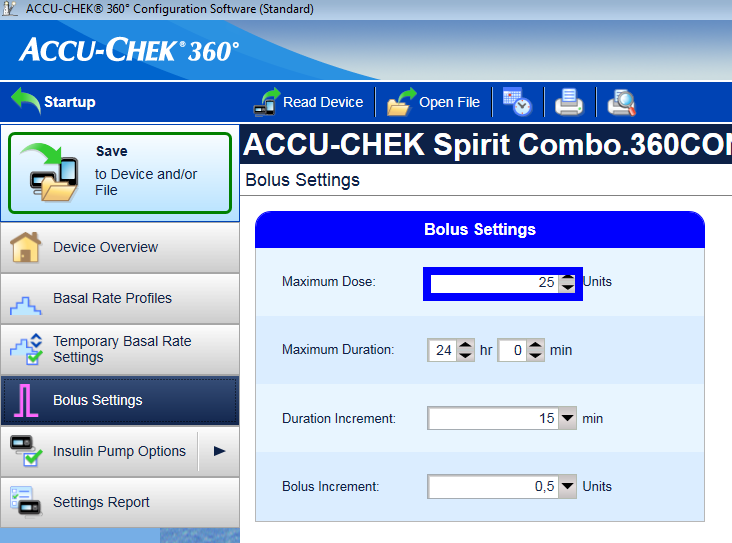
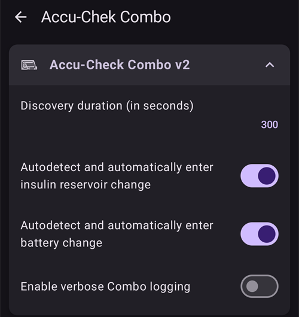
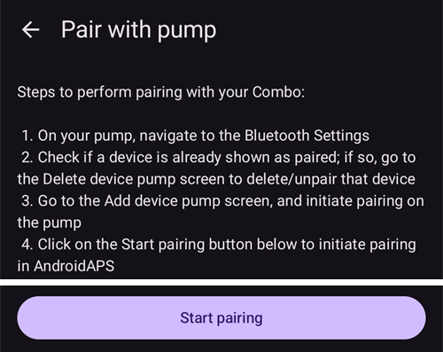
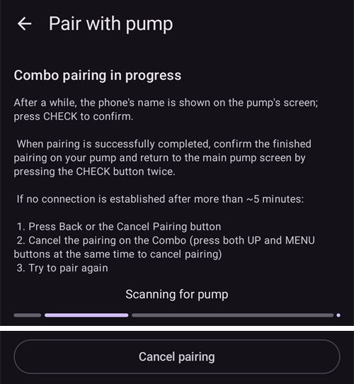
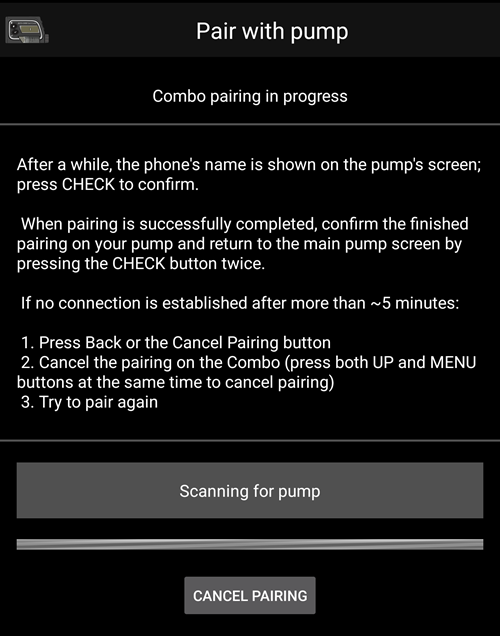

# Accu-Chek Combo

**Ši programinė įranga yra ne paruoštas produktas, o Pasidaryk Pats sprendimo dalis, todėl Jūs turite skaityti, mokytis ir suprasti sistemos veikimą savarankiškai. Tai nėra kažkas, kas kontroliuos Jūsų diabetą už Jus, tačiau jei skirsite tiek laiko, kiek reikia, sistema leis Jums pagerinti diabeto kontrolę ir gyvenimo kokybę. Nepulkite stačia galva, skirkite laiko mokymuisi. Tik Jūs pats atsakote už tai, ką darysite su šia sistema.**

```{admonition} Accu-Chek Combo is being phased out
:class: note

Roche traukiasi iš insulino pompų rinkos ir savo diabeto produktus sutelkia į Accu-Chek SmartGuide NGJ. Ji paskelbė, kad baigia prekybą Accu-Chek Combo ir Accu-Chek Insight pompomis; likusi Accu-Chek Solo mikropompa taip pat palaipsniui nutraukiama (paskutiniai pristatymai Vokietijoje – 2025 m. pabaigoje). Pokyčiai vykdomi pagal regionus, pradedant Vokietija; tikimasi, kad vėliau bus ir kitos Europos rinkos. Jei naudojate šią pompą, iš anksto planuokite perėjimą prie palaikomos pompos.
```

```{contents} Table of contents
:depth: 1
:local: true
```

## Pompos galimybės su AAPS

* Ryšį su **AAPS** palaiko per telefono vidinį Bluetooth, be papildomo ryšio įrenginio.
* Automatinis vasaros laiko ir laiko juostų keitimo tvarkymas.

## Reikalavimai techninei ir programinei įrangai

* Roche Accu-Chek Combo pompa (tinka bet kuri programinės įrangos versija).
* Smartpix arba Realtyme prietaisas ir programa 360 Configuration Software pompai konfigūruoti. (Klientui pageidaujant Roche nemokamai išsiunčia Smartpix ir konfigūravimo programėlę.)
* Suderinamas telefonas su Android 12 arba naujesne versija. Daugiau informacijos rasite [versijų pastabose](#maintenance-android-version-aaps-version).
* Jūsų telefone įdiegta programėlė **AAPS**.

Kai kurie telefonai gali veikti geriau nei kiti. Tai priklauso nuo jų Bluetooth palaikymo kokybės ir nuo to, ar juose yra papildomas, labai agresyvus energijos taupymas. Telefonų sąrašą rasite puslapyje [Telefonai](#Phones-list-of-tested-phones). Atkreipkite dėmesį, kad šis sąrašas remiasi tik asmenine vartotojų patirtimi ir gali būti nepilnas. Jūs taip pat galite prisidėti pranešdami apie savo patirtį (pagrindinis šio projekto principas - neatlygintinas asmeninis įnašas).

(combov2-before-you-begin)=
## Prieš pradedant

**SAUGUMAS SVARBIAUSIA** – nedarykite to aplinkoje, kurioje negalėtumėte ištaisyti klaidos. Turėkite po ranka Smartpix / Realtyme prietaisą ir programą 360 Configuration Software. Visiems nustatymams ir patikrai, ar viskas veikia tinkamai, skirkite maždaug valandą.

Atkreipkite dėmesį į šiuos apribojimus:

* Ištęstas bolusas ir daugiabangis bolusas šiuo metu nepalaikomi (vietoj jų galite naudoti [ištęstus angliavandenius](../DailyLifeWithAaps/ExtendedCarbs.md)).
* Palaikomas tik vienas bazės profilis (pirmasis).
* Mažiausia valandinė bazė jūsų **profilyje** yra 0,05 V/val. **AAPS** nepriima **profilio** su mažesne reikšme. Combo valandinę bazę apvalina savo žingsniais (0,01 V/val. iki 1 V/val., 0,05 V/val. iki 10 V/val., 0,1 V/val. virš 10 V/val.). **AAPS** naudoja tas reikšmes, kurias pompa iš tikrųjų tiekia.
* Laikinos bazės ribojamos iki 500 % dabartinės valandinės bazės. **AAPS** šią ribą įvertina.
* Ciklas išjungiamas, jei pompoje aktyvus ne 1 profilis. Taip tęsiasi, kol aktyviu padaromas 1 profilis. Kai tai padaroma, kitą kartą AAPS prisijungus (po kurio laiko pačiai arba jums Accu-Chek Combo pompos ekrane paspaudus **Atnaujinti**), ji pastebės, kad dabartinis yra 1 profilis, ir vėl įjungs ciklą.
* Jei ciklas prašo atšaukti veikiančią laikiną bazę, Combo vietoj to 15 minučių nustato 90 % arba 110 % laikiną bazę. Taip daroma todėl, kad tikras laikinos bazės atšaukimas pompoje sukelia perspėjimą su daug vibracijos, o šios vibracijos išjungti negalima.
* Bluetooth ryšio stabilumas priklauso nuo telefono modelio, kai ryšys su pompa tampa negalimas, įjungiamas perspėjimas "Pompa nepasiekiama". Jei ši klaida įvyksta, įsitikinkite, kad Bluetooth įjungtas, pompos ekrane (**Valdymas** > **Pompa**) spauskite **Atnaujinti** ir pažiūrėkite, ar tai nebuvo laikinas sutrikimas. Jei ryšio vis tiek nėra, paleiskite telefoną iš naujo – paprastai tai padeda.
* Yra ir kita problema, kai paleidimas iš naujo nepadeda, o reikia paspausti pompos mygtuką (taip paleidžiama iš naujo pompos Bluetooth dalis), kad pompa vėl priimtų telefono prisijungimus.
* Nenustatinėkite laikinų bazių pompoje, nes jas kontroliuoja Ciklas. Aptikti naują laikiną bazę pompoje gali užtrukti iki 20 minučių, ir jos efektas bus skaičiuojamas tik nuo aptikimo momento, todėl gali nutikti, kad 20 min trukmės laikina bazė neatsispindės AIO.

Šiuo metu tvarkyklė palaiko šias Combo kalbas. (Tai nesusiję su AAPS kalba – tai kalba, rodoma pačios Combo LCD ekrane.)

* English
* Spanish
* French
* Italian
* Russian
* Turkish
* Polish
* Czech
* Vengrų
* Slovak
* Romanian
* Kroatų
* Dutch
* Greek
* Suomių
* Norvegų
* Portuguese
* Swedish
* Danų
* German
* Slovėnų
* Lithuanian

**Svarbu**: jei jūsų pompoje nustatyta kalba, kurios šiame sąraše nėra, susisiekite su kūrėjais ir nustatykite pompoje vieną iš šio sąrašo kalbų. Kitaip tvarkyklė neveiks tinkamai.

## Telefono nustatymai

Labai svarbu įsitikinti, kad baterijos optimizavimas išjungtas. AAPS pati aptinka, kai ją veikia šis optimizavimas, ir savo ekrane prašo jį išjungti. Tačiau naujuose Android telefonuose _pats_ Bluetooth yra programėlė (sistemos programėlė). Ir ši „Bluetooth programėlė“ paprastai veikia _su numatytuoju įjungtu baterijos optimizavimu_. Dėl to Bluetooth gali nustoti atsakinėti, kai telefonas taupo energiją, nes jis uždaro Bluetooth programėlę. Todėl baterijos optimizavimą reikia išjungti ir šios Bluetooth sistemos programėlės nustatymuose. Deja, kaip rasti šią Bluetooth sistemos programėlę, skirtinguose telefonuose skiriasi. Įprastame Android atverkite Settings -> Apps -> See all N apps (N – programėlių skaičius jūsų telefone). Tada atverkite meniu viršutiniame dešiniajame kampe ir spauskite „Show system“, „Show system apps“ arba „All apps“ (rodyti sistemos programėles). Dabar išplėstame programėlių sąraše ieškokite programėlės „Bluetooth“. Pasirinkite ją ir jos lange „App info“ spauskite „Battery“. Ten išjunkite baterijos optimizavimą (kartais jis vadinamas „battery usage“).

## Combo nustatymai

* Sukonfigūruokite pompą programa Accu-Chek 360 Configuration Software. Jei šios programos neturite, susisiekite su Accu-Chek pagalbos linija. Registruotiems naudotojams jie paprastai atsiunčia kompaktinį diską su „360° Pump Configuration Software“ ir SmartPix USB–infraraudonųjų spindulių jungties prietaisą (tinka ir Realtyme prietaisas, jei jį turite).

  - **Required settings** (marked green in screenshots):

     * Nustatykite arba palikite meniu konfigūraciją „Standard“. Tada pompoje matysite tik palaikomus meniu ir veiksmus, o nepalaikomi bus paslėpti (ištęstas / daugiabangis bolusas, keli bazės profiliai). Jie riboja ciklo veikimą, jei yra naudojami, nes tada ciklas negali saugiai veikti.
     * Patikrinkite, kad _Quick Info Text_ būtų nustatytas „QUICK INFO“ (be kabučių, rasite skiltyje _Insulin Pump Options_).
     * Nustatykite TBR _Maximum Adjustment_ (didžiausias laikinos bazės pokytis) į 500 %
     * Disable _Signal End of Temporary Basal Rate_
     * Set TBR _Duration increment_ to 15 min
     * Įjunkite Bluetooth

  - **Recommended settings** (marked blue in screenshots)

     * Nustatykite pageidaujamą senkančio rezervuaro perspėjimą
     * Kad išvengtumėt programos klaidų, nustatykite maksimalų boluso kiekį, atsižvelgdami į savo terapijos ypatumus
     * Taip pat nustatykite maksimalią laikinos bazės trukmę kaip saugiklį. Leiskite bent 3 val., nes jei prireiks atjungti pompą 3 valandoms, bus nustatyta 0 % bazė toms 3 val.
     * Įjunkite pompos klaviatūros užraktą, kad bolusų nebūtų galima leisti iš pompos, ypač jei pompą naudojote anksčiau ir buvote įpratę greitai leisti bolusus.
     * Nustatykite display timeout ir menu timeout į mažiausias reikšmes: atitinkamai 5,5 ir 5. Tai leis AAPS greičiau atsistatyti įvykus klaidai ir sumažins vibracijų, kurios susijusios su klaidomis, skaičių

  

  

  

  

## Tvarkyklės įjungimas ir susiejimas su Combo

* Viršutiniame kairiajame kampe atverkite **meniu** (☰), eikite į [**Konfigūracija** > **Pompa**](../SettingUpAaps/ConfigBuilder.md) ir pasirinkite **Accu-Chek Combo**.

  

  Kai jis pasirinktas, kortelėje **Accu-Chek Combo** rodomi du mygtukai – **Parametrai** ir **Atidaryti įskiepį**:

  

  **Parametrai** atveria Accu-Chek Combo tvarkyklės nustatymus (žr. [Nustatymai](#combov2-preferences) toliau):

  

  **Atidaryti įskiepį** (arba **Valdymas** > **Pompa**) atveria Accu-Chek Combo pompos ekraną. Kol pompa nesusieta, rodoma **Pompa nesusieta**:

  

* Pompos ekrane spauskite **Susiejimas**. Atsidaro ekranas **Susieti pompą**. Atlikite ekrane rodomus žingsnius, tada spauskite **Pradėti susiejimą**. Kai Android paprašys leidimo padaryti telefoną matomą kitiems Bluetooth įrenginiams, spauskite **Allow** (leisti). Galiausiai Combo savo ekrane parodo 10 skaitmenų susiejimo PIN, o **AAPS** jo paprašo. Įveskite šį PIN į lauką **10 skaitmenų PIN**.

  

  

  

  Toliau pateikti paveikslėliai yra iš senesnės **AAPS** versijos. Žingsniai ir tekstai tie patys, bet ekranai atrodo šiek tiek kitaip.

  

  

  

* Jei PIN įvestas neteisingai, **AAPS** parodo **PIN netinka. Patikrinkite, ar visi skaičiai teisingi. Jei problema kartojasi, atšaukite ir pakartokite susiejimą.**

  

* Kai parodoma **Combo sėkmingai susieta**, spauskite **OK**. Grįžtate į pompos ekraną, kuriame dabar rodoma pompos būsena (žr. [Accu-Chek Combo pompos ekrano turinys](#combov2-tab-contents) toliau). Mygtuką **Susiejimas** pakeičia mygtukas **Atsieti**.

* Kad patikrintumėte nustatymus (saugumo dėlei pompa turi būti **atjungta** nuo kaniulės!), per AAPS nustatykite 500 % laikiną bazę 15 min ir suleiskite bolusą. Dabar pompoje turi veikti laikina bazė, o pompos istorijoje turi būti bolusas. AAPS should also show the active TBR and delivered bolus.

* Combo pompoje rekomenduojama įjungti klaviatūros užraktą, kad bolusų nebūtų galima leisti iš pompos, ypač jei pompą naudojote anksčiau ir buvote įpratę naudoti funkciją „quick bolus“ (greitasis bolusas).

## Pastabos apie susiejimą

Accu-Chek Combo buvo sukurta prieš išleidžiant Bluetooth 4.0 ir tik praėjus metams po pačios pirmosios Android versijos. Todėl jos susiejimo su kitais įrenginiais būdas nėra 100 % suderinamas su tuo, kaip tai daroma dabartiniame Android. Kad tai visiškai išspręstų, AAPS reikėtų sistemos lygio leidimų, kuriuos gauna tik sistemos programėlės. Jas į telefoną įdiegia telefonų gamintojai – naudotojai sistemos programėlių įdiegti negali.

Todėl susiejimas niekada nebus 100 % be problemų. Ypač susiejimo metu gali trumpam pasirodyti ir pats išnykti Android Bluetooth PIN langas. Tačiau kartais jis lieka ekrane ir prašo 4 skaitmenų PIN. (Nepainiokite jo su 10 skaitmenų Combo susiejimo PIN.) Nieko neįveskite, tiesiog spauskite „Cancel“ (atšaukti). Jei susiejimas nesitęsia, vykdykite ekrane rodomus nurodymus ir bandykite susieti dar kartą.

(combov2-tab-contents)=
## Accu-Chek Combo pompos ekrano turinys

Norėdami atverti pompos ekraną, eikite į **Valdymas** > **Pompa**. Kai pompa susieta, ekrane rodoma ši informacija (iš viršaus į apačią):


1. **Tvarkyklės būsena**: tvarkyklė gali būti vienos iš šių būsenų:
   - **Atsijungta**: Bluetooth ryšio nėra; tvarkyklė didžiąją laiko dalį būna šios būsenos ir prie pompos jungiasi tik prireikus – taip taupoma energija
   - **Jungiamasi**
   - **Tikrinama pompa**: pompa prijungta, bet tvarkyklė atlieka saugumo patikras, kad įsitikintų, jog viskas gerai ir duomenys naujausi
   - **Paruošta**: tvarkyklė pasirengusi priimti AAPS komandas
   - **Sustabdyta**: pompa sustabdyta (Combo rodoma kaip „stopped“)
   - Vykdomos komandos aprašymas, pavyzdžiui, **Nustatomas bazės profilis** arba **Gaunama pompos būklė**
   - **Klaida**: įvyko klaida; ryšys nutrauktas, vykdyta komanda nutraukta
2. **Paskutinis prisijungimas**: prieš kiek minučių tvarkyklė sėkmingai prisijungė prie Combo; jei praėjo daugiau nei 30 minučių, šis elementas rodomas raudonai
3. **Baterija**: baterijos lygis; Combo rodo tik **Įkrauta**, **Senka** arba **Išsikrovusi** ir tikslesnės informacijos (pvz., procentų) nepateikia, todėl čia rodomi tik šie trys lygiai
4. **Rezervuaras**: kiek V šiuo metu yra Combo rezervuare
5. **Paskutinis bolusas**: prieš kiek minučių buvo suleistas paskutinis bolusas; jei po AAPS paleidimo bolusas dar nebuvo suleistas, šis elementas nerodomas
6. **Laikina bazė**: informacija apie šiuo metu aktyvią laikiną bazę; jei laikinos bazės nėra, šis elementas nerodomas
7. **Pagrindinis bazės dydis**: šiuo metu aktyvi pagrindinė valandinė bazė („pagrindinė“ reiškia valandinę bazę be jokios aktyvios laikinos bazės įtakos)
8. **Serijos numeris**: Combo serijos numeris, kurį nurodo pompa (jis sutampa su serijos numeriu Combo nugarėlėje)
9. **Bluetooth adresas**: Combo 6 baitų Bluetooth adresas, rodomas formatu `XX:XX:XX:XX:XX:XX`

Kai tvarkyklė kažką daro (pavyzdžiui, nustato bazės profilį), po sąrašu esančiame laukelyje aprašomas dabartinis veiksmas, o plona eigos juosta rodo, kiek atlikta.

Combo galima valdyti per Bluetooth _nuotolinio terminalo_ (remote-terminal) režimu arba _komandų_ (command) režimu. Nuotolinio terminalo režimas atitinka Combo gliukomačio „nuotolinio valdymo režimą“ („remote control mode“), kuris atkartoja pompos LCD ekraną ir keturis mygtukus. Kai kurias komandas tvarkyklė turi vykdyti šiuo režimu, nes komandų režime jų atitikmenų nėra. Komandų režimas daug greitesnis, bet, kaip minėta, jo galimybės ribotos. Kai aktyvus nuotolinio terminalo režimas, dabartinis nuotolinio terminalo ekranas rodomas lauke, esančiame tiesiai virš Combo paveikslėlio. Tačiau kai tvarkyklė persijungia į komandų režimą, tas laukas lieka tuščias.

(Jūs to nekeičiate; tvarkyklė pati visiškai nusprendžia, kurį režimą naudoti. Tai tik pastaba, kad žinotumėte, kodėl tame lauke kartais matote Combo ekranų vaizdus.)

Apačioje yra šie mygtukai:

- **Atnaujinti**: iš karto atnaujina pompos būseną. Juo taip pat AAPS pranešama, kad anksčiau aptikta klaida jau ištaisyta ir AAPS gali dar kartą patikrinti, ar viskas gerai (daugiau apie tai [skyriuje apie perspėjimus](#combov2-alerts) toliau). Jį galima paspausti tik tada, kai tvarkyklė atsijungusi, sustabdyta arba yra klaidos būsenos.
- **Atsieti**: atsieja susietą Combo nuo **AAPS** ir Android, kai patvirtinate klausimą **Ar tikrai norite atsieti pompą?**. Kai jokia pompa nesusieta, šį mygtuką pakeičia mygtukas **Susiejimas**.

(combov2-preferences)=
## Parametrai

Combo tvarkyklei galimi šie nustatymai (**Konfigūracija** > **Pompa** > **Accu-Chek Combo** > **Parametrai** arba nustatymų piktograma (krumpliaratis) pompos ekrane). Elementai išvardyti iš viršaus į apačią:

1. **Aptikimo trukmė (sekundėmis)**: susiejimo metu tvarkyklė padaro telefoną matomą pompai. Šis nustatymas nurodo, kiek laiko telefonas lieka matomas. Numatytoji reikšmė – didžiausia (300 sekundžių = 5 minutės). Android neleidžia telefonui likti matomam neribotą laiką, todėl reikia pasirinkti trukmę.
2. **Automatiškai aptikti ir įrašyti insulino rezervuaro keitimą**: jei įjungta, tvarkyklė įrašo „rezervuaro keitimą“, kurį paprastai įrašytumėte patys per **Valdymas** > **Užpildymas**. Tai [plačiau paaiškinta toliau](#combov2-autodetections).
3. **Automatiškai aptikti ir įrašyti baterijos keitimą**: jei įjungta, tvarkyklė įrašo „baterijos keitimą“, kurį paprastai įrašytumėte patys per **Valdymas** > **Baterijos keitimas**. Tai [plačiau paaiškinta toliau](#combov2-autodetections).
4. **Įgalinti išsamius Combo įrašus**: tvarkyklė į žurnalą rašo daug daugiau informacijos. **DĖMESIO**: neįjunkite to, nebent to paprašė kūrėjas. Kitaip į **AAPS** žurnalus gali patekti daug nereikalingos informacijos ir jie taps mažiau naudingi.

Susiejimas ir atsiejimas atliekami pompos ekrane, ne nustatymuose (žr. aukščiau).

(combov2-autodetections)=
## Automatinis baterijos ir rezervuaro keitimo aptikimas ir įrašymas

Tvarkyklė gali aptikti baterijos ir rezervuaro keitimą, sekdama baterijos ir rezervuaro lygį. Jei paskutinį kartą atnaujinant pompos būseną Combo pranešė, kad baterija senka, o dabar, naujo atnaujinimo metu, baterijos lygis normalus, tvarkyklė daro išvadą, kad naudotojas pakeitė bateriją. Ta pati logika taikoma rezervuaro lygiui: jei dabar jis didesnis nei anksčiau, tai laikoma rezervuaro keitimu.

Tai veikia tik tada, jei baterija ir rezervuaras keičiami, kai jų lygis rodomas kaip žemas, _ir_ nauja baterija bei rezervuaras yra pakankamai pilni.

Šį automatinį aptikimą galima išjungti tvarkyklės [nustatymuose](#combov2-preferences).

(combov2-alerts)=
## Perspėjimai (įspėjimai ir klaidos) ir kaip jie tvarkomi

Combo perspėjimus rodo kaip nuotolinio terminalo ekranus. Įspėjimai rodomi su kodu „Wx“ (x – skaitmuo) ir trumpu aprašymu. Pavyzdys: „W7“, „TBR OVER“. Klaidos panašios, bet rodomos su kodu „Ex“.

Kai kuriuos įspėjimus tvarkyklė patvirtina (uždaro) automatiškai. Tai šie įspėjimai:

- W1 „reservoir low“: tvarkyklė jį paverčia įspėjimu „Pompos rezervuaras beveik tuščias“, kuris rodomas AAPS pagrindiniame ekrane
- W2 „battery low“: tvarkyklė jį paverčia įspėjimu „Pompos baterija baigia išsikrauti“, kuris rodomas AAPS pagrindiniame ekrane
- W3, W6, W7, W8: jie visi tik informuoja naudotoją, todėl tvarkyklė gali saugiai juos automatiškai patvirtinti

Kiti įspėjimai automatiškai _nepatvirtinami_. Klaidos taip pat _niekada_ nepatvirtinamos automatiškai. Abu atvejai tvarkomi vienodai: tvarkyklė virš AAPS ekrano parodo perspėjimo langą ir nutraukia vykdomą komandą. Tada tvarkyklė pereina į klaidos būseną (žr. [Accu-Chek Combo pompos ekrano turinys aukščiau](#combov2-tab-contents)). Šioje būsenoje jokios komandos vykdyti negalima. Naudotojas turi išspręsti klaidą pompoje; pavyzdžiui, dėl užsikimšimo klaidos gali tekti pakeisti kaniulę. Kai naudotojas išsprendžia klaidą, įprastą veikimą galima atnaujinti Accu-Chek Combo pompos ekrane paspaudus **Atnaujinti**. Tada tvarkyklė prisijungia prie Combo ir atnaujina jos būseną, tikrina, ar ekrane vis dar rodoma klaida, ir pan. Be to, po kurio laiko tvarkyklė pompos būseną atnaujina automatiškai, todėl spausti šį mygtuką rankiniu būdu nebūtina.

Bolusas yra ypatingas atvejis. Jis leidžiamas Combo komandų režimu, kuris boluso metu nepraneša, kad atsirado perspėjimas. Todėl tvarkyklė negali automatiškai patvirtinti įspėjimų _boluso metu_. Deja, tai reiškia, kad pompa pypsės, kol bolusas baigsis. Dažniausias perspėjimas boluso metu yra W1 „reservoir low“ (senka rezervuaras). Boluso metu **nepatvirtinkite** Combo įspėjimų rankiniu būdu pačioje pompoje. Taip galite nutraukti bolusą. Kai bolusas baigsis, tvarkyklė pati sutvarkys įspėjimą.

Perspėjimų, kurie atsiranda, kai tvarkyklė neprisijungusi prie Combo, tvarkyklė nepastebės. Combo negali pati nusiųsti perspėjimo į telefoną; ryšį visada turi pradėti telefonas. Todėl perspėjimas išliks, kol tvarkyklė prisijungs prie pompos. Pompos ekrane galite paspausti **Atnaujinti**, kad tvarkyklė iš karto prisijungtų ir sutvarkytų perspėjimą (užuot laukus, kol AAPS pati nuspręs prisijungti).

**SVARBU**: jei įvyksta klaida arba pasirodo įspėjimas, kuris nėra automatiškai patvirtinamas, tvarkyklė pereina į klaidos būseną. Šioje būsenoje ciklas **BUS UŽBLOKUOTAS**, kol pompos būsena nebus atnaujinta! Jis atblokuojamas, kai pompos būsena atnaujinama (paspaudus **Atnaujinti** arba tvarkyklei automatiškai atnaujinus būseną) ir klaida nebėra rodoma.

## Į ką atkreipti dėmesį naudojant Combo

* Atminkite, kad tai nėra paruoštas produktas. Ypač pradžioje naudotojas turi stebėti ir suprasti sistemą, jos apribojimus ir tai, kaip ji gali sutrikti. Primygtinai rekomenduojama NENAUDOTI šios sistemos, jei ja besinaudojantis asmuo negali visiškai suprasti sistemos.
* Dėl to, kaip veikia Combo nuotolinis valdymas, kai kurie veiksmai (ypač bazės profilio nustatymas) yra lėti, palyginti su kitomis pompomis. Tai nemalonus Combo apribojimas, kurio išspręsti neįmanoma.
* Don't set or cancel a TBR on the pump. Laikinas bazes valdo ciklas, ir kitaip jis negali patikimai veikti, nes neįmanoma nustatyti, kada prasidėjo laikina bazė, kurią naudotojas nustatė pompoje.
* Nespauskite jokių pompos mygtukų, kol AAPS bendrauja su pompa (kol pompa prijungta prie AAPS, pompoje rodomas Bluetooth ženklas). Taip nutrauksite Bluetooth ryšį. Darykite tai tik tada, jei kyla problemų prisijungiant (žr. [skyrių „Prieš pradedant“ aukščiau](#combov2-before-you-begin)).
* Nespauskite jokių mygtukų, kol pompa leidžia bolusą. Ypač nebandykite mygtukais patvirtinti perspėjimų. Kodėl taip yra, plačiau paaiškinta [skyriuje apie perspėjimus](#combov2-alerts).

## Ką patikrinti, kai nepavyksta prisijungti prie Combo

Tvarkyklė labai stengiasi prisijungti prie Combo ir naudoja kelis triukus, kad ryšys būtų kuo patikimesnis. Vis dėlto kartais prisijungti nepavyksta. Štai keli žingsniai, kurie gali padėti.

1. Paspauskite bet kurį Combo mygtuką. Kartais Combo Bluetooth dalis nustoja reaguoti ir nebepriima prisijungimų. Paspaudus Combo mygtuką, kad LCD ekrane kas nors būtų parodyta, Bluetooth dalis paleidžiama iš naujo. Dažniausiai to vieno žingsnio pakanka ryšio problemoms išspręsti.
2. Paleiskite telefoną iš naujo. To gali prireikti, jei problema yra pačioje telefono Bluetooth dalyje.
3. Jei Combo baterijos dangtelis senas, apsvarstykite galimybę jį pakeisti. Seni baterijos dangteliai gali sutrikdyti Combo maitinimą, o tai veikia Bluetooth.
4. Jei prisijungti vis tiek nepavyksta, apsvarstykite galimybę pompą atsieti ir susieti iš naujo.

(combov2-tips-for-basic-usage)=
## Patarimai kasdieniam naudojimui

### Kaip užtikrinti sklandų veikimą

* Visada **nešiokitės išmanųjį telefoną su savimi**, naktį palikite jį šalia lovos. Kadangi miegant pompa gali atsidurti už jūsų kūno ar po juo, geriausiai tinka aukštesnė vieta (ant lentynos ar spintelės).
* Visada pasirūpinkite, kad pompos baterija būtų kuo pilnesnė. Patarimų apie bateriją rasite skyriuje apie bateriją.
* Kai tik įmanoma, pompą valdykite tik per programėlę AAPS. Kad būtų paprasčiau, įjunkite pompos klaviatūros užraktą: **PUMP SETTINGS / KEY LOCK / ON**. Pompos mygtukus reikia naudoti tik tada, kai keičiamos pompos baterijos arba rezervuaras.


### Pompa nepasiekiama. Ką daryti?

#### Įjunkite perspėjimą apie nepasiekiamą pompą
* **AAPS** pagrindinio ekrano viršutiniame dešiniajame kampe spauskite piktogramą **Nustatymai** (krumpliaratis), eikite į **Lokalūs įspėjimai**, įjunkite **Įspėti, kad pompa nepasiekiama** ir nustatykite **Perspėjimo apie nepasiekiamą pompą riba** į **31** minutę.
* Taip aliarmas nesuskambės, kai išeisite iš kambario palikę telefoną ant stalo, bet jums bus pranešta, jei pompa nepasiekiama ilgiau nei trunka laikina bazė.

#### Kaip atkurti ryšį su pompa

* Kai AAPS praneša aliarmą **Pompa nepasiekiama**, pirmiausia atrakinkite klaviatūrą ir **paspauskite bet kurį pompos mygtuką** (pvz., mygtuką „žemyn“). Kai tik pompos ekranas užges, spauskite **Atnaujinti** Accu-Chek Combo pompos ekrane (**Valdymas** > **Pompa**). Dažniausiai tada ryšys vėl veikia.
* Jei tai nepadeda, paleiskite telefoną iš naujo. Po paleidimo iš naujo AAPS vėl pradės veikti ir užmegs naują ryšį su pompa.

* Bandymai su skirtingais telefonais parodė, kad kai kurie telefonai klaidą „pompa nepasiekiama“ sukelia dažniau nei kiti. Sėkmingai išbandytus telefonus rasite puslapyje [Telefonai](#Phones-list-of-tested-phones).

#### Dažnų ryšio klaidų priežastys ir pasekmės
* Telefonuose su **maža atmintimi** (arba **agresyviais energijos taupymo** nustatymais) AAPS dažnai uždaroma. Tai galima atpažinti iš to, kad atvėrus AAPS pagrindiniame ekrane nerodomi terapijos mygtukai (QuickLaunch įrankių juosta), nes sistema dar paleidžiama. Dėl to paleidžiant programėlę gali įsijungti aliarmas „pompa nepasiekiama“. Pompos ekrano (**Valdymas** > **Pompa**) lauke **Paskutinis prisijungimas** galite patikrinti, kada AAPS paskutinį kartą bendravo su pompa.


* Ši klaida gali greičiau iškrauti pompos bateriją, nes paleidžiant programėlę iš naujo iš pompos nuskaitomas bazės profilis.
* Be to, didėja tikimybė sukelti klaidą, dėl kurios pompa atmeta visus prisijungimus, kol paspaudžiamas pompos mygtukas.

### Nepavyksta atšaukti laikinos bazės
* Kartais AAPS negali automatiškai patvirtinti perspėjimo **TBR CANCELED**. Tada reikia arba spausti **Atnaujinti** Accu-Chek Combo pompos ekrane, arba patvirtinti aliarmą pompoje.

### Pompos baterijos naudojimas

#### Baterijos keitimas
* Po aliarmo **senka baterija** bateriją reikia pakeisti kuo greičiau, kad visada užtektų energijos patikimam Bluetooth ryšiui su telefonu, net jei telefonas yra toliau nuo pompos.
* Net ir po aliarmo **senka baterija** baterija gali būti naudojama dar nemažai laiko. Vis dėlto, nuskambėjus aliarmui „senka baterija“, rekomenduojama visada turėti su savimi naują bateriją.
* Prieš keisdami bateriją, pagrindiniame ekrane paspauskite simbolį **Ciklas** ir 1 valandai pasirinkite **Sustabdyti ciklą**.
* Palaukite, kol telefonas susisieks su pompa ir pompos ekrane išnyks Bluetooth ženklas.


* Atrakinkite pompos klaviatūrą, perjunkite pompą į sustabdymo režimą (STOP), patvirtinkite galimą laikinos bazės atšaukimo perspėjimą ir greitai pakeiskite bateriją.
* Po baterijos keitimo pompos laikrodžio iš naujo nustatyti nereikia: AAPS automatiškai atnaujina pompos datą ir laiką.
* Tada vėl įjunkite pompą (RUN režimas) ir pagrindiniame ekrane paspaudę piktogramą **Ciklas sustabdytas** pasirinkite **Atnaujinti**.
* Gavusi kitą glikemijos reikšmę, AAPS vėl nustatys reikiamą laikiną bazę.

(Accu-Chek-Combo-Tips-for-Basic-usage-battery-type-and-causes-of-short-battery-life)=
#### Baterijų tipai ir galimos trumpo baterijų tarnavimo laiko priežastys
* Kadangi intensyvus Bluetooth ryšys sunaudoja daug energijos, naudokite tik **aukštos kokybės baterijas**, pvz., Energizer Ultimate Lithium, „Power One“ baterijas iš „didelio“ Accu-Chek aptarnavimo rinkinio, o jei renkatės įkraunamą bateriją – Eneloop baterijas.

 

Tipinis baterijų tarnavimo laikas skirtingoms baterijoms yra toks:
* **Energizer Ultimate Lithium**: nuo 4 iki 7 savaičių
* **Power One Alkaline** (Varta) iš aptarnavimo rinkinio: nuo 2 iki 4 savaičių
* **Eneloop įkraunamos** baterijos (BK-3MCCE): nuo 1 iki 3 savaičių

Jei jūsų baterijos tarnauja daug trumpiau nei nurodyta aukščiau, patikrinkite šias galimas priežastis:
* Yra keli variantai užsukamų Combo pompos baterijų dangtelių, kurie dalinai užtrumpina baterijas ir jas greičiau iškrauna. Dangteliai be šių problemų gali būti atpažįstami iš aukso spalvos metalinių kontaktų.
* Jei pompos laikrodis "neišgyvena" greito baterijos pakeitimo, greičiausiai sugedo kondensatorius, kuris palaiko laikrodžio veikimą trumpai sutrikus energijos tiekimui. Tokiu atveju gali padėti pompos pakeitimas per Roche; garantiniu laikotarpiu tai nėra problema.
* Pompos baterijos tarnavimo laiką veikia ir telefono aparatinė bei programinė įranga (Android operacinė sistema ir Bluetooth dalis), nors tikslūs veiksniai dar nėra visiškai žinomi. Jei turite galimybę, išbandykite kitą telefoną ir palyginkite baterijos tarnavimo laiką.

### Ištęstas bolusas, daugiabangis bolusas
OpenAPS algoritmas nepalaiko lygiagretaus ištęsto ar daugiabangio boluso. Tačiau panašų gydymą galima pasiekti šiais būdais:
* Naudokite **i-AV**: įvesdami angliavandenius arba naudodami boluso patarėją, įveskite viso valgio angliavandenius ir laiką, per kurį tikitės, kad jie pateks į kraują kaip gliukozė. Tada sistema apskaičiuos mažas angliavandenių dalis, tolygiai paskirstytas per visą trukmę, ir algoritmas tieks atitinkamą insulino kiekį, nuolat tikrindamas bendrą glikemijos kilimą ar kritimą. Norėdami pasiekti panašų poveikį kaip daugiabangis bolusas, taip pat galite derinti mažesnį iš karto suleidžiamą bolusą su i-AV.
* Prieš valgį kelioms valandoms nustatykite laikiną tikslą **Netrukus valgysiu** – 80 mg/dL (4,4 mmol/l) (paspauskite tikslą pagrindiniame ekrane arba **Valdymas** > **Laikinas tikslas**). Trukmė turėtų būti tokia, kokį intervalą rinktumėtės ištęstam bolusui. Taip jūsų tikslas bus žemesnis nei įprastai, todėl bus tiekiama daugiau insulino.
* Tada **Boluso patarėjuje** įveskite visus valgio angliavandenius, bet jo siūlomų reikšmių iš karto nepritaikykite. Jei norite suleisti bolusą, panašų į daugiabangį, sumažinkite insulino dozę. Priklausomai nuo valgio, algoritmas dabar turės suleisti papildomų SMB arba nustatyti didesnes laikinas bazes, kad atsvertų glikemijos kilimą. Čia labai atsargiai reikia bandyti valandinės bazės saugumo apribojimus (Maks. V/val., didžiausią bazinį AIO) ir, jei reikia, juos laikinai pakeisti.

* Nenaudokite ištęsto ar daugiabangio boluso tiesiai pompoje. Tvarkyklė jų nepalaiko (žr. [Prieš pradedant](#combov2-before-you-begin)); jei daugiabangis bolusas vis tiek suleidžiamas pompoje, **AAPS** iš pompos istorijos jį įrašo kaip įprastą bolusą ir ištęstą bolusą, todėl jis įskaičiuojamas į AIO. Ištęstas bolusas neveikia uždaro ciklo aplinkoje (daugiau informacijos [šiame puslapyje](#extended-bolus-and-why-they-wont-work-in-closed-loop-environment)).

### Aliarmai leidžiant bolusą
* Po kiekvieno boluso tvarkyklė nuskaito pompos bolusų istoriją. Tai saugumo priemonė, kad aktyvus insulinas (AIO) būtų apskaičiuotas teisingai, net kai bolusas leidžiamas tiesiai iš pompos.
* Jei prieš bolusą pompos istorijoje yra bolusas, apie kurį **AAPS** nežinojo (pavyzdžiui, bolusas, suleistas tiesiai pompoje), prašomas bolusas **nesuleidžiamas**, nes jis buvo apskaičiuotas neįvertinus to insulino. **AAPS** parodo **Pompos istorijoje rastas bolusas, apie kurį AAPS nežinojo. Prašomas bolusas nebuvo suleistas...** Patikrinkite bolusų istoriją pompoje ir savo AIO. Jei bolusas vis dar reikalingas, apskaičiuokite jį iš naujo. Tai galioja ir tada, kai nežinomas bolusas randamas naujo prisijungimo metu.
* Jei bolusas suleistas, bet pompos istorijoje buvo ir kitų bolusų, apie kuriuos **AAPS** nežinojo, jie dabar įrašomi, o **AAPS** paprašo prieš kitą bolusą patikrinti AIO.
* Jei ryšys su pompa nutrūksta **boluso metu**, **AAPS** neįrašo 0 V: ji parodo, kiek pompa iki tol buvo suleidusi, ir įspėja, kad pompa gali suleisti likusią dalį. **Neleiskite boluso dar kartą.** **AAPS** kitą kartą prisijungusi nuskaitys tikrą kiekį iš pompos istorijos.
* Jei ryšys nutrūksta, kol **AAPS** siunčia bolusą, nežinoma, ar pompa jį gavo. Prieš kitą bolusą patikrinkite bolusų istoriją pompoje.
* Jei **AAPS** negali patvirtinti, kad bolusas suleistas, ji parodo **Boluso suleisti nepavyko. Panašu, kad nė kiek insulino nesuleista. Kad nesuleistumėte dvigubo boluso, patikrinkite pompą ir tik tada leiskite bolusą dar kartą.** Bolusai niekada nekartojami automatiškai.

## Kur gauti pagalbos

Combo tvarkyklę kuria bendruomenė **savanoriškais** pagrindais. Prieš prašydami pagalbos:

1. **Perskaitykite** atitinkamą šios dokumentacijos skyrių ir įsitikinkite, kaip funkcija turi veikti.
2. **Klauskite** kanale *#AAPS* [Discord](https://discord.gg/4fQUWHZ4Mw) serveryje arba kitame [bendruomenės kanale](../GettingHelp/WhereCanIGetHelp.md).
3. **Praneškite apie klaidą**: paieškokite tarp [esamų problemų (issues)](https://github.com/nightscout/AndroidAPS/issues); jei jūsų problemos ten nėra, sukurkite [naują problemą (issue)](https://github.com/nightscout/AndroidAPS/issues) ir pridėkite [žurnalų failus](../GettingHelp/AccessingLogFiles.md).

Prašydami pagalbos nurodykite telefono gamintoją ir modelį, Android versiją, **AAPS** versiją ir paprastai, angliškai aprašykite problemą (kas pasikeitė, kada paskutinį kartą veikė).
