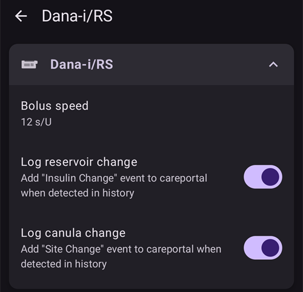
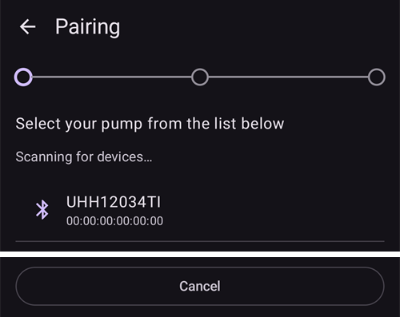
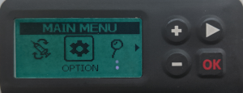
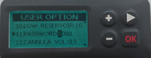

# DanaRS, Dana-i ir Dana-i2

*Naudokitės šiomis instrukcijomis, jei turite DanaRS (nuo 2017 m.), Dana-i arba Dana-i2 pompą. Jei vietoj jos turite originalią DanaR, žr. [DanaR insulino pompa](./DanaR-Insulin-Pump.md).*

**Dana-i2 galima naudoti nuo AAPS 4.0 versijos.** Ji naudoja tą pačią **Dana-i/RS** tvarkyklę kaip ir Dana-i.

* DanaRS/i/i2 pompoje programėlė naudoja „BASAL A“. Esami duomenys perrašomi.

    {contents} Turinys
    :depth: 1
    :local: true

## Pompos galimybės su AAPS

* Su **AAPS** ryšį palaiko per telefono įtaisytą Bluetooth, be papildomo ryšio įrenginio.
* Vasaros ir žiemos laiko bei laiko juostų pakeitimus reikia tvarkyti rankiniu būdu (žr. [Keliavimas per laiko juostas](#timezone-traveling-danarv2-danars)).

(DanaRS-Insulin-Pump-pairing-pump)=

## Pompos susiejimas

* **AAPS** pagrindinio ekrano kairiajame viršutiniame kampe atidarykite **meniu** (☰) ir pasirinkite **Konfigūracija**.
* Spauskite **Pompa** ir pasirinkite **Dana-i/RS**.
    
    
    
    Kai jis pasirinktas, **Dana-i/RS** kortelėje rodomi du mygtukai – **Parametrai** ir **Atidaryti įskiepį**:
    
    
    
    **Parametrai** atveria Dana-i/RS tvarkyklės nustatymus:
    
    
    
    **Atidaryti įskiepį** (arba **Valdymas** > **Pompa**) atveria Dana-i/RS pompos ekraną. Kol pompa nesusieta, jis atrodo taip:
    
    

* Pompos ekrane spauskite **Susiejimas**. **AAPS** ieško netoliese esančių pompų.

* Sąraše spauskite savo pompą.
    
    

* **Susiejimą turite patvirtinti pompoje!** Tai veikia taip pat, kaip kiti jums žinomi Bluetooth susiejimai (pavyzdžiui, išmaniojo telefono ir automobilio garso sistemos).
    
    

* Susiekite pompą pagal jos tipą ir programinės įrangos versiją:
    
    * DanaRS v1 atveju **AAPS** paprašo įvesti **Pompos slaptažodis (tik v1)**. Įveskite pompos slaptažodį (žr. [Numatytasis slaptažodis](#DanaRS-Insulin-Pump-default-password)).
    * DanaRS v3 atveju **AAPS** paprašo paspausti pompoje OK ir įvesti 2 skaičių ir raidžių sekas, rodomas pompoje. Kol baigsite, laikykite pompos ekraną įjungtą spaudydami minuso mygtuką. Tada spauskite **Baigta**.
    * Dana-i ir Dana-i2 atveju atsiranda standartinis Android susiejimo langas. Įveskite pompoje rodomą 6 skaitmenų skaičių.

* Kai rodoma **Sėkmingai susieta!**, spauskite **Baigta**.
    
    
    
    Grįžtate į pompos ekraną, kuriame dabar rodoma jūsų pompos būsena.
    
    

* Skiltyje **Parametrai** pasirinkite **Boluso greitis**, kad pakeistumėte numatytąjį boluso greitį (12 s/U, 30 s/U arba 60 s/U).

* Pompoje per gydytojo meniu (Doctors menu) nustatykite valandinės bazės žingsnį 0,01 V/val. (žr. pompos naudotojo vadovą).
* Pompoje per gydytojo meniu (Doctors menu) nustatykite boluso žingsnį 0,05 V (žr. pompos naudotojo vadovą). **AAPS** nuskaito valandinės bazės ir boluso žingsnius iš pompos ir naudoja juos kiekvienam bolusui, todėl bolusas visada atitinka pompoje nustatytą žingsnį. Pompos ekrane jie rodomi eilutėje **Bazės / boluso žingsnis**.
* Įgalinkite ištęstus bolusus pompoje

### Parinktys, rodomos tik kai kuriuose modeliuose

* **Automatinis užraktas**: Dana-i2 ekrane **Naudotojo parinktys** (pompos ekrane, **Valdymas** > **Pompa**) yra jungiklis **Automatinis užraktas** pompos automatinio užrakto nustatymui. Jį pakeitę, paspauskite **Išsaugoti nustatymus pompoje**.
* **Supaprastintas režimas**: pompų modeliuose, kurie turi supaprastinto meniu režimą, pompos ekrane rodoma eilutė **Supaprastintas režimas** su reikšme **Įjungti** arba **Išjungti**.
* Jei Dana-i2 atsisako suleisti bolusą, **AAPS** parodo priežastį, pavyzdžiui, *Pompa neužpildyta*, *Rezervuare nepakanka insulino* arba *Pompoje įjungtas supaprastintas miego režimas*.

(DanaRS-Insulin-Pump-default-password)=

### Numatytasis slaptažodis

* Pompos DanaRS su programine įranga v1 ir v2 numatytasis slaptažodis yra 1234.
* DanaRS su programine įranga v3 ir Dana-i numatytasis slaptažodis gaunamas iš pagaminimo datos ir yra MMDD, kur MM yra mėnuo, o DD – diena, kai pompa buvo pagaminta (pvz., „0124“ reiškia 01 mėnesį ir 24 dieną).
    
    * Pagrindiniame meniu (MAIN MENU) pasirinkite REVIEW, tada submeniu atidarykite SHIPPING INFORMATION
    * 3 numeriu pažymėta pagaminimo data. 
    * v3/i versijose šis slaptažodis naudojamas tik pompos meniu užrakinti. Jis nenaudojamas ryšiui ir jo nereikia įvesti AAPS.

(DanaRS-Insulin-Pump-change-password-on-pump)=

## Slaptažodžio keitimas pompoje

* Paspauskite pompos mygtuką OK
* Pagrindiniame meniu pasirinkite „OPTION“ (judėkite dešinėn kelis kartus paspausdami rodyklės mygtuką)
    
    

* Meniu Parinktys pasirinkite „USER OPTION“
    
    

* Rodyklės mygtuku slinkite žemyn iki "11. password"
    
    

* Paspauskite OK senojo slaptažodžio įvedimui.

* Įveskite **senąjį slaptažodį** (numatytąjį slaptažodį žr. [aukščiau](#DanaRS-Insulin-Pump-default-password)) ir paspauskite OK
    
    

* Jei įvedamas neteisingas slaptažodis, nebus jokio pranešimo apie klaidą!

* Įveskite **naują slaptažodį** (Keiskite numerius mygtukais + ir - / Perkelkite į dešinę rodyklės mygtuku).
    
    

* Patvirtinkite paspausdami OK mygtuką.

* Paspauskite OK, kad išsaugotumėte nustatymą.
    
    

* Pereikite žemyn į „14. EXIT“ ir paspauskite OK, kad išeitumėte.
    
    

(DanaRS-Insulin-Pump-dana-rs-specific-errors)=

## Specifinės DanaRS klaidos 

### Klaida suleidžiant insuliną

Jei boluso leidimo metu nutrūksta ryšys tarp AAPS ir Dana RS (pvz., nueinate nuo telefono, kol Dana RS leidžia insuliną), pamatysite toliau parodytą pranešimą ir išgirsite aliarmą.

* Dažniausiai tai tik ryšio klaida ir visas insulino kiekis sėkmingai suleidžiamas.
* Pompos istorijoje patikrinkite, ar buvo suleistas teisingas bolusas. Tai galite padaryti pačioje pompoje arba **AAPS** pompos ekrane (**Valdymas** > **Pompa**) > **Pompos istorija** > **Bolusai**.
* Jei norite, ištrinkite klaidos įrašą [terapijoje](#screens-bolus-carbs).
* Tikrasis kiekis nuskaitomas ir įrašomas kito prisijungimo metu. Norėdami tai padaryti iš karto, pompos ekrane spauskite **Atnaujinti** arba tiesiog palaukite kito prisijungimo.

## Specialūs veiksmai keičiant telefoną

Keičiant telefoną reikia atlikti šiuos veiksmus:

* [Export settings](../Maintenance/ExportImportSettings.md) on your old phone
* Perkelkite nustatymus iš seno telefono į naują

### DanaRS v1

* **Rankiniu būdu susiekite** Dana RS su nauju telefonu
* Jei importuodami pažymėsite **Taip pat pakeisti pompos nustatymus**, bus importuoti ir pompos ryšio nustatymai, todėl AAPS naujame telefone jau „žinos“ pompą ir nepradės Bluetooth paieškos. Therefore new phone and pump must be paired manually.
* Įdiekite AAPS naujame telefone.
* [Importuokite nustatymus](../Maintenance/ExportImportSettings.md) naujajame telefone

### DanaRS v3, Dana-i, Dana-i2

* Pradėkite susiejimą, kaip aprašyta [aukščiau](#DanaRS-Insulin-Pump-pairing-pump).
* Kartais pirmiausia gali reikėti išvalyti susiejimo informaciją **AAPS**. Pompos ekrane (**Valdymas** > **Pompa**) spauskite **Atsieti** ir patvirtinkite **Panaikinti susiejimo informaciją?**. Tada vėl spauskite **Susiejimas**.

## Keliavimas per laiko juostas su DanaRS, Dana-i ir Dana-i2 pompomis

Apie keliones per laiko juostas žr. skyrių [Keliavimas per laiko juostas su pompomis](#timezone-traveling-danarv2-danars).

## Kur gauti pagalbos

DanaRS/Dana-i/Dana-i2 tvarkyklę kuria bendruomenė **savanoriškai**. Prieš prašydami pagalbos:

1. **Perskaitykite** atitinkamą šios dokumentacijos skyrių ir įsitikinkite, kaip funkcija turi veikti.
2. **Klauskite** *#AAPS* kanale [Discord](https://discord.gg/4fQUWHZ4Mw) arba kitame [bendruomenės kanale](../GettingHelp/WhereCanIGetHelp.md).
3. **Praneškite apie klaidą**: pirmiausia paieškokite tarp [esamų problemų (issues)](https://github.com/nightscout/AndroidAPS/issues); jei jūsiškės nėra, sukurkite [naują problemą (issue)](https://github.com/nightscout/AndroidAPS/issues) ir pridėkite savo [žurnalų failus](../GettingHelp/AccessingLogFiles.md).

Prašydami pagalbos, nurodykite telefono gamintoją ir modelį, Android versiją, **AAPS** versiją ir paprastais žodžiais aprašykite problemą (kas pasikeitė, kada paskutinį kartą veikė).