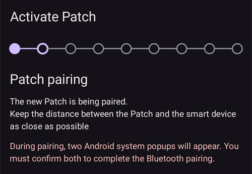
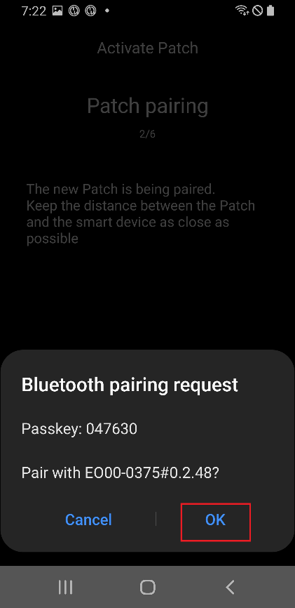
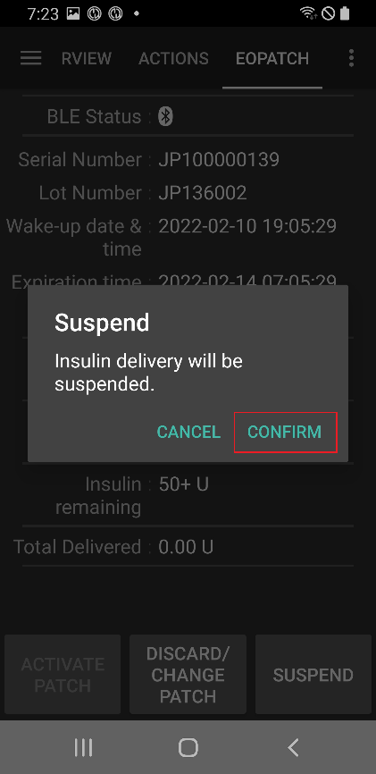

# EOPatch2

Pompai reikia greito veikimo U-100 insulino, pavyzdžiui, NovoRapid ar Humalog. Naudokite greito veikimo insuliną, kurį jums paskyrė gydytojas.

Mažiausia dozė, kurią pompa gali suleisti, yra 0,05 V. Visas valandines bazes savo **profilyje** nustatykite ne mažesnes nei 0,05 V/val., 0,05 V/val. žingsniais. Kitaip **AAPS** kiekvieną reikšmę suapvalina iki artimiausių 0,05 V/val. (niekada iki 0) ir naudoja tas reikšmes, kurias pompa iš tikrųjų suleidžia, todėl bendras insulino kiekis per parą šiek tiek skiriasi nuo jūsų **profilio**. Taip pat ir bolusai turi būti ne mažesni nei 0,05 V.

```{contents} Table of contents
:depth: 1
:local: true
```

## Pompos galimybės su AAPS

* Ryšį su **AAPS** palaiko per telefono vidinį Bluetooth, be papildomo ryšio įrenginio.
* Vasaros laiko ir laiko juostos pakeitimus reikia tvarkyti rankiniu būdu.

## Pompos sąranka

1. Atidarykite **meniu** (☰) viršutiniame kairiajame **AAPS** pagrindinio ekrano kampe ir pasirinkite **Konfigūracija**.
1. Skiltyje **Pompa** pasirinkite **EOPatch2**.
1. Paspauskite mygtuką „Atgal“, kad grįžtumėte į pagrindinį ekraną.

 

Kai jis pasirinktas, **EOPatch2** kortelėje rodomi du mygtukai: **Parametrai** ir **Atidaryti įskiepį**:


## Parametrai

EOPatch2 nustatymus galite atidaryti dviem būdais:

* **Konfigūracija** ekrane **EOPatch2** kortelėje spauskite **Parametrai** arba
* atidarykite pompos ekraną (**Valdymas** → **Pompa**) ir spauskite krumpliaračio piktogramą viršutiniame dešiniajame kampe.

Yra trys nustatymai:


### Low reservoir Alerts

Įspėjimas rodomas, kai pompoje likęs insulino kiekis sumažėja iki šio kiekio ar mažiau. Galite nustatyti nuo 10 iki 50 V, 5 V žingsniais. Numatyta reikšmė yra 10 V.

### Priminimas apie pompos galiojimą

Primena, kiek laiko liko, kol baigsis dabartinės pompos galiojimas. Galite nustatyti nuo 1 iki 24 valandų, 1 valandos žingsniais. Numatyta reikšmė yra 4 valandos.

### Garsiniai priminimai

Kai ši parinktis įjungta, pompa pypteli, kai bolusas, ištęstas bolusas ar laikina bazė prasideda ir kai baigiasi. Įprastai valandinei bazei tai neturi jokios įtakos. Numatyta: išjungta.

## Naujos pompos aktyvavimas

### Atidarykite aktyvavimo vedlį

Atidarykite pompos ekraną per **Valdymas** → **Pompa** (arba **Konfigūracija** ekrane **EOPatch2** kortelėje spauskite **Atidaryti įskiepį**). Kai nėra aktyvios pompos, ekrane rodoma **Neaktyvuota**, o apačioje mygtukas **Aktyvuoti pompą**.

Spauskite **Aktyvuoti pompą**, kad paleistumėte vedlį.


Vedlys padės atlikti kiekvieną žingsnį. Taškų eilutė viršuje rodo, kiek žingsnių jau atlikote.

```{note}
Jei **AAPS** dar niekada neaktyvavote **profilio**, vedlys pirmiausia parodo puslapį **Reikalingas profilis**. Pasirinkite norimą profilį ir spauskite **Aktyvuoti profilį**.
```

### Pildomas insulinas

Įdurkite švirkšto adatą į pompos insulino pildymo angą. Lėtai spauskite stūmoklį, kad pripildytumėte pompą. Kai pompoje bus daugiau nei 80 V, ji vieną kartą pypteli ir įsijungia.

Išgirdę pyptelėjimą, spauskite **Pradėti susiejimą**.


```{warning}
- Nesukite adatos įvedimo svirtelės, kol vedlys to nepaprašys. Pasukus ją per anksti, pildymo ar saugos patikros metu gali kilti rimtų problemų.
- Į pompą telpa nuo 80 iki 200 V. Jei įpilsite mažiau nei 80 V, pompa neveiks.
- Išimkite insuliną iš šaldytuvo 15–30 minučių prieš pildymą, kad jis sušiltų iki kambario temperatūros. Insulino temperatūra turi būti ne žemesnė nei 10 °C.
```

### Pompa susiejama

**AAPS** dabar automatiškai bando susieti pompą. Susiejimo metu atsiranda dvi Android Bluetooth susiejimo užklausos. Pirmojoje spauskite **OK**. Antrojoje, kurioje rodomas prieigos kodas, vėl spauskite **OK**.

```{warning}
- Susiejimo metu pompą ir telefoną laikykite ne toliau kaip 30 cm vienas nuo kito.
- Pompai įsijungus, ji pypteli kas 3 minutes, kol susiejimas baigiamas.
- Pompos aktyvavimą turite užbaigti per 60 minučių nuo jos įsijungimo. Jei nespėsite, pompą pašalinkite.
```

  

```{admonition} Older screenshot
:class: note
Šios dvi Bluetooth susiejimo ekrano kopijos yra iš ankstesnės **AAPS** versijos: **AAPS** ekranas už Android susiejimo užklausos **AAPS** 4 versijoje atrodo kitaip.
```

### Insulino pasirinkimas

Pasirinkite insuliną, kuriuo pripildėte pompą, ir spauskite **Toliau**. Po aktyvavimo **AAPS** su šiuo insulinu atlieka profilio keitimą.

### Pasiruoškite priklijuoti pompą

Nuo pompos nuimkite lipnią juostą ir spauskite **Toliau**.

Jei adata kyšo arba pompa šlapia, nešvari ar jos lipni juosta užlenkta, spauskite **Pašalinti** ir naudokite naują pompą.


### Infuzijos vieta

Šis žingsnis rodomas tik tada, jei vietų rotacijos nustatymuose įjungta **Valdyti infuzijos vietų rotaciją**. Kūno schemoje palieskite vietą, kur priklijuosite pompą, ir spauskite **Toliau** arba spauskite **Praleisti**.

### Pompos priklijavimas

Insulinas turi patekti į vietą, kur po oda yra riebalinio audinio, bet mažai nervų ar kraujagyslių. Tinka pilvas, ranka arba šlaunis. Nuvalykite ir nusausinkite vietą, tada priklijuokite pompą prie odos.

Patikrinkite infuzijos vietą ir spauskite **Pradėti saugos patikrą**.

```{warning}
- Tolygiai prispauskite pompos lipnios juostos kraštus, kad visa pompa tvirtai prisitvirtintų prie odos.
- Jei pompa prilimpa ne visa, tarp pompos ir odos gali patekti oro. Tai susilpnina pompos lipnumą ir atsparumą vandeniui.
```


### Saugos patikra

Saugos patikra trunka apie 30 sekundžių. Kai ji baigiama, pompa vieną kartą pypteli. Jei patikra nepavyksta, spauskite **Bandyti dar kartą**.

```{warning}
Saugos sumetimais nesukite adatos įvedimo svirtelės, kol saugos patikra nebaigta.
```

 

```{admonition} Older screenshot
:class: note
Ekrano kopijos nuo **Pasiruoškite priklijuoti pompą** iki **Saugos patikra** yra iš ankstesnės **AAPS** versijos ir **AAPS** 4 versijoje gali atrodyti kitaip.
```

### Inserting the needle

Tvirtai laikykite pompą. Pasukite adatos įvedimo svirtelę į viršų daugiau nei 100°, kad įvestumėte adatą. Kai adata įvesta teisingai, pompa vieną kartą pypteli. Tada sukite svirtelę iki galo, kad ją nuimtumėte. Paspauskite **Toliau**.

```{caution}
Jei pereisite prie kito žingsnio neišgirdę pyptelėjimo, atsiras **Adatos įvedimo klaida**. Įsitikinkite, kad pasigirdo pyptelėjimas, ir spauskite **Bandyti dar kartą**. Jei klaida neišnyksta, spauskite **Pašalinti**, kad išjungtumėte pompą.
```

### Pompa aktyvuota

Paskutinis puslapis patvirtina, kad pompa aktyvi ir kad ji jums primins, kai artės jos galiojimo pabaiga. Spauskite **Baigti**, kad grįžtumėte į pompos ekraną.

## Pompos pašalinimas

Pakeiskite pompą, kai joje mažai insulino, kai baigiasi jos galiojimas arba jei ji sugedo. Rekomenduojame kiekvieną pompą naudoti ne ilgiau kaip 84 valandas nuo jos įsijungimo.

1. Atidarykite pompos ekraną (**Valdymas** → **Pompa**). Kol pompa aktyvi, spauskite **Pašalinti pompą**.
1. Puslapyje **Pašalinti pompą** rodomas likęs laikas ir pompoje likęs insulinas. Spauskite **Pašalinti pompą**.
1. Atsiranda langas, kuriame prašoma patvirtinti. Dar kartą spauskite **Pašalinti pompą**.
1. Kai pompa išjungta, vedlys rodo **Pompa pašalinta.** Nuimkite pompą nuo kūno ir spauskite **Patvirtinti**.

Po to vedlys iš karto pereina prie naujos pompos aktyvavimo (žr. aukščiau). Jei norite čia sustoti, spauskite rodyklę atgal.

Kol nėra aktyvios pompos, **AAPS** rodo pompą kaip sustabdytą ir įrašo 0 V/val. laikiną bazę, todėl iki kitos pompos aktyvavimo į AIO neįskaičiuojamas joks bazinis insulinas.

   

```{admonition} Older screenshot
:class: note
Aukščiau esančios ekrano kopijos yra iš ankstesnės **AAPS** versijos. **AAPS** 4 versijoje pompos ekraną atidarote per **Valdymas** → **Pompa**, o mygtukas jame vadinasi **Pašalinti pompą**.
```

```{admonition} If the patch does not respond
:class: warning
Jei **AAPS** negali susisiekti su pompa, gali būti rodomas puslapis apie pompos aliarmo išjungimą rankiniu būdu: nuimkite pompą nuo kūno, nulupkite lipnią juostą ir smeigtuku tvirtai įspauskite į skylutę šalia insulino pildymo angos.

Puslapyje **Pašalinti pompą** taip pat yra mygtukas **Priverstinai nustatyti iš naujo**. Jis tik pašalina pompą iš **AAPS**, nesiųsdamas pompai jokios komandos. Pompa toliau leidžia insuliną, kol išsikrauna jos baterija arba kol ją išjungsite rankiniu būdu. Naudokite jį tik tada, jei įprastas pašalinimas nepavyksta, ir nuimkite pompą nuo kūno.
```

## Insulino tiekimo sustabdymas ir atnaujinimas

Sustabdžius insulino tiekimą, taip pat atšaukiamas ištęstas bolusas ir laikina bazė. Atnaujinus tiekimą, jie **nėra** paleidžiami iš naujo. Kol insulino tiekimas sustabdytas, pompa pypteli kas 15 minučių.

### Insulino tiekimo sustabdymas

1. Atidarykite pompos ekraną (**Valdymas** → **Pompa**) ir spauskite **Sustabdyti pompą**.
1. Langas paaiškina, kas bus sustabdyta. Spauskite **Patvirtinti**.
1. Lange **Bazės sustabdymo laikas** pasirinkite, kiek laiko stabdyti: 30 min., 1 val., 1 val. 30 min. arba 2 val. Spauskite **Patvirtinti**.

Insulino tiekimas sustabdomas jūsų pasirinktam laikui.

  

```{admonition} Older screenshot
:class: note
Aukščiau esančios ekrano kopijos yra iš ankstesnės **AAPS** versijos. **AAPS** 4 versijoje pompos ekraną atidarote per **Valdymas** → **Pompa**, o mygtukas jame vadinasi **Sustabdyti pompą**.
```

### Insulino tiekimo atnaujinimas

1. Atidarykite pompos ekraną (**Valdymas** → **Pompa**) ir spauskite **Atnaujinti pompos veikimą**.
1. Lange **Atnaujinti insulino tiekimą** spauskite **Patvirtinti**.

 

```{admonition} Older screenshot
:class: note
Aukščiau esančios ekrano kopijos yra iš ankstesnės **AAPS** versijos. **AAPS** 4 versijoje pompos ekraną atidarote per **Valdymas** → **Pompa**, o mygtukas jame vadinasi **Atnaujinti pompos veikimą**.
```

```{warning}
Kai sustabdymo laikas baigiasi, **AAPS** rodo įspėjimą **Insulino tiekimo sustabdymo pabaiga**. Insulino tiekimas **nėra** atnaujinamas, kol jo nepatvirtinsite. Jei to nepadarysite, gali išsivystyti hiperglikemija.
```

(eopatch2-alarms-and-warnings)=

## Aliarmai ir įspėjimai

### Alarms

Aliarmai skirti skubioms, svarbiausioms situacijoms, ir į juos reikia reaguoti nedelsiant. **AAPS** skleidžia aliarmą, kuris skamba tol, kol jį patvirtinsite, ir rodo pranešimą **pagrindiniame ekrane**. Aliarmas reiškia, kad yra problema su naudojama pompa. Daugeliu atvejų pompą reikia pašalinti ir pakeisti nauja.

Kai pranešime spaudžiate **Patvirtinti**, **AAPS** apdoroja aliarmą. Daugumos aliarmų atveju tai išjungia pompą. Aliarmo **Netinkama temperatūra** atveju mygtukas yra **Bandyti dar kartą**.

 

```{admonition} Older screenshot
:class: note
Aliarmų ekrano kopijos yra iš ankstesnės **AAPS** versijos ir **AAPS** 4 versijoje gali atrodyti kitaip.
```

Toliau paaiškinti įvairūs aliarmai.

| Alarm                             | Paaiškinimas                                                                                                                                            |
| --------------------------------- | ------------------------------------------------------------------------------------------------------------------------------------------------------- |
| Empty reservoir                   | Pompoje baigėsi insulinas.                                                                                                                              |
| Pompos naudojimo laikas pasibaigė | Pompos naudojimo laikas baigėsi, ir ji nebegali leisti insulino.                                                                                        |
| Occlusion                         | Atrodo, kad pompos insulino kelias užsikimšęs.                                                                                                          |
| Įjungimo savikontrolės klaida     | Pompa, įsijungusi, savikontrolės metu aptiko netikėtą klaidą.                                                                                           |
| Netinkama temperatūra             | Aktyvuojant ar naudojant pompą, jos temperatūra yra už įprasto veikimo ribų. Perkelkite pompą į vietą, kurioje tinkama temperatūra (nuo 4,4 iki 37 °C). |
| Needle insertion Error            | Aktyvavimo metu adata buvo įvesta netinkamai. Patikrinkite, ar pompos adatos įvedimo kraštas ir adatos įvedimo svirtelė yra vienoje tiesioje linijoje.  |
| Pompos baterijos klaida           | Pompos vidinė baterija tuoj išsikraus, ir pompa išsijungs.                                                                                              |
| Pompos aktyvavimo klaida          | Pompa nebuvo visiškai aktyvuota per 60 minučių nuo įsijungimo.                                                                                          |
| Pompos klaida                     | Aktyvuojant ar naudojant pompą, ji aptiko netikėtą klaidą.                                                                                              |

### Įspėjimai

Įspėjimai skirti vidutinio ar žemo prioriteto situacijoms. Įspėjimas rodomas kaip pranešimas **pagrindiniame ekrane**.


```{admonition} Older screenshot
:class: note
Ši ekrano kopija yra iš ankstesnės **AAPS** versijos: **AAPS** 4 versijoje įspėjimas rodomas pagrindiniame ekrane, kuris atrodo kitaip.
```

Toliau paaiškinti įvairūs įspėjimai.

| Įspėjimas                                | Paaiškinimas                                                                                                                          |
| ---------------------------------------- | ------------------------------------------------------------------------------------------------------------------------------------- |
| Insulino tiekimo sustabdymo pabaiga      | Jūsų pasirinktas sustabdymo laikas baigėsi. Pranešime spauskite **Atnaujinti pompos veikimą**, kad vėl paleistumėte insulino tiekimą. |
| Mažai insulino                           | Pompoje likęs insulino kiekis yra mažesnis nei nustatytas parinktyje **Senkančio rezervuaro perspėjimai**.                            |
| Pompos naudojimo laikas baigėsi          | Pompos naudojimo laikotarpis baigėsi.                                                                                                 |
| Pompos naudojimo laikas netrukus baigsis | Pompą reikia pašalinti per 1 valandą.                                                                                                 |
| Pompa nepilnai aktyvuota                 | Pompos aktyvavimas po susiejimo buvo nutrauktas ilgiau nei 3 minutėms. Atidarykite pompos ekraną ir užbaikite pompos aktyvavimą.      |
| Pompos baterija senka                    | Pompos baterija senka.                                                                                                                |

## Kur gauti pagalbos

EOPatch2 tvarkyklę kuria bendruomenė **savanoriškai**. Prieš prašydami pagalbos:

1. **Perskaitykite** atitinkamą šios dokumentacijos skyrių ir įsitikinkite, kaip funkcija turi veikti.
2. **Klauskite** kanale *#AAPS* [Discord](https://discord.gg/4fQUWHZ4Mw) serveryje arba kitame [bendruomenės kanale](../GettingHelp/WhereCanIGetHelp.md).
3. **Praneškite apie klaidą**: paieškokite tarp [esamų problemų (issues)](https://github.com/nightscout/AndroidAPS/issues); jei jūsų problemos ten nėra, sukurkite [naują problemą (issue)](https://github.com/nightscout/AndroidAPS/issues) ir pridėkite [žurnalų failus](../GettingHelp/AccessingLogFiles.md).

Prašydami pagalbos nurodykite telefono gamintoją ir modelį, Android versiją, **AAPS** versiją ir paprastai, angliškai aprašykite problemą (kas pasikeitė, kada paskutinį kartą veikė).
