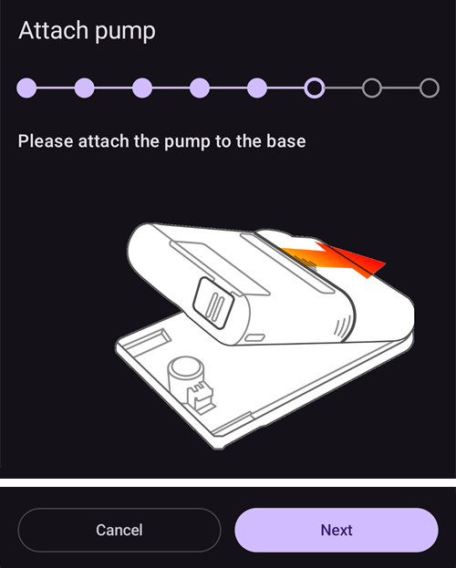

# Equil

Šios instrukcijos skirtos Equil insulino pompos konfigūravimui.

```{contents} Table of contents
:depth: 1
:local: true
```

## Pompos galimybės su AAPS

* Pompa be vamzdelio (patch), kuri ryšį su **AAPS** palaiko per telefono vidinį Bluetooth, be papildomo ryšio įrenginio.
* **AAPS** Equil laiko pompa be vamzdelio (patch) su 200 V rezervuaru: pagrindiniame ekrane rodomos tokios pompos būsenos lemputės, o **Užpildymas** ir **Baterijos keitimas** nesiūlomi. Pildymas, užpildymas ir baterijos keitimas atliekami pompos vedliuose.
* Kol pompa sustabdyta, **AAPS** įrašo 0 V/val. laikiną bazę, todėl į AIO neįskaičiuojamas joks bazinis insulinas.
* Vasaros laiko ir laiko juostos pakeitimus reikia tvarkyti rankiniu būdu.

## Reikalavimai techninei ir programinei įrangai
* **Suderinama Equil įranga**

  Šiuo metu palaikomos Equil 5.3 ir 5.4 versijos.

* **AAPS**, sukurta ir įdiegta pagal [APK kūrimo](../SettingUpAaps/BuildingAaps.md) instrukcijas

## Sąranka

### Pasirinkite Equil pompą

Atidarykite **meniu** (☰) viršutiniame kairiajame kampe, pasirinkite **[Konfigūracija](#Config-Builder-pump)** ir skiltyje **Pompa** pasirinkite **Equil**.

Kai jis pasirinktas, **Equil** kortelėje rodomi du mygtukai: **Parametrai** ir **Atidaryti įskiepį**:


**Atidaryti įskiepį** (arba **Valdymas** → **Pompa**) atidaro Equil pompos ekraną. Kol pompa nesusieta, jis atrodo taip:


### Parametrai

Equil nustatymus atidarykite mygtuku **Parametrai** **Equil** kortelėje arba krumpliaračio piktograma viršutiniame dešiniajame pompos ekrano kampe.


* **Senkančios baterijos aliarmas**: įspėja, kai pompos baterija senka.
* **Mažo insulino likučio aliarmas**: įspėja, kai rezervuare lieka mažai insulino.
* **Perspėjimo tonas**: kaip pompa jus perspėja: **Nutildyti**, **Tik vibravimas**, **Tik garsas** arba **Vibracija ir garsas**.
* **Boluso greitis**: kaip greitai suleidžiamas bolusas: **1,5 V/min (standartinis)**, **3 V/min**, **6 V/min** arba **12 V/min**. Greitesni bolusai gali sukelti daugiau užsikimšimo aliarmų.


```{admonition} Max basal and max bolus on the patch
:class: note
Pati pompa atmeta bet kokią valandinę bazę, didesnę už maksimumą, kurį į ją įrašo **AAPS**. **AAPS** paima didesnę iš dviejų reikšmių: jūsų **maks. valandinės bazės** [nustatymą](../SettingUpAaps/Preferences.md) arba didžiausią valandinę bazę jūsų **profilyje**, todėl pompa visada priima jūsų profilį ir laikinas bazes, kurių prašo ciklas. **AAPS** taip pat siunčia į pompą jūsų maksimalų leistiną bolusą.

Kai pakeičiate **maks. valandinę bazę** arba **maks. bolusą**, **AAPS** naujas reikšmes į pompą nusiunčia automatiškai. Jos taip pat siunčiamos kiekvieno profilio keitimo metu. Pačioje pompoje nieko nustatyti nereikia.
```

### Pompos susiejimas

Pompos ekrane spauskite **Susieti**. Vedlys padės atlikti kiekvieną žingsnį. Taškų eilutė viršuje rodo, kiek žingsnių jau atlikote.

Jei Android klausia, ar **AAPS** gali rasti netoliese esančius įrenginius ir prie jų jungtis, spauskite **Leisti**. **AAPS** to reikia, kad rastų pompą.


Vedlį sudaro šie žingsniai. Spauskite **Toliau**, kad tęstumėte, arba **Atšaukti**, kad išeitumėte iš vedlio.

1. **Reikalingas profilis**: rodoma tik tada, jei **AAPS** dar niekada neaktyvavote **profilio**. Pasirinkite norimą profilį ir spauskite **Aktyvuoti profilį**.
1. **Surinkti pompą**: sujunkite pompą, pripildytą rezervuarą ir įkrautą bateriją.

   

1. **Rasti pompą**: **AAPS** ieško netoliese esančių Equil pompų. Sąraše pasirinkite savo pompą.

   
1. **Susieti įrenginį**: lauke **Nustatyti susiejimo slaptažodį** galite įvesti susiejimo slaptažodį. Jis turi būti 4 simbolių ilgio, sudarytas iš `ABCDEF0123456789`. Spauskite **Susieti**.

   

1. **Pasirinkite insuliną**: rodoma tik tada, jei turite nustatę daugiau nei vieną insuliną. Pasirinkite insuliną, kuris yra rezervuare.
1. **Užpildymas**: pompa **neturi** būti ant savo pagrindo. Spauskite **Užpildymas** ir užpildykite rezervuarą, kol ant adatos galiuko atsiras insulino lašas. Paspauskite **Toliau**.

   
1. **Vietų rotacija**: rodoma tik tada, jei vietų rotacijos nustatymuose įjungta **Valdyti infuzijos vietų rotaciją**. Palieskite vietą, kur pritvirtinsite pompą, arba spauskite **Praleisti**.
1. **Pritvirtinti pompą**: pritvirtinkite pompą prie jos pagrindo.

   
1. **Užpildyti kaniulę**: kai pompa jau ant pagrindo, spauskite **Išleisti orą**, kad iš kaniulės pašalintumėte orą. Paspauskite **Toliau**.

   

1. **Patvirtinti**: pritvirtinkite pompą ant kūno ir spauskite **Baigti**.

   

```{warning}
Jei nustatėte savo susiejimo slaptažodį (rekomenduojama dėl jūsų saugumo), laikykite jį saugioje vietoje. Slaptažodis išsaugomas pompoje. Pompa jo klaus kiekvieną kartą susiejant iš naujo, kol tinkamai jos neatsiesite **AAPS**. Iki tol pompos taip pat negalima naudoti su originaliu nešiojamu valdymo įrenginiu (PDA).
```

### Pompos ekranas po susiejimo

Kai pompa susieta, pompos ekrane rodomi šie mygtukai:

* **Atnaujinti**: iš karto nuskaito pompos būseną ir istoriją.
* **Sustabdyti** / **Atnaujinti suleidimą**: sustabdo arba vėl paleidžia insulino tiekimą.
* **Rezervuaro keitimas**: padeda atjungti pompą, įdėti naują rezervuarą (ir, jei reikia, naują bateriją), užpildyti ir vėl ją pritvirtinti. Pirmame žingsnyje klausiama *Ar taip pat naudosite naują infuzijos rinkinį (pagrindą ir kaniulę)?*
  * **Taip, naują infuzijos rinkinį**: pasirenkate vietą, kaniulė užpildoma, o **AAPS** įrašo insulino keitimą ir kaniulės keitimą.
  * **Ne, tik rezervuarą arba bateriją**: kaniulė neužpildoma, o **AAPS** įrašo tik insulino keitimą.

  Po rezervuaro keitimo baterijos lygis rodomas kaip **-**, kol **AAPS** vėl jį nuskaito iš pompos.

  

* **Istorija**: rodo pompos įrašytus įvykius.
* **Atsieti įrenginį**: padeda atjungti pompą ir atsieti ją nuo **AAPS**. Tai sustabdo insulino tiekimą, grąžina pompos stūmoklį į apačią ir ištrina susiejimą.

### Alarms

* Įspėjimas apie mažą insulino likutį suskamba po vieną kartą kiekviename lygyje (10 V, 5 V ir 2 V) ir kai rezervuaras tuščias. Įspėjimas apie senkančią bateriją suskamba vieną kartą ties 10 % ir vieną kartą ties 5 %. Kiekvienas lygis įspėja tik vieną kartą iki kito rezervuaro keitimo.
* Pompos aliarmai ir sustojimai taip pat įrašomi į terapijos įrašus kaip pranešimai tuo laiku, kai pompa juos užregistravo, todėl vėliau galite matyti, kada ir kodėl pompa sustojo.
* Jei boluso metu rezervuaras ištuštėja, **AAPS** įrašo tik iki tol suleistą insuliną ir praneša jums abu kiekius.

## Kur gauti pagalbos

Equil tvarkyklę kuria bendruomenė **savanoriškai**. Prieš prašydami pagalbos:

1. **Perskaitykite** atitinkamą šios dokumentacijos skyrių ir įsitikinkite, kaip funkcija turi veikti.
2. **Klauskite** kanale *#AAPS* [Discord](https://discord.gg/4fQUWHZ4Mw) serveryje arba kitame [bendruomenės kanale](../GettingHelp/WhereCanIGetHelp.md).
3. **Praneškite apie klaidą**: paieškokite tarp [esamų problemų (issues)](https://github.com/nightscout/AndroidAPS/issues); jei jūsų problemos ten nėra, sukurkite [naują problemą (issue)](https://github.com/nightscout/AndroidAPS/issues) ir pridėkite [žurnalų failus](../GettingHelp/AccessingLogFiles.md).

Prašydami pagalbos nurodykite telefono gamintoją ir modelį, Android versiją, **AAPS** versiją ir paprastai, angliškai aprašykite problemą (kas pasikeitė, kada paskutinį kartą veikė).
