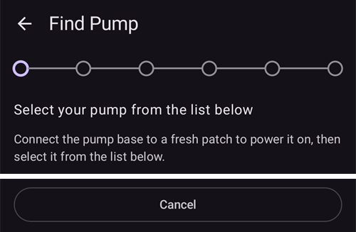
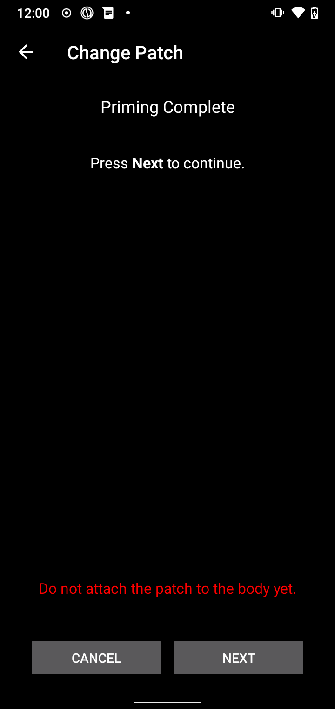
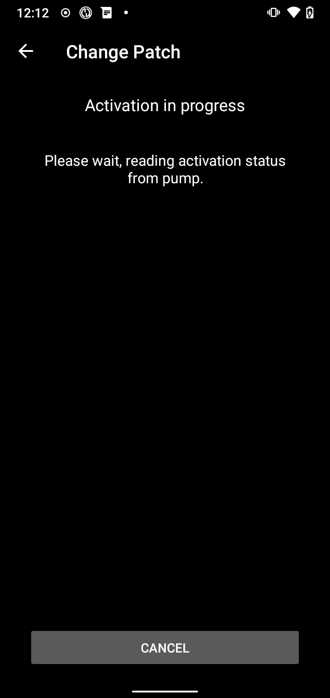

(medtrum-nano-300u)=
# Medtrum Nano 200U / 300U

Šie nurodymai skirti Medtrum insulino pompos konfigūravimui.

```{contents} Table of contents
:depth: 1
:local: true
```

## Pompos galimybės su AAPS
* Palaikomos visos ciklo funkcijos (SMB, laikina bazė ir kt.)
* Automatinis vasaros laiko (DST) ir laiko juostų keitimas
* AAPS tvarkyklė nepalaiko ištęsto boluso

## Reikalavimai techninei ir programinei įrangai
* **Suderinami Medtrum pompos pagrindai ir rezervuarai (patch)**
    - Šiuo metu palaikomos:
        - Medtrum TouchCare Nano 200U su pompos pagrindais, kurių kodai: **MD0201** ir **MD8201**.
        - Medtrum TouchCare 300U su pompos pagrindu, kurio kodas: **MD8301**.
        - Jei turite nepalaikomą modelį ir norite paaukoti įrangą arba padėti testuoti, susisiekite su mumis per discord [čia](https://discordapp.com/channels/629952586895851530/1076120802476441641).
* **AAPS sukurta ir įdiegta** pagal [APK kūrimo](../SettingUpAaps/BuildingAaps.md) instrukcijas.
* **Suderinamas Android telefonas** su BLE Bluetooth ryšiu
    - Žr. AAPS [versijų pastabas](../Maintenance/ReleaseNotes.md)

## Prieš pradedant

**SAUGUMAS PIRMIAUSIA** Nepradėkite šio proceso ten, kur negalėtumėte ištaisyti klaidos (būtina turėti atsarginių rezervuarų (patch), insulino ir pompos valdymo įrenginių).

**PDM ir Medtrum programėlė neveiks su pompa, kurią aktyvavo AAPS.** Anksčiau galbūt siuntėte komandas pompai per PDM (pompos valdymo pultą) arba Medtrum programėlę. Saugumo sumetimais aktyvuotą pompą galite naudoti tik su tuo įrenginiu arba programėle, kuriais ji buvo aktyvuota.

*Tai NEREIŠKIA, kad turite išmesti savo PDM. Rekomenduojame jį laikyti saugioje vietoje kaip atsarginį nenumatytiems atvejams, pavyzdžiui, jei pamestumėte telefoną arba AAPS veiktų netinkamai.*

**Pompa nenustoja tiekti insulino, kai nėra prisijungusi prie AAPS** Numatytosios valandinės bazės užprogramuojamos pompoje pagal šiuo metu aktyvų profilį. Kol AAPS veikia, ji siunčia laikinos valandinės bazės komandas, kurios veikia ne ilgiau kaip 120 minučių. Jei dėl kokios nors priežasties pompa negauna naujų komandų (pavyzdžiui, nutrūko ryšys, nes pompa per toli nuo telefono), pasibaigus laikinai valandinei bazei pompa grįžta prie numatytosios valandinės bazės, užprogramuotos pompoje.

**AAPS profilis nepalaiko valandinės bazės intervalų, prasidedančių pusvalandžiais** Jei AAPS naudojate pirmą kartą ir pirmą kartą nustatote valandinės bazės profilį, atminkite, kad valandinės bazės, prasidedančios pusvalandžiais, nepalaikomos, todėl profilį turėsite pakeisti taip, kad intervalai prasidėtų sveikomis valandomis. Pavyzdžiui, jei turite 1,1 V valandinę bazę, kuri prasideda 09:30 ir trunka 2 valandas iki 11:30, tai neveiks. Šią 1,1 V valandinę bazę turėsite pakeisti į laiko intervalą 9:00–11:00 arba 10:00–12:00. Nors pati Medtrum pompos įranga palaiko 30 min. valandinės bazės profilio intervalus, AAPS algoritmai šiuo metu negali jų įvertinti.

**0 V/val. valandinių bazių profilyje AAPS NEPALAIKO** Nors Medtrum pompa palaiko nulinę valandinę bazę, AAPS automatinei terapijai nustatyti naudoja profilio valandinės bazės kartotinius, todėl su nuline valandine baze veikti negali. Mažiausia profilio valandinė bazė yra 0,05 V/val.

Laikiną nulinę valandinę bazę galima gauti funkcija „Atjungti pompą“ arba derinant „Išjungti ciklą“ / laikiną valandinę bazę ar „Sustabdyti ciklą“ / laikiną valandinę bazę.

## Sąranka

```{caution}
Kai aktyvuojate pompą su **AAPS**, **BŪTINAI** išjunkite visus kitus įrenginius, kurie gali susisiekti su Medtrum pompos pagrindu, pavyzdžiui, aktyvų PDM arba Medtrum programėlę.
```

### 1 žingsnis: pasirinkite Medtrum pompą

#### 1 variantas: nauji įdiegimai

Jei **AAPS** diegiate pirmą kartą, sąranką padės atlikti **Sąrankos vedlys**. Pasiekę žingsnį **Pompa**, pasirinkite **Medtrum**.

Jei abejojate, galite pasirinkti ir **Virtuali pompa**, o **Medtrum** pasirinkti vėliau, kai nustatysite **AAPS** (žr. 2 būdą).


#### 2 variantas: ekranas „Konfigūracija“

Jei AAPS jau įdiegta, **Medtrum** pompą galite pasirinkti skiltyje [Konfigūracija > Pompa](#Config-Builder-pump):

Atidarykite **meniu** (☰) viršutiniame kairiajame kampe, spauskite **Konfigūracija** > **Pompa** ir pasirinkite **Medtrum** kortelę. Vienu metu gali būti aktyvi tik viena pompa.


Kai jis pasirinktas, **Medtrum** kortelėje rodomi du mygtukai: **Parametrai** ir **Atidaryti įskiepį**:


**Atidaryti įskiepį** (arba **Valdymas → Pompa**) atidaro Medtrum pompos ekraną. Jame keičiate pompas ir matote pompos būseną. Kol pompa neaktyvuota, ekranas atrodo taip:


(medtrum-step-2)=
### 2 žingsnis: Medtrum nustatymų keitimas

Spauskite **Parametrai** **Medtrum** kortelėje skiltyje **Konfigūracija** > **Pompa**. Taip pat galite paspausti krumpliaračio piktogramą viršutiniame dešiniajame Medtrum pompos ekrano kampe. Atsidaro **Medtrum pompos nustatymai**:


```{note}
Nustatymo **Serijos numeris** nebėra. **AAPS** randa jūsų pompos pagrindą Bluetooth paieška, kai pirmą kartą aktyvuojate pompą (žr. [3 žingsnis](#medtrum-activate-patch)), ir įsimena jo serijos numerį. Jei norite naudoti kitą pompos pagrindą, žr. [Atsieti](#medtrum-unpair).
```

#### Aliarmų nustatymai

***Numatyta: garso signalas.***

Šis nustatymas keičia, kaip pompa jus perspėja, kai įvyksta įspėjimas arba klaida.

- **Garso signalas**: pompa pypsi esant aliarmams ir įspėjimams.
- **Be garso**: pompa jūsų neperspėja apie aliarmus ir įspėjimus.

Pastaba: begarsiu režimu **AAPS** vis tiek skleidžia aliarmo garsą, priklausomai nuo telefono garsumo nustatymų. Jei į aliarmą nereaguojate, galiausiai pompa pradeda pypsėti.

#### Pompos pranešimas apie įspėjimą

***Numatyta: įjungta.***

Šis nustatymas keičia, kaip **AAPS** rodo pranešimus apie nekritinius pompos įspėjimus. Kai įjungta, įvykus pompos įspėjimui, telefone rodomas pranešimas, pavyzdžiui:
- Senka baterija
- Senka rezervuaras (20 V)
- Pompa netrukus išsijungs

Rekomenduojame palikti įjungtą, jei pompos aliarmai nustatyti į **Be garso**. Bet kuriuo atveju šie įspėjimai rodomi ir Medtrum pompos ekrane, eilutėje [Aktyvūs aliarmai](#medtrum-active-alarms).

(medtrum-patch-expiration)=
#### Patch Expiration

***Numatyta: įjungta.***

Šis nustatymas keičia pompos elgseną. Kai įjungta, pompos galiojimas baigiasi po 3 parų ir, jei garsas įjungtas, pompa duoda garsinį įspėjimą. Po 3 parų ir 8 valandų pompa nustoja veikti.

Jei šis nustatymas išjungtas, pompa jūsų neįspėja prieš nustodama veikti. Su naujesne pompos pagrindo programine įranga pompa veikia ne ilgiau kaip 5 paras.

#### Įspėjimas apie pompos galiojimo laiką [valandos]

***Numatyta: 72 valandos.***

Šis nustatymas keičia įspėjimo apie galiojimo pabaigą laiką. Kai įjungtas nustatymas [Rezervuaras išsijungs](#medtrum-patch-expiration), **AAPS** parodo pranešimą praėjus nurodytam valandų skaičiui po aktyvavimo.

#### Valandos insulino limitas [V]

***Numatyta: 25 V.***

Šis nustatymas keičia didžiausią insulino kiekį, kurį galima suleisti per vieną valandą. Viršijus šią ribą, pompa sustabdo insulino tiekimą ir duoda aliarmą. Aliarmą galite atstatyti pompos ekrane mygtuku **Atstatyti aliarmus**, žr. [Atstatyti aliarmus](#nano-reset-alarms).

Nustatykite reikšmę, tinkamą jūsų insulino poreikiui.

#### Paros insulino limitas [V]

***Numatyta: 80 V.***

Šis nustatymas keičia didžiausią insulino kiekį, kurį galima suleisti per vieną parą. Viršijus šią ribą, pompa sustabdo insulino tiekimą ir duoda aliarmą. Aliarmą galite atstatyti pompos ekrane mygtuku **Atstatyti aliarmus**, žr. [Atstatyti aliarmus](#nano-reset-alarms).

Nustatykite reikšmę, tinkamą jūsų insulino poreikiui.

#### Skenuoti, jei kyla ryšio klaida

***Numatyta: išjungta.***

Yra skiltyje **Papildomi nustatymai**.

Įjunkite tai tik tada, jei turite ryšio problemų. Kai įjungta, prieš bandydama vėl prisijungti, tvarkyklė iš naujo ieško pompos. Įsitikinkite, kad **AAPS** leidimas „Vieta“ (Location) nustatytas į „Allow all the time“ (leisti visada).

### 2b žingsnis: AAPS įspėjimų nustatymai

Šie nustatymai nėra Medtrum tvarkyklės dalis. Juos atidarysite pagrindinio ekrano viršutiniame dešiniajame kampe paspaudę **Nustatymai** (krumpliaračio) piktogramą. Daugiau informacijos rasite puslapyje [Nustatymai](../SettingUpAaps/Preferences.md).

#### BT Watchdog

Atidarykite **Nustatymai** > **Pompa**:


**BT Watchdog** vienai sekundei išjungia telefono Bluetooth, jei **AAPS** negali prisijungti prie pompos. Tai gali padėti kai kuriuose telefonuose, kuriuose Bluetooth „užstringa“.

Įjunkite šį nustatymą, jei dažnai kyla ryšio su pompa problemų.

#### Lokalūs įspėjimai

Atidarykite **Nustatymai** > **Lokalūs įspėjimai**:


##### Įspėti, kad pompa nepasiekiama

***Numatyta: įjungta.***

Kai įjungta Medtrum tvarkyklė, šis nustatymas visada įjungtas. Jis jus įspėja, kai pompa nepasiekiama. Taip gali nutikti, kai pompa yra už ryšio ribų arba nereaguoja dėl sugedusio rezervuaro ar pompos pagrindo, pavyzdžiui, kai tarp pompos pagrindo ir rezervuaro prateka vandens.

Saugumo sumetimais šio nustatymo išjungti negalima.

##### Perspėjimo apie nepasiekiamą pompą riba

***Numatyta: 30 min.***

Šis nustatymas keičia, kiek laiko **AAPS** laukia, prieš įspėdama, kad pompa nepasiekiama.

Naudodami Medtrum pompą šį nustatymą galite keisti, tačiau saugumo sumetimais rekomenduojame palikti 30 minučių.

(medtrum-activate-patch)=
### 3 žingsnis: pompos aktyvavimas

**Prieš tęsdami:**
- Pasiruoškite Medtrum pompos pagrindą ir naują rezervuarą (patch).
- Išjunkite kitus įrenginius, kurie gali susisiekti su Medtrum pompa (PDM ir Medtrum programėlę).
- Geriausia, kad **AAPS** jau būtų nustatyta ir [aktyvuotas profilis](../DailyLifeWithAaps/ProfileSwitch-ProfilePercentage.md). Jei aktyvaus profilio nėra, aktyvavimas prasideda žingsniu **Reikalingas profilis**, kuriame pasirenkate, kurį profilį aktyvuoti.

#### Aktyvavimo pradžia

Atidarykite [Medtrum pompos ekraną](#nano-overview) (**Valdymas → Pompa**) ir spauskite **Keisti rezerv.**. Jei nustatėte [nustatymų apsaugą](#Preferences-protection), pirmiausia turite įvesti slaptažodį arba PIN kodą.

Jei pompa jau aktyvi, pirmiausia jūsų paprašys ją išjungti, žr. [Pompos išjungimas](#nano-deactivate-patch).

Aktyvavimas vyksta vedlyje, žingsnis po žingsnio. Vykdykite nurodymus, kad užpildytumėte ir aktyvuotumėte naują pompą. Norėdami sustabdyti, bet kuriame žingsnyje spauskite **Atšaukti**.

```{important}
Pompą prie kūno klijuokite ir kaniulę įveskite tik tada, kai tai nurodo vedlys (kai baigtas pildymas).
```

Pirmieji žingsniai priklauso nuo jūsų nustatymų:

1. **Reikalingas profilis**: tik jei nėra aktyvaus profilio. Pasirinkite taikomą profilį ir tęskite.
2. **Rasti pompą**: tik pirmą kartą arba panaudojus [Atsieti](#medtrum-unpair). Prijunkite pompos pagrindą prie naujo rezervuaro, kad jis įsijungtų. **AAPS** ieško netoliese esančių Medtrum pompos pagrindų (jų pavadinimai prasideda `MT`). Sąraše paspauskite savąjį. **AAPS** išsaugo jo serijos numerį ir iškart pereina prie rezervuaro užpildymo.

   

3. **Įjungti rezervuarą**: tik kai **AAPS** jau žino jūsų pompos pagrindą. Ekrane rašoma: „Nėra aktyvaus rezervuaro. Spauskite **Toliau** ir pradėkite aktyvavimą.“ Įsitikinkite, kad pompos pagrindas dar **neprijungtas** prie rezervuaro, tada spauskite **Toliau**.


#### Rezervuaro prijungimas ir užpildymas


Prijunkite pompos pagrindą prie rezervuaro, pašalinkite likusį orą ir pripildykite rezervuarą insulino. Aktyvavimui reikia bent 70 V. Ekrane rodomas insulino kiekis rezervuare. Kol kas neklijuokite pompos prie kūno.

Kai rezervuaras aptinkamas ir užpildomas, atsiranda mygtukas **Toliau**. Paspauskite jį.

#### Insulino pasirinkimas

Šis žingsnis rodomas tik tada, jei **AAPS** nustatėte daugiau nei vieną insuliną. Pasirinkite insuliną, kuriuo pildote rezervuarą. Po aktyvavimo **AAPS** su šiuo insulinu atlieka profilio keitimą.

#### Pompos pildymas (prime)


**Nenuimkite** apsaugos. Iki pusės nuspauskite adatos mygtuką ant pompos, tada spauskite **Toliau**, kad pradėtumėte pildymą.


Palaukite, kol baigsis pildymas.



Kai pildymas baigtas, spauskite **Toliau**, kad tęstumėte.

#### Vietų rotacija

Šis žingsnis rodomas tik tada, jei infuzijos vietas tvarkote su [Vietų rotacija](#Aapsscreens-site-rotation) (nustatymas **Valdyti infuzijos vietų rotaciją**). Pasirinkite, kurioje kūno vietoje klijuosite pompą, arba praleiskite šį žingsnį.

#### Pompos priklijavimas


Nuvalykite odą ir nuimkite lipdukus. Nuimkite apsaugą, priklijuokite pompą prie kūno ir paspauskite adatos mygtuką, kad įvestumėte kaniulę.

Spauskite **Toliau**, kad aktyvuotumėte pompą.

#### Pompos aktyvavimas


**AAPS** aktyvuoja pompą ir nustato pradinę valandinę bazę. Palaukite. Kai aktyvavimas baigtas, rodomas šis ekranas:


```{admonition} Older screenshot
:class: note
Išskyrus **Rasti pompą**, aukščiau pateiktos aktyvavimo ekrano kopijos yra iš ankstesnės **AAPS** versijos ir **AAPS** 4 versijoje gali atrodyti kitaip.
```

Jame rodoma, kiek vienetų insulino liko rezervuare. Spauskite **OK**, kad grįžtumėte į pompos ekraną.

```{tip}
Aktyvavę naują pompą, [eksportuokite nustatymus](../Maintenance/ExportImportSettings.md). Tada vėliau galėsite atkurti šios pompos sesiją, pavyzdžiui, naujame telefone.
```

(nano-deactivate-patch)=

### Pompos išjungimas

Norėdami išjungti aktyvią pompą, atidarykite [Medtrum pompos ekraną](#nano-overview) (**Valdymas → Pompa**) ir spauskite **Keisti rezerv.**.


Jūsų paprašys patvirtinti, kad norite išjungti dabartinę pompą. **Šio veiksmo atšaukti negalima.** Spauskite **Toliau**, kad išjungtumėte, arba **Atšaukti**, kad grįžtumėte į pompos ekraną.


Jei **AAPS** negali išjungti pompos (pavyzdžiui, nes pompos pagrindas jau nuimtas nuo rezervuaro), spauskite **Pašalinti**, kad AAPS pamirštų dabartinę pompos sesiją. Tada galėsite aktyvuoti naują pompą.


Kai išjungimas baigtas, ištraukite adatą ir nuimkite pompą nuo kūno. Nuimkite pompos pagrindą ir išmeskite naudotą rezervuarą. Spauskite **OK**, kad grįžtumėte į pompos ekraną, arba **Toliau**, kad pradėtumėte aktyvuoti naują pompą.

(nano-resume-interrupted-activation)=

### Nutraukto aktyvavimo tęsimas

Jei pompos aktyvavimas nutrūksta, pavyzdžiui, išsikrovus telefono baterijai, galite jį tęsti. Atidarykite [Medtrum pompos ekraną](#nano-overview) (**Valdymas → Pompa**) ir spauskite **Keisti rezerv.**.


Spauskite **Toliau**, kad tęstumėte aktyvavimą. Spauskite **Pašalinti**, kad atstatytumėte aktyvavimo būseną ir galėtumėte aktyvuoti naują pompą.



```{admonition} Older screenshot
:class: note
Skyrių **Pompos išjungimas** ir **Nutraukto aktyvavimo tęsimas** ekrano kopijos yra iš ankstesnės **AAPS** versijos ir **AAPS** 4 versijoje gali atrodyti kitaip.
```

Tvarkyklė nuskaito aktyvavimo būseną iš pompos. Jei tai pavyksta, vedlys tęsia nuo to žingsnio, kuriame sustojo.

(nano-overview)=

## Pompos ekranas

Medtrum pompos ekrane (**Valdymas → Pompa**) rodoma dabartinė Medtrum pompos būsena. Jame taip pat yra mygtukai pompai keisti, aliarmams atstatyti ir būsenai atnaujinti. Viršuje esanti juosta rodo svarbias būsenas, pavyzdžiui, **Rezervuaras neaktyvus** arba **Pompa sustabdyta**.


Ekrane gali būti rodomos šios eilutės. Kai kurios eilutės rodomos tik tada, kai turi reikšmę.

- **Paskutinis prisijungimas**: kiek laiko praėjo nuo paskutinio **AAPS** prisijungimo prie pompos.
- **Paskutinis bolusas**: paskutinis suleistas bolusas.
- **Baterija**: dabartinė pompos baterijos įtampa.
- **Rezervuaras**: dabartinis insulino kiekis rezervuare.
- **Serijos numeris**: jūsų pompos pagrindo serijos numeris.
- **Pompos būsena**: dabartinė pompos būsena. Pavyzdžiui, **Aktyvi** (pompa aktyvuota ir veikia įprastai) arba **Sustabdyta** (pompa neaktyvuota).
- **Pagrindinis bazės dydis**: šiuo metu veikianti valandinė bazė iš jūsų profilio.
- **Laikina bazė**: laikina valandinė bazė, jei ji veikia.
- **Aktyvus bolusas**: šiuo metu leidžiamas bolusas.
- **Aktyvūs aliarmai**: žr. [toliau](#medtrum-active-alarms).
- **Pompos tipas**: jūsų pompos pagrindo modelis.
- **FW versija**: pompos pagrindo programinės įrangos versija.
- **Rezervuaro nr.**: aktyvuotos pompos eilės numeris. Jis padidėja vienetu kiekvieną kartą, kai aktyvuojate naują pompą.
- **Aktyvavimas**: data ir laikas, kada pompa aktyvuota, ir kiek laiko nuo to praėjo.
- **Rezerv. gal. baigsis**: data ir laikas, kada baigiasi pompos galiojimas. Rodoma **Neįjungta**, jei nustatymas [Rezervuaras išsijungs](#medtrum-patch-expiration) išjungtas.

(medtrum-active-alarms)=
### Aktyvūs aliarmai

Šioje eilutėje rodomi šiuo metu aktyvūs aliarmai, pavyzdžiui, senkantis rezervuaras arba baigiantis pompos galiojimas.

### Atnaujinti

Šis mygtukas atnaujina pompos būseną. Jis veikia tik tada, kai pompa aktyvi ir **AAPS** tuo metu nėra prisijungusi prie pompos.

### Keisti rezerv.

Šis mygtukas paleidžia pompos keitimo vedlį. Daugiau informacijos rasite skyriuje [Pompos aktyvavimas](#medtrum-activate-patch).

(medtrum-unpair)=
### Atsieti

Šis mygtukas rodomas tik tada, kai **AAPS** žino pompos pagrindą. Jis ištrina išsaugotą pompos pagrindo serijos numerį ir nutraukia ryšį. Kitą kartą aktyvuojant pompą, **AAPS** vėl ieškos pompos pagrindo (žingsnis **Rasti pompą**). Naudokite tai, jei pereinate prie kito pompos pagrindo. Tai darykite tik tada, kai nėra aktyvios pompos.

(nano-reset-alarms)=

### Reset alarms

Mygtukas **Atstatyti aliarmus** pompos ekrane rodomas tik tada, kai pompa pati sustabdė insulino tiekimą, pavyzdžiui, po paros insulino limito aliarmo. Paspauskite jį, kad atstatytumėte aliarmus ir atnaujintumėte insulino tiekimą.


```{admonition} Older screenshot
:class: note
Aukščiau esanti ekrano kopija yra iš ankstesnės **AAPS** versijos. **AAPS** 4 versijoje pompos ekranas atrodo kitaip, bet mygtukas **Atstatyti aliarmus** veikia taip pat.
```

## Telefono keitimas, nustatymų eksportas / importas

Pereidami prie naujo telefono, atlikite šiuos veiksmus:
* Senajame telefone [eksportuokite nustatymus](../Maintenance/ExportImportSettings.md).
* Perkelkite nustatymų failą iš senojo telefono į naująjį ir importuokite jį į **AAPS**. Importavimo ekrane pažymėkite **Taip pat pakeisti pompos nustatymus**, kitaip pompos sesija nebus perkelta į naująjį telefoną.

Importuojamas nustatymų failas turi būti iš dabar naudojamos pompos sesijos, kitaip pompa neprisijungs (žr. [Pompos be vamzdelio](#ExportImportSettings-tubeless-pumps)).

Po nustatymų importavimo tvarkyklė sinchronizuoja istoriją su pompa. Tai gali užtrukti, priklausomai nuo nustatymų failo amžiaus. Eiga („Sinchronizuojami įrašai, liko ...“) rodoma pagrindiniame ekrane:


(medtrum-nano-troubleshooting)=

## Troubleshooting

### Ryšio problemos

Jei baigiasi ryšio laukimo laikas (timeout) arba kyla kitų ryšio problemų:
- **AAPS** Android programėlės nustatymuose leidimą „Vieta“ (Location) nustatykite į „Allow all the time“ (leisti visada).
- Pabandykite įjungti **Skenuoti, jei kyla ryšio klaida** (Medtrum nustatymai > **Papildomi nustatymai**) ir **BT Watchdog** (**Nustatymai** > **Pompa**), žr. [2 žingsnis](#medtrum-step-2).

### Bluetooth problemos
Dėl žinomų Bluetooth ryšio problemų, pompos / Pod ryšio nutrūkimų arba aktyvavimo ir prisijungimo problemų žr. [Bluetooth trikčių šalinimas](../GettingHelp/BluetoothTroubleshooting.md)

### Aktyvavimas nutrauktas

Jei aktyvavimas nutrūksta, pavyzdžiui, išsikrovus telefono baterijai ar telefonui užstrigus, galite jį tęsti. Pompos ekrane spauskite **Keisti rezerv.** ir vykdykite skyriaus [Nutraukto aktyvavimo tęsimas](#nano-resume-interrupted-activation) veiksmus.

### Kaip išvengti pompos klaidų

Pompa gali rodyti įvairias klaidas. Kad klaidos nekiltų dažnai:
- Įsitikinkite, kad pompos pagrindas tinkamai įstatytas į rezervuarą ir nesimato tarpų.
- Pildydami rezervuarą, per stipriai nespauskite stūmoklio. Nepilkite į rezervuarą daugiau, nei leidžia jūsų modelis.

## Kur gauti pagalbos

Visą Medtrum tvarkyklės kūrimo darbą bendruomenė atlieka **savanoriškai**; prašome tai prisiminti ir, prieš prašant pagalbos, laikytis šių nurodymų:

-  **0 lygis:** Perskaitykite atitinkamą šios dokumentacijos skyrių, kad suprastumėte, kaip turi veikti funkcija, su kuria turite problemų.
-  **1 lygis:** Jei vis dar turite problemų, kurių nepavyksta išspręsti pagal šį dokumentą, eikite į *#Medtrum* kanalą **Discord** per [šią pakvietimo nuorodą](https://discord.gg/4fQUWHZ4Mw).
-  **2 lygis:** Paieškokite esamose problemose (issues), ar apie jūsų problemą jau pranešta: [Issues](https://github.com/nightscout/AAPS/issues). Jei taip, patvirtinkite / pakomentuokite / pridėkite informacijos apie savo problemą. Jei ne, sukurkite [naują problemą (issue)](https://github.com/nightscout/AndroidAPS/issues) ir pridėkite [savo žurnalų failus](../GettingHelp/AccessingLogFiles.md).
-  **Būkite kantrūs – dauguma mūsų bendruomenės narių yra geranoriški savanoriai, o problemoms spręsti dažnai reikia laiko ir kantrybės ir iš naudotojų, ir iš kūrėjų.**