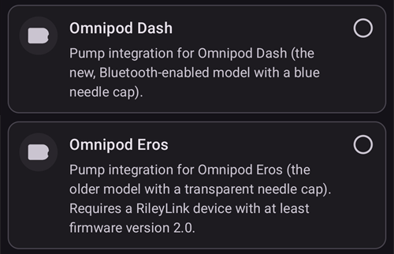
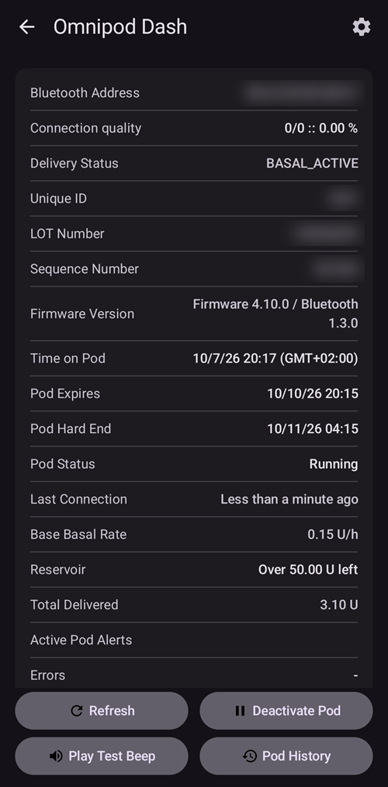
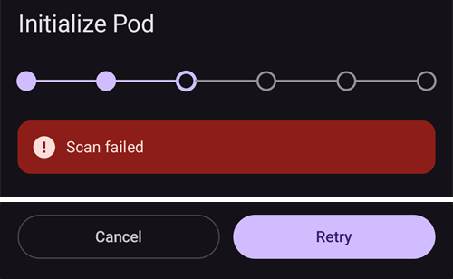
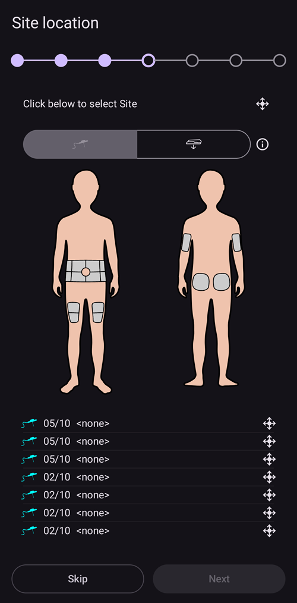
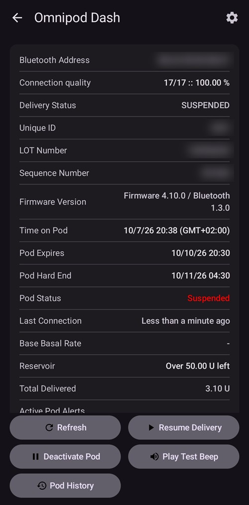
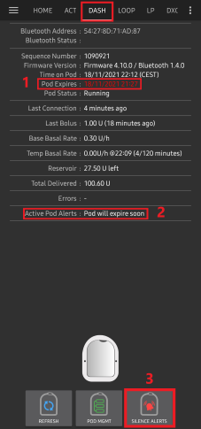
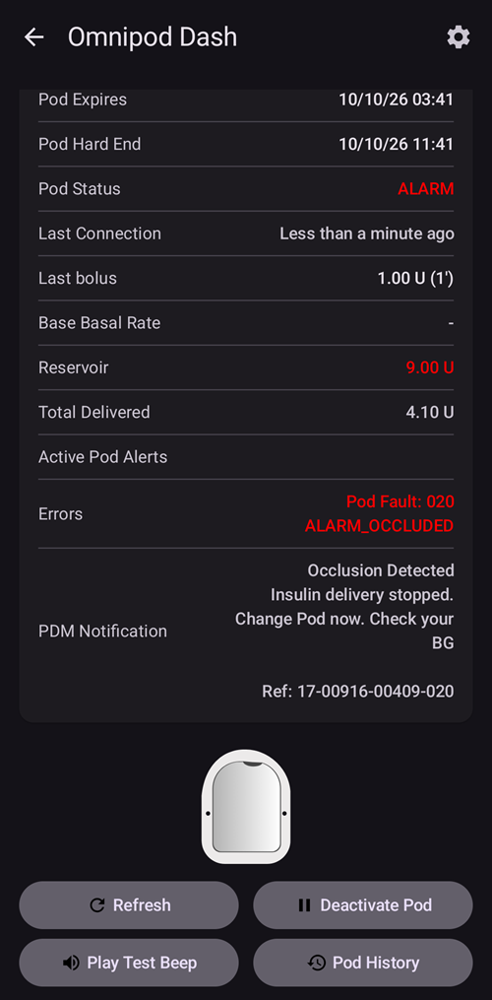

# Omnipod DASH

Šios instrukcijos skirtos **Omnipod DASH** kartos pompai nustatyti **(NE Omnipod Eros)**. DASH tvarkyklė yra gerai išbandytas būdas naudoti ciklą su Omnipod.

```{contents} Table of contents
:depth: 1
:local: true
```

## Omnipod DASH specifikacijos

Pagrindinės **Omnipod DASH** („DASH“) savybės:

- DASH Pod atpažįstami iš **mėlyno adatos dangtelio** (senesnio EROS Pod adatos dangtelis yra skaidrus). Kitais atžvilgiais Pod fiziniai matmenys yra vienodi.
- DASH nereikia BLE ryšio įrenginio / tilto (NEREIKIA RileyLink, OrangeLink ar EmaLink).
- DASH Bluetooth ryšys naudojamas tik siunčiant komandą (pvz., bolusą) ir iškart po komandos išsiuntimo nutraukiamas.
- **AAPS** lauks, kol Pod bus pasiekiamas, kad išsiųstų komandas.
- Aktyvuojant Pod, **AAPS** suras naują DASH Pod ir prie jo prisijungs.
- Tikėtinas atstumas nuo telefono: 5–10 metrų (priklauso nuo aplinkybių).

(omnipod-dash-constraints)=

## Žinomi Omnipod DASH apribojimai ir problemos AAPS
- Bendras patarimas – naudoti **AAPS** su Android 14 arba 16. Bendruomenė praneša apie daug [problemų](https://github.com/nightscout/AndroidAPS/issues/3471) su Android 15. Tačiau jei naudojate Android 15, greičiausiai reikės įjungti **Bluetooth susiejimą** ([Dash nustatymų](#omnipod-dash-advanced-settings) skyriuje **Papildomi nustatymai**), kad galėtumėte sėkmingai aktyvuoti ir naudoti Pod. Daugiau apie susiejimo nustatymus rasite puslapyje [Bendrasis trikčių šalinimas](../GettingHelp/GeneralTroubleshooting.md).
- Vasaros laiko ir laiko juostos pakeitimai automatiškai nepritaikomi. Pasikeitus laikui, Pod turite atnaujinti rankiniu būdu: DASH pompos ekrane paspauskite **Atnaujinti**, tada paspauskite **Nustatyti laiką** (rodomas, kai Pod ir telefono laiko juostos skiriasi) arba atlikite **profilio keitimą** (žr. [Laiko juostos keitimas su Omnipod Dash](#timezone-traveling-with-pumps)).
- Dash palaiko tik valandinę bazę 0,05 V/val. žingsniais. Jei savo **AAPS profilyje** bandote nustatyti valandinę bazę 0,01 žingsniais, AAPS neįspės, nors Pod suapvalins reikšmę iki 0,05 žingsnio. Jei DASH pompos ekrane atidarysite **Pod istorija**, ten bus parodyta, kad nustatyta 0,05 valandinė bazė. Tai taip pat reiškia, kad mažiausia DASH valandinė bazė, leidžiama **AAPS**, yra 0,05 V/val.
- Nustatymų faile yra aktyvi Pod sesija. Eksportuokite nustatymus po kiekvieno Pod aktyvavimo, o prieš importuodami nustatymus perskaitykite skyrių [Nustatymų eksportavimas ir importavimas](#omnipod-dash-export-import).
- Nustatydamas naują valandinės bazės profilį, DASH sustabdo insulino tiekimą prieš nustatydamas naują valandinės bazės **profilį**. Jei ryšys nutrūksta arba įvyksta klaida, valandinės bazės profilis automatiškai iš naujo nepasileidžia. Daugiau informacijos rasite skyriuje [Insulino tiekimo atnaujinimas](#omnipod-dash-resuming-insulin-delivery).
- Jei perspėjimai nustatyti ir Pod naudojimo laikas tuoj baigsis, Pod pypsės tol, kol perspėjimai bus nutildyti. Daugiau informacijos rasite skyriuje [Pod perspėjimų nutildymas](#omnipod-dash-silencing-pod-alerts).
- Yra keletas žinomų Bluetooth problemų, dėl kurių gali nepavykti aktyvuoti Pod. Žinomas problemas ir jų sprendimus rasite puslapyje [Bluetooth trikčių šalinimas](../GettingHelp/BluetoothTroubleshooting.md).

(hardware-software-requirements)=

(omnipod-dash-hardware-software-requirements)=
## Reikalavimai techninei ir programinei įrangai

- Omnipod DASH atpažįstamas iš mėlyno adatos dangtelio.


- **Suderinamas Android telefonas** su Bluetooth Low Energy (BLE) (daugiau informacijos rasite puslapyje [Telefonai](../Getting-Started/Phones.md)). Be to, ši informacija padės įvertinti kitus svarbius dalykus, kad sėkmingai aktyvuotumėte ir naudotumėte DASH su suderinamu telefonu:
    -  **AAPS** Omnipod Dash tvarkyklė prie DASH Pod jungiasi per Bluetooth.  
      **AAPS** automatiškai sukuria naują Bluetooth ryšį su Pod kiekvieną kartą, kai reikia išsiųsti komandą (pvz., bolusą), o išsiuntus komandą Bluetooth ryšys iškart nutraukiamas.
       - **PASTABA:**
         - Bluetooth ryšį gali trikdyti kiti Bluetooth įrenginiai, susieti su telefonu, kuriame veikia **AAPS**, pavyzdžiui, ausinės ir pan. Kai kuriuose telefonų modeliuose tokie įrenginiai gali sukelti ryšio klaidas arba Pod aktyvavimo problemas. Renkantis telefoną Omnipod DASH sistemai, verta peržiūrėti [išbandytų įrenginių](https://docs.google.com/spreadsheets/u/1/d/e/2PACX-1vScCNaIguEZVTVFAgpv1kXHdsHl3fs6xT6RB2Z1CeVJ561AvvqGwxMhlmSHk4J056gMCAQE02sAWJvT/pubhtml?gid=683363241&single=true) sąrašą, kuriame nurodyti žinomi veikiantys deriniai.
         - Yra keletas žinomų Bluetooth problemų, dėl kurių gali nepavykti aktyvuoti Pod (patarimų dėl kitų Bluetooth problemų rasite skyriuje [Trikčių šalinimas](#omnipod-dash-troubleshooting)), ypač skyriuje [Su Bluetooth susijusios problemos](#omnipod-dash-bluetooth-related-issues).
    - Telefone turi veikti **Android 12 arba naujesnė versija**, o **AAPS** turi būti sukurta ir įdiegta pagal [**APK kūrimo**](../SettingUpAaps/BuildingAaps.md) instrukcijas. Visada naudokite naujausią išleistą versiją.
- Palaikomas [**nuolatinis gliukozės jutiklis (NGJ)**](../Getting-Started/CompatiblesCgms.md)

Toliau aprašyta, kaip su **AAPS** pradėti naują Pod sesiją. Palaukite, kol dabartinio Pod naudojimo laikas beveik baigsis, nes naują Pod turėsite aktyvuoti su **AAPS**. Išjungto Pod negalima naudoti ar aktyvuoti pakartotinai: išjungimas yra galutinis.

## Prieš pradedant

Būtinai perskaitykite ir supraskite visą šį vadovą, taip pat skyrių **Prieš pradedant** ir skyrių **[Omnipod ir AAPS apribojimai ir problemos](#omnipod-dash-constraints)**, kad nesusidurtumėte su jau žinoma problema.

### **SAUGUMAS PIRMIAUSIA** – jūs **NETURĖTUMĖTE** pirmą kartą jungti **AAPS** prie Pod, jei neturite viso šio sąrašo:
1. Papildomi Pod (3 ar daugiau atsarginių)
2. Atsarginis insulinas ir priemonės gydymui švirkštikliais (MDI)
3. Veikiantis Omnipod PDM (jei **AAPS** sugestų)
4. Būtinai naudokite palaikomą telefoną! (Žr. [Aparatinės ir programinės įrangos reikalavimai](#hardware-software-requirements))
5. Tinkama AAPS versija, sukurta ir įdiegta

### Kai AAPS Dash tvarkyklė aktyvuoja jūsų Pod, jūsų Omnipod Dash PDM taps nereikalingas.
- Prieš naudodami **AAPS**, jūs arba jūsų globėjas Pod valdėte su Omnipod PDM (kai kuriuose regionuose – su telefono programėle) ir juo siuntėte komandas savo DASH (pvz., bolusą).
- DASH gali turėti ryšį tik su vienu Bluetooth įrenginiu (pvz., PDM arba telefonu), per kurį jis valdomas ir gauna komandas.
- Įrenginys, kuris sėkmingai aktyvuoja Pod, nuo to momento yra vienintelis įrenginys, galintis bendrauti su tuo Pod. Tai reiškia, kad kai aktyvuojate DASH savo Android telefonu su **AAPS**, **su tuo Pod nebegalėsite naudoti savo PDM!** Kol tas Pod aktyvus, **AAPS** Dash tvarkyklė jūsų Android telefone yra naujasis jūsų Pod PDM.
- **NEIŠMESKITE savo PDM!** Rekomenduojama jį pasilikti kaip atsarginį ir nenumatytiems atvejams, pavyzdžiui, jei pamestumėte telefoną arba **AAPS** neveiktų tinkamai.

### Jūsų Pod **NENUSTOS** tiekti insulino, kai nėra prisijungęs prie AAPS.
Aktyvuojant Pod, į jį įrašomos numatytosios valandinės bazės, nustatytos dabartiniame aktyviame [**profilyje**](../SettingUpAaps/YourAapsProfile.md).  
Kol **AAPS** veikia, ji siunčia valandinės bazės koregavimo komandas, kurios veikia ne ilgiau kaip 120 minučių.  
Jei dėl kokios nors priežasties Pod negauna naujų komandų (pavyzdžiui, nutrūko ryšys dėl per didelio atstumo tarp Pod ➜ telefono), Pod automatiškai grįžta prie numatytųjų valandinių bazių, nustatytų jūsų [**profilyje**](../SettingUpAaps/YourAapsProfile.md).

### AAPS profiliai nepalaiko 30 minučių valandinės bazės intervalų
Jei **AAPS** naudojate pirmą kartą ir pirmą kartą nustatote valandinės bazės [**profilį**](../SettingUpAaps/YourAapsProfile.md), žinokite, kad valandinės bazės, prasidedančios pusvalandžio pradžioje, nepalaikomos. Pavyzdžiui, jei Omnipod PDM turite 1,1 vieneto valandinę bazę, kuri prasideda 09:30 ir trunka 2 valandas iki 11:30, tokio pat valandinės bazės **profilio** **AAPS** tiksliai atkurti negalima.  
Šią 1,1 vieneto valandinę bazę turėsite pakeisti į laiko intervalą 9:00–11:00 arba 10:00–12:00. Nors pati DASH aparatinė įranga palaiko 30 minučių valandinės bazės **profilio** intervalus, **AAPS** šios funkcijos NEPALAIKO.

### 0 V/val. valandinės bazės profilyje AAPS NEPALAIKOMOS
Nors DASH palaiko nulinę valandinę bazę, **AAPS** automatinei terapijai nustatyti naudoja naudotojo **profilio** valandinės bazės kartotinius, todėl su nuline valandine baze veikti negali.  
Laikiną nulinę valandinę bazę galima gauti funkcija „Atjungti pompą“ arba derinant „Išjungti ciklą“ / laikiną bazę arba „Sustabdyti ciklą“ / laikiną bazę.  
**PASTABA:** Mažiausia DASH valandinė bazė, leidžiama **AAPS**, yra 0,05 V/val.

## Dash pasirinkimas AAPS

Omnipod DASH tvarkyklę **AAPS** galima pasirinkti **dviem** būdais:

### 1 variantas: nauji įdiegimai

Kai pirmą kartą įdiegiate **AAPS**, **Sąrankos vedlys** supažindina jus su pagrindinėmis **AAPS** funkcijomis ir įdiegimo reikalavimais. Kai pasieksite žingsnį **Pompa**, pasirinkite **Omnipod Dash**.



Jei dar nesate tikri, kol kas galite pasirinkti **Virtuali pompa**, o **Omnipod Dash** pasirinkti vėliau, kai nustatysite **AAPS** (žr. 2 būdą).

(omnipod-dash-option-2-config-builder)=
### 2 variantas: ekranas „Konfigūracija“

Jei AAPS jau įdiegta, **Omnipod Dash** pompą galite pasirinkti ekrane **Konfigūracija**:

1. Atidarykite **meniu** (☰) viršutiniame kairiajame pagrindinio ekrano kampe ir pasirinkite **Konfigūracija**.
2. Bakstelėkite **Pompa** ir pažymėkite **Omnipod Dash** perjungiklį (*„Omnipod Dash pompos integracija (naujas, Bluetooth palaikantis modelis su mėlynu adatos dangteliu).“*).

3. Kai ji pasirinkta, **Omnipod Dash** kortelėje rodomi du mygtukai:
   - **Parametrai** atidaro [Dash nustatymus](#omnipod-dash-settings).
   - **Atidaryti įskiepį** atidaro [DASH pompos ekraną](#omnipod-dash-tab).

   

### Omnipod tvarkyklės pasirinkimo patikrinimas

Norėdami patikrinti, ar pasirinkta **Omnipod Dash**, atidarykite **Valdymas** (pagrindinio ekrano apatinė navigacijos juosta) ir bakstelėkite **Pompa**. Atsidaro DASH pompos ekranas, kaip parodyta kitame skyriuje.

(omnipod-dash-tab)=

## The DASH pump screen

DASH pompos ekrane valdote savo Pod: juos aktyvuojate ir išjungiate, atnaujinate Pod būklę, nutildote perspėjimus ir peržiūrite Pod istoriją. Jį atidarysite per **Valdymas** > **Pompa** arba mygtuku **Atidaryti įskiepį** **Omnipod Dash** kortelėje skiltyje **Konfigūracija** > **Pompa**.

Taip ekranas atrodo, kai nėra aktyvaus Pod:


O taip ekranas atrodo su aktyviu Pod:



**Nustatymai** (krumpliaračio) piktograma viršutiniame dešiniajame kampe atidaro [Dash nustatymus](#omnipod-dash-settings).

***PASTABA:** Jei kuriame nors pompos ekrano lauke rodoma (nepatvirtinta), paspauskite **Atnaujinti**, kad atnaujintumėte Pod būklę.*

### Laukai

- **Bluetooth adresas:** Pod Bluetooth adresas.

- **Ryšio kokybė:** Kaip patikimai **AAPS** prisijungia prie Pod. Rodoma taip: *sėkmingi prisijungimai / visi bandymai prisijungti :: sėkmės dalis*, pavyzdžiui, `412/420 :: 98.10 %`. Po daugiau nei 50 sėkmingų prisijungimų reikšmė tampa geltona, kai yra mažesnė nei 90 %, ir raudona, kai mažesnė nei 70 %. Maža reikšmė rodo Bluetooth problemą (žr. [Su Bluetooth susijusios problemos](#omnipod-dash-bluetooth-related-issues)).

- **Insulino tiekimo būklė:** Neapdorota insulino tiekimo būklė, kurią praneša Pod. Šis laukas rodomas tik inžinerinio režimo versijose.

- **Unikalus ID:** Unikalus ID, kurį **AAPS** suteikė Pod aktyvuojant.

- **LOT numeris:** Pod gamybos partijos (LOT) numeris.

- **Eilės Nr.:** Pod eilės numeris.

- **Programinės įrangos versija:** Pod programinės įrangos ir Bluetooth versijos.

- **Pod laikas:** Dabartinis Pod laikas ir jo laiko juosta. Tekstas tampa raudonas, kai Pod laiko juosta skiriasi nuo telefono laiko juostos, ir geltonas, kai Pod laikas skiriasi daugiau nei 10 minučių.

- **Pod naudojimo pabaiga:** Data ir laikas, kada baigiasi Pod naudojimo laikas (72 valandos po aktyvavimo). Paskutines 4 valandas iki šio laiko tekstas būna geltonas. Jis niekada netampa raudonas, nes ir po to Pod toliau tiekia insuliną.

- **Pod veikimo pabaiga:** Pod papildomo laiko pabaiga (8 valandos po **Pod naudojimo pabaiga**, iš viso Pod gali veikti ne ilgiau kaip 80 valandų). Tekstas tampa geltonas, kai prasideda papildomas laikas (ties **Pod naudojimo pabaiga**), ir raudonas paskutines 4 valandas iki veikimo pabaigos. Papildomo laiko metu taip pat rodoma, kiek laiko liko, pavyzdžiui, *(17m remaining)*. Veikimo pabaigoje Pod nustoja tiekti insuliną, todėl jį reikia pakeisti.

- **Pod būklė:** Pod būsena: **Nėra aktyvaus Pod**, **Nustatoma**, **Vykdoma**, **Sustabdyta** arba, po Pod gedimo, **ALARM**.

- **Paskutinis prisijungimas:** Prieš kiek laiko **AAPS** paskutinį kartą bendravo su Pod.

  - *Ką tik* – mažiau nei prieš 10 sekundžių.

  - *Mažiau nei prieš minutę* – prieš 10–60 sekundžių.

  - *prieš XX min.* – daugiau nei prieš 1 minutę (o po valandos – *prieš X val. ir XX min.*).

- **Paskutinis bolusas:** Paskutinio į Pod išsiųsto boluso kiekis ir prieš kiek laiko jis suleistas. Nepatvirtintas bolusas pažymimas (nepatvirtinta).

- **Pagrindinė valandinė bazė:** Valandinė bazė, nustatyta dabartiniam laikui jūsų valandinės bazės **profilyje**.

- **Laikina bazė:** Šiuo metu veikianti laikina bazė su jos pradžios laiku ir trukme. Šis laukas rodomas tik tada, kai veikia laikina bazė.

- **Rezervuaras:** Rodo *Liko daugiau nei 50 V*, kai rezervuare liko daugiau nei 50 vienetų. Kai liko mažiau nei 50 vienetų, rodomas tikslus kiekis. Kai liko mažiau nei 20 vienetų, reikšmė tampa raudona.

- **Iš viso suleista:** Bendras iš rezervuaro suleisto insulino kiekis. Į jį įskaičiuotas ir užpildymui sunaudotas insulinas.

- **Aktyvūs Pod perspėjimai:** Šiuo metu Pod aktyvūs perspėjimai, pavyzdžiui, *Pod naudojimo laikas greitai baigsis* arba *Senka rezervuaras*.

- **Klaidos:** Pod gedimas, jei Pod sugedo; rodomas raudonai kaip *Pod klaida:*, po kurios nurodytas gedimo kodas ir pavadinimas, pavyzdžiui, *Pod klaida: 020 ALARM_OCCLUDED*. Ankstesnes klaidas ir išsamesnę informaciją rasite [Pod istorijoje](#omnipod-dash-view-pod-history) ir žurnalų failuose. Žr. [Pod gedimai](#omnipod-dash-pod-failures).

- **PDM pranešimai:** Rodomas tik po Pod gedimo. Jame gedimas rodomas taip, kaip jį būtų parodęs Omnipod PDM: pavadinimas (pavyzdžiui, *Aptiktas užsikimšimas*, *Tuščias rezervuaras* arba *Pod naudojimo pabaiga*), kas atsitiko (pavyzdžiui, *Insulino tiekimas sustabdytas. Pakeiskite Pod.*) ir *Ref:* kodas.

### Buttons

Mygtukai pompos ekrano apačioje keičiasi pagal Pod būseną. Rodomi tik tie mygtukai, kurie tuo metu turi prasmę.

- **Atnaujinti:** Paprašo Pod pranešti dabartinę būklę.
  - *Naudokite jį Pod būklei atnaujinti ir laukams, kuriuose rodoma (nepatvirtinta), išvalyti.*
  - *Daugiau informacijos rasite toliau esančiame skyriuje [Trikčių šalinimas](#omnipod-dash-troubleshooting).*

- **Nutildyti perspėjimus:** Sustabdo Pod perspėjimų pypsėjimą (pavyzdžiui, dėl Pod naudojimo pabaigos ar senkančio rezervuaro). Rodomas tik tada, kai Pod turi aktyvų perspėjimą. Žr. [Pod perspėjimų nutildymas](#omnipod-dash-silencing-pod-alerts).

- **Atnaujinti insulino tiekimą:** Atnaujina insulino tiekimą sustabdytame Pod. Rodomas tik tada, kai insulino tiekimas sustabdytas. Žr. [Insulino tiekimo atnaujinimas](#omnipod-dash-resuming-insulin-delivery).

- **Nustatyti laiką:** Pakeičia Pod laiko juostą į telefono laiko juostą, iš naujo išsiųsdamas jūsų valandinės bazės **profilį**. Rodomas tik tada, kai Pod laiko juosta skiriasi nuo telefono laiko juostos.

- [**Aktyvuoti Pod**](#omnipod-dash-activate-pod): užpildo ir aktyvuoja naują Pod. Rodomas, kai nėra aktyvaus Pod.

- [**Išjungti Pod**](#omnipod-dash-deactivate-pod): išjungia aktyvų Pod. Rodomas, kai tik Pod susiejamas su **AAPS**, taip pat kai aktyvavimas nutrūko pusiaukelėje (pavyzdžiui, nes Pod sugedo aktyvuojant). Prieš išjungdama Pod, **AAPS** paprašo jūsų patvirtinimo.

- **Paleisti bandomąjį signalą:** Pod vieną kartą pypteli bandomuoju signalu.

- [**Pod istorija**](#omnipod-dash-view-pod-history): rodo aktyvaus Pod veiksmų istoriją.

- **Pašalinti Pod:** Pašalina nebaigtą aktyvuoti Pod iš **AAPS**. Rodomas tik tada, kai Pod aktyvavimas nutrūko pusiaukelėje. **AAPS** paprašo jūsų patvirtinimo. Pašalinus Pod, **AAPS** nebegali su juo bendrauti: nuimkite jį nuo kūno.


```{admonition} Older screenshot
:class: note
Aukščiau esanti ekrano kopija yra iš ankstesnės **AAPS** versijos, kurioje buvo atskiras **Pod valdymo** meniu. **AAPS** 4 versijoje visi šie veiksmai, taip pat **Aktyvuoti Pod**, **Išjungti Pod**, **Paleisti bandomąjį signalą** ir **Pod istorija**, yra mygtukai su užrašais tiesiog pompos ekrane.
```

(omnipod-dash-activate-pod)=

## Activate Pod

1. Atidarykite DASH pompos ekraną (**Valdymas** > **Pompa**) ir paspauskite **Aktyvuoti Pod**. Atsidaro aktyvavimo vedlys.

   

   ```{admonition} Older screenshot
   :class: note
   Aukščiau esanti ekrano kopija yra iš ankstesnės **AAPS** versijos. **AAPS** 4 versijoje **Aktyvuoti Pod** yra mygtukas tiesiog DASH pompos ekrane, o ne **Pod valdymo** meniu.
   ```

   Jei **AAPS** dar niekada neaktyvavote **profilio**, vedlys pirmiausia parodo žingsnį **Reikalingas profilis**: pasirinkite profilį, kuris bus pritaikytas aktyvuojant, ir tęskite.

2. Rodomas žingsnis **Užpildykite Pod**. Užpildykite naują Pod insulinu, kurio pakaktų 3 dienoms, **ne mažiau kaip 80 vienetų**. Klausykite, kada Pod du kartus pypteli: tai reiškia, kad pripildytas mažiausias 80 vienetų kiekis. Visiškai ištuštinkite pildymo švirkštą, net jei jau išgirdote du pyptelėjimus. Kol kas nenuimkite Pod adatos dangtelio.

   ***PASTABA:** Skaičiuodami, kiek insulino reikės 3 dienoms, nepamirškite, kad Pod užpildymui sunaudojama apie 3–10 vienetų.*

   

   

   Įsitikinkite, kad naujas Pod ir telefonas su **AAPS** yra arti vienas kito, ir paspauskite **Toliau**.

3. Jei **AAPS** naudojate daugiau nei vieną insuliną, rodomas žingsnis **Pasirinkite insuliną**. Jame rodomas **Šiuo metu aktyvus** insulinas. Jei Pod užpildėte kitu insulinu, paspauskite **Keisti** ir jį pasirinkite. Baigus aktyvavimą, **AAPS** su šiuo insulinu atlieka **profilio keitimą**. Paspauskite **Toliau**.

   

4. Žingsnyje **Inicijuoti Pod** **AAPS** susieja naują Pod ir jį užpildo. Kai Pod užsipildo, išgirsite spragtelėjimą, o po jo – tiksėjimo garsus. Kai tai sėkmingai baigiama, atsiranda mygtukas **Toliau**. Paspauskite **Toliau**.

       

   ***PASTABA**: Jei rodomas klaidos pranešimas, pavyzdžiui, _Nuskaityti nepavyko_ arba _'Could not find an available pod for activation'_ (taip gali būti), nepanikuokite. Paspauskite **Bandyti dar kartą**. Dažniausiai po to aktyvavimas sėkmingai tęsiasi.*

   

   Jei Pod sugedo (pavyzdžiui, nes baigėsi jo aktyvavimo laikas), vietoj **Bandyti dar kartą** rodomas **Išjungti Pod**. Paspauskite jį ir pradėkite iš naujo su nauju Pod.

   Jei paspausite **Atšaukti** prieš baigiant aktyvavimą, **AAPS** paprašys patvirtinti, kad norite išeiti. Paspauskite **OK**, jei norite išeiti iš vedlio, arba **Atšaukti**, jei norite likti.

   

5. Jei infuzijos vietų rotaciją valdote **AAPS** (nustatymas **Valdyti infuzijos vietų rotaciją** skiltyje [Vietų rotacija](#Aapsscreens-site-rotation)), rodomas žingsnis **Infuzijos vieta**. Kūno schemoje pasirinkite, kur dėsite Pod, ir paspauskite **Toliau** arba paspauskite **Praleisti**.

   

6. Tada paruoškite infuzijos vietą naujam Pod. Nusiplaukite rankas, kad išvengtumėte infekcijos. Nuvalykite infuzijos vietą muilu ir vandeniu arba spiritine servetėle ir, prieš tęsdami, leiskite odai visiškai išdžiūti ore. Jei lipni juosta dirgina odą, apsvarstykite galimybę naudoti apsaugines servetėles arba apsauginį purškalą.

   Žingsnyje **Priklijuokite Pod** nuimkite mėlyną plastikinį Pod adatos dangtelį. Jei iš Pod kyšo kaniulė ar kas nors kita arba jis atrodo neįprastai, **SUSTOKITE**: paspauskite **Atšaukti** ir pradėkite iš naujo su nauju Pod. Jei viskas atrodo **gerai**, nuimkite baltą popierinę apsaugą nuo lipnios juostos ir priklijuokite Pod pasirinktoje kūno vietoje.

   Baigę paspauskite **Toliau**.

   

7. Atsiranda patvirtinimo langas: *Kai paspausite OK, kaniulė bus įvesta.* **Spauskite OK TIK tada, kai esate pasiruošę įvesti kaniulę!**

   

8. Žingsnyje **Įvesti kaniulę** **AAPS** nustato jūsų valandinės bazės grafiką, o Pod įveda kaniulę. Tai gali užtrukti (daugiausia 1–2 minutes). **Būkite kantrūs!**

   ***PASTABA:** Prieš įvedant kaniulę, verta suimti odą šalia kaniulės įvedimo vietos. Taip adata įeina sklandžiau, o užsikimšimo tikimybė mažesnė.*

       

9. Kai kaniulė sėkmingai įvesta, atsiranda mygtukas **Toliau**. Paspauskite **Toliau**.

   

10. Rodomas žingsnis **Pod aktyvuotas**. Patikrinkite, ar kaniulė įvesta teisingai, ir pakeiskite Pod, jei manote, kad ne.

    Paspauskite **Baigti**.

    Sveikiname! Jūs pradėjote naują Pod sesiją.

    

11. Grįžtate į DASH pompos ekraną. Dabar jame rodoma jūsų aktyvaus Pod informacija: dabartinė valandinė bazė, rezervuaro lygis, suleistas insulinas, Pod klaidos ir perspėjimai. Vietoj **Aktyvuoti Pod** rodomas **Išjungti Pod**: negalite aktyvuoti kito Pod, kol neišjungėte aktyvaus Pod.

    ***PASTABA:** Daugiau apie rodomą informaciją rasite skyriuje [DASH pompos ekranas](#omnipod-dash-tab).*

    

    ***PASTABA:** Verta eksportuoti nustatymus PO Pod aktyvavimo. Eksportuokite nustatymus po kiekvieno Pod keitimo ir kartą per mėnesį. Nukopijuokite eksportuotą nustatymų failą į debesį (pavyzdžiui, Google Drive) ar kitur ne telefone, jei pamestumėte telefoną (žr. [**Eksportuoti nustatymus**](../Maintenance/ExportImportSettings.md)).*

Jei ankstesnis aktyvavimas nutrūko jau užpildžius Pod, paspaudus **Aktyvuoti Pod** tęsiama nuo žingsnio **Priklijuokite Pod**.

(omnipod-dash-deactivate-pod)=

## Išjungti Pod

Įprastai Pod veikia tris dienas (72 valandas) ir dar 8 valandas papildomo laiko po perspėjimo apie naudojimo pabaigą: iš viso 80 valandų.

Norėdami išjungti Pod (nes baigėsi jo naudojimo laikas arba jis sugedo):

1. Atidarykite DASH pompos ekraną (**Valdymas** > **Pompa**) ir paspauskite **Išjungti Pod**.

   

2. Žingsnyje **Išjungti Pod** paspauskite **Toliau**. Lange klausiama: *Išjungto Pod pakartotinai naudoti negalima. Išjungti šį Pod dabar?* Paspauskite **OK**, jei norite pradėti išjungti Pod, arba **Atšaukti**, jei norite jį palikti. Išjungimas sustabdo visą insulino tiekimą, ir jo atšaukti negalima.

   

3. Kol **AAPS** išjungia Pod, rodomas žingsnis **Pod išjungiamas**. Pod pypteli, patvirtindamas, kad išjungimas pavyko.

   

   ```{admonition} Older screenshot
   :class: note
   Aukščiau esanti ekrano kopija yra iš ankstesnės **AAPS** versijos. **AAPS** 4 versijoje vedlys savo eigą rodo taškų eile viršuje, o ne eigos juosta.
   ```

   Kai išjungimas sėkmingai baigiamas, atsiranda mygtukas **Toliau**. Paspauskite **Toliau**.

   

   Jei išjungti nepavyksta, rodomas klaidos pranešimas ir mygtukas **Pašalinti Pod**. Prieš jį naudodami, perskaitykite toliau esantį skyrių [Pod pašalinimas](#omnipod-dash-discard-pod). Taip pat galite paspausti **Atšaukti** ir vėliau dar kartą pabandyti **Išjungti Pod**.

4. Rodomas žingsnis **Pod išjungtas**. Nuimkite Pod nuo kūno ir paspauskite **Baigti**.

   

5. Grįžtate į DASH pompos ekraną. Patikrinkite, ar lauke **Pod būklė** rodoma **Nėra aktyvaus Pod** ir ar vėl rodomas mygtukas **Aktyvuoti Pod**.

   

(omnipod-dash-discard-pod)=

### Pod pašalinimas

Pašalinkite Pod tik tada, kai visi bandymai su juo susisiekti nuolat nepavyksta. Jei **AAPS** dar gali bendrauti su Pod, verčiau naudokite **Išjungti Pod**.

- Prieš pašalindama Pod, **AAPS** paprašo jūsų patvirtinimo.
- Po to **AAPS** nebegali bendrauti su tuo Pod.
- **Insulino tiekimas NĖRA sustabdytas**, nes Pod nebuvo tinkamai išjungtas. **Nuimkite Pod nuo kūno!**
- Žingsnis **Pod pašalintas** patvirtina, kad Pod būsena pašalinta. Paspauskite **Baigti**. Dabar galite aktyvuoti naują Pod.

(omnipod-dash-resuming-insulin-delivery)=

## Insulino tiekimo atnaujinimas

**PASTABA**: **Profilio keitimo** metu, kaip ir naudojant PDM, **AAPS** turi sustabdyti insulino tiekimą Pod prieš nustatydama naują valandinės bazės **profilį**. Jei tarp sustabdymo ir atnaujinimo komandų nutrūksta ryšys, insulino tiekimas gali likti sustabdytas. Daugiau informacijos rasite trikčių šalinimo skyriuje [**Insulino tiekimas sustabdytas**](#omnipod-dash-delivery-suspended).

Kai insulino tiekimas sustabdytas, turite nurodyti Pod atnaujinti insulino tiekimą. Kai komanda sėkmingai įvykdoma, Pod vėl tiekia insuliną pagal jūsų aktyvaus valandinės bazės **profilio** valandinę bazę dabartiniam laikui. Pod vėl priima boluso, **laikinos bazės** ir **SMB** komandas.

1. Atidarykite DASH pompos ekraną ir patikrinkite, ar lauke **Pod būklė** rodoma **Sustabdyta**. Paspauskite **Atnaujinti insulino tiekimą**, kad Pod atnaujintų įprastą insulino tiekimą.

   

2. Kai komanda pavyksta, lauke **Pod būklė** rodoma **Vykdoma**, o mygtukas **Atnaujinti insulino tiekimą** išnyksta.

   

   

   ```{admonition} Older screenshot
   :class: note
   Aukščiau esančios ekrano kopijos yra iš ankstesnės **AAPS** versijos, kurioje buvo rodomas patvirtinimo langas. **AAPS** 4 versijoje rezultatą patikrinate DASH pompos ekrane: lauke **Pod būklė** rodoma **Vykdoma**, o mygtuko **Atnaujinti insulino tiekimą** nebėra.
   ```

   Jei komanda nepavyksta, **AAPS** parodo įspėjimo langą, kuris prasideda žodžiais *Nepavyko atnaujinti insulino tiekimo*. Paspauskite **Atnaujinti** ir bandykite dar kartą.

   

(omnipod-dash-silencing-pod-alerts)=

## Pod perspėjimų nutildymas

Šiame skyriuje paaiškinta, kaip sustabdyti Pod pypsėjimą, kai artėja Pod naudojimo pabaiga. Kada prasideda šis pypsėjimas, priklauso nuo **Perspėjimai** nustatymų (žr. [Dash nustatymai](#omnipod-dash-settings)):

- **Priminimas apie galiojimo pabaigą (72 val.):** prieš kiek valandų iki 72 valandų naudojimo pabaigos Pod pradeda pypsėti.
- **Įspėjimas apie išsijungimą (80 val.):** prieš kiek valandų iki išsijungimo po 80 valandų Pod vėl pypsi.

Ilgiausias Pod veikimo laikas yra 80 valandų (3 dienos ir 8 valandos). Tačiau Pod gamintojas rekomenduoja nenaudoti ilgiau nei 72 valandas (3 dienas).

***PASTABA**: Mygtukas **Nutildyti perspėjimus** DASH pompos ekrane rodomas tik tada, kai Pod turi aktyvų perspėjimą, pavyzdžiui, dėl naudojimo pabaigos ar senkančio rezervuaro. Jei mygtukas **Nutildyti perspėjimus** nerodomas, bet girdite Pod pypsėjimą, paspauskite **Atnaujinti**.*

1. Atėjus priminimo laikui, Pod pypsi, kad praneštų, jog greitai baigsis jo naudojimo laikas ir jį reikia pakeisti. DASH pompos ekrane laukas **Pod naudojimo pabaiga (1)** rodo tikslų laiką, kada baigsis Pod naudojimo laikas (72 valandos po aktyvavimo). Likus 4 valandoms iki šio laiko, tekstas tampa geltonas. Po jo **Pod veikimo pabaiga** tampa geltona ir rodo, kiek laiko liko, kol Pod nustos tiekti insuliną. Laukas **Aktyvūs Pod perspėjimai (2)** rodo **Pod naudojimo laikas greitai baigsis**, ir rodomas mygtukas **Nutildyti perspėjimus (3)**.

   

2. Paspauskite **Nutildyti perspėjimus**. **AAPS** išsiunčia Pod komandą sustabdyti naudojimo pabaigos pypsėjimą.

   

   ```{admonition} Older screenshot
   :class: note
   Aukščiau esanti ekrano kopija yra iš ankstesnės **AAPS** versijos, kurioje šis ekranas buvo **DASH** skirtukas. **AAPS** 4 versijoje mygtukas **Nutildyti perspėjimus** yra DASH pompos ekrane (**Valdymas** > **Pompa**).
   ```

3. Kai perspėjimai nutildyti, perspėjimas nebėra rodomas lauke **Aktyvūs Pod perspėjimai**, mygtukas **Nutildyti perspėjimus** išnyksta, o Pod nustoja pypsėti dėl naudojimo pabaigos.

   

   ```{admonition} Older screenshot
   :class: note
   Aukščiau esanti ekrano kopija yra iš ankstesnės **AAPS** versijos, kurioje buvo rodomas patvirtinimo langas. **AAPS** 4 versijoje rezultatą patikrinate DASH pompos ekrane: perspėjimo nebėra lauke **Aktyvūs Pod perspėjimai**.
   ```

   Jei komanda nepavyksta, **AAPS** parodo įspėjimo langą, kuris prasideda žodžiais *Nepavyko nutildyti perspėjimų*. Paspauskite **Atnaujinti** ir bandykite dar kartą.

Perspėjimas apie senkantį rezervuarą veikia taip pat. Kai Pod likęs insulino kiekis sumažėja iki **Vienetų skaičius**, nustatyto **Perspėjimai** nustatymuose, Pod pypsi. Laukas **Rezervuaras** rodo likusį kiekį, laukas **Aktyvūs Pod perspėjimai** rodo **Senka rezervuaras**, ir rodomas mygtukas **Nutildyti perspėjimus**. Paspauskite **Nutildyti perspėjimus**, kad sustabdytumėte pypsėjimą, ir suplanuokite kitą Pod keitimą.


(omnipod-dash-view-pod-history)=

## Pod istorijos peržiūra

Šiame skyriuje paaiškinta, kaip peržiūrėti aktyvaus Pod istoriją ir filtruoti ją pagal veiksmo tipą. Pod istorijoje rodomos į aktyvų Pod išsiųstos komandos ir jų rezultatai per visą jo trijų dienų (72–80 valandų) veikimo laiką.

Joje patogu patikrinti į Pod išsiųstus bolusus, laikinas bazes ir valandinės bazės komandas. Kitos kategorijos padeda šalinti triktis ir parodo įvykių seką, dėl kurios įvyko gedimas.

**PASTABA:** **Nepatvirtinta gali būti tik paskutinė komanda**. Naujos komandos *nesiunčiamos*, kol **paskutinė „nepatvirtinta“ komanda netampa „patvirtinta“ arba „paneigta“**. Norėdami „sutvarkyti“ nepatvirtintą komandą, DASH pompos ekrane paspauskite **Atnaujinti**.

1. Atidarykite DASH pompos ekraną ir paspauskite **Pod istorija**.

   

   ```{admonition} Older screenshot
   :class: note
   Aukščiau esanti ekrano kopija yra iš ankstesnės **AAPS** versijos. **AAPS** 4 versijoje **Pod istorija** yra mygtukas tiesiog DASH pompos ekrane, o ne **Pod valdymo** meniu.
   ```

2. Atsidaro ekranas **Pod istorija**, kuriame pasirinktas filtras **Visi**. Jame išvardytos visos komandos su laiku ir rezultatu, naujausios viršuje, sugrupuotos pagal dienas. Viršuje esančiais filtro mygtukais (pavyzdžiui, **Bolusai** arba **Bazė**) galite rodyti tik vieno tipo komandas. Paspauskite rodyklę atgal, kad grįžtumėte į DASH pompos ekraną.

    

   ```{admonition} Older screenshot
   :class: note
   Antroji aukščiau esanti ekrano kopija yra iš ankstesnės **AAPS** versijos, kurioje komandos tipą pasirinkdavote iš sąrašo **Tipas**. **AAPS** 4 versijoje naudojate filtro mygtukus, parodytus pirmojoje ekrano kopijoje.
   ```

   Bolusų atveju po kiekio nurodomas boluso tipas, jei tai ne įprastas bolusas, pavyzdžiui, *0,05 V (SMB)* arba *0,05 V (Bazės korekcija)*. Bazės korekcija yra labai mažas bolusas (vienas Pod impulsas, 0,05 V), kurį tvarkyklė siunčia pati; jūs jo neprašėte.

   ```{admonition} Why basal corrections happen
   :class: note
   Pod valandinės bazės insuliną tiekia 0,05 V impulsais, kurių laiką skaičiuoja vidinis laikrodis. Kiekvieną kartą, kai keičiasi valandinė bazė (pavyzdžiui, kai ciklas nustato naują **laikiną bazę**), Pod iš naujo paleidžia šį laikrodį, ir impulsas, iki kurio jis skaičiavo, prarandamas. Kadangi ciklas valandinę bazę keičia dažnai, ypač naktį, Pod gali suleisti mažiau valandinės bazės insulino, nei tikėtasi.

   **AAPS** palygina valandinės bazės insuliną, kurį Pod praneša suleidęs, su tuo, kiek turėjo būti suleista. Kai trūkumas pasiekia pusę impulso ar daugiau, tvarkyklė suleidžia vieną papildomą impulsą kaip bazės korekciją, kad vis tiek gautumėte tiek valandinės bazės insulino, kiek prašė jūsų profilis ir ciklas. Korekcija nesiunčiama, kol Pod sustabdytas arba kol veikia nulinė **laikina bazė**.
   ```

(omnipod-dash-settings)=

## Dash nustatymai

Dash tvarkyklės nustatymus galima atidaryti dviem būdais:

- Paspauskite **Nustatymai** (krumpliaračio) piktogramą [DASH pompos ekrano](#omnipod-dash-tab) viršutiniame dešiniajame kampe.
- Atidarykite **meniu** (☰) viršutiniame kairiajame pagrindinio ekrano kampe ir pasirinkite **Konfigūracija** > **Pompa**. **Omnipod Dash** kortelėje paspauskite **Parametrai**.

Nustatymai sugrupuoti į keturis išskleidžiamus skyrius: **Patvirtinimo signalai**, **Perspėjimai**, **Pranešimai** ir **Papildomi nustatymai**. Bakstelėkite skyrių, kad jį atidarytumėte:


Dauguma nustatymų yra įjungimo / išjungimo jungikliai.

### Patvirtinimo signalai


Pod patvirtinimo signalai, kai suleidžiamas ar keičiamas bolusas, valandinė bazė, SMB ir laikina bazė.

**Boluso signalai įjungti:**    Pod pypteli, kai suleidžiamas bolusas. Numatyta: įjungta.

**Bazės signalai įjungti:**    Pod pypteli, kai nustatoma nauja valandinė bazė arba kai aktyvi valandinė bazė atšaukiama ar pakeičiama. Numatyta: išjungta.

**SMB signalai įjungti:**  Pod pypteli, kai suleidžiamas SMB. Numatyta: įjungta.

**Laikinos bazės signalai įjungti:**  Pod pypteli, kai nustatoma arba atšaukiama laikina bazė. Numatyta: išjungta.

### Alerts


```{admonition} Older screenshot
:class: note
Aukščiau esanti ekrano kopija yra iš ankstesnės **AAPS** versijos. **AAPS** 4 versijoje šie nustatymai yra išskleidžiamame skyriuje **Perspėjimai**.
```

Pod perspėjimai apie naudojimo pabaigą, išsijungimą ir senkantį rezervuarą. Jei šiuos nustatymus pakeičiate, kai Pod aktyvus, **AAPS** išsiunčia naujus perspėjimų nustatymus į Pod.

***PASTABA:** **AAPS** pranešimas VISADA rodomas apie bet kokį perspėjimą, kai tik **AAPS** susisiekia su Pod po to, kai perspėjimas suveikė. Uždarius pranešimą, Pod perspėjimas NESUSTOJA. Norėdami sustabdyti perspėjimą, atidarykite DASH pompos ekraną ir paspauskite **Nutildyti perspėjimus**.*

**Galiojimo pabaigos priminimas įjungtas:**    Kai įjungta, Pod pypsi, kai ateina priminimo laikas. Numatyta: įjungta.

**Priminimas apie galiojimo pabaigą (72 val.):** Prieš kiek valandų iki 72 valandų Pod naudojimo pabaigos prasideda priminimas (nuo 1 iki 24 valandų; numatyta 4).

**Galiojimo pabaigos perspėjimas įjungtas:**   Kai įjungta, Pod pypsi, kai ateina perspėjimo laikas, ir dar kartą likus 1 valandai iki išsijungimo. Numatyta: įjungta.

**Įspėjimas apie išsijungimą (80 val.):**  Prieš kiek valandų iki Pod išsijungimo po 80 valandų prasideda įspėjimas (nuo 1 iki 8 valandų; numatyta 8).

**Įjungtas perspėjimas apie senkantį rezervuarą:**    Pod perspėja, kai rezervuare likęs insulino kiekis sumažėja iki reikšmės **Vienetų skaičius**. Numatyta: įjungta.

**Vienetų skaičius:**    Vienetų skaičius, kuriam esant suveikia perspėjimas apie senkantį rezervuarą (nuo 5 iki 50 vienetų; numatyta 20).

### Notifications


Pasirinkite, ar **AAPS** leidžia garsą su savo pranešimais, kai neaišku, ar laikina bazė, SMB ar bolusas buvo suleisti, ir kai insulino tiekimas sustabdytas.

***PASTABA:** Tai tik telefono pranešimai; pats Pod nepypsi.*

**Garsinis pranešimas apie neaiškią laikiną bazę įjungtas:**  Kartu su pranešimu leidžia garsą, kai **AAPS** nėra tikra, ar laikina bazė buvo nustatyta.

**Garsinis pranešimas apie neaiškų SMB įjungtas:**  Kartu su pranešimu leidžia garsą, kai **AAPS** nėra tikra, ar SMB buvo suleistas.

**Garsinis pranešimas apie neaiškų bolusą įjungtas:**    Kartu su pranešimu leidžia garsą, kai **AAPS** nėra tikra, ar bolusas buvo suleistas.

**Garsinis pranešimas apie sustabdytą insulino tiekimą įjungtas:**     Kartu su pranešimu leidžia garsą, kai insulino tiekimas sustabdomas.

(omnipod-dash-advanced-settings)=

### Papildomi nustatymai


**Bluetooth susiejimas:**  Susieja Pod su telefonu per Bluetooth (bonding). Bandykite jį tik tada, jei Pod negali palaikyti stabilaus ryšio, pavyzdžiui, su Android 15 (žr. [Žinomi Omnipod DASH apribojimai ir problemos AAPS](#omnipod-dash-constraints)). Kai jis įjungtas, telefonas rodo susiejimo užklausas, kurias turite priimti. Jei Pod jungiasi gerai, palikite jį išjungtą. Žemesnėse nei Android 15 versijose jis neturi jokio poveikio. Numatyta: išjungta.

## Insulino ir kaniulės amžius

Pagrindinio ekrano [būsenos eilutėje](#screens-sensor-level-battery) rodomas jūsų insulino ir kaniulės amžius. Su Omnipod jie veikia šiek tiek kitaip nei su pompomis su vamzdeliu.

Kiekvieną kartą aktyvuojant Pod, **AAPS** automatiškai įrašo kaniulės keitimą ir insulino keitimą. Todėl po kiekvieno Pod keitimo amžiai **Insulinas** ir **Kaniulė** nustatomi į nulį. Jums nereikia jų įrašyti patiems per **Užpildymas**. Taip yra todėl, kad Pod įveda kaniulę tiesiai į odą toje vietoje, kur yra priklijuotas: Omnipod nenaudoja vamzdelio.

**Pompos baterija**: amžius nerodomas, nes baterija ir insulino rezervuaras yra įmontuoti kiekviename Pod, o baterija visada veikia ilgiau nei pats Pod (daugiausia 80 valandų).


```{admonition} Older screenshot
:class: note
Aukščiau esanti ekrano kopija yra iš ankstesnės **AAPS** versijos, kurioje šie amžiai buvo rodomi skirtuko **Veiksmai** skyriuje **Terapija**. **AAPS** 4 versijoje jie rodomi pagrindinio ekrano būsenos eilutėje.
```

### Level

**Insulino lygis**

Rodomas insulino lygis yra kiekis, kurį praneša Pod. Tačiau Pod praneša tikrąjį rezervuaro lygį tik tada, kai jame liko mažiau nei 50 vienetų. Iki tol rodoma *Liko daugiau nei 50 V*. Pranešamas kiekis nėra tikslus: kai Pod praneša „tuščias“, dažniausiai rezervuare dar būna likę keli vienetai insulino.

DASH pompos ekrane lygis rodomas taip:

  * **Liko daugiau nei 50 V** – Pod praneša, kad rezervuare yra daugiau nei 50 vienetų.
  * **Mažiau nei 50 vienetų** – tikslus rezervuare likęs insulino kiekis, kurį praneša Pod.

Papildoma pastaba:
  * **SMS** – SMS atsakymuose grąžina reikšmę arba 50+U, kai liko daugiau nei 50 vienetų.
  * **Nightscout** – kai liko daugiau nei 50 vienetų, į Nightscout siunčia reikšmę 50 (14.07 ir senesnėse versijose). Naujesnės versijos, kai liko daugiau nei 50 vienetų, rodo reikšmę 50+.

(omnipod-dash-troubleshooting)=

## Troubleshooting

Šiame skyriuje aprašytos dažnos žinomos problemos ir jų sprendimai naudojant Omnipod DASH su AAPS. Dokumentacijoje taip pat yra skyrius [Bendrasis trikčių šalinimas](../GettingHelp/GeneralTroubleshooting.md), kurį verta peržiūrėti, nes jame aprašyta temų, susijusių ir su kai kuriomis Pod problemomis.

---

(omnipod-dash-bluetooth-related-issues)=

## Su Bluetooth susijusios problemos

Dėl žinomų Bluetooth ryšio problemų, pompos / Pod ryšio nutrūkimų arba aktyvavimo ir prisijungimo problemų žr. [Bluetooth trikčių šalinimas](../GettingHelp/BluetoothTroubleshooting.md)

---

(omnipod-dash-delivery-suspended)=

### Insulino tiekimas sustabdytas

  - Mygtuko „sustabdyti“ nebėra. Jei norite „sustabdyti“ Pod, galite nustatyti nulinę **laikiną bazę** x minučių.
  - **Profilio keitimo** metu DASH turi sustabdyti insulino tiekimą prieš nustatydamas naują valandinės bazės **profilį**. Jei tarp šių dviejų komandų nutrūksta ryšys, insulino tiekimas gali likti sustabdytas. Kai taip atsitinka:
     - Insulinas visai netiekiamas: nėra valandinės bazės, SMB, rankinių bolusų ir pan.
     - Gali būti rodomas pranešimas, kad viena iš komandų nepatvirtinta: tai priklauso nuo to, kada įvyko klaida.
     - **AAPS** bandys nustatyti naują valandinės bazės profilį kas 15 minučių.
     - Jei insulino tiekimas vis dar sustabdytas (nepavyko atnaujinti tiekimo), **AAPS** kas 15 minučių rodys pranešimą, kad insulino tiekimas sustabdytas.
     - Jei norite atnaujinti insulino tiekimą rankiniu būdu, DASH pompos ekrane rodomas mygtukas [**Atnaujinti insulino tiekimą**](#omnipod-dash-resuming-insulin-delivery).
     - Jei **AAPS** pati nesugeba atnaujinti insulino tiekimo (taip būna, jei Pod nepasiekiamas, garsas išjungtas ir pan.), Pod pradės pypsėti 4 kartus per minutę 3 minutes, o tai kartosis kas 15 minučių, jei tiekimas lieka sustabdytas ilgiau nei 20 minučių.
  - Nepatvirtintoms komandoms patvirtinti arba paneigti DASH pompos ekrane paspauskite **Atnaujinti**.

*****PASTABA:** Išgirdę Pod pypsėjimą, nemanykite, kad insulino tiekimas tęsis, nepatikrinę telefono: tiekimas gali likti sustabdytas, ***todėl būtinai patikrinkite!******

---
(omnipod-dash-pod-failures)=

### Pod gedimai

- Pod kartais sugenda dėl įvairių priežasčių, taip pat ir dėl paties Pod aparatinės įrangos gedimų.
- Geriau nekreipkite į Insulet dėl pagalbos ar Pod pakeitimo, nes AAPS nėra patvirtintas Pod naudojimo būdas.
- Klaidų kodų sąrašą [**rasite čia**](https://github.com/openaps/openomni/wiki/Fault-event-codes); jis padeda nustatyti priežastį.

Kai Pod sugenda, jis nustoja tiekti insuliną ir nepertraukiamai pypsi. **AAPS** pagrindiniame ekrane parodo pranešimą su gedimo kodu, pavadinimu ir *Ref:* kodu, pavyzdžiui, *Pod klaida: 020 ALARM_OCCLUDED*. Paspauskite **Atmesti**, kad uždarytumėte pranešimą. Tai nesustabdo Pod pypsėjimo.


DASH pompos ekrane lauke **Pod būklė** rodoma **ALARM**, lauke **Klaidos** rodomas Pod gedimas, o laukas **PDM pranešimai** jį paaiškina, pavyzdžiui, *Aptiktas užsikimšimas. Insulino tiekimas sustabdytas. Pakeiskite Pod. Pasitikrinkite glikemiją*.



Sugedusio Pod pakartotinai naudoti negalima. Pasitikrinkite gliukozės kiekį kraujyje, tada [išjunkite Pod](#omnipod-dash-deactivate-pod) ir aktyvuokite naują.

---
### Kaip išvengti 49 Pod klaidos

Ši klaida susijusi su netinkama Pod būsena komandai arba su klaida vykdant insulino suleidimo komandą. Taip būna, kai tvarkyklė ir Pod „nesutaria“ dėl tikrosios būsenos. Tada Pod (dėl įmontuotos saugos priemonės) reaguoja neatitaisoma klaida 49 (0x31), ir prasideda vadinamasis „screamer“: ilgas erzinantis pypsėjimas, kurį galima sustabdyti tik pradūrus skylę tam skirtoje vietoje Pod nugarėlėje. Tikrąją „49 Pod klaidos“ priežastį dažnai sunku nustatyti. Tai gali nutikti, pavyzdžiui, programėlei užstrigus, naudojant kūrimo versiją arba įdiegus programėlę iš naujo.

---

### Perspėjimai „Pompa nepasiekiama“

Jei su Pod nepavyksta susisiekti iš anksto nustatytą laiką, rodomas perspėjimas „Pompa nepasiekiama“. Perspėjimus „Pompa nepasiekiama“ galima nustatyti paspaudus **Nustatymai** (krumpliaračio) piktogramą viršutiniame dešiniajame pagrindinio ekrano kampe ir pasirinkus **Lokalūs įspėjimai** ➜ **Perspėjimo apie nepasiekiamą pompą riba**. Rekomenduojama įspėti po **120** minučių.

---
(omnipod-dash-export-import)=
### Nustatymų eksportavimas ir importavimas

Eksportavę **AAPS** nustatymus, galite atkurti visus savo nustatymus ir mokymo etapus, pavyzdžiui, iš naujo įdiegę **AAPS** arba naujame telefone. **Eksportuokite nustatymus iškart po kiekvieno Pod aktyvavimo** ir nukopijuokite failą į saugią vietą ne telefone (pavyzdžiui, Google Drive), kad būtų galima atkurti ir aktyvų Pod. Žr. [Atsarginių kopijų kūrimas ir atkūrimas](#ExportImportSettings-Settings-Export).

```{admonition} Importing settings can end your active Pod
:class: warning
Telefone, kuris jau valdo Pod, palikite **Taip pat pakeisti pompos nustatymus** nepažymėtą: Pod sesija išsaugoma, o importuojami tik kiti nustatymai. Pažymėkite jį tik naujame telefone, su failu, eksportuotu dabar nešiojamo Pod metu. Žr. [Pompos be vamzdelio](#ExportImportSettings-tubeless-pumps).
```

Jei importuotuose nustatymuose yra Pod, kuris nebeaktyvus, žr. kitą skyrių.

---
### Nustatymų, kuriuose yra neaktyvaus Pod būsena, importavimas

Importuojant nustatymus su duomenimis apie Pod, kuris nebeaktyvus, AAPS bandys prie jo prisijungti, ir tai, žinoma, nepavyks. Tokioje situacijoje negalite aktyvuoti naujo Pod.

Norėdami pašalinti seną Pod sesiją:
1. DASH pompos ekrane paspauskite **Išjungti Pod**. Išjungti greičiausiai nepavyks.
2. Kai nepavyks, paspauskite **Pašalinti Pod** ir patvirtinkite (žr. [Pod pašalinimas](#omnipod-dash-discard-pod)).
3. Kai senas Pod pašalintas, galite aktyvuoti naują Pod.

### Bendra klaida: java.lang.IllegalStateException: Trying to set a Bluetooth Address to ***, but it is already set to ***.

Jei ši klaida rodoma bandant inicijuoti naują Pod, **AAPS** nepavyksta, nes konfigūracijoje vis dar išsaugoti seno Pod nustatymai.


Taip gali atsitikti, jei atkuriate iš atsarginės kopijos arba nepavyksta išjungti Pod.

Norėdami tai išspręsti, paspauskite **Atšaukti** ir išeikite iš aktyvavimo. DASH pompos ekrane paspauskite **Pašalinti Pod**, jei šis mygtukas rodomas. Kitu atveju paspauskite **Išjungti Pod**, o kai išjungti nepavyks, paspauskite **Pašalinti Pod** (žr. [Pod pašalinimas](#omnipod-dash-discard-pod)).

Dabar turėtumėte galėti aktyvuoti naują Pod.

---
### AAPS įdiegimas iš naujo

Išdiegę **AAPS**, prarasite visus nustatymus, mokymo etapus ir dabartinę Pod sesiją. **Kad galėtumėte juos atkurti, pasirūpinkite, kad turėtumėte neseniai eksportuotą nustatymų failą!**

Kai Pod aktyvus, naudokite eksportą, padarytą dabartinės Pod sesijos metu (žr. [Nustatymų eksportavimas ir importavimas](#omnipod-dash-export-import)).

1. Eksportuokite nustatymus ir išsaugokite kopiją saugioje vietoje (pvz., Google Drive).
2. Išdiekite **AAPS** ir paleiskite telefoną iš naujo.
3. Įdiekite naują **AAPS** versiją.
4. Importuokite savo nustatymus.
5. Patikrinkite visus nustatymus (jei norite, vėl importuokite nustatymus).
6. Aktyvuokite naują Pod.
7. Kai baigsite: eksportuokite dabartinius nustatymus.

---
### AAPS atnaujinimas į naujesnę versiją

Daugeliu atvejų išdiegti nereikia. Galite įdiegti „ant viršaus“ – tiesiog pradėkite diegti naują versiją. Tai galima daryti ir tada, kai Pod sesija aktyvi.

1. Eksportuokite savo nustatymus.
2. Įdiekite naują **AAPS** versiją.
3. Patikrinkite, ar įdiegimas pavyko
4. ATNAUJINKITE Pod veikimą arba aktyvuokite naują Pod.
5. Kai baigsite: eksportuokite dabartinius nustatymus.

---
### Omnipod tvarkyklės perspėjimai

Omnipod Dash tvarkyklė **pagrindiniame ekrane** rodo įvairių savitų perspėjimų. Dauguma jų yra informaciniai ir gali būti uždaryti, o kai kurie reikalauja, kad naudotojas atliktų veiksmą ir pašalintų perspėjimo priežastį.

Toliau pateikta pagrindinių perspėjimų, kuriuos galite matyti, santrauka:

- *Pod klaida: XXX PAVADINIMAS*, po to *Ref: ...*: Pod sugedo ir nustojo tiekti insuliną. Pakeiskite Pod. Žr. [Pod gedimai](#omnipod-dash-pod-failures).
- *Nėra aktyvaus Pod*: Pod sesija nerasta. Šis pranešimas vis pasirodo, kol neaktyvuojate naujo Pod. Aktyvavus Pod, jis automatiškai išnyksta.
- *Insulino tiekimas sustabdytas*: Pod sustabdė insulino tiekimą. Žr. [Insulino tiekimo atnaujinimas](#omnipod-dash-resuming-insulin-delivery).
- *Gali būti, kad bazės profilis nebuvo nustatytas. Insulino tiekimas gali būti sustabdytas! Rankiniu būdu atnaujinkite Pod būseną pompos ekrane ir, jei reikia, atnaujinkite insulino tiekimą.* Gali būti, kad valandinės bazės **profilio** nustatyti Pod nepavyko. DASH pompos ekrane paspauskite **Atnaujinti** ir paspauskite **Atnaujinti insulino tiekimą**, jei šis mygtukas rodomas.
- *Nepavyko patikrinti, ar SMB (X V) suleistas. Atnaujinkite Pod būklę, kad patvirtintumėte arba paneigtumėte šią komandą.* **AAPS** negalėjo patvirtinti, kad **SMB** buvo suleistas. DASH pompos ekrane paspauskite **Atnaujinti** ir patikrinkite lauką **Paskutinis bolusas**.
- *Boluso suleidimo būklė nežinoma. Atnaujinkite Pod būklę.* Tas pats galioja įprastam bolusui: DASH pompos ekrane paspauskite **Atnaujinti**.
- *Pod laiko juosta skiriasi nuo telefono. Bazė neteisinga. Atlikite profilio keitimą* Žr. pastabą apie vasaros laiką ir laiko juostas skyriuje [Žinomi Omnipod DASH apribojimai ir problemos AAPS](#omnipod-dash-constraints).

(omnipod-dash-where-to-get-help-for-dash)=

## Kur gauti pagalbos

Visą DASH kūrimo darbą bendruomenė atlieka **savanoriškai**; turėkite tai omenyje ir prieš prašydami pagalbos laikykitės šių nurodymų:

-  **0 lygis:** Perskaitykite atitinkamą šios dokumentacijos skyrių, kad suprastumėte, kaip turi veikti funkcija, su kuria turite problemų.
-  **1 lygis:** Jei vis dar turite problemų, kurių neišsprendžiate pagal šį dokumentą, eikite į *#AAPS* kanalą **Discord** per [šią pakvietimo nuorodą](https://discord.gg/4fQUWHZ4Mw). Taip pat galite klausti daugelyje Facebook ir kitų grupių (žr. [**Kur gauti pagalbos?**](../GettingHelp/WhereCanIGetHelp.md))
-  **2 lygis:** Paieškokite esamose problemose (issues), ar apie jūsų problemą jau pranešta: [Issues](https://github.com/nightscout/AndroidAPS/issues). Jei taip, patvirtinkite / pakomentuokite / pridėkite informacijos apie savo problemą. Jei ne, sukurkite [naują problemą (issue)](https://github.com/nightscout/AndroidAPS/issues) ir pridėkite [savo žurnalų failus](../GettingHelp/AccessingLogFiles.md).
-  **Būkite kantrūs – dauguma mūsų bendruomenės narių yra geranoriški savanoriai, o problemoms spręsti dažnai reikia laiko ir kantrybės ir iš naudotojų, ir iš kūrėjų.**

Prašydami pagalbos, pasiruoškite šią informaciją, kad bendruomenei būtų lengviau atsakyti į jūsų klausimus ir išspręsti problemas:
- Android telefono gamintojas ir modelis
- Android OS versija (pvz., 15 arba 16)
  - Ar neseniai atnaujinote Android OS versiją?
- Kokią **AAPS** versiją naudojate
- Paprastas problemos aprašymas, atsižvelgiant į kai kuriuos iš šių dalykų
   - Ar anksčiau viskas veikė?
   - Kada veikė, o kada neveikė?
   - Ar keitėte konfigūracijos ar profilio nustatymus?
   - Ar susiejote naują Bluetooth įrenginį?
   - Ar atnaujinote ar įdiegėte naują programėlę?
   - Kiek laiko viskas veikė, kol nustojo veikti?
