# Omnipod Eros

Šios instrukcijos skirtos Omnipod Eros kartos pompai (**NE Omnipod Dash**) nustatyti.

```{admonition} Omnipod Eros is being phased out
:class: note

[Omnipod sistemos](https://www.omnipod.com/current-podders/resources/omnipod-system) (originalaus Omnipod, kurį sudaro asmeninis diabeto valdymo pultas (PDM) ir Pod) gamyba nutraukiama, o pabaigos data skiriasi pagal šalį. Pavyzdžiui, Kanadoje ji nebebus prieinama po 2026 m. birželio 30 d. Jei naudojate Eros pompą, iš anksto planuokite perėjimą prie palaikomos pompos.
```

**Ši programinė įranga yra „pasidaryk pats“ (DIY) dirbtinės kasos sprendimo dalis. Tai nėra produktas: JŪS turite perskaityti, išmokti ir suprasti šią sistemą, taip pat ir tai, kaip ja naudotis. Tik Jūs pats atsakote už tai, ką darysite su šia sistema.**

```{contents} Table of contents
:depth: 1
:local: true
```

## Reikalavimai techninei ir programinei įrangai

- **Pod ryšio įrenginys**

> Įrenginys, kuris perduoda ryšį iš jūsų telefono su AAPS į Eros kartos Pod.
> 
> > -   [OrangeLink svetainė](https://getrileylink.org/product/orangelink)
> > -  [433MHz RileyLink](https://getrileylink.org/product/rileylink433)
> > -   [Emalink svetainė](https://github.com/sks01/EmaLink) - [Kontaktai](mailto:getemalink@gmail.com)
> > -   DiaLink - [Kontaktai](mailto:Boshetyn@ukr.net)
> > -   [LoopLink svetainė](https://www.getlooplink.org/) - [Kontaktai](https://jameswedding.substack.com/) - Neišbandyta

-   **Mobilusis telefonas**

> Įrenginys, kuriame veikia AAPS ir kuris siunčia valdymo komandas į Pod ryšio įrenginį.
> 
> > - Palaikomas [Android telefonas](#Phones-list-of-tested-phones) su nustatyta **AAPS** ir susijusiais komponentais.

-   **Insulino tiekimo įrenginys**

> Įrenginys, kuris vykdo komandas, gautas iš Pod ryšio įrenginio, o šios komandos ateina iš jūsų telefono su AAPS.
> 
> > - Naujas Omnipod Pod (Eros kartos - **NE DASH**)

Šios instrukcijos daro prielaidą, kad pradedate naują Pod sesiją. Jei taip nėra, būkite kantrūs ir pradėkite šį procesą kito Pod keitimo metu.

Šiame puslapyje **RileyLink** reiškia bet kurį iš aukščiau išvardytų Pod ryšio įrenginių.

## Prieš pradedant

**SAUGUMAS PIRMIAUSIA** - nedarykite to aplinkoje, kurioje negalėtumėte ištaisyti klaidos (būtina turėti atsarginių Pod, insulino, įkrautą RileyLink ir telefoną).

**Kai AAPS Omnipod tvarkyklė aktyvuos jūsų Pod, jūsų Omnipod PDM nebeveiks**. Anksčiau komandas savo Omnipod Eros Pod siuntėte Omnipod PDM. Omnipod Eros Pod leidžia ryšį tik su vienu įrenginiu. Nuo tos akimirkos su Pod gali bendrauti tik tas įrenginys, kuris jį sėkmingai aktyvavo. Tai reiškia, kad kai aktyvuosite Omnipod Eros Pod su RileyLink per AAPS Omnipod tvarkyklę, **savo PDM su šiuo Pod nebegalėsite naudoti**. Dabar jūsų PDM atlieka AAPS Omnipod tvarkyklė su RileyLink. *Tai NEREIŠKIA, kad PDM reikia išmesti. Rekomenduojama jį pasilikti kaip atsarginį, kritiniams atvejams, kai AAPS neveikia tinkamai.*

**Su Pod vienu metu gali bendrauti tik vienas RileyLink.** **AAPS** įsimena vieną susietą RileyLink. Jei susiesite kitą, jis pakeis ankstesnį.

**Kai RileyLink yra už ryšio zonos ribų, jūsų Pod neišsijungia.** Kai RileyLink yra per toli arba signalas negali pasiekti aktyvaus Pod, Pod toliau tiekia valandinės bazės insuliną. Aktyvuojant Pod, į naują Pod įrašomas AAPS nustatytas valandinės bazės profilis. Jei ryšys su Pod nutrūksta, Pod grįžta prie šio valandinės bazės profilio. Naujų komandų siųsti negalėsite, kol RileyLink vėl nebus ryšio zonoje ir neatkurs ryšio.

**30 min. valandinės bazės profiliai AAPS NEPALAIKOMI.** Jei AAPS naudojate pirmą kartą ir pirmą kartą nustatote valandinės bazės profilį, atkreipkite dėmesį: valandinės bazės, kurios prasideda pusvalandį, nepalaikomos. Profilį reikės pakeisti taip, kad intervalai prasidėtų valandos pradžioje. Pavyzdžiui, jei turite 1,1 vieneto valandinę bazę, kuri prasideda 09:30, trunka 2 valandas ir baigiasi 11:30, tai neveiks.  Šią 1,1 vieneto valandinę bazę reikės perkelti į intervalą 9:00–11:00 arba 10:00–12:00.  Nors pati Omnipod aparatinė įranga palaiko 30 min. valandinės bazės intervalus, AAPS algoritmai kol kas negali jų įvertinti.

## Omnipod tvarkyklės įjungimas AAPS

Omnipod tvarkyklę AAPS galite įjungti **dviem būdais**:

### 1 variantas: Sąrankos vedlys

Įdiegus naują AAPS versiją, automatiškai pasileidžia **Sąrankos vedlys**. Jei jau eksportavote nustatymus iš ankstesnės įdiegtos versijos, galite juos importuoti vedlyje. Jei diegiate pirmą kartą, tęskite toliau.

Eikite per [Sąrankos vedlį](../SettingUpAaps/SetupWizard.md), kol pasieksite žingsnį **Pompa**, tada pasirinkite **Omnipod Eros** (aprašyme parašyta „Omnipod Eros pompos integracija“).


Sąrankos vedlys nesusieja jūsų RileyLink. Baigę vedlį, atidarykite Omnipod pompos ekraną ir susiekite RileyLink, kaip aprašyta skyriuje [RileyLink sąranka](#OmnipodEros-rileylink-setup).

**ARBA**

### 2 variantas: ekranas „Konfigūracija“

Atidarykite viršutiniame kairiajame kampe esantį **meniu** (☰) > **Konfigūracija** > **Pompa** ir pažymėkite **Omnipod Eros** **pasirinkimo mygtuką**.

Kai ji pasirinkta, **Omnipod Eros** kortelėje rodomi du mygtukai: **Parametrai** ir **Atidaryti įskiepį**:


**Parametrai** atidaro Omnipod tvarkyklės nustatymus (žr. [Omnipod nustatymai](#OmnipodEros-omnipod-settings)):


**Atidaryti įskiepį** atidaro Omnipod pompos ekraną. Jį taip pat bet kada galite atidaryti iš pagrindinio ekrano: **Valdymas** > **Pompa**. Šiame puslapyje jis vadinamas **Omnipod pompos ekranu**. Kol RileyLink nesusietas ir Pod neaktyvuotas, jis atrodo taip:


### Omnipod tvarkyklės pasirinkimo patikrinimas

Norėdami patikrinti, ar įjungėte Omnipod tvarkyklę, pagrindiniame ekrane atidarykite **Valdymas** > **Pompa**. Turėtumėte matyti aukščiau parodytą **Omnipod Eros** pompos ekraną. Jei RileyLink dar nesusietas, **RileyLink būklė** rodo **Nepradėta**, o **Pod būklė** rodo **Nėra aktyvaus Pod**.

## Omnipod konfigūracija

Visos Pod ir RileyLink funkcijos yra mygtukai [Omnipod pompos ekrane](#OmnipodEros-omnipod-pod-tab) (**Valdymas** > **Pompa**). Kai kurie mygtukai rodomi tik tam tikrose situacijose, pavyzdžiui, kai Pod aktyvus.

>  Atnaujinti Pod ryšį ir būklę
> 
>  Pod valdymas (Aktyvuoti, Išjungti, Paleisti bandomąjį signalą, RileyLink statistika ir Pod istorija)

```{admonition} Older screenshot
:class: note
Aukščiau esančios ekrano kopijos yra iš ankstesnės **AAPS** versijos. **AAPS** 4 versijoje nėra mygtuko **POD MGMT** ir Pod valdymo meniu: **Atnaujinti** ir visi Pod valdymo veiksmai yra mygtukai Omnipod pompos ekrane.
```

(OmnipodEros-rileylink-setup)=

### RileyLink sąranka

Jei RileyLink jau susiejote, pereikite prie skyriaus [Pod aktyvavimas](#OmnipodEros-activating-a-pod) toliau.

*Pastaba: geras vaizdinis ženklas, kad RileyLink neprijungtas, yra tai, kad pagrindiniame ekrane nėra terapijos mygtukų (QuickLaunch įrankių juostos). Taip pat būna maždaug pirmąsias 30 sekundžių po AAPS paleidimo, kol AAPS jungiasi prie RileyLink.*

1. Įsitikinkite, kad RileyLink visiškai įkrautas ir įjungtas.

2. Padėkite RileyLink [arti telefono](#OmnipodEros-optimal-omnipod-and-rileylink-positioning) (~30 cm ar arčiau).

3. Atidarykite Omnipod pompos ekraną (**Valdymas** > **Pompa**) ir paspauskite **Susieti RileyLink**.

4. Ekranas **Susieti RileyLink** iš karto pradeda ieškoti Bluetooth įrenginių. Rastų įrenginių sąraše bakstelėkite savo RileyLink.

   

5. Kai parodomas pranešimas **RileyLink sėkmingai susietas** su jūsų įrenginio pavadinimu ir adresu, paspauskite **OK**.

6. Grįžę į Omnipod pompos ekraną, patikrinkite, ar **RileyLink būklė** pasikeitė į **Prisijungta**. **Pod būklė** turėtų rodyti **Nėra aktyvaus Pod**. Jei RileyLink neprisijungia, paspauskite **Nustatyti RileyLink iš naujo** arba paleiskite **AAPS** iš naujo.

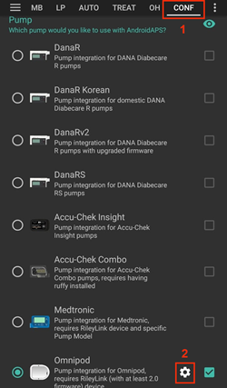 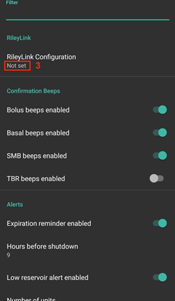

 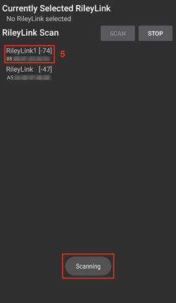

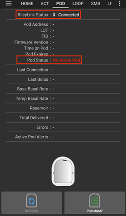


```{admonition} Older screenshot
:class: note
Šešios aukščiau esančios ekrano kopijos (po 6 žingsnio) yra iš ankstesnės **AAPS** versijos. **AAPS** 4 versijoje RileyLink susiejate mygtuku **Susieti RileyLink** Omnipod pompos ekrane, o ne per **RileyLink Configuration** Omnipod nustatymuose, ir paieška prasideda automatiškai.
```

```{note}
Norėdami pereiti prie kito RileyLink (pavyzdžiui, atsarginio įrenginio), dar kartą paspauskite **Susieti RileyLink** ir pasirinkite naują įrenginį. Jis pakeičia anksčiau susietą. Seno įrenginio pirma pašalinti nereikia.
```

(OmnipodEros-activating-a-pod)=

### Pod aktyvavimas

Prieš aktyvuodami Pod, įsitikinkite, kad RileyLink susietas, o **RileyLink būklė** rodo **Prisijungta**. Mygtukas **Aktyvuoti Pod** lieka neaktyvus, kol RileyLink nėra paruoštas.

*PRIMINIMAS: aktyvuojant (susiejant) Pod, dėl saugumo ryšys veikia tik nedideliu atstumu. Prieš susiejimą Pod radijo signalas silpnesnis, o po susiejimo Pod veikia visu signalo galingumu. Šių veiksmų metu įsitikinkite, kad jūsų Pod yra* [visai netoli](#OmnipodEros-optimal-omnipod-and-rileylink-positioning) *(~30 cm ar arčiau), bet ne ant RileyLink ir ne visai šalia jo.*

01. Atidarykite Omnipod pompos ekraną (**Valdymas** > **Pompa**) ir paspauskite **Aktyvuoti Pod**.

    Jei dar niekada neaktyvavote profilio, pirmiausia parodomas žingsnis **Reikalingas profilis**. Pasirinkite profilį, kuris bus taikomas aktyvavus.

    >  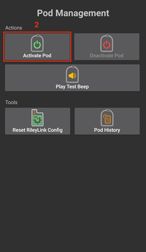 
    > 
    > ```{admonition} Older screenshot
    >     :class: note
    >     Aukščiau esančios ekrano kopijos yra iš ankstesnės **AAPS** versijos. **AAPS** 4 versijoje **Aktyvuoti Pod** yra mygtukas Omnipod pompos ekrane, o ne **POD MGMT** meniu.
    > ```

02. Rodomas ekranas **Užpildykite Pod**. Pripildykite naują Pod insulino 3 dienoms ir klausykitės dviejų pyptelėjimų. Jie reiškia, kad pripildytas mažiausias 80 vienetų kiekis. Visiškai ištuštinkite pildymo švirkštą, net jei jau išgirdote du pyptelėjimus. Skaičiuodami, kiek insulino reikės 3 dienoms, nepamirškite, kad Pod užpildymui sunaudojama 12–15 vienetų. Kol kas nenuimkite Pod adatos dangtelio.

    > 
    > 
    > Įsitikinkite, kad naujas Pod ir RileyLink yra visai netoli vienas kito (~30 cm ar arčiau), ir paspauskite **Toliau**.

03. **Pasirinkite insuliną** (rodoma tik jei nustatytas daugiau nei vienas insulinas): pasirinkite insuliną, kuriuo pildote Pod, ir paspauskite **Toliau**. Po aktyvavimo pritaikomas profilio keitimas su šiuo insulinu.

04. Ekrane **Inicijuoti Pod** Pod pradeda užpildymą (išgirsite spragtelėjimą, o po jo seriją tiksėjimų, kol Pod pats užsipildo). Jei RileyLink yra per toli nuo aktyvuojamo Pod, gausite klaidos pranešimą **Nėra atsakymo iš Pod**. Jei taip nutinka, [padėkite RileyLink arčiau](#OmnipodEros-optimal-omnipod-and-rileylink-positioning) Pod (~30 cm ar arčiau), bet ne ant jo ir ne visai šalia, ir paspauskite **Bandyti dar kartą**.

    >  

05. Kai užpildymas pavyksta, parodoma žalia varnelė ir tampa aktyvus mygtukas **Toliau**. Paspauskite **Toliau**.

    > 

06. **Infuzijos vieta** (rodoma tik jei [Vietų rotacija](#Aapsscreens-site-rotation) įjungta parinktis **Valdyti infuzijos vietų rotaciją**): pasirinkite, kurioje kūno vietoje klijuojate Pod, ir paspauskite **Toliau**.

07. Rodomas ekranas **Priklijuokite Pod**. Paruoškite naujo Pod infuzijos vietą. Nuimkite Pod plastikinį adatos dangtelį ir baltą popierinę lipniosios dalies apsaugą ir priklijuokite Pod pasirinktoje kūno vietoje. Jei kaniulė kyšo, paspauskite **Atšaukti** ir išmeskite Pod. Baigę paspauskite **Toliau**.

    > 

08. Parodomas patvirtinimo langas: „Kai paspausite OK, kaniulė bus įvesta“. **Spauskite OK TIK tada, kai esate pasiruošę įvesti kaniulę**.

    > 

09. Ekrane **Įvesti kaniulę** gali praeiti šiek tiek laiko, kol Omnipod atsakys ir įves kaniulę (daugiausia 1–2 minutės), todėl būkite kantrūs.

    > Jei RileyLink yra per toli nuo aktyvuojamo Pod, gausite klaidos pranešimą **Nėra atsakymo iš Pod**. Jei taip nutinka, padėkite RileyLink arčiau Pod (~30 cm ar arčiau), bet ne ant jo ir ne visai šalia, ir paspauskite **Bandyti dar kartą**.
    > 
    > Jei RileyLink yra už Bluetooth ryšio zonos arba neturi aktyvaus ryšio su telefonu, gausite klaidos pranešimą **Nėra atsakymo iš RileyLink**. Jei taip nutinka, padėkite RileyLink arčiau telefono ir paspauskite **Bandyti dar kartą**.
    > 
    > *PASTABA: prieš įvedant kaniulę, verta suimti odą šalia kaniulės įvedimo vietos. Tada adata įeina sklandžiai ir mažiau tikėtina, kad atsiras užsikimšimų.*
    > 
    > 
    > 
    >  

10. Sėkmingai įvedus kaniulę, atsiranda žalia varnelė ir tampa aktyvus mygtukas **Toliau**. Paspauskite **Toliau**.

    > 

11. Rodomas ekranas **Pod aktyvuotas**. Patikrinkite, ar kaniulė įvesta teisingai. Jei manote, kad ne, pakeiskite Pod. Paspauskite **Baigti**. Sveikiname! Jūs pradėjote naują aktyvią Pod sesiją.

    >  
    > 
    > ```{admonition} Older screenshot
    >     :class: note
    >     2–11 žingsnių ekrano kopijos yra iš ankstesnės **AAPS** versijos ir **AAPS** 4 versijoje gali atrodyti kitaip. Žingsniai **Pasirinkite insuliną** ir **Infuzijos vieta** paveikslėliuose neparodyti.
    > ```

12. Grįžtate į Omnipod pompos ekraną. Vietoje mygtuko **Aktyvuoti Pod** rodomas **Išjungti Pod**, nes kito Pod negalite aktyvuoti, kol neišjungėte aktyvaus.

    Dabar pompos ekrane rodoma informacija apie jūsų aktyvų Pod: dabartinė valandinė bazė, rezervuaro lygis, suleistas insulinas, Pod klaidos ir perspėjimai. Daugiau informacijos rasite skyriuje [Omnipod pompos ekranas](#OmnipodEros-omnipod-pod-tab).

     

    ```{admonition} Older screenshot
    :class: note
    Aukščiau esančios ekrano kopijos yra iš ankstesnės **AAPS** versijos. **AAPS** 4 versijoje nėra Pod valdymo meniu: grįžtate tiesiai į Omnipod pompos ekraną, kur vietoje **Aktyvuoti Pod** rodomas **Išjungti Pod**.
    ```

```{note}
Jei aktyvavimas buvo nutrauktas po užpildymo (pavyzdžiui, programėlė buvo uždaryta), dar kartą paspauskite **Aktyvuoti Pod**. Vedlys tęsia nuo kaniulės įvedimo žingsnių.
```

### Pod išjungimas

Įprastai Pod veikia tris dienas (72 valandas) ir dar 8 valandas po įspėjimo apie Pod naudojimo pabaigą, iš viso 80 valandų.

Norėdami išjungti Pod (pasibaigus naudojimo laikui arba sugedus Pod):

1. Atidarykite Omnipod pompos ekraną (**Valdymas** > **Pompa**) ir paspauskite **Išjungti Pod**.

   >  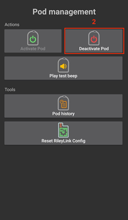 
   > 
   > ```{admonition} Older screenshot
   >    :class: note
   >    Aukščiau esančios ekrano kopijos yra iš ankstesnės **AAPS** versijos. **AAPS** 4 versijoje **Išjungti Pod** yra mygtukas Omnipod pompos ekrane, o ne **POD MGMT** meniu.
   > ```

2. Ekrane **Išjungti Pod** pirmiausia įsitikinkite, kad RileyLink yra visai netoli Pod, bet ne ant jo ir ne visai šalia. Tada paspauskite **Toliau**. Lange klausiama: *Išjungto Pod pakartotinai naudoti negalima. Išjungti šį Pod dabar?* Paspauskite **OK**, jei norite pradėti išjungti Pod, arba **Atšaukti**, jei norite jį palikti. Išjungimas sustabdo visą insulino tiekimą, ir jo atšaukti negalima.

   > 

3. Parodomas ekranas **Pod išjungiamas**, ir Pod pyptelėjimu patvirtina, kad išjungimas pavyko.

   > 
   > 
   > **JEI išjungti nepavyksta** ir negirdite patvirtinimo pyptelėjimo, galite gauti pranešimą **Nėra atsakymo iš RileyLink** arba **Nėra atsakymo iš Pod**. Paspauskite **Bandyti dar kartą**, kad bandytumėte išjungti dar kartą. Jei išjungti vis nepavyksta, paspauskite **Pašalinti Pod** ir patvirtinkite. Tada **AAPS** pamiršta šį Pod. Insulino tiekimas **nesustabdytas**, todėl nuimkite Pod nuo kūno. Jei jūsų Pod garsiai aliarmuoja („rėkia“), gali tekti jį nutildyti rankiniu būdu (smeigtuku ar sąvaržėle), nes **Pašalinti Pod** jo nenutildo.
   > 
   > >   

4. Kai išjungimas pavyksta, parodoma žalia varnelė. Paspauskite **Toliau**, kad būtų parodytas ekranas **Pod išjungtas**. Dabar galite nuimti Pod, nes aktyvi sesija išjungta.

   > 

5. Paspauskite **Baigti**, kad grįžtumėte į Omnipod pompos ekraną.

   >  
   > 
   > ```{admonition} Older screenshot
   >    :class: note
   >    2–5 žingsnių ekrano kopijos yra iš ankstesnės **AAPS** versijos ir **AAPS** 4 versijoje gali atrodyti kitaip.
   > ```

6. Omnipod pompos ekrane patikrinkite, ar **RileyLink būklė** rodo **Prisijungta**, o **Pod būklė** rodo **Nėra aktyvaus Pod**.

   >    
   > 
   > ```{admonition} Older screenshot
   >    :class: note
   >    Aukščiau esančios ekrano kopijos yra iš ankstesnės **AAPS** versijos. **AAPS** 4 versijoje **Baigti** jus grąžina tiesiai į Omnipod pompos ekraną; nėra nei Pod valdymo meniu, nei skirtuko **Omnipod (POD)**.
   > ```

### Insulino tiekimo sustabdymas ir atnaujinimas

Toliau parodyta, kaip sustabdyti ir atnaujinti insulino tiekimą.

*PASTABA - jei nematote mygtuko **Sustabdyti***, jis pagal numatymą paslėptas. Enable **Show Suspend Delivery button in Omnipod tab** in the [Omnipod settings](#OmnipodEros-omnipod-settings) under **Other**.

#### Insulino tiekimo sustabdymas

Ši komanda aktyvų Pod perjungia į sustabdytą būseną. Sustabdytas Pod visai netiekia insulino. Ši komanda atlieka tą patį, ką originalaus Omnipod PDM sustabdymo funkcija aktyviam Pod.

1. Atidarykite Omnipod pompos ekraną (**Valdymas** > **Pompa**) ir paspauskite **Sustabdyti**. Sustabdymo komanda per RileyLink siunčiama aktyviam Pod.

2. Kai Pod sustabdo visą insulino tiekimą, **Pod būklė** rodo **Sustabdyta**, o vietoje mygtuko **Sustabdyti** rodomas **Atnaujinti insulino tiekimą**.

   >  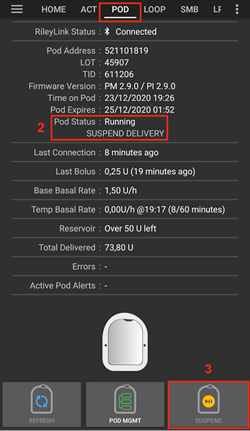
   > 
   > 
   > 
   >  
   > 
   > ```{admonition} Older screenshot
   >    :class: note
   >    Aukščiau esančios ekrano kopijos yra iš ankstesnės **AAPS** versijos. **AAPS** 4 versijoje šie žingsniai atliekami Omnipod pompos ekrane, o ne skirtuke **Omnipod (POD)**, o rezultatas rodomas lauke **Pod būklė**.
   > ```

Jei komanda nepavyksta, langas **Įspėjimas** rodo „Nepavyko sustabdyti insulino tiekimo“ ir priežastį. Patikrinkite RileyLink ryšį ir bandykite dar kartą.

#### Insulino tiekimo atnaujinimas

Šia komanda nurodote aktyviam, šiuo metu sustabdytam Pod vėl tiekti insuliną. Sėkmingai įvykdžius komandą, insulinas vėl tiekiamas įprastai: pagal aktyvaus valandinės bazės profilio valandinę bazę dabartiniam laikui. Pod vėl priima boluso, laikinos bazės ir SMB komandas.

1. Atidarykite Omnipod pompos ekraną ir patikrinkite, ar **Pod būklė** rodo **Sustabdyta**. Paspauskite **Atnaujinti insulino tiekimą**.

2. Kai komanda pavyksta, **Pod būklė** vėl rodo **Vykdoma**, o mygtukas **Atnaujinti insulino tiekimą** išnyksta (mygtukas **Sustabdyti** vėl rodomas, jei jį įjungėte).

   >  
   > 
   > 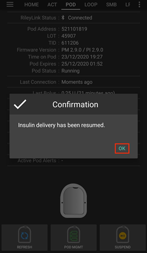
   > 
   >  
   > 
   > ```{admonition} Older screenshot
   >    :class: note
   >    Aukščiau esančios ekrano kopijos yra iš ankstesnės **AAPS** versijos. **AAPS** 4 versijoje šie žingsniai atliekami Omnipod pompos ekrane, o ne skirtuke **Omnipod (POD)**, o rezultatas rodomas lauke **Pod būklė**.
   > ```

Jei komanda nepavyksta, langas **Įspėjimas** rodo „Nepavyko atnaujinti insulino tiekimo“ ir priežastį. Patikrinkite RileyLink ryšį ir bandykite dar kartą.

### Pod perspėjimų nutildymas

*PASTABA - mygtukas **Nutildyti perspėjimus** Omnipod pompos ekrane rodomas tik tada, kai Pod turi aktyvų perspėjimą (pavyzdžiui, apie Pod naudojimo pabaigą arba senkantį rezervuarą), ir tik jei išjungta parinktis **Automatiškai nutildyti Pod perspėjimus**.*

Toliau parodyta, kaip nutildyti Pod pypsėjimą, kuris prasideda, kai Pod pasiekia įspėjimo laiką prieš naudojimo pabaigą. Šis įspėjimo laikas nustatomas parinktimi **Įspėjimas apie išsijungimą (80 val.)** Omnipod nustatymų skiltyje **Perspėjimai**. Ilgiausias Pod veikimo laikas yra 80 valandų (3 dienos ir 8 valandos), tačiau Insulet rekomenduoja neviršyti 72 valandų (3 dienų).

*PASTABA - jei Omnipod nustatymų skiltyje **Perspėjimai** įjungėte **Automatiškai nutildyti Pod perspėjimus**, **AAPS** perspėjimą nutildo automatiškai per kitą ryšį su Pod, ir to NEREIKIA daryti rankiniu būdu.*

1. Atėjus įspėjimo laikui, Pod pypsi, kad praneštų, jog greitai baigsis jo naudojimo laikas ir jį reikės pakeisti. Omnipod pompos ekrane **Pod naudojimo pabaiga** rodo tikslų Pod naudojimo pabaigos laiką (72 valandos po aktyvavimo); likus 4 valandoms, laukas tampa **geltonas**. **Pod veikimo pabaiga** rodo, kada Pod nustos tiekti insuliną. **Aktyvūs Pod perspėjimai** rodo **Pod naudojimo laikas greitai baigsis**, ir atsiranda mygtukas **Nutildyti perspėjimus**. **AAPS** taip pat parodo pranešimą apie artėjančią Pod naudojimo pabaigą.

   > 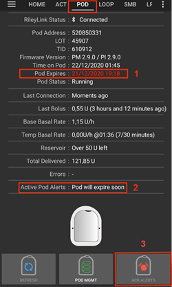 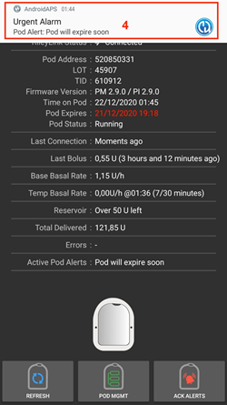 
   > 
   > ```{admonition} Older screenshot
   >    :class: note
   >    Aukščiau esančios ekrano kopijos yra iš ankstesnės **AAPS** versijos. **AAPS** 4 versijoje mygtukas **ACK ALERTS** vadinasi **Nutildyti perspėjimus** ir yra Omnipod pompos ekrane.
   > ```

2. Paspauskite **Nutildyti perspėjimus**. RileyLink siunčia Pod komandą nutraukti įspėjimo apie naudojimo pabaigą pypsėjimą.

   >  
   > 
   > ```{admonition} Older screenshot
   >    :class: note
   >    Aukščiau esanti ekrano kopija yra iš ankstesnės **AAPS** versijos. **AAPS** 4 versijoje mygtukas vadinasi **Nutildyti perspėjimus**.
   > ```

3. Kai perspėjimai nutildomi, Pod pyptelėja du kartus. **Aktyvūs Pod perspėjimai** neberodo įspėjimo, mygtukas **Nutildyti perspėjimus** išnyksta, o Pod nustoja pypsėti dėl naudojimo pabaigos.

   >  
   > 
   > ```{admonition} Older screenshot
   >    :class: note
   >    Aukščiau esanti ekrano kopija yra iš ankstesnės **AAPS** versijos. **AAPS** 4 versijoje rezultatas rodomas Omnipod pompos ekrane: įspėjimas išnyksta iš lauko **Aktyvūs Pod perspėjimai**.
   > ```

Jei komanda nepavyksta (pavyzdžiui, RileyLink yra per toli nuo Pod), langas **Įspėjimas** rodo „Nepavyko nutildyti perspėjimų“ ir priežastį. Padėkite RileyLink arčiau Pod ir bandykite dar kartą.

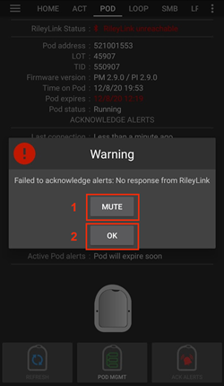

```{admonition} Older screenshot
:class: note
Aukščiau esanti ekrano kopija yra iš ankstesnės **AAPS** versijos. **AAPS** 4 versijoje langas **Įspėjimas** rodo „Nepavyko nutildyti perspėjimų“ ir priežastį.
```

(OmnipodEros-view-pod-history)=

### Pod istorijos peržiūra

Šiame skyriuje parodyta, kaip peržiūrėti aktyvaus Pod istoriją ir filtruoti ją pagal veiksmų kategorijas. Pod istorijoje matysite veiksmus ir jų rezultatus, atliktus su dabar aktyviu Pod per jo trijų dienų (72–80 valandų) veikimo laiką.

Tai naudinga norint patikrinti bolusus, laikinas bazes ir valandinės bazės pakeitimus, kai nesate tikri, ar jie buvo atlikti. Kitos kategorijos dažniausiai naudingos ieškant problemų priežasčių ir nustatant, kokia tvarka vyko įvykiai prieš gedimą.

*PASTABA:* **Nepatvirtintos** komandos rodomos Pod istorijoje, tačiau dėl jų pobūdžio negalite būti tikri, kad jos tikslios.

1. Atidarykite Omnipod pompos ekraną (**Valdymas** > **Pompa**) ir paspauskite **Pod istorija**.

   > 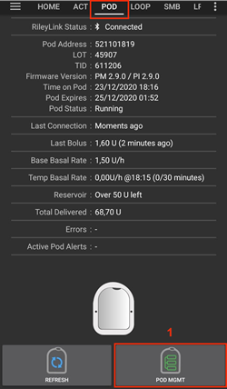  
   > 
   > ```{admonition} Older screenshot
   >    :class: note
   >    Aukščiau esančios ekrano kopijos yra iš ankstesnės **AAPS** versijos. **AAPS** 4 versijoje **Pod istorija** yra mygtukas Omnipod pompos ekrane, o ne **POD MGMT** meniu.
   > ```

2. Ekrane **Pod istorija** išvardyti visi Pod veiksmai ir jų rezultatai, naujausi viršuje, sugrupuoti pagal dienas. Pagal numatymą pasirinkta **Visi**. Bakstelėkite vieną iš filtrų mygtukų viršuje, kad būtų rodoma tik viena kategorija. Rodykle atgal viršutiniame kairiajame kampe grįžkite į Omnipod pompos ekraną.

   > 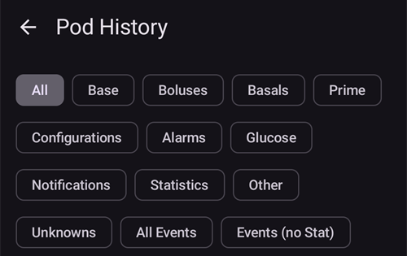

   >  
   > 
   > ```{admonition} Older screenshot
   >    :class: note
   >    Antroji ekrano kopija yra iš ankstesnės **AAPS** versijos ir **AAPS** 4 versijoje gali atrodyti kitaip.
   > ```

### RileyLink nustatymų ir istorijos peržiūra

Ekrane **RileyLink statistika** rodomi jūsų RileyLink ir aktyvaus Pod nustatymai bei abiejų ryšio istorija. Jame yra du skirtukai: **Parametrai** ir **Istorija**.

Mygtukas **RileyLink statistika** pagal numatymą paslėptas. Kad jis būtų rodomas Omnipod pompos ekrane, [Omnipod nustatymų](#OmnipodEros-omnipod-settings) skiltyje **Kiti** įjunkite **Pod valdymo meniu rodyti mygtuką RileyLink statistika**.

#### Pod ryšio įrenginio Bluetooth ryšio atkūrimas rankiniu būdu

Jei jūsų Pod ryšio įrenginys kurį laiką buvo už telefono Bluetooth ryšio zonos, **RileyLink būklė** Omnipod pompos ekrane gali rodyti **RileyLink nepasiekiama**. Kai įrenginys vėl ryšio zonoje, **AAPS** paprastai prisijungia pati. Jei ne:

1. Įsitikinkite, kad RileyLink įjungtas, įkrautas ir yra arti telefono.

2. Omnipod pompos ekrane paspauskite **Nustatyti RileyLink iš naujo**. Pranešimas patvirtina: **RileyLink konfigūracija nustatyta iš naujo**. Žr. [pastabas apie RileyLink nustatymą iš naujo](#OmnipodEros-reset-rileylink-config-notes) toliau.

3. Jei **Bluetooth ryšys** neatsikuria, pabandykite telefone rankiniu būdu **išjungti** ir vėl **įjungti** Bluetooth.

4. Jei vis tiek neprisijungia, paspauskite **Susieti RileyLink** ir vėl pasirinkite savo RileyLink.

5. Sėkmingai prisijungus, **RileyLink būklė** rodo **Prisijungta**. Taip pat galite patikrinti **Ryšio būklė** ekrano **RileyLink statistika** skirtuke **Parametrai**. Sveikiname, jūs vėl prijungėte savo Pod ryšio įrenginį prie AAPS!

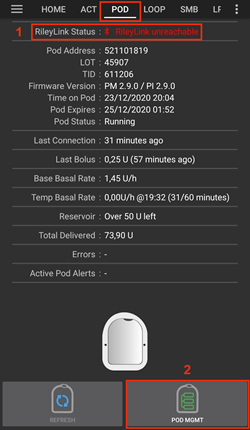 

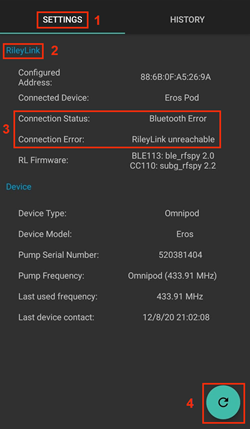


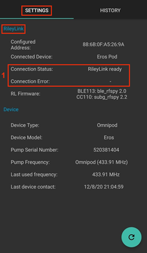

```{admonition} Older screenshot
:class: note
Aukščiau esančios ekrano kopijos yra iš ankstesnės **AAPS** versijos. **AAPS** 4 versijoje iš naujo prisijungiate mygtuku **Nustatyti RileyLink iš naujo** arba **Susieti RileyLink** Omnipod pompos ekrane, o ne atnaujinimo mygtuku RileyLink nustatymų ekrane.
```

#### Pod ryšio įrenginio ir aktyvaus Pod nustatymai

Šiame ekrane rodoma šiuo metu susieto Pod ryšio įrenginio ir šiuo metu aktyvaus Omnipod Eros Pod informacija ir būklė. Informacija atnaujinama automatiškai.

1. Atidarykite Omnipod pompos ekraną (**Valdymas** > **Pompa**) ir paspauskite **RileyLink statistika**. Skirtuke **Parametrai** rodomas jūsų šiuo metu susietas **RileyLink** ir aktyvus Pod (**Įrenginys**).

   > 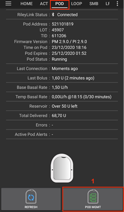 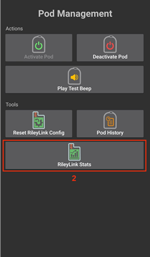 
   > 
   > ```{admonition} Older screenshot
   >    :class: note
   >    Aukščiau esančios ekrano kopijos yra iš ankstesnės **AAPS** versijos. **AAPS** 4 versijoje **RileyLink statistika** yra mygtukas Omnipod pompos ekrane, o ne **POD MGMT** meniu.
   > ```

   > 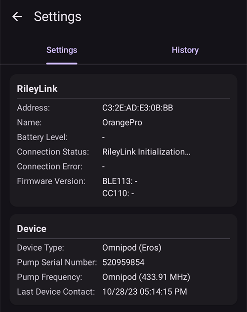

##### RileyLink laukai

> - **Adresas:** susieto Pod ryšio įrenginio MAC adresas.
> - **Vardas:** susieto Pod ryšio įrenginio Bluetooth pavadinimas.
> - **Baterijos lygis:** dabartinis prijungto Pod ryšio įrenginio baterijos lygis. Rodomas tik tada, kai įjungta parinktis **Rodyti baterijos įkrovimo lygį, gautą iš OrangeLink/EmaLink/DiaLink**.
> - **Ryšio būklė**: dabartinė Bluetooth ryšio tarp Pod ryšio įrenginio ir telefono su AAPS būklė.
> - **Prisijungimo klaida:** jei Pod ryšio įrenginio Bluetooth ryšyje yra klaida, čia rodoma išsami informacija.
> - **Programinės įrangos versija:** šiuo metu prijungto Pod ryšio įrenginio programinės įrangos versija.

##### Įrenginio laukai - kai yra aktyvus Pod

> - **Įrenginio tipas:** įrenginio, kuris bendrauja su Pod ryšio įrenginiu, tipas (OmniPod (Eros)).
> - **Nustatytas įrenginio modelis:** įrenginio, nustatyto bendrauti su Pod ryšio įrenginiu, modelis.
> - **Prijungtas įrenginio modelis:** įrenginio, kuris šiuo metu bendrauja su Pod ryšio įrenginiu, modelis.
> - **Pompos serijos Nr:** šiuo metu aktyvuoto Pod serijos numeris.
> - **Pompos dažnis:** radijo dažnis, kuriuo bendraujama su Pod.
> - **Paskutinis naudotas dažnis:** paskutinis žinomas radijo dažnis, kuriuo Pod bendravo su Pod ryšio įrenginiu.
> - **Paskutinis įrenginio kontaktas:** data ir laikas, kada Pod paskutinį kartą susisiekė su Pod ryšio įrenginiu.

(omnipod-eros-rileylink-and-active-pod-history)=
#### RileyLink ir aktyvaus Pod istorija

Šiame skirtuke, naujausi viršuje, išvardytos visos RileyLink arba šiuo metu prijungto Pod būsenos ir veiksmai. Istorija prieinama tik šiuo metu aktyviam Pod. Po Pod keitimo ši istorija ištrinama, ir įrašomi bei rodomi tik naujai aktyvuoto Pod įvykiai.

1. Atidarykite Omnipod pompos ekraną (**Valdymas** > **Pompa**), paspauskite **RileyLink statistika** ir bakstelėkite skirtuką **Istorija**.

   >  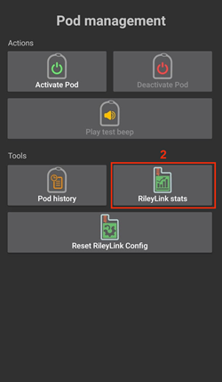 
   > 
   > ```{admonition} Older screenshot
   >    :class: note
   >    Aukščiau esančios ekrano kopijos yra iš ankstesnės **AAPS** versijos. **AAPS** 4 versijoje **RileyLink statistika** yra mygtukas Omnipod pompos ekrane, o ne **POD MGMT** meniu.
   > ```

   > 

##### Laukai

Kiekviename įraše rodoma:

> - **Įrenginys:** įrenginys, kuriam priklauso veiksmas arba būsena.
> - **Laikas:** įvykio laikas.
> - **Būsena arba veiksmas:** įrenginio būsena arba jo atliktas veiksmas.

(OmnipodEros-omnipod-pod-tab)=

## Omnipod pompos ekranas

Toliau paaiškinti **Omnipod pompos ekrano** būsenos laukai ir mygtukai (**Valdymas** > **Pompa** arba **Konfigūracija** > **Pompa** > **Atidaryti įskiepį**).

Krumpliaračio piktograma viršutiniame dešiniajame kampe atidaro [Omnipod nustatymus](#OmnipodEros-omnipod-settings).

*PASTABA: jei kuris nors būsenos laukas rodo (nepatvirtinta), paspauskite **Atnaujinti**, kad atnaujintumėte Pod būklę ir tai išvalytumėte.*


```{admonition} Older screenshot
:class: note
Aukščiau esanti ekrano kopija yra iš ankstesnės **AAPS** versijos, kurioje šis ekranas buvo skirtukas **Omnipod (POD)**. **AAPS** 4 versijoje tai yra Omnipod pompos ekranas, ir kai kurių laukų bei mygtukų pavadinimai skiriasi.
```

### Laukai

- **RileyLink būklė:** rodo dabartinę RileyLink ryšio būklę. Klaidos rodomos raudonai.

- *Nepradėta* - RileyLink dar nesusietas arba ryšys dar neprasidėjo.
- *RileyLink nepasiekiama* - Pod ryšio įrenginys yra už telefono Bluetooth ryšio zonos, išjungtas arba turi gedimą, kuris trukdo Bluetooth ryšiui.
- *RileyLink paruoštas* - Pod ryšio įrenginys įjungtas ir dabar kuria Bluetooth ryšį.
- *Prisijungta* - Pod ryšio įrenginys įjungtas, prijungtas ir gali bendrauti per Bluetooth.

- **Unikalus ID:** rodo aktyvaus Pod adresą.

- **LOT numeris:** rodo aktyvaus Pod LOT numerį.

- **Eilės Nr.:** rodo Pod serijos numerį (TID).

- **Programinės įrangos versija:** rodo aktyvaus Pod programinės įrangos versiją.

- **Pod laikas:** rodo dabartinį laiką aktyviame Pod. Jis paryškinamas, kai skiriasi nuo telefono laiko daugiau nei 5 minutėmis.

- **Pod naudojimo pabaiga:** rodo datą ir laiką, kada baigsis aktyvaus Pod naudojimo laikas. Paskutines 4 valandas iki šio laiko tekstas būna geltonas. Jis niekada netampa raudonas, nes ir po to Pod toliau tiekia insuliną.

- **Pod veikimo pabaiga:** rodo Pod papildomo laiko pabaigą (8 valandos po **Pod naudojimo pabaiga**, iš viso daugiausia 80 valandų Pod veikimo). Tekstas tampa geltonas, kai prasideda papildomas laikas (ties **Pod naudojimo pabaiga**), ir raudonas paskutines 4 valandas iki veikimo pabaigos. Papildomo laiko metu taip pat rodoma, kiek laiko liko, pavyzdžiui, *(17m remaining)*. Veikimo pabaigoje Pod nustoja tiekti insuliną, todėl jį reikia pakeisti.

- **Pod būklė:** rodo aktyvaus Pod būklę (pavyzdžiui, **Nėra aktyvaus Pod**, **Vykdoma** arba **Sustabdyta**).

- **Paskutinis prisijungimas:** rodo, kada paskutinį kartą pavyko susisiekti su aktyviu Pod. Tekstas tampa raudonas, kai viršijama [perspėjimo apie nepasiekiamą pompą riba](#OmnipodEros-troubleshooting).

- *Ką tik* - mažiau nei prieš 20 sekundžių.
- *Mažiau nei prieš minutę* - daugiau nei prieš 20 sekundžių, bet mažiau nei prieš 60 sekundžių.
- *prieš 1 minutę* - daugiau nei prieš 60 sekundžių, bet mažiau nei prieš 120 sekundžių (2 min.)
- *prieš XX minučių* - daugiau nei prieš 2 minutes, XX nurodo tikslų skaičių

- **Paskutinis bolusas:** rodo paskutinio aktyviam Pod išsiųsto boluso dozę ir skliausteliuose - prieš kiek laiko jis buvo suleistas.

- **Pagrindinė valandinė bazė:** rodo valandinę bazę, nustatytą dabartiniam laikui valandinės bazės profilyje.

- **Laikina bazė:** rodoma tik tada, kai veikia laikina bazė. Rodoma tokiu formatu:

- Vienetai / valandą @ laikas, kada nustatyta laikina bazė (praėjusios minutės / visa laikinos bazės trukmė minutėmis)
- *Pavyzdys:* 0,00 V/val. @18:25 ( 90/120 min.)

- **Rezervuaras:** rodo **Liko daugiau nei 50 V**, kai rezervuare liko daugiau nei 50 vienetų. Kai liko mažiau, rodomas apytikslis vienetų skaičius. Tekstas tampa raudonas, kai liko mažiau nei [perspėjimų nustatymuose](#OmnipodEros-omnipod-settings) nustatyta senkančio rezervuaro riba.

- **Iš viso suleista:** rodo bendrą iš rezervuaro suleisto insulino vienetų skaičių. *Tai tik apytikslė reikšmė, nes Pod užpildymas nėra tikslus procesas.*

- **Aktyvūs Pod perspėjimai:** rodo šiuo metu aktyvius aktyvaus Pod perspėjimus. Paprastai naudojama, kai Pod naudojimo laikas viršijo 72 valandas ir Pod pats pypsi.

- **Klaidos:** rodo paskutinę įvykusią klaidą (raudonai). Ankstesnių klaidų ir išsamesnės informacijos ieškokite [Pod istorijoje](#OmnipodEros-view-pod-history), [RileyLink istorijoje](#omnipod-eros-rileylink-and-active-pod-history) ir žurnalų failuose.

### Buttons

Mygtukai pompos ekrano apačioje keičiasi pagal situaciją. Mygtukai, kurių dabar naudoti negalima, yra pilki, pavyzdžiui, kol RileyLink neprijungtas.

**Pod būklės mygtukai** (rodomi, kai Pod aktyvus):

- **Atnaujinti:** siunčia aktyviam Pod atnaujinimo komandą, kad atnaujintų jo būklę. Naudokite jį Pod būklei atnaujinti ir būsenos laukams, kuriuose rodoma (nepatvirtinta), išvalyti. Daugiau informacijos rasite žemiau esančiame skyriuje [Trikčių šalinimas](#OmnipodEros-troubleshooting).

  

  ```{admonition} Older screenshot
  :class: note
  Aukščiau esanti ekrano kopija yra iš ankstesnės **AAPS** versijos. **AAPS** 4 versijoje tai yra tekstinis mygtukas **Atnaujinti** Omnipod pompos ekrane.
  ```

- **Nutildyti perspėjimus:** nutildo Pod naudojimo pabaigos ir senkančio rezervuaro pypsėjimą bei pranešimus. Rodomas tik tada, kai Pod turi aktyvų perspėjimą ir išjungta parinktis **Automatiškai nutildyti Pod perspėjimus**. Nutildžius perspėjimus, mygtukas išnyksta.

  

  ```{admonition} Older screenshot
  :class: note
  Aukščiau esanti ekrano kopija yra iš ankstesnės **AAPS** versijos. **AAPS** 4 versijoje šis mygtukas vadinasi **Nutildyti perspėjimus**.
  ```

- **Nustatyti laiką:** nustato Pod laiką pagal dabartinį telefono laiką. Rodomas tik tada, kai Pod laikas nuo telefono laiko skiriasi daugiau nei 5 minutėmis.

  

  ```{admonition} Older screenshot
  :class: note
  Aukščiau esanti ekrano kopija yra iš ankstesnės **AAPS** versijos. **AAPS** 4 versijoje tai yra tekstinis mygtukas **Nustatyti laiką** Omnipod pompos ekrane.
  ```

- **Sustabdyti:** sustabdo insulino tiekimą aktyviame Pod. Only shown if enabled in the settings (**Show Suspend Delivery button in Omnipod tab**).

  

  ```{admonition} Older screenshot
  :class: note
  Aukščiau esanti ekrano kopija yra iš ankstesnės **AAPS** versijos. **AAPS** 4 versijoje tai yra tekstinis mygtukas **Sustabdyti** Omnipod pompos ekrane.
  ```

- **Atnaujinti insulino tiekimą:** atnaujina insulino tiekimą šiuo metu sustabdytame aktyviame Pod. Rodomas tik tada, kai Pod sustabdytas.

  

  ```{admonition} Older screenshot
  :class: note
  Aukščiau esanti ekrano kopija yra iš ankstesnės **AAPS** versijos. **AAPS** 4 versijoje tai yra tekstinis mygtukas **Atnaujinti insulino tiekimą** Omnipod pompos ekrane.
  ```

**Pod ir RileyLink valdymo mygtukai:**


```{admonition} Older screenshot
:class: note
Aukščiau esanti ekrano kopija yra iš ankstesnės **AAPS** versijos. **AAPS** 4 versijoje nėra Pod valdymo meniu: šie veiksmai yra mygtukai tiesiai Omnipod pompos ekrane.
```

- **Aktyvuoti Pod:** užpildo ir aktyvuoja naują Pod. Rodomas, kai nėra aktyvaus Pod. Jis aktyvus tik tada, kai RileyLink prijungtas.

  

  ```{admonition} Older screenshot
  :class: note
  Aukščiau esanti ekrano kopija yra iš ankstesnės **AAPS** versijos. **AAPS** 4 versijoje **Aktyvuoti Pod** yra mygtukas Omnipod pompos ekrane, o ne Pod valdymo meniu.
  ```

- **Išjungti Pod:** išjungia šiuo metu aktyvų Pod. Rodomas, kai tik Pod susietas, taip pat kai aktyvavimas sustojo pusiaukelėje (pavyzdžiui, nes Pod sugedo aktyvuojant). Jis aktyvus tik tada, kai RileyLink prijungtas. Prieš išjungdama Pod, **AAPS** paprašo jūsų patvirtinimo.

- Šią komandą naudokite „rėkiančiam“ Pod (klaida 49) išjungti.
- Jei išjungti nepavyksta, išjungimo vedlys pasiūlo parinktį **Pašalinti Pod**.

  

  ```{admonition} Older screenshot
  :class: note
  Aukščiau esanti ekrano kopija yra iš ankstesnės **AAPS** versijos. **AAPS** 4 versijoje **Išjungti Pod** yra mygtukas Omnipod pompos ekrane, o ne Pod valdymo meniu.
  ```

- **Paleisti bandomąjį signalą:** paspaudus Pod vieną kartą pyptelėja. Rodomas, kai Pod susietas.

  

  ```{admonition} Older screenshot
  :class: note
  Aukščiau esanti ekrano kopija yra iš ankstesnės **AAPS** versijos. **AAPS** 4 versijoje **Paleisti bandomąjį signalą** yra mygtukas Omnipod pompos ekrane, o ne Pod valdymo meniu.
  ```

- **Pod istorija:** rodo aktyvaus Pod veiksmų istoriją. Žr. [Pod istorijos peržiūra](#OmnipodEros-view-pod-history).

  

  ```{admonition} Older screenshot
  :class: note
  Aukščiau esanti ekrano kopija yra iš ankstesnės **AAPS** versijos. **AAPS** 4 versijoje **Pod istorija** yra mygtukas Omnipod pompos ekrane, o ne Pod valdymo meniu.
  ```

- **Susieti RileyLink:** suranda jūsų Pod ryšio įrenginį ir jį susieja. Žr. [RileyLink sąranka](#OmnipodEros-rileylink-setup).

- **RileyLink statistika:** atidaro ekraną „RileyLink statistika“ su dviem skirtukais. Rodomas tik jei įjungtas nustatymuose (**Pod valdymo meniu rodyti mygtuką RileyLink statistika**).

- **Parametrai** - rodo RileyLink ir aktyvaus Pod nustatymus
- **Istorija** - rodo RileyLink ir Pod ryšio istoriją

  

  ```{admonition} Older screenshot
  :class: note
  Aukščiau esanti ekrano kopija yra iš ankstesnės **AAPS** versijos. **AAPS** 4 versijoje **RileyLink statistika** yra mygtukas Omnipod pompos ekrane, o ne Pod valdymo meniu.
  ```

- **Nustatyti RileyLink iš naujo:** iš naujo nustato šiuo metu prijungto Pod ryšio įrenginio konfigūraciją. Pradedant ryšį, į RileyLink siunčiami ir jame nustatomi tam tikri duomenys:

- Nustatomi atminties registrai
- Nustatomi ryšio protokolai
- Nustatomas suderintas radijo dažnis
  > 
  > Žr. [papildomas pastabas](#OmnipodEros-reset-rileylink-config-notes) toliau.

  

  ```{admonition} Older screenshot
  :class: note
  Aukščiau esanti ekrano kopija yra iš ankstesnės **AAPS** versijos. **AAPS** 4 versijoje šis mygtukas vadinasi **Nustatyti RileyLink iš naujo** ir yra Omnipod pompos ekrane.
  ```

- **Pašalinti Pod:** po patvirtinimo pašalina neatsakančio Pod būseną. Rodomas tik tada, kai Pod buvo pradėtas aktyvuoti, bet nėra visiškai susietas, nes tinkamai išjungti jo nebeįmanoma:

- **Pod nėra visiškai susietas**, todėl nepaiso išjungimo komandų.
- **Pod užstringa** susiejimo metu tarp žingsnių.
- **Pod visai nesusiejamas.**
  > 
  > Pašalinus Pod, **AAPS** nebegali su juo bendrauti. Nuimkite Pod nuo kūno.

  

  ```{admonition} Older screenshot
  :class: note
  Aukščiau esanti ekrano kopija yra iš ankstesnės **AAPS** versijos. **AAPS** 4 versijoje **Pašalinti Pod** yra mygtukas Omnipod pompos ekrane, o ne Pod valdymo meniu.
  ```

(OmnipodEros-reset-rileylink-config-notes)=

#### *Pastabos apie RileyLink nustatymą iš naujo*

- Ši funkcija dažniausiai naudojama, kai dabartinis Pod ryšio įrenginys neatsako ir ryšys „užstrigo“.
- Jei Pod ryšio įrenginys buvo išjungtas ir vėl įjungtas, paspauskite **Nustatyti RileyLink iš naujo**, kad šie ryšio parametrai vėl būtų nustatyti Pod ryšio įrenginyje.
- Jei to NEPADARYSITE, išjungus ir vėl įjungus Pod ryšio įrenginį, AAPS reikės paleisti iš naujo.
- Keičiant vieną Pod ryšio įrenginį kitu, šio mygtuko spausti **NEREIKIA**.

(OmnipodEros-omnipod-settings)=

## Omnipod nustatymai

Omnipod tvarkyklės nustatymus galite atidaryti vienu iš būdų:

- paspauskite krumpliaračio piktogramą Omnipod pompos ekrano viršutiniame dešiniajame kampe (**Valdymas** > **Pompa**) arba
- atidarykite viršutiniame kairiajame kampe esantį **meniu** (☰) > **Konfigūracija** > **Pompa** ir **Omnipod Eros** kortelėje paspauskite **Parametrai**.

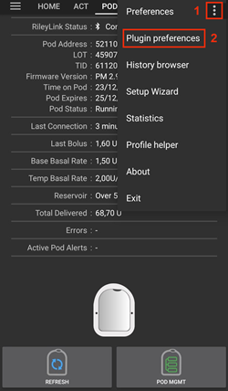

```{admonition} Older screenshot
:class: note
Aukščiau esanti ekrano kopija yra iš ankstesnės **AAPS** versijos. **AAPS** 4 versijoje nustatymus atidarote mygtuku **Parametrai** kortelėje **Omnipod Eros** arba krumpliaračio piktograma Omnipod pompos ekrane, o ne nustatymų krumpliaračiu skiltyje **Konfigūracija** ar 3 taškų meniu.
```

Nustatymai sugrupuoti taip, kaip išvardyta toliau. Bakstelėkite grupę, kad ją išskleistumėte. Dauguma įrašų yra jungikliai, kuriuos galite įjungti arba išjungti:


*PASTABA: žvaigždutė (\*) reiškia, kad nustatymas pagal numatymą įjungtas.*

### RileyLink

Pod ryšio įrenginio nustatymai. Patį įrenginį susiejate mygtuku **Susieti RileyLink** pompos ekrane (žr. [RileyLink sąranka](#OmnipodEros-rileylink-setup)).

- **Atlikti skanavimą:** prieš jungiantis prie OrangeLink atlieka paiešką. Tai gali pagerinti ryšį. Jei reikia, galima naudoti ir su kitais RileyLink klonais.

- **Rodyti baterijos įkrovimo lygį, gautą iš OrangeLink/EmaLink/DiaLink:** rodo tikrąjį OrangeLink/EmaLink/DiaLink baterijos lygį. Visiems OrangeLink/EmaLink/DiaLink naudotojams **primygtinai rekomenduojama** įjungti šį nustatymą.

- NEVEIKIA su originaliu RileyLink.
- Gali neveikti su kitomis RileyLink alternatyvomis.
- Įjungta - rodo dabartinį palaikomų Pod ryšio įrenginių baterijos lygį.
- Išjungta - rodo reikšmę n/a.

- **Įjungti baterijos keitimo registravimą veiksmuose:** galima tik tada, kai įjungtas aukščiau esantis baterijos lygio rodymo nustatymas. Kai kuriuose Pod ryšio įrenginiuose galima naudoti įprastas keičiamas baterijas. Įjungę šį nustatymą, galite įrašyti **Baterijos keitimas** [terapijos įrašą](#aaps-screens-careportal), kad pažymėtumėte keitimą ir iš naujo nustatytumėte baterijos amžių.

### Patvirtinimo signalai

Pod pypteli, kad patvirtintų boluso, valandinės bazės, SMB ir laikinos bazės suleidimą ir pakeitimus.

- **\*Boluso signalai įjungti:** įjungia arba išjungia patvirtinimo signalus, kai suleidžiamas bolusas.
- **Bazės signalai įjungti:** įjungia arba išjungia patvirtinimo signalus, kai nustatoma nauja valandinė bazė, atšaukiama aktyvi valandinė bazė arba keičiama dabartinė valandinė bazė.
- **\*SMB signalai įjungti:** įjungia arba išjungia patvirtinimo signalus, kai suleidžiamas SMB.
- **Laikinos bazės signalai įjungti:** įjungia arba išjungia patvirtinimo signalus, kai laikina bazė nustatoma arba atšaukiama.

### Alerts

AAPS perspėjimai ir Nightscout pranešimai apie Pod naudojimo pabaigą, išsijungimą ir senkantį rezervuarą pagal nustatytą vienetų ribą.

*Atminkite: AAPS pranešimas VISADA parodomas apie kiekvieną perspėjimą po pirmojo ryšio su Pod nuo perspėjimo pradžios. Uždarius pranešimą, perspėjimas NEnutildomas, NEBENT įjungta parinktis **Automatiškai nutildyti Pod perspėjimus**. Norėdami perspėjimą nutildyti RANKINIU BŪDU, atidarykite Omnipod pompos ekraną ir paspauskite **Nutildyti perspėjimus**.*

- **\*Galiojimo pabaigos priminimas įjungtas:** įjungus, Pod pypsi, kai pasiekiamas žemiau nustatytas laikas.
- **Įspėjimas apie išsijungimą (80 val.):** likęs valandų skaičius iki Pod išsijungimo (80 valandų po aktyvavimo), kai suveikia galiojimo pabaigos priminimas (nuo 1 iki 8 valandų, numatyta 8).
- **\*Įjungtas perspėjimas apie senkantį rezervuarą:** įjungia arba išjungia perspėjimą, kai Pod likęs insulino kiekis pasiekia ribą, nustatytą lauke Vienetų skaičius.
- **Vienetų skaičius:** vienetų skaičius, kuriam esant suveikia Pod perspėjimas apie senkantį rezervuarą (nuo 5 iki 50, numatyta 20).
- **Automatiškai nutildyti Pod perspėjimus:** įjungus, pranešimas vis tiek parodomas, bet perspėjimas automatiškai nutildomas per kitą ryšį su Pod po perspėjimo pradžios.

### Notifications

AAPS pranešimai ir garsiniai telefono perspėjimai, kai neaišku, ar laikina bazė, SMB ar bolusas pavyko.

*PASTABA: tai tik pranešimai, Pod nepypsi.*

- **\*Garsinis pranešimas apie neaiškią laikiną bazę įjungtas:** įjunkite arba išjunkite šį nustatymą, kad gautumėte garsinį perspėjimą ir pranešimą ekrane, kai AAPS nežino, ar laikina bazė buvo sėkmingai nustatyta.
- **\*Garsinis pranešimas apie neaiškų SMB įjungtas:** įjunkite arba išjunkite šį nustatymą, kad gautumėte garsinį perspėjimą ir pranešimą ekrane, kai AAPS nežino, ar SMB buvo sėkmingai suleistas.
- **\*Garsinis pranešimas apie neaiškų bolusą įjungtas:** įjunkite arba išjunkite šį nustatymą, kad gautumėte garsinį perspėjimą ir pranešimą ekrane, kai AAPS nežino, ar bolusas buvo sėkmingai suleistas.

### Kiti

Papildomi nustatymai, padedantys ieškoti klaidų.

- **Show Suspend Delivery button in Omnipod tab:** Hide or display the **Suspend** button in the Omnipod tab.
- **Pod valdymo meniu rodyti mygtuką Pulse log:** šis nustatymas dar rodomas sąraše, tačiau dabartinėje pompos ekrano versijoje mygtuko **Pulse Log** nėra.

- **Pod valdymo meniu rodyti mygtuką RileyLink statistika:** paslepia arba rodo mygtuką **RileyLink statistika** Omnipod pompos ekrane.
- **\*Vasaros laiko/Laiko juostos aptikimas įjungtas:** leidžia automatiškai aptikti laiko juostos pakeitimus, jei telefonas naudojamas vietovėje, kur keičiamas vasaros laikas (DST).

### Aktyvaus Pod ryšio įrenginio (RileyLink) keitimas arba pašalinimas

Kadangi yra daug originalaus RileyLink alternatyvų (pavyzdžiui, OrangeLink ar EmaLink) arba gali reikėti kelių ar atsarginių to paties Pod ryšio įrenginio egzempliorių, gali tekti pereiti prie kito įrenginio.

Norėdami pakeisti įrenginį, atidarykite Omnipod pompos ekraną (**Valdymas** > **Pompa**), paspauskite **Susieti RileyLink** ir pasirinkite naują įrenginį, kaip aprašyta skyriuje [RileyLink sąranka](#OmnipodEros-rileylink-setup). Naujas įrenginys pakeičia anksčiau susietą.

 


 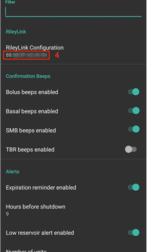

```{admonition} Older screenshot
:class: note
Aukščiau esančios ekrano kopijos yra iš ankstesnės **AAPS** versijos. **AAPS** 4 versijoje įrenginį pridedate mygtuku **Susieti RileyLink** Omnipod pompos ekrane, o ne per **RileyLink Configuration** Omnipod nustatymuose, ir paieška prasideda automatiškai.
```

Atskiro mygtuko susietam įrenginiui pašalinti nėra. Jei nustojate naudoti RileyLink, tiesiog susiekite naują, kai jo prireiks.


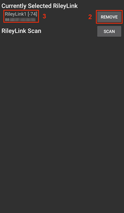

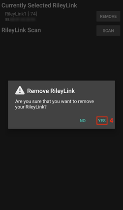


```{admonition} Older screenshot
:class: note
Aukščiau esančios ekrano kopijos yra iš ankstesnės **AAPS** versijos. **AAPS** 4 versijoje nėra mygtuko **Remove**: susiejus naują RileyLink, jis pakeičia ankstesnį.
```

## Būsenos eilutė ir terapijos įrašai

Yra keletas dalykų, kuriais Omnipod Pod skiriasi nuo pompų su vamzdeliu, ypač priklijavus naują Pod.

**Insulino** ir **kaniulės** amžius pagrindinio ekrano [būsenos eilutėje](#screens-sensor-level-battery) **po kiekvieno Pod keitimo** **nustatomas** į 0 dienų ir 0 valandų. Taip yra dėl to, kaip sukurta ir veikia Omnipod pompa. **Pompos baterija** ir **insulino rezervuaras** yra kiekvieno Pod viduje. Kadangi Pod įveda kaniulę tiesiai į odą toje vietoje, kur priklijuotas Pod, Omnipod pompos nenaudoja įprasto vamzdelio. *Todėl po Pod keitimo šių reikšmių amžius automatiškai nustatomas į nulį.* **Pompos baterijos amžius** nerodomas, nes Pod baterija visada veikia ilgiau nei pats Pod (daugiausia 80 valandų).


### Lygiai

**Insulino lygis**

Insulino kiekis Omnipod Eros Pod rodomas netiksliai. Taip yra todėl, kad nežinoma, kiek tiksliai insulino įpilta į Pod: žinoma tik tai, kad kai pildant Pod pasigirsta 2 pyptelėjimai, įpilta bent 80 vienetų. Pod talpa yra ne daugiau kaip 200 vienetų. Užpildymas taip pat gali sukelti netikslumų, nes tai nėra tikslus procesas. Dėl abiejų šių priežasčių Omnipod tvarkyklė sukurta taip, kad kuo tiksliau apskaičiuotų rezervuare likusį insulino kiekį.

> - **Daugiau nei 50 vienetų** - kai rezervuare yra daugiau nei 50 vienetų, rodoma reikšmė 50+U.
> - **Mažiau nei 50 vienetų** - rodomas apytikslis apskaičiuotas rezervuare likusio insulino kiekis.
> - **SMS** - SMS atsakymuose grąžina reikšmę arba 50+U
> - **Nightscout** - kai yra daugiau nei 50 vienetų, į Nightscout siunčia reikšmę 50 (14.07 ir senesnės versijos).  Naujesnės versijos, kai yra daugiau nei 50 vienetų, rodo reikšmę 50+.

**Battery Level**

Baterijos lygio rodymą galima įjungti nustatymuose. Tada rodomas dabartinis Pod ryšio įrenginių, pavyzdžiui, OrangeLink, EmaLink ar DiaLink, baterijos lygis.  RileyLink aparatinė įranga negali pranešti savo baterijos lygio.  Baterijos lygis gaunamas po kiekvieno ryšio su Pod, todėl kraunant lygis gali didėti ne tolygiai.  Atnaujinus rankiniu būdu, rodomas dabartinis baterijos lygis.  Kai palaikomas Pod ryšio įrenginys atjungtas, rodoma reikšmė 0 %.

> - **RileyLink aparatinė įranga NEGALI pranešti baterijos lygio**
> - **Kad būtų rodomas baterijos lygis, Omnipod nustatymuose TURI būti įjungtas nustatymas „Rodyti baterijos įkrovimo lygį, gautą iš OrangeLink/EmaLink/DiaLink“**
> - **Baterijos lygio rodymas veikia TIK su OrangeLink, EmaLink ir DiaLink įrenginiais**
> - **Baterijos lygio rodymas GALI veikti su kitais įrenginiais (išskyrus RileyLink)**
> - **SMS** - atsakyme grąžina dabartinį baterijos lygį, kai tikroji reikšmė žinoma; reikšmė n/a negrąžinama
> - **Nightscout** - baterijos lygis siunčiamas, kai tikroji reikšmė žinoma; reikšmė n/a nesiunčiama

(OmnipodEros-troubleshooting)=

## Troubleshooting

### Pod gedimai

Pod kartais sugenda dėl įvairių priežasčių, taip pat ir dėl paties Pod aparatinės įrangos gedimų. Geriau dėl šių klaidų nesikreipti į Insulet, nes AAPS nėra patvirtintas naudojimo būdas. Klaidų kodų sąrašą, kuris padeda nustatyti priežastį, rasite [čia](https://github.com/openaps/openomni/wiki/Fault-event-codes).

### Kaip išvengti 49 Pod klaidos

Ši klaida susijusi su netinkama Pod būsena komandai arba su klaida vykdant insulino suleidimo komandą. Rekomenduojame Nightscout sinchronizavimą nustatyti į režimą *tik siųsti*: Nightscout kliento sinchronizavimo nustatymuose visos parinktys „Gauti ... iš NS“ turi likti išjungtos (žr. [Nightscout](../SettingUpAaps/Nightscout.md)), kad būtų išvengta galimų klaidų.

### Perspėjimai „Pompa nepasiekiama“

Rekomenduojame perspėjimus apie nepasiekiamą pompą nustatyti į **120 minučių**. Paspauskite **Nustatymai** (krumpliaračio) piktogramą pagrindinio ekrano viršutiniame dešiniajame kampe, pasirinkite **Lokalūs įspėjimai** > **Perspėjimo apie nepasiekiamą pompą riba** ir nustatykite **120**.

(OmnipodEros-import-settings-from-previous-aaps)=
### Nustatymų importavimas iš ankstesnės AAPS versijos

```{admonition} Importing settings can end your active Pod
:class: warning
Telefone, kuris jau valdo Pod, palikite **Taip pat pakeisti pompos nustatymus** nepažymėtą: Pod sesija išsaugoma, o importuojami tik kiti nustatymai. Pažymėkite tai tik tada, kai failas eksportuotas naudojant tą Pod, kurį nešiojate dabar. Žr. [Pompos be vamzdelio](#ExportImportSettings-tubeless-pumps).
```

Saugiausia **AAPS** iš naujo įdiegti tarp dviejų Pod:

1. Išjunkite savo Pod sesiją. Patikrinkite, kad neturite aktyvios Pod sesijos.
2. Eksportuokite savo nustatymus ir kopiją laikykite saugioje vietoje.
3. Išdiekite ankstesnę AAPS versiją ir paleiskite telefoną iš naujo.
4. Įdiekite naują AAPS versiją ir patikrinkite, kad neturite aktyvios Pod sesijos.
5. Importuokite savo nustatymus ir aktyvuokite naują Pod.

### Omnipod tvarkyklės perspėjimai

Atminkite, kad Omnipod tvarkyklė **pagrindiniame ekrane** rodo įvairių savitų perspėjimų. Dauguma jų yra informaciniai ir juos galima uždaryti, o kai kurie nurodo naudotojui, ką daryti, kad būtų pašalinta perspėjimo priežastis. Toliau pateikta pagrindinių perspėjimų, kuriuos galite matyti, santrauka:

#### No active Pod

Neaptikta aktyvi Pod sesija. Šį perspėjimą galima laikinai uždaryti paspaudus **NUTILDYTI**, tačiau jis vis kartosis, kol neaktyvuosite naujo Pod. Aktyvavus Pod, šis perspėjimas automatiškai nutildomas.

#### Pod suspended

Informacinis perspėjimas, kad Pod sustabdytas.

#### Setting basal profile failed. Insulino tiekimas gali būti sustabdytas! Rankiniu būdu atnaujinkite Pod būseną pompos ekrane ir, jei reikia, atnaujinkite insulino tiekimą.

Informacinis perspėjimas, kad nepavyko nustatyti Pod valandinės bazės profilio. Atidarykite Omnipod pompos ekraną ir paspauskite **Atnaujinti**, tada, jei reikia, **Atnaujinti insulino tiekimą**.

#### Nepavyko patikrinti, ar SMB bolusas pavyko. Jei esate tikri, kad bolusas nepavyko, rankiniu būdu ištrinkite SMB įrašą iš terapijos įrašų.

Perspėjimas, kad nepavyko patikrinti, ar SMB bolusas pavyko. Omnipod pompos ekrane patikrinkite lauką **Paskutinis bolusas**, kad sužinotumėte, ar SMB pavyko. Jei ne, ištrinkite įrašą iš terapijos įrašų.

#### Neaišku, ar „užduotis bolusas/laikina bazė/SMB“ įvykdyta, rankiniu būdu patikrinkite, ar ji pavyko.

Dėl to, kaip bendrauja RileyLink ir Omnipod, gali būti situacijų, kai *neaišku*, ar komanda buvo sėkmingai įvykdyta. Todėl reikėjo apie šį neaiškumą informuoti naudotoją.

Toliau pateikiami keli pavyzdžiai, kada gali atsirasti pranešimas apie nepatvirtintą komandą.

- **Bolusai** - nepatvirtintų bolusų negalima patikrinti automatiškai. Pranešimas lieka iki kito boluso, tačiau rankiniu būdu atnaujinus Pod būklę jis išnyksta. *Šio tipo pranešimams perspėjimo signalai pagal numatymą įjungti, nes naudotojas turi juos patikrinti rankiniu būdu.*
- **Laikinos bazės, Pod būklės, profilio keitimai, laiko pakeitimai** - rankiniu būdu atnaujinus Pod būklę, pranešimas išnyksta.
- **Pod laiko nuokrypis -** kai Pod laikas ir jūsų telefono laikas per daug skiriasi, AAPS ciklui sunku veikti, tiksliai prognozuoti ir rekomenduoti dozes. Jei Pod ir telefono laikas skiriasi daugiau nei 5 minutėmis, Omnipod pompos ekrane atsiranda mygtukas **Nustatyti laiką**. Paspauskite **Nustatyti laiką**, kad Pod laikas būtų suderintas su telefono laiku. Jei po to **Pod būklė** rodo **Sustabdyta**, paspauskite **Atnaujinti insulino tiekimą**, kad Pod vėl veiktų įprastai.

## Gerosios praktikos

(OmnipodEros-optimal-omnipod-and-rileylink-positioning)=

### Geriausia Omnipod ir RileyLink padėtis

RileyLink ryšiui su Omnipod Pod naudoja 433 MHz spiralinę anteną. Dėl savo konstrukcijos ji skleidžia signalą į visas puses, tarsi trimatė spurga, kurios z ašis yra vertikaliai stovinti antena. Tai reiškia, kad yra geriausios RileyLink padėtys, ypač aktyvuojant ir išjungiant Pod.


> *(1 pav. Spiralinės antenos signalo sklidimo į visas puses grafikas*)

Dėl saugumo ir apsaugos Pod *aktyvavimas* turi vykti *mažesniu atstumu (~30 cm ar mažiau)* nei kiti veiksmai, pavyzdžiui, boluso suleidimas, laikinos bazės nustatymas ar tiesiog Pod būklės atnaujinimas. Dėl to, kaip RileyLink antena skleidžia signalą, NErekomenduojama dėti Pod tiesiai ant RileyLink ar visai šalia jo.

Žemiau esančiame paveikslėlyje parodyta, kaip geriausia padėti RileyLink aktyvuojant ir išjungiant Pod. Pod gali aktyvuotis ir kitose padėtyse, tačiau didžiausia sėkmės tikimybė bus naudojant padėtį, parodytą žemiau esančiame paveikslėlyje.

*Pastaba: jei Pod ir RileyLink padėti geriausiai, bet ryšys vis tiek nepavyksta, priežastis gali būti išsikrovusi baterija, kuri sumažina RileyLink antenos veikimo atstumą. Kad to išvengtumėte, įsitikinkite, kad RileyLink gerai įkrautas arba šio proceso metu tiesiogiai prijungtas prie įkrovimo laido.*


## Kur gauti pagalbos

Visą Omnipod tvarkyklės kūrimo darbą bendruomenė atlieka savanoriškai. Prašome būti supratingi ir prašydami pagalbos laikytis šių nurodymų:

- **0 lygis:** Perskaitykite atitinkamą šios dokumentacijos skyrių, kad suprastumėte, kaip turi veikti funkcija, su kuria turite problemų.
- **1 lygis:** Jei vis dar turite problemų, kurių neišsprendžiate pagal šį dokumentą, eikite į *#androidaps* kanalą **Discord** per [šią pakvietimo nuorodą](https://discord.gg/4fQUWHZ4Mw).
- **2 lygis:** Paieškokite esamose problemose (issues), ar apie jūsų problemą jau pranešta; jei ne, sukurkite naują [problemą (issue)](https://github.com/nightscout/AndroidAPS/issues) ir pridėkite savo [žurnalų failus](../GettingHelp/AccessingLogFiles.md).
- **Būkite kantrūs – dauguma mūsų bendruomenės narių yra geranoriški savanoriai, o problemoms spręsti dažnai reikia laiko ir kantrybės ir iš naudotojų, ir iš kūrėjų.**
