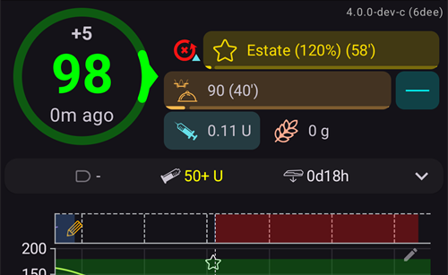
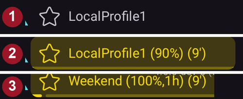
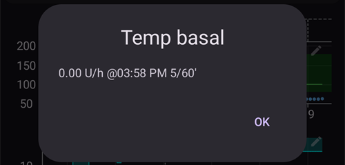
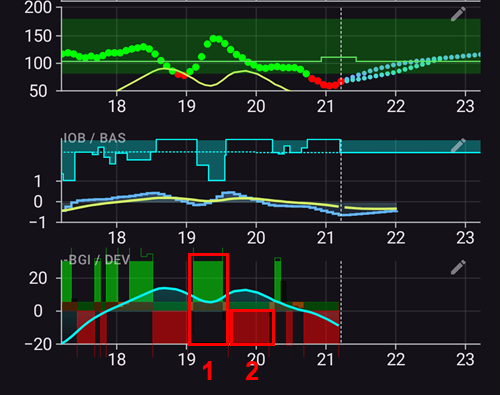
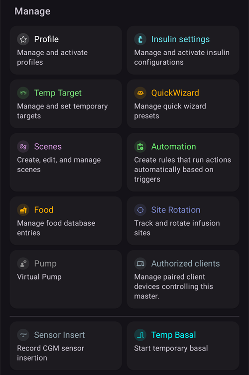
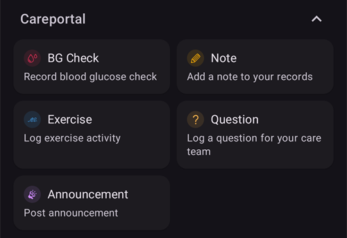
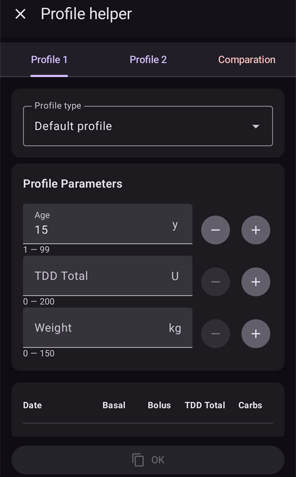

# AAPS ekranai

```{contents}
:backlinks: entry
:depth: 2
```

(the-homescreen)= (AapsScreens-the-homescreen)=

## Pagrindinis ekranas


Tai pirmasis ekranas, kurį matote atidarę **AAPS**. Jame yra didžioji dalis informacijos, kurios jums reikia kasdien.

### Skiltis A – viršutinė juosta

* Kairėje esantis **meniu** (☰) atidaro šoninį meniu su punktais **Terapijos istorija**, **Istorija**, **Statistika**, **Profilio pagalbininkas**, **Servisas**, **Sąrankos vedlys**, **Konfigūracija** ir kitais.
* **Paieškos juosta** randa nustatymus, langus ir dokumentaciją – tiesiog pradėkite rašyti (žr. [Visuotinė paieška](../DailyLifeWithAaps/GlobalSearch.md)).
* Dešinėje esanti **Nustatymų** (krumpliaračio) piktograma atidaro visus [nustatymus](../SettingUpAaps/Preferences.md).

(aaps-screens-profile--target)=

### Skiltis B – būsenos blokas

#### Current blood glucose

Paskutinis NGJ glikemijos rodmuo rodomas dideliame apskritime kairėje kartu su skirtumu nuo ankstesnio rodmens (pokytis) ir rodmens amžiumi.

KG reikšmės spalva rodo, ar ji yra nustatytame [intervale](#Preferences-range-for-visualization).

* žalia = tikslinėse ribose
* raudona = žemiau ribų
* geltona = virš ribų

  

(loop-status)= (AapsScreens-loop-status)=

#### Ciklo būsena


Šalia KG apskritimo esanti piktograma rodo ciklo veikimo režimą (paveikslėlyje iš viršaus į apačią):

1. Žalias apskritimas = [uždaras ciklas](#KeyAapsFeatures-ClosedLoop), ciklas veikia
2. Violetinis apskritimas su punktyrine linija = [stabdymas esant žemai glikemijai (LGS)](#KeyAapsFeatures-LGS)
3. Mėlynas apskritimas su punktyrine linija = [atviras ciklas](#KeyAapsFeatures-OpenLoop)
4. Raudonas apskritimas su kryžiumi = ciklas išjungtas (ilgam neveikia)
5. Raudona pauzės piktograma = ciklas sustabdytas (laikinai pristabdytas, bet valandinė bazė tiekiama) – likęs laikas rodomas šalia piktogramos
6. Pilkas apskritimas su kištuku = pompa atjungta (laikinai insulinas visai netiekiamas) – likęs laikas rodomas šalia piktogramos

Paspauskite piktogramą, kad atidarytumėte ciklo langą. Lango turinys priklauso nuo dabartinės būsenos:

* Kai ciklas **veikia** (uždaras, atviras ar LGS), galite pakeisti veikimo režimą (Uždaras ciklas, Stabdymas esant žemai glikemijai, Atviras ciklas arba Išjungti ciklą), **sustabdyti** ciklą arba **atjungti** pompą pasirinktam laikui.
* Kai ciklas **išjungtas**, galite jį vėl įjungti pasirinkdami veikimo režimą arba atjungti pompą.
* Kai ciklas **sustabdytas**, galite jį **atnaujinti**, atjungti pompą arba skiltyje **Sustabdyti ciklą** pasirinkti naują trukmę, kad pratęstumėte sustabdymą.
* Kai pompa **atjungta**, galite **vėl prijungti** pompą arba skiltyje **Atjungti pompą** pasirinkti naują trukmę, kad pratęstumėte atjungimą.

Kai pratęsiate sustabdymą ar atjungimą, nauja trukmė **skaičiuojama nuo dabar**: ji pakeičia likusį laiką, o ne pridedama prie jo. Prieš tai atnaujinti ar vėl prijungti nereikia.

Langas, kai ciklas veikia uždaro ciklo režimu:


Langas, kai ciklas sustabdytas, su mygtuku **Atnaujinti** ir trukmėmis sustabdymui pratęsti:


Langas, kai pompa atjungta, su mygtuku **Prijungti pompą** ir trukmėmis atjungimui pratęsti:


Stabdymo esant žemai glikemijai, atviro ciklo ir išjungto ciklo languose skiriasi tik siūlomi veikimo režimai:


Taip pagrindinis ekranas atrodo kiekvienu režimu. Spalvota juosta grafiko viršuje pasikeičia tuo metu, kai perjungiamas režimas.

Stabdymas esant žemai glikemijai:


Atviras ciklas:


Ciklas išjungtas:



Ciklas sustabdytas – likęs laikas rodomas šalia piktogramos:


Pompa atjungta – likęs laikas rodomas šalia piktogramos. Terapijos mygtukai lieka QuickLaunch įrankių juostoje, todėl vis tiek galite įrašyti švirkštikliu suleistą insuliną arba angliavandenius:


Po kiekvieno pasirinkimo reikia patvirtinimo.

```{admonition} Aliarmas: pompa nepriėmė nulinės laikinos bazės :class: warning Kol pompa atjungta, **AAPS** pompoje palaiko nulinę laikiną bazę ir vėl ją nustato, jei jos nėra. Jei po 10 minučių to vis dar nepavyksta, **AAPS** įjungia skubų aliarmą: *„Pompa nepriėmė nulinės laikinos bazės. Bazinis insulinas vis dar gali būti tiekiamas. Patikrinkite pompą.“* Aliarmas kartojamas kas 15 minučių, kol nulinė laikina bazė nustatoma arba atjungimas baigiasi. Jei jį matote, patikrinkite pompą: ji gali tiekti valandinės bazės insuliną, nors **AAPS** rodo, kad ji atjungta.

    <br />Pastaba: siūlomi režimai priklauso nuo jūsų pažangos [Mokymo etapuose](../SettingUpAaps/CompletingTheObjectives.md) – Uždaras ciklas ir LGS tampa prieinami tik juos įvykdžius.
    
    (aaps-screens-bg-warning-sign)=
    #### KG įspėjamasis ženklas
    
    Jei **AAPS** aptinka gaunamų KG rodmenų problemą, pagrindinio ekrano apatinėje juostoje atsiranda nuoroda į jūsų glikemijos šaltinį (pavadinta jo vardu, pvz., **xDrip+**) su raudonu įspėjimo ženkleliu. Bakstelėkite ją, kad atidarytumėte [glikemijos šaltinio ekraną](#aaps-screens-bg-source).
    
    ##### Pasikartojantys KG duomenys
    
    Raudonas įspėjamasis ženklas reiškia, kad turite nedelsdami imtis veiksmų: gaunate **pasikartojančius KG duomenis**, dėl kurių ciklas negali tinkamai veikti. Iš pasikartojančių rodmenų **AAPS** negali patikimai apskaičiuoti jūsų KG tendencijos, todėl nustoja koreguoti.
    
    Jei jūsų ciklas buvo uždaras, **AAPS** perjungia jį į [stabdymo esant žemai glikemijai (LGS)](#KeyAapsFeatures-LGS) režimą: ciklo piktograma tampa violetinė.
    
      
    
    Paspauskite ciklo piktogramą: kortelė **Apribojimai** viršuje paaiškina priežastį: „BgQualityCheck: Įjungtas LGS režimas dėl dubliuojamų gliukozės duomenų“.
    
      
    
    ```{admonition} Jūsų ciklas veikia stabdymo esant žemai glikemijai režimu
    :class: note
    Ciklas toliau veikia, bet tik saugo jus nuo hipoglikemijos: **AAPS** vis dar gali sumažinti arba sustabdyti valandinę bazę, bet neleis jokio korekcinio insulino, kol neišspręsite šios problemos!
    

Turite išsiaiškinti, kodėl gaunate pasikartojančias KG reikšmes:

* Ar jūsų Nightscout svetainėje įjungtas Dexcom bridge? Išjunkite bridge: atidarykite savo Nightscout administravimo skydelį, redaguokite kintamąjį „enable“ ir pašalinkite iš jo dalį „bridge“. (Apie Heroku [išsamiau skaitykite čia](https://nightscout.github.io/troubleshoot/troubleshoot/#heroku).)
* Ar jūsų KG į Nightscout siunčia keli šaltiniai? Jei naudojate BYODA programėlę, įjunkite duomenų siuntimą **AAPS**, bet neįjunkite jo xDrip, jei jį naudojate.
* Ar turite sekėjų, kurie gauna jūsų KG, bet patys vėl ją siunčia į jūsų Nightscout svetainę?
* Kraštutinė priemonė: [NSClient nustatymuose](#Preferences-nsclient) pasirinkite sinchronizacijos nustatymus ir išjunkite parinktį „Gauti NGJ duomenis iš NS“.

Kad įspėjimas iškart dingtų ir ciklas vėl koreguotų, ištrinkite pasikartojančius įrašus glikemijos šaltinio ekrane: bakstelėkite nuorodą apatinėje juostoje. Pasikartojantis rodmuo paryškintas raudonai. Ilgai paspauskite rodmenį, kad pradėtumėte žymėti, pažymėkite dublikatus ir bakstelėkite šiukšliadėžės piktogramą viršuje dešinėje.


Tačiau kai dublikatų daug, gali būti paprasčiau

* [pasidarykite nustatymų atsarginę kopiją](../Maintenance/ExportImportSettings.md),
* atkurkite pradinę duomenų bazę (reset) meniu Servisas ir
* vėl [importuokite savo nustatymus](../Maintenance/ExportImportSettings.md)

    {admonition} Patys vėl įjunkite uždarą ciklą
    :class: important
    Kai dublikatų nebelieka, **AAPS** pats negrįžta į **Uždaro ciklo** režimą. Paspauskite ciklo piktogramą pagrindiniame ekrane ir vėl pasirinkite **Uždaras ciklas**.

##### Nekintantys KG duomenys

Su kai kuriais glikemijos šaltiniais (Libre 1, AiDEX, Glutec, Medtronic ir šaltiniais, kurie nenurodo savo jutiklio tipo) **AAPS** taip pat tikrina, ar rodmenys nesikeičia: jei jūsų KG per 45 minutes pasikeitė mažiau nei 2 mg/dL (0,1 mmol/l), duomenys laikomi klaidingais. Tada glikemijos šaltinio nuorodoje rodomas raudonas plokščios tendencijos ženklelis, o ciklas nutraukia bet kokią padidintą laikiną bazę ir neleidžia korekcinio insulino, kol rodmenys vėl ims keistis. Patikrinkite jutiklį ir programėlę, kuri siunčia rodmenis.

##### Nereguliarūs KG duomenys

Kai rodmenys gaunami nereguliariais intervalais arba kai kurių trūksta, **AAPS** iš turimų rodmenų perskaičiuoja 5 minučių reikšmes. Taip būna, pavyzdžiui, pakeitus jutiklį arba su Libre jutikliais, kurių laikas kas kelias valandas pasislenka minute ar dviem. Ciklas toliau veikia, ir jums nieko daryti nereikia. **AAPS** 4 dėl to neberodo geltono įspėjamojo ženklo.

#### Current Profile

Dabartinis profilis rodomas šalia žvaigždutės piktogramos.

Bakstelėkite profilio pavadinimą, kad atidarytumėte [Profilio ekraną](#aaps-screens-profile), kuriame galite peržiūrėti profilio duomenis ir [perjungti skirtingus profilius](../DailyLifeWithAaps/ProfileSwitch-ProfilePercentage.md).

Norėdami **pakeisti profilio procentą** (ir jo trukmę), bakstelėkite profilio pavadinimą, tada bakstelėkite apvalų mygtuką **▶** (Aktyvuoti) Profilio ekrano apačioje dešinėje. **AAPS** 3.x šis ekranas atsidarydavo ilgai paspaudus profilio pavadinimą; **AAPS** 4 ilgas paspaudimas nieko nedaro. Žingsnis po žingsnio: [Profilio procento keitimas](#ProfileSwitch-change-percentage).



1. Įprastas rodinys, kai aktyvuotas standartinis profilis.
2. Profilio keitimas su 90 % procentu ir likusia 9 minučių trukme – kol veikia laikinas profilio keitimas, profilio pavadinimas tampa geltonas.
3. Profilio keitimas su 1 valandos laiko perstūmimu ir likusia 9 minučių trukme.

#### Target


Dabartinis tikslinis glikemijos lygis rodomas po profilio pavadinimu.

Trumpai paspauskite tikslą, kad atidarytumėte ekraną **[Laikinas tikslas](../DailyLifeWithAaps/TempTargets.md)**.

1. Įprastas rodinys: jūsų profilyje nustatytas tikslinis intervalas.
2. Jei nustatytas laikinas tikslas, tikslas tampa geltonas / oranžinis, rodoma naudojamo šablono piktograma, o likęs laikas minutėmis rodomas skliaustuose.

(AapsScreens-visualization-of-dynamic-target-adjustment)=

#### Visualization of Dynamic target adjustment

Kai naudojate [SMB algoritmą](#Config-Builder-aps) ir funkciją [Autosens](#Open-APS-features-autosens), **AAPS** gali dinamiškai keisti jūsų tikslą pagal jautrumą.

[OpenAPS SMB nustatymuose](#Preferences-openaps-smb-settings) įjunkite vieną arba abi šias parinktis:

* „Didesnis jautrumas padidina tikslą“ ir (arba)
* „Rezistencija mažina tikslą“

Jei **AAPS** aptinka rezistenciją ar jautrumą, tikslas skirsis nuo nustatyto profilyje, o rodomo tikslo spalva pasikeis ir parodys šį koregavimą.

(aaps-screens-iob-cob-basal-sens)=

#### AIO, AAO, valandinė bazė ir jautrumas


1. **Švirkštas**: aktyvus insulinas organizme (AIO) – aktyvaus insulino kiekis jūsų kūne  
    AIO būtų lygus nuliui, jei veiktų tik jūsų standartinė valandinė bazė ir nebūtų likę insulino iš ankstesnių bolusų. 
    * AIO gali būti neigiamas, jei pastaruoju metu valandinė bazė buvo sumažinta.
    * Paspauskite šį ženklelį, kad pamatytumėte, kiek yra boluso ir valandinės bazės insulino (pirmasis langas paveikslėlyje – čia AIO neigiamas po sumažintos valandinės bazės laikotarpio)
2. **Grūdas**: [aktyvūs angliavandeniai organizme (AAO)](../DailyLifeWithAaps/CobCalculation.md) – anksčiau suvalgyti, dar neįsisavinti angliavandeniai
3. Žalsvai mėlynas mygtukas dešinėje rodo **dabartinį valandinės bazės tiekimą**: tiesi linija, kai veikia profilio valandinė bazė, ir pakitusi piktograma, kai veikia laikina bazė
4. **Procentų eilutė** rodo dabartinį jautrumą ([Autosens](#Open-APS-features-autosens) / [DynamicISF](../DailyLifeWithAaps/DynamicISF.md)). Kai ciklas keičia jūsų JIF, eilutėje taip pat rodomas profilio JIF, rodyklė ir JIF, kurį ciklas naudoja dabar, pavyzdžiui, „80% 2,0 ↗ 2,5“. Paspauskite ją, kad pamatytumėte Autosens reikšmę ir faktinį JIF (antrasis langas paveikslėlyje). Jei ciklas naudoja kitą reikšmę nei paskutinis Autosens rezultatas (pavyzdžiui, nes laikinas tikslas keičia jūsų jautrumą), lange ši reikšmė taip pat rodoma kaip **Autosens algoritme**. Kai Autosens išjungtas, ciklas naudoja jūsų profilio JIF ir faktinis JIF nerodomas.

AIO langas, atidaromas paspaudus AIO ženklelį:


Paspauskite žalsvai mėlyną mygtuką, kad pamatytumėte veikiančią laikiną bazę, kada ji prasidėjo ir kiek laiko jau veikia:



(aaps-screens-carbs-required)=

#### Reikalingi angliavandeniai


Carbs suggestions are given when the reference design detects that it requires carbs.

Taip būna, kai oref algoritmas mano, kad negali jūsų apsaugoti nuline laikina baze ir jums reikia suvalgyti angliavandenių.

Pranešimai apie angliavandenius yra daug sudėtingesni nei boluso patarėjo pranešimai. Galite matyti angliavandenių pasiūlymą, nors boluso patarėjas nerodo trūkstamų angliavandenių.

Jei norite, pranešimus apie reikalingus angliavandenius galima siųsti į Nightscout. Tada bus parodytas ir išsiųstas skelbimas.

### Skiltis C – būsenos eilutė


Būsenos eilutė vizualiai įspėja apie

* Kaniulės amžius
* Insulino amžių (kiek dienų naudojamas rezervuaras) ir rezervuaro lygį (vienetais)
* Jutiklio amžius
* Pompos baterijos amžių ir lygį (%)

Jei viršijama įspėjimo riba, reikšmės rodomos geltonai.

Jei viršijama kritinė riba, reikšmės rodomos raudonai.

The age is always shown in its short form, whatever the screen size: *4h* on the first day, *3d4h* later.

Ribas galima keisti per mažą **Nustatymų** piktogramą, kuri rodoma **išskleidus** būsenos eilutę (rodyklė dešinėje) – žr. [Būklės indikatoriai](#Preferences-status-lights).

Išskleistame būsenos skydelyje kai kurių eilučių gale taip pat yra mygtukas pakeitimui įrašyti, kuris iš naujo pradeda skaičiuoti atitinkamą amžių: **Pridėti** eilutėje **Jutiklis** įrašo jutiklio įvedimą. Jei jūsų pompa tai palaiko, mygtukas **Užpildymas** rodomas eilutėse **Kaniulė** (arba **Patch pompa**) ir **Insulinas**, o **Pridėti** – eilutėje **Pompos baterija**.


Priklausomai nuo jūsų pompos, kai kurių iš šių piktogramų gali nebūti.

(screens-sensor-level-battery)=

#### Jutiklio lygis (baterija)

Veikia su NGJ, turinčiu papildomą siųstuvą, pvz., MiaoMiao 2. (Techniškai jutiklis turi siųsti baterijos lygio informaciją į xDrip.)

Ribas galima nustatyti skiltyje [Būklės indikatoriai](#Preferences-status-lights).

(aaps-screens-main-graph)=

### Skiltis D – pagrindinis grafikas


Grafike rodoma jūsų glikemija (KG), gauta iš gliukozės matuoklio (NGJ).

Naudokite slinkimo ir suspaudimo (priartinimo) gestus grafike, kad pakeistumėte matomą laikotarpį.

Žalia sritis rodo jūsų tikslinį intervalą.

Šiame grafike taip pat rodoma:

* Rankiniai bolusai: mėlynas trikampis tiesiai virš KG kreivės, smaigaliu žemyn į to momento rodmenį, su insulino kiekiu
* Angliavandenių įrašai: oranžinis trikampis tiesiai po KG kreive, smaigaliu aukštyn į rodmenį, su angliavandenių kiekiu. Valgis, įvestas kartu su bolusu, atrodo kaip vienas žymeklis, kurį perskiria rodmuo.
* Trikampiai būna trijų dydžių (maži, vidutiniai, dideli), priklausomai nuo kiekio, palyginti su didžiausiu tos dienos kiekiu. Jei tuo metu nėra KG rodmens (jutiklio duomenų spraga), trikampis piešiamas grafiko apačioje.
* KG matavimai ir kalibracijos: piešiami ties savo išmatuota reikšme, kad galėtumėte juos palyginti su jutiklio kreive
* Tikslas, nustatytas profilyje arba pakeistas laikinu tikslu: žalia linija
* Profilio keitimai: žvaigždutės piktogramos grafiko viršuje
* Ciklo būsena: spalvota juosta grafiko viršuje, kai [veikimo režimas](#AapsScreens-loop-status) yra kitas nei uždaras ciklas: mėlyna = atviras ciklas, violetinė = LGS, raudona = ciklas išjungtas, geltona = ciklas sustabdytas, pilka = pompa atjungta, oranžinė = superbolusas (ekrano kopijoje: violetinė, tada geltona). Šių pakeitimų istorija pateikiama skiltyje [Veikimo režimas](#AapsScreens-running-mode)
* [SMB](#Open-APS-features-super-micro-bolus-smb) KG grafike nepiešiami (jų būtų kas kelias minutes): jie rodomi [AIO grafike](#aaps-screens-iob).

Bakstelėkite **KG matavimą** grafike, kad pamatytumėte jo reikšmę ir pastabą, jei ją parašėte.

(aaps-screens-graph-press-and-hold)=

#### Reikšmės pasirinktu laiku

**Paspauskite ir palaikykite** KG grafiką, kad pamatytumėte vieno rodmens reikšmes. Taškas pažymi artimiausią rodmenį, visuose grafikuose tuo laiku nubrėžiama brūkšninė linija, o grafiko viršuje iškylančiame lange rodoma:

* laikas ir KG reikšmė
* AIO, AAO (tik kai daugiau nei 0 g) ir tuo metu buvusi valandinė bazė – bazės piktograma rodo, ar veikė laikina bazė, kaip pagrindiniame ekrane
* bet koks tuo metu suleistas bolusas, SMB ar įvesti angliavandeniai, su tais pačiais trikampiais kaip grafikuose

Laikykite pirštą ant ekrano ir braukite jį kairėn ar dešinėn, kad pereitumėte nuo vieno rodmens prie kito. Ties kiekvienu rodmeniu pajusite lengvą vibraciją, o grafikas tuo metu neslenka. Iškylantis langas lieka matomas 2 sekundes po to, kai atitraukiate pirštą.

Taip pat veikia ir [papildomi grafikai](#aaps-screens-additional-graphs) po KG grafiku (AIO, AAO...): paspauskite ir palaikykite bet kurį iš jų.


(aaps-screens-graph-clock-change)=

#### Clock changes

When the clock of the phone jumped, at a daylight saving change or in a new time zone, a dashed vertical line marks that moment in the BG graph, with a small clock icon at its foot. The same dashed line runs through the [additional graphs](#aaps-screens-additional-graphs) below.


(AapsScreens-activate-optional-information)=

#### Activate optional information

Paspauskite **pieštuko** piktogramą grafiko viršutiniame dešiniajame kampe, kad atidarytumėte grafiko nustatymus:


* **Grafiko aukštis** keičia, kokio aukščio piešiamas grafikas.
* **AKT** uždeda insulino aktyvumo kreivę: vientisa geltonai žalia linija <span style="background:#141218;color:#D3F166;padding:0 0.3em;border:1px solid #141218;border-radius:4px">━━━━</span> (nepainiokite su taškuota geltona NDM prognoze)
* **PROGN** uždeda [prognozių linijas](#aaps-screens-prediction-lines) (žr. žemiau)

(aaps-screens-prediction-lines)=

#### Prognozių linijos

Kai **PROGN** įjungta, AAPS savo prognozes piešia **taškuotomis linijomis** į dešinę nuo linijos „dabar“. Kiekviena prognozė turi savo spalvą. Tamsioje temoje naudojami šviesesni tų pačių spalvų atspalviai, o linija žalioje tikslinėje srityje gali atrodyti šiek tiek žalesnė.

| Linija                       | Šviesi tema                                                                                                                       | Tamsi tema                                                                                                                         | Ką ji prognozuoja                           |
| ---------------------------- | --------------------------------------------------------------------------------------------------------------------------------- | ---------------------------------------------------------------------------------------------------------------------------------- | ------------------------------------------- |
| **AIO** (mėlyna)             | <span style="background:#FFFFFF;color:#1E88E5;padding:0 0.3em;border:1px solid #CCCCCC;border-radius:4px">●●●●</span>             | <span style="background:#141218;color:#64B5F6;padding:0 0.3em;border:1px solid #141218;border-radius:4px">●●●●</span>              | tik insulinas                               |
| **AAO** (oranžinė)           | <span style="background:#FFFFFF;color:#FB8C00;padding:0 0.3em;border:1px solid #CCCCCC;border-radius:4px">●●●●</span>             | <span style="background:#141218;color:#FFB74D;padding:0 0.3em;border:1px solid #141218;border-radius:4px">●●●●</span>              | aktyvūs angliavandeniai organizme           |
| **NDM** (geltona)            | <span style="background:#FFFFFF;color:#C9BD60;padding:0 0.3em;border:1px solid #CCCCCC;border-radius:4px">●●●●</span>             | <span style="background:#141218;color:#E6D39A;padding:0 0.3em;border:1px solid #141218;border-radius:4px">●●●●</span>              | nedeklaruotas maistas                       |
| **ZT** (žalsvai mėlyna)      | <span style="background:#FFFFFF;color:#00D2D2;padding:0 0.3em;border:1px solid #CCCCCC;border-radius:4px">●●●●</span>             | <span style="background:#141218;color:#4DD4D4;padding:0 0.3em;border:1px solid #141218;border-radius:4px">●●●●</span>              | nulinė laikina bazė (insulinas sustabdytas) |
| **aCOB** (blyškiai oranžinė) | <span style="background:#FFFFFF;color:rgba(251,140,0,0.5);padding:0 0.3em;border:1px solid #CCCCCC;border-radius:4px">●●●●</span> | <span style="background:#141218;color:rgba(255,183,77,0.5);padding:0 0.3em;border:1px solid #141218;border-radius:4px">●●●●</span> | tik senesnis AMA algoritmas                 |

Kai dvi prognozės duoda tas pačias reikšmes, jų taškai sutampa ir matote tik vieną spalvą (pavyzdžiui, NDM virš AIO, kai KG nekinta).

* **AAO** linija (oranžinė): [aktyvūs angliavandeniai organizme](CobCalculation.md) (oranžinė spalva visoje AAPS naudojama AAO ir angliavandeniams)
    
    Ši prognozės linija rodo, kur judės jūsų KG (ne pats AAO!) pagal dabartinius **Profilio** nustatymus, darant prielaidą, kad nuokrypiai dėl angliavandenių įsisavinimo išliks pastovūs. Ši linija rodoma tik tada, kai yra žinomų AAO.

* **AIO** linija (mėlyna): aktyvus insulinas organizme (mėlyna spalva visoje AAPS naudojama AIO ir insulinui)
    
    Ši prognozės linija rodo, kas vyktų veikiant tik insulinui. Pavyzdžiui, jei susileidote insulino, o paskui nevalgėte jokių angliavandenių.

* **ZT** linija (žalsvai mėlyna): nulinė laikina bazė (prognozuojama KG, jei būtų nustatyta 0 % laikina bazė)
    
    Ši prognozės linija rodo, kaip pasikeistų KG kreivė, jei pompa visiškai sustabdytų insulino tiekimą (0 % TBR). Linija baigiasi, kai pakyla virš jūsų tikslo.
    
    *Ši linija rodoma tik tada, kai naudojamas [SMB](#Config-Builder-aps) algoritmas.*

* **NDM** linija (geltona): [nedeklaruotas maistas](#SensitivityDetectionAndCob-sensitivity-oref1)
    
    Nedeklaruotas maistas reiškia, kad aptiktas reikšmingas glikemijos kilimas dėl maisto, adrenalino ar kitų veiksnių. Ši prognozės linija panaši į **oranžinę AAO liniją**, tačiau daroma prielaida, kad nuokrypiai mažės pastoviu greičiu (tęsiant dabartinį mažėjimo greitį).
    
    *Ši linija rodoma tik tada, kai naudojamas [SMB](#Config-Builder-aps) algoritmas, OpenAPS SMB nustatymuose įjungta parinktis **Naudoti NDM** ir KG kyla labiau, nei galima paaiškinti vien insulinu.*

* **aCOB** linija (blyški, permatoma oranžinė): pagreitintas angliavandenių įsisavinimas
    
    Panaši į AAO, tačiau daroma prielaida, kad angliavandeniai įsisavinami pastoviu 10 mg/dL/5 min (0,555 mmol/l/5 min) greičiu. Pasenusi funkcija, jos nauda ribota.
    
    *Ši linija rodoma tik tada, kai naudojamas senesnis [AMA](#Config-Builder-aps) algoritmas.*

Paprastai tikroji glikemijos kreivė atsiduria tarp šių linijų arba arčiausiai tos, kurios prielaidos geriausiai atitinka jūsų situaciją.

(aaps-screens-how-predictions-become-a-dosing-decision)=

#### Kaip AAPS iš prognozių priima dozavimo sprendimą

AAPS nedozuoja insulino vien pagal dabartinę KG – kiekviename ciklo etape (maždaug kas 5 minutes) jis kartu įvertina visas aukščiau aprašytas prognozių linijas ir nusprendžia, kuris veiksmas saugiausias.

Pagrindinė taisyklė – **pirmiausia saugumas**: jei *bet kuri* prognozės linija bet kuriuo laikotarpiu nukrenta žemiau jūsų apatinės saugumo ribos, AAPS nustato nulinę laikiną bazę (0 % laikina bazė) ir daugiau insulino neleidžia, net jei jūsų dabartinė KG aukšta. Tik kai visos prognozės linijos lieka virš šios ribos, AAPS svarsto leisti daugiau insulino.

Kai saugu leisti daugiau insulino, AAPS žiūri, kur galiausiai turėtų atsidurti KG (**galutinė KG**) pagal sujungtas prognozes, ir apskaičiuoja, kiek korekcijos reikia, kad ši galutinė KG grįžtų į tikslą. Ši korekcija suleidžiama arba kaip padidinta laikina bazė, arba (jei įjungtas oref1/[SMB](#Open-APS-features-super-micro-bolus-smb) algoritmas) kaip mažas bolusas iš karto. Jei KG dabar aukšta, bet jau pakankamai krenta pati, AAPS palauks arba net sumažins valandinę bazę, o ne pridės insulino, kuris vėlesnę hipoglikemiją padarytų dar gilesnę.

Šios sprendimų logikos pavyzdžius su tikromis ekrano kopijomis rasite [dozavimo scenarijuose gydytojo vadove](#clinicianguide-dosing-scenarios) – jie parašyti gydytojams, bet tinka bet kuriam AAPS naudotojui.

*Išsamų techninį aprašymą, kaip apskaičiuojamos šios prognozės ir iš jų kylantis dozavimo sprendimas, rasite [OpenAPS determine-basal dokumentacijoje](https://openaps.readthedocs.io/en/latest/docs/While%20You%20Wait%20For%20Gear/Understand-determine-basal.html).*

#### Basals

**Vientisa mėlyna** linija rodo pompos tiekiamą valandinę bazę ir atspindi faktinį insulino tiekimą per laiką.

**Taškuota mėlyna** linija rodo, kokia būtų valandinė bazė, jei nebūtų laikinų bazės pakeitimų (TBR).

Kai tiekiama standartinė valandinė bazė, plotas po kreive rodomas tamsiai mėlynai. Kai valandinė bazė laikinai pakeista (padidinta arba sumažinta), plotas po kreive rodomas šviesiai mėlynai.

#### Insulino aktyvumas

The **thin yellow** line shows the activity of Insulin.

Ji pagrįsta tikėtinu glikemijos sumažėjimu dėl jūsų organizme esančio insulino, jei nebūtų kitų veiksnių (pvz., angliavandenių).

(AapsScreens-section-g-additional-graphs)= (aaps-screens-additional-graphs)=

### Skiltis E – papildomi grafikai

Po pagrindiniu grafiku galite įjungti papildomus grafikus. [Paprastajame režime](#preferences-simple-mode) papildomi grafikai yra iš anksto nustatyti ir jų keisti negalima. Jei norite patys nustatyti papildomus grafikus, išjunkite **Paprastąjį režimą**.

Papildomi grafikai seka pagrindinį grafiką: kai slenkate ar priartinate KG grafiką, jie juda kartu. Patempus papildomą grafiką į šoną, taip pat paslenkami visi grafikai. Jie neturi savo laiko žymų – laiką žiūrėkite KG grafike.

Norėdami nustatyti papildomą grafiką, paspauskite **pieštuko** piktogramą jo viršutiniame dešiniajame kampe:


Pasirinkite ženklelius, atitinkančius duomenis, kuriuos norite matyti šiame grafike; mygtukas **Pašalinti** ištrina grafiką.

Norėdami sukurti dar vieną grafiką, paspauskite **Pridėti grafiką** po paskutiniu grafiku ir tokiu pat būdu pasirinkite jo ženklelius:


Naujas grafikas pridedamas po kitais – čia antrasis papildomas grafikas su **SENS%** ir **NUOKR**:


Daugumai naudotojų pakanka tokios papildomų grafikų konfigūracijos:

* 1 grafikas su AIO, AAO ir jautrumo pokyčiais
* 2 grafikas su nuokrypiais ir glikemijos įtaka (KGĮ).

#### Visas insulinas (ABS)

Active insulin including boluses **and basal**.

(aaps-screens-iob)=

#### Aktyvus insulinas organizme (AIO)

Rodo aktyvų insuliną organizme (= insulinas, kuris dar veikia jūsų kūne). Į jį įeina bolusų ir laikinų bazių insulinas (**bet neįeina profilyje nustatyta valandinė bazė**).

Jei per IVT laikotarpį nebūtų buvę [SMB](#Open-APS-features-super-micro-bolus-smb), bolusų ir TBR, ši reikšmė būtų nulis.

SMB šiame grafike rodomi kaip mėlyni trikampiai, trijų dydžių, priklausomai nuo kiekio, palyginti su didžiausiu tos dienos SMB.

IOB can be negative if you have no remaining bolus and zero/low temp for a longer time.

Mažėjimas priklauso nuo jūsų [IVT ir insulino tipo nustatymų](#Config-Builder-insulin-dia).

#### Aktyvūs angliavandeniai organizme (AAO)

Rodo aktyvius angliavandenius organizme (= suvalgyti, bet dar neįsisavinti angliavandeniai).

Mažėjimas priklauso nuo [algoritmo aptinkamų nuokrypių](../DailyLifeWithAaps/CobCalculation.md).

Jei aptinkamas greitesnis angliavandenių įsisavinimas, nei tikėtasi, bus suleista daugiau insulino ir AIO padidės (daugiau ar mažiau, priklausomai nuo jūsų saugumo nustatymų).

#### Jautrumo pokyčiai (SENS%)

Rodo jautrumą, kurį aptiko [Autosens](#Open-APS-features-autosens).

Jautrumas – tai apskaičiuotas jautrumas insulinui, kurį keičia fizinis krūvis, hormonai ir pan.

Atminkite: kad jautrumo nustatymas / [Autosens](#Open-APS-features-autosens) galėtų automatiškai koreguoti suleidžiamo insulino kiekį, turite būti pasiekę [8 mokymo etapą](#objectives-objective8). Kol nepasiekėte šio mokymo etapo, linija jūsų grafike rodoma tik informacijai.

### Kintamas jautrumas (VSENS)

Rodo jautrumą, apskaičiuotą funkcijos [DynamicISF](../DailyLifeWithAaps/DynamicISF.md). Duomenys rodomi tik tada, kai naudojate šią funkciją.

(screen-heart-rate-steps)=

#### Pulsas (HR) & Žingsniai

Šie duomenys gali būti prieinami, kai naudojate [Wear išmanųjį laikrodį](../WearOS/WearOsSmartwatch.md). Įjunkite juos **AAPS** Wear programėlėje ir suteikite leidimą naudoti sveikatos duomenis.

Steps are drawn as columns, and the heart rate as a curved line that breaks where the watch sent no data.

#### Nuokrypiai (NUOKR)

* **Pilki** stulpeliai rodo nuokrypį dėl angliavandenių.
* **Žali** stulpeliai rodo, kad KG yra aukštesnė, nei algoritmas tikėjosi. Žali stulpeliai naudojami [Autosens](#Open-APS-features-autosens) rezistencijai didinti.
* **Raudoni** stulpeliai rodo, kad KG yra žemesnė, nei algoritmas tikėjosi. Raudoni stulpeliai naudojami [Autosens](#Open-APS-features-autosens) jautrumui didinti.
* **Geltoni** stulpeliai rodo nuokrypį dėl NDM.
* **Juodi** stulpeliai rodo mažus nuokrypius, į kuriuos neatsižvelgiama skaičiuojant jautrumą

#### Glikemijos įtaka (-KGĮ)

Ši linija rodo, kiek KG „turėtų“ kilti arba kristi vien dėl insulino aktyvumo.



Šią liniją verta rodyti kartu su nuokrypių stulpeliais. Jų skalė bendra, bet kitokia nei kitų papildomų duomenų, todėl verta juos rodyti atskirame grafike, kaip parodyta aukščiau. Palyginę KGĮ liniją ir nuokrypių stulpelius, galite kitu būdu suprasti, kaip svyruoja **KG**. Čia, laiku, pažymėtu **1**, nuokrypių stulpeliai yra gerokai virš KGĮ linijos: KG kyla labiau, nei galima paaiškinti vien insulino aktyvumu (pavyzdžiui, po angliavandenių). Laiku, pažymėtu **2**, nuokrypių stulpeliai yra žemiau nulio (raudoni): KG žemesnė, nei algoritmas tikėjosi.

### Skiltis F – QuickLaunch įrankių juosta


Plaukiojanti įrankių juosta ekrano apačioje talpina jūsų **[QuickLaunch](../DailyLifeWithAaps/QuickLaunch.md)** veiksmus. Mažas **krumpliaratis** atidaro QuickLaunch konfigūraciją, kurioje pasirenkate, kokie mygtukai rodomi (terapija, terapijos įrašai, NGJ veiksmai, meniu **Valdymas** ekranai, [Greitojo vedlio](../DailyLifeWithAaps/QuickWizards.md) mygtukai, [Scenarijai](../DailyLifeWithAaps/Scenes.md) ir kt.).

Aukščiau parodyta įprasta konfigūracija: **Insulinas**, **Angliavandeniai** ir **Boluso patarėjas**.

Kai pompa **atjungta**, terapijos mygtukai lieka įrankių juostoje, pavyzdžiui, kad galėtumėte įrašyti švirkštikliu suleistą insuliną (žr. [Insulinas](#aaps-screens-buttons-insulin) žemiau). Tie patys veiksmai pasiekiami ir apatinės navigacijos meniu [Terapija](#aaps-screens-treatments-sheet).

(aaps-screens-buttons-insulin)=

#### Insulinas


Suleisti tam tikrą insulino kiekį nenaudojant [boluso patarėjo](#aaps-screens-bolus-wizard).

Įjungę **Pradėti Netrukus valgysiu LT**, galite automatiškai pradėti [laikiną tikslą „Netrukus valgysiu“](#TempTargets-eating-soon-temp-target).

Jei nenorite leisti boluso pompa, o tik įrašyti insulino kiekį (pvz., švirkštikliu suleistą insuliną), įjunkite „**Bolusas bus tik įrašytas (nebus suleistas)**“. Papildoma eilutė **Laikas**, nustatyta į **Dabar**, leidžia įrašyti anksčiau atliktą insulino injekciją: keiskite ją mygtukais **-** / **+** arba bakstelėkite rodyklę, kad įvestumėte minutes ar pasirinktumėte datą ir laiką.

 

Mygtukais **+0,5 / +1,0 / +2,0** galite greitai padidinti insulino kiekį. Prieaugio reikšmes galima pakeisti [boluso patarėjo nustatymuose](#Preferences-deliver-this-part-of-bolus-wizard-result).

Insulino langą galima naudoti ir tada, kai pompa sustabdyta ar atjungta, pvz., norint įrašyti švirkštikliu suleistą insuliną. Tokiu atveju „**Bolusas bus tik įrašytas (nebus suleistas)**“ įjungiamas priverstinai (rodomas raudonai), o papildomuose laukuose galite pasirinkti insulino tipą ir **Laiko** poslinkį anksčiau atliktai injekcijai:


#### Angliavandeniai


To record carbs without bolusing.

Kai kuriuos [iš anksto nustatytus laikinus tikslus](#TempTargets-hypo-temp-target) (Hipo, Netrukus valgysiu, Sportas) galima pradėti tiesiai jungikliais viršuje.

**Angliavandenių laikas**: kada valgysite / valgėte angliavandenius.

**Trukmė**: naudojama [„ištęstiems angliavandeniams“](ExtendedCarbs.md). Ši eilutė suskleista, kad per klaidą neįvestumėte į ją gramų: keiskite ją mygtukais **-** / **+** arba bakstelėkite rodyklę, kad ją išskleistumėte ir įvestumėte reikšmę.

Mygtukais **+5 / +10 / +20** galite greitai padidinti angliavandenių kiekį.

#### Greitasis vedlys

Vienu iš anksto sukonfigūruotu mygtuku lengvai įveskite angliavandenių kiekį ir nustatykite skaičiavimo pagrindus.

Išsami sąranka aprašyta puslapyje [Greitasis vedlys](../DailyLifeWithAaps/QuickWizards.md).

(aaps-screens-treatments-sheet)=

### Skiltis G – apatinė navigacija

Apatinė navigacijos juosta suteikia prieigą prie:

* **Terapija** – greitųjų veiksmų meniu su jūsų terapijos veiksmais:
    
    

* **Scenarijai** – rodoma tik tada, kai turite bent vieną [scenarijų](../DailyLifeWithAaps/Scenes.md) arba **Automatizacijos** taisyklę, pažymėtą kaip **Naudotojo veiksmas**. Atidaromas meniu, iš kurio galite juos paleisti; ženklelis rodo, kiek jų galite paleisti dabar. **Pieštukas** meniu viršuje atidaro **Valdymas → Scenarijai**.

* **Valdymas** – vieta viskam, ką valdote **AAPS**: Profilis, Insulino nustatymai, Laikinas tikslas, Greitasis vedlys, Scenarijai, Automatizacija, Maistas, Vietų rotacija, Pompa ir Autorizuoti klientai. Po jais yra įrenginių ir valandinės bazės veiksmai, pavyzdžiui, Jutiklio įvedimas ir Laikina bazė. Kai kurie punktai rodomi tik tada, kai jie tinka jūsų sistemai – pavyzdžiui, Užpildymas ir baterijos keitimas priklauso nuo jūsų pompos, o Laikina bazė, Ištęstas bolusas ir terapijos įrašai [Paprastajame režime](#preferences-simple-mode) paslėpti:
    
    

* **Mokymo etapai** – jūsų pažanga [Mokymo etapuose](../SettingUpAaps/CompletingTheObjectives.md); ženklelis rodo, kiek jų įvykdyta. Šis punktas dingsta, kai visi mokymo etapai įvykdyti, ir jo nėra **AAPSClient**.

(aaps-screens-notifications)=

#### Notifications

Virš apatinės juostos dešinėje gali atsirasti **pranešimų burbulas**. Jame surenkami aktyvūs **AAPS** pranešimai; mažas skaičius rodo, kiek jų yra. Jo spalva atitinka svarbiausią pranešimą: raudona – skubus pranešimas, žalia – paprasta informacija.


Bakstelėkite burbulą, kad atidarytumėte skydelį **Pranešimas**. Prie kiekvieno pranešimo rodomas laikas, kada jis atsirado. Paspauskite **Atmesti** po pranešimu, kad jį pašalintumėte; kai kurie pranešimai vietoj to turi kitą mygtuką, kuris nuveda prie nustatymo, kuriam reikia jūsų dėmesio.


(bolus-wizard)= (aaps-screens-bolus-wizard)=

## Boluso patarėjas


Valgio bolusą paprastai leisite iš čia.

### Skiltis I

Antraštėje **Skaičiavimas** rodomas apskaičiuotas bolusas. Jei aktyvaus insulino organizme jau yra daugiau nei apskaičiuotas bolusas, bus parodytas tik dar reikalingų angliavandenių kiekis.

Boluso patarėją galima naudoti, kokia bebūtų jūsų dabartinė **KG**, net jei ji per aukšta ar per žema. Jei **KG** yra virš tikslo, prie valgio boluso pridedama korekcija. Jei **KG** yra žemiau tikslo, bolusas sumažinamas, o jei aktyvaus insulino organizme jau yra daugiau nei reikia, patarėjas vietoj insulino parodo, kiek angliavandenių dar reikia.

Piktogramų eilutė po antrašte rodo, kurie duomenys įtraukiami į skaičiavimą (KG, tendencija, AIO, laikinas tikslas, AAO). Paspaudus piktogramą, šie duomenys įtraukiami į skaičiavimą arba iš jo pašalinami; piktograma **(i)** rodo išsamius skaičiavimo skaičius.

#### Combinations of COB and IOB and what they mean

* Saugumo sumetimais AIO negalima išjungti, kai įjungti AAO, nes rizikuotumėte gauti per daug insulino, jei **AAPS** neatsižvelgtų į jau suleistą insuliną.
* Jei įjungiate AAO ir AIO, bus atsižvelgiama į neįsisavintus angliavandenius, kurie dar nepadengti insulinu, ir į visą insuliną, suleistą kaip TBR ar SMB.
* Jei įjungiate AIO be AAO, **AAPS** atsižvelgia į jau suleistą insuliną, bet nesudengia jo su dar neįsisavintais angliavandeniais. Todėl matysite pranešimą „trūksta angliavandenių“.
* Jei netrukus po valgio boluso leidžiate bolusą **papildomam maistui** (pvz., papildomam desertui), gali būti naudinga **išjungti visus įvesties duomenis**. Taip pridedami tik nauji angliavandeniai, nes pagrindinis valgis nebūtinai jau įsisavintas, todėl netrukus po valgio boluso AIO tiksliai neatitiks AAO.
* Saugumo sumetimais **laikinas tikslas** į skaičiavimą įtraukiamas tik tada, kai jį įjungiate rankiniu būdu.

(AapsScreens-section-j)=

### Skiltis J – įvesties laukai

Lauke **Angliavandeniai** įvedate angliavandenių kiekį **gramais**, kuriam norite leisti bolusą; mygtukai **+** po juo greitai prideda angliavandenių. **AAPS** dirba tik su gramais: jei skaičiuojate duonos vienetais arba pakaitais (*pvz.,* DAFNE „CHO“ pakaitais), prieš įvesdami perskaičiuokite juos į gramus. Žr. [pastabą apie duonos vienetus](#your-aaps-profile-insulin-to-carbs-ratio) profilio puslapyje.

#### Angliavandenių tipas: duona, pyragas ar pica

Po lauku **Angliavandeniai** esantys mygtukai **Duona**, **Pyragas** ir **Pica** nurodo **AAPS**, kaip greitai įsisavinamas valgis. Pasirinkus **Pyragas** ir **Pica**, bolusas dabar padengia tik dalį angliavandenių, o likusi dalis pridedama vėliau kaip i-AV. Procentus ir laiką rasite skiltyje [Angliavandenių tipas: duona, pyragas ar pica](#AapsScreens-carbs-type) puslapyje „Ištęsti angliavandeniai“.

Eilutė **Korekcija** skirta, jei dėl kokios nors priežasties norite pakeisti galutinę dozę.

Visada atvira tik eilutė **Angliavandeniai**. Kitos eilutės (**Korekcija**, **Angliavandenių laikas**, **KG** ir **Naudoti procentus**) yra suskleistos: jos rodo savo reikšmę su mygtukais **-** / **+**, kad galėtumėte ją keisti mažais žingsniais. Bakstelėkite rodyklę, kad išskleistumėte eilutę ir įvestumėte reikšmę, ir bakstelėkite ją dar kartą, kad eilutę suskleistumėte. Taip išvengiama, kad per klaidą įvestumėte gramus į lauką **Korekcija**.


Bakstelėkite bet kur eilutėje **Profilis**, kad atidarytumėte savo profilių sąrašą, tada bakstelėkite pavadinimą, kad šiam skaičiavimui naudotumėte tą profilį.


Laukas **Angliavandenių laikas** skirtas išankstiniam bolusui: juo sistemai nurodote, kad angliavandenių reikia laukti šiek tiek vėliau. Į šį lauką galite įvesti neigiamą skaičių, jei leidžiate bolusą anksčiau suvalgytiems angliavandeniams.

**Nustatyti įspėjimą** (priminimas pavalgyti): kai įvedamas būsimas angliavandenių laikas, atsiranda jungiklis „**Nustatyti įspėjimą**“, kad nurodytu laiku jums būtų priminta suvalgyti į **AAPS** įvestus angliavandenius:


The reminder starts when the bolus has been delivered. While it runs, a **Time to eat** bar on the main screen counts down, with **Stop** and **+5 min**. **+5 min** moves the end of the wait five minutes later, and the bar shows the total wait. When the time has come, the reminder rings with its own sound, a soft kitchen timer. Besides **Silence alarm** (the screen stays open) and **Silence and close**, the alarm screen offers **+5 min**, which starts a new five-minute wait. Once it has rung, the bar reads *The time is up* with **+5 min** and **Dismiss**; **Silence and close** removes the bar too. The bar and the alarm are also shown on **AAPSClient**, and on the [watch](#WearOsSmartwatch-wizard-carb-time). The reminder does not create a timer in your phone's clock app. If Android does not let **AAPS** set alarms, the wizard asks you to allow *Alarms and reminders* for **AAPS** in the Android settings. The bell is not offered for a carb time in the past.


Laukas **KG** paprastai jau užpildytas paskutiniu NGJ rodmeniu. Jei neturite veikiančio NGJ, šis laukas bus tuščias. Kai rodmuo naujas, eilutė **KG** lieka suskleista. The field follows new readings while the wizard is open, until you change it yourself.

Rezultato mygtukas apačioje rodo siūlomą bolusą; jį paspaudus, prieš suleidžiant insuliną prašoma patvirtinimo. While the confirmation is waiting, the loop gives no SMB, so the bolus you confirm is still right. If an SMB is being delivered at that moment, **OK** waits until it has finished.

Naudinga žinoti:

* Jei apskaičiuotas bolusas viršija jūsų **[Didžiausią bolusą](#Preferences-maximum-bolus)**, jis sumažinamas iki didžiausio boluso, o patvirtinimo lange rodomas įspėjimas „Pritaikytas boluso apribojimas“. [Greitasis vedlys](../DailyLifeWithAaps/QuickWizards.md) tokiu atveju atmetamas.
* Kai bolusas tik įrašomas (pavyzdžiui, kai pompa atjungta), įspėjimas „**Bolusas bus tik įrašytas (nebus suleistas)**“ lieka lango viršuje, net kai slenkate.
* Rankiniu būdu leidžiamas bolusas turi pirmenybę prieš [SMB](#Open-APS-features-super-micro-bolus-smb), kuris laukia, kol bus suleistas: SMB atmetamas, o ciklas skaičiuoja iš naujo. Jei SMB tiekiamas būtent dabar, jūsų bolusas atmetamas su pranešimu „Šiuo metu leidžiamas SMB. Bandykite dar kartą, kai jis bus baigtas.“ Insulinas nesuleidžiamas, o kartu su tuo bolusu įvesti angliavandeniai neišsaugomi: palaukite šiek tiek ir įveskite juos dar kartą.

(AapsScreens-wrong-cob-detection)=

#### Wrong COB detection


Jei pasinaudoję boluso patarėju matote aukščiau pateiktą įspėjimą, **AAPS** aptiko, kad apskaičiuota AAO reikšmė gali būti neteisinga. Todėl, jei po ankstesnio valgio, kai dar yra AAO, norite vėl leisti bolusą, saugokitės perdozavimo!

Daugiau informacijos rasite patarimuose puslapyje [AAO apskaičiavimas](#CobCalculation-detection-of-wrong-cob-values).

Ieškote **AAPS** 3.x skirtuko **Veiksmai**? Jo funkcijos perkeltos į pagrindinį ekraną, meniu **Valdymas** ir QuickLaunch įrankių juostą: žr. [Kur dingo skirtukas Veiksmai?](#screens-action-tab).

(aaps-screens-careportal)=

## Terapijos įrašai

[Būsenos eilutėje](#screens-sensor-level-battery) rodomi amžiai ir lygiai (jutiklis, insulinas, kaniulė, pompos baterija) pagrįsti terapijos įrašais: **Užpildymas** (įrašo infuzijos vietos ir insulino rezervuaro keitimus), **Jutiklio įvedimas** ir **Baterijos keitimas**.

Juos galite įrašyti išskleistame būsenos skydelyje pagrindiniame ekrane, meniu **Valdymas** arba [QuickLaunch](../DailyLifeWithAaps/QuickLaunch.md) mygtukais.

**Užpildymas** įrašo infuzijos vietos keitimą ir (arba) insulino rezervuaro keitimą ir gali suleisti užpildymo kiekį:


**Jutiklio įvedimas** ir **Baterijos keitimas** prašo nurodyti tik įvykio laiką:


 Sporto, pranešimo, klausimo ir pastabos įrašai atitinka Nightscout terapijos įrašus (careportal) ir yra specialios pastabų formos.

Meniu **Valdymas** slinkite žemyn ir paspauskite **Terapija**, kad būtų parodyti šie įrašai: **Gliukomatis**, **Pastaba**, **Sportas**, **Klausimas** ir **Pranešimas**.



**Gliukomatis**, **Klausimas** ir **Pranešimas** leidžia įvesti gliukozės reikšmę (iš gliukomačio, jutiklio ar kito šaltinio), pastabą ir įvykio laiką. Languose **Klausimas** ir **Pranešimas** gliukozės eilutė yra suskleista, o šalia reikšmės rodomas matavimo tipas: jei pakeičiate reikšmę, tipas pasikeičia iš **Jutiklis** į **Matuoklis**.


**Pastaba** ir **Sportas** leidžia įvesti trukmę (suskleista eilutė: naudokite **-** / **+** arba bakstelėkite rodyklę, kad ją įvestumėte), pastabą ir įvykio laiką:


Visuose šiuose languose (**Užpildymas**, **Jutiklio įvedimas**, **Baterijos keitimas** ir terapijos įrašai) įvykio laikui naudojama ta pati eilutė **Laikas** kaip [insulino lange](#aaps-screens-buttons-insulin) ir boluso patarėjuje: mygtukais **-** / **+** laiką keiskite 5 minučių žingsniais (iki vienos savaitės atgal ir 12 valandų į priekį) arba bakstelėkite rodyklę, kad pasirinktumėte bet kurią datą ir laiką.

## Vietų rotacija

**Valdymas → Vietų rotacija** kūno žemėlapyje įrašo, kur buvo įvesta kiekviena kaniulė ir jutiklis, kad galėtumėte keisti vietas: žr. [Vietų rotacija](#Aapsscreens-site-rotation) puslapyje „Pompos ir kaniulės“.

**BPD** (bendra paros dozė) ir valandinės bazės / boluso santykio orientacinė taisyklė paaiškinti [Statistikos skirtuke Insulinas](#reviewing-tdd).

(AapsScreens-insulin-profile)=

## Insulinas


**Valdymas → Insulino nustatymai** rodo ir valdo jūsų insulino konfigūracijas. Kiekviena konfigūracija rodoma kortelėje su **piko laiku** ir **[IVT](#Config-Builder-insulin-dia)**; naudojama konfigūracija pažymėta **AKTYVUS**. Po kortele matote aktyvumo kreivę. Galite redaguoti bet kurios konfigūracijos, išskyrus aktyvią, pavadinimą, piką ir IVT: norėdami pakeisti naudojamą insuliną, [pridėkite naują konfigūraciją ir ją aktyvuokite](#Config-Builder-insulin-change-active).

Žr. [Insulino veikimo trukmė](#Config-Builder-insulin-dia), kad sužinotumėte daugiau, kas tai yra ir kaip ją nustatyti.

## Pompos būklė


**Valdymas → Pompa** (arba **Konfigūracija → Pompa → Atidaryti įskiepį**) rodo jūsų pompos būseną: paskutinį prisijungimą, pagrindinį bazės dydį, bateriją, rezervuarą...

* Displayed information depends on your pump model.
* Daugiau informacijos rasite [pompų puslapyje](../Getting-Started/CompatiblePumps.md).

## Loop, AMA / SMB

**Konfigūracija → Ciklas → Atidaryti įskiepį** (ir **Konfigūracija → DKS → Atidaryti įskiepį**) rodo algoritmo skaičiavimų duomenis ir paaiškina, kodėl **AAPS** elgiasi taip, kaip elgiasi: paskutinį vykdymą, gautą užklausą ir apribojimus. **Ciklo** ekrane pateikiami tik tie apribojimai, kurie iš tikrųjų apribojo suleistą laikiną bazę ar SMB (ir kodėl uždaras ciklas neleidžiamas, jei taip yra); **DKS** ekrane pateikiami visi į skaičiavimą įtraukti apribojimai.

Skaičiavimai atliekami kiekvieną kartą, kai sistema gauna naują NGJ rodmenį.

Daugiau informacijos rasite [Konfigūracijos puslapio APS skyriuje](#Config-Builder-aps).

(aaps-screens-profile)=

## Profile


**Valdymas → Profilis** (arba bakstelėjimas ant profilio pavadinimo pagrindiniame ekrane) atidaro Profilio ekraną: jūsų profiliai rodomi kaip slenkamų kortelių karuselė su mygtukais profiliui pridėti, redaguoti, klonuoti, ištrinti ir **aktyvuoti**.

Profilyje yra informacija apie jūsų individualius diabeto nustatymus. Daugiau informacijos rasite puslapyje **[Profilis](../SettingUpAaps/YourAapsProfile.md)**.

## Automatizavimas


**Valdymas → Automatizacija** pateikia jūsų automatizacijos taisykles. Žr. atskirą puslapį [čia](../DailyLifeWithAaps/Automations.md).

## NSClient


**Konfigūracija → Ryšys → NSClientV3 → Atidaryti įskiepį** rodo ryšio su jūsų Nightscout svetaine būseną: URL, websocket būseną, eilę ir sinchronizacijos veiklos žurnalą.

Nustatymus galima pakeisti [NSClient nustatymuose](#Preferences-nsclient).

Trikčių šalinimas aprašytas šiame [puslapyje](../GettingHelp/TroubleshootingNsClient.md).

(aaps-screens-bg-source)=

## Glikemijos šaltinis – xDrip, BYODA...


**Konfigūracija → Glikemijos šaltinis → Atidaryti įskiepį** rodo NGJ rodmenų istoriją ir leidžia pašalinti rodmenis gedimo atveju (pvz., dėl suspaudimo klaidingai žemi rodmenys) arba pasikartojančius rodmenis.

## Terapijos istorija

Atidarykite **meniu** (☰) ir pasirinkite **Terapijos istorija**, kad peržiūrėtumėte, patikrintumėte ir pataisytumėte viską, ką **AAPS** įrašė: angliavandenius ir bolusus, laikinas bazes, laikinus tikslus, profilio keitimus, terapijos įrašus, ciklo režimo pakeitimus ir naudotojo įrašus. Žr. [Terapijos istorija](#aaps-screens-treatments) puslapyje „Duomenų peržiūra“.

## Istorija


Atidarykite **meniu** (☰) ir pasirinkite **Istorija**.

Leidžia grįžti atgal **AAPS** istorijoje. Žr. atskirą puslapį [Duomenų peržiūra > Istorija](../Maintenance/Reviewing.md).

(aaps-screens-statistics)=

## Statistics


Atidarykite **meniu** (☰) ir pasirinkite **Statistika**.

Pateikia jūsų bendros paros dozės, laiko tikslinėse ribose, gliukozės profilio per parą (AGP) ir insulino ciklo dėsningumų statistiką keturiuose skirtukuose. Žr. atskirą puslapį [Duomenų peržiūra > Statistika](#reviewing-statistics).

(aaps-screens-profile-helper)=

## Profilio pagalbininkas

Atidarykite **meniu** (☰) ir pasirinkite **Profilio pagalbininkas**.



Profilio pagalbininkas leidžia palyginti profilius ir sukurti pradinius profilius vaikams. Žr. [Jūsų AAPS profilis](../SettingUpAaps/YourAapsProfile.md) – skyrius [Profilio kūrimas vaikui nuo nulio](#your-aaps-profile-profile-from-scratch-for-a-kid) ir [Dviejų profilių palyginimas](#your-aaps-profile-compare-profiles).

(aaps-screens-widgets)=

## Pagrindinio ekrano valdikliai

**AAPS** turi penkis valdiklius, kuriuos galite pridėti į telefono pagrindinį ekraną, kad matytumėte savo duomenis neatidarę programėlės. Žr. atskirą puslapį [Pagrindinio ekrano valdikliai](../DailyLifeWithAaps/Widgets.md).

