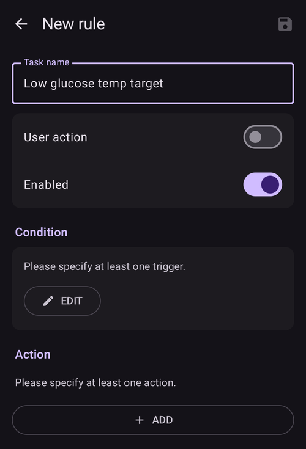
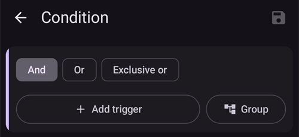
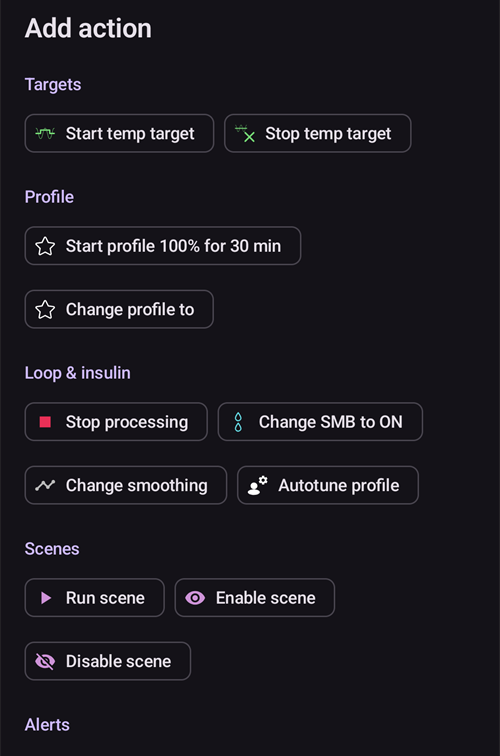
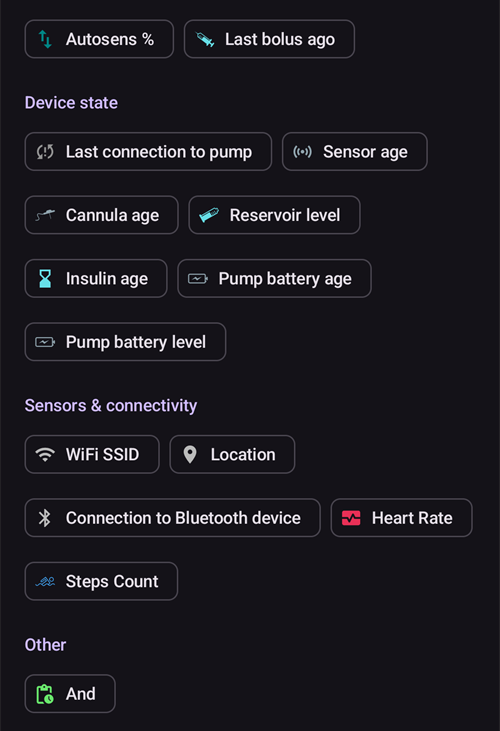
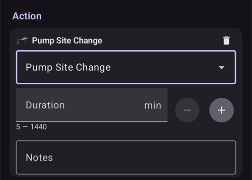
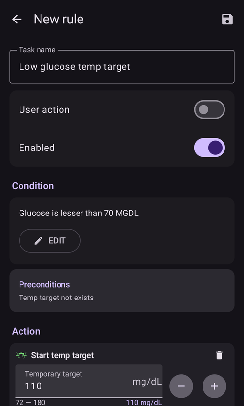

# Automatizavimas

```{contents} In this page
:backlinks: entry
:depth: 2
```

## Kas yra automatizacija?

„**Automatizacija**“ – tai funkcija, kuri gali automatizuoti užduotis AAPS.

Automatizacija atlieka tam tikrus veiksmus pagal vieną ar kelias sąlygas. Sąlygos gali būti ir nereguliarūs įvykiai, pvz., žema ar aukšta glikemija (KG) arba tam tikras neigiamas aktyvaus insulino kiekis (AIO). Automatizacijos gali tvarkyti ir pasikartojančius įvykius, pvz., valgį ar sportą tam tikru paros metu, arba kai naudotojas yra tam tikru atstumu nuo GPS vietos ar Wi-Fi SSID zonoje. Automatizacija gali kurti AAPS nustatymų atsargines kopijas pagal tvarkaraštį arba kiekvieną kartą pakeitus Pod.

Automatizacijos taisyklės kuriamos ir keičiamos ekrane **Automatizacija** (**Valdymas → Automatizacija**). Kiekvieną taisyklę apibrėžia dvi savybės:

- Viena ar daugiau sąlygų (angl. triggers), kurios paleidžia veiksmą.

    Pavyzdžiui, tam tikras laikas, įvykis arba AAPS savybės reikšmė

- Vienas ar daugiau veiksmų, kuriuos reikia atlikti.

    Pavyzdžiui, aliarmas, profilio procento nustatymas arba AAPS nustatymų eksportavimas pakeitus Pod.


Automatizacijos parinkčių yra daug, todėl naudotojams patariama su jomis susipažinti AAPS programėlės skiltyje „Automatizacija“. Kitų naudotojų automatizacijų pavyzdžių taip pat galite ieškoti AAPS naudotojų grupėse [**Facebook**](https://www.facebook.com/groups/AndroidAPSUsers) ir [**Discord**](https://discord.gg/4fQUWHZ4Mw).

## Kuo gali padėti automatizacija

1. **Pasikartojančių užduočių automatizavimas:** užprogramuoti veiksmai atliekami automatiškai, naudotojui nieko nedarant.

1. **Mažesnis nuovargis dėl sprendimų:** pagrindinė **automatizacijų** nauda – naudotojui nebereikia rankiniu būdu nuolat įsikišti į **AAPS** darbą. [Tyrimų](https://www.ncbi.nlm.nih.gov/pmc/articles/PMC6286423/#ref4) duomenimis, žmonės, sergantys 1 tipo diabetu, kasdien vidutiniškai turi priimti 180 papildomų sprendimų. **Automatizacijos** gali sumažinti protinį krūvį, todėl naudotojui lieka daugiau energijos kitiems gyvenimo dalykams.

1. **Galimai geresnė glikemijos kontrolė:** pavyzdžiui, **automatizacijos** padeda užtikrinti, kad **laikini tikslai** visada būtų nustatyti, kai jų reikia, net ir esant įtemptam dienos režimui ar kai ką nors pamirštate. Pavyzdžiui, jei vaikas, sergantis diabetu, mokykloje sportuoja antradieniais 10 val. ir ketvirtadieniais 14 val., ir jam reikia aukšto laikino tikslo (LT) likus 30 minučių iki sporto, šį **laikiną tikslą** galima įjungti **automatizacija**.

1. **AAPS galima labai individualiai pritaikyti**, kad tam tikrose situacijose jis veiktų agresyviau arba švelniau, kaip nori naudotojas. Pavyzdžiui, nustatytam laikui įjungti sumažintą **profilio** % , jei naktį atsiranda neigiamas **AIO**. Tai rodo, kad esamas **profilis** gali būti per stiprus.

Toliau pateiktas pavyzdys rodo, kaip **automatizacija** gali padėti išvengti kai kurių veiksmų.

Naudotojas kiekvieną rytą 6 val. sportuoja: jam reikia nepamiršti 5 val. rankiniu būdu AAPS nustatyti laikiną tikslą „Sportas“.


Naudotojas nustatė **automatizaciją**, kuri 5 val. įjungia laikiną tikslą „Sportas“, kad jo **KG** ir **AIO** būtų tinkami 6 val. treniruotei:


## Svarbu žinoti prieš pradedant naudoti automatizacijas

1. Prieš nustatydami kai kurias automatizacijas, su **AAPS** turėtumėte būti pasiekę pakankamai gerą **KG** kontrolę. Automatizacijomis nereikėtų kompensuoti netinkamai nustatytų valandinės bazės, **JIF** ar **IA** reikšmių (plačiau aptariama toliau). Nenustatykite automatinio **profilio keitimo**, kad kompensuotumėte **KG** kilimą, _pvz._, dėl maisto. Tam geriau tinka kitos strategijos (SMB ir kt.).

1. Kaip ir bet kuri technologija, **NGJ**, **pompos** ir telefonai gali sugesti: techninės problemos ar jutiklio klaidos gali sutrikdyti **automatizacijos** veiksmus, ir gali tekti įsikišti rankiniu būdu.

1. **Pasikeitus dienos režimui, greičiausiai pasikeis ir automatizacijų poreikis**. Kai keičiasi darbo, mokslo ar atostogų laikotarpiai, nusistatykite priminimą kalendoriuje ir peržiūrėkite, kurios **automatizacijos** šiuo metu įjungtos (jas lengva įjungti ir išjungti). Pavyzdžiui, jei išvykstate atostogų ir jums nebereikia automatizacijos, nustatytos mokyklos sporto pamokoms ar kasdieniam sportui, arba reikia pakeisti laiką.

1. **Automatizacijos** gali prieštarauti viena kitai. Kiekvieną naują **automatizaciją (-as)** verta atidžiai išbandyti saugioje aplinkoje ir suprasti, kodėl **automatizacija** suveikė arba nesuveikė taip, kaip tikėjotės.

1. Jei naudojate Autosens, stenkitės naudoti **laikinus tikslus**, o ne **profilio keitimus**. **Laikini tikslai** nenustato Autosens iš naujo į 0. **Profilio keitimai** nustato Autosens iš naujo.

1. Daugumą **automatizacijų** reikėtų nustatyti tik **ribotam laikui**. Po to **AAPS** gali iš naujo įvertinti situaciją ir prireikus pakartoti **automatizaciją**, jei sąlyga vis dar tenkinama. Pavyzdžiui, „pradėti 7,0 mmol/l laikiną tikslą 30 min.“ arba „pradėti **profilį** 110 % 10 min.“ _ir_ „pradėti 5,0 mmol/l laikiną tikslą 10 min.“. Jei **automatizacijomis** daromi nuolatiniai pakeitimai (pvz., įjungiamas stipresnis profilio %), kyla hipoglikemijos rizika.

## Kada galiu pradėti naudoti automatizaciją?

**Automatizacijas** galima pradėti naudoti **10 mokymo etape**.

## Kur AAPS yra automatizacijos?

Pagrindinio ekrano apatinėje naršymo juostoje atidarykite **Valdymas** ir pasirinkite **Automatizacija**.

## Kaip nustatyti automatizaciją?

Norėdami nustatyti **automatizaciją**, automatizacijos ekrane paspauskite mygtuką **+** ir sukurkite „taisyklę“:



* suteikite „taisyklei“ pavadinimą (Užduoties pavadinimas);
* paspauskite „**Keisti**“ po **Sąlyga**. Ekrane **Sąlyga** pasirinkite, kaip sujungti sąlygas (**Ir**, **Arba**, **Išskirtinis arba**), ir paspauskite „**Pridėti sąlygą**“:



* pridėkite bent vieną sąlygą:


* paspauskite „**PRIDĖTI**“ po **Veiksmas** ir pasirinkite vieną veiksmą:



* išsaugokite taisyklę mygtuku **Išsaugoti** ir įsitikinkite, kad langelis kairėje nuo taisyklės pavadinimo yra „pažymėtas“ – tada **automatizacija** bus įjungta:


Norėdami išjungti **automatizacijos** taisyklę, nuimkite žymę langelyje kairėje nuo **automatizacijos** pavadinimo. Toliau pateiktame pavyzdyje **automatizacija** rodoma įjungta („pažymėta“) arba išjungta („nepažymėta“):


Nustatydami **automatizaciją**, pirmiausia galite ją išbandyti, skiltyje „Veiksmai“ pasirinkę parinktį „pranešimas“. Tada **AAPS** pirmiausia tik parodo pranešimą, o ne iš tikrųjų atlieka veiksmą. Kai būsite tikri, kad pranešimas rodomas tinkamu laiku ir esant tinkamoms sąlygoms, **automatizacijos** taisyklėje „Pranešimas“ galima pakeisti tikru veiksmu.


```{admonition} Important note
:class: note

**Automatizacijos** veikia net tada, kai ciklas išjungtas!
```


## Kada tikrinamos taisyklės

**AAPS** tikrina visas **automatizacijos** taisykles kiekvieną kartą, kai apdorojamas naujas gliukozės rodmuo. Taigi taisyklės tikrinamos tokiu pačiu dažniu kaip jūsų NGJ duomenys, net ir tada, kai telefono ekranas išjungtas. Taisyklės taip pat tikrinamos, kai telefonas pradeda krautis, kai pasikeičia tinklas ar vieta ir kai prisijungia Bluetooth įrenginys. Vienu metu vyksta tik vienas tikrinimas, todėl taisyklė, kurios veiksmai trunka ilgiau (pvz., komanda pompai), negali būti įvykdyta du kartus.

## Saugumo ribos

**Automatizacijoms** taikomos saugumo ribos:

* **Automatizacijos** nustatytas **laikinas tikslas** turi būti nuo 72 iki 180 mg/dL (arba nuo 4 iki 10 mmol/l).
* **Profilio procentas** turi būti nuo 50 % iki 130 %.
* Tarp **automatizacijos** vykdymų (ir iki pirmojo vykdymo) turi praeiti bent 5 minutės.

## Teisingas neigiamų reikšmių naudojimas

```{admonition} Warning
:class: warning

Būkite atsargūs, kai **automatizacijoje** pasirenkate neigiamą reikšmę
```

Būkite atsargūs, kai **automatizacijos** sąlygoje pasirenkate neigiamą reikšmę su palyginimu, pvz., „mažiau nei“. Pavyzdžiui:


**1 pavyzdys:** sukūrus sąlygą **„mažiau nei“** „-0,1 mmol/l“ (arba „-2 mg/dL“):

**Automatizacija** suveikia esant bet kuriam skaičiui, kuris yra **griežtai mažesnis nei** -0,1 (-2). Tai apima skaičius, pvz., -0,2, -0,3, -0,4 (-4, -6, -8) ir t. t. Atminkite, kad pats skaičius -0,1 (-2) į šią sąlygą **neįeina**. (Sąlyga „lygu arba mažiau nei -0,1 mmol/l (-2 mg/dL)“ _apimtų_ ir -0,1 mmol/l arba -2 mg/dL).

**2 pavyzdys:** sukūrus sąlygą „daugiau nei“ -0,1 mmol/l (-2 mg/dL):

**Automatizacija** suveikia esant bet kuriam skaičiui, kuris yra **didesnis nei** -0,1 mmol/l (-2 mg/dL). Tai apima skaičius, pvz., 0; 0,2; 0,4 mmol/l (0, 4, 8 mg/dL) ir bet kurį kitą teigiamą skaičių.

Rinkdamiesi šias sąlygas ir reikšmes, gerai apgalvokite, ką tiksliai turi daryti jūsų **automatizacija**.

(automations-automation-triggers)=
## Automatizacijos sąlygos


Slinkite žemyn, kad pamatytumėte likusį sąrašą:



Naudotojas gali pasirinkti įvairias „sąlygas“. Sąlygos – tai reikalavimai, kurie turi būti įvykdyti, kad automatizacija būtų įvykdyta. Šis sąrašas nėra baigtinis:

**Sąlyga:** sąlygų sujungimas

**Parinktys:**

Kelias sąlygas galima sujungti taip:
* „Ir“
* „Arba“
* „Išskirtinis arba“ (tai reiškia, kad veiksmas (-ai) bus atliktas (-i), jei tenkinama viena ir tik viena sąlyga)

**Sąlyga:** laikas ir pasikartojantis laikas

**Parinktys:**

* laikas = vienkartinis įvykis
* pasikartojantis laikas = tai, kas vyksta reguliariai (pvz., kartą per savaitę, kiekvieną darbo dieną ir pan.)

**Sąlyga:** vieta

**Parinktys:**

* skiltyje [Nustatymai > Automatizacija](#preferences-maintenance-settings) naudotojas gali pasirinkti reikiamą vietovės paslaugą.

**Sąlyga:** vietovės paslaugos

**Parinktys:**

* Naudoti pasyvų vietos nustatymą: **AAPS** gauna vietą tik tada, kai jos prašo kitos programėlės.
* Nustatyti vietą pagal tinklą: jūsų Wi-Fi vieta.
* Nustatyti vietą naudojant GPS (Dėmesio! Tai gali labai greitai iškrauti bateriją!)

**Sąlygos**: pompos ir jutiklio duomenys

* Sąlyga „Kaniulės laikas“: veikia su visomis pompomis
* Sąlyga „Insulino laikas“: veikia su palaikomomis pompomis
* Sąlyga „Pompos baterijos laikas“: veikia su palaikomomis pompomis
* Sąlyga „Jutiklio amžius“: veikia visada
* Sąlyga „Pod aktyvavimas“: veikia su pompomis be vamzdelio (patch)

Atkreipkite dėmesį, kad visoms su laiku susijusioms sąlygoms palyginimas „lygu“ greičiausiai nesuveiks, todėl tokiu atveju intervalui sudaryti reikia dviejų sąlygų

* Sąlyga „Rezervuaro lygis“: veikia su visomis pompomis. Palyginimas „NOT\_AVAILABLE“ šiai sąlygai neveikia, nes **AAPS** reikšmė visada užpildyta
* Sąlyga „Pompos baterijos lygis“: veikia su palaikomomis pompomis. Palyginimas „NOT\_AVAILABLE“ šiai sąlygai neveikia, nes **AAPS** reikšmė visada užpildyta

(automations-automation-action)=
## Veiksmas


Slinkite žemyn, kad pamatytumėte likusį sąrašą:


**Veiksmai:** pradėti **laikiną tikslą**

**Parinktys:**

* **KG** turi būti nuo 72 mg/dL iki 180 mg/dL (nuo 4 mmol/l iki 10 mmol/l)
* **LT** veikia tik tada, jei nėra ankstesnio laikino tikslo. **AAPS** automatiškai prideda prie taisyklės eilutę „**Išankstinės sąlygos: Laikinas tikslas neegzistuoja**“

**Veiksmai:** sustabdyti **laikiną tikslą**

**Parinktys:**

none

**Veiksmai:** **Profilio procentas**

**Parinktys:**

* **Profilis** turi būti nuo 50 % iki 130 %
* veikia tik tada, jei ankstesnis procentas yra 100 %

**Actions:** **Change smoothing** (in the **Loop & insulin** group)

**Parinktys:**

* select the [smoothing method](../CompatibleCgms/SmoothingBloodGlucoseData.md) to switch to. The list is the same as under **Configuration** > **Smoothing**, and the action does exactly what a change there does: the new method is saved, synced to paired clients, and the BG data is smoothed again right away.
* vykdomas tik tada, jei tas glodinimo metodas dar neaktyvus. **AAPS** automatiškai prideda prie taisyklės eilutę „**Išankstinės sąlygos: Glodinimas … neaktyvus**“. Kai pasirinktas glodinimas jau aktyvus, taisyklė tyliai praleidžiama.
* Example: a new sensor is often noisy during its first day. Two rules with the **Sensor age** trigger give stronger filtering while the sensor settles, and lag-free smoothing after that:
  * **Sensor age** less than 24 h: **Change smoothing** to **Unscented Kalman Filter**
  * **Sensor age** more than 24 h: **Change smoothing** to **Average smoothing**

**Veiksmai:** **Pastaba** (sąrašo grupėje **Perspėjimai**)

**Parinktys:**

* pasirinkite, kokį įvykį įrašyti: **Pastaba**, **Sportas**, **Klausimas**, **Pranešimas** arba **Infuzijos vietos keitimas**, ir, jei norite, pastabą. Veiksmo pavadinimas pasikeičia į pasirinktą įvykį.
* **Trukmė**: naudojama **Pastaba**, **Sportas** ir **Infuzijos vietos keitimas**. **Klausimas** ir **Pranešimas** neturi trukmės: vietoj jos jie įrašo jūsų dabartinę KG.
* **Infuzijos vietos keitimas** iš naujo pradeda skaičiuoti kaniulės laiką, lyg būtumėte rankiniu būdu įrašę infuzijos vietos keitimą. Pavyzdys: kai kurios pompos (pvz., Combo) pačios įrašo rezervuaro keitimą, bet neįrašo infuzijos vietos keitimo. Jei visada keičiate abu kartu, taisyklė su sąlygomis **Insulino laikas** mažiau nei 1 valanda ir **Kaniulės laikas** daugiau nei 24 valandos gali įrašyti infuzijos vietos keitimą už jus.

 

**Veiksmai:** **Siųsti SMS į visus numerius** (grupėje **Perspėjimai**)

**Parinktys:**

* įveskite žinutės tekstą. Ji siunčiama visais telefono numeriais, kurie leidžiami [SMS komandos](../RemoteFeatures/SMSCommands.md) nustatymuose. Įskiepis „SMS komandos“ turi būti įjungtas.

**Veiksmai:** **Pakeisti profilį** (grupėje **Profilis**)

**Parinktys:**

* pasirinkite **profilį**, kurį norite įjungti. Jis įjungiamas 100 %, be laiko perstūmimo. Jei šis profilis jau aktyvus, veiksmas nieko nedaro.

**Veiksmai:** **Įjungti/išjungti SMB** (grupėje **Ciklas & insulinas**)

**Parinktys:**

* pasirinkite **ĮJUNGTA** arba **IŠJUNGTA**. Tai pakeičia OpenAPS SMB nustatymą **Naudoti SMB** lygiai taip pat, lyg būtumėte jį pakeitę **nustatymuose**. Pakeitimas lieka, kol jūs arba kita taisyklė jo nepakeis atgal.

**Veiksmai:** **Paleisti Autotune** (grupėje **Ciklas & insulinas**)

**Parinktys:**

* pasirinkite profilį, kurį derinti, ir dienų skaičių: žr. [Autotune paleidimas automatizacijos taisykle](#autotune-run-autotune-with-an-automation-rule).

**Veiksmai:** **Stabdyti apdorojimą** (grupėje **Ciklas & insulinas**)

**Parinktys:**

* nėra. While the conditions of a rule with this action are true, **AAPS** does not check the rules below it in the list. As soon as its conditions are false again, the rules below are checked as usual. Pridėkite jį prie taisyklės, kuri turi turėti pirmenybę prieš žemiau esančias taisykles (žr. [automatizacijų tvarka](#Automations-the-order-of-the-automations-in-the-list-matters)).

**Veiksmai:** **Paleisti scenarijų**, **Įjungti scenarijų**, **Išjungti scenarijų** (grupėje **Scenarijai**)

**Parinktys:**

* pasirinkite [scenarijų](Scenes.md), kurį norite paleisti, įjungti arba išjungti.

Pridėjus veiksmą, numatytąsias reikšmes reikia pakeisti norimomis: spustelėkite jas ir pakoreguokite.


(Automations-the-order-of-the-automations-in-the-list-matters)=
## **Automatizacijų** tvarka sąraše yra svarbi
 **AAPS** vykdo sukurtas taisykles pagal prioritetą, pradėdama nuo **automatizacijų** sąrašo viršaus. Pavyzdžiui, jei **automatizacija** „Žema“ yra svarbiausia **automatizacija**, svarbesnė už visas kitas taisykles, ši **automatizacija** turi būti naudotojo **automatizacijų** sąrašo viršuje, kaip parodyta toliau:


Norėdami pakeisti **automatizacijos** taisyklių prioritetą, palieskite ir palaikykite rankenėlę **=** dešinėje taisyklės pusėje. **Automatizacijų** tvarką pakeisite perkeldami taisykles aukštyn arba žemyn.


## Kaip ištrinti automatizacijos taisykles

Norėdami ištrinti **automatizacijos** taisyklę, spustelėkite šiukšliadėžės piktogramą.


## Automatizacijų pavyzdžiai

Toliau pateikiami **automatizacijų** pavyzdžiai. Daugiau diskusijų apie **automatizacijas** ir tai, kaip naudotojai pritaikė savo **automatizacijas**, rasite Facebook diskusijų grupėse arba Discord. Nekopijuokite toliau pateiktų pavyzdžių, jei gerai nesuprantate, kaip veiks **automatizacija**.

(automations-low-glucose-temp-target)=
### Žemos glikemijos laikinas tikslas

Ši **automatizacija** automatiškai įjungia **laikiną tikslą**, kai **KG** nukrenta žemiau tam tikros ribos. Šiame pavyzdyje, kai gliukozė mažesnė nei 70 mg/dL, 30 minučių įjungiamas 110 mg/dL tikslas:



### Pietų laiko laikinas tikslas (su sąlyga „Vieta“)


Ši **automatizacija** sukurta naudotojui, kuris darbe pietauja maždaug tuo pačiu metu kiekvieną darbo dieną. Ji suveikia tik tada, kai naudotojas yra nustatytoje „vietoje“.  Taigi, jei naudotojas kurią dieną nėra darbe, ši **automatizacija** neįsijungs.

Ši **automatizacija** 13:00 nustatys žemą **laikiną tikslą** (Netrukus valgysiu), kad prieš pietus KG nukristų iki 90 mg/dL (arba 5 mmol/l).

Sąlyga „Vieta“ turi pavadinimą, padėtį (bakstelėkite **Pasirinkti žemėlapyje** arba naudokite dabartinę vietą) ir spindulį metrais. Ji suveikia, kai esate zonoje (arba už jos ribų):


Dėl „Ir“ jungties **automatizacija** suveikia tik „pasirinktu laiku“ ir tik tada, kai naudotojas yra pasirinktoje vietoje.

Kitu laiku šioje vietoje arba šiuo laiku už 50 metrų spindulio aplink pasirinktą vietą **automatizacija** nesuveiks.

### Automatizacija pagal Wi-Fi SSID vietą

Wi-Fi SSID yra geras būdas paleisti **automatizaciją**, kai esate konkretaus Wi-Fi tinklo veikimo zonoje (palyginti su GPS): jis gana tikslus, naudoja mažiau baterijos ir veikia uždarose patalpose, kur GPS ir kitos vietos nustatymo paslaugos gali būti nepasiekiamos.

Štai dar vienas pavyzdys, kaip nustatyti **laikiną tikslą** tik darbo dienomis prieš pusryčius (1).


**Automatizacija** suveiks 05:30 tik nuo pirmadienio iki penktadienio (2)  
ir tik kai telefonas prisijungęs prie namų Wi-Fi tinklo (3).


Tada ji nustatys 75 mg/dL **laikiną tikslą** 30 minučių (4). Vienas iš vietos įtraukimo privalumų – taisyklė nesuveiks, pavyzdžiui, jei naudotojas keliauja atostogų.


Slinkite žemyn, kad pamatytumėte veiksmą: 75 mg/dL **laikinas tikslas** 30 minučių (4).


Štai ekrano kopija su **automatizacijos** sąlygomis:

1) Pagrindinė jungtis „IR“ (sąlyga suveikia, kai tenkinamos abi sąlygos) 1) Pasikartojantis laikas = Pr, An, Tr, Kt, Pn, 5:30  
1) WiFi SSID = My_Home_WiFi_Name


(automating-preference-settings-export)=

## Nustatymų eksportavimo automatizavimas

### Automatinis eksportavimas: pagal tvarkaraštį (kasdien)

Ekrano kopijos su automatizacijos sąlygomis:

1) Sąlyga: Pasikartojantis laikas = Pr, An, Tr, Kt, Pn, 8:00 1) Veiksmas: Eksportuoti nustatymus (laukelyje „Tekstas terapijoje“ įveskite „Daily“)


Pastaba: eksportavimas bus įrašytas terapijos įrašuose (Careportal)

### Automatinis eksportavimas: Pod aktyvavimas (tik pompoms be vamzdelio)

Ekrano kopijos su automatizacijos sąlygomis:

1) Sąlyga: Pod aktyvavimas 1) Veiksmas: Eksportuoti nustatymus (laukelyje „Tekstas terapijoje“ įveskite „Pod Activation: settings export“)


Pastaba: eksportavimas bus įrašytas terapijos įrašuose (Careportal). Pastaba: automatizacija **visai** nesuveiks, jei anksčiau nesate bent kartą rankiniu būdu eksportavę nustatymų. Kaip tinkamai įjungti automatinį nustatymų eksportavimą, žr. [Nustatymai → Servisas](#preferences-maintenance-settings).


## Automatizacijos žurnalas

**AAPS** ekrano **Automatizacija** apačioje, po taisyklėmis, rodo naujausių **automatizacijos** įvykių žurnalą. Juo patikrinkite, ar taisyklės suveikė tada, kai tikėjotės.

Toliau pateiktame pavyzdyje įjungta taisyklė **Low glucose temp target** (1) (žr. aukščiau [Žemos glikemijos laikinas tikslas](#automations-low-glucose-temp-target)). Žurnale (2) matyti, kad 15:09 gliukozė nukrito žemiau 70 mg/dL ir taisyklė suveikė:
* veiksmas buvo „Start temp target: 110mg/dL@30 min“: 110 mg/dL **laikinas tikslas** 30 minučių;
* **OK** pabaigoje reiškia, kad veiksmas atliktas sėkmingai.


(automations-troubleshooting)=

## Troubleshooting

* Problema: __AAPS nevykdo mano automatizacijų?__

Patikrinkite, ar langelis kairėje nuo **automatizacijos** pavadinimo yra „pažymėtas“, kad taisyklė būtų įjungta:


* Problema: __Mano automatizacijos vykdomos netinkama tvarka.__

Patikrinkite taisyklių prioriteto tvarką, kaip aprašyta aukščiau.

* Problema: __Sąlygoje rodoma „Nežinoma sąlyga … – niekada netenkinama“.__

Taisyklėje yra sąlyga, kurios ši **AAPS** versija negali nuskaityti, pavyzdžiui, grįžus prie senesnės versijos arba importavus nustatymus iš naujesnės versijos. Tokia sąlyga niekada nėra tenkinama, todėl taisyklė nevykdoma. Ji išsaugoma nepakeista, kad naujesnė versija vis dar galėtų ją naudoti. Redaguokite taisyklę ir pakeiskite sąlygą arba atnaujinkite **AAPS**.

## Automatizacijų alternatyvos

Patyrę naudotojai užduotis gali automatizuoti ir kitais būdais, pvz., naudodami IFTTT arba trečiosios šalies Android programėlę Automate. 
