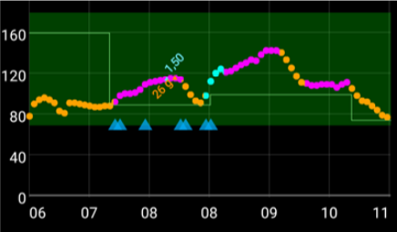

(Open-APS-features-DynamicISF)=
# Dinaminis JIF (DynISF)

Iki šiol, naudojant **AMA** ir **SMB**, **JIF** buvo nustatomas **profilyje** ir buvo pastovus kiekvienam nustatytam paros intervalui. Tačiau iš tikrųjų žmogaus **JIF** nėra toks pastovus ir kinta priklausomai nuo **KG** lygio: esant aukštai KG, naudotojui reikės daugiau insulino, kad jo **KG** sumažėtų 50 mg/dL / 3 mmol/l, nei esant žemesnei **KG**. [Autosens](#Open-APS-features-autosens) buvo pirmasis algoritmas, kuris bandė išspręsti šią problemą, koreguodamas **JIF** ne valgio metu.

**Dinaminis JIF** (dar vadinamas **DynISF**) turi tą pačią paskirtį, bet yra pažangesnis, nes gali būti naudojamas bet kuriuo metu. Jis rekomenduojamas tik patyrusiems naudotojams, kurie gerai išmano **AAPS** valdymą ir stebėjimą. Prieš išbandydami, perskaitykite toliau esantį skyrių [Į ką atsižvelgti įjungiant dinaminį JIF](#dyn-isf-things-to-consider-when-activating-dynamicisf).

```{admonition} CAUTION - Automations or Profile Percentage change
:class: warning

**Automatizacijas** visada naudokite atsargiai. Ypač tai svarbu naudojant **dinaminį JIF**.

Naudodami **dinaminį JIF**, išjunkite visas **automatizacijos** taisykles, kurios laikinai keičia **profilį**, nes dėl jų **dinaminis JIF** taptų per daug agresyvus skiriant korekcinius bolusus ir sukeltų hipoglikemiją. Būtent tam ir skirtas **dinaminis JIF**, todėl nereikia automatizacija nurodyti **AAPS** suleisti daugiau insulino, kai **KG** aukšta.

```

Kad būtų galima naudoti **dinaminį JIF**, **AAPS** duomenų bazėje turi būti bent 7 dienų naudotojo **AAPS** duomenys.

## Ką daro dinaminis JIF?

**Dinaminis JIF** dinamiškai keičia jautrumo insulinui faktorių (**JIF**) pagal naudotojo:

- bendros paros insulino dozės (**BPD**); ir
- dabartinių ir prognozuojamų gliukozės kraujyje reikšmių.

Naudojant **dinaminį JIF**, **profilyje** įvestos **JIF** reikšmės visai nebenaudojamos. Jos naudojamos tik kaip atsarginės, jei **AAPS** duomenų bazėje nepakanka BPD duomenų (*pvz.*, iš naujo įdiegus programėlę).

**SMB/AMA** – naudotojo **profilio** pavyzdys su statiniu **JIF**, kurį nustatė naudotojas ir kurį naudoja **SMB** ir **AMA**.


**Dinaminis JIF** – naudotojo **JIF** pavyzdys, kai jį keičia **dinaminis JIF**.


Raudonai apibrauktoje dalyje rodoma: `profile ISF` -> `ISF as calculated by DynISF`. <br/> Bakstelėjus šią sritį, atidaromas langas su papildoma informacija, pvz., **JIF**, naudojamu skaičiuotuvui ir angliavandenių įsisavinimui (žr. toliau [Kiti JIF panaudojimo atvejai](#dynisf-other-usages-of-isf)).

**DynISF** reikšmę taip pat galima rodyti grafike: pagrindiniame ekrane po grafikais bakstelėkite **Pridėti grafiką** ir pasirinkite **VSENS** (kintamas jautrumas). Ji rodoma balta linija (aukščiau esančio paveikslėlio apačioje).

## Kaip apskaičiuojamas dinaminis JIF?

**Dinaminis JIF** naudoja Chris Wilson modelį **JIF** nustatyti, o ne pastovią naudotojo **JIF** reikšmę, nustatytą **profilyje**. Išsamus paaiškinimas (anglų k.): [Chris Wilson on Insulin Sensitivity (Correction Factor) with Loop and Learn, 2/6/2022](https://www.youtube.com/watch?v=oL49FhOts3c).

Naudojama **dinaminio JIF** lygtis: `ISF = 1800 / ((TDD * DynISF Adjust Factor) * Ln (( current BG / insulin divisor) + 1 ))`

Šioje lygtyje naudojami kintamieji aprašyti toliau.<br/> Pastaba: `Ln` reiškia natūrinį logaritmą (matematinę funkciją).

Ši lygtis naudojama dabartiniam **JIF** apskaičiuoti ir oref1 [prognozėse pagal **AIO**, **ZT** (nulinė laikina bazė) ir **NDM**](#aaps-screens-prediction-lines). Ji taip pat naudojama **AAO** ir boluso patarėjui (žr. toliau [Kiti JIF panaudojimo atvejai](#dynisf-other-usages-of-isf)).

### BPD (bendra paros dozė)
BPD apskaičiuojama derinant šias reikšmes:
1.  7 dienų vidutinė **BPD**;
2.  praėjusios paros **BPD**; ir
3.  paskutinių aštuonių (8) valandų insulino vartojimo svertinio vidurkio, perskaičiuoto 24 valandoms.

Šioje lygtyje naudojama **BPD** sudaroma po vieną trečdalį iš kiekvienos aukščiau nurodytos reikšmės.

### Dinaminio JIF derinimo faktorius

Jis nustatomas naudotojo **nustatymuose** ir naudojamas tam, kad **dinaminis JIF** būtų agresyvesnis arba mažiau agresyvus. Žr. toliau esantį skyrių [Nustatymai](#dyn-isf-preferences).

### Insulino daliklis
Insulino daliklis priklauso nuo naudojamo insulino piko ir yra atvirkščiai proporcingas piko laikui. Lyumjev ši reikšmė yra 75, Fiasp – 65, o įprastam greito veikimo insulinui – 55.

### JIF pagal prognozuojamą KG dozavimo sprendimams

Dinaminis jautrumas apskaičiuojamas pagal **dabartinę KG** reikšmę ir **AAPS** rodomas kaip jūsų dabartinis JIF. Tačiau skaičiuodamas dozes, oref1 algoritmas apskaičiuoja ir naudoja **būsimą JIF**.

Taip daroma tam, kad nebūtų suleista per daug insulino, kai **KG** žema arba prognozuojama, kad ji bus žema.

**Būsimas JIF** apskaičiuojamas pagal tą pačią aukščiau aprašytą formulę, tik vietoj **dabartinės KG** gali būti naudojama **mažiausia prognozuojama KG**. **Mažiausia prognozuojama KG**, [apskaičiuota oref1](#aaps-screens-how-predictions-become-a-dosing-decision), yra mažiausia reikšmė, iki kurios, prognozėmis, gali nukristi jūsų KG per visą prognozės laikotarpį.

* Jei dabartinė **KG** yra virš tikslo<br/> **ir** jei **KG** stabili (pokytis neviršija +/- 3 mg/dL):<br/>formulėje KG naudojama taip: `average(minimum predicted BG, current BG)`.
* Jei galutinė **KG** yra virš tikslo ir gliukozė kyla,<br/> **arba** galutinė **KG** yra aukštesnė už dabartinę **KG**:<br/>formulėje KG naudojama taip: `current BG`.
* Kitais atvejais:<br/>formulėje KG naudojama taip: `minimum predicted BG`.

Supaprastintą paaiškinimą rasite toliau pateiktoje ekrano kopijoje, kurioje parodyta aukščiau aprašyta situacija. Oranžiniai taškai naudoja **prognozuojamą KG**, violetiniai taškai – **average(prognozuojama KG, dabartinė KG)**, o mėlyni taškai – **dabartinę KG**.



(dynisf-other-usages-of-isf)=
## Kiti JIF panaudojimo atvejai

### JIF ir AAO įsisavinimas

Kaip aprašyta puslapyje [AAO apskaičiavimas](../DailyLifeWithAaps/CobCalculation.md), AAO įsisavinimas paprastai apskaičiuojamas pagal šią formulę:   
`absorbed_carbs = deviation * ic / isf`  
Naudojant **dinaminį JIF**, čia naudojamas **JIF** yra paskutinių 24 val. dinaminio JIF reikšmių vidurkis.

### JIF boluso patarėjuje

Naudojant [boluso patarėją](#aaps-screens-bolus-wizard), **JIF** naudojamas korekcijai pridėti, jei **KG** yra virš tikslo.

Naudojant **dinaminį JIF**, čia naudojamas **JIF** yra paskutinių 24 val. dinaminio JIF reikšmių vidurkis.

(dyn-isf-preferences)=
## Parametrai

Norėdami įjungti, pažymėkite **Naudoti dinaminį jautrumą** skiltyje [Nustatymai > OpenAPS SMB](#Preferences-openaps-smb-settings). Pasirinkus atsiranda nauji nustatymai.


(dyn-isf-adjustment-factor)=
### DynamicISF derinimo faktorius
**Dinaminis JIF** veikia pagal vieną taisyklę, kuri turėtų tikti visiems. Tai reiškia, kad žmonių su ta pačia **BPD** jautrumas būtų toks pat. Kadangi kiekvieno naudotojo jautrumas yra individualus, **derinimo faktorius** leidžia nurodyti, ar naudotojas yra jautresnis ar mažiau jautrus insulinui nei „standartinis“ žmogus.

**Derinimo faktorius** yra reikšmė nuo 1 % iki 300 %. Jis veikia kaip **BPD** reikšmės daugiklis.

* Padidinus šią reikšmę virš 100 %, **DynISF** tampa agresyvesnis: **JIF** reikšmės tampa *mažesnės* (_t. y._ norint nedaug sumažinti **KG**, reikia daugiau insulino)
* Sumažinus šią reikšmę žemiau 100 %, **DynISF** tampa mažiau agresyvus: **JIF** reikšmės tampa didesnės (_t. y._ norint nedaug sumažinti **KG**, reikia mažiau insulino).

**Derinimo faktorius** taip pat pasikeičia įjungus [**profilio keitimą** su procentu](../DailyLifeWithAaps/ProfileSwitch-ProfilePercentage.md). Mažesnis **profilio procentas** sumažina **derinimo faktorių**, o didesnis **profilio procentas** jį padidina.

Pavyzdžiui, jei jūsų **derinimo faktorius** yra 80 % ir įjungiamas **profilio keitimas** į 80 %, gautas **derinimo faktorius** bus `0.8*0.8=0.64`.

Tai reiškia, kad naudodami **DynISF**, galite **profilio procentu** laikinai rankiniu būdu patikslinti savo jautrumą. Tai gali būti naudinga fizinio aktyvumo metu (mažesnis procentas), sergant (didesnis procentas) ir pan.

### LGS slenkstis

**KG** reikšmė, žemiau kurios insulino tiekimas sustabdomas (sustabdymas esant žemai glikemijai, LGS). Numatytoji reikšmė naudoja standartinį tikslo modelį. Naudotojas šią reikšmę gali nustatyti nuo 60 mg/dL (3,3 mmol/l) iki 100 mg/dL (5,5 mmol/l). Reikšmės, mažesnės nei 65/3,6, reiškia, kad naudojamas numatytasis modelis.

### DynamicISF jautrumo koregavimas

Šis nustatymas (*„Atsižvelgti į DynamicISF skaičiuojant jautrumą insulinui.“*) pakeičia Autosens ir, kaip ir įprastas Autosens, naudoja paskutinių 24 val. **BPD** / 7 dienų **BPD** santykį valandinei bazei didinti ar mažinti. Ši apskaičiuota reikšmė taip pat naudojama tikslui koreguoti, jei įjungtos parinktys, kurios koreguoja tikslą pagal jautrumą. Kitaip nei Autosens, ši parinktis nekeičia **JIF** reikšmių.

(dyn-isf-things-to-consider-when-activating-dynamicisf)=
## Į ką atsižvelgti įjungiant dinaminį JIF

* **Dinaminis JIF** rekomenduojamas tik patyrusiems naudotojams, kurie gerai išmano **AAPS** valdymą ir stebėjimą. Prieš pereinant prie **dinaminio JIF**, naudotojai turėtų būti pasiekę gerą kontrolę su **SMB**.
* Kaip minėta aukščiau, išjunkite visas [**automatizacijas**](../DailyLifeWithAaps/Automations.md), kurios pagal **KG** įjungia **profilio procentą**, nes tai bus per agresyvu ir gali būti suleista per daug insulino! Tai jau yra **dinaminio JIF** algoritmo dalis.
* Dinaminio JIF skaičiavime atsižvelgiama į [profilio procentą](../DailyLifeWithAaps/ProfileSwitch-ProfilePercentage.md) (žr. aukščiau [Dinaminio JIF derinimo faktorius](#dyn-isf-adjustment-factor)). Ilgai naudoti kitokį nei 100 % **profilio procentą** yra bloga praktika. Jei nustatėte, kad jūsų **profilis** pasikeitė, sukurkite naują **profilį** su pataisytomis reikšmėmis, užuot naudoję **profilį** su tam tikru procentu.
* **Dinaminis JIF** gali tikti ne visiems. Ypač galite pastebėti netikėtus rezultatus, jei jums tinka viena iš šių situacijų:
  * Kintantis gyvenimo būdas (nepastovus valgymo ar fizinio aktyvumo režimas)
  * Kasdien besikeičianti BPD arba jautrumas.
* Tikslių nurodymų, kaip nustatyti pradinę **derinimo faktoriaus** reikšmę, nėra. Tačiau pradžiai: jei jūsų **profilio** reikšmės teisingos, kai esate tiksliniame intervale ir **KG** stabili, **DynISF** reikšmė turėtų būti maždaug tokia pati, kokia anksčiau buvo jūsų **profilyje**.<br/>Jei matote, kad **dinaminis JIF** per daug agresyvus, sumažinkite **derinimo faktorių**, ir atvirkščiai.
* Nors **DynISF** visai nenaudoja **profilio JIF**, jei pastebite, kad jūsų jautrumas labai skiriasi nuo to, kas anksčiau buvo išsaugota jūsų **profilyje**, verta jį atnaujinti. Tai gali būti naudinga, jei prarastumėte **AAPS** duomenis (_pvz._, naujas telefonas, nauja **AAPS** versija…), nes kitas 7 dienas atsarginė reikšmė bus jūsų **profilio JIF**.