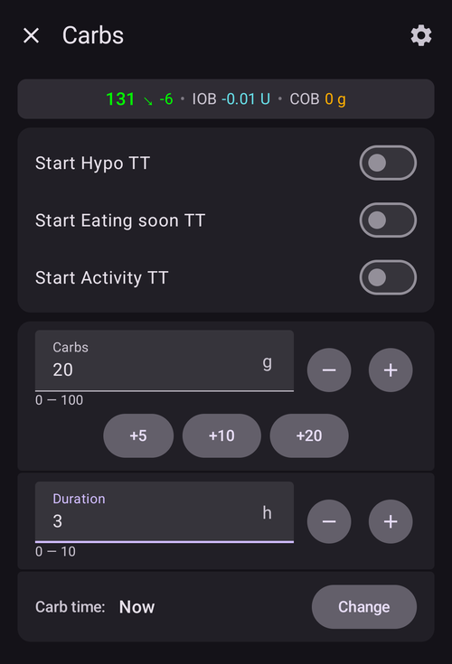
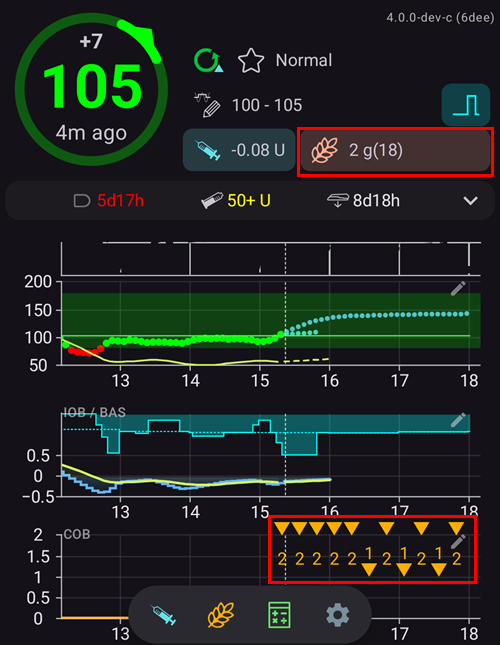

(Extended-Carbs-extended-carbs-ecarbs)=
# Ištęsti angliavandeniai / "i-AV"

## Kas yra i-AV ir kada jie naudingi?

Vykdant įprastą pompos terapiją, ištęstos dozės yra tinkamas būdas susitvarkyti su riebiu ar kitokiu lėtai įsisavinamu maistu, kuris padidina gliukozės kiekį kraujyje ilgiau nei daro insulinas. Tačiau naudojant ciklą ištęsti bolusai nėra tokie prasmingi (ir sukelia techninių sunkumų), nes iš esmės tai yra fiksuota aukšta laikina valandinė bazė, o tai prieštarauja ciklo veikimui: ciklas valandinę bazę keičia dinamiškai. For details see [extended bolus](#extended-bolus-and-why-they-wont-work-in-closed-loop-environment) below.

Tačiau vis tiek reikia susitvarkyti su tokiais patiekalais. Todėl AAPS palaiko vadinamuosius ištęstus angliavandenius, arba i-AV.

i-AV yra angliavandeniai, kurie paskirstomi per kelias valandas. Įprastam maistui, kuriame yra daugiau angliavandenių nei riebalų / baltymų, paprastai pakanka iš anksto įvesti angliavandenius (ir, jei reikia, sumažinti pradinį bolusą), kad insulinas nebūtų suleistas per anksti.  Tačiau lėčiau įsisavinamam maistui, kai visų angliavandenių įvedimas iš anksto dėl SMB sukuria per daug AIO, galima naudoti i-AV. Jie tiksliau imituoja, kaip angliavandeniai (ir angliavandenių ekvivalentai, kuriuos įvedate kitoms maistinėms medžiagoms) įsisavinami ir kaip veikia glikemiją. Turėdamas šią informaciją, ciklas gali palaipsniui leisti SMB šiems angliavandeniams padengti; tai galima laikyti dinaminiu ištęstu bolusu (tai turėtų veikti ir be SMB, bet tikriausiai mažiau efektyviai).

**Pastaba:** i-AV tinka ne tik riebiam / daug baltymų turinčiam maistui: juos galima naudoti bet kokioje situacijoje, kai kas nors didina cukraus kiekį kraujyje, pvz., kai vartojami kiti vaistai, tokie kaip kortikosteroidai.

## Kaip veikia i-AV

Norėdami įvesti i-AV, atverkite langą **Angliavandeniai** (**Terapija** → **Angliavandeniai**), įveskite visą angliavandenių kiekį, lauke **Trukmė** nustatykite trukmę ir, jei reikia, lauke **Angliavandenių laikas** paslinkite pradžią (*toliau pateikti skaičiai yra tik pavyzdžiai; turėsite išbandyti savo reikšmes, kad gliukozė reaguotų taip, kaip jums reikia*):

i-AV pagrindiniame ekrane: skaičius skliaustuose lauke **AAO** rodo dar laukiamus angliavandenius, o grafike **AAO** kiekvienas būsimas i-AV įrašas rodomas oranžine žyme. Jei nematote grafiko **AAO**, pridėkite jį mygtuku **Pridėti grafiką** po grafikais (žr. [AAPS ekranai](../DailyLifeWithAaps/AapsScreens.md)).

(AapsScreens-carbs-type)=
## Maisto tipas Boluso patarėjuje: duona, pyragas arba pica

[Boluso patarėjuje](#aaps-screens-bolus-wizard) po lauku **Angliavandeniai** yra trys mygtukai, kuriais galite pasirinkti, kaip greitai įsisavinamas jūsų maistas. Pasirinkite vieną iš jų prieš patvirtindami. Priklausomai nuo tipo, **AAPS** dalį įvestų angliavandenių įrašo kaip įprastus angliavandenius, o lėtai įsisavinamam, sotiam maistui vėliau prideda [ištęstus angliavandenius („i-AV“)](#Extended-Carbs-extended-carbs-ecarbs). Paspauskite piktogramą **(i)** šalia mygtukų: pamatysite tipiškus pasirinkto tipo maisto produktus ir kaip tipas pakeičia jūsų angliavandenius.

| Tipas                | Tipiški maisto produktai (pavyzdžiai iš programėlės)                                                                                | Angliavandeniai dabar, naudojami bolusui | Pridedami i-AV                                            |
| -------------------- | ----------------------------------------------------------------------------------------------------------------------------------- | ---------------------------------------- | --------------------------------------------------------- |
| **Duona** (numatyta) | Duona, nesaldūs kepiniai, jogurtas, vaisiai, bulvės, ryžiai, avižinė košė, daržovės                                                 | 100 %                                    | None                                                      |
| **Pyragas**          | Koldūnai, makaronai, daug angliavandenių ir riebalų turinti Azijos virtuvė, saldūs ir mieliniai kepiniai, dribsniai, medus, uogienė | 90 %                                     | 20 %, pradedant po 60 minučių, paskirstyta per 2 valandas |
| **Pica**             | Lazanija, pica, mėsainiai, gruzdintos bulvės, keptos bulvės, traškučiai                                                             | 80 %                                     | 35 %, pradedant po 60 minučių, paskirstyta per 3 valandas |

**Pavyzdys**: įvedate 100 g ir pasirenkate **Pica**. Bolusas apskaičiuojamas 80 g, kurie įrašomi dabar. 35 g i-AV prasideda po 1 valandos ir paskirstomi per 3 valandas.

Naudinga žinoti:
* Tai nėra paprastas padalijimas: pasirinkus **Pyragas** ir **Pica**, įrašytų angliavandenių suma yra **didesnė, nei įvedėte** (110 % ir 115 %). Papildomas kiekis yra tik i-AV dalyje.
* Bolusas apima tik dabar įrašytus angliavandenius. **AAPS** iš anksto neleidžia boluso i-AV: ciklas į juos atsižvelgia, kai jie prasideda, kaip ir į bet kuriuos kitus [i-AV](#Extended-Carbs-extended-carbs-ecarbs).
* Jei nustatote **Angliavandenių laikas**, i-AV prasideda praėjus 60 minučių po to laiko.
* Patvirtinimo lange i-AV rodomi atskiroje eilutėje, _pvz._, „i-AV 35 g / 3 val. (+60 min)“.
* Gramai suapvalinami žemyn iki sveikųjų skaičių.
* Procentai, atidėjimai ir trukmės yra fiksuoti; jų negalima pakeisti nustatymuose.
* Pasirinkimas neįsimenamas: patarėjas kaskart atidaromas su pasirinkimu **Duona**.

______________________________________________________________________

A way to handle fat and protein with that feature is described here: [https://adriansloop.blogspot.com/2018/04/page-margin-0.html](https://adriansloop.blogspot.com/2018/04/page-margin-0.html)

______________________________________________________________________

## Recommended setup, example scenario, and important notes

The recommended setup is to use the OpenAPS SMB APS plugin, with SMBs enabled as well as the *Enable SMB with COB* preference being enabled.

Pavyzdžiui, valgant picą, galima iš anksto suleisti (dalinį) bolusą per *Boluso patarėją*, o tada lange *Angliavandeniai* įvesti likusius angliavandenius 4–6 valandų trukmei, pradedant po 1 ar 2 valandų.

Kad būtų greičiau, *Boluso patarėjas* gali pridėti i-AV už jus: po lauku **Angliavandeniai** pasirinkite [maisto tipą](#AapsScreens-carbs-type) **Pyragas** arba **Pica** (žr. aukščiau). Kiekiai ir laikas yra fiksuoti, todėl, jei norite kitų reikšmių, naudokite langą *Angliavandeniai*.

**Important notes:** You'll need to try out and see which concrete values work for you of course. You might also carefully adjust the setting *max minutes of basal to limit SMB to* to make the algorithm more or less aggressive. Valgant maistą, kuriame mažai angliavandenių ir daug riebalų / baltymų, gali pakakti naudoti tik i-AV be rankinių bolusų (žr. tinklaraščio įrašą aukščiau). Kai sukuriami i-AV, taip pat sukuriamas terapijos įrašas (pastaba), kuriame užfiksuojami visi įvesti duomenys, kad būtų lengviau juos patikrinti ir patobulinti.

(extended-bolus-and-why-they-wont-work-in-closed-loop-environment)=
## Ištęsti bolusai ir kodėl jie neveikia uždarajame cikle

Kaip jau minėta aukščiau, ištęstas arba vadinamasis daugiabangis bolusas neveikia su uždaru ciklu. Daugiau informacijos [pateikiama toliau](#why-extended-boluses-won-t-work-in-a-closed-loop-environment).

(Extended-Carbs-extended-bolus-and-switch-to-open-loop-dana-and-insight-pump-only)=
### Ištęstas bolusas ir perjungimas į atvirą ciklą – tik Dana ir Insight pompoms

Kai kurie žmonės vis tiek prašė galimybės AAPS naudoti ištęstą bolusą, nes norėjo tam tikrą maistą valdyti taip, kaip yra įpratę.

Todėl **AAPS** Dana ir Insight pompų naudotojams siūlo ištęstą bolusą: atverkite **Valdymas** ir pasirinkite **Ištęstas bolusas**.

**AAPS** pirmiausia įspėja, kad, kol veiks ištęstas bolusas, uždaras ciklas bus sustabdytas. Norėdami tęsti, spauskite **OK**:

Įveskite kiekį lauke **Insulinas** ir trukmę lauke **Trukmė**, tada spauskite patvirtinimo mygtuką apačioje ir **OK**:

Insight pompoje ištęstas bolusas *negalimas*, jei naudojama [laikinos bazės emuliacija](#Accu-Chek-Insight-Pump-settings-in-aaps).

Kol veikia ištęstas bolusas, ciklas veikia režimu **Atviras ciklas** (pasikeičia ciklo piktograma pagrindiniame ekrane), o kai ištęstas bolusas baigiasi, uždaras ciklas automatiškai vėl įjungiamas:

Meniu **Valdymas** rodomas mygtukas **Atšaukti** su greičiu ir praėjusiu / visu laiku (pavyzdžiui, **Atšaukti 2,00 V/val. 1/60'**). Spauskite jį, jei norite sustabdyti ištęstą bolusą anksčiau:

(why-extended-boluses-won-t-work-in-a-closed-loop-environment)=
### Kodėl ištęstas bolusas neveiks uždaro ciklo aplinkoje

1. Ciklas nustato, kad dabar reikia leisti 1,55 V/val. Algoritmui nesvarbu, ar tai leidžiama kaip ištęstas bolusas, ar kaip laikina bazė. Tiesą sakant, kai kurios pompos naudoja ištęstus bolusus. Kas tada atsitinka? Most pump drivers then stop the extended bolus -> You didn't even need to start it.

2. Jeigu įvedėte ištęstą bolusą, kas turėtų atsitikti modelyje?

   1. Ar jis turėtų būti laikomas neutraliu dydžiu kartu su nustatyta valandine baze ir ciklas turėtų remtis juo kaip pagrindu? Tada ciklas taip pat turėtų galėti sumažinti bolusą, jei, pvz., glikemija tampa per žema ir visas „neutralus“ insulinas atimamas?
   2. Ar reikia tiesiog pridėti ištęstą bolusą? Taigi turėtų būti leidžiama toliau uždaram ciklui veikti? Net blogiausios hipoglikemijos atveju? Nemanau, kad tai geras dalykas: kai yra numatoma hipoglikemija, tačiau nėra imamasi jokių priemonių jos išvengti?

3. Į aktyvaus insulino kiekį, kurį kaupia ištęstas bolusas, yra atsižvelgiama po 5 minučių atliekant kitą skaičiavimą. Atitinkamai ciklas sumažintų valandinę bazę. So not much changes... except that the possibility of hypo avoidance is taken.
