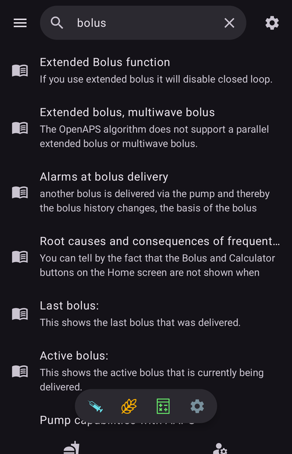

(global-search)=
# Visuotinė paieška

**AAPS** v4 versijoje pagrindinio ekrano viršuje yra **visuotinės paieškos** laukas. Įveskite žodį, ir paieška iš karto ieškos visoje programėlėje – įskiepiuose, languose, nustatymų ekranuose, atskiruose nustatymuose – o jei esate prisijungę prie interneto, ir **AndroidAPS dokumentacijoje**. Tai greičiausias būdas pereiti prie nustatymo ar ekrano, kai neprisimenate, kur jis yra.

```{contents} Table of contents
:depth: 2
:local: true
```

---

## Paieškos atvėrimas

Paspauskite lauką **🔍 Ieškoti** **pagrindinio ekrano** viršuje (šalia meniu ☰). Pradėkite rašyti – rezultatai atsiranda rašant (po trumpos pauzės) ir yra sugrupuoti pagal kategoriją:


Lauką išvalykite mygtuku **✕** arba paiešką uždarykite įrenginio mygtuku **Atgal**.

---

## Ieškokite angliškai *arba* savo kalba

Tai verta žinoti: paieška lygina **ir** tekstą jūsų **pasirinkta kalba**, **ir** originalų **anglišką** tekstą.

- Jei jūsų programėlė, pavyzdžiui, vokiečių ar čekų kalba, galite įvesti **išverstą** žodį **arba** **anglišką** žodį – abiem atvejais nustatymas bus rastas.
- Aukščiausiai rikiuojamas atitikmuo **išverstame** pavadinime, po jo – **angliškame** pavadinime, tada – išverstuose ir angliškuose **aprašymuose**.
- Lyginant nepaisoma **kirčių / diakritinių ženklų** (taigi *ů* atitinka *u*, *é* atitinka *e*), o **didžiosios ir mažosios raidės nesvarbu**.

Tai reiškia, kad angliškai parašytas vadovas ar forumo įrašas vis tiek nuves jus prie reikiamo nustatymo, net jei jūsų telefone viskas rodoma išversta.

---

## Kur ieškoma

Rezultatai sugrupuoti į šias kategorijas:

- **Įskiepiai** – visi jūsų versijoje matomi įskiepiai (tie patys, kurie išvardyti skiltyje [Konfigūracija](../SettingUpAaps/ConfigBuilder.md)). Kiekvienoje įskiepio eilutėje yra **įjungimo jungiklis**, todėl įskiepį galite įjungti ar išjungti tiesiai iš rezultatų – paspaudus išjungto (perjungiamo) įskiepio eilutę, jis įjungiamas.
- **Dialogai** – terapijos / veiksmų ir valdymo ekranai (Boluso patarėjas, Insulinas, Ištęstas bolusas, Kalibravimas, Laikinas tikslas, Profilis, …). Jūsų versijai netinkami ekranai nerodomi (pavyzdžiui, *Susieti su pagrindiniu įrenginiu* pagrindiniame įrenginyje, *Autorizuoti klientai* kliento įrenginyje).
- **Nustatymų kategorijos** – nustatymų **ekranai** ir jų poekraniai, tiek įtaisytieji (Bendrieji, Išvaizda, Apsauga, Perspėjimai, Servisas, …), tiek įskiepių, taip pat nedidelės nustatymų grupės, pasiekiamos iš langų (užpildymo mygtukai, insulino / angliavandenių mygtukų žingsniai, būsenos indikatorių ribos, patarėjo nustatymai, …).
- **Nustatymai** – kiekvienas **atskiras nustatymas**, turintis pavadinimą. Jie filtruojami pagal jūsų versiją / režimą, todėl matote tik tuos nustatymus, kurie iš tikrųjų taikomi (APS / NSClient / pompos valdymas).
- **Dokumentacija** – internetinės **AndroidAPS dokumentacijos** puslapiai (žr. toliau).

```{admonition} Settings that belong to a disabled plugin
:class: note
Nustatymas, kurio įskiepis šiuo metu **išjungtas**, vis tiek rodomas – **pilkas** ir nepaspaudžiamas – su pastaba *„Įskiepis … išjungtas“*, kad matytumėte, jog toks nustatymas yra, ir kurį įskiepį reikia įjungti, norint jį pasiekti.


```

---

## Dokumentacijos rezultatai (internete)

Kol vyksta vietinė paieška, **AAPS** tuo pačiu metu ieško ir oficialioje **AndroidAPS dokumentacijoje** (patalpintoje ReadTheDocs). Atitinkantys puslapiai rodomi grupėje **Dokumentacija** apačioje, kiekvienas su 📖 piktograma, skyriaus pavadinimu ir trumpa ištrauka:



- Jei dokumentacija išversta į jūsų programėlės kalbą, **AAPS** tuo pačiu metu ieško išverstuose ir angliškuose puslapiuose. Pirmiausia rodomi puslapiai jūsų kalba, tada angliški puslapiai, kurie dar nebuvo rasti.
- Paspaudus dokumentacijos rezultatą, tas puslapis atveriamas jūsų **naršyklėje**.
- Dokumentacijos paieškai reikia **interneto** – kai nesate prisijungę, vietoje rezultatų matote pastabą *„Norint ieškoti dokumentacijoje reikia interneto ryšio“*, o vietiniai (programėlės) rezultatai veikia įprastai.

---

## Rezultato atvėrimas

Paspauskite rezultatą, kad iškart prie jo pereitumėte:

- **Įskiepis** → atveria tą įskiepį.
- **Dialogas** → atveria tą ekraną ar langą.
- **Nustatymų kategorija** → atveria tą nustatymų ekraną.
- **Nustatymas** → atveria nustatymą **jo vietoje** (pereina prie jo jo ekrane).
- **Dokumentacija** → atveria puslapį jūsų naršyklėje.

Atveriant nustatymus ir apsaugotus veiksmus, vis tiek taikoma jūsų **[apsauga](#Preferences-protection)** (PIN / slaptažodis), lygiai taip pat, kaip jei būtumėte ten nuėję patys. Atlikę veiksmą su rezultatu, galite paspausti **Atgal** ir grįžti prie paieškos rezultatų.

---

## Spartieji būdai patyrusiems naudotojams

Dvi specialios užklausos iš karto parodo visą kategoriją:

- `%PLUGINS%` – parodo **visus** įskiepius.
- `%DIALOGS%` – parodo **visus** dialogus / veiksmų ekranus.

---

```{admonition} The index stays current
:class: note
Paieškos indeksas sukuriamas, kai ieškote pirmą kartą, ir vėliau laikomas paruoštas. Jis automatiškai sukuriamas iš naujo, kai **įjungiate / išjungiate įskiepį** arba **pakeičiate programėlės kalbą**, todėl rezultatai visada atitinka jūsų dabartinę sąranką.
```

---


<!-- =====================================================================
     Screenshots captured from a real master device (query "bolus"):
       - search_results.png        (categorized local results: Dialogs / Preference categories / Preferences)
       - search_disabled_plugin.png (greyed-out preference from a disabled plugin)
       - search_documentation.png   (online ReadTheDocs results with 📖 icon + snippets)
     Maintainers: relocate page + images and fix cross-links as needed.
     ===================================================================== -->
