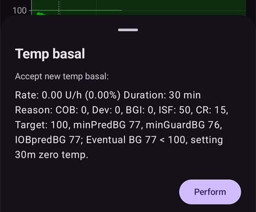

# Key AAPS features

## Ciklo režimas

Ciklo būsena rodoma pagrindiniame ekrane viena iš toliau pateiktų piktogramų.

**AAPS** turi kelis ciklo režimus, pvz., uždarą ciklą (1), stabdymą esant žemai glikemijai (LGS – 2) ir atvirą ciklą (3).

Kaip pasirinkti ciklo režimą ir ką reiškia kitos paveikslėlio piktogramos (4–6), žr. [AAPS ekranai > Pagrindinis ekranas > Ciklo būsena](#AapsScreens-loop-status).

(KeyAapsFeatures-OpenLoop)=

### Atviras ciklas

**AAPS** nuolat vertina visus turimus duomenis (AIO, AAO, KG...) ir prireikus pateikia terapijos rekomendacijas (laikinas valandines bazes), kaip koreguoti gydymą.

Rekomendacijos nevykdomos automatiškai (kaip uždaro ciklo režimu). Rekomendacijas naudotojas turi įvesti į pompą rankiniu būdu (jei naudojama virtuali pompa) arba patvirtinti mygtuku, jei **AAPS** prijungta prie tikros pompos.

Kai **AAPS** turi rekomendaciją, pagrindinio ekrano apatinėje naršymo juostoje atsiranda įrašas **Ciklas** su ženkliuku. Paspauskite jį, perskaitykite rekomendaciją („Priimti naują laikiną bazę“) su jos dydžiu, trukme ir priežastimi, tada paspauskite **Vykdyti**, kad ją įvykdytumėte:

Rekomendacija galioja tik kelias minutes. Jei ji senesnė nei maždaug 9 minutės arba jei per tą laiką ciklas buvo sustabdytas ar pompa atjungta, **AAPS** ją atmeta ir į pompą nieko nesiunčia (*„Rekomendacija per sena, todėl į pompą nebus siunčiama. Palaukite sekančios.“*). Palaukite kitos rekomendacijos.

Šis režimas skirtas susipažinti, kaip veikia **AAPS**, arba jei naudojate nepalaikomą pompą. Kad ir ką čia pasirinktumėte, iki **[5 mokymo etapo](#objectives-objective5)** pabaigos veiksite atviro ciklo režimu.

(KeyAapsFeatures-LGS)=

### Stabdymas esant žemai glikemijai (LGS)

Šiuo režimu [maxIOB](#Open-APS-features-maximum-total-iob-openaps-cant-go-over) nustatomas į nulį.

Tai reiškia, kad jei gliukozė krenta, **AAPS** gali sumažinti jūsų valandinę bazę. Tačiau jei gliukozė kyla, automatinė korekcija nebus atliekama. Jūsų valandinės bazės išliks tokios, kaip nustatyta dabartiniame **profilyje**. Tik jei AIO yra neigiamas (po ankstesnio stabdymo esant žemai glikemijai), bus suleista papildomo insulino **KG** sumažinti.

Šis režimas pasiekiamas nuo **[6 mokymo etapo](#objectives-objective6)**.

Be to, kad šį režimą galite pasirinkti patys, **AAPS** gali į jį persijungti ir pati: kol vykdote **[6 mokymo etapą](#objectives-objective6)** ir kai aptinka pasikartojančius KG rodmenis (žr. [KG įspėjamasis ženklas](#aaps-screens-bg-warning-sign)).

(KeyAapsFeatures-ClosedLoop)=

### Uždaras ciklas

**AAPS** nuolat vertina visus turimus duomenis (AIO, AAO, KG...) ir prireikus automatiškai koreguoja gydymą (*t. y.* be jūsų įsikišimo), kad pasiektų nustatytą [tikslinį intervalą arba reikšmę](#profile-glucose-targets) (boluso suleidimas, laikina valandinė bazė, insulino tiekimo sustabdymas, kad būtų išvengta hipoglikemijos, ir kt.).

Uždaras ciklas veikia laikydamasis daugelio saugos ribų, kurias galima nustatyti individualiai.

Uždaras ciklas galimas tik jei esate **[7 mokymo etape](#objectives-objective7)** ar aukštesniame ir naudojate palaikomą pompą.

(autosens)= (Open-APS-features-autosens)=

## Autosens

- Autosens yra algoritmas, kuris vertina gliukozės nuokrypius (teigiamus / neigiamus / neutralius).
- Pagal šiuos nuokrypius jis bando nustatyti, kiek esate jautrus ar rezistentiškas insulinui.
- **OpenAPS** oref įgyvendinimas naudoja 24 ir 8 valandų duomenų derinį. Naudojamas tas laikotarpis, kuris rodo didesnį jautrumą.
- Naudotojai, perėję nuo oref1, tikriausiai pastebės, kad sistema į pokyčius gali reaguoti mažiau dinamiškai, nes jautrumas skaičiuojamas pagal 24 arba 8 valandų duomenis.
- Pakeitus kaniulę arba profilį, Autosens santykis grįžta į 100 % (procentinis profilio keitimas su nustatyta trukme Autosens neatstato).
- Autosens koreguoja jūsų valandinę bazę ir JIF (t. y. veikia panašiai kaip profilio keitimas).
- Jei angliavandenius valgote nuolat ilgą laiką, Autosens tuo metu veiks prasčiau, nes angliavandeniai neįtraukiami į **KG** pokyčio skaičiavimus.
- Nuokrypiai paverčiami **jautrumo santykiu** (procentais): santykis, mažesnis nei 100 %, reiškia, kad AAPS mano, jog esate jautresnis insulinui, nei numato jūsų **profilis** (todėl sumažina faktinę valandinę bazę ir padidina JIF reikšmę), o santykis, didesnis nei 100 %, reiškia, kad esate rezistentiškesnis (todėl padidina valandinę bazę ir sumažina JIF reikšmę).
- Pagal numatytuosius nustatymus šis santykis laikomas tarp 0,7 (70 %, didesnis jautrumas) ir 1,2 (120 %, didesnė rezistencija), kad neįprastų duomenų seka negalėtų per daug nutolinti dozavimo nuo jūsų **profilio**. Šias ribas galima keisti jautrumo nustatymo papildomuose nustatymuose.
- Autosens ir [Autotune](../AdvancedOptions/Autotune.md) sprendžia tą pačią problemą skirtingais laiko mastais: Autosens kas minutę pagal paskutinių 8–24 val. duomenis šiek tiek koreguoja jūsų *esamą* dozavimą, o Autotune pagal kelių savaičių istoriją pamažu perrašo patį jūsų *profilį*. Naudoti abu yra įprasta ir tikėtina – jie vienas kitą papildo, o ne dubliuoja.

*Išsamų techninį Autosens algoritmo aprašymą rasite [OpenAPS Autosens dokumentacijoje](https://openaps.readthedocs.io/en/latest/docs/Customize-Iterate/autosens.html).*

(Open-APS-features-super-micro-bolus-smb)=

## Supermikrobolusas (SMB)

**SMB** yra **Super micro bolus** (supermikroboluso) santrumpa. Tai OpenAPS funkcija, įdiegta nuo 2018 m. Oref1 algoritme. Skirtingai nei **AMA**, **SMB** gliukozei reguliuoti naudoja ne laikinas valandines bazes, o daugiausia **mažus supermikrobolusus**. Kai **AMA** laikina valandine baze suleistų 1,0 V insulino, **SMB** mažais žingsniais **kas 5 minutes** suleidžia kelis supermikrobolusus, pvz., 0,4 V, 0,3 V, 0,2 V ir 0,1 V. Tuo pat metu (dėl saugumo) tikroji valandinė bazė tam tikram laikui nustatoma į 0 V/val., kad nebūtų perdozuota (**„nulinė laikina bazė“**). Taip sistema gliukozę gali koreguoti greičiau nei **AMA**, kuri didina laikiną valandinę bazę.

Thanks to SMB, it may be sufficient for meals containing only "slow" carbs to inform the system of the planned amount of carbohydrate and leave the rest to **AAPS**. Tačiau tada gliukozė po valgio gali pakilti aukščiau, nes išankstinio boluso suleisti negalima. Or you can give, if necessary with pre-bolusing, a **start bolus**, which **only partly** covers the carbohydrates (e.g. 2/3 of the estimated amount) and let **SMB** deliver the rest of the insulin.

SMB [AIO grafike](#aaps-screens-iob) rodomi mėlynais trikampiais. [Paspauskite ir palaikykite](#aaps-screens-graph-press-and-hold) grafiką ties trikampiu, kad pamatytumėte, kiek insulino suleista, arba naudokite [Terapijos istoriją](#aaps-screens-treatments).

**SMB's** features contain some safety mechanisms:

1. **Didžiausia vienkartinė SMB dozė**  
  Didžiausia vienkartinė SMB dozė gali būti tik mažiausia iš šių reikšmių:
  
        * reikšmė, atitinkanti dabartinę valandinę bazę (pakoreguotą Autosens) per laiką, nustatytą „Maksimalus bazės minučių skaičius SMB ribai“, pvz., bazės kiekis kitoms 30 minučių, arba
        * pusė šiuo metu reikalingo insulino kiekio, arba
        * likusi jūsų nustatymuose nurodytos maxIOB reikšmės dalis.
      

2. **Mažos laikinos valandinės bazės**  
  Naudojant **SMB**, mažos laikinos valandinės bazės (vadinamos „low temps“) arba 0 V/val. laikinos bazės (vadinamos „zero-temps“) įjungiamos dažniau. This is by design for safety reasons and has no negative effects if the **Profile** is set correctly. Pagrindiniame grafike AIO kreivė (plona geltona linija) yra informatyvesnė nei laikinų valandinių bazių eiga.

3. **Nedeklaruotas maistas**  
  Papildomi skaičiavimai gliukozės eigai prognozuoti, pvz., naudojant **NDM** (nedeklaruotą maistą). Net jei naudotojas rankiniu būdu neįveda angliavandenių, **NDM** gali automatiškai aptikti ženklų gliukozės padidėjimą dėl maisto, adrenalino ar kitų veiksnių ir bandyti jį koreguoti naudodamas **SMB**. Dėl saugumo tai veikia ir atvirkščiai: jei gliukozė netikėtai greitai krenta, SMB gali būti sustabdyti anksčiau. Todėl naudojant SMB funkcija NDM visada turėtų būti įjungta.

SMB pats nesprendžia, kad reikia insulino – jis naudoja tas pačias sujungtas KG prognozes (galutinė KG, nulinė laikina bazė, AAO, NDM), aprašytas skyriuje [kaip AAPS prognozes paverčia dozavimo sprendimu](#aaps-screens-how-predictions-become-a-dosing-decision). SMB ir nulinė laikina bazė yra tiesiog dvi priemonės, kuriomis AAPS įgyvendina šį sprendimą.

**Norėdami naudoti SMB, turite būti pradėję [9 mokymo etapą](#objectives-objective9).**

Išsamų techninį aprašymą rasite [OpenAPS oref1/SMB dokumentacijoje](https://openaps.readthedocs.io/en/latest/docs/Customize-Iterate/oref1.html#understanding-super-micro-bolus-smb), o bendruomenės aprašymą – [Timo informacijoje apie SMB](https://www.diabettech.com/artificial-pancreas/understanding-smb-and-oref1/).

OpenAPS SMB nustatymai aprašyti toliau.

(Open-APS-features-max-u-h-a-temp-basal-can-be-set-to)=

### Didžiausia valandinė bazė

Šis saugos nustatymas nustato didžiausią laikiną valandinę bazę, kurią gali tiekti insulino pompa. It is also known as **max-basal**.

Reikšmė matuojama vienetais per valandą (V/val.). Rekomenduojama nustatyti protingą reikšmę. A good recommendation for setting this parameter is:

**MAX-BASAL = DIDŽIAUSIA VALANDINĖ BAZĖ x 4**

Pavyzdžiui, jei didžiausia valandinė bazė jūsų profilyje yra 0,5 V/val., ją padauginę iš 4 gausite 2 V/val.

**AAPS** šiai reikšmei taiko griežtą ribą pagal [Nustatymai > Sauga > Naudotojo amžius](#preferences-patient-type). The hard limits are as follows:

- Vaikas: 2
- Paauglys: 5
- Suaugęs: 10
- Insulinui rezistentiškas suaugęs: 12
- Nėščioji: 25

*See also [overview of hard-coded limits](#Open-APS-features-overview-of-hard-coded-limits).*

(Open-APS-features-maximum-total-iob-openaps-cant-go-over)=

### Didžiausias AIO naudojant SMB

Ši reikšmė nustato didžiausią **aktyvaus insulino organizme** kiekį (bazės ir boluso AIO), kurio **AAPS** neviršys veikdama uždaro ciklo režimu. It is also known as **maxIOB**.

Jei dabartinis AIO (pvz., po boluso valgiui) viršija nustatytą reikšmę, ciklas nebeleidžia insulino, kol AIO nukrenta žemiau ribos.

Geras pradinis šio parametro nustatymas:

      maxIOB = vidutinis bolusas valgiui + 3x didžiausia paros valandinė bazė
    

Be careful and patient when adjusting your **max-IOB**. Ši reikšmė kiekvienam žmogui skiriasi ir gali priklausyti nuo vidutinės bendros paros dozės (BPD).

**AAPS** šiai reikšmei taiko griežtą ribą pagal [Nustatymai > Sauga > Naudotojo amžius](#preferences-patient-type). The hard limits are as follows:

- Vaikas: 7
- Paauglys: 13
- Suaugęs: 22
- Insulinui rezistentiškas suaugęs: 30
- Nėščioji: 70

*See also [overview of hard-coded limits](#Open-APS-features-overview-of-hard-coded-limits).*

Note : When using **SMB**, the **max-IOB** is calculated differently than in AMA. Naudojant **AMA**, maxIOB yra bazės **AIO** saugos parametras, o SMB režimu jis apima ir boluso AIO.

### Naudoti dinaminį jautrumą

This is the [DynamicISF](../DailyLifeWithAaps/DynamicISF.md) feature. When enabled, new settings become available. Settings are explained on the [DynamicISF](#dyn-isf-preferences) page.

### Naudoti Autosens

Tai funkcija [Autosens](#Open-APS-features-autosens). Naudojant DynamicISF, Autosens naudoti negalima, nes tai du skirtingi algoritmai, keičiantys tą patį kintamąjį (jautrumą).

Autosens vertina gliukozės nuokrypius (teigiamus / neigiamus / neutralius). Pagal šiuos nuokrypius Autosens bando nustatyti, kiek esate jautrus ar rezistentiškas insulinui, ir atitinkamai koreguoja valandinę bazę bei JIF.

When enabled, new settings become available.

#### Didesnis jautrumas padidina tikslą

Įjungus šią parinktį, jautrumo nustatymas (Autosens) gali padidinti tikslą, kai nustatomas didesnis jautrumas (mažiau nei 100 %). In this case your target will be raised by the percentage of the detected sensitivity.

Jei tikslas pakeistas dėl jautrumo nustatymo, pagrindiniame ekrane jis rodomas žaliame fone.

Šis nustatymas pasiekiamas, kai įjungtas „Naudoti dinaminį jautrumą“ arba „Naudoti Autosens“.

#### Resistance lowers target

Įjungus šią parinktį, jautrumo nustatymas (Autosens) gali sumažinti tikslą, kai nustatoma rezistencija insulinui (daugiau nei 100 %). Tokiu atveju tikslas sumažinamas nustatytos rezistencijos procentine dalimi.

Šis nustatymas pasiekiamas, kai įjungtas „Naudoti dinaminį jautrumą“ arba „Naudoti Autosens“.

### Naudoti SMB

Enable this to use SMB functionality. If disabled, no **SMBs** will be given.

When enabled, new settings become available.

(Open-APS-features-enable-smb-with-high-temp-targets)=

#### Naudoti SMB esant aukštesniam laikinam gliukozės tikslui

Jei šis nustatymas įjungtas, **SMB** bus suleidžiami net jei naudotojas pasirinko aukštą **laikiną tikslą** (100 mg/dL arba 5,6 mmol/l ir daugiau, nepriklausomai nuo **profilio** tikslo). Įjunkite atsargiai: **SMB** gali tapti pernelyg agresyvūs, jei jūsų nustatymai gerai nesuderinti arba jei jūsų **profilis** dažnai kinta (pvz., vaikų).

Kai šis nustatymas išjungtas, aukštas **laikinas tikslas** išjungia **SMB**. Pavyzdžiui, jei ši parinktis išjungta, **SMB** galima išjungti nustačius 100 mg/dL arba 5,6 mmol/l ar aukštesnį **laikiną tikslą**. Ši parinktis taip pat išjungia **SMB**, nepriklausomai nuo to, kokia kita sąlyga bando įjungti SMB, – išskyrus žemą **laikiną tikslą**, pvz., **Netrukus valgysiu** (arba bet kurį 98 mg/dL arba 5,4 mmol/l ar žemesnį **laikiną tikslą**), kai **SMB** vis tiek gali būti suleidžiami, kad **KG** priartėtų prie tikslo.

Šis nustatymas pats savaime **SMB** neįjungia. Esant aukštam laikinam tikslui, **SMB** suleidžiamas tik tada, jei tai leidžia ir vienas iš kitų toliau aprašytų nustatymų (pvz., **Naudoti SMB visada** arba **Naudoti SMB su AAO**).

(Open-APS-features-enable-smb-always)=

#### Naudoti SMB visada

Jei šis nustatymas įjungtas, SMB naudojami visada (nepriklausomai nuo AAO, laikinų tikslų ar bolusų). Jei šis nustatymas įjungtas, kiti toliau aprašyti įjungimo nustatymai neturi jokio poveikio. Tačiau jei **Naudoti SMB esant aukštesniam laikinam gliukozės tikslui** išjungtas ir nustatytas aukštas laikinas tikslas, SMB bus išjungti.

This setting is only available if **AAPS** detects that you are using a [reliable BG source](#GettingStarted-TrustedBGSource), with advanced filtering. FreeStyle Libre 1 nelaikomas patikimu šaltiniu, nes sugedus jutikliui seni KG duomenys gali būti kartojami be galo.

Noisy data could cause **AAPS** to believe BG is rising really fast, resulting in the administration of unnecessary SMBs. For more information about noise and data smoothing, see [here](../CompatibleCgms/SmoothingBloodGlucoseData.md).

#### Naudoti SMB su AAO

Jei šis nustatymas įjungtas, SMB naudojami, kai AAO yra didesnis nei 0.

Šis nustatymas nerodomas, jei įjungtas „Naudoti SMB visada“.

#### Naudoti SMB esant žemesniam laikinam gliukozės tikslui

Jei šis nustatymas įjungtas, SMB naudojami, kai nustatytas laikinas tikslas („Netrukus valgysiu“, aktyvumas, hipoglikemija, pasirinktinis). Jei šis nustatymas įjungtas, bet **Naudoti SMB esant aukštesniam laikinam gliukozės tikslui** išjungtas, SMB bus naudojami, kai nustatytas žemas laikinas tikslas (98 mg/dL arba 5,4 mmol/l ir žemiau), bet bus išjungti, kai nustatytas aukštas laikinas tikslas.

Šis nustatymas nerodomas, jei įjungtas „Naudoti SMB visada“.

#### Naudoti SMB po angliavandenių

Jei įjungta, SMB naudojami 6 val. po angliavandenių įvedimo, net jei AAO jau sumažėjo iki 0.

Dėl saugumo šis nustatymas pasiekiamas tik jei **AAPS** nustato, kad naudojate patikimą glikemijos duomenų šaltinį. Jis nerodomas, jei įjungtas „Naudoti SMB visada“.

This setting is only available if **AAPS** detects that you are using a [reliable BG source,](#GettingStarted-TrustedBGSource) with advanced filtering. FreeStyle Libre 1 nelaikomas patikimu šaltiniu, nes sugedus jutikliui seni KG duomenys gali būti kartojami be galo.

Noisy data could cause **AAPS** to believe BG is rising really fast, resulting in the administration of unnecessary SMBs. Daugiau informacijos apie triukšmą ir duomenų glodinimą rasite [čia](../CompatibleCgms/SmoothingBloodGlucoseData.md).  
Šis nustatymas nerodomas, jei įjungtas „Naudoti SMB visada“.

#### SMB intervalas

This feature limits the frequency of SMBs. This value determines the minimum time between SMBs. Note that the loop runs every time a glucose value comes in (generally 5 minutes). Atimkite 2 minutes, kad ciklui liktų papildomo laiko užsibaigti. E.g. if you want SMB to be given every loop run, set this to 3 minutes.

Numatytoji reikšmė: 3 min.

(Open-APS-features-max-minutes-of-basal-to-limit-smb-to)=

#### Maksimalus bazės minučių skaičius SMB ribai

Tai svarbus saugos nustatymas. Ši reikšmė nustato, kiek SMB galima suleisti pagal valandinės bazės insulino kiekį per tam tikrą laiką, kai jį dengia AAO.

Making this value larger allows the SMB to be more aggressive. You should start with the default value of 30 minutes. After some experience, increase the value in 15 minutes increments and observe the effects over multiple meals.

Rekomenduojama nenustatyti didesnės nei 90 minučių reikšmės, nes tada algoritmas gali nebesugebėti kompensuoti krentančios gliukozės nustatydamas 0 V/val. bazę („zero-temp“). Taip pat nustatykite aliarmus, kurie gerokai iš anksto įspėtų apie artėjančią hipoglikemiją, ypač jei dar bandote naujus nustatymus.

Default value: 30 min.

#### Maksimalus bazės minučių skaičius NDM SMB ribai

Šis nustatymas leidžia keisti SMB stiprumą NDM metu, kai angliavandenių nebeliko.

Numatytoji reikšmė: tokia pati kaip **Maksimalus bazės minučių skaičius SMB ribai**.

Šis nustatymas matomas tik jei įjungti „Naudoti SMB“ ir „Naudoti NDM“.

(enable-uam)=

### Naudoti NDM

Įjungus šią parinktį, SMB algoritmas gali atpažinti nedeklaruotą maistą. Tai naudinga, jei pamirštate pranešti **AAPS** apie angliavandenius, neteisingai įvertinate jų kiekį arba daug riebalų ir baltymų turintis maistas įsisavinamas ilgiau, nei tikėtasi. Neįvedus angliavandenių, NDM gali atpažinti greitą gliukozės padidėjimą dėl angliavandenių, adrenalino ir pan. ir bandyti jį koreguoti SMB. This also works the opposite way: if there is a fast glucose decrease, it can stop SMBs earlier.

**Todėl naudojant SMB funkcija NDM visada turėtų būti įjungta.**

(key-aaps-features-minimal-carbs-required-for-suggestion)=

### Angliavandenių poreikio riba

Minimum grams of carbs to display a carbs suggestion alert. Papildomai suvalgyti angliavandenių bus pasiūlyta, kai algoritmas nustatys, kad jų reikia. Tokiu atveju gausite pranešimą, kurį galima atidėti 5, 15 arba 30 minučių.

Jei norite, pranešimus apie reikalingus angliavandenius galima siųsti į Nightscout. Tada bus parodytas ir išsiųstas skelbimas.

Bet kuriuo atveju reikiami angliavandeniai bus rodomi pagrindinio ekrano AAO skiltyje.

### Papildomi nustatymai

Visą parametrų aprašymą (įskaitant čia neaprašytus nustatymus) rasite [OpenAPS nustatymų ir saugos parametrų dokumentacijoje](https://openaps.readthedocs.io/en/latest/docs/While%20You%20Wait%20For%20Gear/preferences-and-safety-settings.html).

**Visada naudoti trumpalaikį vidutinį gliukozės pokytį, o ne paprastą pokytį** Jei įjungsite šią funkciją, **AAPS** naudos trumpalaikį vidutinį gliukozės pokytį per paskutines 15 minučių. Paprastai tai yra paskutinių trijų reikšmių vidurkis. Tai padeda **AAPS** veikti stabiliau su triukšmingais duomenų šaltiniais, tokiais kaip xDrip ir Libre.

**Max daily safety multiplier** This is an important safety limit. The default setting (which is unlikely to need adjusting) is 3. This means that **AAPS** will never be allowed to set a temporary basal rate that is more than 3x the highest hourly basal rate programmed in a user’s pump and/or profile. Pavyzdys: jei didžiausia valandinė bazė yra 1,0 V/val., o didžiausias paros saugos daugiklis yra 3, **AAPS** gali nustatyti ne didesnę kaip 3,0 V/val. laikiną bazę (= 3 x 1,0 V/val.).

Default value: 3 (shouldn’t be changed unless you really need to and know what you are doing)

**Current Basal safety multiplier** This is another important safety limit. The default setting (which is also unlikely to need adjusting) is 4. This means that **AAPS** will never be allowed to set a temporary basal rate that is more than 4x the current hourly basal rate programmed in a user’s pump and/or profile.

Default value: 4 (shouldn’t be changed unless you really need to and know what you are doing)

* * *

(Open-APS-features-auto-isf)=

## Automatinis JIF

**Automatinis JIF** (Auto ISF) yra **eksperimentinis** algoritmas patyrusiems naudotojams. Jis pagrįstas OpenAPS SMB ir prideda taisykles, kurios sustiprina arba susilpnina jautrumo insulinui faktorių (JIF), priklausomai nuo to, kaip kinta jūsų gliukozė.

Tai kūrimo funkcija: ją galima įjungti tik [dev versijoje](../AdvancedOptions/DevBranch.md) su įjungtu **inžineriniu režimu**. Įprastoje išleistoje versijoje ji visada išjungta, todėl nerodoma skiltyje **Konfigūracija → APS**. Įvykdžius [mokymo etapus](../SettingUpAaps/CompletingTheObjectives.md), ji neatrakinama.

Ją pasirinkus, jos **Parametrai** apima OpenAPS SMB nustatymus ir grupę **Automatinio JIF nustatymai**:

- **Įjungti AutoISF**: įjungia JIF koregavimą. Be jo algoritmas veikia kaip OpenAPS SMB.
- **Mažiausia AutoISF reikšmė** ir **Didžiausia AutoISF reikšmė**: kiek JIF gali susilpnėti ir sustiprėti, taip pat kaip Autosens ribos. Esant numatytajai reikšmei 1,0, poveikis išjungtas.
- **Koeficientai (weights)**: kiekvienas valdo vieną taisyklę, o numatytoji reikšmė 0,0 tą taisyklę išjungia. 
  - kai gliukozės kitimas **greitėja**, JIF sustiprinamas (daugiau insulino);
  - kai gliukozės kitimas **lėtėja**, JIF susilpninamas (mažiau insulino);
  - kai gliukozė yra **žemiau tikslo**, JIF susilpninamas;
  - kai gliukozė yra **virš tikslo**, JIF sustiprinamas;
  - **po valgio** koeficientas ir **trukmės** koeficientas veikia po valgio ir tada, kai gliukozė ilgai išlieka aukšta.
- **SMB dozės dalis** (su minimumu, maksimumu ir KG intervalu): kokia reikiamo insulino dalis gali būti suleista kaip SMB.
- **SMB dozės ribos išplėtimas**: kiek kartų galima viršyti įprastą SMB dydžio ribą ([maksimalus bazės minučių skaičius](#Open-APS-features-max-minutes-of-basal-to-limit-smb-to), numatytoji reikšmė 30 minučių). Numatytoji reikšmė 1 nieko nekeičia; galima iki 5. Šią eksperimentinę reikšmę didinkite pamažu ir atsargiai.
- **AIO ribos procentas**: didžiausio AIO procentas, kurį viršijus SMB išjungiami.

    {admonition} Tik patyrusiems naudotojams
    :class: danger
    Su numatytosiomis reikšmėmis Automatinis JIF nieko nekeičia. Kiekviena padidinta reikšmė daro **AAPS** agresyvesnę. Keiskite po vieną reikšmę, mažais žingsniais, ir kelias dienas stebėkite rezultatą. Būkite ypač atsargūs, jei **Didžiausia AutoISF reikšmė** viršija 2,5.

(Open-APS-features-advanced-meal-assist-ama)=

## Pažangi pagalba valgant (AMA)

AMA yra „advanced meal assist“ (pažangi pagalba valgant) santrumpa. Tai OpenAPS funkcija nuo 2017 m. (oref0). OpenAPS Advanced Meal Assist (AMA) leidžia sistemai po boluso valgiui greičiau nustatyti aukštą laikiną bazę, jei patikimai įvedate angliavandenius.

Daugiau informacijos rasite [OpenAPS dokumentacijoje](https://newer-docs.readthedocs.io/en/latest/docs/walkthrough/phase-4/advanced-features.html#advanced-meal-assist-or-ama).

### Didžiausia valandinė bazė (OpenAPS „max-basal“)

Šis saugos nustatymas neleidžia **AAPS** nustatyti pavojingai didelės valandinės bazės ir riboja laikiną bazę iki x V/val. Rekomenduojama nustatyti protingą reikšmę. Rekomenduojama paimti didžiausią valandinę bazę jūsų profilyje ir padauginti ją iš 4, bet ne mažiau kaip iš 3. Pavyzdžiui, jei didžiausia valandinė bazė jūsų profilyje yra 1,0 V/val., ją padauginę iš 4 gausite 4 V/val. ir šią reikšmę 4 galite nustatyti kaip saugos parametrą.

Pasirinkti bet kokios reikšmės negalima: dėl saugumo yra „griežta riba“, kuri priklauso nuo paciento amžiaus. AMA režimu maxIOB „griežta riba“ yra mažesnė nei SMB režimu. Vaikams ši reikšmė mažiausia, o insulinui rezistentiškiems suaugusiems – didžiausia.

**AAPS** kode nustatyti parametrai yra šie:

- Vaikas: 2
- Paauglys: 5
- Suaugęs: 10
- Insulinui rezistentiškas suaugęs: 12
- Nėščioji: 25

*See also [overview of hard-coded limits](#Open-APS-features-overview-of-hard-coded-limits).*

### Didžiausias AIO naudojant AMA

Šis parametras riboja didžiausią bazės AIO, kuriam esant **AAPS** dar veikia. Jei AIO didesnis, papildomas bazinis insulinas nebeleidžiamas, kol bazės AIO nukrenta žemiau ribos.

Numatytoji reikšmė yra 2, tačiau šį parametrą didinkite pamažu, kad matytumėte, kaip jis jus veikia ir kokia reikšmė tinka geriausiai. Ši reikšmė kiekvienam skiriasi ir priklauso nuo vidutinės bendros paros dozės (BPD). Dėl saugumo yra riba, kuri priklauso nuo paciento amžiaus. AMA režimu maxIOB „griežta riba“ yra mažesnė nei SMB režimu.

- Vaikas: 3
- Paauglys: 5
- Suaugęs: 7
- Insulinui rezistentiškas suaugęs: 12
- Nėščioji: 25

*See also [overview of hard-coded limits](#Open-APS-features-overview-of-hard-coded-limits).*

### Naudoti Autosens (AMA)

Čia galite pasirinkti, ar norite naudoti Autosens [jautrumo nustatymą](../DailyLifeWithAaps/SensitivityDetectionAndCob.md).

### Autosens nustatomi tikslai

Jei ši parinktis įjungta, Autosens gali koreguoti ir tikslus (be valandinės bazės ir JIF). Taip **AAPS** gali veikti „agresyviau“ arba ne. Taip tikrasis tikslas gali būti pasiektas greičiau.

### Papildomi nustatymai

- Paprastai šio lango nustatymų keisti nereikia!
- Jei vis tiek norite juos keisti, įsitikinkite, kad suprantate, ką darote – visą parametrų aprašymą rasite [OpenAPS nustatymų ir saugos parametrų dokumentacijoje](https://openaps.readthedocs.io/en/latest/docs/While%20You%20Wait%20For%20Gear/preferences-and-safety-settings.html).

**Visada naudoti trumpalaikį vidutinį gliukozės pokytį, o ne paprastą pokytį** Jei įjungsite šią funkciją, **AAPS** naudos trumpalaikį vidutinį gliukozės pokytį per paskutines 15 minučių. Paprastai tai yra paskutinių trijų reikšmių vidurkis. Tai padeda **AAPS** veikti stabiliau su triukšmingais duomenų šaltiniais, tokiais kaip xDrip ir Libre.

**Max daily safety multiplier** This is an important safety limit. The default setting (which is unlikely to need adjusting) is 3. Tai reiškia, kad **AAPS** niekada negalės nustatyti laikinos bazės, didesnės nei 3x didžiausios valandinės bazės, užprogramuotos naudotojo pompoje. Pavyzdys: jei didžiausia valandinė bazė yra 1,0 V/val., o didžiausias paros saugos daugiklis yra 3, **AAPS** gali nustatyti ne didesnę kaip 3,0 V/val. laikiną bazę (= 3 x 1,0 V/val.).

Default value: 3 (shouldn’t be changed unless you really need to and know what you are doing)

**Current Basal safety multiplier** This is another important safety limit. The default setting (which is also unlikely to need adjusting) is 4. Tai reiškia, kad **AAPS** niekada negalės nustatyti laikinos bazės, didesnės nei 4x dabartinės valandinės bazės, užprogramuotos naudotojo pompoje.

Default value: 4 (shouldn’t be changed unless you really need to and know what you are doing)

**IVT daliklis laikotarpiui po boluso** Funkcija „bolus snooze“ (laikotarpis po boluso) veikia po boluso valgiui. Po valgio **AAPS** nenustato mažų laikinų bazių laikotarpiu, kuris lygus IVT, padalytai iš „bolus snooze“ parametro. Numatytoji reikšmė yra 2. Tai reiškia, kad kai IVT yra 5 val., „bolus snooze“ truktų 5 val. : 2 = 2,5 val.

Numatytoji reikšmė: 2

* * *

(Open-APS-features-overview-of-hard-coded-limits)=

## Kode nustatytų griežtų ribų apžvalga

|            | Child | Paauglys | Adult | Insulin resistant adult | Nėščioji |
| ---------- | ----- | -------- | ----- | ----------------------- | -------- |
| MAXBOLUS   | 5     | 10       | 17    | 25                      | 60       |
| MINDIA     | 5     | 5        | 5     | 5                       | 5        |
| MAXDIA     | 9     | 9        | 9     | 9                       | 10       |
| MINIC      | 2     | 2        | 2     | 2                       | 0,3      |
| MAXIC      | 100   | 100      | 100   | 100                     | 100      |
| MAXIOB_AMA | 3     | 5        | 7     | 12                      | 25       |
| MAXIOB_SMB | 7     | 13       | 22    | 30                      | 70       |
| MAXBASAL   | 2     | 5        | 10    | 12                      | 25       |