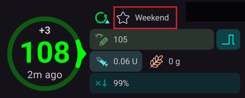
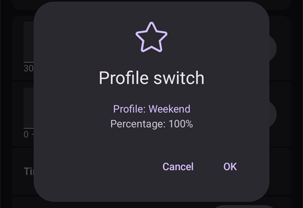

# Profilio keitimas ir profilio procentas

This section will explain what is a **Profile Switch** and **Profile Percentage**. You can learn how to create a **Profile** in [Your AAPS Profile](#your-aaps-profile-create-and-edit-profiles).

When first embarking on your **AAPS** journey, you will need to create a **Profile**, understand how to action a **Profile Switch** and learn the impact of a **Profile Percentage** within **AAPS**. **Profilio keitimas** ar **profilio procentas** gali būti ypač naudingi:

- the Menstrual Cycle - a percentage adjustment within a **Profile** can be set up in **Automations** in order to allow **AAPS** to accommodate for different stages of the hormone cycle and with predicted insulin resistance.

- Exercise - a percentage adjustment within a **Profile** can be set up in **Automations** for exercise in order to reduce basal intake.

- Night or pattern shift workers - a time shift in **Profile** can be set up for pattern shift workers by altering the number of hours in the **Profile** to how much later/earlier the user will go to bed or wake up.

Kodėl verta naudoti **profilio procentą**, o ne laikiną valandinę bazę? Kad pakeitimas būtų veiksmingesnis, **profilio procentas** proporcingai sumažina arba padidina valandinę bazę, JIF ir IA. This ensures a balanced approach is calculated by **AAPS** when administering the user’s insulin intake. Vien sumažinus valandinę bazę **AAPS** **profilyje** naudos gali būti mažai, jei algoritmas ir toliau taiko tuos pačius JIF ir IA santykius.

(ProfileSwitch-change-percentage)=

## Change the Profile Percentage from the main screen

You need at least one saved **Profile**. A **Profile Percentage** is always applied through a **Profile Switch**: you activate a **Profile** again, this time with a percentage.

```{admonition} Coming from AAPS 3? :class: note A long press on the profile name no longer opens the profile switch dialog. **Tap** the profile name, then tap the round **▶** button at the bottom right: it opens the same settings (percentage, duration, Activity temp target).

    <br />1. On the main screen, **tap the profile name** (next to the star icon). The [Profile screen](#ProfileSwitch-manage-v4) opens on the card of the running **Profile**, marked **ACTIVE**.
    
       
    
    2. Jei norite palikti tą patį **profilį**, palikite pasirinktą kortelę **AKTYVUS**. To change **Profile** at the same time, swipe to another card.
    3. Tap the round **▶** button (**Activate**) at the bottom right. The **Activate** screen opens.
    4. Set the **Percentage** with **−** / **+** (steps of 5 %), or type it in (30 to 250 %). The field always starts at **100 %**: it does not show the percentage that is running now. For example, enter **80** for 20 % less insulin, or **120** for 20 % more.
    5. Set the **Duration** in minutes:
       * **0** keeps the new percentage until you make another **Profile Switch**;
       * any other value ends the switch after that time, and **AAPS** goes back to the **Profile** that was running before.
    
       
    
    6. Tap **▶ Activate** at the bottom of the screen. Check the summary in the **Profile switch** dialog and tap **OK**.
    
       
    
    Back on the main screen, the profile name shows the percentage and the remaining time, for example *Normal (80%) (59')*, and turns yellow while a switch with a duration is running. A star marks the switch on the glucose graph. See [the main screen](#aaps-screens-profile--target).
    
    
    
    To **go back to 100 %** before the end, repeat the steps and keep **Percentage** at 100 and **Duration** at 0.
    
    ```{admonition} Procentai vienu bakstelėjimu
    :class: tip
    Jei dažnai naudojate tą patį procentą (sportuodami, sirgdami), pridėkite [profilio spartųjį mygtuką](#profile-shortcuts) į QuickLaunch įrankių juostą arba sukurkite [scenarijų](Scenes.md). Both apply a profile with a preset percentage and duration in one tap.
    

(ProfileSwitch-manage-v4)=

## Managing and activating profiles (Manage → Profile)

In **AAPS** v4 profiles are managed and activated from the **Manage** screen (bottom navigation) → **Profile** (*“Manage and activate profiles”*).

The Profile screen shows your profiles as a **swipeable card carousel**. Veikiančio profilio kortelė pažymėta **AKTYVUS**; joje rodoma paros valandinės bazės suma (pvz., *∑ 30,15 V*). Below the selected card you see that profile's details — the **Insulin** type, and the **IC**, **ISF**, **basal** and **target** schedules with graphs.

When a temporary switch is running, the **ACTIVE** card shows its percentage and time shift with the time left, for example *110% +2 h · 2 h 40 min*, above a progress bar. Both are refreshed every 30 seconds. The details below then have two columns: the values of the profile in blue, and the values in use with the percentage in red.


The buttons at the bottom act on the **selected** profile: **➕ Add**, **✏️ Edit**, **⧉ Clone** and **‘️ Delete**, and the round **▶ Activate** button on the right. Kaip redaktoriuje užpildyti keturis tvarkaraščius (IA / JIF / BAZ / TIKSLAS), žr. [Profilių kūrimas ir redagavimas](#your-aaps-profile-create-and-edit-profiles).

**⧉ Clone** uses the two-squares icon often used for *copy*, but there is nothing to paste: it makes the duplicate in one step. Patvirtinkite *Klonuoti profilį „Normal“?*. Karuselės gale bus pridėtas ir pasirinktas naujas profilis *Normal kopija*. Jį galite redaguoti mygtuku **✏️ Redaguoti** (ten taip pat galite pakeisti jo pavadinimą). Tai nėra tas pats, kas ankstesnio **profilio keitimo** klonavimas iš terapijos istorijos: tada sukuriamas naujas profilis, *kuriam jau pritaikytas procentas ir laiko perstūmimas*. See [Keep a profile switch for later use](#ProfileSwitch-keep-for-later).

(ProfileSwitch-read-only-mode)= **Only the ▶ Activate button?** Your settings are protected, so the screen opens read-only. Tap the **✏️ pencil** in the top bar and enter your settings password. Žr. [Nustatymų apsauga dabar užrakina ir valdymo ekranus](#v4changes-read-only-management).

### Reordering profiles

If you have more than one profile you can choose their order in the carousel: tap the **Reorder** icon (⇅, two arrows pointing up and down) in the top bar. The page indicator is replaced by **◀ / ▶ move buttons** with a *position / total* readout — step the centred card earlier or later, then confirm with **✓** (or discard with **✕**). The new order is saved once, when you confirm.


### Activating a profile

Select a profile and tap **▶ Activate**. The **Activate** screen lets you tailor how the **Profile Switch** is applied:


- **Percentage** (30–250 %, starts at 100 % every time) — scale the whole profile. 100 % palieka profilį nepakeistą; pavyzdžiui, 70 % sumažina valandinę bazę ir apskaičiuotą insulino dozę (tiek maisto bolusus, tiek korekcijas) 30 %. It does not change your glucose targets or carb absorption. Išsamų poveikį žr. [Profilio procentas](#ProfileSwitch-profile-percentage).
- **Duration** (0–10080 minutes, that is up to 7 days) — how long the switch lasts. **0 = indefinite** (until you switch again); a non-zero value reverts to the previous profile when it ends.
- **Temporary target / Activity** — appears only when you set a **Duration** and a **Percentage** below 100 %. Switch it on to also start an [Activity temp target](#TempTargets-activity-temp-target) for the same duration, as you would before exercise.
- **Time shift** — shows *0h*; tap **Change** to move the schedule forward or back by up to 23 hours (useful for shift work or travel). See [Time shift](#ProfileSwitch-ProfilePercentage-time-shift-of-the-circadian-percentage-profile).
- **Pakartotinai naudoti** – rodoma, kai vykdomas profilio keitimas turi kitokį nei 100 % procentą arba laiko perstūmimą, pavyzdžiui, **Pakartotinai naudoti 80% 0h**. Bakstelėkite šį mygtuką, kad būtų įrašytas tas pats procentas ir laiko perstūmimas, pavyzdžiui, norėdami pratęsti netrukus pasibaigsiantį profilio keitimą.
    
    

- **Time** — *Now* by default. You can pick another time, up to 24 hours before or after now. A switch set in the future starts at that time; an Activity temp target set with it then also starts at that time.
    
    

- **Notes** — only shown if [Show notes in dialogs](#Preferences-show-notes-field-in-treatments-dialogs) is on.

Jei pasirinktu procentu apskaičiuota valandinė bazė nesuderinama su jūsų pompa, viršuje pasirodo įspėjimas, o **▶ Aktyvuoti** lieka išjungtas: pasirinkite kitą procentą.

Tap **▶ Activate**, then **OK** in the confirmation dialog. The running profile then carries the **ACTIVE** badge on its card.

```{admonition} Pompa gali apvalinti valandinę bazę :class: note Kiekviena pompa valandinę bazę gali tiekti tik savo žingsniais (pavyzdžiui, po 0,05 V/val.), todėl ji apvalina jūsų **profilio** valandinę bazę. Tada **AAPS** naudoja valandinę bazę, kurią pompa iš tikrųjų tiekia, todėl AIO ir BPD lieka teisingi. Jei per parą pompa tiekia šiek tiek daugiau arba mažiau insulino nei nurodyta jūsų **profilyje**, pranešimas *„Bazės profilis pompoje atnaujintas“* parodo skirtumą, pavyzdžiui, *„per parą suleis 10,00 V vietoj 10,12 V“*.

Jei pompa praneša valandinę bazę, kuri labai skiriasi nuo jūsų **profilio**, **AAPS** palieka **profilio** valandinę bazę ir paprašo patikrinti valandinę bazę pompoje.

    <br />```{admonition} Su procentu ir laiko perstūmimu vieno profilio pakanka daugeliui situacijų
    :class: note
    Užuot kūrę daug panašių profilių, turėkite vieną pagrindinį profilį ir pasikartojančioms situacijoms (ligai, sportui, kelionėms) taikykite kitokį **procentą** arba **laiko perstūmimą**. Būtent tai automatizuoja [scenarijai](Scenes.md).
    

A profile switch is not limited to this screen. Tą patį profilio keitimą taip pat galima pradėti **Wear OS laikrodžiu**, susietu **klientu** (žr. [Pagrindinio įrenginio ↔ kliento valdymas](../RemoteFeatures/ClientMasterControl.md)), **[scenarijumi](Scenes.md)** arba **Automatizacijos** taisykle.

(ProfileSwitch-profile-percentage)=

## Profile Percentage

It is important that a user understands the essential features of a **Profile Percentage**. By applying a percentage increase or decrease to a **Profile Switch** this will apply in the same percentage to either raise or lower the user’s settings parameters as set within the **Profile**.

Pavyzdžiui, **profilio keitimas** į 130 % (tai reiškia, kad naudotojas yra 30 % atsparesnis insulinui) nurodys **AAPS**:

- **padidinti** valandinę bazę 30 %; 
- **sumažinti** **JIF**, padalijant jį iš 1,3;
- **sumažinti** **IA**, padalijant jį iš 1,3.

Atminkite: mažesnis **JIF** arba **IA** reiškia stipresnį santykį ir didesnį suleidžiamo insulino kiekį. This fact can be easily overlooked by new users to **AAPS**.

Pasirinkus **AAPS** perskaičiuoja numatytąją valandinę bazę, o **AAPS** (atviru arba uždaru ciklu) toliau veikia pagal pasirinktą procentinį **profilį**.

The effect of a **Profile** Percentage is summarized in the table below:

| Profile Switch  
Percentage |    Effect    |     IA  
g/V      | Pavyzdys  
15 g |          JIF  
mmol/l/V  
mg/dL/V          | V sumažinti  
2 mmol/l  
40 mg/dL |
|:---------------------------:|:------------:|:-----------------:|:---------------:|:------------------------------------------:|:---------------------------------:|
|            90 %             |    Weaker    | 5/0,9  
=**5,55** |      2,7 V      | 2,2/0,9  
=**2,4**  
  
40/0,9  
=**44,4** |               0,8 V               |
|          **100 %**          | **Standard** |       **5**       |     **3 V**     |                **2,2  
40**                |             **0,9** V             |
|            130 %            |   Stronger   | 5/1,3  
=**3,85** |      3,9 V      | 2,2/1,3  
=**1,7**  
  
40/1,3  
=**30,8** |               1,2 V               |

(ProfileSwitch-ProfilePercentage-time-shift-of-the-circadian-percentage-profile)=

## Time shift of the Circadian Percentage Profile

A ‘time shift’ within a user’s **Profile** feature will move the user’s **Profile’s** settings around the day-to-day clock (‘circadian’) to the desired number of hours entered. This can be helpful for:

- **dirbantiesiems naktį arba pamainomis**: dirbant naktinėmis pamainomis, **profilyje** pakeiskite valandų skaičių pagal tai, kiek vėliau ar anksčiau naudotojas eis miegoti arba kelsis; 
- **users changing time zones during travelling**; or
- **users who are type 1 children**: and have a set bedtime routine and insulin resistance catered for within their **Profile**. If for whatever reason, there is a predicted later bedtime for the child, the caregiver can apply a ‘time shift’ to the child’s **Profile** to allow **AAPS** to react to insulin resistance at a desired time period as set by the user.

It is always a question of which hour’s **Profile’s** settings should replace the settings of the current time. This time must be shifted by x hours. So please be mindful of the directions as described in the following example:

- Current time: 12:00
- **Positive** time shift 
    - 2:00 **+10 h** -> 12:00
    - Dėl teigiamo laiko perstūmimo vietoje nustatymų, kurie paprastai taikomi 12:00, bus naudojami 2:00 nustatymai.
- **Negative** time shift 
    - 22:00 **-10 h** -> 12:00
    - Dėl neigiamo laiko perstūmimo vietoje nustatymų, kurie paprastai taikomi 12:00, bus naudojami 22:00 nustatymai.


Toks **profilio** momentinių kopijų darymas leidžia daug tiksliau apskaičiuoti praeitį ir sekti **profilio** pakeitimus.

(ProfileSwitch-keep-for-later)=

## Keep a profile switch for later use

Atlikę profilio keitimą su procentu ir (arba) laiko perstūmimu, galite šį laikiną profilį nukopijuoti į naują profilį.

To do this, open the menu (☰) → **Treatments** and go to the **Profile switch** tab, see [Clone a Profile switch to a new Profile](#your-aaps-profile-clone-profile-switch).