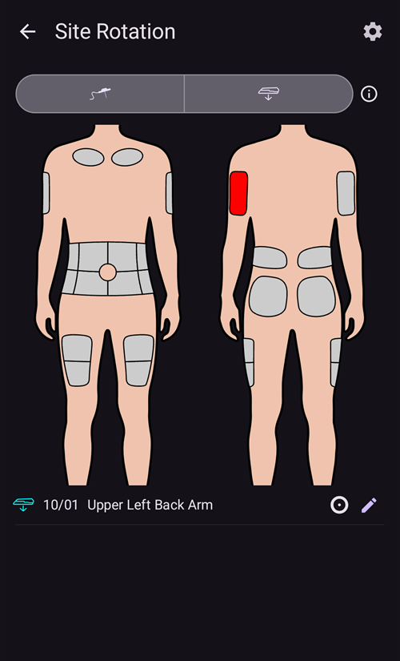
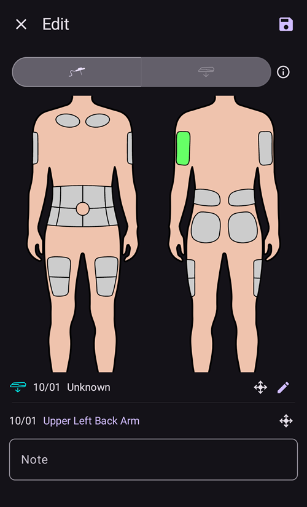
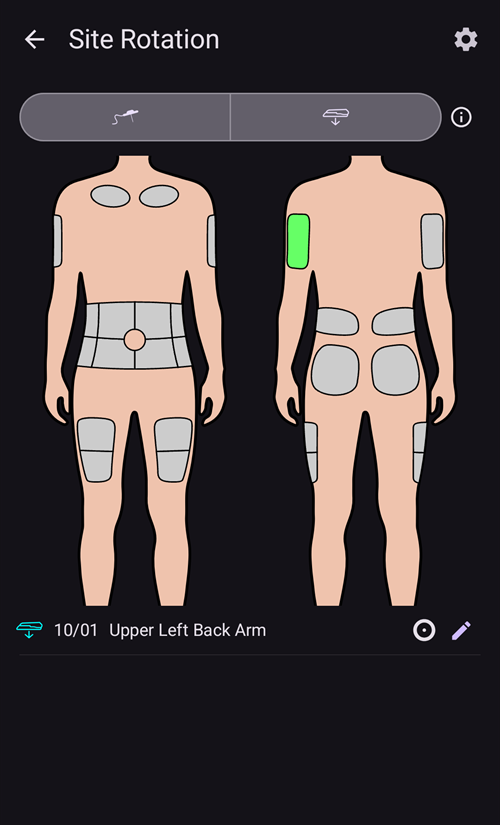

# Pumps and cannulas

## Changing infusion sets: insulin reservoirs and cannulas

The procedure described below is for tubed pumps only and does not apply to patch pumps like Omnipod, Medtrum Nano, Accu-Chek Solo etc. This procedure is sometimes referred to as a "set change", with a "full" set change including the insulin reservoir and cannula, and a "partial" set change referring to a change of cannula only.

Pompos be vamzdelio (patch) užsipildo ir paruošiamos savo aktyvavimo vedlyje, o jų kaniulė jau yra kūne. **AAPS** joms užpildymo nesiūlo: **Užpildymas** nerodomas nei meniu **Valdymas**, nei QuickLaunch. See the page of your pump in [Compatible pumps](../Getting-Started/CompatiblePumps.md).

Physical cartridge/reservoir changes cannot be done via **AAPS** and have to be carried out via the pump directly. These need to be logged in **AAPS** manually, once completed.

(pumps-cannulas-changing-reservoir-and-cannula)=
### Guide for changing both the pump reservoir and cannula

1. In **AAPS**, disconnect the pump: press the [loop icon](#AapsScreens-loop-status) on the main screen and select **Disconnect pump** for 1 hour. The icon changes to a grey plug icon, indicating that the pump is disconnected.

2. Physically change the insulin reservoir: physically disconnect your pump from the body, and change the reservoir/cartridge and cannula as per manufacturer's instructions.

3. Prime/fill the tubing and cannula: this can be done directly on the pump. Be sure to eliminate any bubbles in the tubing.

4. Attach the new cannula to the body. Once the cannula is inserted and the needle is removed, the attached cannula now has a small air gap which also needs to be primed. Norėdami tai užregistruoti **AAPS** ir užpildyti infuzijos vietą, atidarykite **Užpildymas** (išskleistame būsenos skydelyje pagrindiniame ekrane, meniu **Valdymas** arba [QuickLaunch](QuickLaunch.md) mygtuku) ir, atsižvelgdami į atliktą keitimą, pažymėkite **Įrašas apie infuzijos rinkinio keitimą** ir (arba) **Įrašas apie rezervuaro keitimą**. Dabar paspauskite mygtuką su numatytuoju insulino kiekiu kaniulei užpildyti (paprastai apie 0,3 V, tačiau patikrinkite, ar ši reikšmė tinka jūsų kaniulei) ir pasirinkite **OK**. Read the summary message, and confirm to execute the priming by tapping **OK**.

   


5. Vėl prijunkite pompą **AAPS**: paspauskite pilko kištuko piktogramą ir pasirinkite **Prijungti pompą**, kad ciklas tęstųsi.

### Useful information concerning insulin/cannula changes

* Užregistravus infuzijos vietos keitimą, Autosens reikšmė grąžinama į 100 %. It also resets the corresponding cannula/insulin status lights and ages on the **AAPS** main screen.

* You can set/adjust the default prime amounts in the **Prime/Fill** settings — type "prime" in the main screen search bar to open them (see [Preferences](../SettingUpAaps/Preferences.md)). See your instruction booklet in your cannula box for how many units (depending on needle length and tubing length) should be primed for your cannula.

* Insulin delivered using the prime function is not taken into account by **AAPS** when calculating insulin on board (IOB), and is marked in the [Treatments history](#aaps-screens-treatments) as "Prime".

* **AAPS** taip pat neįtraukia jokio boluso, suleisto tiesiogiai pompa, kol ji atjungta. If you happen to bolus directly from the pump while **AAPS** is disconnected, once you reconnect the pump you can announce this insulin (without bolusing it) in the **Insulin** dialog (see [To announce delivered insulin without actually bolusing](#pumps-cannulas-announce-insulin) below).

### Cannula, infusion site, tubing and/or pump issues

If you are confident that you haven't received any insulin for a period of time, despite **AAPS** recording that you have, and you know exactly when the issue started (_e.g._ you remove the cannula and see that the cannula was kinked during the insertion process) you can correct this in **AAPS**, while being aware that the insulin may in fact have been delivered but may be slow to act for some reason.

```{admonition} Caution - Risk of Hypoglycemia
:class: danger
Only delete insulin delivery from **AAPS** with EXTREME caution, in case insulin _has_ actually been delivered, and monitor BG closely for the next 24 h.
```

Norėdami pašalinti bolusus ir SMB, kurie, kaip žinote, nebuvo suleisti, atidarykite **meniu** (☰), pasirinkite [Terapijos istorija](#aaps-screens-treatments) ir skirtuke **AV ir bolusai** atsargiai ištrinkite užregistruotus bolusus nuo to momento, kai įvyko problema. This will correct the "insulin on board" (IOB) value which is key for **AAPS**' calculations; if you now return to the main screen you will see that the IOB has reduced. Be aware that you cannot delete basal insulin which **AAPS** calculates to have been delivered, so that will still be taken into account by **AAPS**.

In less obvious cases of insulin delivery problems _e.g._ leakages, occlusions or tunneling where either you are not sure when the issue started, or think some of the insulin was delivered, you need to be careful. Šias problemas galite pastebėti užuodę insuliną, pamatę sudrėkusį pleistrą, matydami aukštas gliukozės reikšmes arba gavę aliarmą. As you will never know how much insulin you got into your skin (which might be starting to work after a while) it will be hard to determine the correct amount of insulin which needs to be deducted from the current "insulin on board" (IOB) value. One strategy is to pause looping for 5 hours (or your specific duration of insulin action) after you resolved the insulin delivery problem, and resume looping afterwards. This will ensure that IOB is correct once you restart looping.

(pumps-cannulas-disconnecting)=
## Disconnecting the pump for showering or activity

If you take your pump off for showering, bathing, swimming, contact sports or other activities you must let **AAPS** know that no insulin is being delivered, to keep the IOB correct. The pump can be disconnected using the [loop icon](#AapsScreens-loop-status) on the main screen: press it and select **Disconnect pump** with the duration you need. If the activity takes longer than planned, open the same dialog again and pick a new duration under **Disconnect pump**: the disconnection is extended and the new duration starts from now. You do not need to reconnect first.

As you are not getting any insulin while the pump is disconnected, you should reconnect every two hours to catch up for the missing basal. You can do this by connecting, bolusing the missing basal amounts (_e.g._ of the last two hours) before disconnecting again. This should help to avoid a severe lack of insulin which could result in diabetic ketoacidosis (DKA). If it is inconvenient to reconnect the pump during activity (cannula site is covered by wearing a wetsuit _etc._), consider a pen injection instead. This manual injection can be logged in **AAPS**, and doesn't have to be logged at the time of injection (just make a note of the time of injection) since you can announce the insulin and backdate the time the insulin was actually given when you reconnect the pump.

(pumps-cannulas-announce-insulin)=
## To announce delivered insulin without actually bolusing

Norėdami užregistruoti insuliną, suleistą pompa, kai **AAPS** buvo atjungta, arba švirkštikliu, atidarykite [Insulino dialogą](#aaps-screens-buttons-insulin) (**Terapija** apatinėje naršymo juostoje arba QuickLaunch mygtuku), įveskite kiekį vienetais ir įjunkite **Bolusas bus tik įrašytas (nebus suleistas)**. A **Time** row (set to **Now**) then lets you record the actual time of the injection: you can ignore it if the injection was given recently. If the bolus was given some time ago, use **-** to move the time back (_e.g._ -30 min), or open the row with the chevron to pick the exact date and time. **AAPS** will then take into account the duration of insulin action and calculate the remaining insulin still in the system accordingly.

If you are using **AAPS** as a caregiver, you can remotely disconnect (and reconnect) the pump very easily by [SMS command](../RemoteFeatures/SMSCommands.md) using commands such as "pump disconnect 120" and "pump connect 120". The range of duration for remote disconnect is from 1 - 120 min, (in this example it is 120 minutes). This is very useful if the **AAPS** handset is inconvenient for you to access, buried in a pump belt on a kid who is running off towards the swimming complex, or being closely guarded (or in use) by a teenager.

## Reconnecting the pump after activity

After a long disconnection (1 - 2 hours) it is fairly common for **AAPS** to calculate that you now have negative IOB. When you reconnect the pump, depending on preference/current glucose level/planned food or subsequent activity, you can either:

a) Just reconnect the pump in **AAPS** (grey-to-green, for closed loop) and leave it up to **AAPS** to start to deliver insulin again

_or_

b) If you want to be more aggressive (for example, you are heading for hyperglycemia), you can open the [Bolus wizard](#aaps-screens-bolus-wizard) and bolus for zero carbs, to immediately deliver the calculated missing insulin as a bolus.

Which strategy you prefer is highly personal, and is best determined by trial and error.


(Aapsscreens-site-rotation)=
## Vietų rotacija

**Manage → Site Rotation** opens the Site Rotation Dialog in View mode:

- With the two buttons at the top (cannula icon and sensor icon), you can show Cannula sites only, Sensor sites only, or both
- All Cannula change and Sensor change events from the past 45 days are available.
- Click on a Site area, or in one entry in the list below to filter the list with only entries in selected area. The selected area will be highlighted in light green color.
- Tap the **pencil** icon next to an entry to open the Edit view and update its Site location, Arrow or Note



- The **cog** icon (upper right) opens the settings: **User profile for site rotation** opens a dialog where you choose **Man**, **Woman** or **Child**, and the **Manage pump site rotation** and **Manage CGM site rotation** switches select which sites you manage.


*Pastaba: šis nustatymas lemia, ar vietų rotacijos dialogas (redagavimo režimu) bus atidaromas automatiškai, kai naujas įrašas sukuriamas mygtuku „Užpildymas“ arba „Jutiklio įvedimas“.*

- For Site change done directly from Pump, you have to open the View Mode and Edit the new entry to select Location and Arrow

Redagavimo režimu galite pasirinkti su pasirinktu įrašu susietą vietą, rodyklę ir pastabą:

- Redaguojamas įrašas rodomas po kūno paveikslėliais su savo tipo piktograma (kaniulė arba jutiklis)
- Priekinis ir nugaros vaizdai rodomi greta: bakstelėkite sritį, kurioje įvedėte kaniulę ar jutiklį
- Pasirinkus vietą (ji paryškinama žaliai), apačioje esančiame sąraše rodomi visi per pastarąsias 45 dienas šioje vietoje atlikti įrašai.



- Galite pridėti nebūtiną rodyklę, bakstelėję rodyklės piktogramą įrašo dešinėje: dialoge **Pasirinkti rodyklę** galite nurodyti tikslesnę vietą arba Pod padėtį


- Lauke **Pastaba** taip pat galite įrašyti pastabą apie pasirinktą vietą
- Bakstelėkite **išsaugojimo** piktogramą (viršuje dešinėje), kad įrašytumėte vietą

Filtruoti galima paveikslėlyje arba sąraše bakstelėjus terapijos įvykį Norėdami pašalinti filtrą, tiesiog bakstelėkite paveikslėlį už visų vietų ribų


