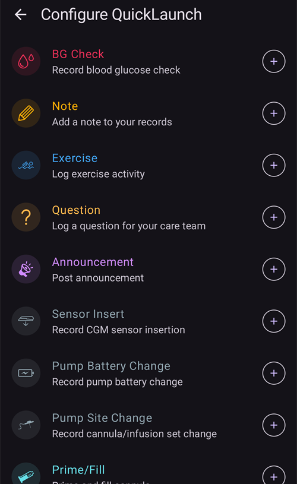

(quicklaunch)=
# QuickLaunch (greitųjų veiksmų įrankių juosta pagrindiniame ekrane)

**QuickLaunch** – tai nedidelė **greitųjų veiksmų įrankių juosta** **AAPS** pagrindinio ekrano apačioje, iškart virš apatinės navigacijos juostos. Tai mygtukų eilutė, kurią galite pritaikyti sau: patys nusprendžiate, kokie veiksmai joje bus ir kokia tvarka. Taip dažniausiai atliekami veiksmai pagrindiniame ekrane visada pasiekiami vienu bakstelėjimu.

```{contents} Table of contents
:depth: 2
:local: true
```


---

## Įrankių juostos naudojimas

Įrankių juosta yra **pagrindiniame ekrane**, tarp grafikų ir apatinės navigacijos juostos:


- **Bakstelėkite** piktogramą, kad atliktumėte jos veiksmą – lygiai taip pat, lyg būtumėte jį atidarę įprastame ekrane (bolusui ar terapijai vis tiek pirmiausia rodomas įprastas patvirtinimas).
- **Ilgai paspauskite** piktogramą, kad pamatytumėte **paaiškinimą** su veiksmo pavadinimu ir trumpu aprašymu.
- Jei pridėsite **daugiau mygtukų, nei telpa** ekrane, papildomi mygtukai perkeliami į **papildomą meniu** (mygtukas **⋮** įrankių juostos gale).
- Kiekviena piktograma turi savo veiksmo **spalvą** (pvz., insulino, angliavandenių, laikino tikslo), todėl ją galima atpažinti iš pirmo žvilgsnio.

```{admonition} The toolbar is always there
:class: note
Paskutinis mygtukas visada yra **Konfigūruoti QuickLaunch** (krumpliaratis **⚙️**). Jo pašalinti negalima, todėl konfigūravimo ekraną visada galite atidaryti tiesiai iš įrankių juostos. Pagal numatytuosius nustatymus įrankių juostoje yra tik du mygtukai: **Boluso patarėjas** ir šis krumpliaratis.
```

---

## QuickLaunch konfigūravimas

Bakstelėkite įrankių juostoje esantį krumpliaratį **⚙️** (arba atidarykite **[Konfigūracija](../SettingUpAaps/ConfigBuilder.md) → … → Konfigūruoti QuickLaunch**), kad atidarytumėte ekraną **Konfigūruoti QuickLaunch** (*„Tinkinti greitųjų veiksmų mygtukus pagrindiniame ekrane“*).


Ekraną sudaro dvi dalys:

- **Pasirinkti veiksmai** (viršuje) – mygtukai, kurie dabar yra jūsų įrankių juostoje, ta pačia tvarka kaip juostoje.
- Po jais esantis **katalogas** – visi veiksmai, kuriuos galite pridėti, sugrupuoti pagal kategorijas. Kiekvienas katalogo įrašas turi mygtuką **➕**, kuriuo jį galima pridėti.

### Pasirinkti veiksmai – tvarkos keitimas, redagavimas, šalinimas

Kiekvienas pasirinktas veiksmas turi:

- **⠿ tempimo rankenėlę** – paspauskite ir vilkite, kad **pakeistumėte mygtukų tvarką** (tvarka čia yra ta pati kaip įrankių juostoje),
- mygtuką **−** – juo veiksmą **pašalinsite** iš įrankių juostos,
- o **Profilis** spartusis mygtukas dar turi mygtuką **✏️**, kuriuo galima keisti jo procentą ir trukmę (žr. [Profilio spartieji mygtukai](#profile-shortcuts)).

Pakeitimai įsigalioja **iš karto** – atskiro mygtuko *Išsaugoti* nėra. Pridėtas veiksmas atsiduria įrankių juostos gale; iš ten galite pakeisti jo vietą.

---

## Veiksmų kategorijos

Kataloge viskas, ką galite pridėti, sugrupuota į šias kategorijas tokia tvarka. Kategorijos, kuriose nėra ką pasiūlyti (pvz., jei neturite scenarijų), tiesiog nerodomos.

### Terapija

Kasdieniai terapijos ir NGJ dialogai:

- **Insulinas** – rankiniu būdu suleisti bolusą.
- **Angliavandeniai** – įrašyti angliavandenius be insulino.
- **Boluso patarėjas** – atidaryti boluso skaičiuotuvą.
- **Terapija** – kartu įrašyti insuliną ir angliavandenius.
- **NGJ** – atidaryti NGJ programėlę (pvz., xDrip).
- **Kalibravimas** – kalibruoti NGJ jutiklį.

### Terapijos įrašai

Terapijos įrašų įvykiai ir įrenginių priežiūros įrašai:

- **Gliukomatis**, **Pastaba**, **Sportas**, **Klausimas**, **Pranešimas**,
- **Jutiklio įvedimas**, **Baterijos keitimas**, **Infuzijos vietos keitimas**, **Užpildymas**, **Vietų rotacija**.

**Užpildymas** ir **Baterijos keitimas** siūlomi tik tada, kai jūsų pompa juos naudoja. Pavyzdžiui, pompos be vamzdelio (patch) užsipildo ir bateriją keičia savo aktyvavimo žingsniuose, todėl šie įrašai joms nerodomi (kaip ir meniu **Valdymas**).



Tai tie patys įrašai, kuriuos kitaip pasiektumėte per meniu **[Terapija](#v4changes-treatments)** ir **[Valdymas](#v4changes-manage)** – QuickLaunch tiesiog perkelia tuos, kuriuos naudojate, į pagrindinį ekraną.

### Valdymas

Meniu **[Valdymas](#v4changes-manage)** ekranai ta pačia tvarka, todėl dažniausiai naudojamą ekraną galite atidaryti tiesiai iš įrankių juostos:

- **Profilis**, **Insulino nustatymai** (insulino konfigūracijų tvarkymas ir aktyvavimas; pavadinimas tyčia skiriasi nuo **Insulinas**, nes tas mygtukas suleidžia bolusą), **Laikinas tikslas**, **Greitasis vedlys**, **Scenarijai**, **Automatizacija**, **Maistas**,
- **Veikimo režimas** – uždaryti arba atidaryti ciklą, jį sustabdyti arba atjungti pompą,
- **Autorizuoti klientai** – tik pagrindiniame įrenginyje arba susietame kliente.

Šie mygtukai tik atidaro ekraną; patys jie nieko nepradeda. Jei norite scenarijų ar Greitąjį vedlį paleisti vienu bakstelėjimu, pridėkite jį iš toliau esančios kategorijos **Scenarijai** arba **Greitasis vedlys**.

 

### Greitasis vedlys

Kiekvieną **[Greitojo vedlio](QuickWizards.md)** ruošinį galima pridėti kaip mygtuką, todėl pasikartojantis valgis pagrindiniame ekrane pasiekiamas vienu bakstelėjimu. Mygtuke rodomas ruošinio pavadinimas ir angliavandenių / insulino kiekis; jį bakstelėjus Greitasis vedlys vykdomas su įprastu patvirtinimu.

Greitojo vedlio ruošiniai, kurie nustatyti rodyti tik laikrodyje, nesiūlomi. Greitojo vedlio mygtukui įrankių juostoje taikomos tos pačios taisyklės kaip meniu **Terapija**: jis paslepiamas už [galiojimo laiko intervalo](#quickwizard_validity) ribų ir trumpam po panaudojimo. Jis lieka įrankių juostos konfigūracijoje ir vėl atsiranda, kai Greitąjį vedlį vėl galima naudoti.

### Scenarijai

Kiekvieną įjungtą **[scenarijų](Scenes.md)** galima pridėti kaip mygtuką. Jį bakstelėjus prašoma patvirtinimo, tada scenarijus aktyvuojamas (tas pats veiksmų rinkinys, kurį gautumėte ekrane Scenarijai). Ši kategorija rodoma tik tada, jei turite bent vieną scenarijų.

Paaiškinime ir kataloge rodoma ta pati santrauka kaip **Valdymas → Scenarijai**, pavyzdžiui, *„3 veiksmai, 2 val. → Cooldown“*; pavadinimas po rodykle yra po jo einantis scenarijus.

### Automatizavimas

Automatizacijos taisykles su **Naudotojo veiksmas** (tas, kurias paleidžiate rankiniu būdu) galima pridėti kaip mygtukus. Bakstelėjus mygtuką prašoma patvirtinimo, tada vykdomi tos taisyklės veiksmai.

```{admonition} Automation buttons run on the master
:class: note
Automatizacija vykdoma **pagrindiniame įrenginyje**, todėl automatizacijos spartieji mygtukai siūlomi ir vykdomi tik pagrindiniame įrenginyje. Susietame **[kliente](../RemoteFeatures/ClientMasterControl.md)** jų nėra.
```

### Laikino tikslo ruošiniai

Kiekvieną **[laikino tikslo](TempTargets.md)** ruošinį galima pridėti kaip mygtuką (rodomas jo pavadinimas, tikslas ir trukmė, pavyzdžiui, *„Netrukus valgysiu – 5,0 mmol/l, 45 min“*). Jį bakstelėjus prašoma patvirtinimo, tada pradedamas tas laikinas tikslas.


(profile-shortcuts)=
### Profile

Kiekvieną **[profilį](ProfileSwitch-ProfilePercentage.md)** galima pridėti kaip **spartųjį mygtuką**, kuris vienu bakstelėjimu atlieka **profilio keitimą**. Kitaip nei dauguma sparčiųjų mygtukų, profilio spartusis mygtukas turi savo **procentą** ir **trukmę**. Juos nustatote pridėję mygtuką, paspaudę **✏️**:

- **Procentais** (30–250 %, po 5 %) – proporcingai pakeičia profilį, kai jis pritaikomas. 100 % palieka profilį nepakeistą.
- **Trukmė** (0–10080 min, t. y. iki 7 dienų, po 10 min) – kiek laiko galioja profilio keitimas. **0 = Nuolatinis** (kol vėl pakeisite profilį).


Taip galite turėti kelis mygtukus **tam pačiam** profiliui su skirtingu stiprumu, pavyzdžiui, *„Profilis 100 %“* ir *„Profilis 70 % 2 val.“*, ir bet kurį iš jų pritaikyti vienu bakstelėjimu. (Tą patį profilį galite pridėti kelis kartus su skirtingais nustatymais.)

### Įskiepiai


Galiausiai bet kurį **įjungtą įskiepį**, kuris turi savo ekraną, galima pridėti kaip spartųjį mygtuką, kuris tą ekraną iškart atidaro. Jie sugrupuoti pagal įskiepio tipą – **Pompa**, **Glikemijos šaltinis**, **DKS**, **Ciklas**, **Jautrumo nustatymas**, **Glodinimas**, **Kalibravimas**, **Apribojimai**, **Ryšys** ir **Bendrieji**, todėl, pavyzdžiui, iš pagrindinio ekrano galite iškart pereiti į pompos ar ciklo ekraną.

---

## QuickLaunch, pagrindinis įrenginys ir klientas

Kitaip nei dauguma jūsų nustatymų, **QuickLaunch įrankių juosta konfigūruojama kiekviename įrenginyje atskirai** – ji saugoma **tik įrenginyje ir nesinchronizuojama** tarp pagrindinio įrenginio ir susietų klientų, todėl kiekvienas įrenginys turi savo mygtukų rinkinį. (Tačiau ji *įtraukiama* į nustatymų **atsarginę kopiją / eksportą**, todėl atkūrus nustatymus tame pačiame įrenginyje ji grįžta.)

Tai, ką kiekvienas įrenginys gali įdėti į savo įrankių juostą, vis tiek priklauso nuo to, ką jis turi: Greitojo vedlio ruošiniai, scenarijai, laikino tikslo ruošiniai ir profiliai sinchronizuojami, todėl kliento kataloge siūlomi tie patys elementai – jūs tiesiog pasirenkate juos kiekviename įrenginyje atskirai. Keletas dalykų, kuriuos verta žinoti:

- Mygtukai, kurių elemento nebėra (ištrintas Greitojo vedlio ruošinys, scenarijus ar ruošinys, išjungta taisyklė), **automatiškai praleidžiami**.
- **Automatizacijos** spartieji mygtukai siūlomi ir vykdomi tik **pagrindiniame įrenginyje** (automatizacija vykdoma pagrindiniame įrenginyje). Scenarijų, Greitojo vedlio, laikino tikslo ir profilio mygtukai pasiekiami ir kliente.
- Kai kliente bakstelite mygtuką, kurio veiksmas turi būti atliktas pagrindiniame įrenginyje (bolusas, laikinas tikslas, profilio keitimas ar scenarijus), jį atlieka **pagrindinis įrenginys** ir jis pateikia patvirtinimą. Žr. [Pagrindinio įrenginio ↔ kliento valdymas](../RemoteFeatures/ClientMasterControl.md).

---


<!-- =====================================================================
     Screenshots captured from a real master device:
       - quicklaunch_toolbar.png    (cropped close-up of the overview toolbar pill)
       - quicklaunch_overview.png   (full overview showing the toolbar in place)
       - quicklaunch_config.png     (Configure QuickLaunch: Selected actions + Treatment + start of Manage)
       - quicklaunch_dynamic.png    (catalog: Quick Wizard / Scenes / Automation / Temp Target Presets)
       - quicklaunch_categories.png (catalog: Profile shortcuts + plugin categories)
     No QuickLaunch action was actually run (nothing delivered; only scrolled).
     Maintainers: relocate page + images and fix cross-links as needed.
     ===================================================================== -->
