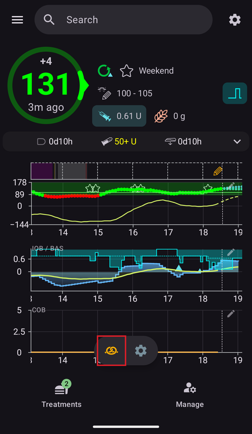

(quickwizards)=
# Greitasis vedlys (bolusas vienu paspaudimu)

**Greitasis vedlys** – tai išsaugotas mygtukas, kurį galite paspausti vieną kartą dažnai pasikartojančiam valgiui ar situacijai. Jame nustatytas fiksuotas **angliavandenių** kiekis (ir kaip jiems skaičiuoti dozę), todėl bolusą sušvirkšti – arba tik įrašyti angliavandenius – galite vienu paspaudimu ir patvirtinimu, o ne kaskart atidarydami visą boluso skaičiuotuvą.

```{contents} Table of contents
:depth: 2
:local: true
```

---

## Greitojo vedlio atidarymas

Atidarykite ekraną **Valdymas** (apatinė navigacija) ir pasirinkite **Greitasis vedlys** (*„Tvarkyti greitojo vedlio ruošinius“*).

---

## Greitųjų vedlių tvarkymas

Jūsų greitieji vedliai rodomi kaip **kortelių karuselė, kurią galima slinkti** (kiekvienoje kortelėje rodomas mygtuko tekstas, angliavandeniai ir galiojimo laikas). Žemiau esančiame redaktoriuje nustatomas **pasirinktas** vedlys; apatinėje veiksmų juostoje yra mygtukai **➕ pridėti**, **⧉ klonuoti**, **🗑️ ištrinti** ir mygtukas **▶**, kuris paleidžia pasirinktą greitąjį vedlį.


Pagrindiniai redaktoriaus laukai:

- **Mygtuko tekstas** – užrašas, rodomas ant mygtuko.
- **Angliavandeniai** ir **Angliavandenių laikas** – angliavandenių kiekis ir jų laiko poslinkis.
- **Galioja nuo–iki** – žr. [Galiojimas](#quickwizard_validity).
- **Skaičiuotuvo parinktys** ir **Įrenginio pasirinkimas** – žr. toliau.

---

## Trys režimai

Redaktoriaus viršuje esantis pasirinkimas – **Vedlys / Insulinas / Angliavandeniai** – nustato, **ką mygtukas daro** jį paspaudus:

- **Vedlys** – sukonfigūruotiems angliavandeniams paleidžia visą **boluso skaičiuotuvą** ir naudoja jūsų dabartinius **KG, AIO, AAO ir tendenciją** (pagal toliau aprašytas *Skaičiuotuvo parinktis*). Jis sušvirkščia *apskaičiuotą* bolusą ir įrašo angliavandenius. Tai klasikinis greitasis vedlys.
- **Insulinas** – sušvirkščia **fiksuotą, iš anksto nustatytą insulino kiekį**, kurį nustatote jūs – be skaičiavimo.
- **Angliavandeniai** – įrašo **tik sukonfigūruotus angliavandenius**, **be boluso**.

---

## Skaičiuotuvo parinktys (režimas Vedlys)

Mygtukui režimu **Vedlys** pasirenkate, kuriuos duomenis naudoja skaičiavimas:

- **Įtraukti KG**, **Įtraukti AAO**, **Įtraukti AIO** (su *Tik teigiamas AIO*), **Įtraukti tendenciją** (*Visas / Tik teigiamą / Tik neigiamą*), **Įtraukti laikiną tikslą**, **Naudoti įspėjimą**.
- **Boluso procentas** – padidina arba sumažina apskaičiuotą bolusą.
- **Pridėti i-AV** – papildomai suplanuoja ištęstus angliavandenius.


---

## Galiojimas – kada rodomas mygtukas

(quickwizard_validity)= **Galioja nuo–iki** (*Nuo / Iki*) nustato, **kada** greitasis vedlys rodomas ir gali būti naudojamas. Mygtukas, nustatytas, pavyzdžiui, **06:00–10:00**, rodomas tik ryte – taip greitasis vedlys *Pusryčiai* vakarienės metu neužgriozdina ekrano (ir nėra paspaudžiamas per klaidą). Už savo laiko intervalo ribų mygtukas paslepiamas meniu **Terapija** ir [QuickLaunch įrankių juostoje](QuickLaunch.md). Įrankių juostos mygtukas neištrinamas: jis vėl atsiranda, kai prasideda jo laiko intervalas.

Kai galiojimo laikas trumpesnis nei 4 valandos, mygtukas taip pat paslepiamas 30 minučių po to, kai jį panaudojate, kad tas pats valgis nebūtų per klaidą įvestas du kartus.

---

## Naudojimo vietos – kur jį naudoti

Jungikliai **Įrenginio pasirinkimas** nustato, kur rodomas kiekvienas greitasis vedlys:

- **Rodyti telefone** – jis rodomas **meniu [Terapija](../Maintenance/V4Changes.md)** (apskaičiuota dozė rodoma tiesiai ant mygtuko). Telefone rodomą greitąjį vedlį taip pat galima **prisegti kaip greitojo veiksmo mygtuką pagrindiniame ekrane**: atidarykite *Konfigūruoti QuickLaunch* (⚙ [QuickLaunch](QuickLaunch.md) įrankių juostoje) ir pridėkite jį iš kategorijos **Greitasis vedlys**.
- **Rodyti laikrodyje** – jis rodomas **Wear OS plytelėje „Greitasis vedlys“** (perslinkite iki jo laikrodžio plytelių karuselėje ir paspauskite mygtuką, kad jį paleistumėte – taip pat kaip [scenarijų plytelėje](#scenes-from-watch)).

```{admonition} Don't see Device Selection?
:class: note
Skiltis **Įrenginio pasirinkimas** redaktoriuje rodoma tik tada, kai įjungtas įskiepis **Išmanieji laikrodžiai** ir įjungtas jo nustatymas **Valdymas per Wear**. Kitu atveju kiekvienas greitasis vedlys tiesiog rodomas telefone.
```

Telefone greitieji vedliai rodomi meniu **Terapija** (lange ekrano apačioje) viršuje:


…ir kaip greitojo veiksmo mygtukas pagrindiniame ekrane:




Susietas **klientas** (**AAPSClient**) taip pat gali paleisti greitąjį vedlį – jį apskaičiuoja ir sušvirkščia **pagrindinis įrenginys** (žr. [Pagrindinio įrenginio ↔ kliento valdymas](../RemoteFeatures/ClientMasterControl.md)).

Kad ir kur jis būtų paleistas, paspaudus greitąjį vedlį visada parodomas **patvirtinimas** (kai paleidžiama iš kliento ar laikrodžio – pagrindinio įrenginio sudarytas patvirtinimas), ir tik tada kas nors sušvirkščiama.

Greitasis vedlys atmetamas, kai jo dozė didesnė už jūsų maks. bolusą arba kai jo angliavandeniai ar i-AV didesni už jūsų maks. angliavandenių kiekį (pavyzdžiui, kai sumažinote ribą). Kai angliavandeniai viršija ribą, mygtukas meniu **Terapija** išjungiamas. Pakeiskite greitąjį vedlį arba ribą.

---

## Pridėjimas ir pašalinimas

- **➕ Pridėti** – sukurti naują greitąjį vedlį.
- **⧉ Klonuoti** – nukopijuoti esamą kaip pradžios tašką.
- **🗑️ Ištrinti** – pašalinti greitąjį vedlį.

Kai turite du ar daugiau greitųjų vedlių, galite keisti jų tvarką karuselėje: viršutinėje juostoje paspauskite piktogramą **Keisti tvarką** (⇅), **◀ / ▶ perkėlimo mygtukais** perkelkite centre esančią kortelę, tada patvirtinkite **✓**. (The controls look the same as [reordering profiles](ProfileSwitch-ProfilePercentage.md).)

Greitieji vedliai yra sinchronizuojamos konfigūracijos dalis, todėl jie bendri jūsų pagrindiniam įrenginiui ir susietiems klientams.

---


<!-- =====================================================================
     Screenshots captured from a real master device:
       - quickwizard_editor.png   (Manage → QuickWizard: carousel, mode, carbs, carb time, valid time range)
       - quickwizard_options.png  (Calculator Options, Bolus percentage, Device Selection)
       - quickwizard_overview.png (the QuickWizard quick-action button on the overview)
       - quickwizard_watch_tile.png (the Wear OS QuickWizard tile)
     No QuickWizard was actually run (no bolus delivered).
     Maintainers: relocate page + images and fix cross-links as needed.
     ===================================================================== -->
