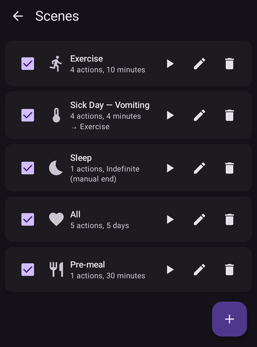
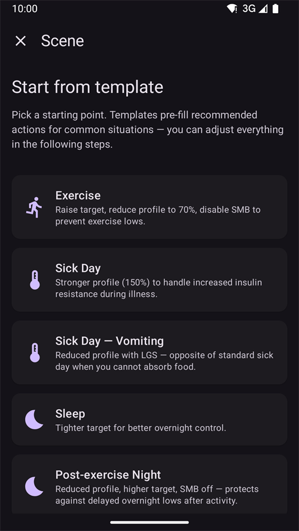
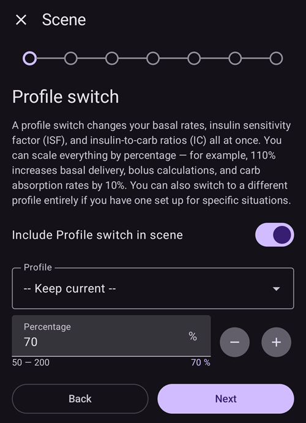
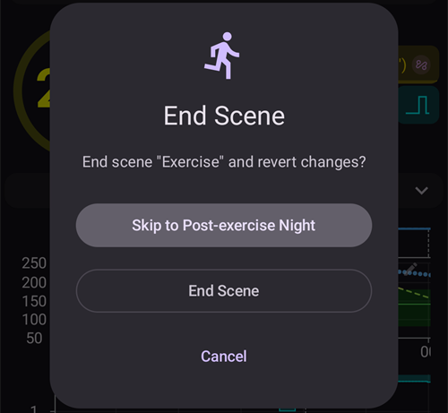
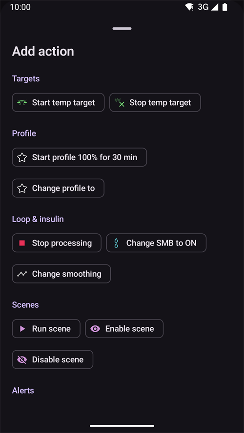

(scenes)=
# Scenarijai (situacijų ruošiniai)

**Scenarijus** – tai pavadintas ruošinys, kuris **iš karto atlieka kelis veiksmus**. Pavyzdžiui, ruošinys *Miegas*, *Sportas* arba *Liga* vienu paspaudimu pakeičia profilį, nustato laikiną tikslą, įjungia arba išjungia SMB ir prideda terapijos įrašą, jei norite – nustatytam laikui.

```{contents} Table of contents
:depth: 2
:local: true
```

---

## Kas yra scenarijus

Užuot kaskart rankiniu būdu keitę kelis dalykus, kai pasikartoja ta pati situacija, juos vieną kartą nustatote kaip scenarijų ir aktyvuojate vienu paspaudimu. Scenarijus gali apjungti bet kuriuos iš šių veiksmų:

- **Profilio keitimas** – pakeisti profilį ir (arba) pakeisti jo procentą (pvz., 70 %).
- **Laikinas tikslas** – nustatyti laikiną tikslą (pvz., *Sportas*, *Netrukus valgysiu* arba savo reikšmę).
- **SMB įjungti / išjungti** – įjungti arba išjungti super mikro bolusus, kol scenarijus aktyvus.
- **Veikimo režimas** – pakeisti veikimo režimą (pvz., į atsargesnį režimą).
- **Terapijos įrašas** – įrašyti įvykį (pvz., *Sportas*, *Liga*), kad jis būtų rodomas grafike ir Nightscout.

Scenarijus taip pat turi **trukmę** – fiksuotą laiką (minutes / valandas / dienas) arba *Neterminuota (baigiama rankiniu būdu)* – ir **pabaigos veiksmą**, kuris atliekamas scenarijui pasibaigus: tai gali būti **pranešimas** arba **perėjimas** į kitą scenarijų (pavyzdžiui, *Liga → Sportas*).

---

## Scenarijų tvarkymas

Atidarykite **Valdymas → Scenarijai**, kad galėtumėte peržiūrėti, kurti, redaguoti, įjungti / išjungti savo scenarijus ir keisti jų tvarką.



Kiekvienoje scenarijaus kortelėje rodoma:

- **žymimasis langelis** scenarijui įjungti / išjungti,
- **piktograma** ir **pavadinimas**,
- santrauka – *„N veiksmai(-ų), trukmė“* ir **→ kitas scenarijus**, jei po šio scenarijaus pereinama į kitą,
- ir trys mygtukai: **▶ aktyvuoti**, **✏️ redaguoti**, **🗑️ ištrinti**.

Paspauskite mygtuką **+**, kad sukurtumėte naują scenarijų.

---

## Scenarijaus kūrimas arba redagavimas

### Pradėkite nuo ruošinio

Norėdami **sukurti** scenarijų, ekrane Scenarijai paspauskite mygtuką **+**. Pirmas žingsnis yra **Pradėti nuo ruošinio**: pasirinkite paruoštą scenarijų dažnai situacijai – *Sportas*, *Liga*, *Liga — vėmimas*, *Miegas*, *Naktis po sporto*, *Prieš valgį*, *Alkoholis*, *Vairavimas*, *Maudymasis*, *Liuteininė fazė*, *Karštas oras*, *Medicininė procedūra* – arba pradėkite nuo scenarijaus *Tuščias*. Kiekvienas ruošinys **iš anksto užpildo rekomenduojamus veiksmus**, o kituose žingsniuose galite viską pakeisti.



Pasirinkus ruošinį, prieš tęsiant paaiškinama jo paskirtis – *kada* ir *kodėl* jį naudoti:


### Veiksmų žingsniai

Likusi redaktoriaus dalis yra trumpas vedlys, einantis **žingsnis po žingsnio**. Kiekvienas žingsnis yra vienas veiksmo tipas su jungikliu *„Įtraukti … į scenarijų“* – įjunkite jį tik tiems veiksmams, kuriuos turi atlikti šis scenarijus, o kitus palikite išjungtus.



Eikite per žingsnius mygtukais **Toliau** / **Atgal**: *Profilio keitimas*, *Laikinas tikslas*, *SMB*, *Veikimo režimas*, *Terapijos įrašas*, tada **trukmė**, **pabaigos veiksmas** (pranešti arba pereiti į kitą scenarijų) ir galiausiai scenarijaus **pavadinimas ir piktograma**. Baigę išsaugokite. (Norėdami **redaguoti** esamą scenarijų, paspauskite jo mygtuką **✏️** – iš karto pateksite į šiuos žingsnius.)

Kiekvienas žingsnis prasideda trumpu paaiškinimu, ką veiksmas daro. Žingsniai atrodo taip (čia su ruošiniu *Sportas*):

**Laikinas tikslas** – pasirinkite vieną iš savo laikinų tikslų ruošinių:


**SMB** – įjungti arba išjungti SMB, kol scenarijus aktyvus:


**Veikimo režimas** – jei norite, pakeiskite ciklo režimą:


**Terapija** – įvykio tipas ir pastaba, kuriuos reikia įrašyti:


**Trukmė** – kiek laiko scenarijus lieka aktyvus; 0 reiškia, kol jį baigsite patys:


**Tolesnis scenarijus** – jei norite, scenarijus, kuris prasideda, kai baigiasi šis:


**Scenarijus** – pavadinimas ir piktograma. Paspauskite **Baigti**, kad išsaugotumėte:


---

## Scenarijaus aktyvavimas

Scenarijų aktyvuokite iš sąrašo **Scenarijai** (mygtuku **▶**) arba per punktą **Scenarijai** apatinėje navigacijoje. Apatinės navigacijos lange **Scenarijai** kiekvienam scenarijui rodoma ta pati santrauka kaip ir scenarijų sąraše, o **pieštukas** lango viršuje atidaro **Valdymas → Scenarijai**, kur galite kurti arba redaguoti scenarijus.


If [bolus protection](#Preferences-protection) is on, **AAPS** asks for it before a scene starts or ends. Changing a scene needs the [settings protection](#Preferences-settings-protection) instead.

Prieš atliekant bet ką, rodomas **patvirtinimas**, kuriame tiksliai išvardyta, ką scenarijus padarys, kad galėtumėte tai peržiūrėti:


Jei po scenarijaus pereinama į kitą, patvirtinimo pabaigoje rodoma **→** ir to tolesnio scenarijaus pavadinimas, taip pat kaip scenarijų sąraše.

Kai scenarijų paleidžiate per punktą **Scenarijai** apatinėje navigacijoje, patvirtinimas yra paprastesnis dialogas su tuo pačiu veiksmų sąrašu. Paspauskite **OK**, kad aktyvuotumėte:


Jums patvirtinus, veiksmai atliekami, o **aktyvus scenarijus** rodomas pagrindinio ekrano viršuje su mygtuku **Baigti scenarijų**. Jei po scenarijaus pereinama į kitą, juostoje taip pat nurodomas tolesnis scenarijus:


Scenarijaus veiksmai galioja, kol:

- baigiasi jo **trukmė** (atliekamas **pabaigos veiksmas** – pranešimas arba perėjimas į kitą scenarijų), arba
- paspaudžiate **Baigti scenarijų** ir baigiate jį rankiniu būdu. Jei po scenarijaus pereinama į kitą, turite du pasirinkimus: **Pereiti prie** tolesnio scenarijaus (aktyvus scenarijus baigiamas, o tolesnis prasideda dabar) arba **Baigti scenarijų** (aktyvus scenarijus baigiamas, o tolesnis neprasideda).

Scenarijus be tolesnio scenarijaus tik paprašo patvirtinti:



Baigiant scenarijų, jo atlikti pakeitimai **atšaukiami** (pavyzdžiui, jo pradėtas profilio keitimas ir laikinas tikslas).

Kol scenarijus aktyvus, prie profilio ir tikslo pagrindiniame ekrane rodoma maža scenarijaus piktograma, jei juos nustatė scenarijus. Apatinės navigacijos langas **Scenarijai** lieka pasiekiamas, kad galėtumėte paleisti kitą scenarijų:


Kai trukmė baigiasi savaime, pakeitimai iš karto atšaukiami, o juosta pasikeičia į **Scenarijus baigtas** su mygtuku **Atmesti**. Atmetimas tik pašalina juostą iš ekrano – pats scenarijus jau baigtas, todėl automatizacijos taisyklės ir tolesnis scenarijus veikia jo nelaukdami.

---

## Scenarijų paleidimas automatizacija

Scenarijaus nebūtina paleisti rankiniu būdu – jį už jus gali paleisti **Automatizacija**. Kai automatizacijos taisyklei pridedate veiksmą (**Valdymas → Automatizacija**), veiksmų pasirinkime yra kategorija **Scenarijai**:

- **Paleisti scenarijų** – aktyvuoti scenarijų, kai įvykdomos taisyklės sąlygos (pavyzdžiui, nustatytu laiku, kai kur nors atvykstate arba kai gliukozė peržengia ribą).
- **Įjungti scenarijų** / **Išjungti scenarijų** – padaryti scenarijų pasiekiamą (arba nepasiekiamą) jo neaktyvuojant.



Automatizacija taip pat gali **reaguoti į** scenarijų: sąlygų sąraše yra sąlyga **Scenarijus**, todėl taisyklė gali veikti tik tada, kai aktyvus tam tikras scenarijus. Kartu su scenarijaus **pabaigos veiksmu** (atšaukti, pranešti arba pereiti į kitą scenarijų) tai leidžia scenarijams automatiškai prasidėti, tęstis ir baigtis.

---

## Scenarijai su pagrindiniu įrenginiu / klientu ir laikrodžiu

**Šiuo metu aktyvus scenarijus sinchronizuojamas** visuose jūsų susietuose įrenginiuose – aktyvuokite jį viename telefone, ir kiti jį taip pat parodys.

Susietas **klientas** (**AAPSClient**) taip pat gali aktyvuoti arba baigti scenarijų: užklausa siunčiama **pagrindiniam įrenginiui**, kuris sudaro patvirtinimą ir pritaiko scenarijų savo būsenai. Kaip tai veikia, žr. [Pagrindinio įrenginio ↔ kliento valdymas](../RemoteFeatures/ClientMasterControl.md).

(scenes-from-watch)=
### Iš Wear OS laikrodžio

Scenarijai **Wear OS laikrodyje** pasiekiami kaip **plytelė Scenarijus**. Laikrodžio plytelių karuselėje perslinkite iki plytelės **Scenarijus** (jei jos dar nėra, pirmiausia pridėkite ją iš karuselės plytelių sąrašo) ir paspauskite scenarijų, kurį norite paleisti:


Plytelėje yra keturios vietos. Pagal numatymą kiekviena vieta **automatiškai** užpildoma kitu iš jūsų įjungtų scenarijų ta tvarka, kokia jie išdėstyti telefone. Norėdami pasirinkti patys, **ilgai palaikykite plytelę** ir atidarykite jos nustatymus: kiekvienai iš keturių vietų galite palikti **Automatiškai**, prisegti **konkretų scenarijų** arba pasirinkti **Nėra**, kad vieta liktų tuščia. Vieta, prisegta prie scenarijaus, kuris vėliau buvo ištrintas arba išjungtas, rodo **Nepasiekiama** – pasirinkite jai kitą scenarijų.

Tada laikrodis parodo patvirtinimą – paspauskite **✓**, kad aktyvuotumėte, arba perbraukite atgal, kad atšauktumėte:


Kaip ir kliente, **patvirtinimą sudaro ir scenarijų paleidžia pagrindinis įrenginys**; laikrodis tik perduoda užklausą (per kliento telefoną, jei laikrodis susietas su klientu).

Kol scenarijus veikia – arba telefone vis dar rodoma jo juosta **Scenarijus baigtas** – plytelėje rodomas mygtukas **Baigti**, o po juo scenarijaus pavadinimas. Paspauskite jį, kad baigtumėte aktyvų scenarijų arba pašalintumėte likusią juostą tiesiai nuo riešo.

Jei po veikiančio scenarijaus pereinama į kitą, plytelėje taip pat rodomas mygtukas **Praleisti**, o po juo tolesnio scenarijaus pavadinimas. Tai tie patys du pasirinkimai kaip ir telefone:

- **Baigti** – aktyvus scenarijus baigiamas. Patvirtinime nurodoma, kad tolesnis scenarijus neprasidės.
- **Praleisti** – aktyvus scenarijus baigiamas, o tolesnis scenarijus prasideda dabar. Patvirtinime nurodomi abu scenarijai.

Laikrodžio [ekrane „Ciklo būsena“](#WearOsSmartwatch-loop-status) taip pat rodomas aktyvus scenarijus, likęs jo laikas ir tolesnis scenarijus.

---


<!-- =====================================================================
     Screenshots captured from a real master device:
       - scenes_list.png        (Manage → Scenes management list)
       - templates_picker.png   (create: "Start from template" picker)
       - template_explanation.png (create: chosen template's explanation)
       - scene_editor.png       (scene editor, Profile switch step)
       - scene_confirmation.png (scene activation confirmation — also used on the Client/Master page)
       - scene_active_banner.png (overview active-scene banner with the End Scene button)
       - automation_scene_action.png (Automation action picker — Scenes category)
       - scene_watch_tile.png    (Wear OS Scene tile)
       - scene_watch_confirm.png (Wear OS scene confirmation)
     Maintainers: relocate page + images and fix cross-links as needed.
     ===================================================================== -->
