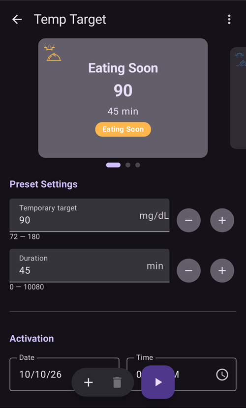
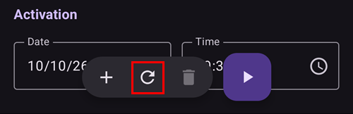

# Laikini tikslai

## Kokie yra laikini tikslai ir kaip juos naudoti bei nustatyti?

**Laikinas tikslas** (trumpiau **LT**) yra **AAPS** funkcija, leidžianti pakeisti [**KG** tikslinį intervalą](#profile-glucose-targets) planuojamai veiklai. This is achieved by **AAPS** manipulating the user’s insulin usage.

A glucose target, particularly if it is only short-term (less than 4 hours in duration), does not need to be the *actual value* you expect or want your glucose level to get to, rather, it is a good way to tell **AAPS** to be more or less aggressive, while still keeping your glucose levels in range.

Temporary targets can be defined within those boundaries :

|                    | Temporary target       |
| ------------------ | ---------------------- |
| Mažiausia reikšmė  | 4 mmol/l arba 72 mg/dL |
| Didžiausia reikšmė | 10 mmol/L or 180 mg/dL |

**AAPS** provides three built-in **Temp-Target** presets suitable for exercise (**Activity**), meals (**Eating Soon**) and predicted hypoglycemia (**Hypo**). Juos rasite ekrane **Laikinas tikslas** (**Valdymas** → **Laikinas tikslas**), kurį taip pat galite atidaryti tiesiog bakstelėję **tikslo ženklelį** pagrindiniame ekrane.

Users should have realistic expectations on the results that can be achieved when selecting a **Temp-Target** in **AAPS**. Ar pavyks pasiekti norimą **KG** tikslą, priklauso nuo daugelio veiksnių: naudotojo **AAPS** nustatymų patikimumo, bendros **KG** kontrolės, **AIO**, jautrumo ir atsparumo insulinui, fizinio krūvio intensyvumo ir kitų veiksnių.

Norimam **KG** tikslui pasiekti naudojant **laikiną tikslą** gali prireikti maždaug 30 minučių ar ilgiau. **AAPS** negali pasiekti **KG** tikslo iš karto. Rinkdamiesi **laikiną tikslą**, naudotojai turėtų tai prisiminti.

Toliau trumpai aprašomos **laikino tikslo „Sportas“**, **laikino tikslo „Netrukus valgysiu“** ir **laikino tikslo „Hipo“** ypatybės. The values shown are the shipped defaults — you can [adjust each preset](#TempTargets-change-preset-defaults) to your own needs.

### LT – Sportas


**KG tikslas (numatytasis ruošinys, keičiamas)**

AAPS 1 val. 30 min. sieks 140 mg/dL arba 7,8 mmol/l tikslo

**Ką dar naudotojai gali norėti įvertinti renkantis**:

Priklausomai nuo **KG** lygio, **AAPS** „sumažins“ insulino tiekimą, kad pasiektų **KG** tikslą. Jei **KG** tikslas nėra intervale (t. y. yra aukščiau už naudotojo **profilyje** pasirinktą **KG** tikslą), **AAPS** gali palikti valandinę bazę įjungtą.

Uždaro ciklo režimu **SMB**:

- *gali būti* išjungti (plačiau aptariama toliau); ir (arba)
- valandinė bazė gali būti įjungta, jei **AAPS** rodo neigiamą **AIO**, arba <0.

Naudotojai taip pat gali apsvarstyti:

- šį **LT** *pasirinkti* 1–2 valandas prieš planuojamą sportą, kad AIO būtų mažesnis (tinkamas šio LT laikas kiekvienam žmogui skiriasi); ir
- planuojamos veiklos laikui *pasirinkti* laikiną profilį (sumažintą), kad **AIO** būtų mažesnis;
- *užtikrinti*, kad **LT** būtų *išjungtas* netrukus prieš sportą, nes **AIO** jau sumažėjęs, o kai kuriems naudotojams po sporto **KG** greitai pakyla.

### LT – Netrukus valgysiu


**KG tikslas (numatytasis ruošinys, keičiamas)**

AAPS 45 minutes sieks 90 mg/dL arba 5,0 mmol/l tikslo

**Ką dar naudotojai gali norėti įvertinti renkantis**:

Uždaro ciklo režimu **SMB**:

- liks įjungti; ir (arba)
- priklausomai nuo naudotojo **profilio** nustatymų, taip pat gali būti įjungta valandinė bazė.

Priklausomai nuo **KG** lygio, **AAPS** „padidins“ insulino tiekimą neviršydama naudotojo **AAPS** nustatymų ribų, kad pasiektų norimą **KG** tikslą.

### LT – Hipo


**KG tikslas (numatytasis ruošinys, keičiamas)**

AAPS 1 valandą sieks 160 mg/dL arba 8,9 mmol/l tikslo

**Ką dar naudotojai gali norėti įvertinti renkantis**:

Uždaro ciklo režimu **SMB**:

- *gali būti* išjungti (plačiau aptariama toliau); ir (arba)
- valandinė bazė gali būti įjungta, jei **AAPS** rodo neigiamą **AIO**, arba <0.

(TempTargets-manage-v4)=

## Setting and managing temporary targets (Manage → Temp Target)

**AAPS** v4 laikino tikslo **ruošinius** tvarkote ir laikiną tikslą pradedate ekrane **Valdymas** (apatinė navigacija) → **Laikinas tikslas** (*„Tvarkyti ir nustatyti laikinus tikslus“*).



The screen has three parts:

1. **Preset carousel** (top) — swipe through your TT presets. Each card shows the preset's **name**, **target** and **duration**; the currently running TT is highlighted.
2. **Editor** (middle) — the **Temporary target** and **Duration** that will actually be applied, plus an **Activation** date/time.
3. **Action bar** (bottom) — **➕ add**, **‘️ delete** and the **▶ activate** button.

Selecting a preset card loads its **target** and **duration** into the editor.

```{admonition} Built-in vs custom presets :class: note The built-in presets — **Eating Soon**, **Activity** and **Hypo** — always exist and **cannot be deleted** (you can change their values and save, though). Any presets you create yourself are **custom** and can be edited or deleted freely.

    <br />### Activating a temporary target
    
    Swipe to the preset you want (its values load into the editor), optionally adjust the **target**/**duration** in the editor, then tap **▶ Activate**. A confirmation shows the exact target, duration and reason before anything starts:
    
    
    
    After you confirm, the temporary target starts immediately (or at the chosen **Activation** time) and runs for the set **duration**.
    
    ```{admonition} Editing the numbers is a one-off — it does not change the preset
    :class: important
    The **target** and **duration** in the editor are the values **Activate** will use *right now*. If you change them, that change is **temporary**: it applies only to this activation and **does not modify the saved preset**. This lets you "tweak and activate" a one-off TT (for example activate *Activity* at a slightly different target today) without permanently altering the preset.
    

### Saving changes to a preset

If you *do* want to keep an edited value, **Save** it: when the editor differs from the selected preset, a **Save** icon appears in the top toolbar. Tapping it stores the current **target** and **duration** (and name, for custom presets) back into the selected preset. For the built-in presets, a **Revert to defaults** button (↺) also appears in the action bar: it brings back the preset's default values.



So the rule of thumb is:

- **Activate** → use the numbers **once** (preset unchanged).
- **Save** → make the numbers the preset's **new defaults**.

To put a built-in preset back the way it shipped, select it and tap the **↺ Revert** button — it appears in the action bar only for a **built-in** preset whose values currently differ from its factory defaults, and it restores that preset's original **target** and **duration**.

### Adding and removing presets

- **➕ Add** — create a **new custom preset** from the current editor values. The new card appears in the carousel.
- **‘️ Delete** — remove the selected **custom** preset. Built-in presets (*Eating Soon*, *Activity*, *Hypo*) cannot be deleted.

Once you have at least two **custom** presets, you can also change their order in the carousel: tap the **Reorder** icon (⇅) in the top bar, step the centred card with the **◀ / ▶ move buttons**, then confirm with **✓**. The built-in presets keep their places — only custom presets can be moved. (The controls look the same as [reordering profiles](ProfileSwitch-ProfilePercentage.md).)

Your presets are part of the synced configuration, so they are shared across your master and paired clients.

### Other ways to set a temporary target

A temporary target can also be set without opening this screen:

- naudojant **LT jungiklius lange Angliavandeniai** – žr. [toliau](#TempTargets-carbs-dialog),
- with a **preset button on the [QuickLaunch toolbar](QuickLaunch.md)** — the *Temp Target Presets* category in *Configure QuickLaunch* offers a one-tap button for each of your presets,
- from a **Wear OS watch** (the **Temp Target** menu item / tile),
- from a paired **client** — see [Master ↔ Client control](../RemoteFeatures/ClientMasterControl.md),
- kaip **[scenarijaus](Scenes.md)** dalį (veiksmas *Laikinas tikslas*) arba
- from an **Automation** rule (*Start temp target* / *Stop temp target*).

* * *

(TempTargets-where-can-i-select-a-temp-target)=

## Kur galiu pasirinkti laikiną tikslą?

Greičiausias būdas – bakstelėti **tikslo ženklelį** pagrindiniame ekrane (jame rodomas dabartinis tikslo intervalas):


This opens the **Temp Target** screen described above — swipe to a preset and tap **▶ Activate**. The same screen is also reachable via **Manage** → **Temp Target**.

(TempTargets-carbs-dialog)= Įvesdami angliavandenius, ekrano **Laikinas tikslas** galite visai neatidaryti: lango **Angliavandeniai** (**Terapija** → **Angliavandeniai**) viršuje yra jungikliai **Pradėti Hipo LT**, **Pradėti Netrukus valgysiu LT** ir **Pradėti Sporto LT**. Switch one on and the corresponding preset is activated together with the carb entry:


    {admonition} Automatinis Hipo LT
    :class: note
    Jei atidarote **langą Angliavandeniai**, kai jūsų gliukozė žemesnė nei 72 mg/dL (4 mmol/l), **AAPS** už jus iš anksto įjungia jungiklį **Pradėti Hipo LT** (nebent jau veikia aukštesnis laikinas tikslas, kurio likęs laikas ilgesnis).

(TempTargets-change-preset-defaults)=

## Kur galiu pakeisti numatytąjį laikiną tikslą ir pritaikyti jį savo poreikiams?

Each preset's **target** and **duration** are edited directly on the **Temp Target** screen — there is no separate preferences entry for this anymore:

1. Atidarykite ekraną **Laikinas tikslas** (bakstelėkite tikslo ženklelį arba pasirinkite **Valdymas** → **Laikinas tikslas**).
2. Swipe to the preset you want to change.
3. Adjust **Temporary target** and/or **Duration** in the editor.
4. Tap the **Save** icon that appears in the top toolbar.


While the editor differs from a built-in preset's factory values, a **↺ Revert** button also appears in the action bar — tap it to restore the preset's original target and duration.

## Kaip atšaukti laikiną tikslą?

Kol laikinas tikslas aktyvus, pagrindinio ekrano tikslo ženklelyje rodomas tikslas ir likęs laikas. Bakstelėkite jį – ekrane **Laikinas tikslas** aktyvus ruošinys pažymėtas **AKTYVUS**, o apačioje esančios įrankių juostos gale, iškart į kairę nuo mygtuko **▶ Aktyvuoti**, rodomas raudonas mygtukas **✗ Atšaukti**. Tap it and confirm:


A running temporary target can also be stopped from a **Wear OS watch**, from a paired **client**, or by an **Automation** rule (*Stop temp target*).

(TempTargets-hypo-temp-target)=

## Laikinas tikslas „Hipo“

**Temp-Target Hypo** enables **AAPS** to prevent the user from experiencing low blood sugar by reducing insulin intake. Jei naudotojas numato, kad jo **KG** sumažės, paprastai **AAPS** turėtų tai suvaldyti, tačiau daug kas priklauso nuo naudotojo **AAPS** nustatymų stabilumo. A **Temp-Target Hypo** enables the user to get ahead of the predicted low and update **AAPS** to reduce insulin.

Kartais suvalgius angliavandenių hipoglikemijai gydyti naudotojo **KG** gali greitai padidėti, o **AAPS** į šį greitą **KG** kilimą reaguos skirdama **SMB**.

Some users wish to avoid **SMBs** being given during **Temp-Target Hypo**. Tai daroma išjungiant *„Naudoti SMB esant aukštesniam laikinam gliukozės tikslui“* skiltyje **Nustatymai** → **OpenAPS SMB** (žr. toliau):

- Pažengusiems, 9 mokymo etapas: naudotojas gali įjungti *„Aukštas laikinas tikslas padidina JIF“* **laikiniems tikslams**, kurie yra 100 mg/dL (5,6 mmol/l) ar aukštesni, naudojant OpenAPS SMB – tada **AAPS** bus jautresnė.

- Pažengusiems, 9 mokymo etapas: naudotojas gali išjungti *„Naudoti SMB esant aukštesniam laikinam gliukozės tikslui“*. Tada, net jei **AAPS** rodo AAO > 0, įjungta „Naudoti SMB esant žemesniam laikinam gliukozės tikslui“ arba „Naudoti SMB visada“ ir aktyvus OpenAPS SMB, **AAPS** neskirs SMB, kol aktyvūs aukšti laikini tikslai.

Pastaba: jei atidarote **langą Angliavandeniai**, kai jūsų gliukozė kraujyje žemesnė nei 72 mg/dL arba 4 mmol/l, **AAPS** automatiškai iš anksto įjungia jungiklį **Pradėti Hipo LT**.

(TempTargets-activity-temp-target)=

## Laikinas tikslas „Sportas“

Before and during exercise, the user may require a higher target to prevent hypoglycemia during the activity.

Kad naudoti **laikiną tikslą „Sportas“** būtų paprasčiau, naudotojas gali nustatyti numatytąjį **laikiną tikslą „Sportas“**, kuris mažina insulino tiekimą, kad **KG** padidėtų, sulėtėtų **KG** mažėjimas ir būtų išvengta hipoglikemijos.

Naujiems **AAPS** naudotojams gali tekti eksperimentuoti ir individualiai pritaikyti numatytuosius **laikino tikslo „Sportas“** nustatymus, kad ši funkcija jiems veiktų geriausiai. Everyone is different when it comes to attaining stable BG control during exercise. Taip pat žr. [DUK skyrių apie sportą](#FAQ-sports).

Kai kurie naudotojai taip pat mieliau aktyvuoja **profilio keitimą** (sumažintą profilį < 100 %, kad **AAPS** tiektų mažiau insulino) prieš įjungdami **laikiną tikslą „Sportas“** ir kol jis aktyvus. Abu galite pradėti vienu žingsniu: pagrindiniame ekrane bakstelėkite profilio pavadinimą, bakstelėkite apvalų mygtuką **▶**, nustatykite **Procentais** mažiau nei 100 % ir **Trukmę**, tada įjunkite **Laikinas tikslas / Sportas**. Žr. [Profilio procento keitimas](#ProfileSwitch-change-percentage).

Pažengusiems, 9 mokymo etapas: naudotojai gali įjungti *„Aukštas laikinas tikslas padidina JIF“* **laikiniems tikslams**, kurie yra 100 mg/dL (5,6 mmol/l) ar aukštesni, naudojant OpenAPS **SMB**. 99 mg/dL (5,5 mmol/l) tikslas yra įprastas tikslas – nei aukštas, nei žemas. Tada **AAPS** yra jautresnė.

Be to, jei *„Naudoti SMB esant aukštesniam laikinam gliukozės tikslui“* išjungta, **AAPS** neskirs **SMB**, net jei AAO > 0, įjungta *„Naudoti SMB esant žemesniam laikinam gliukozės tikslui“* arba *„Naudoti SMB visada“* ir aktyvus OpenAPS **SMB**.

(TempTargets-eating-soon-temp-target)=

## Laikinas tikslas „Netrukus valgysiu“

**Laikinas tikslas „Netrukus valgysiu“** gali padėti pamažu sumažinti **KG** ir užtikrinti, kad prieš valgį būtų pakankamai **AIO**.

Tai gali būti svarbi priemonė naudotojams, kurie nesileidžia išankstinio boluso, tačiau **laikino tikslo „Netrukus valgysiu“** veiksmingumas priklausys nuo daugelio veiksnių: naudotojo nustatymų, ar jis laikosi mažai angliavandenių turinčios dietos ir ar naudoja greito veikimo insuliną (pvz., Fiasp ar Lyumjev), kad išankstinio boluso nereikėtų. Paprastai, kol naudotojai nėra įgiję patirties su **AAPS**, naudodami **laikiną tikslą „Netrukus valgysiu“** jie turėtų tikėtis, kad reikės suleisti bolusą prieš valgį. Tai ypač svarbu, jei racione daug angliavandenių.

Daugiau apie „Netrukus valgysiu“ režimą galite perskaityti straipsnyje ['How to do “eating soon” mode'](https://diyps.org/2015/03/26/how-to-do-eating-soon-mode-diyps-lessons-learned/) (anglų k.) arba [čia](https://diyps.org/tag/eating-soon-mode/).

Pažengusiems, [9 mokymo etapas](#objectives-objective9): jei naudojate OpenAPS SMB ir įjungtas nustatymas *„Žemas laikinas tikslas sumažina JIF“*, **AAPS** veikia šiek tiek agresyviau. Šiai parinkčiai reikia, kad **laikinas tikslas** būtų 98 mg/dL (5,4 mmol/l) ar žemesnis.

## Kaip išjungti SMB, kai aktyvus laikinas tikslas?

Norėdami tai padaryti, atidarykite **Nustatymai** → **OpenAPS SMB** ir išjunkite *„Naudoti SMB esant aukštesniam laikinam gliukozės tikslui“*.


Taip **AAPS** neskirs **SMB**, net jei AAO > 0, įjungta *„Naudoti SMB esant žemesniam laikinam gliukozės tikslui“* arba *„Naudoti SMB visada“* ir aktyvus OpenAPS SMB.