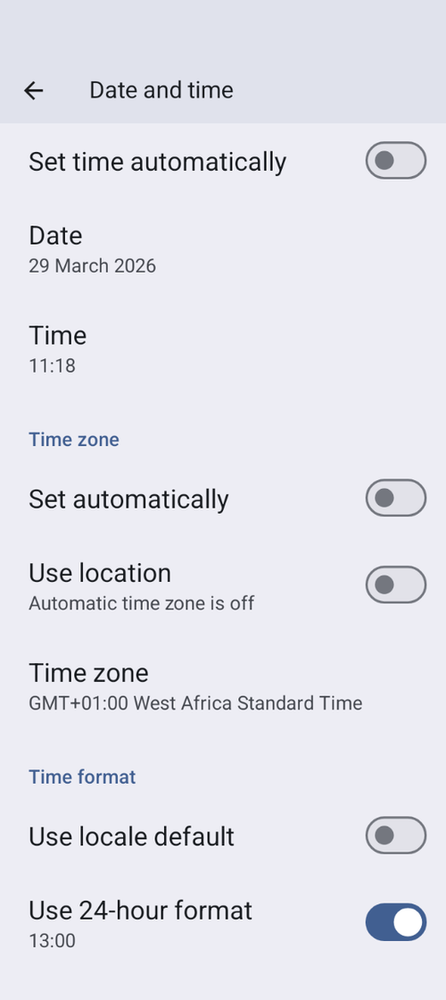

# Timezone Change and Daylight Saving

Pasikeitus telefono laiko juostai, **AAPS** maždaug po 10 sekundžių iš naujo perskaičiuoja praeities **AIO**, valandinę bazę ir jautrumą. Kol tai vyksta, grafikai ir reikšmės pagrindiniame ekrane gali atsinaujinti ne iš karto.

(timezone-traveling-with-pumps)=

## Timezone change for Omnipod Dash

* Atnaujinkite pompos būseną: **Valdymas → Pompa**
* Laikinai pasirinkite kitą **profilį**, tada vėl pasirinkite ankstesnį arba norimą **profilį**

## Timezone change for DanaR, Korean DanaR

Laiko juostos keitimas telefone nesukelia problemų, nes pompa nenaudoja istorijos

(timezone-traveling-danarv2-danars)=

## Laiko juostos keitimas naudojant DanaRv2, DanaRS, Dana-i

These pumps require special care because **AAPS** uses history from the pump but the records in pump do not have timezone stamp. **This means that if you change time zone in your phone, records will be read with different time zone and will be doubled.**

Kad to išvengtumėte, yra du būdai:

### 1 variantas: namų laiko išlaikymas ir profilio laiko perstūmimas

* Turn off 'Automatic date and time' in your phone's settings (manual time zone change).

* Your phone must keep your standard time as at home for the whole travel period.

* Time-shift your **Profile** according to time difference between home time and destination time.
   
   * Bakstelėkite **profilio** pavadinimą pagrindiniame ekrane, kad atidarytumėte [Profilio ekraną](#ProfileSwitch-manage-v4)
   * Pasirinkite savo **profilį** ir bakstelėkite **▶ Aktyvuoti**
   * Nustatykite '**Laiko perstūmimas**' pagal kelionės tikslą ir bakstelėkite **Aktyvuoti**.
   
   
   
   * pvz., Viena -> Niujorkas: **Profilio keitimas** +6 valandos
   * pvz., Viena -> Sidnėjus: **Profilio keitimas** -8 valandos

### 2 variantas: pompos istorijos ištrynimas

* Telefono nustatymuose išjunkite 'Automatic date and time' (laiko juostos keitimas rankiniu būdu)

Išlipę iš lėktuvo:

* išjunkite pompą
* pakeiskite laiko juostą telefone
* išjunkite telefoną, įjunkite pompą
* ištrinkite pompos istoriją
* pakeiskite pompos laiką
* įjunkite telefoną
* leiskite telefonui prisijungti prie pompos ir suderinti laiką

(timezone-traveling-insight)=

## Timezone Change for Insight

Tvarkyklė automatiškai pritaiko pompos laiką prie telefono laiko.

Insight pompa taip pat įrašo į istoriją, kada buvo pakeistas laikas ir iš kokio (seno) laiko į kokį (naują) laiką. So the correct time can be determined in **AAPS** despite the time change.

Dėl to **BPD** reikšmės gali būti netikslios. Tačiau tai neturėtų sukelti problemų.

Taigi Insight naudotojams nereikia nerimauti dėl laiko juostos ir laiko pakeitimų. Yra viena šios taisyklės išimtis: Insight pompa turi mažą vidinę bateriją, kuri maitina laikrodį ir kt. kol keičiate „tikrąją“ bateriją. Jei baterijos keitimas užtrunka per ilgai, ši vidinė baterija išsikrauna, laikrodis nustatomas iš naujo ir įdėjus naują bateriją jūsų paprašoma įvesti laiką ir datą. In this case all entries prior to the battery change are skipped in calculation in AAPS as the correct time cannot be identified properly.

## Timezone Change for Accu-Chek Combo

[Combo tvarkyklė](../CompatiblePumps/Accu-Chek-Combo-Pump-v2.md) automatiškai pritaiko pompos laiką prie telefono laiko. Combo negali saugoti laiko juostų, tik vietinį laiką, ir būtent jį tvarkyklė įrašo į pompą. In addition, it stores the timezone in the local AAPS preferences to be able to convert the pump's localtime to a full timestamp that has a timezone offset. The user does not have to do anything; if the time on the Combo deviates too much from the phone's current time, the pump's time is automatically adjusted.

Note that this takes some time, however, since it can only be done in the remote-terminal mode, which is generally slow. This is a Combo limitation that cannot be overcome.

## Timezone Change for Medtrum

Tvarkyklė automatiškai pritaiko pompos laiką prie telefono laiko.

Pakeitus laiko juostą, istorija lieka nepakitusi. Tai gali paveikti tik BPD. Rankiniu būdu pakeitus telefono laiką, gali kilti problemų su istorija ir **AIO**. Jei laiką keičiate rankiniu būdu, dar kartą patikrinkite **AIO**.

Pakeitus laiko juostą ar laiką, tuo metu veikiančios **laikinos bazės** sustabdomos.

(time-adjustment-daylight-savings-time-dst)=

## DAYLIGHT SAVING (DST)

Laiko pakeitimas dėl vasaros laiko.

Priklausomai nuo jūsų pompos ir NGJ sąrankos, laiko šuoliai gali sutrikdyti tinkamą **AAPS** veikimą. Kai kurių pompų atveju laiko juostą geriau pakeisti dieną, kol nemiegate, prieš laiko persukimą, o ne naktį.

### DST automatic adjustment for most pumps

* Tačiau **ciklas** bus išjungtas 3 valandoms PO laiko persukimo (paprastai nuo 1 val. nakties), ir **AAPS** naudos įprastą valandinę bazę, nustatytą jūsų **profilyje**. Tai daroma saugumo sumetimais: **AIO** gali būti per didelis, nes prieš laiko persukimą leistas bolusas gali būti įrašytas du kartus.
* Po laiko persukimo atlikite **profilio keitimą** į norimą **profilį**, kad įjungtumėte **ciklą**: bakstelėkite profilio pavadinimą pagrindiniame ekrane, tada apvalų mygtuką **▶** (žr. [Profilio aktyvavimas](#ProfileSwitch-manage-v4)).
* Prieš laiko persukimą **AAPS** pagrindiniame ekrane taip pat gausite pranešimą, kad **ciklas** laikinai išjungtas. Šis pranešimas pasirodys be garso signalo, vibracijos ar panašaus garso.

Jei bolusą leidžiate su **AAPS** skaičiuotuvu, nenaudokite **AAO** ir **AIO** duomenų, nebent esate tikri, kad jie visiškai teisingi. Būkite atsargūs ir nenaudokite šios funkcijos porą valandų po laiko persukimo.

### DST for Accu-Chek Insight

* Laikas persukamas (DST) automatiškai. Nieko daryti nereikia.

### DST for Accu-Chek Combo

* Laikas persukamas (DST) automatiškai. Nieko daryti nereikia.

### Vasaros laikas naudojant Medtrum

* Laikas persukamas (DST) automatiškai. Nieko daryti nereikia.

### Vasaros laikas naudojant Omnipod Dash

* Galite leisti **AAPS** po laiko persukimo laikinai naudoti įprastą profilio valandinę bazę, kaip paaiškinta anksčiau.
* Jei nenorite, kad **AAPS** naktį laikinai naudotų įprastą profilio valandinę bazę, laiko juostą galite pakeisti dieną prieš laiko persukimą. Taip išvengsite sutrikimų naktį. ATKREIPKITE DĖMESĮ: DĖL ŠIOS PARINKTIES JŪSŲ POD GALI NUSTOTI VEIKTI PER ANKSTI. PASIRINKĘ TOLIAU APRAŠYTĄ FUNKCIJĄ, TURĖKITE PRIEMONIŲ SU SAVIMI.

#### Actions to take before the clock change

1. IŠJUNKITE visus telefono nustatymus, kurie automatiškai nustato telefono laiko juostą, kad galėtumėte pasirinkti norimą laiko juostą, kurioje nenaudojamas vasaros laikas. How to enable this will depend on your smartphone and Android version.
   
   * Kai kuriuose telefonuose yra du nustatymai: vienas automatiškai nustato laiką (geriausia jį palikti įjungtą), kitas automatiškai nustato laiko juostą (jį turite IŠJUNGTI: **Set automatically** skiltyje **Time zone** toliau pateiktoje ekrano kopijoje).
   * Unfortunately, some Android versions have a single switch to enable automatic setting of both the time and the timezone. Kol kas šį nustatymą turėsite išjungti.

2. Find a timezone that has the same time as your current location but doesn't use DST.
   
   * A list of these countries is available [https://greenwichmeantime.com/countries](https://greenwichmeantime.com/countries/)
   * Centrinės Europos laikui (CET) tai galėtų būti "Brazzaville" (Kongas). Pakeiskite telefono laiko juostą į Kongo laiko juostą.

3. **AAPS** programėlėje atnaujinkite pompos būseną ir perjunkite į norimą **profilį**.

4. Patikrinkite **AAPS** **AIO** ir **AAO**. Jei jie netikslūs, išjunkite **ciklą** bent vienai IVT arba maksimaliam angliavandenių įsisavinimo laikui (**Ilgiausia įsisavinimo trukmė**), pagal tai, kuris ilgesnis.

5. Actions to take after the clock change. Tinkamas metas grįžti prie vietinės laiko juostos – kai **AIO** mažas. E.g. an hour before a meal such as breakfast. Geriausia, kad tiek **AAO**, tiek **AIO** būtų artimi nuliui.