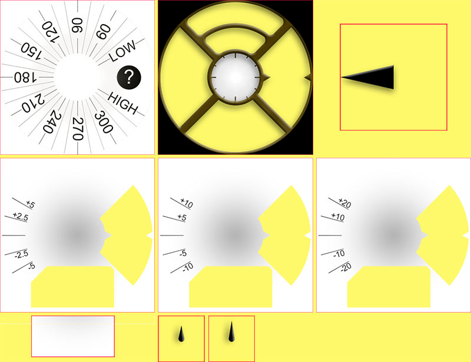
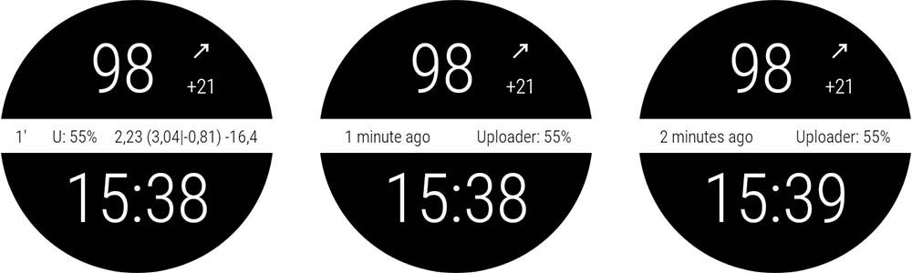
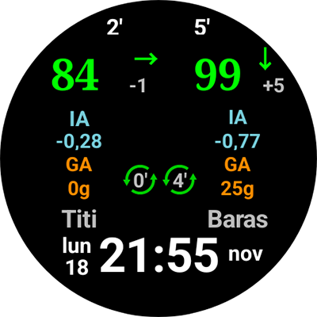

# Pasirinktinio ciferblato žinynas

Šis puslapis skirtas naujų ciferblatų kūrėjams. Jame išvardyti visi raktiniai žodžiai ir funkcijos, kurių reikia norint sukurti arba animuoti naują ciferblatą.

- Naujos funkcijos ir raktai, galimi pasirinktiniame ciferblate V2 (Wear apk 3.3.0 ar naujesnė), aprašyti [čia](#cwf-reference-new-v2-features)

## Pasirinktinio ciferblato formatas

Pasirinktinis ciferblatas (Custom Watchface) yra atviras formatas, sukurtas AAPS ir susietas su nauju laikrodyje esančiu ciferblatu „AAPS (Custom)“.

Ciferblato failas yra paprastas zip failas, bet kad jis būtų atpažintas kaip ciferblato failas, zip faile turi būti šie failai:

- Vienas paveikslėlio failas, pavadintas CustomWatchface (gali būti rastriniai failai `CustomWatchface.jpg`, `CustomWatchface.png` arba vektorinis `CustomWatchface.svg`). Šis failas yra maža ikona, naudojama ciferblatui pasirinkti, kai paspaudžiate mygtuką „Įkelti ciferblatą“, ir paveikslėlis, matomas AAPS Wear įskiepyje.
- Vienas failas, pavadintas `CustomWatchface.json` (žr. [JSON struktūra](#cwf-reference-json-structure) žemiau). Šis antrasis failas yra pagrindinis. Jame bus visa informacija, reikalinga ciferblatui sukurti. Šis json failas turi būti teisingas (tai turbūt sunkiausia vieta, kai šį failą redaguojate rankiniu būdu teksto redaktoriuje, nes vieno trūkstamo ar papildomo kablelio pakanka, kad json formatas būtų sugadintas). Šiame JSON faile taip pat turi būti blokas `"metadata"` su raktu `"name"`, kurio reikšmė nėra tuščia. Tai bus jūsų pasirinktinio ciferblato pavadinimas (žr. [Metaduomenų nustatymai](#cwf-reference-metadata-settings) žemiau)
- šis zip failas turi būti kuo mažesnis (mažiau nei apie 500 kb). Jei šis failas per didelis, jis bus tiesiog užblokuotas ir neperduotas į laikrodį.

Zip faile taip pat gali būti papildomų išteklių failų:

- Iš anksto nustatyti paveikslėlių failų pavadinimai, kurie bus naudojami ciferblato standartiniuose rodiniuose (pvz., `Background`, `CoverChart`... žr. [Iš anksto nustatytų išteklių failų sąrašas](#cwf-reference-list-of-hardcoded-resource-files) žemiau). Visi šie failai gali būti `jpg`, `png` arba `svg` formato. tačiau daugumai jų turėsite naudoti `png` arba `svg`, nes jie palaiko permatomumą (jpg failai mažesni už png, bet be permatomumo). Atkreipkite dėmesį, kad geriausia kokybė su mažiausiu dydžiu paprastai būna su svg failais (vektorinis formatas).
- Papildomi išteklių failai su laisvai pasirinktais pavadinimais. Šie papildomi failai gali būti paveikslėlių failai arba šriftų failai (šriftams tinka `ttf` ir `otf` formatai). Atkreipkite dėmesį, kad šių papildomų failų `filename` (be plėtinio) bus naudojamas kaip rakto reikšmė (keyValue) JSON faile, nurodant, kur arba kada šie failai turi būti naudojami.
  - paveikslėlių failai dažnai naudojami kaip teksto rodinių fonas arba dinaminei animacijai (pvz., baterijos lygiui nuo 0% iki 100%)
  - šriftų failai leidžia jūsų ciferblate naudoti specialius šriftus

(cwf-reference-json-structure)=

## JSON struktūra

JSON failus galima redaguoti teksto redaktoriumi Notepad (arba notepad++) (geriau notepad++, kuris atpažįsta JSON ir naudoja spalvinį formatavimą)

- jame yra eilutės raktai `"string_key":` ir rakto reikšmės, kurios gali būti eilutės, pvz., `"key value"`, sveikieji skaičiai, loginės reikšmės, pvz., `true` arba `false`, arba duomenų blokai.
- kiekviena reikšmė atskiriama kableliu `,`
- Duomenų blokas prasideda `{`  ir baigiasi `}`
- json failas yra vienas visas blokas, todėl jis prasideda  `{`  ir baigiasi `}`, o šio failo viduje visi įdėtiniai blokai susieti su `"key"`, kuris bloke turi būti unikalus
- Kad json failą būtų lengviau skaityti, jis paprastai rašomas su įtraukomis (kiekvienas naujas raktas naujoje eilutėje, kiekvienas naujas blokas pastumtas į dešinę 4 tarpais)

(cwf-reference-metadata-settings)=

### Metaduomenų nustatymai

Šis blokas yra pirmasis json faile ir yra privalomas. Jame yra visa su šiuo ciferblatu susijusi informacija, pvz., pavadinimas, autorius, sukūrimo ar atnaujinimo data, autoriaus versija arba įskiepio versija.

Žemiau pateiktas metaduomenų bloko pavyzdys:

```text
"metadata": {
    "name": "Default Watchface",
    "author": "myName",
    "created_at": "07\/10\/2023",
    "author_version": "1.0",
    "cwf_version": "1.0",
    "comment": "Default watchface, you can click on EXPORT WATCHFACE button to generate a template"
},
```

Atkreipkite dėmesį, kad datoje naudojamas `/` yra specialusis simbolis. Kad json failas jį teisingai atpažintų, prieš jį turite parašyti „escape“ simbolį `\`

Kai kuriuose json failuose galite matyti papildomą raktą `"filename"`. Šis raktas bus automatiškai sukurtas arba atnaujintas, kai pasirinktinis ciferblatas bus įkeltas į AAPS (jis naudojamas parodyti naudotojui zip failo pavadinimą exports aplanke), todėl šį raktą galite iš metaduomenų bloko pašalinti.

(cwf-reference-general-parameter-settings)=

### Bendrųjų parametrų nustatymai

Po pirmojo bloko su metaduomenimis nustatysite kai kuriuos bendruosius parametrus (žr. [Bendrųjų parametrų sąrašas](#cwf-reference-list-of-general-parameters) žemiau). Tai leidžia nustatyti grafiko spalvas (angliavandeniai, bolusas, KG reikšmės...) ir numatytąsias spalvas reikšmėms diapazone, hiperglikemijai ar hipoglikemijai (numatytosios KG reikšmės ir rodyklių spalvos)

Žemiau pateiktas bendrųjų parametrų pavyzdys

```text
"highColor": "#FFFF00",
"midColor": "#00FF00",
"lowColor": "#FF0000",
"lowBatColor": "#E53935",
"carbColor": "#FB8C00",
"basalBackgroundColor": "#0000FF",
"basalCenterColor": "#64B5F6",
"gridColor": "#FFFFFF",
"pointSize": 2,
"enableSecond": true,
```
(cwf-reference-imageview-settings)=

### ImageView nustatymai

Pasirinktinį paveikslėlį galima pritaikyti naudojant teisingą failo pavadinimą, susietą su kiekvienu ImageView, esančiu pasirinktinio ciferblato išdėstyme (Layout). Tada json blokas reikalingas tik vietai, dydžiui, rodinio matomumui nustatyti ir, jei norite, spalvai pakeisti:

Žemiau pateiktas paveikslėlio bloko pavyzdys rodiniui second_hand (šiuo atveju į zip failą neįtrauktas joks paveikslėlis, todėl bus naudojamas numatytasis sekundžių rodyklės paveikslėlis, bet su pasirinktine spalva).

```text
"second_hand": {
    "width": 400,
    "height": 400,
    "topmargin": 0,
    "leftmargin": 0,
    "visibility": "visible",
    "color": "#BC906A"
}
```
Kad second_hand būtų nuspalvinta numatytąja KG spalva (lowRange, midRange arba highRange), tereikia pakeisti paskutinę eilutę rakto reikšme `bgColor`

```json
    "color": "bgColor"
```

(cwf-reference-textview-settings)=

### TextView nustatymai

TextView turi daugiau parametrų nei ImageView: galite nustatyti sukimą (sveikasis skaičius laipsniais), textsize (sveikasis skaičius pikseliais), gravity (ar teksto reikšmė bus centruota (numatytoji reikšmė), ar lygiuota kairėje arba dešinėje), nustatyti font, fontStyle ir fontColor, taip pat TextView fono spalvą

```text
"basalRate": {
    "width": 91,
    "height": 32,
    "topmargin": 133,
    "leftmargin": 249,
    "rotation": 0,
    "visibility": "visible",
    "textsize": 23,
    "gravity": "center",
    "font": "default",
    "fontStyle": "bold",
    "fontColor": "#BDBDBD"
},
```
Atkreipkite dėmesį, kad jei nenorite naudoti kurio nors rodinio savo ciferblate, raktą `"visibility"` nustatykite į `"gone"`, bet taip pat dydį ir vietą nustatykite už matomos srities ribų, štai taip:

```text
"second": {
    "width": 0,
    "height": 0,
    "topmargin": 0,
    "leftmargin": 0,
    "rotation": 0,
    "visibility": "gone",
    "textsize": 46,
    "gravity": "center",
    "font": "default",
    "fontStyle": "bold",
    "fontColor": "#BDBDBD"
},
```
Jei dydis ir vieta yra matomoje srityje, atnaujinant ciferblatą galite trumpai pamatyti paslėptą reikšmę („blyksnį“).

Jei norite pakeisti teksto rodinio fono paveikslėlį, galite naudoti raktą `"background":` ir kaip rakto reikšmę nurodyti zip faile esančio paveikslėlio failo pavadinimą. Taip pat galite tiesiog pakeisti fono spalvą raktu `"color:"`.

```json
"background": "fileName"
```

Taip pat yra 4 specialūs teksto rodiniai (pavadinti nuo freetext1 iki freetext4), turintys specialų parametrą `"textvalue":`. Jį galima naudoti, pavyzdžiui, užrašui nustatyti

(cwf-reference-chartview-settings)=

### ChartView nustatymai

Grafiko rodinys yra labai ypatingas rodinys. Jis gali turėti kai kuriuos tokius pačius parametrus kaip ImageView arba TextView...

Standartiniai šio rodinio nustatymai yra labai paprasti:

```text
"chart": {
    "width": 400,
    "height": 170,
    "topmargin": 230,
    "leftmargin": 0,
    "visibility": "visible"
},
```
Grafiko rodiniui galite pridėti 2 papildomus parametrus: fono spalvą (numatytoji yra permatoma) raktu `"color"` arba fono paveikslėlį raktu `"background"`.

(cwf-reference-how-to-build-watchface)=

## Kaip sukurti savo pirmąjį ciferblatą

### Reikalingi įrankiai

- Teksto redaktorius: patariu naudoti NotePad++ (ar panašų). Tai paprastas teksto redaktorius, bet jo privalumas – tekstas rodomas su spalviniu kodu, todėl lengviau rasti klaidas. tiks bet koks paprastas teksto redaktorius. Nes tikslas – keisti json informaciją.
- Paveikslėlių redaktorius (rastrinis ir (arba) vektorinis)
  - Jei naudojate rastrinius paveikslėlius
    - Paveikslėlių redaktorius turi palaikyti permatomumą (būtina visiems paveikslėliams virš fono) ir png formatą (jei naudojate rastrinius paveikslėlius)
    - Fono paveikslėlis gali būti jpg formato (mažesnis už png)
    - Paveikslėlių redaktorius turi leisti išmatuoti grafinius objektus pikseliais (tai gali būti paprastas kvadratas) (top, left, width, height)
    - Paveikslėlių redaktorius turi rodyti spalvas RRGGBB kodu šešioliktainiu formatu
    - Paveikslėlių redaktorius turi mokėti pakeisti paveikslėlio dydį į 400px x 400px (labai svarbu dirbti su šia raiška)
  - Jei naudojate vektorinius paveikslėlius
    - Vektorinis paveikslėlis turi būti eksportuotas svg formatu

### Gaukite šabloną, kad nereikėtų pradėti nuo nulio

Kurdami pirmąjį ciferblatą geriausia pradėti nuo numatytojo ciferblato (taip turėsite naujausią versiją su visais galimais rodiniais, išdėstytais teisinga tvarka)

- Zip failą gausite paspaudę mygtuką „Eksportuoti šabloną“ Wear įskiepyje. Zip failas atsiras aplanke AAPS/exports
- Atkreipkite dėmesį, kad pasirinktinio ciferblato mygtukus matysite tik tada, kai prie AAPS bus prijungtas laikrodis (laikrodis taip pat reikalingas pasirinktiniam ciferblatui tikrinti, testuoti ir derinti)

Numatytasis ciferblatas labai paprastas, jo zip faile bus tik 2 failai:

- CustomWatchface.png (numatytojo ciferblato paveikslėlis ciferblato pasirinkimui)
- CustomWatchface.json

### Failų tvarkymas kompiuteryje

Paprasčiausia dirbti, kai telefonas prijungtas prie kompiuterio, ir naudoti du aplankus:

- viena failų naršyklė atidaryta specialiame aplanke, kuriame yra visi failai (json, rastriniai paveikslėliai, vektoriniai paveikslėliai, šriftai) ir jame esantis failas CustomWatchface.zip
- kita failų naršyklė (arba pritaikytas aplankų medis) atidaryta, kad būtų pasiekiamas aplankas Phone/AAPS/exports

Taip dirbti labai paprasta: kiekvieną kartą, kai pakeičiate json failą teksto redaktoriumi arba paveikslėlį paveikslėlių redaktoriumi (rastriniu ar vektoriniu), jums tereikia:

1. išsaugoti pakeitimus kiekvienoje programoje
2. nuvilkti visus failus į failą CustomWatchface.zip
3. nuvilkti CustomWatchface.zip į telefono aplanką AAPS/exports
4. nusiųsti CustomWatchface į laikrodį ir patikrinti rezultatą

### Ciferblato pritaikymo pradžia

Pirmiausia turėsite nustatyti ciferblato pavadinimą (jis reikalingas, kad testuojant ciferblatą būtų lengva pasirinkti) ir pradėti keisti metaduomenų raktus json failo pradžioje

Tada turėsite nuspręsti, kokią informaciją norite rodyti, t. y. kurie rodiniai turi būti matomi, o kurie paslėpti.

- ar rodysite sekundes, ar ne?
- ar norite sukurti analoginį, ar skaitmeninį laikrodį (ar abu...)

Dabar galite pradėti keisti json failą: kiekvieno rodinio raktui `"visibility":` nustatykite `"visible"` arba `"gone"` (ar norite rodinį palikti, ar ne)

Taip pat galite apytiksliai nustatyti top, left margin ir width, height reikšmes, kad pradėtumėte dėlioti ciferblatą (vėliau šios reikšmės bus patikslintos paveikslėlių redaktoriumi)

Pastaba: viskas kuriama **400px x 400px stačiakampyje**. Todėl viskas išdėstoma absoliučiomis koordinatėmis šio dydžio ribose.

Kurdami pirmąjį ciferblatą turite žinoti, kad viskas išdėstyta sluoksniais nuo apatinio iki viršutinio, todėl kiekvienas rodinys (ImageView arba TextView) gali uždengti tai, kas yra už jo...


json faile visi rodiniai surikiuoti nuo apatinio iki viršutinio (tai padės prisiminti, kas yra už ko...)

Jei kuriate ar keičiate savo pirmąjį pasirinktinį ciferblatą, pradėkite nuo paprastų dalykų: pakeiskite kai kurių rodinių matomumą, įdėkite savo fono paveikslėlį nekeisdami json failo...

### Spalvų valdymas

json faile bus keli raktai spalvoms nurodyti: `"color"`, `"fontColor"` rodiniams, bet taip pat `"highColor"`, `"midColor"`, `"lowColor"`, ... (žr. [Bendrųjų parametrų sąrašas](#cwf-reference-list-of-general-parameters))

Spalvos nurodomos teksto lauku, kuris prasideda `#`, o po jo eina RRGGBB (raudona, žalia, mėlyna) reikšmės šešioliktainiu formatu:

- `"#FFFFFF"` yra balta, `"#000000"` – juoda, `"#FF0000"` – raudona...

Taip pat galite pridėti 2 papildomas alfa sluoksnio reikšmes ir nurodyti permatomumo lygį (AARRGGBB):

- `"#00000000"` yra visiškai permatoma, o `"#FF000000"` – visiškai nepermatoma ( taigi  `"#FF000000"` yra tas pats kaip  `"#000000"`)

Taip pat galite naudoti specialią rakto reikšmę `"bgColor"`, kad pagal KG reikšmę būtų automatiškai naudojamos bendruosiuose parametruose nurodytos `"highColor"`, `"midColor"`, `"lowColor"`:

- `"fontColor": "bgColor",` automatiškai nustatys rodinio šrifto spalvą pagal KG reikšmę
- Atkreipkite dėmesį, kad rodiniai `sgv` (KG reikšmei) ir `direction` (tendencijos rodyklei) automatiškai naudoja bendruosiuose parametruose nustatytas KG spalvas (jei šiems 2 rodiniams norite kitų spalvų, turėsite naudoti išplėstinę [dynData](#cwf-reference-dyndata-feature) funkciją su vieno žingsnio spalva...)

Daugiau informacijos apie ImageViews ir raktą `"color":` rasite skyriuje [Paveikslėlio spalvos keitimas](#cwf-reference-tune-image-color) žemiau.

### Iš anksto nustatytų paveikslėlių įtraukimas

paprasčiausias būdas pradėti keisti ciferblatą – įdėti į zip failą paveikslėlių su specialiais pavadinimais (žr. [Iš anksto nustatytų išteklių failų sąrašas](#cwf-reference-list-of-hardcoded-resource-files))

- Paveikslėlis turi būti `.jpg`, `.png` arba `.svg` formato. tačiau būkite atsargūs: jpg nepalaiko permatomumo, todėl turi būti naudojamas tik fono sluoksniui. Visiems tarpiniams sluoksniams (cover_chart, cover_plate, hands) naudokite `.png` arba `.svg` paveikslėlį

- Jei turite vektorinių paveikslėlių redaktorių (pavyzdžiui, Illustrator), rinkitės šį formatą: jis sukuria mažus teksto failus su plėtiniu `.svg` ir geriausią kokybę.
- Būtinai naudokite tikslų failo pavadinimą (įskaitant didžiąsias ir mažąsias raides)

Jei norite savo fono paveikslėlio, tereikia į zip failą įdėti failą, pavadintą `Background.jpg` (nieko kito nekeičiant). Nusiųskite zip failą į laikrodį ir patikrinkite rezultatą!

Jei norite pakeisti analoginio laikrodžio hour_hand, minute_hand arba second_hand, tiesiog įdėkite `HourHand.png` (arba `HourHand.svg`), `MinuteHand.png` ir `SecondHand.png`.

- šie paveikslėliai automatiškai sukasi aplink paveikslėlio centrą, todėl paveikslėliuose turi būti nustatyta 00:00:00 (o „pilno kadro“ analoginiam laikrodžiui naudokite 400 x 400 px dydį, vieta top 0, left 0)

[Iš anksto nustatytų išteklių failų sąraše](#cwf-reference-list-of-hardcoded-resource-files) taip pat matysite, kad kiekvienam paveikslėlio rodiniui yra du papildomi iš anksto nustatyti failų pavadinimai `High` ir `Low` (pavyzdžiui, į zip failą galite įdėti kitus paveikslėlius, pavadintus `BackgroundHigh.jpg` ir `BackgroundLow.jpg`). tada paveikslėlis automatiškai keisis pagal jūsų KG lygį (diapazone, hiperglikemija arba hipoglikemija). Pavyzdžiu žr. ciferblatą AIMICO.

(cwf-reference-tune-image-color)=

### Paveikslėlio spalvos keitimas

Raktu `"color"` galima pakeisti numatytąją paveikslėlio spalvą:

- pritaikytas fono rodiniui, jis nustatys fono spalvą (numatytoji juoda)
- pritaikytas cover_plate (paprastam ciferblatui) arba rodyklėms, jis pakeis numatytąjį paveikslėlį (baltą) nurodyta spalva (įskaitant `"bgColor"`)

Kai raktą `"color"` pritaikote rastriniam paveikslėliui (`.jpg` arba `.png`), spalva sukurs įdomų spalvų sodrumo efektą. Taigi savo rastrinį paveikslėlį vis tiek atpažinsite.

Galiausiai `.svg` paveikslėlio failui raktas `"color"` neturės jokio poveikio: vektorinių failų spalvos laikomos nustatytomis pačiame paveikslėlyje. Jei norite keisti spalvas, turėsite įdėti kelis `svg` failus ir jiems keisti naudoti išplėstinę [dynData](#cwf-reference-dyndata-feature) funkciją

### Papildomų šriftų naudojimas TextViews

Keli numatytieji šriftai jau yra wear apk (žr. šriftų raktus skyriuje [Rakto reikšmės](#cwf-reference-key-values)). Tačiau jei norite naudoti papildomus šriftus, kurių nėra numatytųjų sąraše, papildomus šriftus galite įdėti į zip failą:

- leidžiami 2 šriftų formatai: `.ttf` ir `.otf` failai
- jei į zip failą įdedate pasirinktinį šriftą, pavyzdžiui, failą `myCustomFont.ttf`, json faile TextView turėsite jį nurodyti failo pavadinimu:

```
"font": "myCustomFont",
```

Atminkite, kad kai kurie šriftai gali būti dideli failai (o zip failo dydis yra ribotas). Taigi, jei naudojate labai mažai simbolių (skaičius, `.`, `,`), galite nemokamais įrankiais pašalinti nenaudojamus simbolius (pavyzdžiui, [čia](https://products.aspose.app/font/generator/ttf-to-ttf)) ir taip sumažinti šrifto dydį.

(cwf-reference-advanced-features)=

## Išplėstinės funkcijos

(cwf-reference-preference-feature)=

### Nustatymų funkcija

Pasirinktinis ciferblatas gali automatiškai pakeisti kai kuriuos laikrodžio nustatymus, kad ciferblatas būtų rodomas teisingai (jei naudotojas tai leido Wear nustatymuose).

Tačiau šią funkciją reikia naudoti atsargiai. Nustatymai yra bendri su visais kitais ciferblatais. Todėl naudojant šią funkciją reikia laikytis kelių taisyklių:

- niekada nenustatykite nustatymų, susijusių su paslėptais rodiniais
- stenkitės, kad matomų rodinių būtų kuo daugiau
- drąsiai darykite kai kuriuos rodinius platesnius:
  - Laikiną valandinę bazę galima rodyti procentais (siauras plotis), bet taip pat absoliučiomis reikšmėmis (daug platesnis)
  - pokytis arba vidutinis pokytis su išsamia informacija gali būti platus
  - tas pats su iob2: šiame rodinyje gali būti bendras AIO, bet jei pasirinktas detalus AIO, tekstas gali būti labai ilgas

Jei vis tiek reikia labai specifinių nustatymų, kad vaizdas būtų teisingas (žemiau esančiame pavyzdyje, jei detaliam AIO nepakanka vietos, galite „priverstinai“ nustatyti šį laikrodžio parametrą į `false`), metaduomenų bloke galite įrašyti tokį nustatymo apribojimą

```text
"metadata": {
    "name": "Default Watchface",
    "author": "myName",
    "created_at": "07\/10\/2023",
    "author_version": "1.0",
    "cwf_version": "1.0",
    "comment": "Default watchface, you can click on EXPORT WATCHFACE button to generate a template",
    "key_show_detailed_iob": false
},
```

Jei naudotojas leido pasirinktiniam ciferblatui keisti laikrodžio parametrus (nustatymas Wear įskiepyje), tada „Rodyti detalų AIO“ bus išjungtas ir užrakintas išjungtoje padėtyje (šio parametro keisti negalima, kol leidimas nebus išjungtas Wear įskiepio parametruose arba nebus pasirinktas kitas ciferblatas)

- Atkreipkite dėmesį, kad naudotojas, rinkdamasis ciferblatą, mato „privalomų parametrų“ skaičių

Žemiau esančiame pavyzdyje ciferblatas Gota turi vieną privalomą parametrą. Jei leidimas nesuteiktas, skaičius rodomas balta spalva. Jei leidimas suteiktas, šis parametras bus nustatytas ir užrakintas laikrodyje (šiuo atveju skaičius rodomas oranžine spalva)


(cwf-reference-twinview-feature)=

### TwinView funkcija

Poriniai rodiniai (twin views) leidžia lengvai pakeisti rodinio vietą pagal tai, kurie rodiniai matomi. Tai nėra taip galinga kaip išdėstymas, sudarytas vien iš LinearLayout, bet tinka daugeliui įprastų atvejų.

Žemiau esančiame pavyzdyje matote ciferblatą AAPS (Cockpit), kai nustatymuose matomi visi rodiniai, ir tą patį ciferblatą, kai išjungta „Rodyti įrenginio bateriją“ ir „Rodyti vidutinį pokytį“


Matote, kad kai vienas iš porinių rodinių paslėptas, kitas pasislenka į centrą

šiame pavyzdyje matote, kad bloke `"uploader_battery"` pridėtas raktas `"twinView":`, nurodantis rodinį `"rig_battery"`, o bloke `"rig_battery"` raktas `"twinView":` nurodo `"uploader_battery"` kaip porinį. Tada papildomas raktas `"leftOffsetTwinHidden":` nurodo, keliais pikseliais pastumti rodinį, kai porinis rodinys paslėptas.

Šį skaičių apskaičiuoti paprasta: skirtumas tarp porinių rodinių leftMargin yra 50 pikselių, todėl, kad rodinys liktų centre, poslinkis yra pusė šio skirtumo į vieną ar kitą pusę.

Jei poriniai rodiniai išdėstyti vertikaliai, tokiu atveju turite naudoti raktą `"topOffsetTwinHidden":`

```text
"uploader_battery": {
    "width": 49,
    "height": 30,
    "topmargin": 354,
    "leftmargin": 150,
    "rotation": 0,
    "visibility": "visible",
    "textsize": 23,
    "gravity": "center",
    "font": "roboto_condensed_bold",
    "fontStyle": "bold",
    "fontColor": "#FFFFFF",
    "twinView": "rig_battery",
    "leftOffsetTwinHidden": 25
},
"rig_battery": {
    "width": 49,
    "height": 30,
    "topmargin": 354,
    "leftmargin": 200,
    "rotation": 0,
    "visibility": "visible",
    "textsize": 23,
    "gravity": "center",
    "font": "roboto_condensed_bold",
    "fontStyle": "bold",
    "fontColor": "#FFFFFF",
    "twinView": "uploader_battery",
    "leftOffsetTwinHidden": -25
},
```
(cwf-reference-dyndata-feature)=

### DynData funkcija

DynData yra galingiausia funkcija, jei norite į ciferblatą įtraukti animaciją pagal kai kurias vidines reikšmes (pvz., KG reikšmę, KG lygį, pokytį, baterijos %... galimų duomenų sąrašą žr. [čia](#cwf-reference-dyndata-key-values))

Šiai funkcijai paaiškinti paimsiu ciferblato AAPS (SteamPunk) pavyzdį:


Šiame ciferblate turėsime valdyti [KG reikšmės sukimą](#cwf-reference-background-management) (nuo 30 iki 330 laipsnių) dešinėje, [avg_delta dinaminį diapazoną](#cwf-reference-avg-delta-management) (skalė iki 5 mgdl, 10 mgdl arba 20 mgdl pagal reikšmę), [rodyklės sukimą](#cwf-reference-dynamic-rotation-management), kuris turi būti suderintas su skale, taip pat skirtingus rodinių sluoksnius...

Kad galėtumėte valdyti šį ciferblatą, žemiau matote visus zip faile esančius paveikslėlius:

Pastaba: kad matytumėte permatomumą, visi šie paveikslėliai yra ant geltono fono ir apjuosti raudonu kvadratu



- Pirmoje eilutėje Background.jpg ir CoverPlate.png bus automatiškai susieti su atitinkamu rodiniu (numatytieji rodinių failų pavadinimai), o steampunk_pointer.png bus valdomas per dynData
- Antroje eilutėje matote 3 dinaminio diapazono skales rodiniui avg_delta. Jos taip pat bus valdomos per dynData
- Trečioje eilutėje chartBackground.jpg bus rankiniu būdu susietas grafiko rodinyje, o HourHand.png ir MinuteHand.png failai bus automatiškai susieti su atitinkamais rodiniais

(cwf-reference-background-management)=

#### Fono valdymas

Pirma, dėl KG reikšmės paveikslėlio pasirinkimo nėra: jis gali būti tik fono sluoksnyje (kitaip jis būtų prieš grafiko rodinį ir grafikas nebūtų matomas!). Taigi turėsime susieti KG reikšmę su fonu ir tada sukti fono paveikslėlį pagal KG reikšmę.

Bloke `"background"` įrašysime 2 specialius raktus šiam sukimui:

```text
"background": {
    "width": 400,
    "height": 400,
    "topmargin": 0,
    "leftmargin": 0,
    "dynData": "rotateSgv",
    "rotationOffset": true,
    "visibility": "visible"
},
```
Raktas `"dynData":` nurodo, kuris blokas bus naudojamas animacijai apibrėžti (reikšmė, diapazonas, konvertavimas...); čia šis blokas pavadintas „rotateSgv“ (naudodami šią funkciją rinkitės aiškų pavadinimą),

`"rotationOffset": true,` nurodo, kad laukiama animacija pagal reikšmę turi būti sukimas. (kiti galimi raktai yra `"leftOffset"` ir `"topOffset"`, jei norite sukurti slankiklį)

Dabar eisime į failo pabaigą, po paskutinio rodinio:

```text
"second_hand": {
    "width": 120,
    "height": 120,
    "topmargin": 140,
    "leftmargin": 140,
    "visibility": "gone"
},
"dynData": {
    "rotateSgv": {
        "valueKey": "sgv",
        "minData": 30,
        "maxData": 330
    },
```
Matote, kad po paskutinio rodinio (`"second_hand"`) pridėjome naują bloką `"dynData": { ... }`, kuriame bus visos animacijos:

Rodinyje `"background"` nurodytas blokas pavadintas `"rotateSgv"`. Tai pirmasis blokas, kurį rasite `"dynData"`!

Šis blokas paprastas: pirmasis raktas `"valueKey":` nurodo, kuri reikšmė turi būti naudojama. šiuo atveju `"sgv"` yra „keyValue“, nurodanti KG reikšmę (atkreipkite dėmesį, kad dažniausiai keyValue vadinasi taip pat kaip rodinys, kuris rodo šią informaciją).

KG reikšmei numatytasis min data nustatytas į 39 mgdl, o max data – į 400 mgdl (visas galimas keyValues ir susijusias min/max data reikšmes žr. [DynData rakto reikšmių žinynas](#cwf-reference-dyndata-key-values) žemiau).

Bloke `"rotateSgv"` du papildomi raktai (`"minData":` ir `"maxData":`) naudojami mažiausiai ir didžiausiai reikšmei nustatyti: 30 ir 330. Su šiomis min ir max reikšmėmis galėsime tiesiogiai naudoti duomenų reikšmę (be jokio konvertavimo) fonui sukti laipsniais. Šiuo atveju visos KG reikšmės virš 330 mgdl bus apribotos iki 330, t. y. viršutinės paveikslėlio ribos.

#### Grafiko valdymas

Numatytasis grafiko fonas yra permatomas. Kad paslėptume fono paveikslėlyje esančią KG skalę, reikės įtraukti specialų fono paveikslėlį (šiame paveikslėlyje bus bendri Steampunk ciferblato šešėliai). Failas chartBackground.jpg susiejamas raktu `"background":`

Žinoma, rodinio dydis ir vieta turi būti nustatyti tiksliai iki pikselio!

```text
"chart": {
    "width": 216,
    "height": 107,
    "topmargin": 280,
    "leftmargin": 80,
    "visibility": "visible",
    "background": "chartBackground"
},
```
(cwf-reference-avg-delta-management)=

#### Vidutinio pokyčio valdymas

Vidutinio pokyčio dinaminiam diapazonui valdyti naudosime keturis freetext rodinius. freetext1 bus naudojamas skalės paveikslėliui valdyti, o nuo freetext2 iki freetext4 – rodyklės sukimui pagal skalę.

**freetext1**

Kaip paaiškinta anksčiau, freetext rodiniai yra prieš grafiką ir prieš foną, todėl įtraukėme permatomą sritį, kad šie paveikslėliai būtų matomi (dešinėje ir apatinėje paveikslėlio dalyje)

Atkreipkite dėmesį, kad iš šių paveikslėlių pašalinta apatinė dalis panaudota kaip grafiko fonas, kad viskas idealiai derėtų.

```text
"freetext1": {
    "width": 400,
    "height": 400,
    "topmargin": 0,
    "leftmargin": 0,
    "rotation": 0,
    "visibility": "visible",
    "dynData": "avgDeltaBackground"
},
```
Šiame rodinyje įtraukiame nuorodą į kitą `"dynData"`bloką, pavadintą `avgDeltaBackground`. Šis blokas valdys avgDelta skalę pagal avgDelta reikšmę.

```text
"avgDeltaBackground": {
    "valueKey": "avg_delta",
    "minData": -20,
    "maxData": 20,
    "invalidImage": "steampunk_gauge_mgdl_5",
    "image1": "steampunk_gauge_mgdl_20",
    "image2": "steampunk_gauge_mgdl_20",
    "image3": "steampunk_gauge_mgdl_10",
    "image4": "steampunk_gauge_mgdl_5",
    "image5": "steampunk_gauge_mgdl_5",
    "image6": "steampunk_gauge_mgdl_10",
    "image7": "steampunk_gauge_mgdl_20",
    "image8": "steampunk_gauge_mgdl_20"
},
```
- `"valueKey":` susies su reikšme `"avg_delta"`
- min ir max Data taip pat apribos diapazoną iki didžiausios šiame ciferblate galimos reikšmės (nuo -20 mgdl iki 20 mgdl). mmol naudotojai turėtų atsiminti, kad AAPS viduje visos reikšmės visada yra mgdl.

Toliau pamatysime, kaip valdyti dinaminį fono paveikslėlį pagal reikšmę.

`"invalidImage":` yra raktas paveikslėliui, kuris rodomas, kai duomenys netinkami (arba jų nėra). Čia susiejame su papildomu zip faile esančiu paveikslėlio ištekliumi su 5 mgdl skale

Tada naudosime paveikslėlių seriją nuo `"image1":` iki `"image8":`. Pateiktų paveikslėlių skaičius nustato žingsnių skaičių tarp `minData` ir `maxData`.

- `image1` nustato paveikslėlį, rodomą, kai avg_delta lygus arba artimas `minData`, o paveikslėlis su didžiausiu numeriu (čia `image8`) nustato paveikslėlį, rodomą, kai avg_delta lygus arba artimas `maxData`
- tarp -20 mgdl ir 20 mgdl bendras diapazonas yra 40 mgdl; padalijus iš 8 (pateiktų paveikslėlių skaičius), gausime 8 žingsnius po 5 mgdl
- Dabar galime susieti fono paveikslėlius su avg_delta reikšme, pradedant nuo mažiausių reikšmių: tarp -20 ir -15, taip pat tarp -15 ir -10 skalei naudosime `steampunk_gauge_mgdl_20`, tada tarp -10 ir -5 `steampunk_gauge_mgdl_10`, ir taip toliau iki +15 ir +20, kur vėl naudosime fono paveikslėlį `steampunk_gauge_mgdl_20`

(cwf-reference-dynamic-rotation-management)=

**nuo freetext2 iki freetext4**

Šiems rodiniams sujungsime dinaminius paveikslėlius ir anksčiau paaiškintą sukimo funkciją:

```text
"freetext2": {
    "width": 276,
    "height": 276,
    "topmargin": 64,
    "leftmargin": 64,
    "rotation": 0,
    "visibility": "visible",
    "dynData": "avgDelta5",
    "rotationOffset": true
},
"freetext3": {
    "width": 276,
    "height": 276,
    "topmargin": 64,
    "leftmargin": 64,
    "rotation": 0,
    "visibility": "visible",
    "dynData": "avgDelta10",
    "rotationOffset": true
},
"freetext4": {
    "width": 276,
    "height": 276,
    "topmargin": 64,
    "leftmargin": 64,
    "rotation": 0,
    "visibility": "visible",
    "dynData": "avgDelta20",
    "rotationOffset": true
},
```
Čia kiekvienas rodinys skirtas konkrečiai skalei (todėl susietas su atskiru dynData bloku). Taip pat matote, kad šiems 3 rodiniams įjungtas raktas `"rotationOffset":`. Dabar pažiūrėkime į pirmąjį dynData bloką:

```text
"avgDelta5": {
    "valueKey": "avg_delta",
    "minData": -20,
    "maxData": 20,
    "rotationOffset": {
        "minValue": -120,
        "maxValue": 120
    },
    "invalidImage": "null",
    "image1": "null",
    "image2": "null",
    "image3": "null",
    "image4": "steampunk_pointer",
    "image5": "steampunk_pointer",
    "image6": "null",
    "image7": "null",
    "image8": "null"
},
```
Nors dinaminis diapazonas bus naudojamas tik avg_delta duomenims tarp -5 ir +5, svarbu palikti bendrą diapazoną nuo -20 iki +20 mgdl, kad keičiantis skalei rodyklė būtų suderinta su fonu. Todėl paliekame tą patį bendrą diapazoną kaip `avgDeltaBackground`  ir tą patį žingsnių skaičių (8 paveikslėliai).

Matote, kad `"invalidImage"` arba keli `"imagexx"` turi rakto reikšmę `"null"` (tai gali būti bet kokia eilutė, kuri nėra failo pavadinimas zip faile). Kai failo pavadinimas nerandamas, rodinio fono paveikslėlis bus permatomas. Taigi šis nustatymas užtikrina, kad rodyklė bus matoma tik 4 ir 5 žingsniuose (vidutinis pokytis tarp -5 mgdl ir +5 mgdl) ir nebus matoma už šio diapazono.

Dabar matome naują bloką `"rotationOffset":`, kuriame yra du raktai `"minValue":` ir `"maxValue":`. Šios reikšmės naudojamos konvertuoti vidinius duomenis (mgdl) į norimą pasukimo kampą.

- Steampunk ciferblatas sukurtas taip, kad rodyklė suktųsi daugiausia nuo -30 iki 30 laipsnių. Taigi pagal skalę (čia nuo -5 mgdl iki 5 mgdl) šioms reikšmėms norėsime turėti 30 laipsnių. Kadangi `minData` ir `maxData` yra 4 kartus didesni, atitinkami minValues ir maxValues yra 4 * 30 laipsnių, t. y. -120 ir +120 laipsnių. Tačiau esant bet kokiam sukimui virš arba žemiau ±30 laipsnių rodyklė bus paslėpta (paveikslėlis nematomas), o rodyklė bus matoma tik reikšmėms tarp -5 ir +5 mgdl... Būtent to čia ir reikia.

Kiti dynData blokai nurodomi taip pat, kad būtų keičiami `"avgDelta10"` ir `"avgDelta20"`

#### loop rodinys

Steampunk ciferblate ciklo žalios ir raudonos rodyklės (būsenai) yra išjungtos. Tai taip pat valdoma specialiu dynData bloku, susietu su loop rodiniu.

```text
    "loopArrows": {
        "invalidImage": "greyArrows",
        "image1": "greenArrows",
        "image2": "redArrows"
    }
```
Kadangi šį bloką naudoja tik loop rodinys, o numatytieji šio rodinio duomenys yra ciklo informacija, raktas `"valueKey":` nėra privalomas.

Numatytieji ciklo `minData` ir `maxData` yra 0 min ir 28 min, todėl su dviem paveikslėliais visos reikšmės iki 14 min bus rodomos su fonu `image1`, o visos reikšmės virš 14 min – su `image2`. 14 min yra būtent ta riba, kai žalia rodyklė pasikeičia į raudoną.

Šiame pavyzdyje failai `greyArrows`, `greenArrows` ir `redArrows` į zip failą neįtraukti, todėl šios rodyklės tiesiog pašalinamos (nematomos). Tačiau šį bloką galite naudoti tokį, koks yra, jei norite pakeisti būsenos rodykles pasirinktiniais fono paveikslėliais.

#### rig_battery ir uploader_battery rodiniai

dynData funkcijos apžvalgą baigsime pažiūrėję, kaip valdoma baterija. Idėja – keisti teksto spalvą pagal baterijos lygį (nuo 0 iki 100%)

```text
"uploader_battery": {
    "width": 60,
    "height": 28,
    "topmargin": 100,
    "leftmargin": 170,
    "rotation": 0,
    "visibility": "visible",
    "textsize": 20,
    "gravity": "center",
    "font": "default",
    "fontStyle": "bold",
    "fontColor": "#00000000",
    "dynData": "batteryIcons",
    "twinView": "rig_battery",
    "topOffsetTwinHidden": -13
},
"rig_battery": {
    "width": 60,
    "height": 28,
    "topmargin": 74,
    "leftmargin": 170,
    "rotation": 0,
    "visibility": "visible",
    "textsize": 20,
    "gravity": "center",
    "font": "default",
    "fontStyle": "bold",
    "fontColor": "#00000000",
    "dynData": "batteryIcons",
    "twinView": "uploader_battery",
    "topOffsetTwinHidden": 13
},
```
Matote, kad abu šie rodiniai naudoja tą patį `dynData` bloką, pavadintą `batteryIcons`. Tai įmanoma, nes pagal numatymą susieti duomenys yra paties rodinio duomenys (taigi nenurodžius rakto `"valueKey":` bloke `batteryIcons`, jis bus pritaikytas `uploader_battery` arba `rig_battery` duomenims, priklausomai nuo rodinio).

Atkreipkite dėmesį, kad šie du rodiniai taip pat naudoja [čia](#cwf-reference-twinview-feature) paaiškintą TwinView funkciją.

Dabar pažiūrėkime į dynData bloką:

```text
"batteryIcons": {
    "invalidFontColor": "#00000000",
    "fontColor1": "#A00000",
    "fontColor2": "#000000",
    "fontColor3": "#000000",
    "fontColor4": "#000000",
    "fontColor5": "#000000"        
},
```
Čia naudojame lygiai tą pačią logiką kaip dinaminiam fono paveikslėliui, tik su specialiais raktais (`"invalidFontColor"` ir nuo `"fontColor1"` iki `"fontColor5"`, kad nurodytume 5 žingsnius po 20%).

- `"fontColor1"` (tamsiai raudona) bus naudojama visoms reikšmėms žemiau 20%, o balta – visoms reikšmėms virš šios ribos.
- Jei norite sumažinti ribą iki „žemiau 10%“, tereikia pridėti 5 papildomus raktus nuo `"fontColor6"` iki `"fontColor10"` , bet taip pat galite pakeisti kiekvieną spalvą, jei norite palaipsnio perėjimo nuo žalios į geltoną, oranžinę ir raudoną...

(cwf-reference-dynpref-feature)=

### DynPref funkcija

Prieš skaitydami šį skyrių, turite suprasti, kaip veikia [dynData](#cwf-reference-dyndata-feature), nes DynPref yra išplėstinis DynData naudojimas: dabar galėsite kiekvieną DynData bloką pritaikyti pagal naudotojo pasirinktus nustatymus:

DynPref funkcijai paaiškinti naudosime du pavyzdžius:

- Steampunk ciferblatas (paprastas naudojimas, kai į tą patį ciferblatą įtraukiama mgdl ir mmol versija; ciferblatas automatiškai persijungs pagal AAPS pasirinktus vienetus).
- Ciferblatas AAPS V2 sujungs skirtingus nustatymus, kad galėtų valdyti teksto spalvą ir foną pagal nustatymus „Tamsus“ ir „Vienodos spalvos skirtukas“.

#### Paprastas dynPref naudojimas Steampunk ciferblate

Steampunk ciferblate turime du paveikslėlių rinkinius pagal vienetus: paveikslėlis `background`, kuriame yra KG skalė ir kuris sukasi pagal KG reikšmę. ir `freeText1`, kuriame yra dinaminė skalė pagal avgDelta reikšmę. Kad vienas ciferblatas automatiškai rodytų teisingus vienetus, paveikslėlį turime parinkti pagal pasirinktus vienetus.

Tam rodinio bloke raktą `dynData` pakeisime raktu `dynPref`:

```text
 "background": {
    "width": 400,
    "height": 400,
    "topmargin": 0,
    "leftmargin": 0,
    "dynPref": "rotateSgv",
    "rotationOffset": true,
    "visibility": "visible"
},
```
Raktai `dynPref` naudojami labai panašiai kaip ankstesniame skyriuje paaiškinti raktai `dynData`

Dabar pažiūrėkime į json failo pabaigą, po bloko `dynData`:

```text
"dynData": {
    ...
},
"dynPref": {
    "rotateSgv": {
        "prefKey": "key_units",
        "true": {
            "valueKey": "sgv",
            "minData": 30,
            "maxData": 330,
            "invalidImage": "Background_mgdl",
            "image1": "Background_mgdl"
        },
        "false": {
            "valueKey": "sgv",
            "minData": 30,
            "maxData": 330,
            "invalidImage": "Background_mmol",
            "image1": "Background_mmol"
        }
    },
    ...
}
```
Matote, kad rodinio `background` bloke nurodytas dynPref raktas (`"dynPref": "rotateSgv"`) yra json bloke `dynPref`, esančiame json failo pabaigoje:

Šiame bloke turi būti raktas `"prefKey"`, kuris nurodo, kurį nustatymą naudoti. Šiame pavyzdyje raktas `"key_units"` susietas su vienetais, pasirinktais AAPS telefone, o reikšmė yra `"true"`, jei pasirinkti vienetai yra mgdl, ir `"false"`, jei pasirinkti vienetai yra mmol.

Tada rasite du json blokus, kurie naudoja „dynData“ formatą ir bus naudojami pagal pasirinktą nustatymą

Atkreipkite dėmesį, kad iš anksto nustatytas fono paveikslėlio failo pavadinimas dabar pakeistas dinaminiu paveikslėliu, kuris bus tas pats, nepriklausomai nuo KG reikšmės (failas `Background_mgdl.png`, jei key_units yra „true“, `Background_mmol.png`, jei key_units yra false). Taip pat įtraukiame raktą `"invalidImage"`, kad fono paveikslėlis būtų visada, net jei iš telefono negauta jokių duomenų.

#### Skirtingų nustatymų sujungimas dynPref su AAPS V2

Dažniausiai nustatymą keičiate ne dėl „dinaminio elgesio“, o tik dėl rezultato pagal tai, ką pasirenkate, tačiau dynPref tai laikoma dinamine funkcija...

- kai `dynData` nurodote vieną pilną parametrų bloką (su paveikslėliais, fontColor, Color, ...), su `dynPref` galėsite kiekvieną parametrą derinti pagal vieną konkretų nustatymą.
- Čia pamatysime, kaip nustatymas „Vienodos spalvos skirtukas“ derinamas su nustatymu „Tamsus“, kad, kai jis įjungtas (true), tamsiame ciferblate (parametras „Tamsus“ true) būtų rodomas baltas tekstas ant juodo fono, o šviesiame ciferblate („Tamsus“ false) – juodas tekstas ant balto fono...

Pirmiausia pažiūrėkime į json failo pradžią:

```text
"dynPrefColor": "prefColorDark",
"pointSize": 2,
"enableSecond": false,
"background": {
    "width": 400,
    "height": 400,
    "topmargin": 0,
    "leftmargin": 0,
    "visibility": "visible",
    "dynPref": "dark"
},
```
`"dynPrefColor": "prefColorDark"` nurodo dynPref bloką visoms numatytosioms spalvoms už rodinių ribų. Šios spalvos bus keičiamos pagal parametrą „Tamsus“ bloke `"prefColorDark"`:

Ir pabaigoje bloke `dynPref` bus specialus dynPref blokas numatytosioms spalvoms:

```text
"prefColorDark": {
    "prefKey": "key_dark",
    "true": {
        "highColor": "#FFFF00",
        "midColor": "#00FF00",
        "lowColor": "#FF0000",
        "lowBatColor": "#E53935",
        "carbColor": "#FB8C00",
        "basalBackgroundColor": "#0000FF",
        "basalCenterColor": "#64B5F6",
        "gridColor": "#FFFFFF"
    },
    "false": {
        "highColor": "#A0A000",
        "midColor": "#00A000",
        "lowColor": "#A00000",
        "lowBatColor": "#E53935",
        "carbColor": "#D07C00",
        "basalBackgroundColor": "#0000A0",
        "basalCenterColor": "#64B5F6",
        "gridColor": "#303030"
    }
}
```
Šis dynPref blokas skiriasi nuo kitų standartinių dynPref blokų, naudojamų rodiniams, tuo, kad čia nėra dynData bloko kiekvienai parametro `"key_dark"` reikšmei, o tik pagrindinių spalvų sąrašas (`highColor`, `midColor` , ...)

Dabar pažiūrėkime į elementus, esančius „skirtuko juostoje“ (žemiau esančiame pavyzdyje rodinys `"basalRate"`, susietas su dynPref rodiniu `"matchDivider"`):

```text
"basalRate": {
    "width": 90,
    "height": 32,
    "topmargin": 127,
    "leftmargin": 242,
    "rotation": 0,
    ...
    "leftOffsetTwinHidden": 33,
    "dynPref": "matchDivider"
},
```
Tada dynPref bloke matote, kad parametras „Vienodos spalvos skirtukas“ (raktas `key_match_divider`) turi 2 blokus „true“ ir „false“, bet šie du blokai tik nurodo, kad rodinys naudos arba „dark“ dynBlock (taigi lygiai tokią pačią fono ir teksto spalvą kaip kiti rodiniai už juostos ribų), arba „white“ dynBLock, kuris nustatys priešingas fono ir teksto spalvas...

```text
"matchDivider": {
    "prefKey": "key_match_divider",
    "true": {
        "dynPref": "dark"
    },
    "false": {
        "dynPref": "white"
    }
},
"dark": {
    "prefKey": "key_dark",
    "true": {
        "color1": "#000000",
        "fontColor1": "#FFFFFF"
    },
    "false": {
        "color1": "#FFFFFF",
        "fontColor1": "#000000"
    }
},
```
Atkreipkite dėmesį, kad čia esate „dynData“ bloke, todėl spalvai arba fontColor nustatyti naudosite dynData (čia nenurodytas) ir vieną žingsnį (naudojami `"color1"` ir `'fontColor1'`)

- visiems parametrams, išskyrus `image`, numatytoji „netinkama reikšmė“ (jei ji specialiai nenustatyta raktu `"invalidColor"` arba raktais `"invalidFontColor"`) bus `"color1"` ir `"fontColor1"`.


Tada pamatysime trečią pavyzdį su AIO rodiniais (`iob1` ir `iob2`), kur detaliam AIO naudosime mažesnį tekstą, o bendram AIO – didesnį:

```text
"iob1": {
    "width": 125,
    "height": 33,
    "topmargin": 168,
    "leftmargin": 275,
    "rotation": 0,
    "visibility": "visible",
    "textsize": 19,
    ...
    "dynPref": "prefIob1"
},
"iob2": {
    "width": 125,
    "height": 33,
    "topmargin": 196,
    "leftmargin": 275,
    "rotation": 0,
    "visibility": "visible",
    "textsize": 24,
    ...
    "leftOffsetTwinHidden": -10,
    "dynPref": "prefIob2"
},
```
Numatytuosiuose rodinio nustatymuose matysite teksto dydį (19 rodinyje `iob1` ir 24 rodinyje `iob2`) ir du skirtingus `dynPref` blokus, kurie keis textsize (pagal detalaus AIO parametrą) ir spalvas (pagal parametrą „Tamsus“)

```text
"prefIob1": {
    "prefKey": "key_show_detailed_iob",
    "true": {
        "dynPref": "dark",
        "textsize1": 24
    },
    "false": {
        "dynPref": "dark"
    }
},
"prefIob2": {
    "prefKey": "key_show_detailed_iob",
    "true": {
        "dynPref": "dark",
        "textsize1": 19
    },
    "false": {
        "dynPref": "dark"
    }
},
```
Čia matote, kad pagal detalaus AIO parametrą (raktas `"key_show_detailed_iob"`), kai jis yra „true“, textsize nustatomas į fiksuotą reikšmę, didesnę už numatytąją (24 vietoj 19): tai daroma naudojant textsize „žingsnių“ funkciją su viena reikšme, taigi vienu žingsniu... (atkreipkite dėmesį, kad visiems parametrams, išskyrus paveikslėlius, jei invalidTextSize nenustatytas, netinkamiems duomenims bus naudojamas textsize1)

Tada „dark“ dynPref blokas bus naudojamas color ir fontColor nustatyti

Šiame pavyzdyje rodiniui iob1, kai įjungtas detalus AIO ir įjungtas tamsus režimas, bus naudojamas toks dynData blokas:

```text
{
    "color1": "#000000",
    "fontColor1": "#FFFFFF",
    "textsize1": 24
},
```

Taigi tekstas bus baltas ant juodo fono, o dydis 24 pakeis rodinyje nustatytą numatytąjį dydį 19

Tam pačiam rodiniui iob1, kai detalus AIO išjungtas ir tamsus režimas išjungtas, bus naudojamas toks dynData blokas:

```text
{
    "color1": "#FFFFFF",
    "fontColor1": "#000000"
},
```

Dabar tekstas bus juodas ant balto fono, dydis 19

#### DynPref patarimai

- Galite derinti tiek nustatymų, kiek norite, bet būkite atsargūs: aprašomų blokų skaičius gali labai greitai augti (eksponentiškai): jei sujungsite 3 parametrus ir norėsite aprašyti visas situacijas, turėsite aprašyti 8 blokus, jei kiekvienas parametras turi tik 2 reikšmes...
- Saugokitės, kad nesukurtumėte „begalinio ciklo“ (pavyzdžiui, jei dynpref1 bloką turi papildyti dynpref2 blokas, kurį turi papildyti dynpref1 blokas...). Šiuo atveju dynpref blokai bus laikomi netinkamais...
- Nepamirškite po rakto parašyti skaitinio indekso (pavyzdžiui, jei rodinyje naudojate raktą `"textsize"`, dynPref reikšmių bloke turėsite naudoti `"textsize1"`, nes tai yra „dynData“ formatas, šiuo atveju susietas su reikšme vienu žingsniu)
- Vienam rodiniui turi būti nustatytas tik vienas raktas `"valueKey"`, todėl jei galutinis `dynData` blokas sudaromas iš kelių `dynPref` blokų, neįtraukite kelių `"valueKey"`  (ir susijusių `"minData"`, `"maxData"`, ...)

(cwf-reference-new-v2-features)=

### Naujos funkcijos pasirinktiniame ciferblate V2 (AAPS V3.3.0 ar naujesnė)

Atkreipkite dėmesį, kad ciferblatams, naudojantiems šias naujas funkcijas ar rodinius, reikės naujausio wear apk, sukurto iš AAPS 3.3.0 versijos.

Jei „v2“ zip failą naudosite su laikrodžiu, kuriame yra CustomWatchface V1, ciferblate trūks informacijos arba turinys bus neteisingas.

CustomWatchface V2 turi šias naujas funkcijas:

- [Naujas būsenos (Status) rodinys](#cwf-reference-new-status-feature)
- [Naujas laikino tikslo (TempTarget) rodinys](#cwf-reference-new-temp-target-feature)
- [Naujas rezervuaro lygio (Reservoir Level) rodinys](#cwf-reference-new-reservoir-level-feature)
- [Nauja formatavimo funkcija](#cwf-reference-new-formating-feature)
- [Išorinių duomenų rodymas sekėjui](#cwf-reference-show-external-datas) (iki 3 duomenų rinkinių viename ciferblate: AAPS, AAPSCLIENT ir AAPSCLIENT2)

(cwf-reference-new-status-feature)=

#### Naujas būsenos (Status) rodinys

Šio rodinio raktas yra `"status"`, o susijęs blokas automatiškai įtraukiamas į šabloną, eksportuotą iš wear apk „Custom Watchface V2“ (sukurto iš AAPS 3.3.0 ar naujesnės versijos)

Šis rodinys buvo ankstesniuose ciferblatuose AAPS (NoChart), AAPS (BigChart) ir AAPS (Large) ir jame buvo eilutės reikšmė (sukurta wear apk).

Šie ankstesni ciferblatai pašalinti ir AAPS 3.3.0 pakeisti 3 naujais pasirinktiniais ciferblatais.

- mažiausia informacija yra AIO reikšmė (visada matoma, nepriklausomai nuo AIO parametro laikrodyje)
- tada detalios AIO reikšmės (BolusIOB|BasalIOB), jei įjungtos nustatymuose
- ir KGĮ reikšmė (taip pat, jei įjungta nustatymuose)

Šis rodinys `"status"` susietas su raktu `"key_show_loop_status"` (dynPref bloke), kuris valdo matomumą.

V1 versijoje šį rodinį buvo galima valdyti naudojant esamus rodinius `"iob1"`, `"iob2"` ir `"bgi"`, bet reikėjo sudėtingų dynPref nustatymų, kad būtų valdomi tarpai tarp kiekvienos informacijos pagal skirtingus laikrodyje pasirinktus nustatymus.

(cwf-reference-new-temp-target-feature)=

#### Naujas laikino tikslo (TempTarget) rodinys

Šio rodinio raktas yra `"tempTarget"`, o susijęs blokas automatiškai įtraukiamas į šabloną, eksportuotą iš wear apk „Custom Watchface V2“ (sukurto iš AAPS 3.3.0 ar naujesnės versijos).

Ciferblate jis rodo:

- Profilio tikslą (viena reikšmė arba min–max tikslo reikšmės) (numatytoji spalva balta)
- Ciklo pakoreguotą tikslą (numatytoji spalva žalia)
- Naudotojo nustatytą laikiną tikslą (numatytoji spalva geltona)

Šis rodinys `"tempTarget"` susietas su raktu `"key_show_temp_target"` (dynPref bloke), kuris valdo matomumą.

DynData raktas (susijęs su spalvos informacija) yra `"tempTarget"` (numatytasis DynData raktas, susietas su TempTarget rodiniu)

DynData reikšmė lygi:

- 0 (profilio tikslas),
- 1 (ciklo tikslas) arba
- 2 (naudotojo laikinas tikslas)

Atkreipkite dėmesį, kad šis rodinys taip pat galimas išoriniams duomenims (žr. [žemiau](#cwf-reference-show-external-datas)) su raktais `"tempTarget_Ext1"` ir  `"tempTarget_Ext2"` (rodinys ir DynData)

(cwf-reference-new-reservoir-level-feature)=

#### Naujas rezervuaro lygio (Reservoir Level) rodinys

Šio rodinio raktas yra `"reservoir"`, o susijęs blokas automatiškai įtraukiamas į šabloną, eksportuotą iš wear apk „Custom Watchface V2“ (sukurto iš AAPS 3.3.0 ar naujesnės versijos).

Šis rodinys rodo rezervuaro lygį (`U`): numatytoji spalva balta, geltona – įspėjimo lygis, raudona – skubus lygis

Šis rodinys `"reservoir"` susietas su raktu `"key_show_reservoir_level"` (dynPref bloke), kuris valdo matomumą.

Su rezervuaro lygiu susieti DynData raktai:

-  `"reservoir"`  (numatytasis DynData raktas, susietas su rezervuaro lygio rodiniu), susietas su insulino kiekiu `U`
  - Min reikšmė yra 0,0 V
  - Max reikšmė yra 500,0 V
-  `"reservoirLevel"`
  - 0 (standartinis lygis, numatytoji spalva balta)
  - 1 (įspėjimo lygis, numatytoji spalva geltona)
  - 2 (skubus lygis, numatytoji spalva raudona)

Atkreipkite dėmesį, kad šis rodinys taip pat galimas išoriniams duomenims (žr. [žemiau](#cwf-reference-show-external-datas)) su raktais `"reservoir_Ext1"`, `"reservoir_Ext2"`, `"reservoirLevel_Ext1"` ir  `"reservoirLevel_Ext2"` (rodinys ir DynData).

(cwf-reference-new-formating-feature)=

#### Nauja formatavimo funkcija DynData arba DynPref

Dabar galite pasirinktinai formatuoti laikrodžio gautas neapdorotas reikšmes, išvardytas [dyndata rakto reikšmių lentelėje](#cwf-reference-dyndata-key-values) žemiau.

Kad parodytume, kaip veikia ši funkcija, paimkime pavyzdžiu ciferblatą AAPS (Large) ir pažiūrėkime rezultatus pagal „prieš kiek laiko“ reikšmę ir tai, ar matomas naujasis rodinys „status“:



- Pirmoje ekrano kopijoje kairėje rodinys status yra matomas (su AIO, detaliu AIO ir KGĮ), todėl laikui (timestamp) rodyti lieka tik 1/3 eilutės (labai glausta informacija su `1'`, o telefono baterijos informacija – `U: 55%`)
- Antroje ekrano kopijoje rodinys `status` paslėptas laikrodžio parametruose, todėl lieka daug vietos rodyti pilną laiko ir telefono baterijos užrašą (`1 minute ago` ir `Uploader : 55%`)
- Trečioje ekrano kopijoje dešinėje laikrodžio nustatymai lygiai tokie patys, bet dabar laikas (timestamp) pasikeitė ir yra didesnis už „1“. dabar pasirinktinis ciferblatas gali rodyti atnaujintą užrašą su daugiskaitos valdymu (`2 minutes ago`)

Žemiau neaiškinsiu, kaip zip faile valdomi visi rodiniai (kiekvieno rodinio vieta pagal skirtingus nustatymus), o kalbėsiu tik apie tai, kaip ciferblate AAPS (Large) valdoma formatavimo funkcija ir susijusi dinaminė reikšmė.


**Šiai funkcijai reikia „dinaminio bloko“** (tai gali būti `dynData` blokas arba `dynPref` blokas)

- Ciferblate AAPS (Large) norėjome, kad formatas keistųsi pagal parametrus (trumpas arba ilgas formatas pagal rodinio `status` matomumą), todėl tam naudojome `dynPref` bloką.

Pirmiausia pradėkime nuo rodinių:

```text
"uploader_battery": {
    "width": 200,
    "height": 50,
    "topmargin": 175,
    "leftmargin": 0,
    "rotation": 0,
    "visibility": "visible",
    "textsize": 25,
    "gravity": "center",
    "font": "roboto_condensed_light",
    "fontStyle": "normal",
    "dynPref": "uploader",
    "dynValue": false,
    "fontColor": "#BDBDBD"
},

"timestamp": {
    "width": 200,
    "height": 50,
    "topmargin": 175,
    "leftmargin": 0,
    "rotation": 0,
    "visibility": "visible",
    "textsize": 25,
    "gravity": "center",
    "font": "roboto_condensed_light",
    "fontStyle": "normal",
    "dynPref": "timestamp",
    "dynValue": false,
    "fontColor": "#FFFFFF"
},
```
čia svarbiausias raktas yra `"dynValue"`: šis raktas įjungia neapdorotos reikšmės dinaminį valdymą. po jo esanti loginė reikšmė (true arba false) nurodo, ar reikšmė turi būti „konvertuojama, ar ne“

- `false`: neapdorota reikšmė bus naudojama tokia, kokia yra, be jokių apribojimų ar konvertavimo
- `true`: neapdorota reikšmė bus konvertuojama (naudojant dynData bloko raktus `minData` ir `maxData` ir dynData nurodytus `minValue` ir `maxValue`)

Šiame ciferblate neapdorotos reikšmės naudojamos be jokio konvertavimo, todėl abiem rodiniams raktas `"dynValue"` nustatytas į `false`.


Dabar pažiūrėkime į bloką `"uploader"`, nurodytą bloke `"dynPref"`:

```text
"uploader": {
    "prefKey": "key_show_loop_status",
    "true": {
        "dynPref": "uploader_true_ago",
        "invalidTextvalue": "U: --",
        "textvalue1": "U: %.0f%%"
    },
    "false": {
        "dynPref": "uploader_false_ago",
        "invalidTextvalue": "Uploader: --",
        "textvalue1": "Uploader: %.0f%%"
    }
},
```
Pagal numatymą rodinys `"uploader_battery"` susietas su `"uploader_battery"` , todėl nereikia pridėti atskiros eilutės su

`"valueKey": "uploader_battery"` (min reikšmė 0, max reikšmė 100, o neapdorota reikšmė yra telefono baterijos procentai)

Formatavimo eilutė įrašyta rakte `"textvalue1"` (raktai `"textvalue1"`, `"textvalue2"` ir t. t. susieti su raktu `"textvalue"`, kuris gali būti bloke `view`)

- Raktą `"textvalue"`  galima naudoti su formatavimo informacija rodinio bloke (tokiu atveju formatas bus statinis, nepriklausomai nuo reikšmės ar nustatymų)
- Jei norite keisti formatavimo informaciją pagal nustatymus ar reikšmes, galima taikyti visą dynData funkciją. Specialūs raktai yra `"invalidTextValue"` (be „formatavimo informacijos“, nes reikšmė netinkama) ir `"textvalue1"`, `"textvalue2"`... (ir tiek reikšmių, kiek žingsnių tarp minData ir maxData norite valdyti)
- papildomi `"dynPref"` raktai naudojami kitiems blokams nurodyti: vietos ir spalvos kitimui pagal matomus rodinius ir nustatymus dark bei matchDivider

Formatavimo eilutės sintaksė yra tokia: `%[flags][width][.precision]f`

- `%` yra formatavimo pradžia, `f` – pabaiga; ji turi būti naudojama Double reikšmei konvertuoti.
  - Atkreipkite dėmesį, kad jei savo eilutėje norite naudoti simbolį `%`, turėsite rašyti `%%`, kad būtų aišku, jog tai ne formatavimo eilutė, o procento simbolis.
- `[flag]` nebūtinas, dažniausiai tai gali būti `+`, jei visada norite ženklo prieš skaičių, arba `(`, jei norite neigiamas reikšmes rodyti skliausteliuose
- `[width]`  nebūtinas, nurodo mažiausią išvedamų simbolių skaičių
- `[.precision]` nurodo skaitmenų skaičių po kablelio.
  - Atkreipkite dėmesį, kad reikšmės yra Double tipo, todėl protinga visada nustatyti tikslumą (kad dėl kotlin tikslumo po kablelio nebūtų daug simbolių)

Taigi aukščiau esančiame pavyzdyje `%.0f` rodys Double reikšmę kaip sveikąjį skaičių


Dabar pažiūrėkime į timestamp dynPref bloką, valdantį daugiskaitą:

```text
"timestamp": {
    "prefKey": "key_show_loop_status",
    "true": {
        "dynPref": "timestamp_true_uploader",
        "invalidTextvalue": "U: --",
        "textvalue1": "%.0f'"
    },
    "false": {
        "dynPref": "timestamp_false_uploader",
        "minData": 0,
        "maxData": 3,
        "invalidTextvalue": "-- minute ago",
        "textvalue1": "%.0f minute ago",
        "textvalue2": "%.0f minutes ago"
    }
},
```
- čia, jei rodinys `status` matomas (taigi raktas `"key_show_loop_status"` yra `true`), naudojamas vienas formatas (`"textvalue1"`), su `'` kaip „vienetu“
- jei rodinys `status` paslėptas, naudojami 2 skirtingi formatai: vienas 0 arba 1 su vienaskaita, kitas reikšmėms nuo 2 su daugiskaita
  - `"minData"` ir `"maxData"` naudojami diapazonui nustatyti ir užtikrinti, kad perėjimas iš vienaskaitos į daugiskaitą įvyktų tarp reikšmių 1 ir 2
  - Atkreipkite dėmesį, kad `"maxData"` (sveikasis skaičius) nustatytas į 3, o ne 2, nes sistemoje naudojami Double duomenys nėra sveikieji skaičiai, todėl reikšmė, šiek tiek didesnė ar mažesnė už 1, gali turėti vienaskaitos arba daugiskaitos formatą, net jei suapvalinus iki sveikojo skaičiaus reikšmė lygi 1.

- Rodiniui `timestamp` svarbu raktą `"dynValue"` nustatyti į `false`,  nes kitaip dėl formatavimo (vienaskaita / daugiskaita) visos reikšmės virš 3 bus apribotos iki `3 minutes ago` dėl konvertavimo naudojant `maxData`...


**Papildomas komentaras apie formatavimo funkciją**

- atminkite, kad galimos tik tos dinaminės reikšmės, kurios išvardytos [čia](#cwf-reference-dyndata-key-values)
- Visos `BG` reikšmės yra mgdl vienetais. Jei norite formatavimo funkcija rodyti reikšmes mmol vienetais, turėsite patys konvertuoti mgdl į mmol. `dynData` arba `dynPref` bloke raktas, kuriuo pavadinamas blokas su `"minValue"` ir `"maxValue"` reikšmei konvertuoti, turi vadintis `"dynValue": { ...  }`. (žr. [DynData raktai](#cwf-reference-dyndata-keys))
- Jei rodinyje norite naudoti statinę formatavimo eilutę, kai formatą nurodo raktas `"textvalue"`, o dinaminės reikšmės naudojimą – raktas `"dynValue"`, tada, kad galėtumėte naudoti formatavimo funkciją, taip pat turėsite naudoti bloką `"dynData"` arba `"dynPref"` (net jei tuščią).
- `"textvalue1"`, `"textvalue2"` iki textvalue*n* galima naudoti ir be formatavimo funkcijos, kad double reikšmės žingsnis būtų pakeistas specialiu teksto užrašu (pavyzdžiui, su rakto reikšme `"day_name"` ir septyniais žingsniais savaitės dienų pavadinimams nurodyti, ... )

- Visą dokumentaciją rasite čia: [Class Formatter](https://docs.oracle.com/javase/8/docs/api/java/util/Formatter.html)

(cwf-reference-show-external-datas)=

#### Išorinių duomenų rodymas sekėjui

Pasirinktinis ciferblatas dabar gali viename ciferblate rodyti iki 3 duomenų rinkinių: AAPS, AAPSCLIENT ir AAPSCLIENT2

Norėdami naudoti šią funkciją, turite:

- telefone turi būti įdiegtos bent 2 iš šių 3 programėlių (AAPS, AAPSCLIENT, AAPSCLIENT2)
- AAPSCLIENT ir (arba) AAPSCLIENT2 įjungti duomenų siuntimą (Broadcast data), kad duomenys būtų siunčiami į pagrindinę programėlę, kuri sinchronizuojama su CustomWatchface (AAPS arba AAPSCLIENT)
- Naudokite pasirinktinį ciferblatą, kuriame yra rodiniai su raktais, turinčiais `_Ext1` arba `_Ext2` (žr. [Raktų ir rakto reikšmių žinynas](#cwf-reference-key-and-keyvalue-reference) žemiau)

Atkreipkite dėmesį, kad jei pagrindinė programėlė telefone yra AAPSCLIENT, o antroji, siunčianti duomenis, yra AAPSCLIENT2, pasirinktinio ciferblato parametruose turėsite įjungti parametrą `Switch external data in watchface` (sukeisti išorinius duomenis ciferblate), jei naudojate ciferblatą su standartiniais rodiniais ir papildomais Ext1 rodiniais (Ext1 susietas su AAPSCLIENT, o Ext2 – su AAPSCLIENT2)

Be to, pridėti trys nauji rodiniai (`"patient_name"` , `"patient_name_Ext1"`  ir `"patient_name_Ext2"` *), kad ciferblate būtų galima automatiškai rodyti paciento vardą (nustatytą AAPS nustatymuose) (žr. pavyzdį žemiau)



(cwf-reference-key-and-keyvalue-reference)=

## Raktų ir rakto reikšmių žinynas

(cwf-reference-list-of-metadata-keys)=

### Metaduomenų raktų sąrašas

(cwf-reference-list-of-standard-metadata-keys)=

#### Standartinės informacijos metaduomenų raktų sąrašas

| Raktas             | Comment                                                                                                                                  |
| ------------------ | ---------------------------------------------------------------------------------------------------------------------------------------- |
| `"name"`           | Pasirinktinio ciferblato pavadinimas                                                                                                     |
| `"author"`         | Autoriaus (-ių) vardas arba slapyvardis                                                                                                  |
| `"created_at"`     | Sukūrimo (arba atnaujinimo) data. Būkite atsargūs: `/` yra specialusis simbolis, todėl jei jį naudojate datoje, prieš jį parašykite `\` |
| `"cwf_version"`    | Ciferblato įskiepis, suderinamas su jūsų ciferblato dizainu                                                                              |
| `"author_version"` | Čia autorius gali nurodyti savo ciferblato versiją                                                                                       |
| `"comment"`        | Laisvas tekstas, kuriame galima pateikti informaciją arba šio ciferblato apribojimus                                                     |

(cwf-reference-preference-keys)=

#### Nustatymų raktai

| Raktas                        | Numatytoji reikšmė ir komentaras                                                                                                                                                                                                                                |
| ----------------------------- | --------------------------------------------------------------------------------------------------------------------------------------------------------------------------------------------------------------------------------------------------------------- |
| `"key_show_detailed_iob"`     | true užrakins detalius AIO duomenis rodinyje `iob2`, tada `iob1` (jei matomas ir nepakeistas ikona) rodys bendrą AIO.<br />false užrakins bendrą AIO rodinyje `iob2`. galima naudoti, jei `iob2` plotis per mažas, kad detalus AIO būtų rodomas teisingai |
| `"key_show_detailed_delta"`   | false (tik jei dizainas nesuderinamas su detalaus pokyčio pločiu rodiniuose `delta` ir `avg_delta`)                                                                                                                                                             |
| `"key_show_bgi"`              | true, jei jūsų dizainui reikia informacijos `bgi`                                                                                                                                                                                                               |
| `"key_show_iob"`              | true, jei jūsų dizainui reikia rodinių `iob1` arba `iob2`                                                                                                                                                                                                       |
| `"key_show_cob"`              | true, jei jūsų dizainui reikia rodinių `cob1` arba `cob2`                                                                                                                                                                                                       |
| `"key_show_delta"`            | true, jei jūsų dizainui reikia informacijos `delta`                                                                                                                                                                                                             |
| `"key_show_avg_delta"`        | true, jei jūsų dizainui reikia informacijos `avg_delta`                                                                                                                                                                                                         |
| `"key_show_temp_target"`      | true, jei jūsų dizainui reikia informacijos `tempTarget`                                                                                                                                                                                                        |
| `"key_show_reservoir_level"`  | true, jei jūsų dizainui reikia informacijos `reservoir`                                                                                                                                                                                                         |
| `"key_show_uploader_battery"` | true, jei jūsų dizainui reikia informacijos `uploader_battery` (telefono baterija)                                                                                                                                                                              |
| `"key_show_rig_battery"`      | true, jei jūsų dizainui reikia informacijos `rig_battery`                                                                                                                                                                                                       |
| `"key_show_temp_basal"`       | true, jei jūsų dizainui reikia informacijos `basalRate`                                                                                                                                                                                                         |
| `"key_show_direction"`        | true, jei jūsų dizainui reikia informacijos `direction` (KG kitimo rodyklės)                                                                                                                                                                                    |
| `"key_show_ago"`              | true, jei jūsų dizainui reikia informacijos `timestamp` (prieš kiek minučių gauta paskutinė KG)                                                                                                                                                                 |
| `"key_show_bg"`               | true, jei jūsų dizainui reikia informacijos `sgv` (KG reikšmė)                                                                                                                                                                                                  |
| `"key_show_loop_status"`      | true, jei jūsų dizainui reikia informacijos `loop` (ciklo būsena ir prieš kiek laiko)                                                                                                                                                                           |
| `"key_show_week_number"`      | true, jei jūsų dizainui reikia informacijos `week_number`                                                                                                                                                                                                       |
| `"key_show_date"`             | true, jei jūsų dizainui reikia informacijos `Date`, `Month` arba `Day of the week`                                                                                                                                                                              |

#### Vidiniai raktai

| Raktas                | Comment                                                                                                                                                                                         |
| --------------------- | ----------------------------------------------------------------------------------------------------------------------------------------------------------------------------------------------- |
| `"filename"`          | Šis raktas bus automatiškai sukurtas (arba atnaujintas), kai ciferblatas bus įkeltas. Jame bus vietinio zip failo pavadinimas exports aplanke                                                   |
| `"cwf_authorization"` | šis raktas bus sukurtas (kai ciferblatas įkeliamas) ir atnaujinamas kiekvieną kartą, kai Wear nustatymuose pakeičiamas leidimo nustatymas. Jis naudojamas leidimui sinchronizuoti su laikrodžiu |

(cwf-reference-list-of-general-parameters)=

### Bendrųjų parametrų sąrašas

| Raktas                   | Comment                                                                                                                                                                                                                         |
| ------------------------ | ------------------------------------------------------------------------------------------------------------------------------------------------------------------------------------------------------------------------------- |
| `"highColor"`            | `"#FFFF00"`(numatytoji geltona): KG reikšmės, tendencijos rodyklių ir KG reikšmių grafike spalva, kai KG virš viršutinės ribos (hiperglikemija)                                                                                 |
| `"midColor"`             | `"#00FF00"`(numatytoji žalia): KG reikšmės, tendencijos rodyklių ir KG reikšmių grafike spalva, kai KG yra diapazone                                                                                                            |
| `"lowColor"`             | `"#FF0000"`(numatytoji raudona): KG reikšmės, tendencijos rodyklių ir KG reikšmių grafike spalva, kai KG žemiau apatinės ribos (hipoglikemija)                                                                                  |
| `"lowBatColor"`          | `"#E53935"`(numatytoji tamsiai raudona): `uploader_battery` spalva, kai reikšmė maža (žemiau 30%)                                                                                                                               |
| `"carbColor"`            | `"#FB8C00"`(numatytoji oranžinė): angliavandenių taškų grafike spalva                                                                                                                                                           |
| `"basalBackgroundColor"` | `"#0000FF"`(numatytoji tamsiai mėlyna): laikinos valandinės bazės kreivės grafike spalva                                                                                                                                        |
| `"basalCenterColor"`     | `"#64B5F6"`(numatytoji šviesiai mėlyna): boluso arba SMB taškų grafike spalva                                                                                                                                                   |
| `"gridColor"`            | `"#FFFFFF"`(numatytoji balta): linijų ir teksto skalės grafike spalva                                                                                                                                                           |
| `"pointSize"`            | 2 (numatytoji): taškų dydis grafike (1 – maži taškai, 2 – dideli taškai)                                                                                                                                                        |
| `"enableSecond"`         | false (numatytoji): nurodo, ar ciferblatas rodys sekundes rodiniuose `time`, `second` arba `second_hand`. svarbu, kad rodinių matomumas derėtų su šiuo bendru nustatymu, kuris leidžia laiko informaciją atnaujinti kas sekundę |
| `"dayNameFormat"`        | "E" (numatytoji): nuo "E" iki "EEEE" nurodo savaitės dienos pavadinimo formatą (skaičius, trumpas pavadinimas, pilnas pavadinimas)                                                                                              |
| `"monthFormat"`          | "MMM" (numatytoji): nuo "M" iki "MMMM" nurodo mėnesio formatą (skaičius, trumpas pavadinimas, pilnas pavadinimas)                                                                                                               |

(cwf-reference-list-of-hardcoded-resource-files)=

### Iš anksto nustatytų išteklių failų sąrašas

Daugumai paveikslėlių priesagos High ir Low leidžia keisti paveikslėlį pagal KG lygį (diapazone, hiperglikemija arba hipoglikemija)

| Failų pavadinimai                                               | Comment                                                                                                                                                                                                       |
| --------------------------------------------------------------- | ------------------------------------------------------------------------------------------------------------------------------------------------------------------------------------------------------------- |
| CustomWatchface                                                 | Paveikslėlis, rodomas renkantis ciferblatą ir Wear įskiepyje                                                                                                                                                  |
| Background,<br />BackgroundHigh,<br />BackgroundLow | nėra (numatytasis juodas): fono paveikslėlis. fonas visada matomas, o jei paveikslėlis nepateiktas, numatytoji spalva yra juoda. Spalvą galima pakeisti, kad derėtų prie ciferblato dizaino                   |
| CoverChart,<br />CoverChartHigh,<br />CoverChartLow | nėra (numatytasis): paveikslėlis prieš grafiką (turi būti permatomas, kad matytųsi už jo esantis grafikas). Galima naudoti grafiko riboms apriboti                                                            |
| CoverPlate,<br />CoverPlateHigh,<br />CoverPlateLow | paprastas ciferblatas (numatytasis): paveikslėlis prieš visas teksto reikšmes. permatomumas privalomas, kad matytųsi visos už jo esančios reikšmės                                                            |
| HourHand,<br />HourHandHigh,<br />HourHandLow       | hour_hand (numatytasis): valandų rodyklės paveikslėlis. pateiktas numatytasis paveikslėlis, kurį galima nuspalvinti pagal analoginį dizainą. Atkreipkite dėmesį, kad sukimo ašis bus paveikslėlio centras     |
| MinuteHand,<br />MinuteHandHigh,<br />MinuteHandLow | minute_hand (numatytasis): minučių rodyklės paveikslėlis. pateiktas numatytasis paveikslėlis, kurį galima nuspalvinti pagal analoginį dizainą. Atkreipkite dėmesį, kad sukimo ašis bus paveikslėlio centras   |
| SecondHand,<br />SecondHandHigh,<br />SecondHandLow | second_hand (numatytasis): sekundžių rodyklės paveikslėlis. pateiktas numatytasis paveikslėlis, kurį galima nuspalvinti pagal analoginį dizainą. Atkreipkite dėmesį, kad sukimo ašis bus paveikslėlio centras |
| ArrowNone                                                       | ?? (numatytasis): paveikslėlis, rodomas, kai nėra tinkamos rodyklės.                                                                                                                                          |
| ArrowDoubleUp                                                   | ↑↑ (numatytasis): dvigubos rodyklės aukštyn paveikslėlis                                                                                                                                                      |
| ArrowSingleUp                                                   | ↑ (numatytasis): viengubos rodyklės aukštyn paveikslėlis                                                                                                                                                      |
| Arrow45Up                                                       | ↗ (numatytasis): 45 laipsnių rodyklės aukštyn paveikslėlis                                                                                                                                                    |
| ArrowFlat                                                       | → (numatytasis): horizontalios rodyklės paveikslėlis                                                                                                                                                          |
| Arrow45Down                                                     | ↘ (numatytasis): 45 laipsnių rodyklės žemyn paveikslėlis                                                                                                                                                      |
| ArrowSingleDown                                                 | ↓ (numatytasis): viengubos rodyklės žemyn paveikslėlis                                                                                                                                                        |
| ArrowDoubleDown                                                 | ↓↓ (numatytasis): dvigubos rodyklės žemyn paveikslėlis                                                                                                                                                        |

Kiekvieno aukščiau nurodyto failo plėtinys gali būti `.jpg`, `.png` arba `.svg`. Tačiau būkite atsargūs: `.jpg` nepalaiko permatomumo (todėl dauguma failų turėtų būti .png arba .svg, kad neuždengtų už jų esančių rodinių...)

(cwf-reference-list-of-view-keys)=

### Rodinių raktų sąrašas

Šis sąrašas surikiuotas nuo fono iki priekinio plano. Kuriant ciferblatą labai svarbu žinoti šią tvarką, nes kai kuriuos paveikslėlius ar tekstą gali uždengti kiti paveikslėliai.

Pastaba: visi raktai, kurių pabaigoje yra `_Ext1` arba `_Ext2`, yra nauji ir skirti kelių naudotojų ciferblatams.

| Raktas                                                                                 | Rodinio tipas        | Susieti duomenys                                                                                                                           | DynData raktas                                                                                                                                   |
| -------------------------------------------------------------------------------------- | -------------------- | ------------------------------------------------------------------------------------------------------------------------------------------ | ------------------------------------------------------------------------------------------------------------------------------------------------ |
| `"background"`                                                                         | Image View           |                                                                                                                                            |                                                                                                                                                  |
| `"chart"`                                                                              | Specialus Chart View | Grafinės kreivės                                                                                                                           |                                                                                                                                                  |
| `"cover_chart"`                                                                        | Image View           |                                                                                                                                            |                                                                                                                                                  |
| `"freetext1"`                                                                          | Text View            |                                                                                                                                            |                                                                                                                                                  |
| `"freetext2"`                                                                          | Text View            |                                                                                                                                            |                                                                                                                                                  |
| `"freetext3"`                                                                          | Text View            |                                                                                                                                            |                                                                                                                                                  |
| `"freetext4"`                                                                          | Text View            |                                                                                                                                            |                                                                                                                                                  |
| `"patient_name"` *<br/>`"patient_name_Ext1"` *<br/>`"patient_name_Ext2"` * | Text View            | Naudotojo vardas                                                                                                                           |                                                                                                                                                  |
| `"iob1"`<br/>`"iob1_Ext1"` *<br/>`"iob1_Ext2"` *                           | Text View            | AIO užrašas arba bendras AIO                                                                                                               |                                                                                                                                                  |
| `"iob2"`<br/>`"iob2_Ext1"` *<br/>`"iob2_Ext2"` *                           | Text View            | Bendras AIO arba detalus AIO                                                                                                               |                                                                                                                                                  |
| `"cob1"`<br/>`"cob1_Ext1"` *<br/>`"cob1_Ext2"` *                           | Text View            | Angliavandenių užrašas                                                                                                                     |                                                                                                                                                  |
| `"cob2"`<br/>`"cob2_Ext1"` *<br/>`"cob2_Ext2"` *                           | Text View            | AAO reikšmė                                                                                                                                |                                                                                                                                                  |
| `"delta"`<br/>`"delta_Ext1"` *<br/>`"delta_Ext2"` *                        | Text View            | Trumpas pokytis (5 min)                                                                                                                    | delta<br/>delta_Ext1<br/>delta_Ext2                                                                                                  |
| `"avg_delta"`<br/>`"avg_delta_Ext1"` *<br/>`"avg_delta_Ext2"` *            | Text View            | Vidutinis pokytis (15 min)                                                                                                                 | avg_delta<br/>avg_delta_Ext1<br/>avg_delta_Ext2                                                                                  |
| `"tempTarget"`*<br/>`"tempTarget_Ext1"` *<br/>`"tempTarget_Ext2"` *        | Text View            | KG tikslas (viena reikšmė arba min–max tikslo reikšmės)                                                                                    | tempTarget<br/>tempTarget_Ext1<br/>tempTarget_Ext2                                                                                   |
| `"reservoir"`*<br/>`"reservoir_Ext1"` *<br/>`"reservoir_Ext2"` *           | Text View            | Rezervuaro lygis                                                                                                                           | reservoir<br/>reservoirLevel<br/>reservoir_Ext1<br/>reservoirLevel_Ext1<br/>reservoir_Ext2<br/>reservoirLevel_Ext2 |
| `"uploader_battery"`                                                                   | Text View            | telefono baterijos lygis (%)                                                                                                               | uploader_battery                                                                                                                                 |
| `"rig_battery"`<br/>`"rig_battery_Ext1"` *<br/>`"rig_battery_Ext2"` *      | Text View            | įrenginio baterijos lygis (%)                                                                                                              | rig_battery<br/>rig_battery_Ext1<br/>rig_battery_Ext2                                                                            |
| `"basalRate"`<br/>`"basalRate_Ext1"` *<br/>`"basalRate_Ext2"` *            | Text View            | % arba absoliuti reikšmė                                                                                                                   |                                                                                                                                                  |
| `"bgi"`<br/>`"bgi_Ext1"` *<br/>`"bgi_Ext2"` *                              | Text View            | mgdl/(5 min) arba mmol/(5 min)                                                                                                             |                                                                                                                                                  |
| `"status"` *<br/>`"status_Ext1"` *<br/>`"status_Ext2"` *                   | Text View            | AIO (nepriklausomai nuo AIO nustatymo laikrodyje), detalaus AIO (pagal nustatymą laikrodyje) ir KGĮ (pagal nustatymą laikrodyje) suvestinė |                                                                                                                                                  |
| `"time"`                                                                               | Text View            | HH:MM arba HH:MM:SS                                                                                                                        |                                                                                                                                                  |
| `"hour"`                                                                               | Text View            | HH                                                                                                                                         |                                                                                                                                                  |
| `"minute"`                                                                             | Text View            | MM                                                                                                                                         |                                                                                                                                                  |
| `"second"`                                                                             | Text View            | SS                                                                                                                                         |                                                                                                                                                  |
| `"timePeriod"`                                                                         | Text View            | AM arba PM                                                                                                                                 |                                                                                                                                                  |
| `"day_name"`                                                                           | Text View            | dienos pavadinimas (žr. dayNameFormat)                                                                                                     | day_name                                                                                                                                         |
| `"day"`                                                                                | Text View            | DD data                                                                                                                                    | day                                                                                                                                              |
| `"week_number"`                                                                        | Text View            | (WW) savaitės numeris                                                                                                                      | week_number                                                                                                                                      |
| `"month"`                                                                              | Text View            | mėnesio pavadinimas (žr. monthFormat)                                                                                                      |                                                                                                                                                  |
| `"loop"`<br/>`"loop_Ext1"` *<br/>`"loop_Ext2"` *                           | Text View            | prieš kiek minučių buvo paskutinis paleidimas ir būsena (spalvotos rodyklės fone), spalvotas rodykles galima keisti per DynData            | loop                                                                                                                                             |
| `"direction"`<br/>`"direction_Ext1"` *<br/>`"direction_Ext2"` *            | Image View           | TrendArrows                                                                                                                                | direction                                                                                                                                        |
| `"timestamp"`<br/>`"timestamp_Ext1"` *<br/>`"timestamp_Ext2"` *            | Text View            | sveikasis skaičius (prieš kiek min.)                                                                                                       | timestamp                                                                                                                                        |
| `"sgv"`<br/>`"sgv_Ext1"` *<br/>`"sgv_Ext2"` *                              | Text View            | sgv reikšmė (mgdl arba mmol)                                                                                                               | sgv<br />sgvLevel<br/>sgv_Ext1<br />sgvLevel_Ext1<br/>sgv_Ext2<br />sgvLevel_Ext2                                  |
| `"cover_plate"`                                                                        | Image View           |                                                                                                                                            |                                                                                                                                                  |
| `"hour_hand"`                                                                          | Image View           |                                                                                                                                            |                                                                                                                                                  |
| `"minute_hand"`                                                                        | Image View           |                                                                                                                                            |                                                                                                                                                  |
| `"second_hand"`                                                                        | Image View           |                                                                                                                                            |                                                                                                                                                  |

**Rodinys pridėtas pasirinktiniame ciferblate V2.0 ar naujesniame (yra AAPS 3.3.0 wear apk ar naujesnėje)*

(cwf-reference-list-of-json-keys)=

### Json raktų sąrašas

(cwf-reference-common-keys)=

#### Bendrieji raktai

 kuriuos galima naudoti visų tipų rodiniuose (Text View, image View, graph view)

| Raktas                   | type    | komentaras / reikšmė                                                                                                                                                                            |
| ------------------------ | ------- | ----------------------------------------------------------------------------------------------------------------------------------------------------------------------------------------------- |
| `"width"`                | int     | rodinio plotis pikseliais                                                                                                                                                                       |
| `"height"`               | int     | rodinio aukštis pikseliais                                                                                                                                                                      |
| `"topmargin"`            | int     | viršutinė paraštė pikseliais                                                                                                                                                                    |
| `"leftmargin"`           | int     | kairioji paraštė pikseliais                                                                                                                                                                     |
| `"rotation"`             | int     | pasukimo kampas laipsniais                                                                                                                                                                      |
| `"visibility"`           | string  | žr. rakto reikšmių lentelę                                                                                                                                                                      |
| `"dynData"`              | string  | rakto bloko pavadinimas, nurodantis susiejamus dinaminius duomenis ir susijusią animaciją (spalvos, paveikslėlis, poslinkis, sukimas)<br />`"dynData": "customName",` (žr. žemiau )       |
| `"leftOffset"`           | boolean | įtraukite šį raktą su rakto reikšme true, kad būtų įjungtas horizontalus poslinkis (teigiama arba neigiama reikšmė) pagal dynData reikšmę                                                       |
| `"topOffset"`            | boolean | įtraukite šį raktą su rakto reikšme true, kad būtų įjungtas vertikalus poslinkis (teigiama arba neigiama reikšmė) pagal dynData reikšmę                                                         |
| `"rotationOffset"`       | boolean | įtraukite šį raktą su rakto reikšme true, kad būtų įjungtas sukimas (teigiama arba neigiama reikšmė) pagal dynData reikšmę                                                                      |
| `"twinView"`             | string  | kito rodinio raktas (paprastai kitame rodinyje taip pat yra parametras twinView su šio rodinio raktu)                                                                                           |
| `"topOffsetTwinHidden"`  | int     | keliais pikseliais vertikaliai pastumti rodinį, jei porinis rodinys paslėptas (teigiama arba neigiama reikšmė)<br />topOffsetTwinHidden = (topOffset twinView - topOffset thisView)/2     |
| `"leftOffsetTwinHidden"` | int     | keliais pikseliais horizontaliai pastumti rodinį, jei porinis rodinys paslėptas (teigiama arba neigiama reikšmė)<br />leftOffsetTwinHidden= (leftOffset twinView - leftOffset thisView)/2 |
| `"dynPref"`              | string  | rakto bloko pavadinimas, nurodantis susiejamus dinaminius nustatymus ir susijusią animaciją (spalvos, paveikslėlis, poslinkis, sukimas)<br />`"dynPref": "customName",` (žr. žemiau )     |

(cwf-reference-textview-keys)=

#### TextView raktai

| Raktas         | type    | comment                                                                                                                                                                                                                                                                                                                                                                                                                                                                                                                                                                                                                                                                                                                                                                                                                                                                     |
| -------------- | ------- | --------------------------------------------------------------------------------------------------------------------------------------------------------------------------------------------------------------------------------------------------------------------------------------------------------------------------------------------------------------------------------------------------------------------------------------------------------------------------------------------------------------------------------------------------------------------------------------------------------------------------------------------------------------------------------------------------------------------------------------------------------------------------------------------------------------------------------------------------------------------------- |
| `"textsize"`   | int     | šrifto dydis pikseliais (atminkite, kad šriftas gali turėti viršutinę ir apatinę paraštę, todėl tikrasis teksto dydis paprastai bus mažesnis už nustatytą pikselių skaičių). Atkreipkite dėmesį, kad dydis turi būti mažesnis už rodinio aukštį, kad tekstas nebūtų nukirptas                                                                                                                                                                                                                                                                                                                                                                                                                                                                                                                                                                                               |
| `"gravity"`    | string  | žr. rakto reikšmių lentelę                                                                                                                                                                                                                                                                                                                                                                                                                                                                                                                                                                                                                                                                                                                                                                                                                                                  |
| `"font"`       | string  | galimus šriftus žr. rakto reikšmių lentelėje.<br />Taip pat gali būti šrifto failo pavadinimas (be plėtinio) šriftams, įtrauktiems į zip failą                                                                                                                                                                                                                                                                                                                                                                                                                                                                                                                                                                                                                                                                                                                        |
| `"fontStyle"`  | string  | žr. rakto reikšmių lentelę                                                                                                                                                                                                                                                                                                                                                                                                                                                                                                                                                                                                                                                                                                                                                                                                                                                  |
| `"fontColor"`  | string  | Valdo šrifto spalvą<br />`"#RRGGBB"`: spalvos kodas RGB formatu, šešioliktainės reikšmės, #FF0000 yra raudona<br />`"#AARRGGBB"`: AA nurodo alfa informaciją (permatomumą), 00 – permatoma, FF – nepermatoma<br />`"bgColor"`: rakto reikšmė bgColor yra paprastas būdas naudoti highColor, midColor arba lowColor pagal KG reikšmę                                                                                                                                                                                                                                                                                                                                                                                                                                                                                                                       |
| `"allCaps"`    | boolean | true, jei norite tekstą didžiosiomis raidėmis (dažniausiai dienos arba mėnesio pavadinimui)                                                                                                                                                                                                                                                                                                                                                                                                                                                                                                                                                                                                                                                                                                                                                                                 |
| `"background"` | string  | `resource_filename` galite įdėti išteklių paveikslėlį kaip teksto rodinio foną (išteklių failas bus pritaikytas teksto rodinio aukščiui ir pločiui, išlaikant paveikslėlio proporcijas). teksto reikšmė bus prieš fono paveikslėlį.<br />- Atkreipkite dėmesį, kad šį raktą taip pat galima naudoti rodiniui `chart`, kad grafikui būtų nustatytas pasirinktinis fonas prieš fono paveikslėlį                                                                                                                                                                                                                                                                                                                                                                                                                                                                         |
| `"color"`      | string  | Valdo rodinio fono spalvą arba keičia paveikslėlio spalvą (tik rastriniam)<br />`"#RRGGBB"`: spalvos kodas RGB formatu, šešioliktainės reikšmės, #FF0000 yra raudona<br />`"#AARRGGBB"`: AA nurodo alfa informaciją (permatomumą), 00 – permatoma, FF – nepermatoma<br />`"bgColor"`: rakto reikšmė bgColor yra paprastas būdas naudoti highColor, midColor arba lowColor pagal KG reikšmę<br />- Numatytiesiems įdėtiniams paveikslėliams (rodyklės, ciferblatas) spalva bus pritaikyta tiesiogiai, rastriniams paveikslėliams (jpg arba png) bus pritaikytas sodrumo gradiento filtras<br />- svg šis parametras neturės jokio poveikio (svg failų spalvos keisti negalima)<br />- Atkreipkite dėmesį, kad šį raktą taip pat galima naudoti rodiniui `chart`, kad grafikui būtų nustatytas pasirinktinis fonas prieš fono paveikslėlį |
| `"textvalue"`  | string  | Raktas, skirtas tik 4 išdėstyme esantiems laisvo teksto rodiniams (nuo freetext1 iki freetext4). Jis leidžia nustatyti rodomą tekstą (tai gali būti užrašas arba tiesiog `:`, jei norite pridėti skirtuką tarp valandų ir minučių rodinių...)  
Nuo Custom Watchface įskiepio v2 (AAPS 3.3) textvalue galima naudoti formato eilutei kituose textViews nurodyti (naudojama su raktu `dynValue` ir `dynData` arba `dynPref`). pavyzdžiui                                                                                                                                                                                                                                                                                                                                                                                                                                     |
| `"dynValue"`*  | boolean | true, jei norite įtraukti neapdorotą reikšmę (double). Naudinga su raktu `textvalue`, jei norite specialaus reikšmės rodymo formato                                                                                                                                                                                                                                                                                                                                                                                                                                                                                                                                                                                                                                                                                                                                         |

**Raktas pridėtas pasirinktiniame ciferblate V2.0 ar naujesniame (yra AAPS 3.3.0 wear apk ar naujesnėje)*

(cwf-reference-imageview-keys)=

#### ImageView raktai

| Raktas    | type   | comment                                                                                                                                                                                                                                                                                                                                                                                                                                                                                                                                                                                                                                                                                                                                                                                                                                                                     |
| --------- | ------ | --------------------------------------------------------------------------------------------------------------------------------------------------------------------------------------------------------------------------------------------------------------------------------------------------------------------------------------------------------------------------------------------------------------------------------------------------------------------------------------------------------------------------------------------------------------------------------------------------------------------------------------------------------------------------------------------------------------------------------------------------------------------------------------------------------------------------------------------------------------------------- |
| `"color"` | string | Valdo rodinio fono spalvą arba keičia paveikslėlio spalvą (tik rastriniam)<br />`"#RRGGBB"`: spalvos kodas RGB formatu, šešioliktainės reikšmės, #FF0000 yra raudona<br />`"#AARRGGBB"`: AA nurodo alfa informaciją (permatomumą), 00 – permatoma, FF – nepermatoma<br />`"bgColor"`: rakto reikšmė bgColor yra paprastas būdas naudoti highColor, midColor arba lowColor pagal KG reikšmę<br />- Numatytiesiems įdėtiniams paveikslėliams (rodyklės, ciferblatas) spalva bus pritaikyta tiesiogiai, rastriniams paveikslėliams (jpg arba png) bus pritaikytas sodrumo gradiento filtras<br />- svg šis parametras neturės jokio poveikio (svg failų spalvos keisti negalima)<br />- Atkreipkite dėmesį, kad šį raktą taip pat galima naudoti rodiniui `chart`, kad grafikui būtų nustatytas pasirinktinis fonas prieš fono paveikslėlį |

(cwf-reference-chartview-keys)=

#### ChartView raktai

| Raktas         | type   | comment                                                                                                                                                                                                                                                                                                                                                                                                                                                                                                                                                                                                                                                                                                                                                                                                                                                                     |
| -------------- | ------ | --------------------------------------------------------------------------------------------------------------------------------------------------------------------------------------------------------------------------------------------------------------------------------------------------------------------------------------------------------------------------------------------------------------------------------------------------------------------------------------------------------------------------------------------------------------------------------------------------------------------------------------------------------------------------------------------------------------------------------------------------------------------------------------------------------------------------------------------------------------------------- |
| `"color"`      | string | Valdo rodinio fono spalvą arba keičia paveikslėlio spalvą (tik rastriniam)<br />`"#RRGGBB"`: spalvos kodas RGB formatu, šešioliktainės reikšmės, #FF0000 yra raudona<br />`"#AARRGGBB"`: AA nurodo alfa informaciją (permatomumą), 00 – permatoma, FF – nepermatoma<br />`"bgColor"`: rakto reikšmė bgColor yra paprastas būdas naudoti highColor, midColor arba lowColor pagal KG reikšmę<br />- Numatytiesiems įdėtiniams paveikslėliams (rodyklės, ciferblatas) spalva bus pritaikyta tiesiogiai, rastriniams paveikslėliams (jpg arba png) bus pritaikytas sodrumo gradiento filtras<br />- svg šis parametras neturės jokio poveikio (svg failų spalvos keisti negalima)<br />- Atkreipkite dėmesį, kad šį raktą taip pat galima naudoti rodiniui `chart`, kad grafikui būtų nustatytas pasirinktinis fonas prieš fono paveikslėlį |
| `"background"` | string | `resource_filename` galite įdėti išteklių paveikslėlį kaip teksto rodinio foną (išteklių failas bus pritaikytas teksto rodinio aukščiui ir pločiui, išlaikant paveikslėlio proporcijas). teksto reikšmė bus prieš fono paveikslėlį.<br />- Atkreipkite dėmesį, kad šį raktą taip pat galima naudoti rodiniui `chart`, kad grafikui būtų nustatytas pasirinktinis fonas prieš fono paveikslėlį                                                                                                                                                                                                                                                                                                                                                                                                                                                                         |

(cwf-reference-key-values)=

### Rakto reikšmės

| Rakto reikšmė                | raktas     | comment                                                                             |
| ---------------------------- | ---------- | ----------------------------------------------------------------------------------- |
| `"gone"`                     | visibility | rodinys paslėptas                                                                   |
| `"visible"`                  | visibility | rodinys matomas ciferblate (bet matomumą galima įjungti arba išjungti parametruose) |
| `"center"`                   | gravity    | tekstas rodinyje centruotas vertikaliai ir horizontaliai                            |
| `"left"`                     | gravity    | tekstas rodinyje centruotas vertikaliai, bet lygiuotas kairėje                      |
| `"right"`                    | gravity    | tekstas rodinyje centruotas vertikaliai, bet lygiuotas dešinėje                     |
| `"sans_serif"`               | font       |                                                                                     |
| `"default"`                  | font       |                                                                                     |
| `"default_bold"`             | font       |                                                                                     |
| `"monospace"`                | font       |                                                                                     |
| `"serif"`                    | font       |                                                                                     |
| `"roboto_condensed_bold"`    | font       |                                                                                     |
| `"roboto_condensed_light"`   | font       |                                                                                     |
| `"roboto_condensed_regular"` | font       |                                                                                     |
| `"roboto_slab_light"`        | font       |                                                                                     |
| `"normal"`                   | fontStyle  |                                                                                     |
| `"bold"`                     | fontStyle  |                                                                                     |
| `"bold_italic"`              | fontStyle  |                                                                                     |
| `"italic"`                   | fontStyle  |                                                                                     |

(cwf-reference-dyndata-keys)=

### DynData raktai

| Raktas                    | type   | comment                                                                                                                                                                                                                                                                                                                                                                                                                                                                                                                    |
| ------------------------- | ------ | -------------------------------------------------------------------------------------------------------------------------------------------------------------------------------------------------------------------------------------------------------------------------------------------------------------------------------------------------------------------------------------------------------------------------------------------------------------------------------------------------------------------------- |
| `"dynData"`               | block  | nurodo visų dinaminių duomenų blokų bloką, kuris bus naudojamas rodiniams. paprastai po paskutinio rodinio.<br />Visi šiame bloke nurodyti raktai bus naudojami kaip rakto reikšmė rodinio bloke:<br />`"dynData": { dynData blocks }`<br />o kiekvienas blokas nurodomas pasirinktiniu pavadinimu ir keliais jame esančiais raktais:<br />`"customName": { one dynData block }`                                                                                                                   |
| `"valueKey"`              | string | naudojamų dinaminių duomenų pavadinimas (paprastai toks pat kaip susieto rodinio raktas).<br />Jei jo nėra, numatytosios bus tos reikšmės, kurias naudoja šį bloką naudojantis rodinys. <br />pavyzdžiui, galite sukurti vieną bloką baterijos lygio procentams pritaikyti nenurodydami valueKey ir tada tą patį bloką naudoti uploader_battery ir rig_battery pritaikyti                                                                                                                                    |
| `"minData"`               | int    | nurodo mažiausią AAPS duomenų reikšmę, į kurią atsižvelgiama: pavyzdžiui, jei reikšmė yra sgv (viduje mgdl vienetais) ir minData nustatytas į 50, visos KG reikšmės žemiau 50 mgdl bus nustatytos į 50.<br />- Atkreipkite dėmesį, kad minData ir maxData naudojami dinaminėms reikšmėms apskaičiuoti (pikseliais arba laipsniais).                                                                                                                                                                                  |
| `"maxData"`               | int    | nurodo didžiausią AAPS duomenų reikšmę, į kurią atsižvelgiama: pavyzdžiui, jei reikšmė yra sgv (viduje mgdl vienetais) ir maxData nustatytas į 330, visos KG reikšmės virš 330 mgdl bus nustatytos į 330.                                                                                                                                                                                                                                                                                                                  |
| `"leftOffset"`            | block  | Nurodo horizontalų rodinio poslinkį pikseliais pagal min ir max reikšmes.<br />- Jame yra raktas `minValue`, raktas `maxValue` ir raktas `invalidValue` (nebūtinas)<br />- Jei duomenys mažesni arba lygūs minData, rodinys bus pastumtas minValue pikselių, o jei duomenys didesni arba lygūs maxData, rodinys bus pastumtas maxValue pikselių<br />Atkreipkite dėmesį, kad šiam poslinkiui pritaikyti rodinyje `leftOffset` turi būti nustatytas į true                                                |
| `"topOffset"`             | block  | Nurodo vertikalų rodinio poslinkį pikseliais pagal min ir max reikšmes.<br />- Jame yra raktas `minValue`, raktas `maxValue` ir raktas `invalidValue` (nebūtinas)<br />- Jei duomenys mažesni arba lygūs minData, rodinys bus pastumtas minValue pikselių, o jei duomenys didesni arba lygūs maxData, rodinys bus pastumtas maxValue pikselių<br />Atkreipkite dėmesį, kad šiam poslinkiui pritaikyti rodinyje topOffset turi būti nustatytas į true                                                     |
| `"rotationOffset"`        | block  | Nurodo rodinio pasukimo kampą laipsniais pagal min ir max reikšmes.<br />- Jame yra raktas `minValue`, raktas `maxValue` ir raktas `invalidValue` (nebūtinas)<br />- Jei duomenys mažesni arba lygūs `minData`, rodinys pasisuks `minValue` laipsnių, o jei duomenys didesni arba lygūs `maxData`, rodinys pasisuks `maxValue` laipsnių<br />Atkreipkite dėmesį, kad šiam sukimui pritaikyti rodinyje `rotationOffset` turi būti nustatytas į true                                                       |
| `"dynValue"`*             | block  | Nurodo dynValue konvertavimą iš min ir max diapazono į min ir max reikšmes.<br />- Jame yra raktas `minValue`, raktas `maxValue` ir raktas `invalidValue` (nebūtinas)<br />- Jei duomenys mažesni arba lygūs `minData`, siunčiama dynValue bus minValue (konvertuota į double), o jei duomenys didesni arba lygūs `maxData`, apskaičiuota dynValue bus maxValue (konvertuota į double)<br />Atkreipkite dėmesį, kad šiam konvertavimui pritaikyti rodinyje raktas `dynValue` turi būti nustatytas į true |
| `"minValue"`              | int    | rodiniui pritaikoma galutinė reikšmė (raktas galioja tik leftOffset, topOffset arba rotationOffset bloke)                                                                                                                                                                                                                                                                                                                                                                                                                  |
| `"maxValue"`              | int    | rodiniui pritaikoma galutinė reikšmė (raktas galioja tik leftOffset, topOffset arba rotationOffset bloke)                                                                                                                                                                                                                                                                                                                                                                                                                  |
| `"invalidValue"`          | int    | rodiniui pritaikoma galutinė reikšmė, jei duomenys netinkami (raktas galioja tik leftOffset, topOffset arba rotationOffset bloke)                                                                                                                                                                                                                                                                                                                                                                                          |
| `"invalidImage"`          | string | `resource_filename`, naudojamas ImageView arba TextView fonui, jei duomenys netinkami                                                                                                                                                                                                                                                                                                                                                                                                                                      |
| image*1_to_n*           | string | `resource_filename` paveikslėlis, naudojamas kiekvienam žingsniui: nuo minData (arba artimos minData) su `"image1"` iki maxData (arba artimos maxData) su image*n*<br />Jei, pavyzdžiui, įdedate 5 paveikslėlius (nuo image1 iki image5), diapazonas tarp minData ir maxData bus padalytas į 5 žingsnius ir pagal duomenų reikšmę bus rodomas atitinkamas paveikslėlis                                                                                                                                               |
| `"invalidFontColor"`      | string | Valdo fontColor žingsnius, jei duomenys netinkami<br />`"#RRGGBB"` arba `"#AARRGGBB"`: spalva, naudojama, kai gaunami netinkami duomenys (gali būti permatoma, jei AA=00)                                                                                                                                                                                                                                                                                                                                            |
| fontColor*1_to_n*       | string | Valdo fontColor žingsnius<br />`"#RRGGBB"` arba `"#AARRGGBB"`: spalva kiekvienam žingsniui nuo minData (arba artimos minData) su `"fontColor1"` iki maxData (arba artimos maxData) su fontColor*n*                                                                                                                                                                                                                                                                                                                   |
| `"invalidColor"`          | string | Valdo fono spalvos arba paveikslėlio spalvos žingsnius, jei duomenys netinkami<br />`"#RRGGBB"` arba `"#AARRGGBB"`: spalva, naudojama, kai gaunami netinkami duomenys (gali būti permatoma, jei AA=00)                                                                                                                                                                                                                                                                                                               |
| color*1_to_n*           | string | Valdo fono spalvos arba paveikslėlio spalvos žingsnius<br />`"#RRGGBB"` arba `"#AARRGGBB"`: spalva kiekvienam žingsniui nuo minData (arba artimos minData) su `"color1"` iki maxData (arba artimos maxData) su color*n*                                                                                                                                                                                                                                                                                              |
| `"invalidTextSize"`       | int    | Teksto dydžio žingsnių valdymas, jei duomenys netinkami                                                                                                                                                                                                                                                                                                                                                                                                                                                                    |
| textsize*1_to_n*        | int    | Valdo kiekvienam žingsniui naudojamą teksto dydį: nuo minData (arba artimos minData) su `"textsize1"` iki maxData (arba artimos maxData) su textsize*n*                                                                                                                                                                                                                                                                                                                                                                    |
| `"invalidLeftOffset"`     | int    | leftOffset žingsnių valdymas, jei duomenys netinkami                                                                                                                                                                                                                                                                                                                                                                                                                                                                       |
| leftOffset*1_to_n*      | int    | Valdo kiekvienam žingsniui naudojamą leftOffset: nuo minData (arba artimos minData) su `"leftOffset1"` iki maxData (arba artimos maxData) su leftOffset*n*<br />Pastaba: galima naudoti su dynPref, kad rodinys pasislinktų, kai kitas paslėptas...                                                                                                                                                                                                                                                                  |
| `"invalidTopOffset"`      | int    | topOffset žingsnių valdymas, jei duomenys netinkami                                                                                                                                                                                                                                                                                                                                                                                                                                                                        |
| topOffset*1_to_n*       | int    | Valdo kiekvienam žingsniui naudojamą topOffset: nuo minData (arba artimos minData) su topOffset1 iki maxData (arba artimos maxData) su topOffset*n*<br />Pastaba: galima naudoti su dynPref, kad rodinys pasislinktų, kai kitas paslėptas...                                                                                                                                                                                                                                                                         |
| `"invalidRotationOffset"` | int    | rotationOffset žingsnių valdymas, jei duomenys netinkami                                                                                                                                                                                                                                                                                                                                                                                                                                                                   |
| rotationOffset*1_to_n*  | int    | Valdo kiekvienam žingsniui naudojamą rotationOffset: nuo minData (arba artimos minData) su rotationOffset1 iki maxData (arba artimos maxData) su rotationOffset*n*                                                                                                                                                                                                                                                                                                                                                         |
| `"invalidTextvalue"`*     | string | textvalue valdymas, jei duomenys netinkami                                                                                                                                                                                                                                                                                                                                                                                                                                                                                 |
| textvalue*1_to_n* *     | string | Valdo kiekvienam žingsniui naudojamą textvalue: nuo minData (arba artimos minData) su textvalue1 iki maxData (arba artimos maxData) su textvalue*n*<br />Pastaba: gali būti formatavimo eilutė, jei rodinyje `"dynValue"` nustatytas į true                                                                                                                                                                                                                                                                          |

**Raktas pridėtas pasirinktiniame ciferblate V2.0 ar naujesniame (yra AAPS 3.3.0 wear apk ar naujesnėje)*

(cwf-reference-dyndata-key-values)=

### DynData rakto reikšmės

| Rakto reikšmė                                                                               | raktas   | comment                                                                                                                                                                                                                                                                              |
| ------------------------------------------------------------------------------------------- | -------- | ------------------------------------------------------------------------------------------------------------------------------------------------------------------------------------------------------------------------------------------------------------------------------------ |
| `"sgv"`<br/>`"sgv_Ext1"` *<br>`"sgv_Ext2"` *                                    | valueKey | numatytasis minData = 39 mgdl<br />numatytasis maxData = 400 mgdl<br />- Atkreipkite dėmesį, kad tikrasis maxData priklauso nuo jūsų jutiklio, o vidinių reikšmių vienetai visada yra mgdl                                                                               |
| `"sgvLevel"`<br/>`"sgvLevel_Ext1"` *<br/>`"sgvLevel_Ext2"` *                    | valueKey | numatytasis minData = -1 (hipoglikemija)<br />numatytasis maxData = 1 (hiperglikemija)<br />jei KG yra diapazone = 0                                                                                                                                                     |
| `"direction"`<br/>`"direction_Ext1"` *<br/>`"direction_Ext2"` *                 | valueKey | numatytasis minData = 1 (dviguba žemyn)<br />numatytasis maxData = 7 (dviguba aukštyn)<br />horizontalios rodyklės duomenys = 4<br />Klaida arba nėra duomenų = 0                                                                                                  |
| `"delta"`<br/>`"delta_Ext1"` *<br/>`"delta_Ext2"` *                             | valueKey | numatytasis minData = -25 mgdl<br />numatytasis maxData = 25 mgdl<br />- Atkreipkite dėmesį, kad tikrieji min ir maxData gali būti didesni, o vidinių reikšmių vienetai visada yra mgdl                                                                                  |
| `"avg_delta"`<br/>`"avg_delta_Ext1"` *<br/>`"avg_delta_Ext2"` *                 | valueKey | numatytasis minData = -25 mgdl<br />numatytasis maxData = 25 mgdl<br />- Atkreipkite dėmesį, kad tikrieji min ir maxData gali būti didesni, o vidinių reikšmių vienetai visada yra mgdl                                                                                  |
| `"tempTarget"`*<br/>`"tempTarget_Ext1"` *<br/>`"tempTarget_Ext2"` *             | valueKey | numatytasis minData = 0 (profilio tikslas)<br />numatytasis maxData = 2 (laikinas tikslas)<br />Tikslas pakoreguotas ciklo = 1<br/>Numatytoji arba trūkstama informacija = 0                                                                                       |
| `"reservoir"`*<br/>`"reservoir_Ext1"` *<br/>`"reservoir_Ext2"` *                | valueKey | numatytasis minData = 0 V<br />numatytasis maxData = 500 V                                                                                                                                                                                                                     |
| `"reservoirLevel"`*<br/>`"reservoirLevel_Ext1"` *<br/>`"reservoirLevel_Ext2"` * | valueKey | numatytasis minData = 0 (standartinė spalva)<br/>numatytasis maxData = 2 (skubi spalva)<br/>Įspėjimo spalva = 1                                                                                                                                                          |
| `"uploader_battery"`                                                                        | valueKey | numatytasis minData = 0 %<br />numatytasis maxData = 100%                                                                                                                                                                                                                      |
| `"rig_battery"`<br/>`"rig_battery_Ext1"` *<br/>`"rig_battery_Ext2"` *           | valueKey | numatytasis minData = 0 %<br />numatytasis maxData = 100%                                                                                                                                                                                                                      |
| `"timestamp"`<br/>`"timestamp_Ext1"` *<br/>`"timestamp_Ext2"` *                 | valueKey | numatytasis minData = 0 min<br />numatytasis maxData = 60 min                                                                                                                                                                                                                  |
| `"loop"`<br/>`"loop_Ext1"` *<br/>`"loop_Ext2"` *                                | valueKey | numatytasis minData = 0 min<br />numatytasis maxData = 28 min<br />- Atkreipkite dėmesį, kad būsenos rodyklės yra žalios iki 14 min ir raudonos po 14 min, todėl įdėję 2 paveikslėlius galite pakeisti būsenos foną savo paveikslėliais su numatytaisiais min ir maxData |
| `"day"`                                                                                     | valueKey | numatytasis minData = 1<br />numatytasis maxData = 31                                                                                                                                                                                                                          |
| `"day_name"`                                                                                | valueKey | numatytasis minData = 1<br />numatytasis maxData = 7                                                                                                                                                                                                                           |
| `"month"`                                                                                   | valueKey | numatytasis minData = 1<br />numatytasis maxData = 12                                                                                                                                                                                                                          |
| `"week_number"`                                                                             | valueKey | numatytasis minData = 1<br />numatytasis maxData = 53                                                                                                                                                                                                                          |

**Raktas pridėtas pasirinktiniame ciferblate V2.0 ar naujesniame (yra AAPS 3.3.0 wear apk ar naujesnėje)*

(cwf-reference-dynpref-keys)=

### DynPref raktai

| Raktas           | type   | comment                                                                                                                                                                                                                                                                                                                                                                                                                                                                                                                  |
| ---------------- | ------ | ------------------------------------------------------------------------------------------------------------------------------------------------------------------------------------------------------------------------------------------------------------------------------------------------------------------------------------------------------------------------------------------------------------------------------------------------------------------------------------------------------------------------ |
| `"dynPref"`      | block  | nurodo visų dinaminių nustatymų blokų bloką, kuris bus naudojamas rodiniams. Paprastai po paskutinio rodinio arba po dynData bloko.<br />Visi šiame bloke nurodyti raktai bus naudojami kaip rakto reikšmė rodinio bloke:<br />`"dynPref": { dynPref blocks }`<br />o kiekvienas blokas nurodomas pasirinktiniu pavadinimu ir keliais jame esančiais raktais:<br />`"customName": { one dynPref block }`                                                                                         |
| `"dynPref"`      | string | *Rodinio bloke*<br />naudojamo dinaminio dynPref bloko pavadinimas (paprastai toks pat kaip susieto rodinio raktas arba susietas nustatymas).                                                                                                                                                                                                                                                                                                                                                                      |
| `"dynPref"`      | string | *Daliniame dynData bloke, esančiame dynPref bloke*<br />dinaminio dynPref bloko, kuriuo papildomas dynData blokas, pavadinimas. Tai leidžia pritaikyti dynData bloką pagal kelis nustatymus                                                                                                                                                                                                                                                                                                                        |
| `"dynPrefColor"` | string | šis raktas skirtas tik pagrindiniam blokui su visomis pagrindinėmis spalvomis (highColor, midColor, lowColor, grafiko spalvos...). jį naudosite, jei norite pagrindines spalvas keisti pagal nustatymus                                                                                                                                                                                                                                                                                                                  |
| `"prefKey"`      | string | nurodo nustatymo rakto reikšmę, kuri bus naudojama naudotojo nustatymams gauti (žr. [PrefKey reikšmės](#cwf-reference-prefkey-values) žemiau). Šis raktas turi būti naudojamas `dynPref` bloke.<br />Tada pagal nustatymo raktą `dynPref` bloke turi būti tiek raktų, kiek prefKey turi reikšmių.<br />Atkreipkite dėmesį, kad dažniausiai nustatymai yra „Boolean“, todėl dynPref bloke turėtų būti šie du dynData blokai: <br />`"true": { dynData Block },`<br />`"false": { dynData Block }` |
| `"true"`         | block  | dauguma nustatymų nustato loginę reikšmę `"true"` arba `"false"`. Nurodysite dynData bloką, naudojamą, jei naudotojo pasirinktas nustatymas yra true.<br />Atkreipkite dėmesį, kad jei bloke taip pat yra raktas `"dynPref":`, dynData blokas bus sujungtas su kitu bloku. Tai leidžia, pavyzdžiui, keisti spalvą pagal vieną nustatymą, o textsize – pagal kitą nustatymą                                                                                                                                         |
| `"false"`        | block  | dauguma nustatymų nustato loginę reikšmę `"true"` arba `"false"`. Nurodysite dynData bloką, naudojamą, jei naudotojo pasirinktas nustatymas yra false.<br />Atkreipkite dėmesį, kad jei bloke taip pat yra raktas `"dynPref":`, dynData blokas bus sujungtas su kitu bloku. Tai leidžia, pavyzdžiui, keisti spalvą pagal vieną nustatymą, o textsize – pagal kitą nustatymą                                                                                                                                        |

(cwf-reference-prefkey-values)=

### PrefKey reikšmės

Visi raktai, išvardyti skyriuje [Nustatymų raktai](#cwf-reference-preference-keys) aukščiau, gali būti naudojami rodinio parametrams keisti

Taip pat galite naudoti šiuos papildomus raktus, esančius AAPS (Custom) specialiuose parametruose:

| Raktas                | type    | comment                                                                                                                                                                                                                                                                                                                                                             |
| --------------------- | ------- | ------------------------------------------------------------------------------------------------------------------------------------------------------------------------------------------------------------------------------------------------------------------------------------------------------------------------------------------------------------------- |
| `"key_units"`         | boolean | *true*: jei AAPS pasirinkti vienetai yra mgdl<br />*false*: jei AAPS pasirinkti vienetai yra mmol                                                                                                                                                                                                                                                             |
| `"key_dark"`          | boolean | *true*: naudoti tamsų foną<br />*false*: naudoti šviesų foną<br />Pastaba: šis parametras dažnai naudojamas ankstesniuose AAPS ciferblatuose (AAPS, AAPS V2...)                                                                                                                                                                                         |
| `"key_match_divider"` | boolean | *true*: skirtukas įtrauktas į AAPS, AAPS v2 ciferblatuose nebus matomas<br />*false*: skirtukas įtrauktas į AAPS, AAPS v2 ciferblatuose bus matomas<br />Pastaba: šis nustatymas dažnai derinamas su nustatymu „Tamsus“ (naudojant raktą `dynPref` bloke `dynData`), kad teksto spalva (ir fonas) būtų tokia pati arba priešinga parametrui „Tamsus“... |
