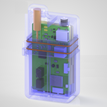

# Compatible Pumps

AAPS works with a number of insulin pumps. The following list shows the currently supported devices. Skliaustuose nurodyta, ar AAPS su pompa ryšį palaiko per telefono Bluetooth funkciją, ar jam reikia RileyLink suderinamo įrenginio.

<!-- List of hidden pages to avoid overcrowding the menu -->

```{toctree}
:hidden:

../CompatiblePumps/Accu-Chek-Combo-Pump-v2.md
../CompatiblePumps/Accu-Chek-Insight-Pump.md
../CompatiblePumps/CareLevo.md
../CompatiblePumps/DanaR-Insulin-Pump.md
../CompatiblePumps/DanaRS-Insulin-Pump.md
../CompatiblePumps/DiaconnG8.md
../CompatiblePumps/EOPatch2.md
../CompatiblePumps/Equil5.3.md
../CompatiblePumps/MedtronicPump.md
../CompatiblePumps/MedtrumNano.md
../CompatiblePumps/OmnipodDASH.md
../CompatiblePumps/OmnipodEros.md
../CompatiblePumps/Future-possible-Pump-Drivers.md
```

- [Accu-Chek Combo](../CompatiblePumps/Accu-Chek-Combo-Pump-v2.md) (Bluetooth; taip pat žr. [Patarimai kasdieniam naudojimui](#combov2-tips-for-basic-usage))
- [Accu-Chek Insight](../CompatiblePumps/Accu-Chek-Insight-Pump.md) (Bluetooth)
- [CareLevo](../CompatiblePumps/CareLevo.md) (Bluetooth)
- [DanaR](../CompatiblePumps/DanaR-Insulin-Pump.md) (Bluetooth)
- [DanaRS](../CompatiblePumps/DanaRS-Insulin-Pump.md) (Bluetooth)
- [Dana-i](../CompatiblePumps/DanaRS-Insulin-Pump.md) (Bluetooth)
- [Dana-i2](../CompatiblePumps/DanaRS-Insulin-Pump.md) (Bluetooth)
- [Diaconn G8](../CompatiblePumps/DiaconnG8.md) (Bluetooth)
- [EOPatch2](../CompatiblePumps/EOPatch2.md) (Bluetooth)
- [Equil 5.3](../CompatiblePumps/Equil5.3.md) (Bluetooth)
- Kai kurios senesnės [Medtronic](../CompatiblePumps/MedtronicPump.md) pompos (joms reikia [papildomo ryšio įrenginio](#CompatiblePumps-additional-communication-device))
- [Medtrum Nano 200U](../CompatiblePumps/MedtrumNano.md) (Bluetooth)
- [Medtrum 300U](../CompatiblePumps/MedtrumNano.md) (Bluetooth)
- [Omnipod DASH](../CompatiblePumps/OmnipodDASH.md) (Bluetooth)
- [Omnipod Eros](../CompatiblePumps/OmnipodEros.md) (reikia [papildomo ryšio įrenginio](#CompatiblePumps-additional-communication-device))

## My pump is not listed

Kitų pompų, kurios ateityje galėtų veikti su AAPS, būsena aprašyta puslapyje [Ateities (galimos) pompų tvarkyklės](../CompatiblePumps/Future-possible-Pump-Drivers.md).

(CompatiblePumps-additional-communication-device)=
## Additional communication device

Jei papildomas ryšio įrenginys nenurodytas, insulino pompa su **AAPS** susisiekia per integruotą Android Bluetooth dalį. Papildomo įrenginio, kuris verstų ryšio protokolą, nereikia.

Senoms Medtronic pompoms ir Omnipod Eros reikia papildomo ryšio įrenginio (be jūsų telefono), kuris „verstų“ pompos radijo signalą į Bluetooth. Įrenginys turi naudoti tą patį radijo dažnį kaip jūsų pompa:

- **Omnipod Eros**: 433 MHz.
- **Medtronic**: 916 MHz – JAV ir Kanadoje parduodamoms pompoms, 868 MHz – kitur parduodamoms pompoms. Žr. [Kaip sužinoti, kokį dažnį naudoja mano pompa](#MedtronicPump-faq).

Galimi ryšio įrenginiai:

-   [OrangeLink svetainė](https://getrileylink.org/product/orangelink)
-  [433MHz RileyLink](https://getrileylink.org/product/rileylink433)
-   [Emalink svetainė](https://github.com/sks01/EmaLink) - [Kontaktai](mailto:getemalink@gmail.com)
-   DiaLink - [Kontaktai](mailto:Boshetyn@ukr.net)
-   [LoopLink svetainė](https://www.getlooplink.org/) - [Kontaktai](https://jameswedding.substack.com/) - Neišbandyta