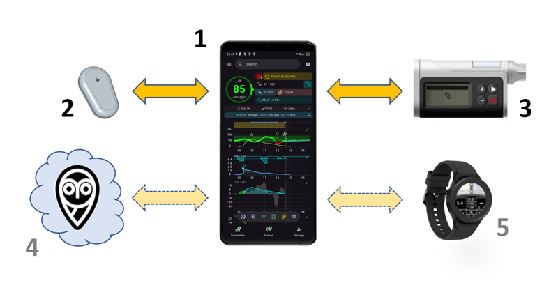
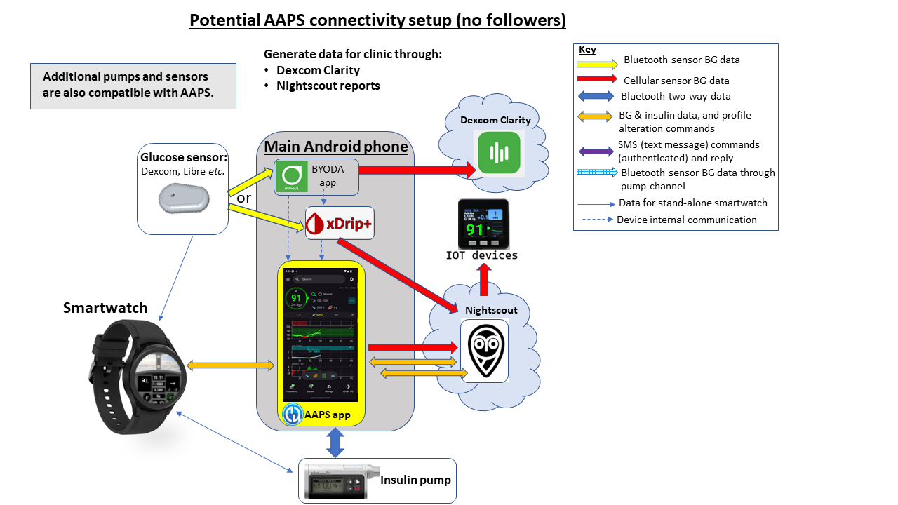
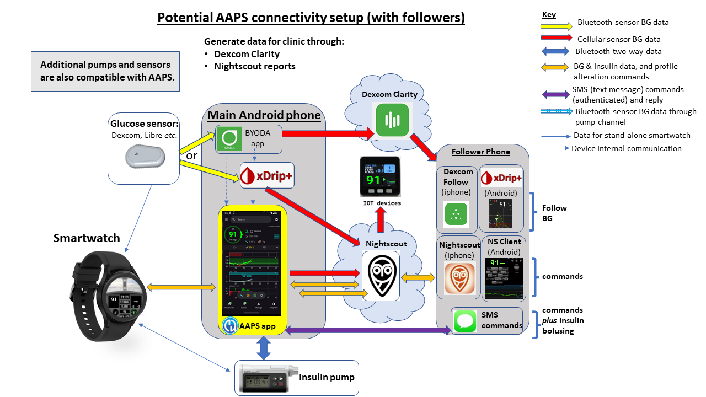

# Introduction to APS and AAPS

```{contents} In this page
:backlinks: entry
:depth: 2
```

## What is an “Artificial Pancreas System”?

A human pancreas does a lot of things besides regulating blood sugar. Tačiau terminas **„dirbtinės kasos sistema“ (APS)** paprastai reiškia sistemą, kuri automatiškai palaiko gliukozės kiekį kraujyje sveikose ribose.

Paprasčiausias būdas tai daryti – matuoti **gliukozės kiekį**, pagal šias vertes atlikti **skaičiavimus** ir tada į organizmą tiekti (prognozuojamą) tinkamą **insulino** kiekį. Ji kartoja skaičiavimą kas kelias minutes, visą parą, kiekvieną dieną. Ji naudoja **aliarmus** ir **perspėjimus**, kad praneštų naudotojui, kai reikia įsikišti arba atkreipti dėmesį. Tokią sistemą paprastai sudaro **gliukozės jutiklis**, **insulino pompa** ir **valdymo įrenginys**, kuris atlieka skaičiavimus. **AAPS** ir kitose atvirojo kodo sistemose valdymo įrenginys yra telefono programėlė. Daugumoje komercinių sistemų tai yra pačioje pompoje įdiegta programinė įranga, o telefono programėlė daugiausia naudojama duomenims rodyti ir valdyti.

For background on how closed-loop systems developed and how they work, this 2022 review article is a good starting point. Bear in mind it predates most of the systems available today, so it is not a guide to what is currently on the market:

 [Closed-Loop Insulin Delivery Systems: Past, Present, and Future Directions](https://www.frontiersin.org/journals/endocrinology/articles/10.3389/fendo.2022.919942/full) (Templer, _Frontiers in Endocrinology_, 2022).

Vadinamosios „dviejų hormonų“ sistemos kartu su insulinu tiekia gliukagoną. Jų tikslas – išvengti sunkių hipoglikemijų ir dar tiksliau valdyti gliukozės kiekį kraujyje. Pirmoji tokio tipo sistema patvirtinta Europoje, bet ji tiekiama tik per tyrimus ir projektus, o kitos dar kuriamos. None is on general sale yet.

Dirbtinę kasą galima įsivaizduoti kaip [„jūsų diabeto autopilotą“](https://www.artificialpancreasbook.com/). What does that mean?

In an aircraft, an autopilot does not do the complete job of the human pilot, the pilot cannot sleep through the entire flight. The autopilot aids the work of the pilot. It relieves them of the burden of constantly having to manage the aircraft, allowing the pilot to concentrate on wider monitoring. Autopilotas gauna signalus iš įvairių jutiklių, kompiuteris įvertina duomenis kartu su piloto nurodymais, tada atlieka reikalingus pakeitimus ir perspėja pilotą apie bet kokias problemas. Pilotui nebereikia nuolat priimti sprendimų. Šią analogiją galima pritaikyti ir **AAPS**.


(Introduction-what-does-hybrid-closed-loop-mean)=
## What does hybrid closed loop mean?

Geriausias sprendimas 1 tipo diabetui būtų „funkcinis išgydymas“ (tikriausiai kasos ląstelių implantas, apsaugotas nuo imuninės sistemos). Kol 1 tipo diabetu sergančiųjų (T1D) bendruomenė to laukia, „visiškai uždaro ciklo“ dirbtinė kasa tikriausiai yra kitas geriausias sprendimas. Tai technologinė sistema, kuriai nereikia jokių naudotojo veiksmų (pvz., suleisti bolusą valgant ar pranešti apie fizinį krūvį) ir kuri gerai reguliuoja gliukozės kiekį kraujyje. Beveik kiekviena kasdien naudojama sistema yra „hibridinis“ uždaras ciklas, nes ji derina automatines technologijas ir naudotojo veiksmus. Pirmosios visiškai uždaro ciklo sistemos Europoje patvirtintos 2026 m., bet kol kas nė viena nėra plačiai prieinama.

## How and why did looping start?

The development of commercial technology for people with type 1 diabetes (T1D) is very slow. In 2013 the T1D community founded the #WeAreNotWaiting movement. Jie patys sukūrė sistemas iš esamų patvirtintų technologijų (insulino pompų ir jutiklių), kad pagerintų gliukozės kontrolę, saugumą ir gyvenimo kokybę. Jos vadinamos OS-AID (Open-Source Automated Insulin Delivery – atvirojo kodo automatinio insulino tiekimo) sistemomis (anksčiau – DIY, „pasidaryk pats“ sistemos), nes jų oficialiai nėra patvirtinusios sveikatos institucijos (FDA, NHS ir kt.). Yra keturios pagrindinės OS-AID sistemos: [OpenAPS](https://openaps.org/what-is-openaps/), **AAPS**, [Loop](https://loopkit.github.io/loopdocs/#what-is-loop) ir [Trio](https://triodocs.org).

Puikus būdas suprasti OS-AID ciklo pagrindus – perskaityti Danos Lewis knygą „Automated Insulin Delivery“. Ją galite nemokamai perskaityti [čia](https://www.artificialpancreasbook.com/) (arba nusipirkti spausdintą knygą). Jei norite daugiau sužinoti apie [OpenAPS](https://openaps.org/what-is-openaps/), iš kurios išsivystė **AAPS**, puikus šaltinis yra [OpenAPS svetainė](https://openaps.org/what-is-openaps/).

Several commercial hybrid closed loop systems have also been launched. Jos labai skiriasi nuo OS-AID sistemų, daugiausia todėl, kad daugelis jų turi „besimokantį algoritmą“, kuris koreguoja tiekiamo insulino kiekį pagal jūsų ankstesnių dienų insulino poreikį. Many people in the OS-AID community have already tried out commercial systems and compared them with their OS-AID system. Daugiau apie tai, kaip skirtingos sistemos skiriasi viena nuo kitos, galite sužinoti paklausę šioms sistemoms skirtose Facebook grupėse, [AAPS Facebook grupėje](https://www.facebook.com/groups/AndroidAPSUsers/) arba [Discord](https://discord.com/invite/4fQUWHZ4Mw).

## What is Android APS (AAPS)?



**Figure 1**. Basic outline of the Android APS (Artificial Pancreas System), AAPS.

Android APS (**AAPS**) yra hibridinio uždaro ciklo sistema, arba dirbtinės kasos sistema (APS). Insulino dozes ji apskaičiuoja naudodama patikrintus [OpenAPS](https://openaps.org/) algoritmus (taisyklių rinkinį), kuriuos sukūrė #WeAreNotWaiting T1D bendruomenė.

Kadangi OpenAPS suderinama tik su kai kuriomis senesnėmis insulino pompomis, **AAPS** (kurią galima naudoti su daugiau insulino pompų) pirmą kartą buvo sukurta 2016 m. vienam šeimos nariui, sergančiam 1 tipo diabetu. Nuo tų pirmųjų dienų **AAPS** nuolat kuria ir tobulina savanorių programuotojų ir kitų entuziastų komanda, susijusi su 1 tipo diabeto pasauliu. Today, **AAPS** is used by many thousands of people worldwide. Tai labai lanksčiai pritaikoma ir universali sistema, o kadangi ji yra atvirojo kodo, ji lengvai suderinama su daugeliu kitų atvirojo kodo diabeto programų ir platformų. Pagrindinės dabartinės **AAPS** sistemos sudedamosios dalys parodytos aukščiau esančiame **1 paveiksle**.


## What are the basic components of AAPS?

AAPS „smegenys“ yra **programėlė**, kurią susikuriate patys. There are detailed step-by-step instructions for this. Tada **AAPS programėlę** įdiegiate [suderinamame](../Getting-Started/Phones.md) **Android telefone** (**1**). A number of users prefer their loop on a separate phone to their main phone. So, you don’t necessarily have to be using an Android phone for everything else in your life, just for running your AAPS loop.

Be **AAPS**, **Android telefone** taip pat reikės įdiegti dar vieną programėlę. Ši [papildoma programėlė](../Getting-Started/CompatiblesCgms.md) per Bluetooth gauna gliukozės duomenis iš jutiklio (**2**) ir telefono viduje perduoda juos **AAPS programėlei**.

**AAPS programėlė** naudoja OpenAPS sprendimų priėmimo procesą (**algoritmą**). Pradedantieji naudoja pagrindinį **oref0** algoritmą, bet įgiję daugiau patirties su AAPS galite pereiti prie naujesnio **oref1** algoritmo. Kurį algoritmą naudoti (oref0 ar oref1), priklauso nuo to, kuris geriau tinka jūsų situacijai.  Abiem atvejais algoritmas atsižvelgia į daug veiksnių ir greitai atlieka skaičiavimus kaskart, kai iš jutiklio gaunamas naujas rodmuo. Tada algoritmas per Bluetooth siunčia insulino pompai (**3**) nurodymus, kiek insulino tiekti. Visą informaciją per mobiliuosius duomenis arba Wi-Fi galima siųsti į internetą (**4**). Jei norite, šiais duomenimis taip pat galima dalytis su sekėjais ir (arba) juos rinkti analizei. Jei norite, su telefonu taip pat galite susieti [išmanųjį laikrodį](../Getting-Started/Watches.md) (**5**), kad vienu žvilgsniu matytumėte savo duomenis, o kai kuriais laikrodžiais – siųstumėte pagrindines komandas į **AAPS**.

## What are the advantages of the AAPS system?

**AAPS** naudojamas OpenAPS algoritmas valdo gliukozės kiekį kraujyje be naudotojo veiksmų, pagal naudotojo nustatytus parametrus (svarbiausi iš jų – valandinė bazė, jautrumo insulinui faktorius, insulino ir angliavandenių santykis, insulino veikimo trukmė ir kt.), ir kas 5 minutes reaguoja į naujus jutiklio duomenis.

Kai kurie nurodomi **AAPS** naudojimo privalumai – daug tiksliai derinamų parinkčių, **automatizacijos** ir didesnis sistemos skaidrumas pacientui ar globėjui. Tai gali padėti geriau valdyti jūsų diabetą (arba žmogaus, kuriuo rūpinatės), o tai savo ruožtu gali pagerinti gyvenimo kokybę ir suteikti daugiau ramybės.

Jei skirsite tam laiko, **AAPS** gali padėti:

- sumažinti 1 tipo diabeto valdymo stresą ir naštą;

- sumažinti daugybę kasdienių smulkių sprendimų, kuriuos tenka priimti dėl 1 tipo diabeto;

- gauti asmeninį ir dinamišką insulino dozavimą pagal realaus laiko duomenis, todėl rečiau reikės gydyti hipoglikemiją ir bus mažiau hiperglikemijos epizodų;

- geriau išmanyti insulino valdymą ir drąsiau tiksliai derinti savo nustatymus;

- kurti automatinius nustatymus (**automatizacijas**), pritaikytus jūsų gyvenimo būdui;

- geriau miegoti ir rečiau keltis naktį ką nors daryti;

- 1 tipo diabetu sergančių žmonių globėjams – nuotoliniu būdu stebėti ir valdyti insulino tiekimą; ir

- supaprastinti visą nešiojamą diabeto įrangą (nuolatinio gliukozės matuoklio imtuvą ir insulino valdymo įrenginius), naudojant Android telefoną, kurį valdo **AAPS**.


Galiausiai **AAPS** gali suteikti žmonėms galių geriau valdyti savo diabetą, todėl gliukozės kiekis kraujyje būna stabilesnis, o ilgalaikė sveikata – geresnė.

### Specific advantages include:

#### 1) Įdiegtas saugumas
Jei norite paskaityti apie algoritmų, vadinamų oref0 ir oref1, saugumo funkcijas, [spauskite čia](https://openaps.org/reference-design/). Naudotojas pats valdo savo saugumo apribojimus.

#### 2) Įrangos lankstumas

**AAPS** veikia su daugeliu insulino pompų ir jutiklių ir yra lanksti, kai gyvenimas keičiasi. Pavyzdžiui, jei atsirado alergija Dexcom jutiklio pleistro klijams, galite pereiti prie Libre jutiklio. Naudotojams nereikia iš naujo kurti ar diegti **AAPS** programėlės – norint pakeisti įrangą, tereikia skiltyje **Konfigūracija** pasirinkti kitą pompą ar glikemijos šaltinį. **AAPS** nepriklauso nuo konkrečių pompų tvarkyklių, be to, turi „virtualią pompą“, todėl naudotojai gali saugiai eksperimentuoti, prieš naudodami ją su savimi.

#### 3) Labai plačiai pritaikoma, su plačiais parametrais

Naudotojai gali lengvai pridėti ar pašalinti modulius ar funkcijas, o **AAPS** galima naudoti ir atviro, ir uždaro ciklo režimu. Here are some examples of the possibilities with the **AAPS** system:

 a) Galimybė 30 min. prieš valgį nustatyti žemesnį **KG** tikslą; tikslą galima nustatyti net iki 72 mg/dl (4,0 mmol/l).

 b) Jei turite atsparumą insulinui ir dėl to aukštą gliukozės kiekį, **AAPS** leidžia sukurti **automatizacijos** taisyklę, kuri įsijungia, kai KG pakyla virš 8 mmol/l (144 mg/dl), ir perjungia, pavyzdžiui, į 120 % profilį (tada valandinė bazė padidėja 20 % ir sustiprėja kiti veiksniai, palyginti su įprastu **profilio** nustatymu). Automatizacija veiks tiek laiko, kiek nustatysite. Tokią automatizaciją galima nustatyti taip, kad ji veiktų tik tam tikromis savaitės dienomis, tam tikru paros metu ir net tam tikrose vietose.

 c) Jei jūsų vaikas netikėtai šokinėja ant batuto, **AAPS** leidžia sustabdyti insulino tiekimą nustatytam laikui tiesiai iš telefono.

 d) Vėl prijungus pompą su vamzdeliu, kuri buvo atjungta plaukimo metu, **AAPS** apskaičiuos bazinį insuliną, kurio negavote, kol pompa buvo atjungta, ir atsargiai jį suleis pagal dabartinę KG. Nereikalingą insuliną galima atsisakyti tiesiog „atšaukus“ praleistą valandinę bazę.

 e) **AAPS** leidžia nustatyti skirtingus profilius skirtingoms situacijoms ir lengvai tarp jų perjungti. Pavyzdžiui, funkcijas, kurios padeda algoritmui greičiau sumažinti padidėjusią KG (pvz., supermikrobolusai („**SMB**“) ir nedeklaruotas maistas („**NDM**“)), galima nustatyti taip, kad jos veiktų tik dieną, jei nerimaujate dėl naktinių hipoglikemijų.

Tai tik pavyzdžiai. Visos funkcijos suteikia didelį lankstumą kasdieniame gyvenime, įskaitant sportą, ligą, hormonų ciklus _ir kt._ Ultimately, it is for the user to decide how to use this flexibility, and there is no one-size-fits-all automation for this.

#### 4) Remote monitoring
Yra keli galimi stebėjimo kanalai (Sugarmate, Dexcom Follow, xDrip, Android Auto _ir kt._). Jie naudingi tėvams, globėjams ir suaugusiesiems tam tikrose situacijose (miegant, vairuojant), kai reikia pritaikomų perspėjimų. Kai kuriose programėlėse (xDrip) aliarmus galima visiškai išjungti. Tai labai patogu, kai naujas jutiklis dar „įsigeria“ ar nusistovi ir dar nenorite su juo naudoti ciklo.

#### 5) Nuotolinis valdymas
Svarbus **AAPS** pranašumas prieš komercines sistemas – sekėjai gali siųsti daug įvairių komandų atgal į **AAPS** sistemą patvirtintomis tekstinėmis (SMS) komandomis arba susieta **AAPSClient** programėle. Šią funkciją labai plačiai naudoja tėvai, kurių vaikai serga 1 tipo diabetu ir naudoja **AAPS**.

Nuotolinio valdymo funkcijos gali būti labai naudingos, pavyzdžiui, žaidimų aikštelėje, kai norite iš savo telefono suleisti išankstinį bolusą užkandžiui, o jūsų vaikas užsiėmęs žaidimu. Sistemą taip pat galima stebėti išmaniuoju laikrodžiu (_pvz._, Garmin) arba siųsti iš jo pagrindines komandas (_pvz._, Wear OS laikrodžiu, tokiu kaip Samsung Galaxy Watch).

#### 6) Jokių komercinių apribojimų dėl atvirų programų sąsajų
Be atvirojo kodo požiūrio, kuris leidžia bet kada peržiūrėti **AAPS** išeities kodą, bendras atvirų programavimo sąsajų principas suteikia galimybę ir kitiems kūrėjams prisidėti naujomis idėjomis. **AAPS** glaudžiai integruota su Nightscout. This accelerates development and allows users to add on features to make life with diabetes even more convenient. Geri tokių integracijų pavyzdžiai yra [Nightscout](https://nightscout.github.io/), [Nightscout Reporter](https://nightscout-reporter.zreptil.de/), xDrip, [M5 stack](https://github.com/mlukasek/M5_NightscoutMon/wiki) ir kt. There is ongoing dialogue between open-source developers and those developing commercial systems. Daugelį OS-AID naujovių palaipsniui perima komercinės sistemos, kuriose kūrimas suprantamai vyksta lėčiau, iš dalies todėl, kad skirtingų įmonių sistemų (pompų, programėlių, jutiklių _ir kt._) sąsajas reikia kruopščiai suderinti ir licencijuoti. Tai taip pat gali lėtinti naujoves, kurios patogios pacientui (arba nedidelei pacientų grupei su labai specifiniais poreikiais), bet neduoda didesnio pelno.

#### 7) Išsami programėlės sąsaja
Su **AAPS** lengva sekti, pavyzdžiui: insulino kiekį pompoje, kaniulės amžių, jutiklio amžių, pompos baterijos amžių, aktyvų insuliną organizme _ir kt._ Daug veiksmų galima atlikti **AAPS** programėlėje (užpildyti pompą, atjungti pompą _ir kt._), o ne pačioje pompoje, todėl pompa gali likti jūsų kišenėje ar ant diržo (arba žmogaus, kuriuo rūpinatės).

#### 8) Accessibility and affordability
**AAPS** suteikia žmonėms, kurie šiuo metu negali patys susimokėti arba neturi finansavimo ar draudimo, prieigą prie hibridinio uždaro ciklo sistemos, kuri savo koncepcija keleriais metais lenkia komercines sistemas. Šiuo metu norint paruošti **AAPS**, reikia ataskaitų serverio (Nightscout arba Tidepool), nors kasdieniam **AAPS** ciklo veikimui jis nebūtinas. Many people continue to use Nightscout for collecting their data, and for remote monitoring. Nors pati **AAPS** yra nemokama, Nightscout paruošimas vienoje iš įvairių platformų gali kainuoti (0–12 €). Tai priklauso nuo to, kokio lygio pagalbos norite (žr. palyginimo lentelę), ir nuo to, ar Nightscout norite naudoti ir po paruošimo. **AAPS** veikia su daugeliu nebrangių (nuo maždaug 150 €) [Android telefonų](https://docs.google.com/spreadsheets/u/1/d/e/2PACX-1vScCNaIguEZVTVFAgpv1kXHdsHl3fs6xT6RB2Z1CeVJ561AvvqGwxMhlmSHk4J056gMCAQE02sAWJvT/pubhtml?gid=683363241&single=true). Yra versijų skirtingoms vietovėms ir kalboms, be to, AAPS gali naudoti ir [neregiai](#accessibility-for-users-aaps-who-are-partially-or-completely-blind).

#### 9) Support
Nė viena automatinio insulino tiekimo sistema nėra tobula. Komercinės ir atvirojo kodo sistemos turi daug bendrų ryšio trikdžių ir laikinų įrangos gedimų. Visame pasaulyje per Facebook, Discord ir GitHub pagalbą teikia AAPS naudotojų bendruomenė, kurios nariai sukūrė, tobulino ir šiuo metu naudoja **AAPS**. Komercinėms APS sistemoms taip pat yra Facebook pagalbos grupių ir klinikų ar gamintojų pagalba. Verta pasikalbėti su šių sistemų naudotojais ar buvusiais naudotojais apie dažnus trikdžius, mokymo programos kokybę ir teikiamos nuolatinės pagalbos lygį.

#### 10) Nuspėjamumas, skaidrumas ir saugumas
**AAPS** yra skaidri, logiška ir nuspėjama, todėl gali būti lengviau suprasti, kada nustatymas neteisingas, ir jį atitinkamai pakoreguoti. Galite tiksliai matyti, ką sistema daro, kodėl ji tai daro, ir nustatyti jos veikimo ribas. Taip valdymas (ir atsakomybė) atsiduria jūsų rankose. This can provide the user with confidence, and a sounder sleep.

#### 11) Prieiga prie pažangių funkcijų kūrimo (dev) versijose, įskaitant visiškai uždarą ciklą
Ši **AAPS** dokumentacija skirta pagrindinei **AAPS** **„master“** atšakai. However, research and development is going on all the time. Patyrę naudotojai gali norėti išbandyti eksperimentines funkcijas **kūrimo (dev)** atšakoje. Kūrimo naujovės skirtos visiškai uždaro ciklo strategijoms (kad nereikėtų leisti boluso valgant _ir kt._) ir apskritai siekia, kad gyvenimas su 1 tipo diabetu būtų kuo patogesnis.

#### 12) Ability to contribute yourself to further improvements
Type 1 diabetes can be highly frustrating and isolating. Having control over your own diabetes tech, with the possibility to “pay it forward” as soon as you are making progress by helping others on their journey can be really rewarding. You can educate yourself, discover the roadblocks and look for, and even contribute, to new developments and the documentation. There will be others in the community with the same quest that you can bounce ideas off and work with. This is the essence of #WeAreNotWaiting.

## How does AAPS compare to MDI and open looping?

Daugkartinės kasdienės injekcijos (MDI, (a) toliau esančiame **2 paveiksle**) paprastai reiškia, kad kartą per dieną leidžiamas ilgai veikiantis insulinas (_pvz._, Tresiba), o valgant ar korekcijai – greičiau veikiantis insulinas (_pvz._, Novorapid, Fiasp). Gydant pompa be ciklo (b), pompa tiekia greitai veikiančio insulino valandinę bazę iš anksto užprogramuotu greičiu, o valgant ar korekcijai bolusai suleidžiami pompa. Ciklo sistemos esmė ta, kad ciklo programėlė naudoja jutiklio gliukozės duomenis ir nurodo pompai sustabdyti insulino tiekimą, kai prognozuoja, kad gliukozė krinta per žemai, ir suleisti papildomo insulino, kai gliukozė kyla ir prognozuojama, kad bus per aukšta (c). Although this figure is oversimplified compared to real-life, it aims to demonstrate the key differences of the approaches. Labai gerą gliukozės kontrolę galima pasiekti bet kuriuo iš šių trijų būdų.


**Figure 2**. Pagrindinė (a) MDI, (b) gydymo pompa atviru ciklu ir (c) gydymo pompa hibridiniu uždaru ciklu apžvalga.

## How does AAPS compare to other looping systems?

2023 m. birželio 25 d. buvo keturios pagrindinės atvirojo kodo uždaro ciklo sistemos: [OpenAPS](https://openaps.readthedocs.io/), **AAPS**, [Loop](https://loopkit.github.io/loopdocs/#what-is-loop) ir [Trio](https://triodocs.org) (anksčiau FreeAPS X). The features of the different systems are shown in the table below:


| Device type | Pavadinimas                                                                     | [AAPS](https://wiki.aaps.app)             | [Ciklas](https://loopkit.github.io/loopdocs/) | [Open APS](https://openaps.readthedocs.io/en/latest/) | [Trio](https://triodocs.org)              |
| ----------- | ------------------------------------------------------------------------------- | ----------------------------------------- | --------------------------------------------- | ----------------------------------------------------- | ----------------------------------------- |
| Phone       | Android                                                                         |      |      |              |  |
| Phone       | iPhone                                                                          |  |          |              |      |
| Rig         | tiny computer (1)                                                               |  |      |                  |  |
| PUMP        | [Dana I](../CompatiblePumps/DanaRS-Insulin-Pump.md)                             |      |          |              |      |
| PUMP        | [Dana RS](../CompatiblePumps/DanaRS-Insulin-Pump.md)                            |      |          |              |      |
| PUMP        | [Dana R](../CompatiblePumps/DanaR-Insulin-Pump.md)                              |      |      |              |  |
| PUMP        | [Omnipod (Dash)](../CompatiblePumps/OmnipodDASH.md)                             |      |          |              |      |
| PUMP        | [Omnipod (Eros)](../CompatiblePumps/OmnipodEros.md)                             |      |          |              |      |
| PUMP        | [Diaconn G8](../CompatiblePumps/DiaconnG8.md)                                   |      |      |              |  |
| PUMP        | [EOPatch 2](../CompatiblePumps/EOPatch2.md)                                     |      |      |              |  |
| PUMP        | [Medtrum TouchCare Nano 200U](../CompatiblePumps/MedtrumNano.md)                |      |          |              |      |
| PUMP        | [Medtrum TouchCare 300U](../CompatiblePumps/MedtrumNano.md)                     |      |          |              |      |
| PUMP        | [Roche Combo](../CompatiblePumps/Accu-Chek-Combo-Pump-v2.md)                    |      |      |              |  |
| PUMP        | [Roche Insight](../CompatiblePumps/Accu-Chek-Insight-Pump.md)                   |      |      |              |  |
| PUMP        | [Senesnės Medtronic](../CompatiblePumps/MedtronicPump.md)                       |      |          |                  |      |
| PUMP        | [Equil 5.3](../CompatiblePumps/Equil5.3.md)                                     |      |      |              |  |
| PUMP        | [CareLevo](../CompatiblePumps/CareLevo.md)                                      |      |      |              |  |
| NGJ         | [Dexcom G7/One+/Stelo](../CompatibleCgms/DexcomG7.md)                           |      |          |              |      |
| NGJ         | [Dexcom One](../CompatibleCgms/DexcomG6.md)                                     |      |          |              |      |
| NGJ         | [Dexcom G6](../CompatibleCgms/DexcomG6.md)                                      |      |          |                  |      |
| NGJ         | [Libre 3/3+](../CompatibleCgms/Libre3.md)                                       |      |          |              |      |
| NGJ         | [Libre 2/2+](../CompatibleCgms/Libre2.md)                                       |      |          |              |      |
| NGJ         | [Libre 1](../CompatibleCgms/Libre1.md)                                          |      |          |              |      |
| NGJ         | [Eversense](../CompatibleCgms/Eversense.md)                                     |      |          |              |      |
| NGJ         | [MM640g/MM630g](../CompatibleCgms/MM640g.md)                                    |      |      |              |  |
| NGJ         | [PocTech](../CompatibleCgms/PocTech.md)                                         |      |      |              |  |
| NGJ         | [Ottai](../CompatibleCgms/OttaiM8.md)                                           |      |      |              |  |
| NGJ         | [Syai Tag](../CompatibleCgms/SyaiTagX1.md)                                      |      |      |              |  |
| NGJ         | [Nightscout kaip glikemijos šaltinis](../CompatibleCgms/CgmNightscoutUpload.md) |      |          |                  |      |

_Table notes:_
1. **Rig** – tai mažas kompiuteris be ekrano, kurį nešiojatės su savimi. Vienas palaikomas įrenginių tipas yra Intel Edison + Explorer Board, kitas – Raspberry Pi + Explorer HAT arba Adafruit RFM69HCW Bonnet. Pirmosios APS sistemos buvo paremtos tokia sąranka, nes mobilieji telefonai negalėjo vykdyti reikalingų algoritmų. Use of these systems has declined, as the setup on mobile phones has become easier, and phones have a display included. Intel has also stopped selling the Intel Edison. Puikūs OpenAPS algoritmai **oref0** ir **oref1** dabar įtraukti į AAPS ir Trio.


Tarptautinį recenzuotą bendro sutarimo pareiškimą su praktiniais patarimais apie atvirojo kodo ciklo sistemas parašė sveikatos priežiūros specialistai, ir jis skirtas jiems patiems. Jis paskelbtas pirmaujančiame medicinos žurnale 2022 m.: [_Lancet Diabetes Endocrinol_, 2022; 10: 58–74](https://www.ncbi.nlm.nih.gov/pmc/articles/PMC8720075/)(_1_). Jį tikrai verta perskaityti (taip pat ir jūsų diabeto klinikai). Jame apibendrinti pagrindiniai techniniai skirtumai tarp įvairių atvirojo kodo hibridinio uždaro ciklo sistemų.

It is hard to get a “feel” for any system without using it, or talking to others who are using it, so do reach out to others on Facebook/Discord and ask. Dauguma žmonių mano, kad **AAPS** yra nepaprastai pažangi, palyginti su kitomis hibridinio uždaro ciklo sistemomis (ypač komercinėmis), ir turi labai daug pritaikomų nustatymų ir funkcijų, aptartų aukščiau. Some people can find this a little overwhelming at the beginning, but there is no rush to investigate all the possibilities at once. You can progress as slowly or as fast as you would like, and there is help available at every step of the way.


## Ar AAPS naudoja dirbtinį intelektą ar kokį nors besimokantį algoritmą?

Dabartinė **AAPS** versija (4.0) neturi jokių mašininio mokymosi algoritmų, kelių parametrų insulino atsako modelių ar dirbtinio intelekto. As such, the system is open and transparent in how it works, and has the ability to be understood not just by experts, but also by clinicians and patients. Tai taip pat reiškia, kad jei jūsų dienotvarkė labai keičiasi (pvz., po įtemptos darbo savaitės prasideda ramios atostogos) ir jums greičiausiai reikės gerokai kitokio insulino kiekio, galite iš karto perjungti **AAPS** į silpnesnį ar stipresnį pritaikytą profilį. „Besimokanti sistema“ šį koregavimą atliks už jus automatiškai, bet insulino tiekimą ji greičiausiai pakoreguos lėčiau.

(which-system-is-right-for-me-or-my-dependent)=
## Which system is right for me or someone I am caring for?

Praktiškai sistemos pasirinkimą dažnai riboja tai, kokią pompą jau turite arba galite gauti iš savo sveikatos priežiūros įstaigos, ir koks jūsų telefonas (Apple ar Android). If you don’t yet have a pump you have the biggest choice of systems. Technology is continually evolving, pumps are being discontinued and new pumps and sensors are being released. Dauguma atvirojo kodo sistemų veikia su pagrindiniais jutikliais (Libre ir Dexcom) arba greitai pritaikomos naujiems jutikliams maždaug per metus po jų pasirodymo (šiek tiek laiko reikia saugumo ir stabilumo bandymams).

Dauguma **AAPS** naudotojų praneša apie ilgesnį laiką tikslo intervale, sumažėjusį HbA1c ir geresnę gyvenimo kokybę, nes sistema gali naktį miegant automatiškai koreguoti valandinę bazę. Tai galioja daugumai hibridinio uždaro ciklo sistemų. Kai kurie žmonės renkasi labai paprastą, mažai pritaikomą sistemą (tada jums gali labiau tikti komercinė sistema), o kitus toks kontrolės trūkumas labai erzina (tada jums gali labiau tikti atvirojo kodo sistema). Jei diabetas jums (ar žmogui, kuriuo rūpinatės) diagnozuotas neseniai, dažnas kelias – pirmiausia priprasti prie MDI su gliukozės jutikliu, tada pereiti prie pompos, kurią galima naudoti cikle, ir tada prie **AAPS**. Tačiau kai kurie žmonės (ypač maži vaikai) gali iš karto pradėti nuo pompos.

Svarbu žinoti, kad **AAPS** naudotojas turi pats aktyviai ieškoti ir šalinti problemas, padedamas bendruomenės. This is a very different mindset to that when using a commercial system. Su **AAPS** naudotojas turi daugiau kontrolės, bet ir daugiau atsakomybės, ir turi jaustis su tuo gerai.

## Ar saugu naudoti atvirojo kodo sistemas, tokias kaip AAPS?

### AAPS sistemos saugumas
Tikslesnis klausimas tikriausiai būtų: „ar ji saugi, **palyginti** su mano dabartine insulino tiekimo sistema?“, nes joks insulino tiekimo būdas nėra be rizikos. **AAPS** turi daug patikrų ir apsaugų. Neseniai paskelbtame [straipsnyje](https://www.liebertpub.com/doi/epub/10.1089/dia.2019.0375) nagrinėtas **AAPS** naudojimas kompiuteriu imituotoje aplinkoje. Tai buvo veiksmingas būdas objektyviai patikrinti, kiek sistema saugi ir veiksminga. Apskritai tūkstančiai žmonių visame pasaulyje naudoja atvirojo kodo automatinio insulino tiekimo sistemas, ir jų vis daugėja.

Bet kurį įrenginį, kuris naudoja radijo ryšį, galima įsilaužti. Tai galioja ir insulino pompai be ciklo. Šiuo metu mums nežinoma, kad kas nors būtų bandęs pakenkti žmonėms įsilauždamas į jų su diabetu susijusią medicinos įrangą. Vis dėlto nuo tokios rizikos galima apsisaugoti keliais būdais:

1.  Pompos nustatymuose apribokite ir maksimalų leidžiamą bolusą, ir maksimalią laikiną valandinę bazę iki kiekių, kurie, jūsų manymu, yra saugiausi. Tai griežtos ribos, kurių, mūsų manymu, joks piktavalis įsilaužėlis negalėtų apeiti.

2.  Įjunkite NGJ aliarmus ir aukštai, ir žemai gliukozei.

3.  Stebėkite insulino tiekimą internetu. Nightscout naudotojai gali nustatyti papildomus aliarmus, kurie perspėja apie įvairias situacijas, įskaitant tas, kurios pasitaiko daug dažniau nei piktavališka ataka. Be aukštos ir žemos gliukozės, Nightscout gali rodyti diagnostinius duomenis, kurie padeda patikrinti, ar pompa veikia kaip reikia, įskaitant dabartinį AIO, pompos laikinų valandinių bazių istoriją ir pompos bolusų istoriją. Jį taip pat galima nustatyti taip, kad iš anksto perspėtų naudotojus apie nepageidaujamas situacijas, pavyzdžiui, prognozuojamą aukštą ir žemą gliukozę, mažai insulino rezervuare ir senkančią pompos bateriją.

Jei jūsų insulino pompa būtų piktavališkai atakuota, šios priemonės gerokai sumažintų riziką. Kiekvienas būsimas **AAPS** naudotojas turi pasverti **AAPS** naudojimo riziką ir kitos sistemos naudojimo riziką.

#### Saugumas, kai gliukozės kontrolė gerinama per greitai

Greitas HbA1c sumažėjimas ir geresnė gliukozės kontrolė skamba patraukliai. Tačiau kai pradėjus naudoti bet kurią uždaro ciklo sistemą vidutinis gliukozės kiekis kraujyje sumažinamas _per greitai_, tai gali sukelti nuolatinę žalą, įskaitant akių pažeidimus, ir skausmingą neuropatiją, kuri niekada nepraeina. Šios žalos galima išvengti tiesiog mažinant gliukozės kiekį lėčiau. Jei šiuo metu jūsų HbA1c yra padidėjęs ir pereinate prie AAPS (ar bet kurios kitos uždaro ciklo sistemos), prieš pradėdami aptarkite šią galimą riziką su savo gydymo komanda ir kartu susitarkite dėl laiko plano. Daugiau bendros informacijos, kaip saugiai sumažinti gliukozės kiekį, įskaitant nuorodas į medicininę literatūrą, rasite saugumo skyriuje [čia](#preparing-safety-first).

#### Medicininis saugumas: prietaisai, eksploatacinės medžiagos ir kiti vaistai

Dirbtinės kasos ciklui naudokite išbandytą, visiškai veikiančią, FDA arba CE patvirtintą insulino pompą ir NGJ. Šių komponentų aparatinės ar programinės įrangos pakeitimai gali sukelti netikėtą insulino tiekimą ir taip sukelti didelę riziką vartotojui. Jei rastumėte ar jums būtų pasiūlyta sugedusi, modifikuota ar pačių pagaminta insulino pompa ar NGJ imtuvas, nenaudokite jų AAPS sistemai.

Naudokite originalias eksploatacines medžiagas, pavyzdžiui, įvediklius, kaniules ir insulino talpykles, patvirtintas jūsų pompos ir NGJ gamintojo. Nepatikrintos ar pakeistos priemonės gali lemti netikslius NGJ rodmenis ir insulino dozavimo klaidas. Netinkamai dozuojamas insulinas yra labai pavojingas – nežaiskite savo gyvybe keisdami eksploatacines medžiagas.

Nevartokite SGLT-2 inhibitorių (gliflozinų), kai naudojate **AAPS**, nes jie neapskaičiuojamai mažina gliukozės kiekį kraujyje. Derinti šį poveikį su sistema, kuri mažina valandinę bazę, kad padidintų KG, yra pavojinga. Daugiau apie tai rasite pagrindiniame [saugumo skyriuje](#preparing-safety-first).

(introduction-how-can-i-approach-discussing-aaps-with-my-clinical-team)=
## How can I approach discussing AAPS with my clinical team?

Naudotojams patariama pasikalbėti su savo gydytojais apie ketinimą naudoti **AAPS**. Nebijokite atvirai pasikalbėti su savo diabeto komanda, jei ketinate naudoti **AAPS** (ar bet kurį kitą OS-AID ciklą). Transparency and trust between patient and doctor is paramount.

### Suggested approach:
Pradėkite pokalbį su gydytoju ir sužinokite, kiek jis išmano diabeto technologijas, tokias kaip NGJ, pompos, hibridiniai ciklai ir komercinės ciklo sistemos, ir kaip jas vertina. Jūsų gydytojas ar endokrinologas turėtų išmanyti pagrindines technologijas ir norėti su jumis aptarti naujausius jo regione prieinamų komercinių ciklo sistemų pasiekimus.

#### Vietos patirtis

Sužinokite, ką jūsų gydytojai ar endokrinologai mano apie OS-AID ciklą, _palyginti su_ komercinėmis ciklo sistemomis, ir įvertinkite, kiek jie apie tai žino. Ar jie žino **AAPS** ir ar gali pasidalyti naudinga darbo su OS-AID ciklą naudojančiais pacientais patirtimi?

Paklauskite, ar jūsų komanda gydo pacientų, kurie jau naudoja OS-AID ciklą. Dėl pacientų konfidencialumo gydytojai negali perduoti jums kitų pacientų duomenų be to žmogaus sutikimo. Tačiau jei norite, **galite** paprašyti perduoti **jūsų** kontaktus OS-AID ciklą naudojančiam pacientui, jei gydytojas mano, kad jūs galite „sutarti“. Pasakykite, kad būtumėte patenkinti, jei tas pacientas su jumis susisiektų aptarti OS-AID ciklo. Gydytojai neprivalo to daryti, bet kai kurie tai daro mielai, nes supranta, kaip svarbi tarpusavio parama valdant 1 tipo diabetą. You may also find it useful to meet local friendly OS-AID loopers. This is of course up to you, and not entirely necessary.

#### Nacionalinė ir tarptautinė patirtis

Jei jaučiate, kad jūsų gydymo komanda nepalaiko jūsų ketinimo naudoti **AAPS**, gali padėti šie argumentai:

a) **AAPS** sistemą sukūrė PATYS pacientai ir jų globėjai. Ji pirmiausia sukurta saugumui, bet taip pat remiasi gilia pacientų patirtimi. There are many thousands of **AAPS** users worldwide. Todėl tikėtina, kad tarp jūsų klinikos pacientų yra ir kitų, naudojančių OS-AID ciklą (nesvarbu, ar klinika apie tai žino, ar ne).

b) Naujausios recenzuotos gairės, paskelbtos pasaulyje pirmaujančiame medicinos žurnale [The Lancet](https://www.ncbi.nlm.nih.gov/pmc/articles/PMC8720075/pdf/nihms-1765784.pdf)(_1_), patvirtino, kad OS-AID ciklai yra **saugūs** ir **veiksmingai gerina diabeto kontrolę**, įskaitant laiką tikslo intervale. Pirmaujančiuose žurnaluose, pavyzdžiui, [Nature](https://doi.org/10.1038/d41586-023-02648-9)(_3_), reguliariai pasirodo straipsnių, kuriuose aprašoma OS-AID ciklo bendruomenės pažanga.

c) Pradedant naudoti **AAPS**, _palaipsniui_ pereinama nuo gydymo pompa „atviru“ ciklu, per sustabdymą esant žemai glikemijai, iki hibridinio „uždaro“ ciklo, įvykdant kelis mokymo etapus. Todėl yra struktūruota programa, kurioje naudotojas kiekviename etape turi parodyti tam tikrą kompetenciją ir sureguliuoti pagrindinius nustatymus (valandinę bazę, JIF ir IA), prieš uždarydamas ciklą.

d) Techninę pagalbą jums gali suteikti OS-AID bendruomenė per GitHub, Discord ir uždaras Facebook grupes.

e) Gydytojo vizitų metu galėsite pateikti **ir NGJ, ir insulino tiekimo ciklu ar pompa informaciją** bendrose ataskaitose (per Nightscout arba Tidepool), atspausdintas arba ekrane (jei atsinešite nešiojamąjį kompiuterį ar planšetę). Kai NGJ ir insulino duomenys pateikiami kartu, gydytojas gali efektyviau panaudoti savo laiką jūsų ataskaitoms peržiūrėti ir lengviau įvertinti jūsų pažangą.

f) Jei jūsų gydymo komanda vis dar tvirtai prieštarauja, duokite gydytojui atspausdintus čia tekste nurodytus straipsnius ir nuorodą į **AAPS** skyrių gydytojams: [Gydytojams – bendras **AAPS** įvadas ir vadovas](../UsefulLinks/ClinicianGuideToAaps.md)

#### Support for OS-AID looping by other clinicians

Straipsnyje, paskelbtame žurnale [Lancet Diabetes Endocrinology](https://www.ncbi.nlm.nih.gov/pmc/articles/PMC8720075/)(_1_) (jo rengimui kartu vadovavo King’s ir Guy’s and St Thomas’ NHS Foundation Trust bei dr. Sufyan Hussain, konsultantas diabetologas ir King’s (Londonas) garbės vyresnysis lektorius), pateikiama:

a) **Patikinimas** specialistams, kad OS-AID dirbtinės kasos sistemos / atvirasis kodas yra „saugus ir veiksmingas gydymo“ būdas 1 tipo diabetui, ir patarimai dėl rekomendacijų, pokalbių, paramos, dokumentacijos;

b) **Pripažinimas**, kad atvirojo kodo automatinio insulino tiekimo („AID“) sistemos gali pailginti laiką tikslo intervale (TIR) ir sumažinti gliukozės koncentracijos kraujyje svyravimus bei hipo- ir hiperglikemijos epizodų skaičių įvairiose amžiaus grupėse, tarp lyčių ir bendruomenėse;

c) **Rekomendacija**, kad sveikatos priežiūros darbuotojai turėtų **palaikyti** 1 tipo diabetu sergančius pacientus ar jų globėjus, kurie diabetą nusprendė valdyti atvirojo kodo AID sistema;

d) Rekomendacija, kad sveikatos priežiūros darbuotojai turėtų stengtis sužinoti apie visas gydymo galimybes, kurios gali būti naudingos pacientams, įskaitant prieinamas atvirojo kodo AID sistemas.  Jei sveikatos priežiūros specialistai neturi išteklių mokytis patys arba turi teisinių ar reguliavimo abejonių, jie turėtų apsvarstyti galimybę **bendradarbiauti su kitais sveikatos priežiūros specialistais**, kurie tokių išteklių turi;

e) Pabrėžiama, kad visi NGJ naudotojai turėtų visada turėti realiu laiku ir atvirą prieigą prie **savo sveikatos duomenų**

f) Pabrėžiama, kad šios atvirojo kodo sistemos nebuvo vertinamos taip pat, kaip komercinės medicinos technologijos, ir neturi komercinės techninės pagalbos. Tačiau **yra plati bendruomenės pagalba**; ir

g) Rekomendacija atnaujinti **reguliavimo ir teisinę bazę**, kad būtų aišku, jog leidžiamas etiškas ir veiksmingas gydymas tokiomis atvirojo kodo sistemomis.

Kitame straipsnyje [Medical Law International, 2021](http://pure-oai.bham.ac.uk/ws/files/120241375/0968533221997510.pdf)(_4_) taip pat pabrėžiama, kad JK Generalinės medicinos tarybos (General Medical Council) „sutikimo gairėse“ labai svarbu, jog gydytojas ir pacientas sprendimus priimtų kartu. Gydytojas turėtų paaiškinti galimą OS-AID APS naudą, riziką, naštą ir šalutinį poveikį ir gali rekomenduoti tam tikrą variantą, nedarydamas spaudimo pacientui.

Galiausiai pacientas turi pasverti šiuos veiksnius kartu su kitais jam svarbiais neklinikiniais klausimais ir nuspręsti, kurį gydymo būdą pasirinkti (jei apskritai kurį nors).

Jei gydytojas klinikoje sužino, kad jo pacientas naudoja OS-AID ciklo sistemą, jis neatleidžiamas nuo pareigos stebėti pacientą vien todėl, kad jis neskyrė tos technologijos, kurią naudoja pacientas. Gydytojai privalo toliau stebėti pacientus.

Gydytojams (bent jau JK) nedraudžiama skirti nelicencijuotų vaistų, ir jie gali remtis savo klinikiniu sprendimu. Todėl jie turėtų remtis savo klinikiniu sprendimu ir nuspręsti, ar OS-AID APS tinka konkrečiam pacientui, ir aptarti su pacientu, kokius privalumus ir trūkumus mato.

#### The articles referenced above, and other useful links and position statements are listed below:

1. Open-source automated insulin delivery: international consensus statement and practical guidance for health-care professionals [_Lancet Diabetes Endocrinol_, (2022) _10_, 58–74](https://www.ncbi.nlm.nih.gov/pmc/articles/PMC8720075/)
2. [In Silico Trials of an Open-Source Android-Based Artificial Pancreas: A New Paradigm to Test Safety and Efficacy of Do-It-Yourself Systems, 2020](https://www.liebertpub.com/doi/epub/10.1089/dia.2019.0375)
3. A DIY ‘bionic pancreas’ is changing diabetes care — what's next? [_Nature_ (2023), _620_, 940-941](https://doi.org/10.1038/d41586-023-02648-9)
4. Prescribing unapproved medical devices? The case of DIY artificial pancreas systems [_Medical law international_, (2021), _21_, 42-68](http://pure-oai.bham.ac.uk/ws/files/120241375/0968533221997510.pdf)
5. [Berlyno sveikatos instituto (Berlin Institute of Health) pozicijos pareiškimas, 2022](https://www.bihealth.org/en/notices/do-it-yourself-solutions-for-people-with-diabetes-are-safe-and-recommended)
6. Do-It-Yourself Automated Insulin Delivery: A Health-care Practitioner User’s Guide (Diabetes Canada pozicija ir vadovas) [_Canadian Journal of Diabetes_ (2023), _47_, E8, 389-397](https://www.canadianjournalofdiabetes.com/article/S1499-2671(23)00138-7/fulltext)
7.  Nyderlandai (EN/NL) – gydytojams – [kaip padėti žmonėms, naudojantiems atvirojo kodo automatinio insulino tiekimo sistemas](https://www.diabetotech.com/blog/how-to-help-people-on-open-source-automated-insulin-delivery-systems)
8. First Use of Open-Source Automated Insulin Delivery AndroidAPS in Full Closed-Loop Scenario: Pancreas4ALL Randomized Pilot Study [_Diabetes Technol. Ther._, 25, _5_, 2023](https://www.liebertpub.com/doi/pdf/10.1089/dia.2022.0562?casa_token=D13eFx5vCwwAAAAA:MYvO8hChbViXVJFgov1T11RXBPx2N_wOMThLHwl3TVUxbCuANegPrIFRC5R5VXx_S71FoQYW-qg)
9. Pre-school and school-aged children benefit from the switch from a sensor-augmented pump to an AndroidAPS hybrid closed loop: A retrospective analysis [_Pediatr. Diabetes_ 2021, _22_, 594-604. 2021](https://onlinelibrary.wiley.com/doi/epdf/10.1111/pedi.13190)
10. Outcomes of the OPEN project, an EU-funded project into the Outcomes of Patient’s Evidence with Novel, Do-it-Yourself Artificial Pancreas Technology (https://www.open-diabetes.eu/publications)


## Why can’t I just download AAPS and use it straight away?

**AAPS** programėlės nėra Google Play – dėl teisinių priežasčių ją turite patys sukurti iš išeities kodo. **AAPS** nėra licencijuota, t. y. jos nėra patvirtinusi jokia jokios šalies reguliavimo institucija. Laikoma, kad naudodami **AAPS** jūs atliekate medicininį eksperimentą su savimi, ir tai darote savo rizika.

Setting up the system requires patience, determination and the gradual development of technical knowledge. All the information and support can be found in these documents, elsewhere online, or from others who have already done it. Many thousands of people have successfully built and are currently using **AAPS** worldwide.

**AAPS** kūrėjai labai rimtai žiūri į saugumą ir nori, kad kitų patirtis naudojant **AAPS** būtų gera. Todėl būtina, kad kiekvienas naudotojas (arba globėjas, jei naudotojas yra vaikas):

- pats susikurtų AAPS sistemą ir įvykdytų **mokymo etapus**, kad iki „ciklo uždarymo“ turėtų pakankamai gerus asmeninius nustatymus ir suprastų pagrindinius **AAPS** veikimo principus;

- sukurtų sistemos atsarginę kopiją, eksportuodamas ir saugioje vietoje išsaugodamas svarbius failus (pvz., raktų saugyklą (keystore) ir nustatymų .json failą), kad prireikus galėtų greitai viską vėl paruošti;

- atnaujintų sistemą į naujesnes master versijas, kai tik jos pasirodo; ir

- prižiūrėtų ir stebėtų sistemą, kad įsitikintų, jog ji veikia tinkamai.

## Kaip AAPS sistema jungiasi su kitais įrenginiais ir paslaugomis?

**3 paveiksle (žemiau)** parodytas **AAPS** sistemos pavyzdys naudotojui, kuriam nereikia, kad sekėjai sąveikautų su sistema. Additional open-source software and platforms which are not shown can also be integrated.




**4 paveiksle (žemiau)** parodytos visos **AAPS** sistemos galimybės naudotojui, kuris turi sekėjų ir kuriam reikia stebėti ir koreguoti sistemą nuotoliniu būdu (pvz., vaikui, sergančiam 1 tipo diabetu). Additional open-source software and platforms which are not shown can also be integrated.



## How does AAPS get continually developed and improved?

Dauguma **AAPS** naudotojų naudoja visiškai išbandytą AAPS **master** versiją, kuri prieš išleidžiant bendruomenei patikrinta dėl klaidų ir problemų. Užkulisiuose kūrėjai bando naujus patobulinimus ir testuoja juos **AAPS** „kūrimo“ (**dev**) versijose su naudotojų bendruomene, kuri mielai greitai atnaujina versijas, kai taisomos klaidos. Jei patobulinimai veikia gerai, jie išleidžiami kaip nauja **AAPS** „master“ versija. Kiekviena nauja master versija paskelbiama Facebook grupėje, kad pagrindiniai **AAPS** naudotojai galėtų apie ją paskaityti ir atsinaujinti į naują master versiją.

Kai kurie patyrę ir drąsūs **AAPS** naudotojai eksperimentuoja su naujomis technologijomis ir **AAPS** programėlės dev versijomis. Mažiau nuotykių ieškantiems naudotojams apie tai gali būti įdomu paskaityti, patiems to nedarant! People tend to share these experiments on the Facebook group too.

You can read more about some of these experiments and discussion on emerging tech here:

Tim Street [https://www.diabettech.com/](https://www.diabettech.com/)

David Burren [https://bionicwookie.com/](https://bionicwookie.com/)

## Who can benefit from AAPS?

| User Type                                   |
| ------------------------------------------- |
| ✔️ type 1 diabetic                          |
| ✔️ caregiver or parent of a type 1 diabetic |
| ✔️ blind users type 1 diabetic              |
| ✔️ *clinicians and healthcare professionals |

Aukščiau pateiktoje lentelėje daroma prielaida, kad naudotojas turi ir nuolatinio gliukozės matavimo sistemą, ir insulino pompą.

*Visus **AAPS** duomenis galima pateikti sveikatos priežiūros specialistams per duomenų dalijimosi platformas, įskaitant Nightscout, kuri registruoja ir realiu laiku rodo NGJ duomenis, insulino tiekimą, angliavandenių įrašus, prognozes ir nustatymus. Nightscout įrašuose yra dienos ir savaitės ataskaitos. Jos gali padėti sveikatos priežiūros specialistams aptarti su 1 tipo diabetu sergančiais pacientais glikemijos kontrolę ir elgsenos aspektus, remiantis tikslesniais duomenimis.

(accessibility-for-users-aaps-who-are-partially-or-completely-blind)=

### Accessibility for AAPS users who are partially or completely blind

#### Day to day AAPS use:
AAPS can be used by blind people. On Android devices, the operating system has a program called TalkBack. This allows screen orientation via voice output as part of the operating system. By using TalkBack you can operate both your smartphone and AAPS without needing to be able to see.

#### Building the AAPS app:
As a user you will build the AAPS app in Android Studio. Many people use Microsoft Windows for this purpose, where there is the screen reader analogous to TalkBack. Kadangi Android Studio yra Java programa, valdymo skydelyje reikia įjungti komponentą „Java Access Bridge“. Kitaip kompiuterio ekrano skaityklė Android Studio programoje nekalbės.

How you do this depends on your operating system, two methods are outlined below:

1) Windows meniu Pradžia paieškos lauke įveskite „Control Panel“ (Valdymo skydas) ir atidarykite paspaudę Enter. Atsidaro langas „All Control Panel Items“ (Visi valdymo skydo elementai).

Atidarykite „Ease of Access Centre“ (Lengvos prieigos centras).

Tada paspaudę Enter atidarykite „Use computer without a display“ (Naudoti kompiuterį be ekrano).

Skiltyje **Hear text read aloud** (Klausytis garsiai skaitomo teksto) pasirinkite **turn on narrator** (įjungti diktorių) ir **turn on audio display** (įjungti garsinį rodinį), tada spustelėkite **apply** (taikyti).

or:

2) Paspauskite Windows klavišą, paieškos lauke įveskite „Control Panel“ (Valdymo skydas) ir atidarykite paspaudę Enter. Atsidaro langas „All Control Panel Items“ (Visi valdymo skydo elementai).

Paspauskite raidę E, kad pereitumėte į „Ease of Access Centre“ (Lengvos prieigos centras), ir atidarykite paspaudę Enter.

Tada paspaudę Enter atidarykite „Use computer without a display“ (Naudoti kompiuterį be ekrano).

Ten apačioje rasite žymimąjį langelį „Enable Java Access Bridge“ (Įjungti Java Access Bridge) – pažymėkite jį.

Viskas, tiesiog uždarykite langą! Dabar ekrano skaityklė turėtų veikti.


Interested in how to get started with setting up AAPS? Peržiūrėkite skyrių [Pasirengimas pradėti naudoti AAPS](../Getting-Started/PreparingForAaps.md).
