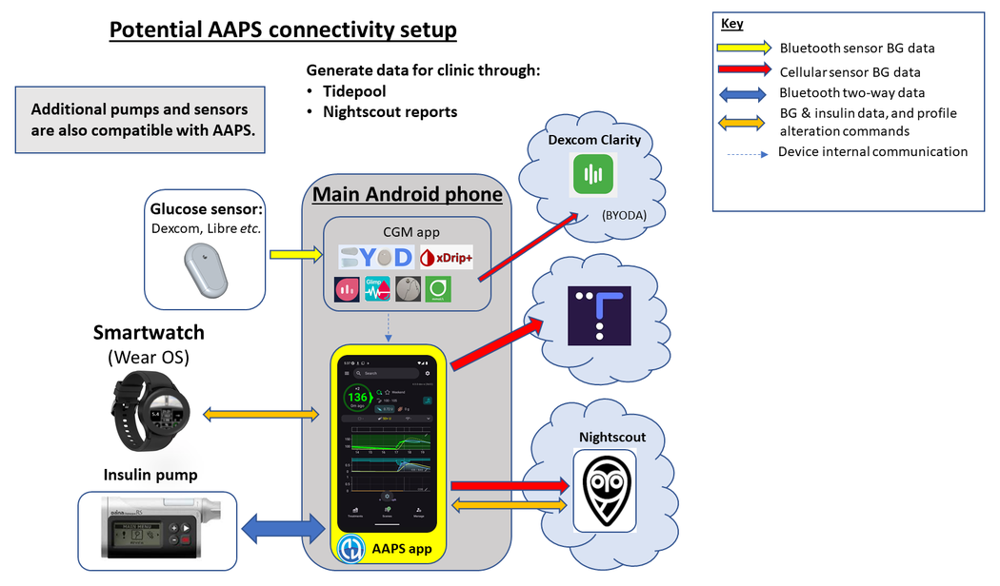
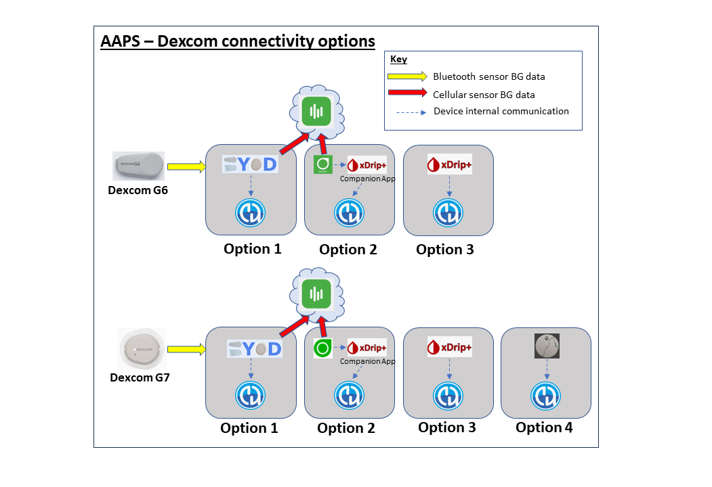
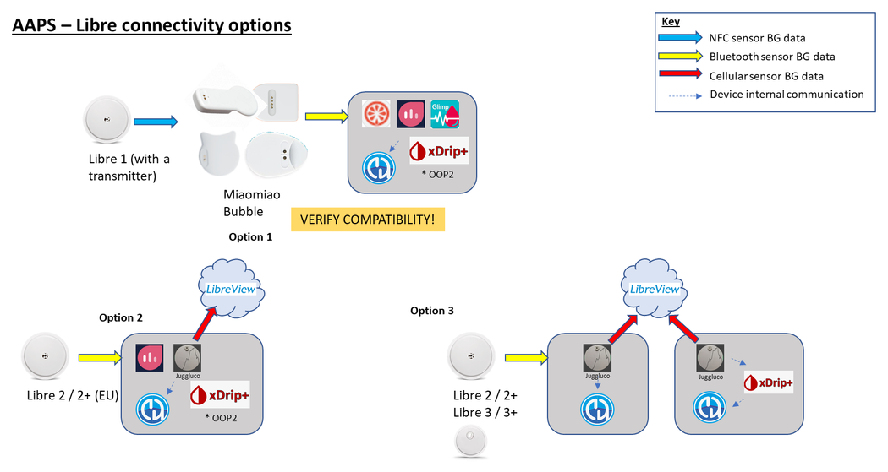
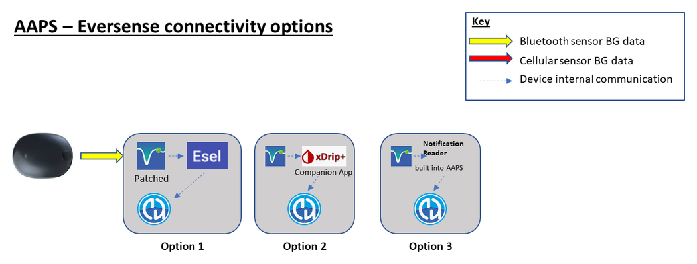

# Preparing to start with AAPS

Welcome. This documentation aims to guide users who are preparing to set up and start using the Android Artificial Pancreas System (**AAPS**).

## Finding your way around the documentation

An **index** and explanation of the documentation structure can be found [here](../index.md), you can also reach it by clicking on the **AAPS** symbol at the top left of the documentation. There you will find an overview of the purpose of the different documentation sections. You can also use the headings to the left of this page to navigate through the documentation. Finally, there is a handy search function, directly below the **AAPS** symbol.

We aim to make it easy to determine both the capabilities and limitations of **AAPS**. Skyrę laiko dokumentacijai skaityti galite nusivilti sužinoję, kad neturite suderinamos insulino pompos ar NGJ arba kad **AAPS** funkcijos skiriasi nuo tų, kurių tikėjotės.

Many experience-related details in the **AAPS** documentation make more sense when you are actually using **AAPS** in real-time. Just as it is difficult to learn a sport only by reading the rules, it takes a combination of learning the foundations of the rules for safely operating **AAPS** and then learning how best to apply those rules as you start to use **AAPS**.

(preparing-safety-first)=

## Saugumas – svarbiausia
“With great power comes great responsibility…”

### Technical safety
**AAPS** has an extensive set of safety features. Šios funkcijos taiko apribojimus, kurie panaikinami palaipsniui, kai įveikiate [mokymo etapus](../SettingUpAaps/CompletingTheObjectives.md). Juose tikrinami konkretūs parametrai ir atsakoma į klausimus su keliais atsakymų variantais. **AAPS** funkcijos atrakinamos sėkmingai įveikus mokymo etapus. This process allows the user to migrate safely in stages from Open Loop to Closed Loop, while learning about the different features of **AAPS**.

[Mokymo etapai](../SettingUpAaps/CompletingTheObjectives.md) sukurti tam, kad kuo geriau supažindintų su **AAPS**. Juos kuriant atsižvelgta į dažnas klaidas ir bendras tendencijas, kurias **AAPS** kūrėjai pastebėjo tarp naujų naudotojų. Mistakes can happen because the beginner is inexperienced and too eager to get started with **AAPS**, or has overlooked key points. [Mokymo etapai](../SettingUpAaps/CompletingTheObjectives.md) padeda sumažinti šias problemas.

### Medical safety
```{admonition} Avoid permanent and painful damage to your eyes and nerves
:class: danger
Caution is advised concerning rapid improvements in blood glucose control and lowering of HbA1c 
```

An important safety consideration is that a **rapid reduction in HbA1c and improved blood glucose control in those who have had elevated glucose levels for some time can cause permanent damage**. Many people with diabetes are unaware of this, and not all clinicians make their patients aware of this issue.

This damage can include **sight loss, and permanent neuropathy (pain)**. It is possible to avoid this damage occurring, by reducing average glucose levels more slowly. If you currently have an elevated HbA1c and are moving to **AAPS** (or any other closed loop system), _please_ discuss this potential risk with your clinical team before starting, and agree a timescale with gradually decreasing safe glucose targets with them. Pradžioje **AAPS** galite lengvai nustatyti aukštesnes tikslines gliukozės reikšmes (šiuo metu didžiausia pasirenkama reikšmė yra 11,1 mmol/l, bet prireikus taip pat galite naudoti sąmoningai silpną profilį), o bėgant mėnesiams tikslinę reikšmę mažinti.

#### How quickly can I reduce my HbA1c without risking permanent damage?

Viename retrospektyviajame 76 pacientų [tyrime](https://pubmed.ncbi.nlm.nih.gov/1464975/) nustatyta, kad retinopatijos progresavimo rizika padidėjo 1,6, 2,4 ir 3,8 karto, jei HbA1c per 6 mėnesių laikotarpį sumažėjo atitinkamai 1 %, 2 % arba 3 %. Tyrėjai siūlė, kad **„HbA1c reikšmės sumažėjimas per bet kurį 6 mėnesių laikotarpį turėtų būti mažesnis nei 2 %, kad būtų išvengta retinopatijos progresavimo....Pernelyg greitas sumažėjimas pradėjus kontroliuoti glikemiją gali smarkiai arba laikinai pasunkinti retinopatijos progresavimą.“**

N.B. If you use different HbA1c units (mmol/mol rather than %), click [here](https://www.diabetes.co.uk/hba1c-units-converter.html) for an HbA1c calculator tool.

In another retrospective [evaluation](https://academic.oup.com/brain/article/138/1/43/337923) of 954 patients, researchers noted that:

**„HbA1c sumažėjus 2–3 procentiniais punktais per 3 mėnesius, absoliuti gydymo sukeltos diabetinės neuropatijos rizika buvo 20 %. HbA1c sumažėjus >4 procentiniais punktais per 3 mėnesius, absoliuti gydymo sukeltos diabetinės neuropatijos rizika viršijo 80 %.“**

Šio darbo [komentare](https://academic.oup.com/brain/article/138/1/2/340563) pritarta, kad, siekiant išvengti komplikacijų, **tikslas turėtų būti sumažinti A1c <2 % per 3 mėnesius.** Kitas šios temos apžvalgas galite skaityti [čia](https://www.ncbi.nlm.nih.gov/pmc/articles/PMC6587545/pdf/DOM-21-454.pdf) ir [čia](https://www.mdpi.com/1999-4923/15/7/1791).

Paprastai pripažįstama, kad _naujai_ diagnozuoto 1 tipo diabeto atveju (kai HbA1c diagnozės metu, prieš pradedant gydymą insulinu, dažnai būna labai didelis) HbA1c, atrodo, galima sparčiai sumažinti iškart po diagnozės, nepatiriant šios rizikos tokiu pat mastu, nes gliukozės kiekis kraujyje nebuvo padidėjęs taip ilgai. However, it is still a consideration which you should discuss with your clinician.

(PreparingForAaps-no-sglt-2-inhibitors)=
### No SGLT-2 inhibitors

```{admonition} NO SGLT-2 inhibitors
:class: danger
SGLT-2 inhibitors, also called gliflozins, inhibit reabsorption of glucose in the kidney. Gliflozins incalculably lower blood sugar levels, and so you MUST NOT take them while using a closed loop system like AAPS! There would be a significant risk of ketoacidosis and/or hypoglycemia! The combination of this medication with a system that lowers basal rates in order to increase BG is especially dangerous. 

Trumpai:
- **1 pavyzdys: hipoglikemijos rizika**
>Per pietus naudodami **AAPS** suleidžiate bolusą, apskaičiuotą 45 g angliavandenių. Problema ta, kad inhibitoriai priverčia organizmą pašalinti dalį angliavandenių, o AAPS apie tai nežino. Todėl organizme lieka per daug insulino, palyginti su įsisavintais angliavandeniais, ir ištinka hipoglikemija.

- **2 pavyzdys: ketoacidozės rizika**
>Inhibitoriai fone pašalina dalį angliavandenių, todėl jūsų KG sumažėja. **AAPS** automatiškai nurodys pompai sumažinti tiekiamo insulino kiekį, įskaitant valandinę bazę. Laikui bėgant jūsų KG gali išlikti žemiau tikslinės reikšmės tiek, kad organizmui pritrūks foninio insulino angliavandeniams įsisavinti, ir išsivystys ketoacidozė. Paprastai 1 tipo diabetu sergantiems žmonėms ketoacidozė išsivysto sugedus pompai. Tada telefone suveiktų įspėjimai, o aukšta KG būtų pastebima. Tačiau gliflozinų pavojus tas, kad AAPS nerodytų jokių įspėjimų, nes pompa veikia, o KG gali išlikti tikslinėse ribose.

Common brand names of SGLT-2 inhibitors include: Invokana, Farxiga, Jardiance, Glyxambi, Synjardy, Steglatro, and Xigduo XR, others.
```


### Key principles of looping with AAPS

The key principles and concepts of looping must be understood before using **AAPS**. Tam skirkite laiko **AAPS** dokumentacijai skaityti ir mokymo etapams įveikti. Jie padeda sukurti tvirtą pagrindą saugiai ir veiksmingai naudoti **AAPS**. The volume of **AAPS** documentation may seem overwhelming at first but be patient and trust the process - with the proper approach, you'll get there!

Kaip greitai pažengsite, priklauso nuo žmogaus, tačiau žinokite, kad visi mokymo etapai paprastai įveikiami per 6–9 savaites. Many people start to build, install and set up **AAPS** well in advance of starting to use it. Tam sistemoje yra „Virtuali pompa“. Ją galima naudoti per pirmuosius mokymo etapus ir susipažinti su **AAPS**, iš tikrųjų netiekiant insulino. Toliau pateiktas išsamus laiko planas. Atkreipkite dėmesį, kad pasiekus 7 **AAPS** mokymo etapą ciklas jau yra uždaras. Vėlesni mokymo etapai prideda papildomų funkcijų, pavyzdžiui, **SMB** ir **automatizacijas**. Kai kuriems naudotojams jos naudingos, bet pagrindiniam **AAPS** veikimui nebūtinos.

Norint sėkmingai naudoti **AAPS**, reikia aktyviai dalyvauti, analizuoti KG duomenis ir būti pasirengus keisti **AAPS** nustatymus, kad pagerintumėte rezultatus. Just as it is nearly impossible to learn to play a sport by reading about the rules alone, the same can be said of **AAPS**.

#### Plan for delays and minor issues in getting everything set up and running

Pradėdami naudoti **AAPS**, galite susidurti su sunkumais užtikrinant visų ciklo komponentų (ir galimų sekėjų) tarpusavio ryšį bei tikslinant nustatymus. Some glitches cannot be resolved until **AAPS** is used in everyday life, but plenty of help is available on the Facebook group and Discord. Please plan accordingly and choose "good" times, like a quiet morning of a weekend (i.e. not late at night or when you are tired, or before a big meeting or travel) to troubleshoot and resolve issues.

#### Technology compatibility

**AAPS** suderinama tik su tam tikromis insulino pompomis, NGJ ir telefonais, o kai kurios technologijos ne visose šalyse prieinamos. Kad nepatirtumėte nusivylimo ar susierzinimo, perskaitykite skyrius apie [NGJ](../Getting-Started/CompatiblesCgms.md), [pompas](../Getting-Started/CompatiblePumps.md) ir [telefonus](../Getting-Started/Phones.md).

#### App build time and progressing to full looping

**AAPS** programėlės kūrimo trukmė priklauso nuo jūsų žinių ir techninių gebėjimų. Typically for inexperienced users, it can take up to half a day or a full day (with help from the community) in order to build **AAPS**. The process will significantly speed up for newer **AAPS** versions, as you become more experienced.

Several parts of this documentation are dedicated to helping you through the build process:

- [Building AAPS](../SettingUpAaps/BuildingAaps.md) takes you step-by-step through building the app and installing it on your phone;

- the [FAQ](../UsefulLinks/FAQ.md) answers common questions and explains the errors most likely to occur; and

- [Bendrojo trikčių šalinimo](../GettingHelp/GeneralTroubleshooting.md) puslapyje pagal temas surinkti dažniausių problemų sprendimai.

How long it takes to get to closed looping depends on the individual; an approximate timeline for reaching full looping with **AAPS** is given [below](#preparing-how-long-will-it-take).


#### Keystore & configuration settings export file

A “keystore” (.jks file) is a password encrypted file unique to your own copy of **AAPS**. Your Android phone uses it to ensure that nobody else can upgrade your own copy without the keystore. In short, as part of the **AAPS** build, you should:

1.  Save your keystore file (.jks file used to sign your app) in a safe place;

2.  Keep a note of your password for your keystore file.

How you save the keystore depends on your build method:

- **Android Studio (computer) build**: the keystore is created during the build — see [Generate signed APK](#Building-APK-generate-signed-apk) for instructions on where to save it.
- **AAPS Builder**: keep the backup file `aaps-keystore.jks` the setup page offered when you created your key, with its password and alias. If you uploaded your own keystore, keep that file.
- **Kūrimas naršyklėje naudojant fork**: norėdami atsisiųsti kopiją į savo „Google Drive“, naudokite tam skirtą darbo eigą (workflow) [Export keystore](#ci-keystore-export).

This will ensure that you can use that exact same keystore file each time an updated version of **AAPS** is created. Vidutiniškai **AAPS** reikės atnaujinti 2 kartus per metus.

In addition, **AAPS** provides the ability to [export all your configuration settings](../Maintenance/ExportImportSettings.md). This ensures that you can safely recover your system while changing phones, upgrading/reinstalling the application with minimum disruption. 

#### Troubleshooting

Please feel free to reach out to the AAPS community if there is anything you feel unsure about - there is no such thing as a silly question! All users with various levels of experience are encouraged to ask questions. Response times to questions are usually quick due to the number of **AAPS** users.

##### [ask on the AAPS Facebook group](https://www.facebook.com/groups/AndroidAPSUsers/)

##### [ask on the AAPS Discord channel](https://discord.gg/4fQUWHZ4Mw)


#### [Kur gauti pagalbos](../GettingHelp/WhereCanIGetHelp.md)?

This section is aimed to provide new users with links on resources in order to get help including accessing community support made up of both new and experienced users who can clarify questions, and resolve the usual pitfalls that come with AAPS.

#### [Section For Clinicians](../UsefulLinks/ClinicianGuideToAaps.md)

This is a [section specifically for clinicians](../UsefulLinks/ClinicianGuideToAaps.md) who want to know more about AAPS and open source artificial pancreas technology. There is also guidance on [how to talk to your clinical team](#introduction-how-can-i-approach-discussing-aaps-with-my-clinical-team) in the Introduction.

## What are we going to build and install?

This diagram provides an overview of the key components (both hardware and software) of the **AAPS** system:




Be trijų pagrindinių aparatinės įrangos komponentų (telefono, pompos, gliukozės jutiklio), dar reikia: 1) **AAPS** programėlės 2) ataskaitų serverio ir 3) nuolatinio gliukozės jutiklio (NGJ) programėlės

### 1) An Android Phone Application: **AAPS**

**AAPS** is an app that runs on Android smartphones & devices. You are going to build the **AAPS** app (an apk file) yourself, using a step-by-step guide, by downloading the **AAPS** source code from GitHub, installing the necessary programs (Android Studio, GitHub desktop) on your computer and building your own copy of **AAPS** app. You will then transfer the **AAPS** app across to your smartphone (by email, USB cable _etc._) and install it.

### 2) A reporting server: Nightscout (Tidepool*)

Kad galėtumėte visapusiškai naudotis **AAPS**, turite sukonfigūruoti Nightscout serverį. You can [do this yourself](https://nightscout.github.io/nightscout/new_user/#free-diy) or alternatively, pay a small fee for a [managed Nightscout service](https://nightscout.github.io/#nightscout-as-a-service) to be set up for you. Nightscout laikui bėgant kaupia duomenis iš **AAPS** ir gali rengti išsamias ataskaitas, susiejančias NGJ bei insulino duomenų tendencijas. It is also possible for caregivers to use Nightscout to remotely communicate with the **AAPS** application, to oversee their child’s diabetic management. Such remote communication features include real-time monitoring of glucose and insulin levels, remote bolusing of insulin (by texting) and meal announcements. Bandymas vertinti diabeto kontrolę atskirai žiūrint NGJ ir pompos duomenis primena automobilį su aklu vairuotoju, kuriam keleivis apibūdina vaizdą. Vietoj Nightscout taip pat galima naudoti Tidepool.

### 3) NGJ jutiklio programėlė

Priklausomai nuo gliukozės jutiklio / NGJ, reikės suderinamos programėlės, kuri priimtų gliukozės rodmenis ir siųstų juos į **AAPS**. Skirtingi variantai pateikti toliau. Daugiau informacijos rasite skyriuje [Suderinami NGJ](../Getting-Started/CompatiblesCgms.md):

  

### Maintenance of the **AAPS** system

Tiek **Nightscout**, tiek **AAPS** reikia atnaujinti maždaug kartą per metus, kai išleidžiamos patobulintos versijos. In some cases, the update can be delayed, in others it is strongly recommended or considered essential for safety. Notification of these updates will be given on the Facebook groups and Discord servers. Versijų pastabose bus aiškiai nurodyta, kuris atvejis taikomas. There are likely to be many people asking similar questions to you at update time, and you will have support for performing the updates.

(preparing-how-long-will-it-take)=
## How long will it take to set everything up?

As mentioned earlier, using **AAPS** is more of a “journey” that requires investment of your personal time. It is not a one-time setup. Šiuo metu numatoma, kad **AAPS** programėlės kūrimas, **AAPS** ir **NGJ** programinės įrangos diegimas bei konfigūravimas ir perėjimas nuo atviro ciklo prie hibridinio uždaro ciklo su **AAPS** iš viso užtrunka maždaug 4–6 mėnesius. Todėl rekomenduojama kuo greičiau imtis **AAPS** programėlės kūrimo ir pirmųjų mokymo etapų, net jei vis dar naudojate kitą insulino tiekimo sistemą (iki 5 mokymo etapo galite naudoti virtualią pompą).

Kai kuriuose mokymo etapuose reikia palaukti nustatytą dienų skaičių, kad įsitikintumėte, jog suprantate naują funkciją. Šio laukimo laiko apeiti neįmanoma. Šie mažiausi laukimo laikai nustatyti jūsų pačių saugumui.

Here is an approximate timeframe:

| Tasks                                                                        |           Approx time            |
| ---------------------------------------------------------------------------- |:--------------------------------:|
| Initial reading of the documentation                                         |             1-2 days             |
| GitHub konfigūravimas, kad būtų galima kurti programėlę naršyklėje           |           1-4 valandos           |
| Setting up a reporting server                                                |              1 hour              |
| NGJ programėlės diegimas (xDrip, BYODA, …)                                   |              1 hour              |
| Pradinis NGJ → xDrip → AAPS konfigūravimas                                   |              1 hour              |
| Configuring AAPS → pump initially                                            |              1 hour              |
| Configuring AAPS → Nightscout/Tidepool (reporting only)                      |              1 hour              |
| Pasirinktinai: Nightscout ↔ **AAPS** & NSFollowers konfigūravimas            |              1 hour              |
| 1 mokymo etapas: vizualizacijos ir stebėjimo nustatymas                      |              1 hour              |
| 2 mokymo etapas: Išmokite valdyti AAPS                                       |            2 valandos            |
| 3 mokymo etapas: Pasitikrinkite žinias                                       |          Up to 14 days           |
| 4 mokymo etapas: Aktyvuojamas atviras ciklas                                 |        Minimum of 7 days         |
| 5 mokymo etapas: supraskite savo atvirą ciklą                                |             7 dienos             |
| 6 mokymo etapas: pradėkite uždaryti ciklą (Stabdymas esant žemai glikemijai) |   Minimum of 5, up to 14 days    |
| 7 mokymo etapas: uždaro ciklo derinimas                                      |  Minimum of 1 day, up to 7 days  |
| 8 mokymo etapas: koreguokite valandinę bazę ir santykius, įjunkite Autosens  | Minimum of 7 days, up to 14 days |
| 9 mokymo etapas: supermikroboluso (SMB) įjungimas                            |        Minimum of 28 days        |
| 10 mokymo etapas: Automatizacija                                             |        Minimum of 28 days        |

Once you are fully operational on **AAPS**, you will still need to regularly fine tune your settings in order to improve your overall diabetic management.

## Reikalavimai

### Medical considerations

In addition to the medical warnings in the [safety section](#preparing-safety-first) there are also different parameters, depending on which insulin you are using in the pump.

#### Insulin choice

**AAPS** skaičiavimai grindžiami 100 V/ml insulino koncentracija (tokia pati kaip standartinė pompos koncentracija). Insuliną nustatote skiltyje **Valdymas → Insulino nustatymai**: įveskite **Pikas** ir **IVT** reikšmes arba naudokite **Įkelti piko reikšmę iš**, kad būtų įrašytas vieno iš ruošinių standartinis piko laikas:

- **Novorapid** (taip pat Humalog ir NovoLog)
- **Fiasp**
- **Lyumjev**

Patyrę naudotojai gali tiesiogiai įvesti bet kokį piko laiką (nuo 35 iki 120 minučių), pavyzdžiui, kai naudojamas insulinų mišinys. Žr. [Insulino nustatymai](#Config-Builder-insulin).


### Technical

This documentation aims to reduce the technical expertise required to an absolute minimum. To build the **AAPS** app, you have several options — see [Building AAPS](../SettingUpAaps/BuildingAaps.md) for an overview:

- **Browser build** (recommended): build the app directly from your smartphone using GitHub Actions, with no computer or Android Studio required. Naudojant [AAPS Builder](../SettingUpAaps/BrowserBuildAapsBuilder.md) reikia tik GitHub paskyros: programėlę atsisiunčiate tiesiai iš GitHub. Fork metodui taip pat reikia Google paskyros programėlei išsaugoti Google Drive.
- **Android Studio build**: build the app on your computer using Android Studio. This is mostly used by developers who intend to make code changes.
- **Command-line build**: for users who prefer to build locally without installing Android Studio.

Beyond building the app, you also need to set up a reporting server, configure several Android phone apps and develop expertise in diabetes management. This can be achieved by moving step-by-step, being patient, and with help from the **AAPS** community. If you are already able to navigate the internet and manage your own Gmail emails, building **AAPS** is a feasible task. Just take your time.

### Smartphones

#### AAPS and Android Versions

Dabartinei **AAPS** versijai (4.0) reikalingas išmanusis telefonas su Google **Android 12.0 arba naujesne versija**. If you are considering buying a new phone, (as of January 2026), Android 16 is preferred.<br/> Users are strongly encouraged to keep their build of **AAPS** up to date for safety reasons. Tačiau naudotojams, negalintiems naudoti įrenginio su Android 12.0 ar naujesne versija, vis dar prieinamos ankstesnės **AAPS** versijos, suderinamos su senesnėmis Android versijomis. Žr. [versijų pastabas](#maintenance-android-version-aaps-version).

#### Smartphone model choice
The exact model you buy depends on the desired function(s). You can find on the [Phones page](../Getting-Started/Phones.md) recommendations and user feedback about working setups.

Naudotojams rekomenduojama nuolat atnaujinti telefono Android versiją, įskaitant saugos naujinimus. However, if you are new with **AAPS** or are not a technical expert you might want to delay updating your phone until others have done so and confirmed it is safe to do so, on our various forums.

```{admonition} Delaying Samsung phone updates
:class: warning
Deja, Samsung yra žinoma tuo, kad priverstinai atnaujina savo telefonus, o tai gali sukelti Bluetooth ryšio problemų. Norėdami išjungti šiuos priverstinius atnaujinimus, telefone turite įjungti kūrėjo režimą („developer mode“):

1. Eikite į **Settings** > **About phone** > **Software information**, tada kelis kartus palieskite **Build number** (versijos numeris), kol bus patvirtinta, kad kūrėjo režimas atrakintas.
2. Grįžkite į pagrindinį **Settings** (nustatymų) meniu. Jame turėtų atsirasti naujas meniu punktas **Developer options** (kūrėjo parinktys).
3. Atidarykite **Developer options**, suraskite **Auto system update** (automatinis sistemos atnaujinimas) ir jį išjunkite.
```

```{admonition} Google Play Protect potential issue
:class: warning
There have been several reports of **AAPS** being shut down arbitrarily by Google Play Protect every morning. Jei taip nutinka, eikite į Google Play parinktis ir išjunkite **Google Play Protect**. Tai paliečia ne visus telefonų modelius ir ne visas Android versijas.
```

```{admonition} Android developer verification
:class: note
Nuo 2026 m. rugsėjo Google palaipsniui diegia [Android kūrėjų tapatybės patikrinimą](#android-developer-verification), kuris keičia, kaip savarankiškai sukurta programėlė įdiegiama telefone. Tai neturi įtakos **AAPS** kūrimui, o nemokami įdiegimo būdai lieka prieinami. Daugiau informacijos rasite susietame puslapyje.
```

