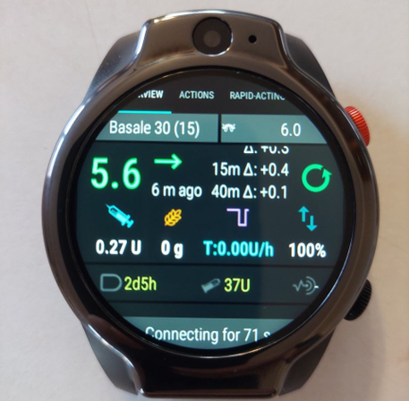
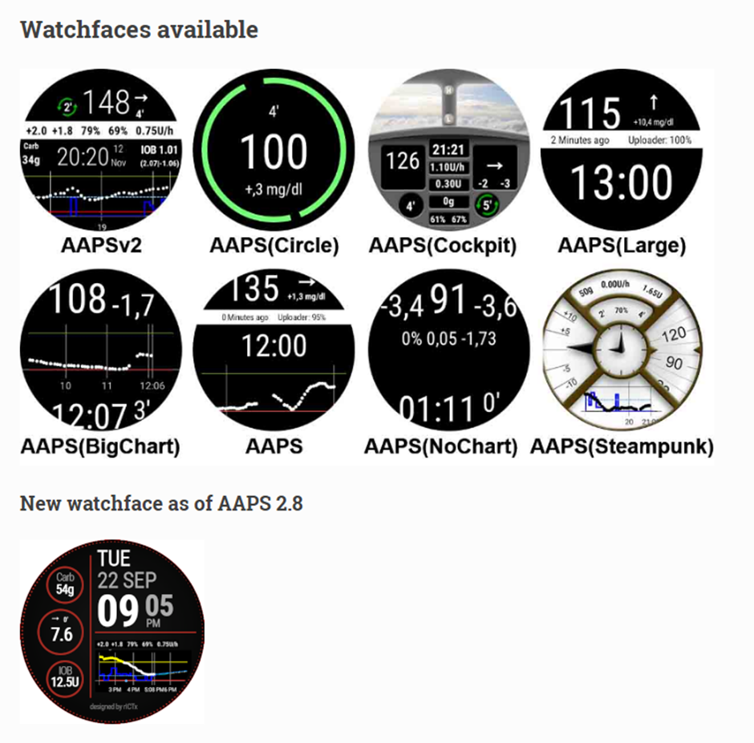
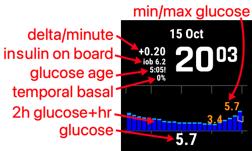
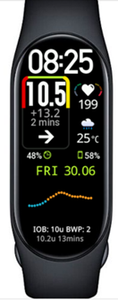

# Smartwatches and AAPS

Įvairius išmaniuosius laikrodžius galima naudoti kai kuriai **AAPS** informacijai rodyti arba nuotoliniams veiksmams atlikti.

Kad išmanusis laikrodis tiesiogiai valdytų **AAPS** (pompą ir jutiklį), reikia pilnaverčio Android laikrodžio (jis laikomas mažu [išmaniuoju telefonu](./Phones.md)).

Kai kuriais išmaniaisiais laikrodžiais galima įvesti terapiją ir daugiau, tačiau **AAPS** vis tiek valdo pats telefonas.

Smartwatches are becoming increasingly used with **AAPS** _both_ for adults with diabetes and carers/parents of children with diabetes.

## General advantages of using smartwatches with **AAPS**


Smartwatches - depending on the model - can be used in many different ways with **AAPS**. Juos galima naudoti visiškai ar iš dalies valdyti **AAPS** arba tiesiog nuotoliniu būdu tikrinti gliukozės kiekį, aktyvų insuliną organizme ir kitus parametrus.

Išmanusis laikrodis, sujungtas su **AAPS**, gali būti naudingas daugelyje situacijų, pavyzdžiui, vairuojant automobilį, važiuojant dviračiu ar motociklu ar sportuojant. Some people feel that looking at a watch (in a meeting, party, dinner table etc.) is more discreet than looking at a phone. Saugumo požiūriu išmanusis laikrodis gali būti naudingas ir keliaujant: **AAPS** telefoną galima laikyti paslėptą (pvz., krepšyje) ir vis tiek valdyti nuotoliniu būdu išmaniuoju laikrodžiu.

## Konkretūs privalumai tėvams ir globėjams, naudojantiems **AAPS**

Jei vaiko **AAPS**  telefonas yra netoliese, globėjas gali išmaniuoju laikrodžiu stebėti ar keisti nustatymus, nenaudodamas **AAPS**  telefono. This can be useful, for example, if the **AAPS** phone is hidden away in a pump belt.

Išmanųjį laikrodį galima naudoti _kartu_ su TELEFONU paremtais nuotolinio valdymo ar [tik sekimo](../RemoteFeatures/FollowingOnly.md) būdais arba _vietoj_ jų.

Be to, skirtingai nei tėvų ar globėjų sekėjų telefonai (kuriems reikia mobiliojo tinklo ar Wi-Fi ryšio), Bluetooth ryšiu prijungti išmanieji laikrodžiai gali būti naudingi atokiose vietose, pavyzdžiui, oloje, valtyje ar pusiaukelėje į kalną. Jei abu įrenginiai (**AAPS** telefonas ir išmanusis laikrodis) yra tame pačiame Wi-Fi tinkle, jie taip pat gali naudoti Wi-Fi.

## Skirtingi išmaniojo laikrodžio ir AAPS sąveikos būdai

Šiuo metu yra penki pagrindiniai būdai, kaip išmanieji laikrodžiai naudojami kartu su **AAPS**. Jie parodyti toliau esančioje lentelėje: 

| Laikrodžio sąranka           | Features                                               | Reikalavimai                                                                                                                                                                                                                                                                                                                                                  |
| ---------------------------- | ------------------------------------------------------ | ------------------------------------------------------------------------------------------------------------------------------------------------------------------------------------------------------------------------------------------------------------------------------------------------------------------------------------------------------------- |
| Savarankiškas                | AAPS be telefono                                       | Pilnavertis Android išmanusis laikrodis (patikrinkite min. Android versiją)</br> Veikia **app-fullRelease**                                                                                                                                                                                                                                                   |
| Visiškas nuotolinis valdymas | Dauguma AAPS funkcijų                                  | Android **Wear OS** laikrodis (patikrinkite Android/API)</br>Veikia **wear-fullRelease**                                                                                                                                                                                                                                                                      |
| Nuotolinis valdymas          | AAPSClient funkcijos                                   | Android **Wear OS** laikrodis (patikrinkite Android/API)</br>Veikia **[wear-aapsclientRelease](https://github.com/nightscout/AndroidAPS/releases)**                                                                                                                                                                                                           |
| Nuotolinis valdymas          | Kai kurios AAPSClient funkcijos                        | Garmin laikrodžiai</br>(tik senesnės Samsung Tizen ir Fitbit sąrankos, nerekomenduojama)</br>Žr. toliau.                                                                                                                                                                                                                                                      |
| Rodymas                      | Gliukozė, tendencija, AIO, AAO, ciklo ir pompos būsena | Daug išmaniųjų laikrodžių, naudojant **AAPS** telefone įdiegtą susietą programėlę, kuri gauna [išorinėms susietoms programėlėms](#watches-external-companion-apps) transliuojamus duomenis: [WatchDrip+](https://bigdigital.home.blog/) (Xiaomi, Amazfit), [GlucoDataHandler](https://github.com/pachi81/GlucoDataHandler) (Wear OS), G-Watch</br>Žr. toliau. |

## Before you buy a smartwatch…

The exact model of smartwatch you buy depends on the desired function(s). Naudingos informacijos galite rasti [puslapyje Telefonai](#Phones-list-of-tested-phones), įskaitant išbandytų telefonų sąrašą, kuriame yra ir keli išmanieji laikrodžiai.

Popular watch brands include Samsung Galaxy, Garmin, Fossil and Mi band. Lentelėje apibendrinti variantai toliau paaiškinti išsamiau, kad galėtumėte nuspręsti, kuris išmanusis laikrodis tinka jūsų situacijai.

Jei jungiate išmanųjį laikrodį su **AAPS** telefone ir norite nuotoliniu būdu valdyti **AAPS**, taip pat turite įvertinti, ar abu įrenginiai suderinami tarpusavyje, ypač jei jūsų telefonas senesnis ar neįprastas.

Paprastai, jei norite tik sekti gliukozės reikšmes ir nevaldyti **AAPS**, galite rinktis iš daug platesnio pigesnių ir paprastesnių laikrodžių pasirinkimo.

Geriausias būdas išsirinkti išmanųjį laikrodį – ieškoti įrašų apie „watch“ **AAPS** grupėse Discord arba Facebook. Have a read of others' experiences, and post any specific questions if your query isn't answered by older posts.

## Pilnavertis Android

It sounds like an attractive option, right? Tačiau šiuo metu tik keli entuziastai bando naudoti **AAPS**  savarankiškame laikrodyje. Yra nedaug išmaniųjų laikrodžių su tinkama sąsaja, kurie taip pat gerai veikia savarankiškai su **AAPS** ir jūsų NGJ programėle. Popular models include the LEMFO LEM 15 Pro and 16. Į laikrodį turėsite įdiegti **AAPS** „full“ apk (tą apk, kuris paprastai diegiamas į išmanųjį telefoną), o ne **AAPS** „wear“ apk.

Nors nėra aiškių reikalavimų, pagal kuriuos būtų galima žinoti, ar laikrodis gerai tiks savarankiškam **AAPS** naudojimui, padės šie parametrai:

1)  Android 12 arba naujesnė. 2)  Galimybė išjungti ciferblato „kvadratinį“ režimą, kad tekstas būtų didesnis ir lengviau įskaitomas. 3)  Very good battery life. 4)  Geras Bluetooth ryšio nuotolis.

Daugiausia nusivylimų savarankiškais **AAPS** laikrodžiais kyla dėl mažyčio ekrano ir dėl to, kad dabartinė pilnos AAPS programėlės sąsaja nėra sukurta laikrodžiui. Dėl mažo ekrano **AAPS**  nustatymus laikrodyje gali būti patogiau keisti rašikliu, be to, kai kurie AAPS mygtukai laikrodžio ekrane gali būti nematomi.

Additional challenges are that it is hard to get sufficient battery life, and watches with sufficient battery are often bulky and thick. Naudotojai praneša apie kovą su operacine sistema ir energijos taupymo nustatymais, sunkumus paleidžiant jutiklius laikrodyje, prastą Bluetooth ryšio nuotolį (norint išlaikyti ryšį ir su jutikliu, ir su pompa) ir abejotiną atsparumą vandeniui. Pavyzdžiai parodyti toliau esančiose nuotraukose.



Jei norite nustatyti savarankišką laikrodį, daugiau informacijos rasite **AAPS**  Facebook grupės įrašuose ir komentaruose (geri paieškos žodžiai: „standalone“ ir „Lemfo“) bei Discord.

## Wear OS

**AAPS** kode yra programėlės priedas, kurį galima įdiegti į [**Wear OS** išmaniuosius laikrodžius](https://wearos.google.com/#oem-carousel).


Patikrinkite, ar jūsų išmanusis laikrodis atitinka **AAPS** [reikalavimus](#maintenance-android-version-aaps-version).

### Kas _yra_ Wear OS?

Pirmiesiems trims išmaniųjų laikrodžių variantams reikia, kad laikrodyje būtų įdiegta **Wear OS**.

**Wear OS** yra operacinė sistema, veikianti kai kuriuose moderniuose Android išmaniuosiuose laikrodžiuose. Jei išmaniojo laikrodžio aprašyme nurodytas tik _suderinamumas_ su Android ir iOS, tai nereiškia, kad jame veikia Wear OS. Tai gali būti kita, gamintojo sukurta operacinė sistema, kuri nesuderinama su **AAPS**. Kad būtų galima įdiegti ir naudoti bet kurią **AAPS** ar **AAPSClient** versiją, išmaniajame laikrodyje turi veikti **Wear OS 3.0, 3.2 ar 3.5** (Android 11, API lygis 30) **arba naujesnė**. Kiekviena Wear OS versija remiasi tam tikra Android versija: **Wear OS 3** yra Android 11 (API lygis 30), **Wear OS 4** yra Android 13 (API lygis 33), **Wear OS 5** yra Android 14 (API lygis 34), o **Wear OS 6** yra Android 16 (API lygis 36). Laikrodžiuose su Wear OS 2 **AAPS** veikti negali.

Jei į **Wear OS** laikrodį įdiegsite **AAPS** wear.apk, galėsite pasirinkti iš įvairių **AAPS** ciferblatų. Arba galite naudoti standartinį išmaniojo laikrodžio ciferblatą, o **AAPS** informacija bus rodoma mažuose ciferblato laukeliuose, vadinamuose ekrano elementais („complications“). Ekrano elementas – tai bet kokia funkcija, rodoma ciferblate be laiko.

```{note}
Naujausi **Wear OS** pakeitimai palaipsniui gadina pasirinktinius **AAPS** ciferblatus (kuo naujesnė Wear OS versija, tuo labiau), tačiau **ekrano elementai** veikia toliau. Prieš pirkdami ar atnaujindami laikrodį, perskaitykite [Wear OS ciferblatų pakeitimai](#wearos-watchface-changes).
```


### What could my smartwatch look like?

[Įdiegę **AAPS** į savo laikrodį](../WearOS/WearOsSmartwatch.md), iš šių **AAPS** ciferblatų automatiškai galėsite pasirinkti norimą. Daugumoje laikrodžių tiesiog ilgai spauskite pagrindinį ekraną, kol ekranas sumažės, ir braukite į dešinę, kad pasirinktumėte kitą ekraną:



Tai yra pagrindiniai į **AAPS** įtraukti ekranai. Yra ir [daugiau ciferblatų](#WearOS_changing-to-AAPS-watchface), taip pat galite naudoti [ekrano elementus](#Watchfaces-complications).

### How would I operate a Wear OS watch from day-to-day?

Daugiau informacijos apie ciferblatus ir kasdienį naudojimą, taip pat kaip susikurti (ir bendrinti) savo ciferblatą, rasite skyriuje [Wear AAPS naudojimas išmaniajame laikrodyje](../WearOS/WearOsSmartwatch.md).

(Watchfaces-tizen)= (watches-external-companion-apps)=

## Išorinės susietos programėlės

**AAPS** gali transliuoti savo būseną kitoms tame pačiame telefone įdiegtoms programėlėms: gliukozę ir tendenciją, AIO, AAO, valandinę bazę ir laikiną valandinę bazę, profilio pavadinimą, ciklo būseną, telefono ir pompos bateriją, rezervuaro lygį ir boluso eigą. Kelios laikrodžių susietos programėlės skaito šią transliaciją ir rodo duomenis laikrodžiuose, kurių **AAPS** tiesiogiai nepalaiko. Norėdami siųsti duomenis, įjunkite **Išorinės susietos programėlės** skiltyje **Konfigūracija** > **Ryšys** (žr. [Išorinės susietos programėlės](#external-companion-apps) puslapyje Konfigūracija). Transliacija siunčiama su kiekviena nauja reikšme ir jos negalima užklausti: susietos programėlės atnaujinimo mygtukas **AAPS** neveikia.


Susietos programėlės, kurios, kaip žinoma, naudoja šią transliaciją:

- [WatchDrip+](https://bigdigital.home.blog/) Xiaomi ir Amazfit laikrodžiams, žr. [Xiaomi ir Amazfit laikrodžiai](#watches-xiaomi-amazfit) toliau.
- [GlucoDataHandler](https://github.com/pachi81/GlucoDataHandler) Wear OS laikrodžiams, kaip ekrano elementas arba valdiklis. Tai naudinga atsarginė galimybė tose Wear OS versijose, kuriose **AAPS** ciferblatai veikia nepatikimai, žr. [AAPS nustatymas Wear OS laikrodyje](../WearOS/WearOsSmartwatch.md). Jos susieta programėlė GlucoDataAuto rodo tuos pačius duomenis automobilyje su Android Auto.
- [G-Watch programėlė](https://play.google.com/store/apps/details?id=sk.trupici.g_watch) Samsung Tizen laikrodžiams ir vėlesnė jos Wear OS versija. Ankstesnėse **AAPS** versijose įskiepis pagal šią programėlę vadinosi **Samsung Tizen**.

```{warning}
**G-Watch programėlė** ir jos **Wear OS** versija nebeprižiūrimos, o Samsung savo išmaniuosius laikrodžius perkėlė iš Tizen į Wear OS. G-Watch aktuali tik esamoms, senesnėms sąrankoms ir nerekomenduojama naujam diegimui. Naujausių žinių ieškokite specialioje [Facebook grupėje](https://www.facebook.com/groups/gwatchapp).
```

(Watchfaces-garmin)=

## Garmin

Garmin ConnectIQ parduotuvėje yra keletas Garmin ciferblatų, kurie jungiasi su [AAPS](https://apps.garmin.com/search?keywords=androidaps).


[AAPS Glucose Watch](https://apps.garmin.com/apps/3d163641-8b13-456e-84c3-470ecd781fb1) tiesiogiai sujungiamas su **AAPS**. Jis rodo ciklo būsenos duomenis (aktyvų insuliną organizme, laikiną valandinę bazę) kartu su gliukozės reikšmėmis ir siunčia pulso duomenis į **AAPS**. Jį galima rasti ConnectIQ parduotuvėje; įjunkite įskiepį **Garmin** skiltyje **Konfigūracija → Ryšys**. 

1. Didžiausia ir mažiausia gliukozės reikšmė grafike
2. Gliukozės pokytis per minutę
3. Aktyvus insulinas organizme (AIO)
4. Laikas nuo paskutinės gliukozės reikšmės (minutės:sekundės)
5. Laikina valandinė bazė, procentais nuo profilio valandinės bazės
6. Paskutinių 2 valandų gliukozės grafikas
7. Dabartinė glikemijos reikšmė


## Fitbit

```{warning}
Google perkelia Fitbit į Google Health ir ES šalyse šalina trečiųjų šalių programėles bei ciferblatus iš Fitbit laikrodžių. Todėl Fitbit ciferblatai **nebėra rekomenduojamas variantas**, ir pirkti Fitbit naudojimui su **AAPS** nerekomenduojama.
```

Jau turimiems Fitbit laikrodžiams [Nightscout tinklalapiuose](https://nightscout.github.io/nightscout/wearable/#fitbit) nurodyti keli tik stebėjimui skirti variantai, pavyzdžiui, [Glance](https://glancewatchface.com/). Tai taip pat trečiųjų šalių ciferblatai, todėl jiems galioja tas pats ES apribojimas.

## Tik sekimas

Šie išmanieji laikrodžiai rodo dalį **AAPS** informacijos, kai kuriems reikia kitų programėlių.

Yra daug nebrangių išmaniųjų laikrodžių, kurie gali tik rodyti duomenis. Jei naudojate Nightscout, gerą visų variantų apžvalgą rasite [čia](https://nightscout.github.io/nightscout/wearable/#)

Toliau pateikti keli tik sekimui skirti laikrodžiai, populiarūs tarp **AAPS** naudotojų:

(watches-xiaomi-amazfit)=
### Xiaomi ir Amazfit laikrodžiai

**WatchDrip+** yra bendruomenės sukurta susieta programėlė, kuri rodo gliukozės ir ciklo duomenis įvairiuose išmaniųjų laikrodžių modeliuose, daugiausia Xiaomi (_pvz.,_ Mi Band) ir Amazfit:



Nuo 0.5 versijos **WatchDrip+** skaito duomenis tiesiai iš **AAPS**, be xDrip+ kaip tarpininko. **AAPS** telefone:

1. Įjunkite **Išorinės susietos programėlės** skiltyje **Konfigūracija** > **Ryšys**, žr. [aukščiau](#watches-external-companion-apps). Taip gaunama dabartinė gliukozė, pokytis, tendencijos rodyklė, AIO ir pompos būsena.
2. Įjunkite įskiepį **xDrip** skiltyje **Konfigūracija** > **Ryšys** ir jo nustatymuose įjunkite **Siųsti būseną į xDrip+**. Taip gaunama AIO/AAO būsenos eilutė, o gliukozės grafikas laikrodyje užsipildo po kelių reikšmių.
3. Jei telefone įdiegta xDrip+, išjunkite jos **Broadcast Service API** (xDrip+ > Settings > Inter-app settings), kad laikrodis negautų duomenų du kartus. Jei xDrip+ tik perdavė duomenis į laikrodį, galite ją pašalinti.

WatchDrip+ atnaujinimo mygtukas su **AAPS** neveikia: duomenys ateina su kiekviena nauja reikšme.


Daugiau apie juos, taip pat kaip juos nustatyti, galite perskaityti [WatchDrip+ svetainėje](https://bigdigital.home.blog/). The advantage of these watches is that they are small and relatively affordable. They are a popular option especially for kids and those with smaller wrists to wear.

### Pebble laikrodis


Pebble laikrodžiai ([jau nebegaminami](https://en.wikipedia.org/wiki/Pebble_(watch))) buvo parduodami 2013–2016 m. ir dar gali būti įsigyjami naudoti. Fitbit took over Pebble’s assets. Pebble naudotojai gali peržiūrėti Nightscout duomenis naudodami Urchin ciferblatą. Galima rodyti AIO, šiuo metu aktyvią laikiną valandinę bazę ir prognozes. Jei naudojate atvirą ciklą, galite naudoti IFTTT ir sukurti programėlę (applet), kuri, gavus pranešimą iš **AAPS**, išsiųstų SMS arba pushover pranešimą.

### [Bluejay laikrodžiai](https://bluejay.website/)


Tai unikalūs įrenginiai, galintys gauti gliukozės duomenis **tiesiogiai** iš Dexcom siųstuvo. Mažai kas žino, kad Dexcom G6/G7 siųstuvai dabartinius gliukozės duomenis transliuoja _dviem_ atskirais kanalais: telefono kanalu ir medicininiu kanalu. Bluejay laikrodžius galima nustatyti gauti gliukozės duomenis bet kuriuo kanalu, todėl jei **AAPS** naudoja telefono kanalą, Bluejay laikrodžiai gali naudoti medicininį kanalą.

Pagrindinis privalumas – laikrodis nepriklauso nei nuo telefono, nei nuo ciklo sistemos. Pavyzdžiui, jei paplūdimyje ar pramogų parke atjungiate pompą ir **AAPS** telefoną ir esate už **AAPS** telefono ryšio zonos ribų, vis tiek galite gauti Dexcom reikšmes tiesiai į Bluejay laikrodį.

Originalus **Bluejay GTS** nebegaminamas ir negali nuskaityti Dexcom G7. Vėlesni modeliai (U1, o dabar **U3**, šio teksto rašymo metu parduodamas kaip ankstyvosios prieigos versija) yra pilnaverčiai Android laikrodžiai su xDrip, kurie duomenis gauna tiesiai iš Dexcom G6 ir G7. Gamintojas laikrodį apibūdina kaip tyrimų įrankį, o ne medicinos priemonę. Nurodomi trūkumai: jis ne visada gauna reikšmę kas 5 minutes, o bateriją reikia dažnai krauti. Daugiau apie dabartinį modelį ir jo prieinamumą rasite [Bluejay svetainėje](https://bluejay.website/).

### Apple laikrodis

Žr. [Nightscout jūsų laikrodyje](https://nightscout.github.io/nightscout/wearable/#).

Apple laikrodis dabar palaiko tiesioginį G7 ryšį ir gali būti naudojamas kartu su **AAPS**.

