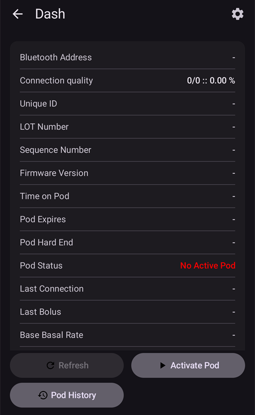

(bluetoothtroubleshooting-bluetooth-related-issues)=

# Su Bluetooth susijusios problemos

Kai kuriems naudotojams nepavyksta aktyvuoti Omnipod DASH, kyla Medtrum Nano ryšio problemų ar kitų su Bluetooth susijusių Pod klaidų. Many of these issues can be traced to one of the following issues.

Kai kurios šių problemų tikriausiai aktualios ir kitoms Bluetooth insulino pompoms. Žinoma, kad Medtrum Nano, kaip ir Omnipod DASH, turi problemų dėl leidimo „Nearby devices“ (netoliese esantys įrenginiai).

---

(bluetoothtroubleshooting-cannot-start-omnipod-with-android-16)=

## Nepavyksta paleisti Omnipod su Android 16
- Kad Omnipod DASH tinkamai veiktų su Android 16, reikia bent **AAPS** 3.3.2.1 versijos, nes joje yra pataisymų, skirtų būtent žinomoms Omnipod problemoms, kurias sukėlė Android 16.

---

(bluetoothtroubleshooting-bluetooth-battery-optimisation)=

## Bluetooth baterijos optimizavimas

Naujesnėse Android versijose sisteminei Bluetooth programėlei įjungtas baterijos optimizavimas. Žinoma, kad dėl to kai kurioms Bluetooth pompoms ir NGJ kyla problemų.

Jei naudojote [Sąrankos vedlį](../SettingUpAaps/SetupWizard.md) ir atlikote nustatymus skyriuje [Bluetooth baterijos optimizavimas](#setup-wizard-bluetooth-battery-optimisation), šis nustatymas turėtų būti teisingas. Tačiau jei naudojotės senesne šio vadovo versija, gali būti, kad šio nustatymo nepakeitėte.

Jei pompos ir NGJ ryšys nutrūksta, patikrinkite, ar tai nustatyta teisingai.

---

(bluetoothtroubleshooting-apps-using-nearby-device-permission)=

## Programėlės, naudojančios Android leidimą „Nearby devices“, gali nutraukti ryšį ir trukdyti aktyvuoti Pod

Android leidžia valdyti, ką kiekviena programėlė gali daryti ar pasiekti jūsų telefone. Tam naudojama leidimų sistema. Kiekvienai įdiegtai programėlei galite leisti arba uždrausti tam tikrus leidimus, pvz., prieigą prie failų įrenginyje, prieigą prie Bluetooth, netoliese esančių įrenginių paiešką ir kt.

Kad veiktų, **AAPS** reikia kelių konkrečių leidimų. Vienas iš jų, būtinas Pod veikimui, yra leidimas „Nearby devices“. Šio leidimo reikia ir daugeliui kitų programėlių. Bendruomenė pastebėjo, kad kai kuriuose įrenginiuose kai kurios programėlės, gavusios šį leidimą, gali trukdyti aktyvuoti naujus Pod.

(bluetoothtroubleshooting-apps-using-nearby-device-permission-known-apps)=

### Programėlės, kurios naudoja leidimą „Nearby device“ ir, kaip žinoma, sukėlė problemų:

Bendruomenėje šios programėlės buvo minėtos kaip sukeliančios problemų Omnipod DASH, o kai kuriais atvejais ir Medtrum Nano.

```{admonition} Updating the list
:class: note
Norėdami aptarti, kurias programėles įtraukti į šį sąrašą, Discord kanale #omnipod-dash parašykite @XiTatiON.
```

- **myBMW** Programėlė MyBMW trukdė veikti Medtrum Nano ir Omnipod DASH. Programėlė MyBMW leidimo „find nearby devices“ prašo tik vieną kartą. Jei jo nesuteiksite, programėlė vis tiek veikia visiškai gerai

- **Amazon Alexa**  Kai kuriems žmonėms problemą išsprendė leidimo „Nearby devices“ atšaukimas programėlei Alexa, tačiau tada nebegalima susieti Matter IoT įrenginių

- **MINI app**  Atrodo, kad ši programėlė sukurta pagal myBMW programėlę, todėl gali elgtis taip pat

- **BM2** yra saulės baterijų akumuliatoriaus stebėjimo programėlė, naudojama kai kuriuose kemperiuose ir stovyklavimo saulės elektrinėse: kai ši programėlė veikė, nepavyko aktyvuoti naujo Pod. Problemą galima apeiti, jei aktyvuodami naują Pod priverstinai sustabdote šią programėlę. Vėliau paleista programėlė, regis, netrukdė DASH veikti (Pixel 8 Pro su Android 16).

(bluetoothtroubleshooting-revoke-nearby-device-permission)=

### Kaip atšaukti „Nearby device“ leidimą kitoms programėlėms:
Jei jums nepavyksta aktyvuoti naujo Pod, nors naudojate tinkamą **AAPS** versiją savo Android versijai, gali reikėti atšaukti šį leidimą kitoms programėlėms, kol aktyvuojate naują Pod.

Atlikite šiuos veiksmus, kad atšauktumėte leidimą „Nearby device“ visoms programėlėms, išskyrus **AAPS**:

```{admonition} Menus and settings
:class: note
Šio vadovo ekrano nuotraukos ir instrukcijos parengtos naudojant standartinę Android 16 versiją telefone Google Pixel 8 Pro. Kitų gamintojų įrenginių meniu ir nustatymai greičiausiai tiksliai nesutaps su čia aprašytais. Pritaikykite veiksmus savo įrenginiui. Jei nepavyksta, skyriuje [Kur gauti pagalbos dėl DASH](#omnipod-dash-where-to-get-help-for-dash) rasite, kaip kreiptis pagalbos į bendruomenę.
```

1. Atidarykite telefono Android nustatymus, slinkite žemyn ir paspauskite **Security and privacy (1)** (sauga ir privatumas).

    

2. Slinkite žemyn ir paspauskite **Privacy controls (1)** (privatumo valdikliai).

   

3. Paspauskite **Permission manager (1)** (leidimų tvarkytuvė).

   

3. Slinkite žemyn ir paspauskite **Nearby devices (1)** (netoliese esantys įrenginiai).

   

4. Browse the list of apps and press on the app you wish to revoke **Nearby devices** permissions for.

   In this guide **Android Auto (1)** is the app we will revoke the permission on.

   Kad daugiau Pod netaptų nebetinkami naudoti, iš pradžių visiems patariame atšaukti šį leidimą visoms programėlėms, išskyrus **AAPS**.

```{admonition} Which app to select?
:class: tip
Jei nežinote, kuri programėlė sukelia problemą, atšaukite leidimą visoms (nepamirškite peržiūrėti žinomų probleminių programėlių sąrašo ir pradėti nuo jų). Jei galite sau leisti prarasti kelis Pod, prieš kiekvieną naujo Pod aktyvavimą vėl suteikite leidimą vienai programėlei, kol nustatysite, kuri būtent programėlė sukelia Pod problemas. Jei aptiksite naujų probleminių programėlių, praneškite mums Discord kanale #omnipod-dash.
```

   

5. Norėdami atšaukti leidimą, paspauskite **Don't allow (1)**, tada paspauskite **Don't allow anyway (2)**. Jei viską atlikote teisingai, perjungiklyje turėtų būti pasirinkta **Don't allow (3)**. Dabar galite grįžti į meniu **Nearby device** paspaudę **Back arrow (4)** (rodyklė atgal) ir prireikus pakeisti šį nustatymą kitoms programėlėms.

      

(bluetoothtroubleshooting-re-enable-nearby-device-permission)=

### Kaip vėl įjungti „Nearby device“ leidimą sistemos ir kitoms programėlėms:

1. Jei reikia, skyriuje **Kaip atšaukti „Nearby device“ leidimą kitoms programėlėms** rasite, kaip atidaryti programėlių privatumo nustatymus. Atidarę **Nearby device** nustatymus, pereikite prie 2 žingsnio.

2. Browse the list of apps and press on the app you wish to allow **Nearby devices** permissions for.

   In this guide **Android Auto (1)** is the app we will allow the permission on.

   You will notice that **Android Auto (1)** is missing in the app list after the permission is revoked. This is because the **Android Auto** app is a **System app** and by default system apps are hidden.

   

3. To show hidden system apps press the **three-dot menu (⋮) (1)** in the top right corner, then press **"Show system" (2)**. You should now be able to see the hidden system app in the list **Android Auto (3)**.

```{admonition} Find your app
:class: tip
If an app is revoked you will need to scroll down until you see the list of revoked apps lower down in the list.
```

     

5. Atlikite skyriuje **Kaip atšaukti „Nearby device“ leidimą kitoms programėlėms** pateiktus veiksmus atvirkštine tvarka, kad vėl įjungtumėte kiekvienos programėlės leidimą.

---

(bluetoothtroubleshooting-android-15-bluetooth-connection-problems)=

## Android 15: dažnos Bluetooth ryšio problemos

Atnaujinus Android arba pradėjus naudoti naujesnį telefoną, **AAPS** dažnai praranda Bluetooth ryšį su pompa. The problem disappears temporarily when restarting the phone. Jei naudojate **Omnipod DASH**, o telefone veikia Android 15, įjungus nustatymą **Bluetooth susiejimas** gali pagerėti Bluetooth ryšio stabilumas. To turn it on:

```{admonition} Android 16
:class: warning
Parinktį **Bluetooth susiejimas** įjunkite tik Android 15 sistemoje ir tik jei kyla ryšio problemų. NEĮJUNKITE susiejimo Android 16 sistemoje.
```

1. Atidarykite [DASH nustatymus](#omnipod-dash-settings): atverkite DASH pompos ekraną per **Valdymas** > **Pompa** ir viršutiniame dešiniajame kampe paspauskite **Nustatymai** (krumpliaračio) piktogramą.

   

2. Open the **Advanced Settings** section and turn on **Bluetooth bonding**.

   

3. If the phone shows a pairing request, accept it.

4. Restart your phone.
