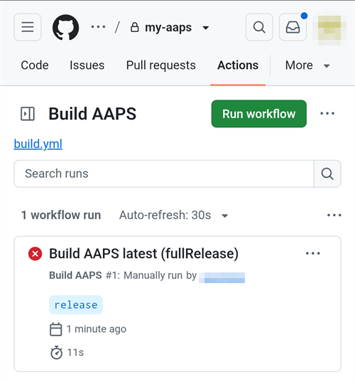
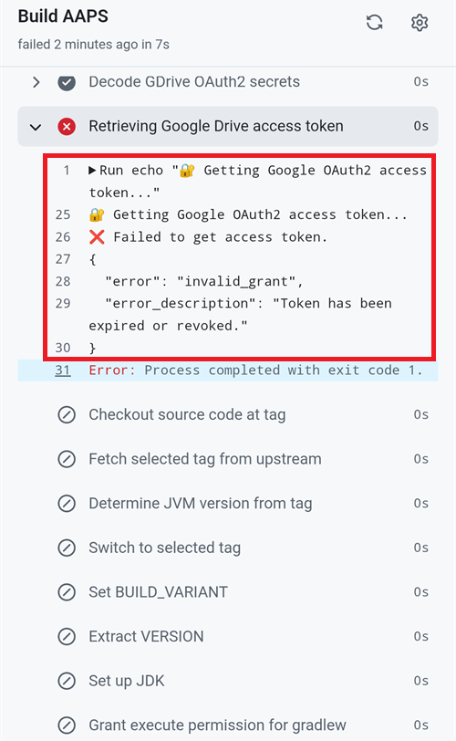
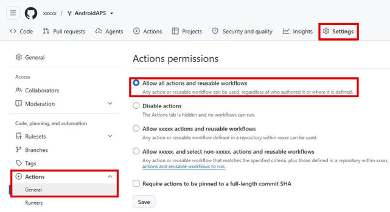

(aaps-ci-troubleshooting)=

# Kūrimas naršyklėje: trikčių šalinimas

```{note}
This page collects troubleshooting tips for the [Browser build](../SettingUpAaps/BrowserBuild.md).
```

(aaps-builder-troubleshooting)=

## AAPS Builder

### Step 1: the repository

(aaps-builder-ts-repo-exists)=

#### "my-aaps already exists in this account"


You already have this repository, for example from an earlier attempt. Close the GitHub tab, keep that name in step 1 of the setup page and go on. If you already did steps 2 and 3 for it, your key is still in it: continue with [step 4](#aaps-builder-step4). If it was made with an earlier version of the setup page, update its workflow once as explained in [Updating AAPS](#aaps-builder-updates). You prefer a fresh start? Type another name, for example `my-aaps-2`, and use the same keystore in step 2.

(aaps-builder-ts-user-not-found)=

#### "No GitHub user with this name"


- **„No GitHub user with this name“** 1 žingsnyje: įveskite savo GitHub naudotojo vardą, kaip jis rodomas jūsų GitHub profilyje, ne el. pašto adresą.
- **Nėra mygtuko „Build AAPS“ arba „Run workflow“, arba saugykla tuščia**: saugykla nebuvo sukurta iš šablono. Ištrinkite ją (**Settings** → puslapio apačia → **Delete this repository**) ir dar kartą atlikite [1 žingsnį](#aaps-builder-step1) su mygtuku **Create my private repository**.

### Step 3: the secret

(aaps-builder-ts-404)=

#### "Page not found" (404)


- **„Page not found“ (404), kai sąrankos puslapis atidaro GitHub**: toje pačioje naršyklėje prisijunkite prie github.com (kai nesate prisijungę, GitHub privačioms saugykloms rodo 404). Jei esate prisijungę, sąrankos puslapio 1 žingsnyje nurodytas naudotojo vardas arba saugyklos pavadinimas nesutampa su jūsų saugykla. Įveskite tikslius pavadinimus.

### Step 4: the build

(aaps-builder-ts-workflow-not-found)=

#### "This workflow does not exist"


Right after the repository is created, GitHub may not have read its workflow file yet: **Build AAPS** is missing from the **Actions** tab, and there is no **Run workflow** button. Any small change to the file makes GitHub read it:

1. In your repository, open **Code**, then the folder `.github`, then `workflows`, then the file `build.yml`.
2. Tap the **⋯** menu at the top right of the file, then **Edit file… In place** (on a computer, click the pencil).

   

3. Tap at the very end of the text and add an empty line (Enter). Tap **Commit changes…** at the top.

   

4. Tap **Commit changes** again.

   

5. Open the **Actions** tab again: **Build AAPS** is now in the list of workflows (on a phone, the list opens with the icon at the left of **All workflows**). Tap it, then **Run workflow**.

   

(aaps-builder-ts-build-failed)=

#### The build failed (red cross)

1. On the setup page, tap **Open my builds** and tap the build with the red cross.

   

2. The page of the build shows **Failure**, and which part failed: **AAPS / Check** (the repository, the secret, the version or the variant: nothing was built) or **AAPS / Build AAPS**.

   

3. Scroll down to **Annotations**, with your finger on the text, not on the diagram. The red lines explain the problem: tap **Show more** to read the whole message, then find it below.

   

- **„Secret KEYSTORE_SET is missing“**: atlikite sąrankos puslapio 3 žingsnį.
- **Kūrimas sustoja su pranešimu „This repository is PUBLIC“**: savo saugykloje atidarykite **Settings** → **General** → **Danger Zone** → **Change visibility** → **Private**, tada kurkite dar kartą.
- **"Version … does not exist"**: only released versions of **AAPS** can be built, the ones on the [tags page](https://github.com/nightscout/AndroidAPS/tags) of nightscout/AndroidAPS, such as `3.3.2.0`. A branch name such as `dev` doesn't work. Use `latest`, or type a tag exactly as listed.
- **„Variant … is not supported“**: jūsų darbo eigos failas yra senesnės versijos. Pakeiskite jį, kaip aprašyta skyriuje [AAPS atnaujinimas](#aaps-builder-updates).
- **„The secret is too short“**, **„The secret is not a valid code“** arba **„The secret does not contain a keystore“**: į slaptąją reikšmę įklijuotas netinkamas tekstas, dažnai pats žodis `KEYSTORE_SET` arba tik dalis kodo. Savo saugykloje atidarykite **Settings** → **Secrets and variables** → **Actions**, redaguokite `KEYSTORE_SET` ir dar kartą įklijuokite ilgą kodą iš **Copy secret** (jei sąrankos puslapį uždarėte, pirmiausia iš naujo atlikite jo 2 žingsnį).
- **„Keystore, password or alias is wrong“**: patikrinkite savo raktų saugyklos slaptažodį ir pseudonimą, tada iš naujo atlikite sąrankos puslapio 2 ir 3 žingsnius.
- **„Google Drive access has expired or was revoked“**: iš naujo atlikite [6 žingsnį](#aaps-builder-google-drive) ir atnaujinkite slaptąją reikšmę `GDRIVE_OAUTH2`.
- **Another error**: [read the build log](#aaps-ci-read-the-logs), then [run the build again](#aaps-ci-rerun). If it fails again the same way, ask for help with the name of the failed step and the error lines. Niekada nesidalykite savo slaptųjų reikšmių turiniu.

### Step 5: the app

- **Nėra nuorodos Download arba atsidarė GitHub programėlė**: GitHub programėlė negali atsisiųsti kūrimų. Atidarykite kūrimą Chrome, kaip aprašyta [5 žingsnyje](#aaps-builder-step5). Kad GitHub nuorodos nebūtų atidaromos programėlėje: Android **Settings** → **Apps** → **GitHub** → **Open by default** → išjunkite **Open supported links**.

## AAPS-CI trikčių šalinimas

(aaps-ci-read-the-logs)=
### Pirmiausia: išsiaiškinkite, kas nutiko

Kai kūrimas nepavyksta, GitHub išsaugo kiekvieno žingsnio žurnalą. Žurnale matyti, kuris žingsnis nepavyko ir kodėl. Perskaitykite jį prieš bandydami ką nors kita: klaidos pranešimo ieškokite šiame puslapyje, jo paprašys ir padėti norintys žmonės.

1. Savo AndroidAPS kopijoje GitHub atidarykite **Actions**. Nepavykęs kūrimas pažymėtas raudonu kryželiu. Bakstelėkite jo pavadinimą.

   

2. Paleidimo suvestinėje rodoma **Failure** (nesėkmė), o žemiau – nepavykusi užduotis (**Build AAPS** su raudonu kryželiu).

   

3. Slinkite žemyn iki **Annotations** ir bakstelėkite raudoną eilutę **Build AAPS**.

   

4. Atsidaro užduotis. Žingsniai su pilka varnele pavyko. Žingsnis su raudonu kryželiu yra tas, kuris nepavyko: GitHub jį atidaro už jus. Po jo esantys žingsniai buvo praleisti (pilkas apskritimas).

   

5. Perskaitykite eilutes, esančias tiesiai virš `Error: Process completed with exit code 1.`: jose paaiškinta problema. Šiame pavyzdyje žingsnis **Retrieving Google Drive access token** nepavyko su klaida `invalid_grant` ir `Token has been expired or revoked.`, žr. [Baigėsi Google atnaujinimo rakto (refresh token) galiojimas](#aaps-ci-google-token-expired).

   

```{tip}
Prašote pagalbos? Pateikite nepavykusio žingsnio pavadinimą ir klaidos eilutes (tinka ekrano nuotrauka, kaip aukščiau). Niekada nesidalykite savo slaptųjų reikšmių turiniu.
```

(aaps-ci-update-secret)=
#### Slaptosios reikšmės atnaujinimas

Daug pataisymų reiškia slaptosios reikšmės (secret) pakeitimą. Savo AndroidAPS kopijoje GitHub eikite į **Settings** → **Secrets and variables** → **Actions** ir bakstelėkite pieštuką šalia slaptosios reikšmės.


Įveskite arba įklijuokite naują reikšmę ir bakstelėkite **Update secret**. GitHub niekada nerodo senos reikšmės: laukas visada tuščias.


(aaps-ci-rerun)=
#### Kūrimo paleidimas iš naujo po pataisymo

Kai pašalinote priežastį, nereikia pradėti nuo pradžių: atidarykite nepavykusį paleidimą, bakstelėkite **...** (viršuje dešinėje), tada **Re-run failed jobs**.


Bakstelėkite **Re-run jobs**. Taip pat galite, kaip įprasta, pradėti naują kūrimą per **Run workflow**.


(aaps-ci-preparation-web)=
### Tinklalapis aaps-ci-preparation
  - Paruošimo puslapį rodo laikinas vietinis serveris (pavyzdžiui, Simple Web Server kompiuteryje), kuris taip pat gauna Google atnaujinimo raktą.
  - Jei matote toliau pateiktą ekraną, vietinis serveris sustojo arba yra nepasiekiamas.
  - Uždarykite paruošimo puslapį, patikrinkite, ar vietinis serveris veikia, tada vėl atidarykite aaps-ci-preparation.html taip pat, kaip 2 žingsnyje, ir atlikite likusius veiksmus. To ypač reikia, kai sąrankos metu pirmą kartą kuriamas ryšys su Google.

  

(aaps-ci-google-token-expired)=
### Baigėsi Google atnaujinimo rakto (refresh token) galiojimas
  - Google OAuth2 atnaujinimo raktų galiojimas baigiasi, jei jie nenaudojami 6 mėnesius. Jie taip pat gali tapti negaliojantys ir kitais atvejais (pvz., pakeitus Google paskyros slaptažodį arba rankiniu būdu atšaukus prieigą). Daugiau informacijos rasite [Google OAuth2 dokumentacijoje](https://developers.google.com/identity/protocols/oauth2).
  - [Kūrimo žurnale](#aaps-ci-read-the-logs) žingsnis **Retrieving Google Drive access token** nepavyksta su klaida `invalid_grant` ir `Token has been expired or revoked.`:

  

  - Jei kūrimas nepavyksta dėl pasibaigusio arba atšaukto Google atnaujinimo rakto, turite pakartoti [Google Drive autorizacijos](#aaps-ci-google-drive-auth) veiksmus ir gauti naują raktą `GDRIVE_OAUTH2`, [atnaujinti slaptąją reikšmę](#aaps-ci-update-secret) savo GitHub saugykloje, tada [vėl paleisti kūrimą](#aaps-ci-rerun).
  - Jei autorizacija vėl nepavyksta arba Google nebeprašo jūsų sutikimo, pirmiausia pašalinkite esamą AAPS prieigą iš savo Google paskyros, žr. [toliau](#aaps-ci-google-remove-access).

(aaps-ci-google-remove-access)=
### AAPS prieigos pašalinimas iš Google paskyros ir autorizacijos pradėjimas iš naujo
  - Jei Google Drive autorizacija vis nepavyksta arba norite pradėti viską iš naujo, pirmiausia pašalinkite anksčiau AAPS suteiktą prieigą, tada atlikite autorizaciją dar kartą.
  - Telefone atidarykite [https://myaccount.google.com](https://myaccount.google.com), bakstelėkite **Security** (sauga), slinkite žemyn iki **Your connections to third-party apps & services** (jūsų ryšiai su trečiųjų šalių programomis ir paslaugomis) ir atidarykite susietų programų sąrašą. Taip pat galite eiti tiesiai į [https://myaccount.google.com/connections](https://myaccount.google.com/connections).
  - Sąraše bakstelėkite **AAPS**.

  

  - Puslapyje rodoma prieiga, kurią suteikėte AAPS (Google Drive failai, naudojami su programa). Bakstelėkite **Delete all** (ištrinti viską), kad pašalintumėte ryšį, arba **See details** (žiūrėti išsamiau), kad pirmiausia jį peržiūrėtumėte.

  

  - Išsamios informacijos puslapyje bakstelėkite **Remove all access** (pašalinti visą prieigą).

  

  - Bakstelėkite **Confirm** (patvirtinti).

  

  - Google patvirtina, kad AAPS nebeturi prieigos. AAPS nebėra susietų programų sąraše.

  

  - Dabar pradėkite autorizaciją iš naujo: uždarykite **abu** – paruošimo puslapį ir failų tvarkyklės programėlę, vėl atidarykite aaps-ci-preparation.html iš failų tvarkyklės ir pakartokite [Google Drive autorizacijos](#aaps-ci-google-drive-auth) veiksmus. Google vėl paprašys suteikti prieigą, o puslapis pateiks naują raktą `GDRIVE_OAUTH2`.
  - [Atnaujinkite slaptąją reikšmę `GDRIVE_OAUTH2`](#aaps-ci-update-secret) savo GitHub saugykloje nauju raktu, tada [vėl paleiskite kūrimą](#aaps-ci-rerun).

(aaps-ci-disable-software)=
### Išjunkite programinę įrangą, kuri gali trukdyti OAuth patvirtinimui
  - Prieš bandydami gauti OAuth raktą, išjunkite telefone visas VPN ir saugos programėles (užkardą, apsaugą nuo kenkėjiškų programų ir pan.).

(aaps-ci-actions-permission)=
### Patikrinkite GitHub Actions leidimų nustatymus
  - Įsitikinkite, kad GitHub Actions taisyklės nustatytos į „Allow all actions and reusable workflows“ (Settings → Actions → General). Jei tai pakeitėte, paspauskite **Save** po parinktimis.

  

`actions/checkout@v4` and `actions/setup-java@v4` are not allowed to be used in `xxxxx/AndroidAPS`. Actions in this workflow must be: within a repository owned by `xxxxx`

(aaps-ci-workflow-permissions)=
### Patikrinkite GitHub darbo eigos (workflow) leidimų nustatymus
  - Jei kūrimas iškart nutrūksta su klaida „Invalid workflow file“, panašia į toliau pateiktą, jūsų saugyklos numatytieji darbo eigos leidimai yra per griežti:

```
Invalid workflow file
The workflow is not valid. .github/workflows/aaps-ci.yml (Line: 361, Col: 3):
Error calling workflow 'xxxxx/AndroidAPS/.github/workflows/cleanup-workflow-runs.yml@...'.
The nested job 'cleanup' is requesting 'actions: write', but is only allowed 'actions: none'.
```

  - Įsitikinkite, kad darbo eigos leidimai nustatyti į „Read and write permissions“ (Settings → Actions → General → Workflow permissions), tada išsaugokite ir vėl paleiskite kūrimo darbo eigą.

  

(aaps-ci-password-special-characters)=
### Kūrimas nepavyksta tikrinant raktų saugyklos slaptažodį
  - [Kūrimo žurnale](#aaps-ci-read-the-logs) žingsnis **Validating keystore, alias and password** nepavyksta su klaida `Either KEYSTORE_BASE64, KEYSTORE_PASSWORD, KEY_PASSWORD, or KEY_ALIAS is incorrect`, po kurios eina `Keystore was tampered with, or password was incorrect`. Kūrimas ten sustoja: raktų saugykla (keystore) ir slaptažodžiai patikrinami prieš kuriant AAPS.

  

  - Kūrimo darbo eiga išsaugo kiekvieną jūsų slaptažodžių simbolį nepakeistą. Įveskite `KEYSTORE_PASSWORD` ir `KEY_PASSWORD` tiksliai tokius, kokie jie yra, nepridėdami atvirkštinio pasvirojo brūkšnio ar kito kaitos (escape) simbolio. Jei pridėjote atvirkštinių pasvirųjų brūkšnių, [atnaujinkite slaptąsias reikšmes](#aaps-ci-update-secret), įvesdami slaptažodį tiksliai tokį, koks jis yra. Toliau pateiktas pavyzdys yra neteisingas: slaptažodis yra `Example2026`, o atvirkštinis pasvirasis brūkšnys buvo pridėtas.

  

  - Jei kūrimas vis tiek nepavyksta pasirašant APK, nors slaptažodis teisingas, o slaptažodyje yra `$`, atvirkštinė kabutė (backtick), `"` arba `\`, jūsų fork darbo eigos failas yra senesnis nei 2026 m. rugsėjis ir vis dar apdoroja šiuos simbolius. [Sinchronizuokite savo fork](#Update-to-new-version-update-your-repo) su naujausia dev versija, tada vėl paleiskite kūrimo darbo eigą.
  - Vertikalus brūkšnys `|` yra ypatingas atvejis. [1 varianto](#aaps-ci-option1) paruošimo puslapis sujungia raktų saugyklą, slaptažodžius ir alias į vieną slaptąją reikšmę `KEYSTORE_SET`, atskirdamas juos simboliu `|`, o darbo eiga pagal šį simbolį juos vėl atskiria. Paruošimo puslapio sugeneruotame slaptažodyje yra tik raidės ir skaitmenys, todėl naudojant 1 variantą taip nutikti negali. Taip gali nutikti tik tada, jei slaptąją reikšmę `KEYSTORE_SET` sudarėte patys iš slaptažodžio, kuriame yra `|`. Tokiu atveju ištrinkite `KEYSTORE_SET` ir vietoj jos įveskite atskiras [2 varianto](#aaps-ci-option2) slaptąsias reikšmes.
