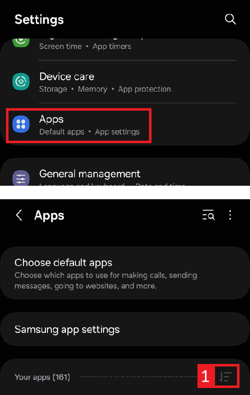
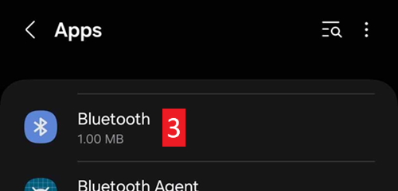
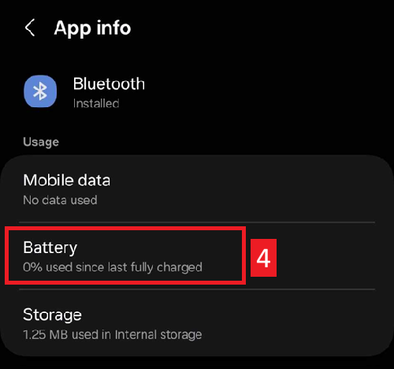

(generaltroubleshooting)=

# Troubleshooting

**Pradėkite čia, kai kas nors neveikia.** Informacija apie trikčių šalinimą yra daugelyje dokumentacijos puslapių. Šiame puslapyje ji surinkta į vieną vietą: tai nuorodų rinkinys, surūšiuotas pagal temas, kuris padės išspręsti dažniausias problemas.

Jei toliau atsakymo nerandate, taip pat peržiūrėkite:

* [DUK](../UsefulLinks/FAQ.md) – atsakymus į dažnus klausimus, ir
* [profilio derinimo vadovą](ProfileTuning.md), jei ciklas veikia, bet gliukozės kontrolę reikia pagerinti.

```{admonition} Still stuck?
:class: tip
Jei nė viena nuoroda problemos neišsprendžia, skaitykite [Kur gauti pagalbos?](WhereCanIGetHelp.md) ir klauskite bendruomenės (Facebook, Discord) arba nusiųskite savo [žurnalų failus](AccessingLogFiles.md) kūrėjams.
```

---

(generaltroubleshooting-aaps-app)=

## AAPS app

### Building & updating

* Jei kūrimas nepavyksta, žr. [Jei kūrimas nepavyksta](#building-aaps-troubleshooting): ten nurodytas kiekvieno kūrimo būdo trikčių šalinimo skyrius:
  * [AAPS Builder](#aaps-builder-troubleshooting)
  * [Browser build](#aaps-ci-troubleshooting)
  * [Android Studio](TroubleshootingAndroidStudio.md)
* Prarasta raktų saugykla arba nauja raktų saugykla: [AAPS įdiegimas iš naujo](#reinstall-aaps)
* **AAPS** atnaujinimas: [su AAPS Builder](#aaps-builder-updates), [kuriant naršyklėje (fork)](#update-browser-build-troubleshooting), [su Android Studio](#update-computer-build-troubleshooting)

### Installing

* [Google Play Protect įspėjimas](#transferring-installing-play-protect-warning): programėlė pažymėta kaip nesaugi.
* Diegimas **užblokuotas** su pranešimu apie nepatvirtintą kūrėją: nemokamus diegimo būdus rasite skyriuje [Android kūrėjų tapatybės patikrinimas](#android-developer-verification).

### Parametrai

* [Profilis: „Bazė nesuderinama su šiuo metu naudojama pompa“](#your-aaps-profile-basal-not-compatible)
* [Pompa: „Duomenys gaunami iš kitos pompos“](#config-builder-wrong-pump-data)
* [Nightscout klientas (NSClient)](TroubleshootingNsClient.md)
* **"AAPS settings cannot be read"** at start: the settings are encrypted with a key that Android keeps for **AAPS**, and that key does not open them any more, for example after the key store of the phone was reset. While this screen is shown, **AAPS** is not running and does not control the pump. Tap **Retry**: it closes and restarts **AAPS**. If that does not help, restart the phone. Use **Start fresh** only when nothing else helps: it sets the unreadable settings file aside (it is renamed and kept) and starts **AAPS** with empty settings. Then import your last [settings export](../Maintenance/ExportImportSettings.md).

### Naudojimas

* [Neteisingos angliavandenių reikšmės (lėtas angliavandenių įsisavinimas)](#CobCalculation-detection-of-wrong-cob-values)
* [Automatizacijos](#automations-troubleshooting)
* [Visiškai uždaras ciklas](#full-closed-loop-troubleshooting)

---

(generaltroubleshooting-bluetooth-related-issues)=


## Su Bluetooth susijusios problemos

Dėl žinomų Bluetooth ryšio problemų, pompos / Pod ryšio nutrūkimų arba aktyvavimo ir prisijungimo problemų žr. [Bluetooth trikčių šalinimas](../GettingHelp/BluetoothTroubleshooting.md)

---

(generaltroubleshooting-android-related-issues)=

## Su Android susijusios problemos

### Baterijos optimizavimas

**AAPS** gali padėti rasti tinkamus nustatymus jūsų telefonui: atidarykite **meniu** (☰) > **Apie** ir paspauskite **Don't kill my app?**. Atsidarys jūsų telefono gamintojo instrukcijos svetainėje [Don't kill my app](https://dontkillmyapp.com/). [Sąrankos vedlys](#setup-wizard-bluetooth-battery-optimisation) taip pat paprašo išjungti baterijos optimizavimą **AAPS** ir Bluetooth.

Android turi baterijos taupymo nustatymus, kurie įjungti iš anksto. Šie nustatymai automatiškai sustabdo programėles, kurios nėra būtinos sistemos veikimui. Taip taupoma baterija, kurią naudoja programėlės, neturinčios veikti visą laiką.

Kai jis įjungtas, labai tikėtina, kad kils problemų **AAPS** ir kitoms pagalbinėms programėlėms, pvz., **xDrip**.

Svarbu išjungti baterijos optimizavimą, kad **AAPS** ir kitos pagalbinės programėlės visada veiktų.

Depending on your phone model and make there may be more than one location and setting which needs to have this disabled.

***PASTABA:** jei jūsų telefone yra ši galimybė, atlikite toliau nurodytus veiksmus ir išjunkite baterijos optimizavimą Bluetooth paslaugai. Tais pačiais veiksmais galite jį išjungti ir **AAPS** bei kitoms programėlėms, tačiau ekrano kopijose parodyta tik Bluetooth paslauga.*

#### Pixel telefonai (standartinė Android versija)

* Atidarykite Android nustatymus ir pasirinkite „Apps“.

  

* Select "See all apps"

  

* On the menu on the right, select "Show system" apps.

  

* Now search and select the app "Bluetooth".

  

* Paspauskite „App battery usage“ ir pasirinkite „Unrestricted“ (kai kuriose senesnėse Android versijose – „Not optimized“).

  


#### Samsung telefonai

* Atidarykite Android nustatymus ir pasirinkite „Apps“.

* Paspauskite piktogramą, kuri keičia rūšiavimą (1), ir pasirinkite „Show system apps“ (2).

  

  

* Dabar suraskite Bluetooth programėlę ir ją pasirinkite, kad pamatytumėte jos nustatymus.

  

* Select "battery".

  

* Nustatykite „Unrestricted“ (kai kuriose senesnėse Android versijose – „Not optimized“).

  

#### Huawei telefonai

Žr. vadovą [Huawei: Bluetooth ir baterijos optimizavimas](../CompatiblePhones/Huawei.md)

---

(generaltroubleshooting-cgm)=

## Nuolatinis gliukozės jutiklis (NGJ)

Naudingos nuorodos į žinomas NGJ problemas ir jų sprendimo veiksmus.

* [Bendra informacija](#general-cgm-troubleshooting)
* [Dexcom G6](#DexcomG6-troubleshooting-g6)
* [Libre 2 su Minimal Looper](#minimallooper-troubleshooting)
* [Libre 3](#libre3-experiences-and-troubleshooting)
* [xDrip – nėra NGJ duomenų](#xdrip-identify-receiver)
* [xDrip – Dexcom trikčių šalinimas](#xdrip-troubleshooting-dexcom-g5-g6-and-xdrip)

---

(generaltroubleshooting-pumps)=

## Pompos

Naudingos nuorodos į žinomas pompų problemas ir jų sprendimo veiksmus

* [Accu-Chek Combo](#combov2-tips-for-basic-usage)
* [Accu-Chek Insight](#Accu-Chek-Insight-Pump-insight-specific-errors)
* [CareLevo](#carelevo-alarms-and-notifications)
* [DanaRS](#DanaRS-Insulin-Pump-dana-rs-specific-errors)
* [Diaconn G8](#diaconn-g8-bluetooth-troubleshooting)
* [EOPatch2](#eopatch2-alarms-and-warnings)
* [Medtronic + RileyLink](#MedtronicPump-what-to-do-if-i-loose-connection-to-rileylink-and-or-pump)
* [Medtrum Nano](#medtrum-nano-troubleshooting)
* [Omnipod DASH](#omnipod-dash-troubleshooting)
* [Omnipod Eros](#OmnipodEros-troubleshooting)

---

(generaltroubleshooting-phones)=

## Telefonai

Naudingos nuorodos į žinomas telefonų problemas ir jų sprendimo veiksmus

* [List of tested phone and device setups](https://docs.google.com/spreadsheets/u/1/d/e/2PACX-1vScCNaIguEZVTVFAgpv1kXHdsHl3fs6xT6RB2Z1CeVJ561AvvqGwxMhlmSHk4J056gMCAQE02sAWJvT/pubhtml?gid=683363241&single=true)
* [Jelly](../CompatiblePhones/Jelly.md)
* [Huawei: Bluetooth ir baterijos optimizavimas](../CompatiblePhones/Huawei.md)

---

(generaltroubleshooting-remote-control)=

## Remote control

* [AAPSClient ir nuotolinis valdymas (susiejimas, komandos negaunamos)](#client-master-control-troubleshooting)
* [Problemos su 'Nightscout prieigos raktu'](#remotecontrol-nightscout-access-token)
* [SMS commands](#SMSCommands-troubleshooting)
* [Android Auto](#android-auto-troubleshooting)

---

(generaltroubleshooting-smartwatches)=

## Išmanieji laikrodžiai

Naudingos nuorodos į žinomas išmaniųjų laikrodžių problemas ir jų sprendimo veiksmus

* [Wear programėlės trikčių šalinimas](#Watchfaces-troubleshooting-the-wear-app)
* [Laikrodis ir telefonas nesusisiekia](#wear-os-watch-phone-communication)
* [Wear OS 5](#wear-os-5-troubleshooting)
* [Building the Wear app](#building-aaps-wear-os-troubleshooting)
