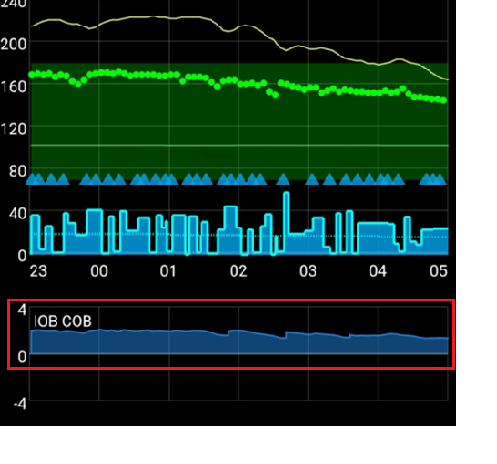
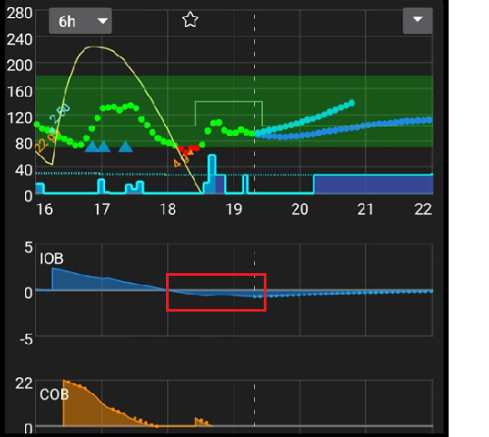

# AAPS profilio derinimas

```{admonition} This is NOT a medical advice
:class: warning
Dėl pagalbos ir patarimų, kaip valdyti diabetą, kreipkitės į savo gydymo komandą.</br>
Naudokite šį vadovą tik tada, kai jau [teisingai nustatėte savo **profilį**](https://androidaps.readthedocs.io/en/latest/SettingUpAaps/YourAapsProfile.md) ir įvykdėte visus **AAPS** mokymo etapus.
```

Šiame vadove paaiškinama, kokius rezultatus OpenAPS algoritmas pateikia su konkrečiu __profiliu__, ir kurias **AAPS** reikšmes galima keisti, kai pastebite tam tikras situacijas ar dėsningumus. Toliau pateikti patarimai dėl valandinės bazės tikrinimo gali skirtis nuo to, ką pataria jūsų gydymo komanda.

**Uždaras ciklas** gali palengvinti valandinės bazės tikrinimą ir gerokai sumažinti hipoglikemijos riziką, jei jūsų __profilio__ valandinė bazė per stipri.

## Kaip keisti profilio nustatymus

1. Įsitikinkite, kad perskaitėte ir supratote toliau pateiktus __AAPS__ rekomenduojamus nustatymus ir patarimus. Jei šių patarimų nesilaikysite, derinti bus sunkiau ir mažiau tikėtina, kad gausite gerai suderintą __profilį__
2. **Kelias dienas** atidžiai stebėkite ir lyginkite, kas vyksta su jūsų __KG__ ir __AIO__.
3. Ieškokite dėsningumų **AAPS** duomenyse, kurie kartojasi (beveik) kasdien apie tą patį laiką.
4. Svarbu tai daryti kelias dienas. Jei sprendimus dėl __profilio__ keitimo priimate pagal vienos dienos duomenis, rezultatai dažnai būna prasti.
5. Tik pastebėję pasikartojantį dėsningumą, pvz., 13 val. jūsų __KG__ šokteli arba __AIO__ tampa neigiamas, pradėkite po truputį keisti savo __profilį__.
6. Svarbu vienu metu keisti tik vieną dalyką. Pvz., padidinkite valandinę bazę 10 % apie 13 val.
7. Po kiekvieno pakeitimo svarbu kelias kitas dienas stebėti, kaip jis veikia jūsų __KG__ ir __AIO__.
8. Kartokite šiuos veiksmus: stebėkite, nuspręskite, jei reikia, vėl pakoreguokite

Neskubėkite, darykite tai lėtai!

## Rekomenduojami nustatymai ir patarimai derinant valandinę bazę

- Visus bandymus atlikite [įjungę uždarą ciklą](#AapsScreens-loop-status).
- **Išjunkite (<u>OFF</u>) visas [automatizacijas](../DailyLifeWithAaps/Automations.md)**
- **Išjunkite (<u>OFF</u>) [DynISF](#Open-APS-features-DynamicISF), [AutoISF](#Open-APS-features-auto-isf), [AutoSens](#Open-APS-features-autosens)**, kad jie nebandytų pritaikyti jūsų profilio.
- Bandymo metu nieko nedarykite rankiniu būdu (rankinis bolusas, laikini tikslai ir pan.): leiskite sistemai naudoti tik **profilio** nustatymus.
- [Papildomuose grafikuose](#AapsScreens-section-g-additional-graphs): 1 grafike rodykite Aktyvus insulinas organizme, Aktyvūs angliavandeniai organizme (ir Jautrumo pokyčiai). 2 grafike rodykite Nuokrypiai ir Glikemijos įtaka. Kai prašote patarimo, šiuos grafikus visada parodykite savo ekrano kopijose.
- AAO=0[*](#profiletuning-cob-zero)

Kitos aplinkybės, kurių geriausia vengti, nes jos veikia duomenis ir gali lemti klaidingas išvadas:
- Jokio fizinio aktyvumo.
- Jokio streso.
- Jokios ligos.
- Jokių ekstremalių oro sąlygų, pvz., labai aukštos ar žemos temperatūros.
- Jokių nepavykusių pompos ar NGJ sesijų.
- Jokių nedeklaruotų angliavandenių.

Taip pat atkreipkite dėmesį:
- Jei jūsų [valandinės bazės profilis](#your-aaps-profile-basal-rates) teisingas, kai KG tiksle, AAO=0[*](#profiletuning-cob-zero) ir AIO=0, KG visą laiką liks tiksle, kad ir koks būtų jūsų **JIF** (**JIF** naudojamas tik tada, kai esate virš **KG** tikslo).
- Reikia tikrinti ne tik dabartinį **AIO**, bet ir **AIO** grafiką, kad matytumėte, kaip **AIO** keitėsi per kelias pastarąsias valandas.

(profiletuning-cob-zero)=

***AAO = 0**

Tai reiškia, kad maistas suvirškintas ir jūsų organizme nebėra angliavandenių.

**AAPS** gali rodyti [AAO=0, nors organizme dar yra angliavandenių](../DailyLifeWithAaps/CobCalculation.md).

## [Profilio](../SettingUpAaps/YourAapsProfile.md) sąvokos

Per **stiprus profilis** rodo kurį nors iš šių dalykų arba jų derinį:

- [JIF](#your-aaps-profile-insulin-sensitivity-factor) skaičius per mažas.
- [Valandinės bazės](#your-aaps-profile-basal-rates) skaičius per didelis.
- [IA](#your-aaps-profile-insulin-to-carbs-ratio) skaičius per mažas.

## AIO stebėjimas

*Pastaba: norėdami matyti AIO per kelias dienas, Nightscout ataskaitose taip pat galite naudoti Loopalyzer AIO grafiką.*

Jei po kelių dienų pastebite šiuos dėsningumus, apsvarstykite šiuos pakeitimus:

### Teigiamas AIO

- **Profilio** valandinė bazė gali būti per silpna (tai taip pat gali būti dėl nedeklaruoto maisto, ligos, prasto insulino įsisavinimo infuzijos vietoje ir pan.)



### Neigiamas AIO

- Pagrindinė valandinė bazė per stipri.
- Gali būti ankstesnio sporto ar fizinio aktyvumo poveikis.


- Ankstesnis valgis: per didelis bolusas (dėl to labai ilgai buvo nulinė laikina bazė)



## KG tikslo stebėjimas

### Užstrigo aukštai

- __JIF__ skaičius didelis ir per silpnas (apskaičiuotas insulino kiekis per mažas)


- __Profilio__ valandinė bazė gali būti per silpna (**SMB** neturi pakankamai „valandinės bazės atsargos“)
- Galėjo suveikti apsauga ([MaxIOB](#Open-APS-features-maximum-total-iob-openaps-cant-go-over)?), kuri riboja insulino suleidimą. Patikrinkite **DKS** įskiepio ekrane (**Konfigūracija → DKS → Atidaryti įskiepį**); žr. [SMB](#Open-APS-features-super-micro-bolus-smb).
- Techninė problema: insulino įsisavinimas infuzijos vietoje, infuzijos rinkinys, ...

### Užstrigo žemai

- __JIF__ per stiprus, jo skaičių reikia padidinti
- __Profilio__ valandinė bazė per stipri (jei AIO taip pat neigiamas)

### Kalneliai (kilimai ir kritimai)

- **JIF** per stiprus? Žr. savo [AAPS profilį](#your-aaps-profile-insulin-sensitivity-factor)


## KG po valgio stebėjimas

### Greitas kilimas ir aukšta KG

- Maiste yra greitųjų angliavandenių (pvz., vaisių sulčių).
- Apsvarstykite išankstinį bolusą arba šiek tiek ankstesnį išankstinį bolusą.
- Bolusas (IA arba suleistas %) per silpnas.


### Greitas kilimas, po to žema KG

- Apsvarstykite išankstinį bolusą, jūsų **profilis** gali būti per agresyvus (per didelė kilimo korekcija)
- Bolusas per stiprus.


## [Kaip apskaičiuoti savo IA](#your-aaps-profile-insulin-to-carbs-ratio)

1. Pirmiausia jūsų **profilyje** turi būti teisingi pagrindinės valandinės bazės nustatymai.
2. Pradėkite, kai KG yra tiksle, geriausia be neigiamo AIO.
3. Užrašykite, kiek iš viso insulino suleista, ekrane **Valdymas → Pompa** (arba pompos istorijoje) ir pavadinkite tai pradžios insulinu. Labai tiksliai pasverkite žinomą angliavandenių porciją ir užrašykite pradžios laiką bei pradžios AIO. Tada įveskite angliavandenių ir boluso informaciją į **AAPS** naudodami boluso patarėją (su dabar nustatytu IA). Nepamirškite suvalgyti angliavandenių ;)
4. Po kelių valandų, kai AAO=0[*](#profiletuning-cob-zero) ir KG vėl tiksle, užrašykite pabaigos laiką ir pabaigos AIO, tada kaip ir anksčiau patikrinkite, kiek iš viso insulino suleista, ir pavadinkite tai pabaigos insulinu. *PASTABA: laikotarpio trukmė NESVARBI, jei tik jis ilgesnis už virškinimo laiką*
5. Nuo skirtumo tarp pradžios ir pabaigos insulino kiekio atimkite arba pridėkite skirtumą pabaigos AIO - pradžios AIO. Tada atimkite valandinės bazės insuliną, apskaičiuotą pagal jūsų **profilio** nustatymus.
6. Jei __KG__ yra tiksle, gausite visą insulino kiekį, kuris buvo panaudotas angliavandeniams „suvirškinti“. Apskaičiuokite savo **IA**.

### IA skaičiavimo paaiškinimai

- Jei **profilio** pagrindinė valandinė bazė teisinga, bet kuriuo laikotarpiu KG turi likti tiksle, o AIO būti artimas 0. Gaunate tik savo **profilio** valandinę bazę.
- Prie to pridedate angliavandenius ir bolusą. Palaukite, kol organizmas suvirškins visus angliavandenius ir **KG** vėl bus tiksle. Jūsų sunaudotas insulinas bus valandinės bazės ir angliavandeniams reikalingo insulino suma. Apskaičiuojate insuliną, kuris buvo naudotas valandinei bazei (pagal savo **profilį**), o likutis bus insulinas, panaudotas angliavandeniams suvirškinti.
- Jei laikotarpis per trumpas, dalis angliavandenių liks nesuvirškinta, todėl jūsų „angliavandeniams reikalingas insulinas“ bus neteisingas.
- Jei laikotarpis per ilgas, nieko blogo neatsitiks. Suvartosite visus angliavandenius ir gausite daugiau valandinės bazės. Pabaigoje atimsite valandinę bazę iš viso sunaudoto insulino, todėl ilgesnis laikotarpis (su daugiau valandinės bazės) rezultatui įtakos neturės.

Iš pradžių parašė @Robby (Discord), pasidalijęs patarimais, kaip suderinti savo **AAPS profilį**; peržiūrėjo ir pataisė bendruomenė (ačiū!).
