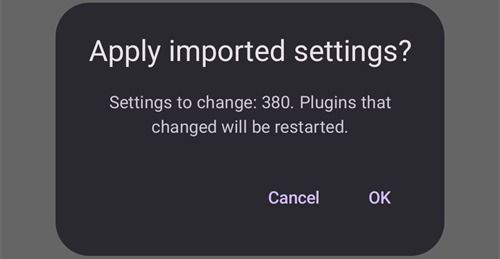

(reinstall-aaps)=
# AAPS įdiegimas iš naujo su nauja raktų saugykla

Kiekvienas **AAPS** apk failas pasirašomas **raktų saugykla** (keystore). Atnaujinimas įsidiegia ant dabartinės **AAPS** tik tada, jei jis pasirašytas **ta pačia raktų saugykla**: tada visi jūsų nustatymai ir duomenys išlieka. Todėl rekomenduojama raktų saugyklą ir jos slaptažodį laikyti saugioje vietoje.

Jei bandysite įdiegti apk, pasirašytą kita raktų saugykla nei anksčiau, gausite klaidos pranešimą, kad įdiegti nepavyko!

(reinstall-aaps-when)=
## Kada reikia įdiegti iš naujo?

**AAPS** reikia pašalinti ir įdiegti iš naujo, kai naujas apk pasirašytas kita raktų saugykla, pavyzdžiui:

- Nerandate senos raktų saugyklos arba jos slaptažodžio.
- Sukūrėte naują raktų saugyklą, pavyzdžiui, [kūrimo naršyklėje 1 variantu](../SettingUpAaps/BrowserBuildKeystore.md) arba su **Create a new key** (sukurti naują raktą) [AAPS Builder](../SettingUpAaps/BrowserBuildAapsBuilder.md) puslapyje.
- Kuriate naujame kompiuteryje ir į jį nenukopijavote savo raktų saugyklos.

Jei raktų saugyklą vis dar turite, šis puslapis jums nereikalingas: naudokite ją ir tiesiog [atnaujinkite **AAPS**](../Maintenance/UpdateToNewVersion.md).

(reinstall-aaps-before)=
## Prieš pradedant

- Pašalinus **AAPS**, ištrinami visi jos nustatymai, jūsų [mokymo etapai](../SettingUpAaps/CompletingTheObjectives.md) ir dabartinis ryšys su pompa. Juos atgausite importavę savo **nustatymų failą**, todėl įsitikinkite, kad turite naują jo kopiją.
- Nustatymų faile nėra jūsų terapijos ir gliukozės istorijos. Jei duomenis siunčiate į [Nightscout](../SettingUpAaps/SettingUpTheReportingServer.md), po įdiegimo iš naujo galėsite juos įkelti atgal (8 žingsnis).
- You need your [**master password**](#Preferences-master-password): the settings file is encrypted with it. Resetting a forgotten master password does not help here: a settings file can only be imported with the password it was exported with (see [How to reset the master password?](#FAQ-reset-master-password)).
- **Omnipod ir Medtrum naudotojai:** pirmiausia perskaitykite [Pompos be vamzdelio](#ExportImportSettings-tubeless-pumps). Jūsų nustatymų failas turi būti eksportuotas naudojant tą Pod ar pompą (patch), kurią nešiojate dabar.
- Jei reikia, prieš pradėdami [nustatykite savo NGJ / glikemijos šaltinio imtuvą](../Getting-Started/CompatiblesCgms.md).

(reinstall-aaps-steps)=
## Žingsniai

Paveikslėliuose parodytas perėjimas nuo **AAPS** 3.4 (1–3 žingsniai) prie **AAPS** 4 (6–8 žingsniai). Kitos versijos atrodo šiek tiek kitaip.

(reinstall-aaps-export)=
### 1. Eksportuokite nustatymus

Eksportuokite nustatymus su ta **AAPS**, kuri dabar įdiegta jūsų telefone. Daugiau informacijos rasite skyriuje [Nustatymų eksportavimas](#ExportImportSettings-Settings-Export).

**AAPS** 3.4 versijoje: atidarykite **Servisas** ir paspauskite **Export options** (eksportavimo parinktys). Skiltyje **User Settings** (naudotojo nustatymai) pažymėkite **Local Storage** (vietinė saugykla) ir paspauskite **OK**.

*Pastaba: atsarginei kopijai taip pat galite naudoti [debesies saugyklą](#preferences-maintenance-cloud): tai gera mintis, bet palikite vietinę saugyklą, kad nustatymus atkurtumėte greitai.*

Dabar mygtuke parašyta **Export settings (local)** (eksportuoti nustatymus į vietinę saugyklą). Paspauskite jį.

**AAPS** parodo failo, kurį sukurs, pavadinimą. Paspauskite **OK**, įveskite pagrindinį slaptažodį ir paspauskite **OK**.

**AAPS** 4 versijoje: atidarykite **Servisas**, šalia **Eksportuoti nustatymus** pasirinkite ženklelį **Vietinė saugykla** ir paspauskite **Eksportuoti nustatymus**.

(reinstall-aaps-copy)=
### 2. Nukopijuokite nustatymų failą iš telefono

Failas yra jūsų [**AAPS** aplanko](#SetupWizard-StoragePermission) poaplankyje **preferences**, jo pavadinimas panašus į `2026-10-13_222735_full.json`. Nukopijuokite arba įkelkite jį į kitą vietą (pvz., į savo kompiuterį, debesies saugyklos paslaugą...). Pašalinus programėlę, failas paprastai lieka telefone, bet dėl visa ko laikykite kopiją kitur.

(reinstall-aaps-nightscout-before)=
### 3. Sinchronizuokite su Nightscout

Šis žingsnis nebūtinas, bet rekomenduojamas, jei naudojate [DynISF](#Open-APS-features-DynamicISF): galėsite iš karto tęsti su dabartiniais nustatymais, užuot laukę 5 dienas, kol įskiepis surinks reikalingus duomenis. NSClient V3 turi būti [įjungtas ir sukonfigūruotas](../SettingUpAaps/SettingUpTheReportingServer.md).

Prieš pašalindami programėlę įsitikinkite, kad Nightscout turi visus jūsų duomenis.

Atidarykite **NSClient**, ekrano apačioje paspauskite mygtuką **Pilna sinchronizacija**, tada **OK**.

*Pastaba: reikalingas laikas priklauso nuo jūsų Nightscout talpinimo paslaugos.*

Tada **AAPS** pasiūlo išvalyti savo duomenų bazę. **OK** ištrina iš telefono senesnius nei 3 mėnesių duomenis, todėl sinchronizacija vyksta daug greičiau. **Atšaukti** sinchronizuoja be valymo. Pašalinus programėlę, telefono duomenų bazė vis tiek ištrinama, todėl tinka abu variantai.

Palikite **AAPS** veikti, kol sinchronizacija baigsis.

(reinstall-aaps-build)=
### 4. Sukurkite naują apk

[Sukurkite](../SettingUpAaps/BuildingAaps.md) naują pasirašytą apk su nauja raktų saugykla ir perkelkite jį į telefoną.

(reinstall-aaps-uninstall)=
### 5. Pašalinkite AAPS

Telefono **Settings** > **Apps** > **AAPS** paspauskite **Uninstall** (pašalinti) ir patvirtinkite su **OK**.

(reinstall-aaps-install)=
### 6. Įdiekite ir paleiskite naująją AAPS

[Įdiekite](../SettingUpAaps/TransferringAndInstallingAaps.md) naują apk ir paleiskite **AAPS**. [Sąrankos vedlys](../SettingUpAaps/SetupWizard.md) paprašys leidimų, kurių reikia **AAPS**: kiekvienam jų paspauskite **Suteikti**. Taip vėl išjungiamas ir [baterijos optimizavimas](#setup-wizard-bluetooth-battery-optimisation).

Ties **AAPS aplankas** pasirinkite tą patį **AAPS** aplanką kaip anksčiau (tą, kuriame yra aplankas **preferences**), paspauskite **Use this folder** (naudoti šį aplanką) ir **Allow** (leisti).

Kai **AAPS** randa jūsų eksportuotus nustatymus, sąrankos vedlys parodo ekraną [Rasti išsaugoti nustatymai](#setup-wizard-import-settings), kuriame galite juos importuoti. Taip pat galite uždaryti vedlį ir importuoti per **Servisas**, kaip aprašyta toliau.

(reinstall-aaps-import)=
### 7. Importuokite nustatymus

Jei nustatymų failo telefone nebėra, nukopijuokite jį atgal į savo **AAPS** aplanko poaplankį **preferences**.

Atidarykite meniu (☰) > **Servisas**, šalia **Importuoti nustatymus** pasirinkite ženklelį **Vietinė saugykla** ir paspauskite **Importuoti nustatymus**.

Sąraše rodomas kiekvienas failas su jo **AAPS** versija ir amžiumi. Pasirinkite failą, kurį eksportavote 1 žingsnyje.

Naujoje **AAPS** iš pradžių nustatyti pagrindinio slaptažodžio nereikia. Lauke **Iššifravimo slaptažodis** įveskite pagrindinį slaptažodį, kurį naudojote eksportuodami, ir paspauskite **Iššifruoti**. Pranešimas **Failas užšifruotas kitu slaptažodžiu** yra normalus: naujoji **AAPS** dar nežino jūsų slaptažodžio. Importas jį atkuria kartu su kitais jūsų nustatymais.

Pažymėkite **Taip pat pakeisti pompos nustatymus**: be šios žymos jūsų pompa ir jos nustatymai nebus atkurti. Omnipod ir Medtrum naudotojai: žymėkite tik tada, jei failas eksportuotas naudojant dabartinį Pod ar pompą (patch) (žr. [Pompos be vamzdelio](#ExportImportSettings-tubeless-pumps)).

Paspauskite **Importuoti**, tada **OK**, kad pritaikytumėte nustatymus, ir dar kartą **OK** lange **Nustatymai pritaikyti**.

(reinstall-aaps-nightscout-after)=
### 8. Atgaukite istoriją iš Nightscout

Atidarykite meniu (☰) > [**Konfigūracija**](../SettingUpAaps/ChangeAapsConfiguration.md) > **Ryšys** ir po **NSClientV3** paspauskite **Atidaryti įskiepį**. Patikrinkite, ar būsena rodo **Prisijungta**. Jei ne, žr. [NSClient trikčių šalinimas](TroubleshootingNsClient.md).

Ekrano apačioje paspauskite mygtuką **Pilna sinchronizacija** ir **OK**. Duomenų bazė nauja, todėl į klausimą dėl valymo galite atsakyti bet kaip.

**AAPS** įkelia jūsų duomenis iš Nightscout. Kai baigiama, žurnale rodoma **Full sync finished** (pilna sinchronizacija baigta).

(reinstall-aaps-check)=
### 9. Patikrinkite ir tęskite ciklą

Patikrinkite, ar pompa prijungta ir ateina NGJ reikšmės, tada toliau naudokite ciklą.

(reinstall-aaps-afterwards)=
## Vėliau

Nuo šiol visada naudokite naują raktų saugyklą ir laikykite ją kartu su slaptažodžiu saugioje vietoje, ne telefone. Žr. [Atsarginių kopijų kūrimas](../Maintenance/ExportImportSettings.md).
