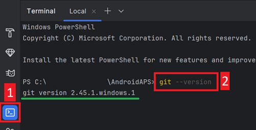
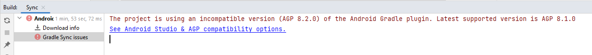
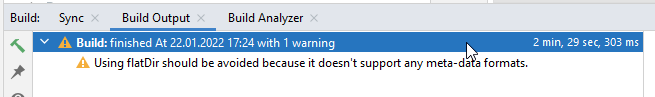

(troubleshooting_androidstudio-troubleshooting-android-studio)=

# Android Studio trikčių šalinimas

```{contents} List of common issues
:depth: 2
:local: true
```

(troubleshooting_androidstudio-lost-keystore)=
## Prarasta raktų saugykla
Jei praradote raktų saugyklą arba jos slaptažodį, apk, pasirašytas nauja raktų saugykla, negali atnaujinti dabartinės **AAPS**: ją reikia pašalinti ir įdiegti iš naujo. Žr. [AAPS įdiegimas iš naujo su nauja raktų saugykla](#reinstall-aaps).

## Nepavyko Gradle Sync
Gradle Sync gali nepavykti dėl įvairių priežasčių. Kai gaunate pranešimą „gradle sync failed“, Android Studio apačioje atidarykite skirtuką „Build“ (1) ir patikrinkite, koks klaidos pranešimas (2) rodomas.


```{contents} Likely reasons for gradle sync failures are:
:depth: 1
:local: true
```

*Svarbu*: Atlikę savo problemos sprendimo veiksmus, turite dar kartą paleisti [gradle sinchronizavimą](#gradle-resync).

(troubleshooting_androidstudio-uncommitted-changes)=
### Neįtraukti pakeitimai (uncommitted changes)

Jei gaunate tokį klaidos pranešimą:


```
Build file 'C:\Data\50-Android\AndroidAPS\app\build.gradle.kts' line: 243

There are uncommitted changes.
Clone sources again as described in wiki and do not allow gradle update
```

#### 1 žingsnis – patikrinkite git įdiegimą
  * Android Studio apačioje atidarykite terminalo skirtuką (1), nukopijuokite šį tekstą ir įklijuokite arba įveskite jį terminale (2).
    ```
    git --version
    ```

    

    Pastaba: tarp Git ir version yra tarpas ir du brūkšneliai!

  * Turite gauti pranešimą, kokia Git versija įdiegta, kaip matyti ekrano kopijoje aukščiau. Tokiu atveju eikite į [2 žingsnį](#troubleshooting-android-studio-check-for-uncommitted-changes).

  * Jei gaunate pranešimą
    ```
    Git: command not found
    ```
    jūsų Git įdiegtas netinkamai.

  * [Patikrinkite git įdiegimą](#BuildingAaps-steps-for-installing-git)

  * Jei naudojate Windows ir Git ką tik įdiegėte, iš naujo paleiskite kompiuterį, kad po įdiegimo Git būtų pasiekiamas visur

  * Jei Git įdiegtas, kompiuterį paleidote iš naujo (jei naudojate Windows), bet Git vis tiek nerandamas:

  * Kompiuteryje suraskite failą „git.exe“.

    Užsirašykite, kuriame aplanke jis yra.

  * Windows sistemoje atidarykite aplinkos kintamuosius (Environment variables), pasirinkite kintamąjį „PATH“ ir spauskite „Edit“. Pridėkite aplanką, kuriame radote savo Git įdiegimą.

  * Išsaugokite ir uždarykite.

  * Iš naujo paleiskite Android Studio.

(troubleshooting-android-studio-check-for-uncommitted-changes)=
#### 2 žingsnis: patikrinkite, ar nėra neįtrauktų pakeitimų.

  * Android Studio kairėje pusėje atidarykite skirtuką „Commit“ (1). 
  * Matysite arba „Changes“ (senesnėse Android Studio versijose – „Default changeset“) (2), arba „Unversioned Files“ (3):

    * Jei matote „Changes“, tikriausiai atnaujinote „Gradle“ arba per klaidą pakeitėte kai kurių failų turinį.

    * Dešiniuoju pelės mygtuku spustelėkite „Changes“ ir pasirinkite „Rollback…“ (1)

      

    * Failai iš naujo atsisiunčiami iš Git serverio. Jei Commit skirtuke kitų pakeitimų nėra, eikite į [3 žingsnį](#gradle-resync).

  * Jei matote „Unversioned Files“, galbūt per klaidą išsaugojote failų savo išeities kodo aplanke. Gali būti, kad tai svarbūs failai, pvz., jūsų raktų saugyklos failas, kurį reikia perkelti kitur. Jei nežinote, kas tai per failai, ir jų nesukūrėte patys, galite juos ištrinti.

    * Įprasta kompiuterio failų naršykle perkelkite arba iškirpkite ir įklijuokite tą failą į saugią vietą.

    * Grįžkite į Android Studio ir Commit skirtuke spustelėkite mygtuką Refresh (4), kad įsitikintumėte, jog failo **AAPS** aplanke nebėra.

      Jei Commit skirtuke kitų pakeitimų nėra, eikite į [3 žingsnį](#gradle-resync).


#### 3 žingsnis: (dar kartą) sinchronizuokite Gradle

Vadovaukitės instrukcijomis skyriuje [Gradle sinchronizavimas iš naujo](#gradle-resync).

### Git Pull Failed - Please tell me who you are

Jei matote šį pranešimą, Git reikia, kad nurodytumėte, kas esate.


Atidarykite terminalą ir vieną po kitos įveskite šias dvi komandas.

```
git config --global user.name "Your name here"
git config --global user.email your.email@here.com
```

Vardas turi būti rašomas kabutėse.


(troubleshooting_androidstudio-android-gradle-plugin-requires-java-11-to-run)=

(incompatible-gradle-jvm)=
### Nesuderinama Gradle JVM


```
Your build is currently configured to use incompatible Java 21.0.3 and Gradle 8.2.
Cannot sync the project.

We recommend upgrading to Gradle version 8.9.

The minimum compatible Gradle version is 8.5.

The maximum compatible Gradle JVM version is 19.
```

Or:

```
Cause: error: invalid source release: 21
```

Jei gaunate aukščiau parodytą klaidos pranešimą, prieš bandydami kurti iš naujo turite atsisiųsti tinkamą JVM versiją:

1.  [Reikalavimų lentelėje](#Building-APK-recommended-specification-of-computer-for-building-apk-file) patikrinkite, kurios JVM versijos reikia jūsų kuriamai **AAPS** versijai, ir ją užsirašykite.

2. Atidarykite Gradle rodinį spustelėdami dramblį (1) dešinėje Android Studio pusėje, atidarykite nustatymus (2) ir pasirinkite **Gradle Settings** (3):


3.  Lauke **Gradle JDK** patikrinkite, ar pasirinkta tinkama versija (1). Jei ne, spustelėkite lauką ir pažiūrėkite, ar ji jau yra sąraše. Toliau pateiktame pavyzdyje JVM 21 pažymėta kaip „jbr-21“. Jei ją randate, tiesiog pasirinkite, ir viskas. Jei jos nėra, pasirinkite **Download JDK** (2).


4. Laukelyje Version (1) pasirinkite JDK, kurio reikia jūsų **AAPS** versijai (tą, kurią užsirašėte tikrindami reikalavimų lentelę). Laukelyje Vendor (2) pasirinkite bet kurį tiekėją. Location (3): nekeiskite. Spustelėkite **Download** (4).


5.  Uždarykite langą **Settings** mygtuku **OK**.
6. Dabar reikia iš naujo paleisti Gradle Sync. Vadovaukitės instrukcijomis skyriuje [Gradle sinchronizavimas iš naujo](#gradle-resync).

(incompatible-version-of-android-gradle-plugin)=
### Nesuderinama Android Gradle įskiepio versija

  Jei gaunate šį klaidos pranešimą

`The project is using an incompatible version (AGP x.x.x) of the Android Gradle plugin. Latest supported version is AGP x.x.x`

  

  Naudojate pasenusią Android Studio versiją. Meniu eikite į Help > Check for updates ir įdiekite visus rastus Android Studio ir jos įskiepių atnaujinimus.

(troubleshooting_androidstudio-could-not-resolve-no-cached-version)=
### Could not resolve / No cached version

  Galite gauti šį klaidos pranešimą:


  * Dešinėje pusėje atidarykite Gradle skirtuką (1).

    Įsitikinkite, kad (2) pažymėtas mygtukas *NĖRA* pasirinktas.

    

  * Dabar reikia paleisti [Gradle sinchronizavimą iš naujo](#gradle-resync)

(troubleshooting_androidstudio-unable-to-start-daemon-process)=
### Unable to start daemon process

  Jei matote tokį klaidos pranešimą kaip toliau, tikriausiai naudojate 32 bitų Windows 10 sistemą. Android Studio 3.5.1 ir naujesnės versijos to nepalaiko, ir, deja, **AAPS** kūrėjai nieko negali padaryti!

  Internete yra informacijos, kaip nustatyti, ar jūsų OS yra 32 bitų, ar 64 bitų, pvz., [ši](https://support.microsoft.com/en-us/windows/32-bit-and-64-bit-windows-frequently-asked-questions-c6ca9541-8dce-4d48-0415-94a3faa2e13d).

  

(gradle-resync)=
### Gradle sinchronizavimas iš naujo

  Jei vis dar matote pranešimą, kad gradle sync nepavyko, pasirinkite nuorodą **Try again** (1). 


  Jei pranešimo nebematote, sinchronizavimą galite paleisti rankiniu būdu:

  * Atidarykite Gradle skirtuką (1) dešiniajame Android Studio krašte.

    

  * Dešiniuoju pelės mygtuku spustelėkite AAPS (2)

  * Spauskite „Reload Gradle Project“ (3)

## Generate Signed APK sėkmingai baigtas su 0 build variants

Kai kuriate pasirašytą apk, galite gauti pranešimą, kad kūrimas pavyko, bet sukurta „0 build variants“:


Tai klaidingas įspėjimas. Patikrinkite aplanką, kurį pasirinkote kaip „Destination folder“ (žingsnis [Generate Signed APK](#Building-APK-generate-signed-apk)), ir ten rasite sukurtą apk!


## Programėlė sukurta su kompiliatoriaus / kotlin įspėjimais

Jei kūrimas baigėsi sėkmingai, bet gaunate kompiliatoriaus ar kotlin įspėjimus (pažymėtus geltonu ar mėlynu šauktuku), šių įspėjimų galite nepaisyti.

 

Jūsų apk sukurtas sėkmingai ir jį galima perkelti į telefoną!


## AAPS negauna NGJ duomenų

* Jei naudojate pataisytą Dexcom G6 programėlę: ši programėlė pasenusi. Vietoj jos naudokite [BYODA](#DexcomG6-if-using-g6-with-build-your-own-dexcom-app) programėlę.

* Jei naudojate xDrip: nustatykite imtuvą (Identify receiver), kaip aprašyta [xDrip nustatymų puslapyje](#xdrip-identify-receiver).


## Apk neįdiegtas


* Įsitikinkite, kad į telefoną perkėlėte failą „app-full-release.apk“.
* Ši klaida dažniausiai reiškia, kad naujas apk pasirašytas kita raktų saugykla nei įdiegta **AAPS**. Jei vis dar turite ankstesnę raktų saugyklą, pasirinkite ją ir sukurkite iš naujo. Kitu atveju žr. [AAPS įdiegimas iš naujo su nauja raktų saugykla](#reinstall-aaps).
* Jei telefone rodoma „App not installed“ (programėlė neįdiegta), atlikite šiuos veiksmus:

1. [Eksportuokite nustatymus](../Maintenance/ExportImportSettings.md) (telefone jau įdiegtoje AAPS versijoje)
2. Pašalinkite **AAPS** iš telefono.
3. Įjunkite lėktuvo režimą ir išjunkite Bluetooth.
4. Įdiekite naują versiją („app-full-release.apk“)
5. [Importuokite nustatymus](../Maintenance/ExportImportSettings.md)
6. Vėl įjunkite Bluetooth ir išjunkite lėktuvo režimą

## Apk įdiegtas, bet versija sena

Jei sėkmingai sukūrėte programėlę, perkėlėte ją į telefoną ir sėkmingai įdiegėte, bet versijos numeris nepasikeitė, galbūt pamiršote [atnaujinti vietinę kopiją](#Update-to-new-version-update-your-local-copy)

## Niekas iš to, kas nurodyta aukščiau, nepadėjo

Jei nė vienas iš aukščiau pateiktų patarimų nepadėjo, galite pabandyti sukurti apk iš naujo:

1. [Eksportuokite nustatymus](../Maintenance/ExportImportSettings.md) (telefone jau įdiegtoje AAPS versijoje)

2. Pasiruoškite rakto slaptažodį (key password) ir raktų saugyklos slaptažodį (key store password).

    Arba tiesiog naudokite naują raktų saugyklą.

3. Sukurkite apk iš naujo, kaip aprašyta [čia](#Building-APK-download-AAPS-code).

4. Sėkmingai sukūrę apk, ištrinkite esamą apk telefone, perkelkite naują apk į telefoną ir įdiekite.
5. Vėl [importuokite nustatymus](../Maintenance/ExportImportSettings.md), kad atkurtumėte mokymo etapus ir nustatymus.
6. Patikrinkite baterijos optimizavimo nustatymus ir vėl jį išjunkite.

## Blogiausias atvejis

Jei tai neišsprendžia kūrimo problemos, galite pabandyti visiškai pašalinti Android Studio ir viską sukurti iš naujo.  Kai kuriems naudotojams tai padeda išspręsti kūrimo problemą.  Šalindami Android Studio, neištrinkite Android naudotojo nustatymų ir **būtinai pašalinkite visus su Android Studio susijusius failus.** Jei Android Studio nepašalinsite visiškai su visais paslėptais failais, pašalinimas gali sukelti naujų problemų, užuot išsprendęs esamas. Visiško pašalinimo instrukcijų galima rasti internete, pvz.:

[https://stackoverflow.com/questions/39953495/how-to-completely-uninstall-android-studio-from-windowsv10](https://stackoverflow.com/questions/39953495/how-to-completely-uninstall-android-studio-from-windowsv10).

Įdiekite Android Studio iš naujo, kaip aprašyta [čia](#Building-APK-install-android-studio).
