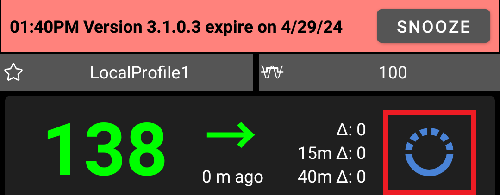

# Versijų pastabos

```{toctree}
:hidden:

Update2_7.md
Update3_0.md
UpdateAaps3204.md
```

Norėdami atnaujinti į naują versiją, vadovaukitės [atnaujinimo vadovo](UpdateToNewVersion.md) instrukcijomis. Trikčių šalinimo skyriuje atnaujinimo vadovo puslapyje taip pat aptariami dažniausi sunkumai, kylantys atnaujinant **AAPS**.

```{admonition} Upgrading from AAPS v3?
:class: tip
Svarbiausi elgsenos pakeitimai – perkeltos, pervadintos ar pašalintos funkcijos – aprašyti puslapyje [Kas pasikeitė AAPS v4](V4Changes.md).
```

Kai bus pasiekiamas naujas atnaujinimas, gausite tokį pranešimą:



Jei neatnaujinsite iki galiojimo pabaigos datos, **AAPS** persijungs į atviro ciklo režimą.

AAPS versijų galiojimo pabaigos datos pateiktos puslapyje [Versijų galiojimo pabaiga](EndOfLife.md).

**Neignoruokite šio pranešimo.** Naujose **AAPS** versijose yra svarbių saugos pataisymų. Todėl kiekvienas **AAPS** naudotojas turi kuo greičiau atnaujinti programą į naujausią versiją. Tai pastanga padidinti kiekvieno **AAPS** naudotojo ir DIY bendruomenės saugumą. Dėkojame už supratingumą.

(maintenance-android-version-aaps-version)=

## Android versija ir AAPS versija

Jei jūsų išmaniajame telefone yra senesnė nei Android 12 versija, negalėsite naudoti AAPS v3.4 ir naujesnių, nes joms reikia bent Android 12.

Kad naudotojai su senesne Android versija galėtų naudoti senesnę AAPS versiją, buvo išleistos naujos versijos, kuriose pakeistas tik versijos tikrinimas. Kitų patobulinimų jose nėra.

Toliau pateiktoje lentelėje raskite savo Android versiją ir naudokite ją atitinkančią **AAPS** versiją. Kodas atsisiunčiamas iš <https://github.com/nightscout/AndroidAPS>, naudojant nurodytą atšaką.

| Jūsų Android versija   | Naudotina AAPS versija | Atsisiunčiama atšaka                                             |
| ---------------------- | ---------------------- | ---------------------------------------------------------------- |
| Android 12 ir naujesnė | Naujausia versija      | [master](https://github.com/nightscout/AndroidAPS) (numatytoji)  |
| Android 11             | **3.3.2.1**            | [3.3.2.1](https://github.com/nightscout/AndroidAPS/tree/3.3.2.1) |
| Android 9, 10          | **3.2.0.4**            | [3.2.0.4](https://github.com/nightscout/AndroidAPS/tree/3.2.0.4) |
| Android 8              | **2.8.2.1**            | [2.8.2.1](https://github.com/nightscout/AndroidAPS/tree/2.8.2.1) |
| Android 7              | **2.6.2**              | [2.6.2](https://github.com/nightscout/AndroidAPS/tree/2.6.2)     |

## WearOS versija

- AAPS reikia WearOS 3.0, 3.2 arba 3.5 (Android 11, API lygis 30) arba naujesnės versijos. WearOS 2 laikrodžiai nepalaikomi.

```{tip}
WearOS 5, API lygis 34 (Android 14), turi [apribojimų](#BuildingAapsWearOs-WearOS5).
```

Versions with a heading are the latest release for each Android version (see the table above). The other releases follow in between, with their notes or a link to them on GitHub.

(latestrelease)=

(version400)=

## Version 4.0.0

Release date: 31-10-2026

**New features**

- Nauja naudotojo sąsaja: telefono programėlė perkurta su Jetpack Compose @MilosKozak
- [Visuotinė paieška](../DailyLifeWithAaps/GlobalSearch.md) @MilosKozak
- Perėjimas prie Kotlin Multiplatform, klientas Windows, Mac, Linux kompiuteriams ir iOS @MilosKozak
- [Scenarijai](../DailyLifeWithAaps/Scenes.md): išsaugokite veiksmų rinkinį ir paleiskite juos kartu @MilosKozak
- [Pagrindinio įrenginio ↔ kliento valdymas](../RemoteFeatures/ClientMasterControl.md): komandų siuntimas iš kliento telefono į pagrindinį įrenginį @MilosKozak
  - [Klientų vaidmenys](#client-master-control-roles): Tik peržiūra, Maistas, Prižiūrintis asmuo arba Administratorius kiekvienam klientui @MilosKozak
  - [Sustiprintos apsaugos režimas](#client-master-control-hardened-mode): kai kliento valdymas įjungtas, pagrindinis įrenginys priima pakeitimus tik iš susietų klientų @MilosKozak
  - Susiejimas QR kodu, kuris kliente kartu nustato ir Nightscout, arba PIN kodu; susiejimo slaptasis raktas pakeičiamas iškart po susiejimo @MilosKozak
  - [Nuosavas Nightscout prieigos raktas](#client-master-control-own-token) kiekvienam klientui, tik su klientui reikalingomis teisėmis @MilosKozak
- [Insulino koncentracijos](../AdvancedOptions/InsulinConcentration.md) (U200, U500) palaikymas pompose, vedlyje ir profiliuose @Philoul @MilosKozak
- Insulino valdymas: insulinų katalogas, pavadinimai, pasirinkimas profilyje ir vedlyje @Philoul
- Kalibravimo įskiepis @MilosKozak
- [Glodinimas](../CompatibleCgms/SmoothingBloodGlucoseData.md): Unscented Kalman Filter (UKF) @piecycle
- New [automation actions](#automations-automation-action): **Change smoothing** @olorinmaia, and **Run**, **Enable** or **Disable scene** @MilosKozak
- [Vietų rotacija](#Aapsscreens-site-rotation): infuzijos vietų sekimas ir keitimas @Philoul @MilosKozak
- [Autotune](../AdvancedOptions/Autotune.md) perdirbimas @Philoul
- Nauji [valdikliai](../DailyLifeWithAaps/Widgets.md) @MilosKozak @t1dude
- Prieinamumas: telefono programėlė veikia su ekrano skaitytuvu – pavadinti valdymo elementai, įgarsinama būsena, grafikų aprašymai ir antraštės greitam peržvelgimui @MilosKozak
- [Nustatymų importavimas](../Maintenance/ExportImportSettings.md): galima išlaikyti pompos nustatymus @MilosKozak
- Nuolatinis pranešimas naudoja Android tiesioginius atnaujinimus (live updates), palaiko Samsung Now bar ir rodo pokytį @premnirmal
- KG grafikas: [paspauskite ir palaikykite](#aaps-screens-graph-press-and-hold), kad pamatytumėte rodmens reikšmes, kiekviename pagrindinio ekrano grafike @t1dude @olorinmaia
- Našumo patobulinimai @MilosKozak
- Automatiniai i-AV boluso patarėjuje @MilosKozak

**New devices**

- **CareLevo**: nauja [pompos tvarkyklė](../CompatiblePumps/CareLevo.md) @Kisu-Choi @MilosKozak
- **Dana-i2**: palaikymas @MilosKozak
- **Instara**: naujas NGJ šaltinis @leohunt

**Pump Driver Improvements**

- Perkurti pompų apžvalgos ekranai: Insight, Medtronic, Medtrum, Omnipod, Dana, Diaconn ir Equil @MilosKozak
- **Omnipod DASH**: PDM stiliaus Ref kodai ir suprantami gedimų aprašymai, laiko dreifo kompensavimas visada įjungtas, geresnis boluso tipo rodymas @nl-ruud
- **Omnipod**: Pod veikimo pabaigos data Dash ir Eros @mcnelson
- **DanaR, RS**: pompos emuliatorius testavimui @MilosKozak
- **Equil**: pompos emuliatorius testavimui @MilosKozak
- Daug pompų ir ciklo pataisymų @MilosKozak ir kiti

**Wear OS**

- [Laikrodžio programėlė](../WearOS/WearOsSmartwatch.md) perkurta su Compose, naujos plytelės ir ekrano elementai, automatinis ciferblato įdiegimas (Watch Face Push) Wear OS 6+ @olorinmaia @Philoul
- CustomWatchface pasiekiamas WearOS 6.0 (GW7, GW8, GW9...) su specialiu WFF ciferblatu @Philoul @olorinmaia
- CustomWatchface dabar gali turėti 5 ekrano elementų vietas, kurias galite pritaikyti (nauja funkcija, pasiekiama tik senesniems laikrodžiams) @Philoul
- Naujas [WFF ciferblatas, pagrįstas AAPS ekrano elementais](#wearos-complications-watchface-setup) @olorinmaia
- Pataisymai boluso patarėjo ir greitojo vedlio rezultate @olorinmaia
- Pagrindiniame meniu nauji KG grafiko ir veikimo režimo langai @olorinmaia
- Boluso patarėjas: [maisto tipo](#WearOsSmartwatch-wizard-meal-type) puslapis, kuris paskirsto angliavandenius kaip telefono vedlys, ir [angliavandenių laikas](#WearOsSmartwatch-wizard-carb-time) su priminimu *laikas valgyti* laikrodyje @olorinmaia
- [Telefono aliarmai laikrodyje](#WearOsSmartwatch-phone-alarms): laikrodis rodo aliarmą ir siūlo mygtukus Nutildyti ir Nutildyti 5 min. @olorinmaia

**Build**

- CI darbo eigos (workflows) kūrimui pagal žymą / atšaką, JDK versijų susiejimas @Angus-repo

**Contributors**

@MilosKozak @Philoul @olorinmaia @Kisu-Choi @leohunt @piecycle @Angus-repo @mcnelson @t1dude @premnirmal @nl-ruud

Full changelog: <https://github.com/nightscout/AndroidAPS/compare/3.4.2.6...4.0.0>

---

(version3426)=

## Version 3.4.2.6

- Equil: padidintas stabilumas @MilosKozak

---

(version3425)=

**Version 3.4.2.5**

- Equil fix race condition @MilosKozak

---

(version3424)=

**Version 3.4.2.4**

- Equil fixes @MilosKozak
- NS profile sync fix @MilosKozak

---

(version3423)=

**Version 3.4.2.3**

- Dash: Drift resolution @nl-ruud
- NSClientV3: Fix gap after reconnection @MilosKozak
- Automation: Fix deserialization @MilosKozak
- Equil: Fix battery report @MilosKozak
- Cleanup workflow @vanelsberg
- Equil: improve error recovery @MilosKozak
- DanaRS: fix domestic pump communication @MilosKozak
- Insight: Fix TBR sync @MilosKozak
- Dash: Fix activation bug @nl-ruud

---

(version3422)=

**Version 3.4.2.2**

- Fixing issues with Equil and Medtronic
- Improve safety of Medtrum

---

(version3421)=

**Version 3.4.2.1**

- Equil: fix Pairing and progress dialog @MilosKozak

---

(version3420)=

**Version 3.4.2.0**

Išleidimo data: 02-04-2026

- Equil: Fix resistance for different models @hhfcvmars
- Tidepool: Fix session @MilosKozak
- Medtrum: Fix activation path by preventing double fill @MilosKozak
- COB: Fix COB calculation (covers dangerous edge case) @MilosKozak

---

(version3410)=

**Version 3.4.1.0**

Išleidimo data: 08-03-2026

**Core**

- Fix DST handling @MilosKozak
- Improve and unify normal target identification (mgdl > 99, mmol > 5.5) @MilosKozak
- SMS: protect RESTART by PIN @MilosKozak
- Maintenance: warn if wrong directory selected @MilosKozak

**Pump Driver Improvements**

- **Omnipod DASH**: BLE tvarkyklės kodas pertvarkytas ir perkeltas į omnipod/common modulį @jwoglom
- **Omnipod DASH**: bandymas ištaisyti ryšio būseną @MilosKozak
- **Omnipod**: validate profile before pod activation to prevent wasting pods (#4534) @brianV
- **Medtronic**: fix same encoding type displayed in settings dialog @mifi100
- **Medtronic**: prepare pump common classes (Tandem preparation) @andy-rozman
- **RileyLink**: encoding fix (#4519) @mifi100
- **Equil**: expand insulin pump compatibility by serial number prefix (#4510) @hhfcvmars
- **Equil**: add logging @MilosKozak
- **Diaconn G8**: fix log sync bug and add firmware 3.58+ support @miyeongkim
- **Diaconn**: fix TBR duration unit conversion @miyeongkim
- **Diaconn**: use commandQueue.loadEvents() for history sync @miyeongkim
- Allow insulin delivery while loop is suspended but pump is available @cschuijt

**Cloud / Backup**

- Add backup to Google Drive @Angus-repo
- Notify UI on cloud storage error state change @Angus-repo
- Allow both local and cloud storage at the same time @Angus-repo

**Tidepool**

- Improve Tidepool OAuth2 migration @MilosKozak
- Fix indefinite Tidepool BLOCKED state, fix rejecting empty SSIDs @michaeln-synapse

**NSClient**

- NSCv3: improve reconnection @MilosKozak

**Wear OS**

- Display New IOB in Wizard Result if IOB is used in calculations @olorinmaia
- Fix Wear BolusProgress with Total Amount @Philoul

**UI**

- Improve ic_none icon for Site Rotation @Philoul
- Fix site rotation manage pump setting not being used @samfundev

**Contributors**

@MilosKozak @Philoul @olorinmaia @jwoglom @mifi100 @andy-rozman @Angus-repo @brianV @cschuijt @hhfcvmars @miyeongkim @samfundev @michaeln-synapse

---

(version3400)=

**Version 3.4.0.0**

Release date: 31-12-2025

**Before upgrading:**

* This version requires Google Android 12.0 or above. Check your phone version before attempting to update.
* Update to latest Android Studio or better setup using browser build.

**New features**

* Running mode @MilosKozak
  * Show [loop status history](#AapsScreens-running-mode) in treatment tabs
  * Show and allow changing [loop status from AAPSClient](#RemoteControl_aapsclient).<br>NB : needs the setting [NSClient > Synchronization > Receive Running mode events](#Preferences-nsclient-synchronization)
* [New CGMs](../Getting-Started/CompatiblesCgms.md) : Glunovo, Intelligo, Sinocare
* [Site rotation](#Aapsscreens-site-rotation) support @Philoul
* New [automation action](#automations-automation-action) : enable or disable SMBs @MilosKozak
* Syai CGM is [trusted source](#GettingStarted-TrustedBGSource) and supports advanced filtering @MilosKozak

**Wear OS Improvements**

* dramatically reduced battery usage @MilosKozak
* UI improvements and fixes @olorinmaia
* almost complete rewritten code to match current level of libs (WearOS 2 previously) @MilosKozak
* 2 new complications for extended data @Philoul
* Migrated to modern complication provider with DataStore @MilosKozak

**Memory Leak Fixes**

* Fixed memory leaks in code @MilosKozak
* Added LeakCanary memory leak reporting to Firebase Crashlytics @MilosKozak

**Pump Driver Improvements**

* **DanaI**: fixed disconnection issues @MilosKozak
* **RileyLink**: Speedup communication by minimizing delays @mifi100
* **Medtrum**: Added patch activation time and age display @vanelsberg, password uppercase fix @MilosKozak
* **Combo**: Fixed Test race conditions @MilosKozak @dv1
* **Equil**: Optimized connectivity, reduced battery usage @MilosKozak

**Nightscout Sync**

* Improved deduplication on NS failure @MilosKozak

**UI/UX Improvements**

* various improvements @MilosKozak @Philoul @olorinmaia

**Automatizavimas**

* New SMB control action - enable/disable SMB via automation @MilosKozak

**Testing**

* Added comprehensive unit tests for Equil, Eopatch, Dana, and Medtronic pumps @MilosKozak
* Improved test stability and coverage across multiple modules @MilosKozak

**Tidepool**

* Tidepool OAUTH2 (Support for new Tidepool authentication) @MilosKozak

---

(version3321)=

## Versija 3.3.2.1

Išleidimo data: 13-08-2025

- Ištaisytas Omnipod Bluetooth ryšys Android 16
- CI procesas (kūrimas naršyklėje)
- Ištaisytas mmol-mgdl konvertavimas
- Ištaisytas neteisingas laiko pasirinkimas languose kai kuriose laiko juostose
- Ištaisytas raktų nuskaitymas paprastajame režime
- Ištaisytos trūkstamos prognozės Wear
- Patobulinta konfigūracija (ConfigBuilder)
- Patobulintas NSCv3 visas sinchronizavimas

---

(version3300)=

**Versija 3.3.2.0**

Išleidimo data: 27-03-2025

**Kaip atnaujinti**

* Šiai versijai sukurti reikia [Android Studio versijos „Meerkat“](#Building-APK-recommended-specification-of-computer-for-building-apk-file) arba naujesnės. Jei jau esate sukūrę 3.3.x versiją, turite dar kartą atnaujinti Android Studio.

(version-enforcement)=

**Nuo šios versijos pranešimai ir versijų privalomas atnaujinimas supaprastinti ir sušvelninti, jie veikia taip:**

*  Galiojimas nesibaigia, kai įrenginys neprisijungęs (nėra interneto ryšio). Tai reiškia, kad 60 ir 90 dienų papildomo laiko nebėra.
*  Pasibaigus galiojimui, privalomai įjungiamas LGS režimas
*  Įspėjimus / pranešimus gausite rečiau:
   - liko 28 ir daugiau dienų: kas 7 dienas
   - liko 27–14 dienų: kas 3 dienas
   - vėliau kartą per dieną
   - Pranešimas sukuriamas po vidurdienio, kad netrukdytų naktį
* Yra tik 2 pranešimų rūšys
   - Yra nauja versija (AAPS veikimui įtakos neturi)
   - Programos galiojimas baigsis tam tikrą dieną ateityje (AAPS veikimui vis dar įtakos neturi) / galiojimas baigėsi (AAPS persijungs į LGS režimą)

**News**

* SMS RESTART command @MilosKozak
* Watch Profile switch parameters @olorinmaia
* Dark mode AAPS V2 watchface @olorinmaia
* G7 data exchange improvements @olorinmaia
* Widget configuration @MilosKozak
* Radiobuttons UI improvements @olorinmaia
* Automation: position choosing from map @MilosKozak
* Version visible on main screens @MilosKozak
* Compilation with existing git system is enforced (no zip downloads)
* Show version on main screen @MilosKozak
* Tidepool upload improvements @ConstantinMatheis

**Bug fixes**

* Dash unbonding fix @Andreas
* Garmin fixes @robertbuessow @suside
* Fix of IOB displaying in dialogs @olorinmaia
* Objectives spelling and validation improvements @MilosKozak
* Fixed rendering of emulated TBRs @MilosKozak
* Fixed bypassing security @tdrkDev

---

**Version 3.3.1.3**

Release date: 21-01-2025

**Bug fixes**

* Dash: bonding is optional (default off) @MilosKozak
* Equil: fixed bolus 10+U, alarm improvements @EquilHack
* Garmin: watch improvements @swissalpine
* Watch improvements @olorinmaia
* Control loop status from watch @tdrkDev
* Stability improvements

*  **New [setup of Authenticator](#sms-commands-authenticator-setup) may be needed.**

---

**Version 3.3.1.2**

Release date: 15-01-2025

**Kaip atnaujinti**

* [Android Studio version called "Ladybug Feature Drop"](#Building-APK-recommended-specification-of-computer-for-building-apk-file) or above is required to build this version. **This is not the same as plain "Ladybug".** If you already built a 3.3.x version, you need to upgrade Android Studio again.

**Bug fixes**

* Dash: use bonding on Android 15+
* Restored Dexcom button on Overview
* Equil: allowed remove non working pump
* Warn when DynISF Adjustment Factor is zero
* NSCv3: resolve websocket communication on phones with slightly different time
* SMS Commands: fix OneTimePassword. **New [setup of Authenticator](#sms-commands-authenticator-setup) may be needed.**
* Fix issue where some preferences could not be edited anymore.
* Fix reset of master password with virtual pump.
* Fixed import of large settings backup files.

---

**Version 3.3.1.0**

Release date: 06-01-2025

**UI changes**

* [Added colors to differentiate between AAPSClient and AAPSClient2](#RemoteControl_aapsclient) @MilosKozak
* Improved Users actions layout and icons

**Other functionalities**

* New automation trigger : [steps count](#screen-heart-rate-steps) @Roman Rihter
* Allow to receive everything on NSCv3 full sync (including data previously not synced such as TBR) @MilosKozak
* NSClient v3 : make Announcement work (_i.e._ from AAPSClient to AAPS) @MilosKozak

**Technical changes & bug fixes**

* Fix Insight crash @philoul
* Fix creation of extra-numerous deviceStatus entries in Nightscout @MilosKozak
* Fix carbs absorption @MilosKozak
* Fixed color of RadioButtons & CheckBoxes @MilosKozak
* Fixed bug in DynISF percentage migration @MilosKozak
* Resolved misplaced DynISF notification @MilosKozak
* Fixed bug in watchfaces @philoul

---

**Version 3.3.0.0**

Release date: 29-12-2024

**Main features**

* **[Dynamic ISF](../DailyLifeWithAaps/DynamicISF.md)** feature is no more a dedicated plugin, but is now included as an option of [OpenAPS SMB](#Config-Builder-aps) plugin, along with some changes in its behavior:
  * **Profile Switch** and **Profile Percentage** is now taken into account for **Dynamic ISF** in respect of dynamic sensitivity strengthness
  * The average **ISF** of the last 24h is calculated and this value is used for bolus wizard and **COB** calculation. **Profile ISF** value is not used at all (except fallback when history data is not available)
  * DynamicISF documentation page has been rewritten. Please read the important section [Things to consider when activating Dynamic ISF](#dyn-isf-things-to-consider-when-activating-dynamicisf).
* [Enable “SMB always” and “SMB after carbs”](#Open-APS-features-enable-smb-always) for FreeStyle Libre 2 and Libre 3 users
  * Note : Requires latest version of xDrip+ or Juggluco.
* New **Automation** triggers
* Unattended settings exports

**Kaip atnaujinti**

* Before upgrading:
  * **<span style="color:red">This version requires Google Android 11.0 or above</span>**. Check your phone version before attempting to update.
  * If you use the “old” Combo driver with ruffy device, migrate to the [native Combo driver](../CompatiblePumps/Accu-Chek-Combo-Pump-v2.md) before update
  * You will lose your [additional graphs](#AapsScreens-section-g-additional-graphs) on the HomeScreen during upgrade: make a manual note of your current configuration if needed, so that you can recreate them after upgrade.
  * The [Bluetooth connectivity issues some people encounter on Android 15](../Getting-Started/Phones.md) are **NOT** solved by this release (this is an Android issue, not **AAPS**). A fix is available in 3.3.1.2.
  * The BYODA button on the homescreen is no longer available due to Android limitations. This is fixed in 3.3.1.2.
* Update instructions: follow the [Update to a new version](../Maintenance/UpdateToNewVersion.md) guide.
  * [Android Studio version called "Ladybug"](#Building-APK-recommended-specification-of-computer-for-building-apk-file) or above is required to build this version. If you already have an older version of Android Studio installed, you may need to <span style="color:red">configure the JVM version to 21</span>. See [Troubleshooting Android Studio > Incompatible Gradle JVM](#incompatible-gradle-jvm).
  * Tip - if you do not want to lose your **AAPS** history ALWAYS do an UPDATE and NOT an UNINSTALL/INSTALL. As a precaution, back up your current **AAPS** settings and old APK to revert to an old version should anything go wrong.
* After upgrading:
  * Set the new [“AAPS directory” setting](#preferences-maintenance-logdirectory), in the Maintenance tab.

**Detailed changes**

**CGMs and Pumps**

* [Enable “SMB always” and “SMB after carbs”](#Open-APS-features-enable-smb-always) for FreeStyle Libre 2 and Libre 3 users @MilosKozak
* [Medtrum driver](../CompatiblePumps/MedtrumNano.md) improvements @jbr77rr
  * Communication improvements, including new setting to workaround problems on some smartphones
  * Show reservoir level at start of activation
  * Fix bug where activation returns to start and user cannot finish the activation
  * Feedback for sync status and other clarifications
* New supported pump : [Equil 5.3](../CompatiblePumps/Equil5.3.md) @EquilHack
* New supported CGMs : [Ottai](../CompatibleCgms/OttaiM8.md) @ottai-developer and [Syai Tag](../CompatibleCgms/SyaiTagX1.md) @syai-dev
* Insight driver rewritten to kotlin @Philoul
* Removed old ruffy dependent Combo driver

**UI changes**

* [Simple mode](#preferences-simple-mode) activated by default on fresh install @MilosKozak
* New [QuickWizard](#Preferences-quick-wizard) options @radicalb
  * The QuickWizard now uses the same logic for bolus calculation and display as the calculator. Dabar Greitajame vedlyje galite naudoti lauką „Angliavandenių laikas“ išankstiniam bolusui.
* New [graph scale menu](#aaps-screens-main-graph); [additional graphs menu](#AapsScreens-activate-optional-information) UI improvements @Philoul
* [ConfigBuilder layout improvement](../SettingUpAaps/ConfigBuilder.md) @MilosKozak
  * Sections are now collapsed by default. Use arrow to expand.
* Variable sensitivity visible in AAPSClient
* BolusWizard UI improvements @kenzo44
* Fix text display in pump tabs when using light theme @jbr77rr

**Other functionalities**

* [Unattended settings exports](#ExportImportSettings-Automating-Settings-Export) @vanelsberg
* New [Automation trigger](#automations-automation-triggers) @vanelsberg
  * Pod Activation (patch pump only)
* New [Automation triggers](#automations-automation-triggers) @jbr77rr
  * Cannula age, Insulin age, Battery age, Sensor age, Reservoir level, Pump battery level
* Allowing negative carbs entry @MilosKozak
* New Parameter [“AAPS directory”](#preferences-maintenance-settings) to choose a storage directory different from the default one.
* Allow for [insulin records when pump suspended](#aaps-screens-buttons-insulin) @jbr77rr
* Updated [Objective 2](#objectives-objective2) @MilosKozak
  * Check that master password is set and known
* Random carbs in test mode @MilosKozak
* Fixed bug in TDD calculation @MilosKozak
* SMS Commands : allow to [**not** send SMS for profile change](#sms-commands-too-many-messages) coming from NS @MilosKozak

**Išmanieji laikrodžiai**

* wear and watchfaces improvement @Philoul @MilosKozak @olorinmaia
* Watch tiles from Automation actions @Philoul
* Combined watchfaces from AAPS, AAPSClient and AAPSClient2 to monitor more patients @Philoul @MilosKozak
* EXTRA: show\_user\_actions\_on\_watch\_only @MilosKozak

**Technical changes**

* [log files location change](#Accessing-logfiles-accessing-logfiles)
* new internal modules structure @MilosKozak
* split persistence layer from main code @MilosKozak
* build files rewritten to kts @MilosKozak
* algorithms rewritten to kotlin for better performance @MilosKozak
* tons of new unit tests @MilosKozak and others
* more code converted to kotlin @MilosKozak
* new preferences management, xml \-\> kotlin @MilosKozak
* new CI configuration, run CI on own servers @MilosKozak
* libraries updated to latest version, toml @MilosKozak
* migration to kotlin 2.0, java 21 @MilosKozak

---

(version3204)=

## [Versija 3.2.0.4](https://github.com/nightscout/AndroidAPS/releases/tag/3.2.0.4)

Išleidimo data: 27-02-2024

Tai paskutinė versija, palaikanti Android 10. Jei negalite atnaujinti į Android 11, [atnaujinkite AAPS į 3.2.0.4](#update-aaps-3204).

**Pakeitimai**

- xDrip G7 palaikymas
- Medtrum pataisymai
- Automatizacijos piktogramos pataisymas
- 1 mokymo etapo įvykdymo pataisymas

---

(version3200)=

**Version 3.2.0.0 dedicated to @Philoul**

Release date: 23-10-2023

**Important hints**

- NS 15 is required
- While using websockets in NS v3 plugin treatments entered through NS UI (plus button) and other applications using v1 API are not sent to AAPS. This will be fixed in future release of NS. Always use the same client (v1 or v3) in AAPS and AAPSClient until NS fully switch to v3 internally. The same is valid for AAPS and AAPSClient itself.
- Websockets in v3 plugin work in a similar manner as v1 plugin. Without websockets enabled AAPS schedules regularly downloads from NS which should lead to lower power consumption because NS is not permanently connected. On the opposite side it means delays in exchanging data. Please read [here](#Important-comments-on-using-v3-versus-v1-API-for-Nightscout-with-AAPS) the important comments from the dev team before you use it!
- If you are using xdrip as cgm source you must select it again after update due to internal changes
- Tidepool can be used as a replacement of NS to pass first objective
- If you send to xDrip+ you must configure xDrip synchronization plugin. In order to receive BGs from AAPS in xDrip, “xDrip+ Sync Follower” must be selected as source
- If you want to switch to ComboV2 driver, Ruffy must be uninstalled and pump paired again to AAPS
- In order to use DynISF plugin you have to start Objective 11 (all previous must be in finished state to allow start of 11)

**Pakeitimai**

- EOPatch2 / GlucomenDay pump driver @jungsomyeonggithub @MilosKozak
- ComboV2 pump driver (no need of Ruffy) @dv1
- Medtrum Nano driver @jbr7rr
- Korean DanaI support @MilosKozak
- Glunovo CGM support @christinadamianou
- G7 support @MilosKozak @rICTx-T1D @khskekec
- NSClient v3 plugin @MilosKozak
- Tidepool support @MilosKozak
- Smoothing plugin @MilosKozak, @justmara, Exponential smoothing @nichi (Tsunami), Average smoothing @jbr7rr
- DynamicISF plugin @Chris Wilson, @tim2000s
- Garmin watchface & HeartRate support @buessow
- New logo @thiagomsoares
- New watchface @Philoul
- fixed tons of issues from 3.1 version
- allow add notes on more places @Sergey Zorchenko
- UI fixes @MilosKozak @osodebailar @Andries-Smit @yodax @Philoul @dv1 @paravoid
- new SMS commands LOOP LGS/CLOSED @pzadroga
- wear translations @Andries-Smit
- xdrip communication moved to separate module @MilosKozak
- internal changes: updated libs versions, rx3 migration, new modules structure @MilosKozak
- Diaconn driver fixes @miyeongkim
- more database maintenance options @MilosKozak
- AAPSClient provides info if main phone is plugged in electricity @MilosKozak
- Change in BolusWizard. If CGM is not available percentage is ignored (ie 100% is used)
- migration to kts build system @MilosKozak
- improved CI integration @MilosKozak @buessow
- tests cleanup @ryanhaining @MilosKozak
- new 110k+ lines of code, changed 240k lines, 6884 changed files

(Important-comments-on-using-v3-versus-v1-API-for-Nightscout-with-AAPS)= **Important comments on using v3 versus v1 API for Nightscout with AAPS**

v1 is the old protocol used for exchanging data between NS web site and NS server. It has many limitations
- v1 sends only 2 days of data
- v1 kiekvieno prisijungimo iš naujo metu siunčia visus 2 dienų duomenis
- using websockets is mandatory = permanent connection, more battery consumption
- during frequent disconnects to NS connection is paused for 15 minutes to prevent high data usage

v3 is new protocol. More safe and efficient
- while using tokens you can better define access rights
- protocol is more efficient on both sides (AAPS & NS)
- It can read up to 3 months of data from NS
- you can choose to use or to not use websockets on every device (using means faster updates, not using means lower power consumption, but slower updates ie. minutes)
- NSClient is not paused on disconnections

LIMITATIONS
- NS 15 must be used with AAPS 3.2
- v3 doesn't see updates done by v1 protocol (probably it will be resolved in some future version of NS)
- in the opposite direction, because of the old ineffective method of tracking changes, v1 sees changes done by v3
- remember NS still uses v1 internally so far thus is not possible to enter data through NS web UI if you are using v3. You must use AAPSClient or SMS if you want to enter data remotely

RECOMMENDED SETTING
- because of all above you should choose only one method and use it on all devices (remember all other uploaders at time of writing this are using v1). If you decide to go to v3, select v3 in AAPS and all AAPSClients
- v3 is preferred because of efficiency
- using websockets or not using with v3 depends on your preference
- LABAI rekomenduojama, kad visus duomenis rinktų AAPS ir siųstų juos į NS kaip vienintelis siuntėjas. All other devices/applications should only read from NS. By doing it you'll prevent conflicts and sync errors. This is valid for getting BG data to NS using Dexcom Share connector etc. too

---

(version3100)=

**Version 3.1.0**

Release date: 19-07-2022

[Versijų pastabos](https://github.com/nightscout/AndroidAPS/releases/tag/3.1.0)

---

**Version 3.0.0**

Release date: 31-01-2022

[Versijų pastabos](https://github.com/nightscout/AndroidAPS/releases/tag/3.0.0)

---

(version2821)=

## Version 2.8.2.1

Release date: 05-10-2021

This version is the last one supporting Android 8. [Release notes](https://github.com/nightscout/AndroidAPS/releases/tag/2.8.2.1)

---

**Versija 2.8.2**

Išleidimo data: 23-01-2021

[Versijų pastabos](https://github.com/nightscout/AndroidAPS/releases/tag/2.8.2)

---

(version-2811)= (important-hints-2-8-1-1)=

**Version 2.8.1.1**

Release date: 12-01-2021

[Versijų pastabos](https://github.com/nightscout/AndroidAPS/releases/tag/2.8.1.1)

---

(Releasenotes-version-2-8-0)=

**Version 2.8.0**

Release date: 01-01-2021

[Versijų pastabos](https://github.com/nightscout/AndroidAPS/releases/tag/2.8.0)

---

(Releasenotes-version-2-7-0)=

**Version 2.7.0**

Release date: 24-09-2020

[Versijų pastabos](https://github.com/nightscout/AndroidAPS/releases/tag/2.7.0)

---

(Releasenotes-version-2-6-1-4)=

**Version 2.6.1.4**

Release date: 04-05-2020

[Versijų pastabos](https://github.com/openaps/AndroidAPSdocs/blob/e7e2e73cae3dd16af3391ce770fb48b3b3388c1b/docs/EN/Maintenance/ReleaseNotes.md#version-2614)

---

**Version 2.6.1.3**

Release date: 03-05-2020

[Versijų pastabos](https://github.com/openaps/AndroidAPSdocs/blob/e7e2e73cae3dd16af3391ce770fb48b3b3388c1b/docs/EN/Maintenance/ReleaseNotes.md#version-2613)

---

**Version 2.6.1.2**

Release date: 19-04-2020

[Versijų pastabos](https://github.com/openaps/AndroidAPSdocs/blob/e7e2e73cae3dd16af3391ce770fb48b3b3388c1b/docs/EN/Maintenance/ReleaseNotes.md#version-2612)

---

**Version 2.6.1.1**

Release date: 06-04-2020

[Versijų pastabos](https://github.com/openaps/AndroidAPSdocs/blob/e7e2e73cae3dd16af3391ce770fb48b3b3388c1b/docs/EN/Maintenance/ReleaseNotes.md#version-2611)

---

**Version 2.6.1**

Release date: 21-03-2020

[Versijų pastabos](https://github.com/openaps/AndroidAPSdocs/blob/e7e2e73cae3dd16af3391ce770fb48b3b3388c1b/docs/EN/Maintenance/ReleaseNotes.md#version-261)

---

(Releasenotes-version-2-6-0)=

**Version 2.6.0**

Release date: 29-02-2020

[Versijų pastabos](https://github.com/openaps/AndroidAPSdocs/blob/e7e2e73cae3dd16af3391ce770fb48b3b3388c1b/docs/EN/Maintenance/ReleaseNotes.md#version-260)

---

**Version 2.5.1**

Release date: 31-10-2019

[Versijų pastabos](https://github.com/openaps/AndroidAPSdocs/blob/e7e2e73cae3dd16af3391ce770fb48b3b3388c1b/docs/EN/Maintenance/ReleaseNotes.md#version-251)

---

(Releasenotes-version-2-5-0)=

**Version 2.5.0**

Release date: 26-10-2019

[Versijų pastabos](https://github.com/openaps/AndroidAPSdocs/blob/e7e2e73cae3dd16af3391ce770fb48b3b3388c1b/docs/EN/Maintenance/ReleaseNotes.md#version-250)

---

**Version 2.3**

Release date: 25-04-2019

[Versijų pastabos](https://github.com/openaps/AndroidAPSdocs/blob/e7e2e73cae3dd16af3391ce770fb48b3b3388c1b/docs/EN/Maintenance/ReleaseNotes.md#version-23)

---

**Version 2.2.2**

Release date: 07-04-2019

[Versijų pastabos](https://github.com/openaps/AndroidAPSdocs/blob/e7e2e73cae3dd16af3391ce770fb48b3b3388c1b/docs/EN/Maintenance/ReleaseNotes.md#version-222)

---

**Version 2.2**

Release date: 29-03-2019

[Versijų pastabos](https://github.com/openaps/AndroidAPSdocs/blob/e7e2e73cae3dd16af3391ce770fb48b3b3388c1b/docs/EN/Maintenance/ReleaseNotes.md#version-22)

---

**Version 2.1**

Release date: 03-03-2019

[Versijų pastabos](https://github.com/openaps/AndroidAPSdocs/blob/e7e2e73cae3dd16af3391ce770fb48b3b3388c1b/docs/EN/Maintenance/ReleaseNotes.md#version-21)

---

**Version 2.0**

Release date: 03-11-2018

[Versijų pastabos](https://github.com/openaps/AndroidAPSdocs/blob/e7e2e73cae3dd16af3391ce770fb48b3b3388c1b/docs/EN/Maintenance/ReleaseNotes.md#version-20)

---

**Versija 1.0**

```{admonition} First version of **AAPS**
:class: note

Pirmoji bandomoji versija pradėta 2015 m., o pirmoji versija išleista 2016 m.

Tikslios šių versijų chronologijos šiuo metu nėra, tačiau kadangi šis klausimas buvo užduotas ne kartą, pateikiame ją čia.

```

