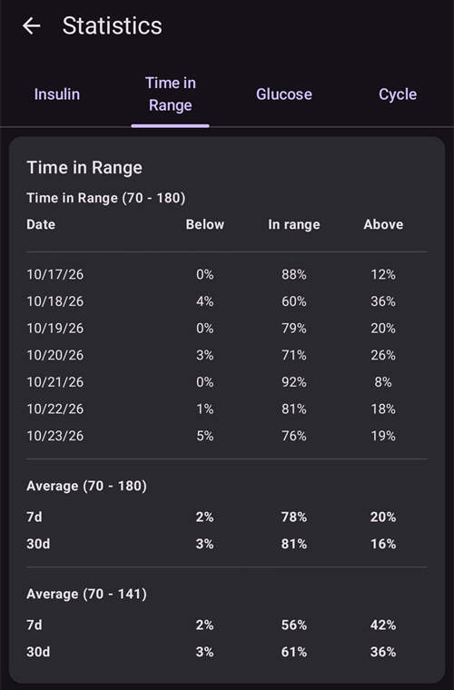
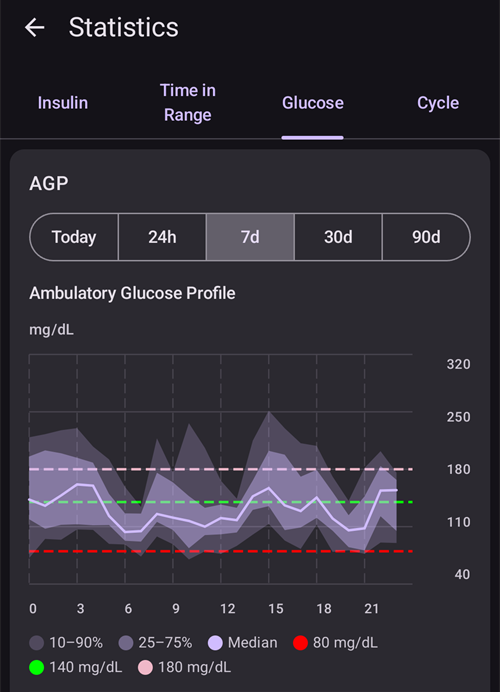
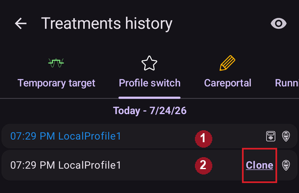
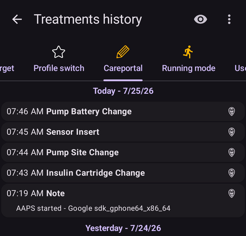
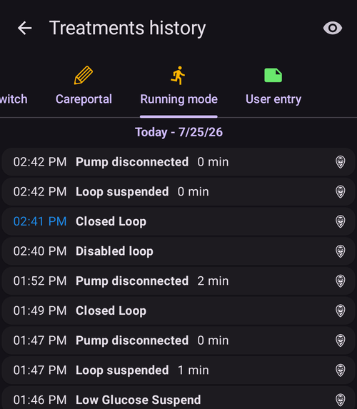

# Duomenų peržiūra

## AAPS istorija

**AAPS** visą jūsų istoriją (**KG**, terapiją, valandinę bazę, tikslus, **Profilio keitimas** įrašus, …) saugo vietinėje telefono duomenų bazėje. Ši duomenų bazė neįeina į [nustatymų eksportą](../Maintenance/ExportImportSettings.md). Ją galite peržiūrėti pačios **AAPS** ekranuose **Istorija** ir **Statistika**, kurie aprašyti toliau. Ilgalaikei peržiūrai ir ataskaitoms siųskite savo duomenis į [Nightscout](../SettingUpAaps/Nightscout.md) arba [Tidepool](../SettingUpAaps/Tidepool.md).

**AAPS** istoriją galima peržiūrėti ekrane **Istorija**: atverkite **meniu** (☰) ir pasirinkite **Istorija**.

- Palieskite **datos kortelę** ir pasirinkite dieną, kurią norite peržiūrėti.
- Atsidarę grafikai rodo **visą pasirinktą dieną**. Norėdami padidinti dalį grafiko, suspauskite arba išskleiskite du pirštus.
- Rodyklėmis **<** ir **>** pereikite viena diena atgal arba pirmyn, o mygtuku **Dabar** grįžkite į šiandieną.
- Grafikai rodo tuos pačius duomenis kaip pagrindinio ekrano grafikai (KG, terapiją, valandinę bazę, AIO, AAO, aktyvumą, nuokrypius...).

(reviewing-statistics)=
## AAPS statistika

**AAPS** pateikia pagrindinę stebėjimo statistiką.

Dauguma reikšmių remiasi ADA 2023 [rekomendacijomis](https://diabetesjournals.org/care/article/46/Supplement_1/S97/148053/6-Glycemic-Targets-Standards-of-Care-in-Diabetes).

Norėdami ją atverti, atverkite **meniu** (☰) ir pasirinkite **Statistika**.

Ekrane **Statistika** yra keturi skirtukai: **Insulinas**, **Laikas tikslinėse ribose**, **Glikemija** ir **BPD ciklas**. Palieskite skirtuką arba braukite kairėn ar dešinėn, kad pereitumėte tarp jų.

(reviewing-tdd)=
### Skirtukas Insulinas: bendra paros dozė

Kortelėje **Bendra paros dozė** rodoma po vieną eilutę kiekvienai ankstesnei dienai (iki vienos savaitės), kurios insulino duomenis **AAPS** turi, tada jų **Vidurkis**, o tada **Šiandien** iki šios akimirkos. Iškart įdiegus **AAPS** rodoma tik eilutė **Šiandien**. Stulpeliai:

- **Valandinė bazė**: tik valandinė bazė.
- **Bolusas**: bolusų ir SMB suma.
- **BPD viso**: bendra paros insulino dozė (**BPD**), per dieną suleisto boluso ir bazės insulino suma.
- **Angliavandeniai**: įvesti angliavandeniai ir i-AV įrašai.

**BPD** dalis skaičiuojama atvėrus puslapį, skaičiavimas užtrunka kelias sekundes. Norėdami skaičiuoti iš naujo, palieskite **Perskaičiuoti**.

**BPD** yra jūsų per parą suleisto boluso ir bazės insulino suma. Kai kurie gydytojai – ypač naujiems pompų naudotojams – taiko bazės ir boluso santykį 50:50: tada bendra bazinė dozė (**TBB**, jūsų valandinių bazių suma per 24 valandas) turėtų būti maždaug pusė BPD. Kiti teikia pirmenybę TBB, kuri sudaro 32–37 % BPD.

Kaip dauguma apytikslių taisyklių, ši taisyklė yra tik ribotai patikima. Jūsų diabetas gali skirtis!

### Skirtukas Laikas tikslinėse ribose

Laikas tikslo intervale (**TIR**): 70-180 mg/dL arba 3,9-10 mmol/l.

**TIR** informacija pateikiama už 7 ir 30 dienų, priklausomai nuo to, kiek duomenų yra **AAPS** duomenų bazėje.

Žemiau pateikiama laiko siaurame tikslo intervale (TITR) 70-140 mg/dL arba 3,9-7,8 mmol/l statistika (ekrane šis intervalas rodomas kaip 70-141).

**Aptarkite tikslus su savo endokrinologu**

Jūsų diabetas gali skirtis. Visus siūlomus tikslus aptarkite su savo endokrinologu arba gydymo komanda. Teisingai naudojama AAPS statistika gali būti veiksminga priemonė __KG__ tendencijoms sekti ir pažangai stebėti.

Dar žemiau kortelėje **Dexcom TIR** rodoma išsami 14 dienų **TIR** statistika.

**SD**: standartinis nuokrypis, KG svyravimų [rodiklis](https://www.ncbi.nlm.nih.gov/pmc/articles/PMC3125941/) (kuo didesnis, tuo blogiau).

HbA1c: apskaičiuotas glikuoto hemoglobino įvertis pagal NGJ matavimų vidurkį. Tai tik orientacinė reikšmė, ji gali nesutapti su HbA1c kraujo tyrimo rezultatais.

(reviewing-statistics-agp)=
### Skirtukas Glikemija: ambulatorinis gliukozės profilis (AGP)

**Ambulatorinis gliukozės profilis** (**AGP**) rodo, kaip jūsų gliukozė paprastai kinta per dieną. Laikotarpį pasirinkite mygtukais viršuje: **Šiandien**, **24 val.**, **7 d**, **30 d** arba **90 d**.

- **Grafikas**: viena para nuo vidurnakčio iki vidurnakčio. Linija yra **Mediana** (pusė jūsų rodmenų tą valandą buvo mažesni, pusė – didesni). Aplink ją viena juosta apima vidurinę jūsų rodmenų pusę (**25–75 %**), o platesnė juosta – didžiąją jų dalį (**10–90 %**). Siaura juosta reiškia, kad tą valandą jūsų gliukozė kiekvieną dieną yra panaši. Brūkšninės linijos žymi jūsų ribas: **Žemoji riba**, 140 mg/dL (7,8 mmol/l) ir **Aukštoji riba**.
- **Glikemijos apžvalga**: laikas jūsų intervale, siaurame intervale (70–140 mg/dL arba 3,9–7,8 mmol/l), virš jūsų intervalo ir žemiau jo, tada jūsų gliukozės **Vidurkis** ir **Mediana**. Jūsų intervalą sudaro **Žemoji riba** ir **Aukštoji riba**, nustatytos parametre [Vizualizacijos diapazonas](#Preferences-range-for-visualization).
- **eA1c** ir **GMI**: du HbA1c įverčiai, apskaičiuoti pagal jūsų NGJ rodmenis. Kaip ir aukščiau aprašytas HbA1c, jie gali nesutapti su jūsų HbA1c kraujo tyrimų rezultatais.
- **SD** (standartinis nuokrypis) ir **CV** (variacijos koeficientas): kiek svyruoja jūsų gliukozė. Mažesnė reikšmė reiškia stabilesnę gliukozę.
- **D.**: kiek dienų NGJ duomenų panaudota.

 

Po AGP kortelėje **Išsamus gliukozės penkiakampis (CGP)** penkiakampiu pavaizduoti penki jūsų paskutinių 14 dienų gliukozės rodikliai. Mažesnis penkiakampis reiškia geresnę gliukozės kontrolę.

### Skirtukas BPD ciklas: BPD ciklo dėsningumas

**BPD ciklo dėsningumas** sudeda jūsų paros insulino kiekius 28 dienų ciklais vieną ant kito, kad lengviau pastebėtumėte pasikartojančius dėsningumus. Kiekvienas ciklas rodomas kaip linija (**Atskiri ciklai**), kartu su jų vidurkiu.

- **Neapdorota BPD** / **Išvalyta BPD**: pasirinkite bendrą paros dozę tokią, kokia suleista, arba BPD be insulino angliavandeniams.
- **Ciklo poslinkis**: perkelia ciklo pradžią (nuo 0 iki 27 dienų).

Reikia bent 56 dienų duomenų (2 ciklų). Jei duomenų mažiau, kortelėje rodoma **Nepakanka duomenų (2 ciklams reikia bent 56 dienų)**. Dėsningumas skaičiuojamas tik atvėrus skirtuką **BPD ciklas**, nes jam nuskaitomi 168 dienų duomenys.

(aaps-screens-treatments)=
## Terapijos istorija

Pagrindinio ekrano viršutiniame kairiajame kampe atverkite **meniu** (☰) ir pasirinkite **Terapijos istorija**. Šiame rodinyje galite peržiūrėti ir keisti šios terapijos istoriją, kiekvieną atskirame skirtuke (braukite skirtukų eilutę, kad pamatytumėte visus):

* AV ir bolusai
* [Ištęstas bolusas](#Extended-Carbs-extended-bolus-and-switch-to-open-loop-dana-and-insight-pump-only)
* Laikina bazė
* [Temporary target](../DailyLifeWithAaps/TempTargets.md)
* [Profilio keitimas](../DailyLifeWithAaps/ProfileSwitch-ProfilePercentage.md)
* Terapija: pastabos ir terapijos įrašai
* Veikimo režimas: ciklo būsenos istorija
* Naudotojo įrašas: kitos pastabos, kurios nesiunčiamos į Nightscout

Kiekvienos eilutės gale mažos piktogramos rodo, iš kur duomenys gauti arba kur jie išsiųsti:
* **Nightscout** piktograma (Nightscout logotipas): duomenys gauti iš Nightscout arba įrašyti į Nightscout
* **Pompos** piktograma: duomenys gauti iš pompos istorijos (juos apdorojo pompa)
* **Šiukšliadėžės** piktograma: įrašas ištrintas (rodoma tik tada, kai ištrintus įrašus įjungiate **akies** piktograma viršutiniame dešiniajame kampe)

(screens-bolus-carbs)=
### AV ir bolusai

Šiame skirtuke galite peržiūrėti bolusų ir angliavandenių žurnalą. Prie kiekvieno boluso (**1** eilutė) šalia insulino kiekio rodomas su juo susijęs likęs AIO. Bolusas gali būti:
* Valgiui (įvestas rankiniu būdu mygtukais Insulinas, Greitasis vedlys arba Boluso patarėjas)
* SMB, kai naudojama SMB funkcija

Angliavandenių įrašai (**2** eilutė) rodomi su kiekiu gramais.

Jei insulino dozei apskaičiuoti naudojote [Boluso patarėją](#aaps-screens-bolus-wizard), boluso eilutėje galite paspausti tekstą „Calc“ ir pamatyti, kaip bolusas buvo apskaičiuotas.

Priklausomai nuo pompos, insulinas ir angliavandeniai gali būti rodomi vienoje eilutėje arba keliose eilutėse: viena skaičiavimo detalėms, viena angliavandeniams, viena pačiam bolusui.

Terapijos istoriją galima naudoti klaidingiems angliavandenių įrašams taisyti (_pvz._, jei angliavandenių kiekį pervertinote arba nepakankamai įvertinote). Esamo įrašo redaguoti negalima, todėl atlikite šiuos veiksmus:

1. Pagrindiniame ekrane patikrinkite ir įsiminkite esamus AAO ir AIO.
2. Priklausomai nuo pompos, angliavandeniai gali būti rodomi kartu su insulinu vienoje eilutėje arba kaip atskiras įrašas (pvz., su Dana RS).
3. Ištrinkite įrašą su klaidingu angliavandenių kiekiu: paspauskite šiukšliadėžės piktogramą, pažymėkite eilutes, kurias norite ištrinti, ir dar kartą paspauskite šiukšliadėžės piktogramą, kad patvirtintumėte.
4. Pagrindiniame ekrane dar kartą patikrinkite AAO ir įsitikinkite, kad angliavandeniai sėkmingai ištrinti.
5. Tą patį padarykite su AIO, jei yra tik viena eilutė su angliavandeniais ir insulinu.

   → Jei angliavandeniai nebuvo ištrinti, kaip tikėtasi, ir pridėsite papildomų angliavandenių, kaip čia aprašyta (6.), AAO bus per didelis, o tai gali lemti per didelę insulino dozę.

6. Vėl įveskite teisingą angliavandenių kiekį (apatinėje navigacijoje **Terapija → Angliavandeniai** arba [QuickLaunch](#quicklaunch) mygtuku **Angliavandeniai**) ir būtinai nustatykite teisingą įvykio laiką.
7. Jei yra tik viena eilutė su angliavandeniais ir insulinu, turite pridėti ir insulino kiekį. Būtinai nustatykite teisingą įvykio laiką ir, patvirtinę naują įrašą, pagrindiniame ekrane patikrinkite AIO.

### Laikina bazė

Čia rodomos ciklo nustatytos **laikinos bazės**. Kai įrašas vis dar turi įtakos AIO, ši informacija rodoma šalia bazės dydžio (**1** eilutė). Ji gali būti:
* Teigiamas AIO, jei laikina bazė buvo didesnė už nustatytą profilyje
* Neigiamas AIO, kai nustatyta nulinė laikina bazė (kaip **1** eilutėje) arba jei laikina bazė buvo mažesnė už nustatytą profilyje

Įrašų ištrynimas paveikia tik jūsų ataskaitas Nightscout, tačiau greičiausiai iškreips jūsų tikrąjį AIO – to daryti nerekomenduojama.

Raudona S raidė eilutės kairėje reiškia „Suspend“ (sustabdyta): taip būna, kai valandinė bazė šiuo metu netiekiama. Tai įprasta situacija, pavyzdžiui, keičiant Pod.

### Temporary target

Čia matoma laikinų tikslų istorija.

### Profilio keitimas

Čia matoma profilio keitimų istorija. Kiekvieną kartą keičiant profilį galite matyti kelis įrašus: **1** eilutė, įrašyta ir NS, ir pompos istorijoje, atitinka faktinį keitimą. **2** eilutė, įrašyta Nightscout, bet ne pompos istorijoje, atitinka naudotojo pateiktą profilio keitimo užklausą.

Įrašų ištrynimas paveikia tik jūsų ataskaitas Nightscout ir niekada nepakeičia esamo profilio.

Mygtuku **Klonuoti**, rodomu **2** eilutėje, galite sukurti **Profilio keitimas** įrašo kopiją. Daugiau informacijos rasite skyriuje [Jūsų AAPS profilis > Profilių valdymas](#your-aaps-profile-clone-profile-switch).

### Terapija

Šiame skirtuke rodomos visos Nightscout įrašytos pastabos ir terapijos įrašai.

(AapsScreens-running-mode)= (aaps-screens-running-mode)=
### Veikimo režimas

Šiame skirtuke rodoma [ciklo būsenos](#AapsScreens-loop-status) pokyčių istorija: atviras, uždaras, LGS, sustabdytas, atjungtas.

### Naudotojo įrašas

Šiame skirtuke pateikiami veiksmai, kuriuos **AAPS** atliko naudotojas arba **Automatizacija** (ciklo režimo pakeitimai, profilio keitimai, terapija, nustatymų eksportas...). Šie įrašai nesiunčiami į Nightscout.

------

## Kuo skiriasi Nightscout ir Tidepool?

Nightscout padeda naudotojui saugoti **AAPS** duomenis ir siūlo daug [ataskaitų įrankių](https://nightscout.github.io/nightscout/reports/).

Tuo tarpu Tidepool leidžia naudotojui [peržiūrėti savo duomenis](https://www.tidepool.org/viewing-your-data) ir suteikia [paprastą būdą dalytis jais su gydymo komanda](https://www.tidepool.org/providers/how-it-works#tidepool-data-platform).