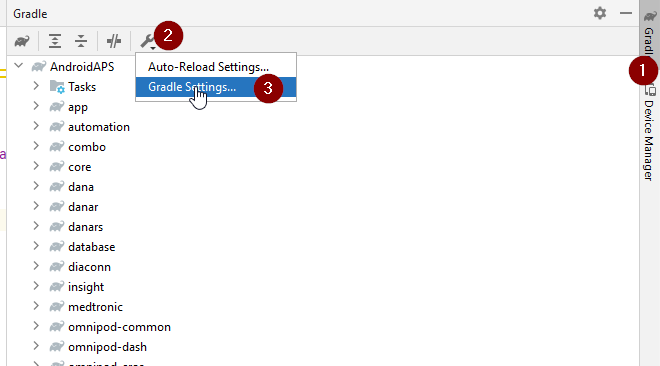
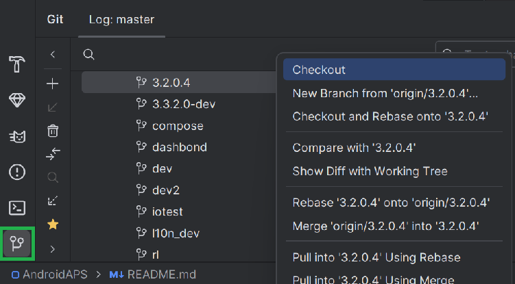
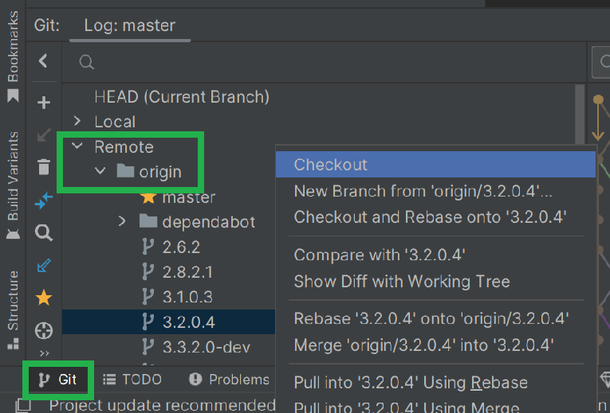
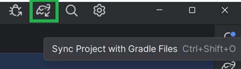
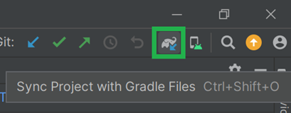

# Atnaujinimas į AAPS 3.2.0.4

(update-aaps-3204)=

## Kurti sau, o ne parsisiųsti

**AAPS programėlės (apk failo) negalima atsisiųsti dėl medicinos prietaisų reglamentų. Sukurti programėlę savo reikmėms yra teisėta, bet jos kopijos negalima duoti kitiems!**

Daugiau informacijos rasite [DUK puslapyje](../UsefulLinks/FAQ.md).

## Kompiuterio ir programinės įrangos reikalavimai AAPS 3.2.0.4 kūrimui

* Norint sukurti apk, gali reikėti konkrečios **[Android Studio](https://developer.android.com/studio/)** versijos.

| AAPS Version            | Rekomenduojama<br/>Android Studio<br/>versija | Alternatyvi<br/>Android Studio<br/>versija | Gradle | JVM |
| ----------------------- | --------------------------------------------------------- | ------------------------------------------------------ | ------ |:--- |
| [3.2.0.4](#version3204) | Hedgehog (2023.1.1)                                       | iki Meerkat                                            | 8.2    | 17  |

„Rekomenduojamoje versijoje“ jau yra tinkama JVM versija. Rekomenduojama versija kartu yra ir mažiausia versija, kurią galite naudoti **AAPS** kūrimui. Su senesne nei „rekomenduojama“ versija kurti **NEGALĖSITE**. Jei naudojate kitą versiją, gali kilti problemų dėl JVM versijos. Šioms problemoms išspręsti žr. puslapį [Android Studio trikčių šalinimas](#incompatible-gradle-jvm). Jei jūsų dabartinės Android Studio versijos lentelėje nėra, pirmiausia ją atnaujinkite.

Gradle versija susieta su šaltinio kodu: atsisiųsdami arba atnaujindami šaltinio kodą, visada gausite tinkamą Gradle versiją. Ji nurodyta tik informacijai, nieko daryti nereikia.

* Android Studio nepalaiko [Windows 32 bitų sistemų](#troubleshooting_androidstudio-unable-to-start-daemon-process). Atminkite, kad **64 bitų procesorius ir 64 bitų operacinė sistema yra privalomos sąlygos.** Jei jūsų sistema šios sąlygos NETENKINA, turite pakeisti netinkamą aparatinę ar programinę įrangą arba visą sistemą.

<table class="tg">
<tbody>
  <tr>
    <th class="tg-baqh">OS (tik 64 bitų)</th>
    <td class="tg-baqh">Windows 8 or higher</td>
    <td class="tg-baqh">Mac OS 10.14 or higher</td>
    <td class="tg-baqh">Any Linux supports Gnome, KDE, or Unity DE;&nbsp;&nbsp;GNU C Library 2.31 or later</td>
  </tr>
  <tr>
    <th class="tg-baqh"><p align="center">Procesorius (tik 64 bitų)</th>
    <td class="tg-baqh">x86_64 procesoriaus architektūra; 2-osios kartos Intel Core ar naujesnis arba AMD procesorius, palaikantis <br><a href="https://developer.android.com/studio/run/emulator-acceleration#vm-windows" target="_blank" rel="noopener noreferrer"><span style="text-decoration:var(--devsite-link-text-decoration,none)">Windows Hypervisor</span></a></td>
    <td class="tg-baqh">ARM lustai arba 2-osios kartos Intel Core ar naujesnis, palaikantis <br><a href="https://developer.android.com/studio/run/emulator-acceleration#vm-mac" target="_blank" rel="noopener noreferrer"><span style="text-decoration:var(--devsite-link-text-decoration,none)">Hypervisor.Framework</span></a></td>
    <td class="tg-baqh">x86_64 procesoriaus architektūra; 2-osios kartos Intel Core ar naujesnis arba AMD procesorius, palaikantis AMD virtualizaciją (AMD-V) ir SSSE3</td>
  </tr>
  <tr>
    <th class="tg-baqh"><p align="center">RAM</th>
    <td class="tg-baqh" colspan="3"><p align="center">8GB or more</td>
  </tr>
  <tr>
    <th class="tg-baqh"><p align="center">Disk</th>
    <td class="tg-baqh" colspan="3"><p align="center">At least 30GB free space. SSD is recommended.</td>
  </tr>
  <tr>
    <th class="tg-baqh"><p align="center">Resolution</th>
    <td class="tg-baqh" colspan="3"><p align="center">1280 x 800 Minimum <br></td>
  </tr>
  <tr>
    <th class="tg-baqh"><p align="center">Internet</th>
    <td class="tg-baqh" colspan="3"><p align="center">Broadband</td>
  </tr>
</tbody>
</table>

**Labai rekomenduojama (bet neprivaloma) naudoti SSD (Solid State Disk), o ne HDD (Hard Disk Drive), nes AAPS apk failo kūrimas užtruks trumpiau.**  **AAPS** apk failą vis tiek galite kurti ir naudodami HDD. Tokiu atveju kūrimas gali užtrukti ilgai, bet kai jis prasidės, galėsite palikti jį veikti be priežiūros.

## Pagalba kuriant 3.2.0.4

Jei kuriant **AAPS** programėlę kyla sunkumų, yra atskiras skyrius [**Android Studio trikčių šalinimas**](https://androidaps.readthedocs.io/en/3.2/GettingHelp/TroubleshootingAndroidStudio.html): pirmiausia peržiūrėkite jį.

Jei manote, kad kūrimo instrukcijose kažkas neteisinga, trūksta ar neaišku, arba jums vis dar nesiseka, kreipkitės į kitus **AAPS** naudotojus grupėje [Facebook](https://www.facebook.com/groups/AndroidAPSUsers) arba [Discord](https://discord.gg/4fQUWHZ4Mw). Jei norite ką nors pakeisti patys (atnaujinti ekrano nuotraukas _ir pan._), pateikite [pull request (PR)](../SupportingAaps/HowToEditTheDocs.md).

```{note}
Šiame puslapyje pateikti pavyzdiniai paveikslėliai ir naujajai (**New**), ir senajai (**Classic**) Android Studio sąsajai.
```

## 3.2.0.x atnaujinimo į 3.2.0.4 apžvalga

```{contents} Steps for updating to 3.2.0.4
:depth: 1
:local: true
```

### Eksportuokite dabartinius nustatymus

Eksportuokite nustatymus iš dabartinės **AAPS** versijos savo telefone. Galbūt to neprireiks, bet geriau būti atsargiems.

Jei neprisimenate, kaip tai padaryti, žr. puslapį [Nustatymų eksportavimas ir importavimas](ExportImportSettings.md).

### Atnaujinkite savo vietinę AAPS kopiją

* Atidarykite esamą AAPS projektą su Android Studio. Gali reikėti pasirinkti projektą. (Dukart) spustelėkite AAPS projektą.


<br>


* Android Studio meniu juostoje pasirinkite Git -> Fetch


<br>


* Apatiniame dešiniajame kampe pamatysite pranešimą, kad Fetch pavyko.


<br>


* Dabar meniu juostoje pasirinkite Git -> Pull


<br>


* Visas parinktis palikite kaip yra (origin/master) ir pasirinkite Pull


<br>


* Palaukite, kol baigsis atsisiuntimas. Eigą matysite apatinėje juostoje. Kai bus baigta, pamatysite pranešimą apie sėkmę.

  ```{note}
  Atnaujinti failai gali skirtis! Tai nereiškia, kad yra problema.
  ```


<br>


* Gradle Sync atsisiųs kai kurias priklausomybes. Palaukite, kol jis baigsis.


<br>


### Pasirinkite JVM 17 versiją

- Atidarykite Gradle rodinį spustelėdami dramblį (1) dešinėje Android Studio pusėje, atidarykite nustatymus (2) ir pasirinkite **Gradle Settings** (3):


<br>



- Lauke **Gradle JDK** (1) patikrinkite, ar pasirinkta tinkama versija: **jbr-17**. Jei ne, spustelėkite lauką ir pažiūrėkite, ar ji jau yra sąraše. Jei jos sąraše nėra (paveikslėlyje žemiau parodytas kompiuteris, kuriame yra tik **jbr-21**), pasirinkite **Download JDK...** (2).


- Lauke Version (1) pasirinkite **17**. Lauke Vendor (2) pasirinkite JetBrains Runtime arba bet kurį tiekėją. Location (3): nekeiskite.


- Uždarykite langą **Settings** mygtuku **OK**.

### Pasirinkite AAPS 3.2.0.4 atšaką

- Apačioje kairėje pasirinkite Git simbolį, dešiniuoju pelės klavišu spustelėkite 3.2.0.4 ir pasirinkite Checkout.



<br>



### Sinchronizuokite projektą su Gradle

```{admonition} WARNING!
:class: warning
**Niekada neatnaujinkite Gradle.** Visada tik sinchronizuokite jį su projektu.
```

Naujoje sąsajoje naudokite dramblio piktogramą ir Sync Project with Gradle Files (arba vadovaukitės [šiuo aprašymu](#gradle-resync)).



Klasikinėje sąsajoje – ([šis aprašymas](https://androidaps.readthedocs.io/en/3.2/GettingHelp/TroubleshootingAndroidStudio.html#gradle-resync)).



### Sukurkite pasirašytą 3.2.0.4 APK

Jūsų šaltinio kodas dabar yra dabartinė išleista versija, ir visos būtinos sąlygos patikrintos. Laikas sukurti pasirašytą apk, kaip aprašyta [pasirašyto apk kūrimo skyriuje](#Building-APK-generate-signed-apk).

### Perkelkite ir įdiekite 3.2.0.4 APK

Apk reikia perkelti į telefoną, kad galėtumėte jį įdiegti.

```{note}
Jei kūrėte su ta pačia esama raktų saugykla Android Studio, esamos programėlės telefone šalinti nereikia. Diegdami apk, vadovaukitės nurodymais ekrane, kad įdiegtumėte atnaujinimą.
Kitais atvejais, pavyzdžiui, jei pasirašytam apk Android Studio sukūrėte naują raktų saugyklą, prieš diegdami apk turėsite pašalinti senąją programėlę. **Būtinai eksportuokite nustatymus!**
```

Žr. [AAPS perkėlimo ir įdiegimo](../SettingUpAaps/TransferringAndInstallingAaps.md) instrukcijas

### Patikrinkite AAPS 3.2.0.4 versiją telefone

Įdiegę naują apk, AAPS versiją telefone galite patikrinti paspaudę trijų taškų meniu viršuje dešinėje ir pasirinkę Apie. Turėtumėte matyti dabartinę versiją.

