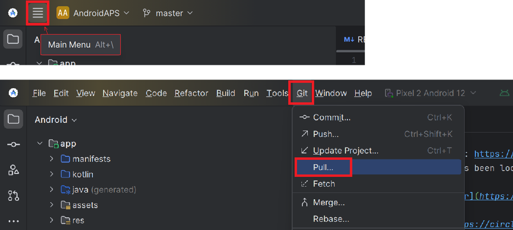

# Atnaujinimas su Android Studio

## Kurti sau, o ne parsisiųsti

**AAPS** negalima atsisiųsti dėl medicinos prietaisams taikomų teisės aktų. Sukurti programėlę savo reikmėms yra teisėta, bet jos kopijos negalima duoti kitiems! Daugiau informacijos rasite [DUK puslapyje](../UsefulLinks/FAQ.md).

```{note}
Jei norite kurti **AAPS** naujame kompiuteryje, nukopijuokite atsarginę raktų saugyklos failo kopiją į naują kompiuterį. Tada vietoj šio vadovo vadovaukitės [pirmojo **AAPS** kūrimo instrukcijomis](../SettingUpAaps/BuildingAaps.md). Vienintelis skirtumas: užuot kūrę naują raktų saugyklą, galite pasirinkti tą, kurią nukopijavote į naują kompiuterį.
```

## AAPS atnaujinimo į naują versiją su Android Studio apžvalga

```{contents} Steps for updating to a new version of AAPS
:depth: 1
:local: true
```

Jei kyla problemų, žr. atskirą puslapį [Android Studio trikčių šalinimas](../GettingHelp/TroubleshootingAndroidStudio.md).

### Eksportuokite nustatymus

Eksportuokite nustatymus iš dabartinės **AAPS** versijos savo telefone. Galbūt to neprireiks, bet geriau būti atsargiems.

Jei neprisimenate, kaip tai padaryti, žr. puslapį [Nustatymų eksportavimas ir importavimas](ExportImportSettings.md).

### Patikrinkite Android Studio versiją

Mažiausia reikalinga versija nurodyta [kūrimo instrukcijose](#Building-APK-recommended-specification-of-computer-for-building-apk-file). Jei jūsų versija senesnė, pirmiausia [atnaujinkite Android Studio](#Building-APK-install-android-studio)!

(Update-to-new-version-update-your-local-copy)=
### Update your local copy

* Atidarykite esamą AAPS projektą su Android Studio. Gali reikėti pasirinkti projektą. (Dukart) spustelėkite AAPS projektą.

  

* Android Studio meniu juostoje pasirinkite Git -> Fetch

   

* Apatiniame dešiniajame kampe pamatysite pranešimą, kad Fetch pavyko.

   

* Dabar meniu juostoje pasirinkite Git -> Pull

   

* Visas parinktis palikite kaip yra (origin/master) ir pasirinkite Pull

   

* Palaukite, kol baigsis atsisiuntimas. Eigą matysite apatinėje juostoje. Kai bus baigta, pamatysite pranešimą apie sėkmę.

  ```{note}
  Atnaujinti failai gali skirtis! Tai nereiškia, kad yra problema.
  ```

   

* Gradle Sync atsisiųs kai kurias priklausomybes. Palaukite, kol jis baigsis.

  

### Patikrinkite JVM versiją

Šį patikrinimą ypač verta atlikti, jei tame pačiame kompiuteryje jau esate kūrę ankstesnę **AAPS** versiją.

[Kūrimo instrukcijose](#Building-APK-recommended-specification-of-computer-for-building-apk-file) patikrinkite, kokios JVM versijos reikia **AAPS** versijai, kurią dabar kuriate. Tada atlikite skyriuje [Incompatible Gradle JVM](#incompatible-gradle-jvm) aprašytus veiksmus ir įsitikinkite, kad dabar naudojate tinkamą versiją.

(Update-to-new-version-build-the-signed-apk)=
### Sukurkite pasirašytą APK

Jūsų šaltinio kodas dabar yra dabartinė išleista versija, ir visos būtinos sąlygos patikrintos. Laikas sukurti pasirašytą apk, kaip aprašyta [pasirašyto apk kūrimo skyriuje](#Building-APK-generate-signed-apk).

(Update-to-new-version-transfer-and-install)=

### Perkelkite ir įdiekite apk
Apk reikia perkelti į telefoną, kad galėtumėte jį įdiegti.

```{note}
Jei kūrėte su ta pačia esama raktų saugykla Android Studio, esamos programėlės telefone šalinti nereikia. Diegdami apk, vadovaukitės nurodymais ekrane, kad įdiegtumėte atnaujinimą.
Kitais atvejais, pavyzdžiui, jei pasirašytam apk Android Studio sukūrėte naują raktų saugyklą, prieš diegdami apk turėsite pašalinti senąją programėlę. **Būtinai eksportuokite nustatymus!**
```

Žr. [AAPS perkėlimo ir įdiegimo](../SettingUpAaps/TransferringAndInstallingAaps.md) instrukcijas. Kur taikomas Google [Android kūrėjų tapatybės patikrinimas](#android-developer-verification) (nuo 2026 m. rugsėjo, priklausomai nuo jūsų šalies), įdiekite per [ADB](#android-developer-verification-adb), o ne paliesdami APK failą.

Tęskite [čia](#Update-to-new-version-check-aaps-version-on-phone).

(update-computer-build-troubleshooting)=

## Troubleshooting

Jei kas nors nepavyksta, nepanikuokite.

Giliai įkvėpkite!

Tada atskirame puslapyje [Android Studio trikčių šalinimas](../GettingHelp/TroubleshootingAndroidStudio.md) patikrinkite, ar jūsų problema jau aprašyta.

Jei reikia daugiau pagalbos, kreipkitės į kitus **AAPS** naudotojus [Facebook](https://www.facebook.com/groups/AndroidAPSUsers) arba [Discord](https://discord.gg/4fQUWHZ4Mw).