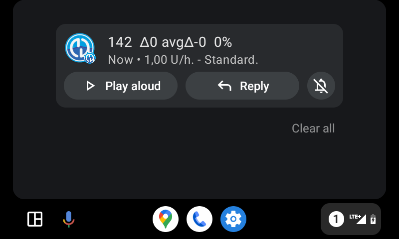
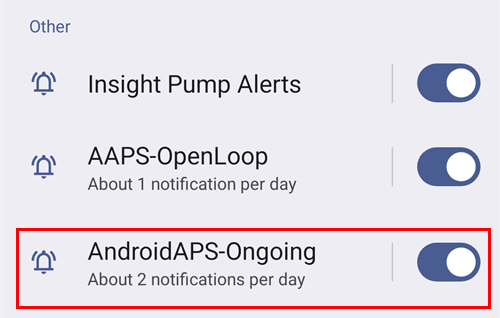

# Android Auto

**AAPS** gali siųsti jūsų dabartinę būseną kaip pranešimą tiesiai į jūsų automobilio Android Auto.

## Reikalavimai

**AAPS** naudoja Android Auto funkciją, kuri leidžia telefono programėlių pranešimus rodyti automobilio garso sistemos ekrane.

Tai reiškia, kad:

* Android turi leisti **AAPS** rodyti pranešimus, o
* Kadangi **AAPS** nėra oficiali programėlė, Android Auto leiskite naudoti „unknown sources“ (nežinomus šaltinius).

(androidauto-check-that-aaps-can-show-notifications)=

## Patikrinkite, ar AAPS gali rodyti pranešimus

**AAPS** visada rodo būsenos pranešimą su jūsų dabartine glikemija, AIO ir AAO. Šį pranešimą Android Auto rodo automobilyje. **AAPS** nieko įjungti nereikia, bet Android turi leisti **AAPS** rodyti pranešimus.

Telefone atidarykite **Settings** > **Apps** > **AAPS** > **Notifications** (Nustatymai > Programėlės > AAPS > Pranešimai) ir patikrinkite, ar įjungta **All AAPS notifications** (visi AAPS pranešimai).

Slinkite žemyn ir patikrinkite, ar įjungta **Nuolatinės būsenos pranešimai**: tai būsenos pranešimo kanalas.

Prieš eidami prie automobilio, dabar patikrinkite, ar telefone matote **AAPS** būsenos pranešimą!

(androidauto-allow-the-use-of-unknown-sources-with-android-auto)=

## Leiskite Android Auto naudoti „unknown sources“ (nežinomus šaltinius).

Kadangi **AAPS** nėra oficiali Android Auto programėlė, Android Auto reikia įjungti pranešimus iš „unknown sources“ (nežinomų šaltinių). Tam naudojamas kūrėjo režimas. Toliau parodysime, kaip tai padaryti.

Nueikite prie automobilio ir prijunkite telefoną prie automobilio garso sistemos.

Dabar turėtumėte matyti ekraną, panašų į šį.

Paspauskite **setting** (nustatymų) piktogramą, kad pradėtumėte konfigūravimą.

Slinkite žemyn iki puslapio galo ir pasirinkite **see more in the phone** (daugiau telefone).

Dabar telefone įjungsime kūrėjo režimą.

Pirmasis ekranas atrodo taip. Slinkite žemyn iki puslapio galo.

Ten matysite Android Auto versiją. Paspauskite Android Auto versiją 10 kartų (dešimt kartų). Šiuo slaptu veiksmu jūs įjungėte kūrėjo režimą.

Lange „Allow development settings?“ (leisti kūrėjo nustatymus?) patvirtinkite, kad norite įjungti kūrėjo režimą.

Skiltyje **developer settings** (kūrėjo nustatymai) įjunkite „Unknown sources“ (nežinomi šaltiniai).

Dabar, jei norite, galite išjungti kūrėjo režimą. Tam paspauskite trijų taškų meniu viršuje dešinėje.

## Show notifications in car

Automobilio Android Auto ekrane paspauskite **number icon** (skaičiaus piktogramą) apačioje dešinėje.

Jūsų NGJ duomenys bus rodomi taip:

(android-auto-troubleshooting)=

## KEEP

* Jei pranešimo nematote, patikrinkite, ar Android [leido AAPS rodyti pranešimus](#androidauto-check-that-aaps-can-show-notifications) ir ar [Android Auto turi prieigą prie pranešimų](#androidauto-allow-the-use-of-unknown-sources-with-android-auto).