# AAPS sekimas (be sąveikos su AAPS sistema)

Be daugybės **AAPS** nuotolinio valdymo _ir_ sekimo galimybių, aprašytų puslapyje [AAPS nuotolinis valdymas](../RemoteFeatures/RemoteControl.md), bendruomenė sukūrė ir keletą kitų programėlių bei įrenginių, kuriais galima tiesiog sekti skaičius (glikemijos reikšmes ir kitą informaciją), nesikišant į **AAPS** veikimą.

Gerą daugybės **AAPS** sekimo galimybių apžvalgą rasite tinklalapyje [Nightscout follower](https://nightscout.github.io/nightscout/downloaders/#).

```{contents} Table of contents
:depth: 1
:local: true
```

Dažniausi būdai, naudojami kartu su **AAPS**, išsamiau aprašyti toliau.

## KEEP

```{contents} These are some of the main “follower” apps used by **AAPS** users. All of these apps are “free”: 
:depth: 1
:local: true
```

### Dexcom Follow ([Android](https://play.google.com/store/apps/details?id=com.dexcom.follow.region2.mgdl) ir [iOS](https://apps.apple.com/fr/app/dexcom-follow-mg-dl-dxcm2/id1032203080))

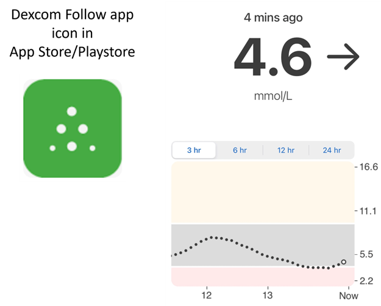

* Dexcom Follow veikia daugelyje telefonų (tiek Android, tiek iPhone). Dexcom Follow galima naudoti, net jei jutiklio duomenims gauti nenaudojate oficialios Dexcom programėlės.

* Daugelis globėjų pažįsta Dexcom Follow ir renkasi jos aiškią sąsają vietoj sudėtingesnės.

* Dexcom Follow labai tinka mokytojams, seneliams ir žmonėms, kurie mažai žino apie diabetą ir gliukozės kiekį. Joje yra pritaikomi įspėjimai (KG lygis, koks garsas skamba ir kt.). Jei reikia, aliarmus galima visiškai išjungti. Tai labai naudinga, jei jutiklis dar nusistovi ir rodo daug klaidingų žemų reikšmių.

#### Dexcom Follow nustatymas: instrukcija

Jei jutiklio duomenims gauti naudojate neoficialią Dexcom programėlę BYODA, gali būti, kad kvietimus sekėjams galėsite siųsti iš BYODA programėlės.

Iš trečiųjų šalių programėlių nebegalima siųsti kvietimų laiškų Dexcom sekėjams. xDrip kvietimo užklausa baigsis tik pranešimu „invite not sent“ (kvietimas neišsiųstas).

Turite įdiegti oficialią Dexcom programėlę, išsiųsti kvietimą ir tada oficialią programėlę pašalinti.

Veiksmai yra tokie:

1)  Įdiekite oficialią Dexcom programėlę _bet kuriame_ išmaniajame telefone (Android/iPhone). Jei patogiau, tai gali būti sekėjo telefonas. 2)  Prisijunkite su savo Dexcom naudotojo vardu ir slaptažodžiu. Jei jau esate Dexcom/Clarity klientas, tai tie patys prisijungimo duomenys, kuriuos naudojate Dexcom Clarity. Jei Dexcom paskyros neturite, šiame žingsnyje galite ją susikurti.   
3)  Perbraukite įvado ekranus. 4)  Kaip jutiklio kodą pasirinkite „no code“ (be kodo). 5)  Skiltyje Transmitter SN pasirinkite „enter manually“ (įvesti rankiniu būdu) ir įveskite bet kurį galiojantį siųstuvo kodą (jei žinote, naudokite vieno iš savo pasibaigusių siųstuvų kodą, kad jis netrukdytų dabartinio siųstuvo veikimui. Kodai yra tam tikro formato iš skaičių ir raidžių: „NLNNNL“, ir galimi tik tam tikri deriniai, todėl paprasčiausia naudoti kodą, kuris, kaip jau žinote, galioja). 6)  Kai programėlė bandys rasti siųstuvą ir jutiklį, galėsite pakviesti sekėjus: programėlės viršuje kairėje pasirinkite tris mažus taškus ir pridėkite naują sekėją. Tai galite naudoti ir tada, kai vienas iš sekėjų pakeitė telefoną ir jam reikia naujo kvietimo: čia galite jį ištrinti iš sekėjų sąrašo ir išsiųsti naują kvietimo laišką, kurį jis naudos naujame telefone. 7)  Sekėjo telefone įdiekite Dexcom Follow iš App Store (iPhone) arba Play (Android). Nustatykite Dexcom Follow programėlę. Jūsų paprašys atidaryti el. paštą ir rasti kvietimą tapti sekėju.    
8)  Dabar galite ištrinti oficialią Dexcom G6 programėlę.

Dexcom Follow atveju jutiklio duomenys tada eksportuojami iš **AAPS** telefono tiesiai iš BYODA arba iš xDrip, priklausomai nuo to, kurią programėlę naudojate.


### [Nightguard](https://apps.apple.com/fr/app/nightguard/id1116430352) (iOS)

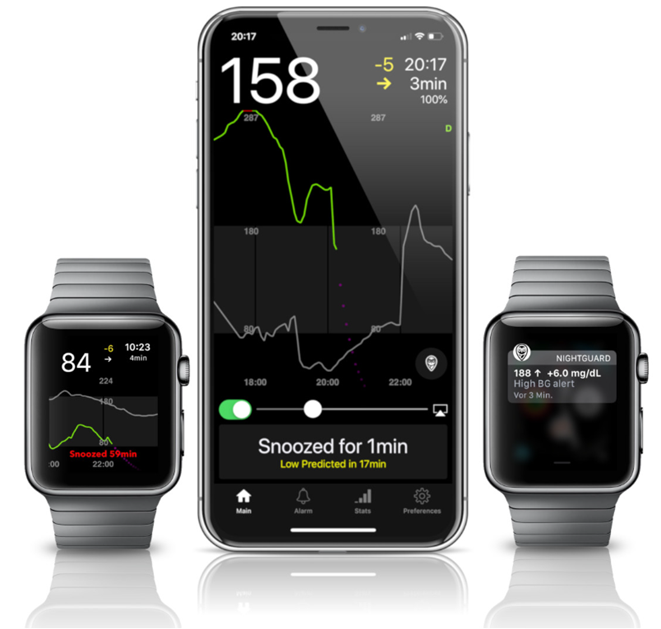

KEEP

* Galima atsisiųsti iš [App Store](https://apps.apple.com/us/app/nightguard/id1116430352), paprasta ir patogi sąsaja.

* Perbraukite mygtuką arba pakratykite telefoną, kad nutildytumėte aliarmus įvairiam laikui – nuo 5 min. iki 24 valandų

* Pritaikomi aliarmai (aukšta, žema glikemija, praleisti rodmenys, kai 15–45 minutes nėra duomenų).

* Greitas kilimas / kritimas per 2–5 iš eilės einančius rodmenis (pasirenkate patys). Taip pat galima pasirinkti pokytį tarp dviejų atskirų rodmenų

* Išmanusis nutildymas: neįspėja, jei reikšmės kinta tinkama kryptimi

* Yra skirtukas Care, kuriame, atrodo, galima nustatyti naują laikiną tikslą tam tikram laikui, ištrinti laikiną tikslą arba įvesti angliavandenius.

KEEP

* Yra tik iOS

* LT visada rodomas kaip 5 mmol, nesvarbu, koks LT nustatytas

* Niekada nerodo laikinos bazės dydžio, nors rodo TB

### [Nightwatch](https://play.google.com/store/apps/details?id=se.cornixit.nightwatch) (Android)

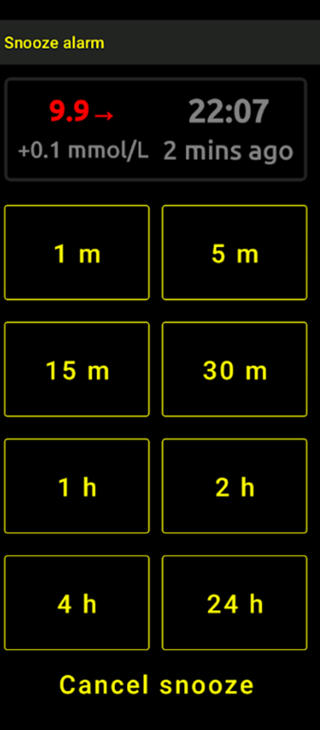


* Nightwatch pristatoma kaip Nightscout klientas. Ji Android telefone arba planšetėje stebi naudotojo glikemiją Nightscout.

* Programėlę galima atsisiųsti iš [Google Play](https://play.google.com/store/apps/details?id=se.cornixit.nightwatch). Ji rodo KG duomenis realiu laiku.

* Naudotoją galima įspėti garsiais, pagal poreikį nustatytais žemos ir aukštos glikemijos aliarmais.

* KG duomenis galima matyti mmol/l arba mg/dL.

* Reikia Android 5.0 arba naujesnės versijos.

* KEEP

### xDrip (Android)

xDrip galite naudoti kaip sekėją.

#### Su Nightscout

Nustatykite xDrip kaip Nightscout sekėją. Gausite KG ir terapijos duomenis, bet ne valandinę bazę.

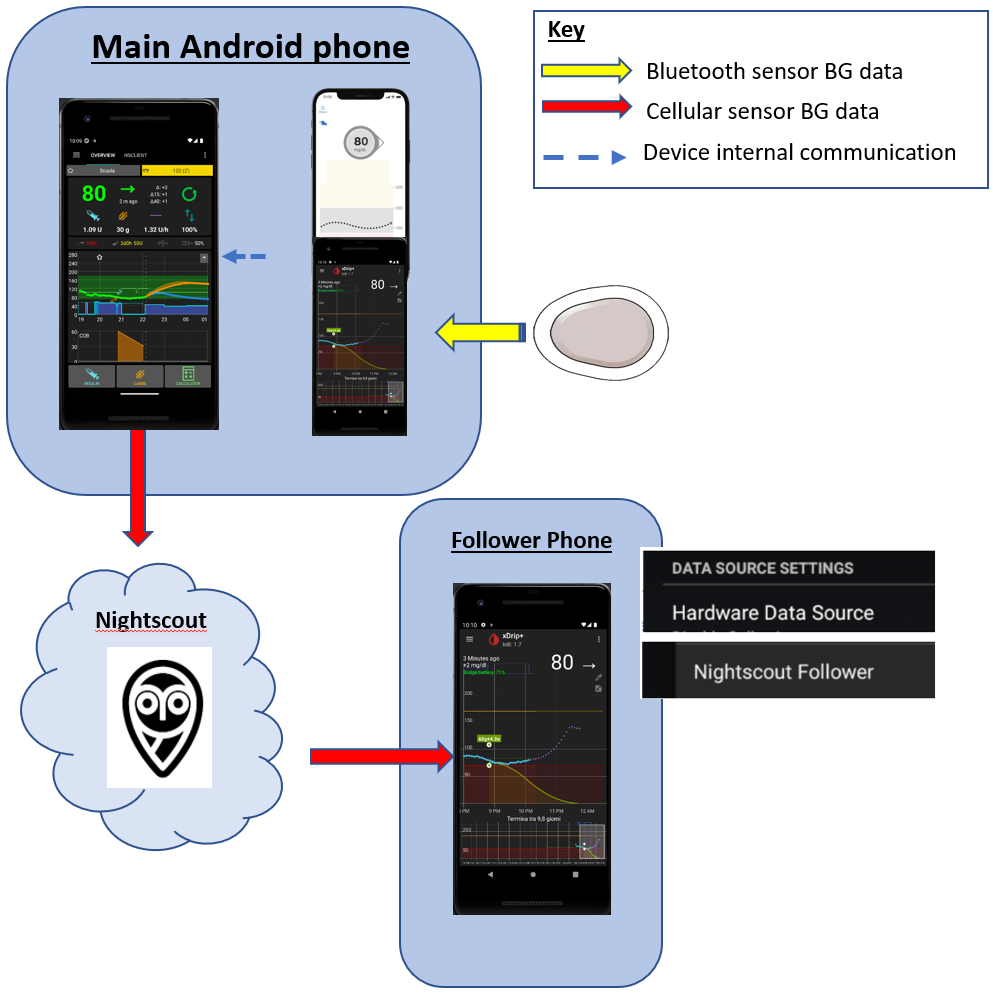

#### Be Nightscout – xDrip kaip glikemijos šaltinis

Jei jūsų **AAPS** duomenų šaltinis yra xDrip (arba jei xDrip taip pat gali gauti KG iš kitos programėlės, pvz., BYODA, Juggluco, ...), galite jį naudoti pagrindiniame telefone ir dalytis duomenimis su xDrip sekėjais: rodoma KG, terapija ir valandinė bazė.

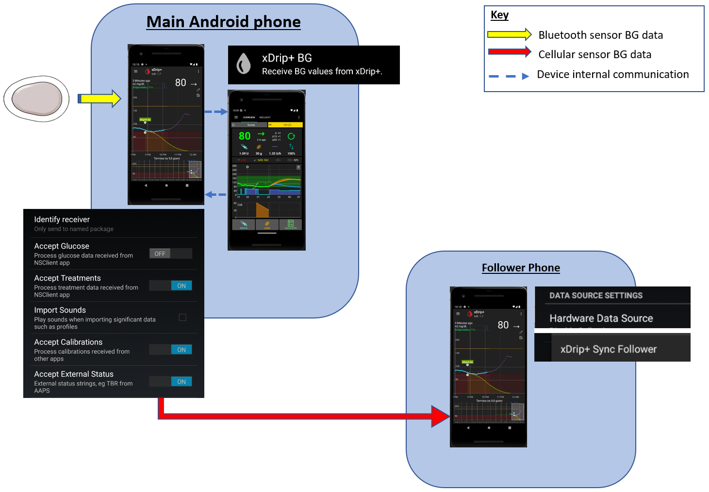

#### Be Nightscout – xDrip KG Companion App

Jei jūsų **AAPS** duomenų šaltinis nėra xDrip, bet xDrip gali rodyti KG duomenis iš Companion App duomenų šaltinio, galite jį naudoti pagrindiniame telefone ir dalytis duomenimis su xDrip sekėjais: rodoma KG, terapija ir valandinė bazė.

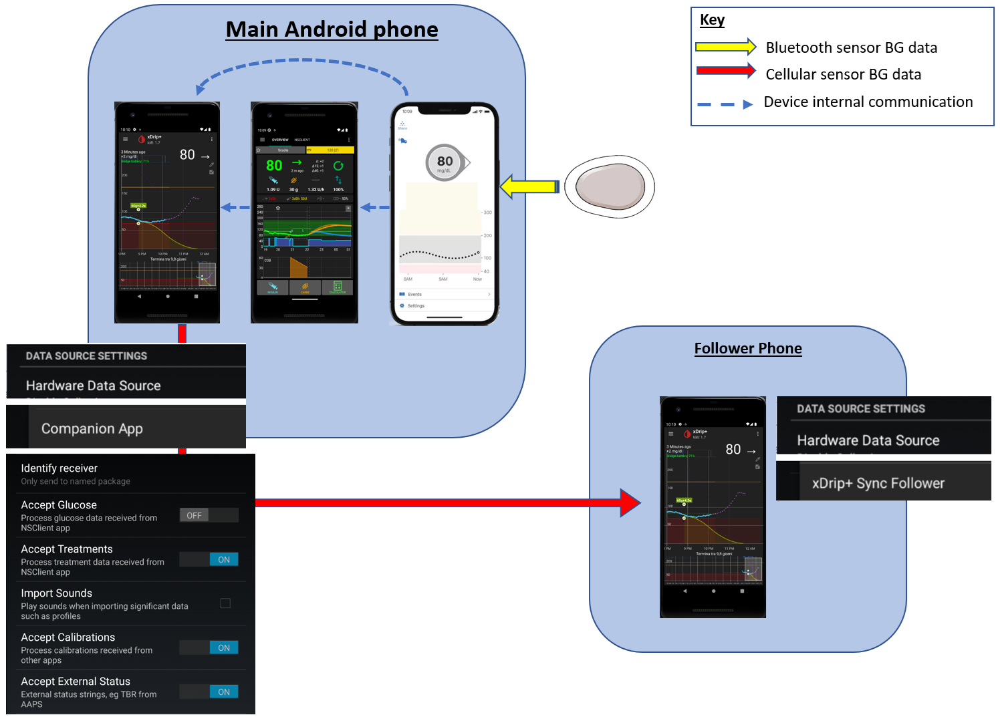

### xDrip4iOS (iOS)


xDripSwift buvo sukurta perkėlus originalią xDrip programėlę į iOS. Vėliau ji tapo „xDrip for iOS“, rašoma **xDrip4iOS**.

```{admonition} Further detail about how to attempt to obtain the original **xDrip4iOS** app
:class: dropdown
[xDrip4iOS Facebook grupė](https://www.facebook.com/groups/853994615056838/announcements) yra pagrindinė xDrip4iOS ir Shuggah bendruomenės pagalbos vieta. **xDrip4iOS** gali jungtis prie daugelio skirtingų NGJ sistemų ir siųstuvų, rodyti glikemijos reikšmes, grafikus ir statistiką bei įspėti aliarmais. Ji taip pat gali siųsti duomenis į Nightscout arba veikti kaip [Nightscout sekėjo programėlė](https://xdrip4ios.readthedocs.io/en/latest/connect/follower/). 

„Kaip gauti **xDrip4iOS** savo iPhone?“
Yra du būdai:

1. Jei turite Mac kompiuterį ir Apple Developer paskyrą (99 EUR/USD per metus), galite patys sukurti xDrip4iOS [pagal instrukcijas](https://xdrip4ios.readthedocs.io/en/latest/install/build/).

Jei norite, vėliau galite tapti „releaser“ (platintoju) ir [bendrinti asmeninę Testflight xDrip4iOS versiją](https://xdrip4ios.readthedocs.io/en/latest/install/personal_testflight/) su iki 100 kitų žmonių, kad jiems padėtumėte.

2. Prisijunkite prie [xDrip4iOS Facebook grupės](https://www.facebook.com/groups/853994615056838/announcements) ir perskaitykite prisegtus įrašus apie dabartinius būdus gauti programėlę. **Neprašykite kvietimo į programėlę** (perskaitykite grupės taisykles).
```


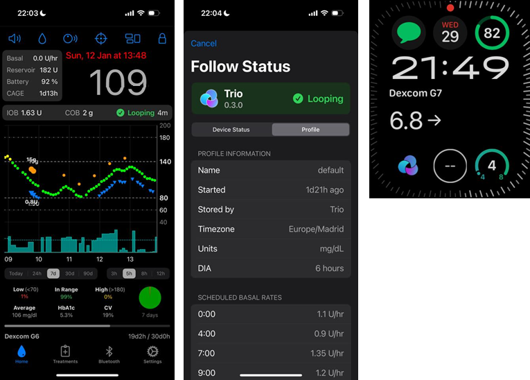

„Kas yra **Shuggah**?“ Ukrainiečių kūrėjų grupė nukopijavo xDrip4iOS projekto kodą (kuris viešai skelbiamas GitHub) ir išleido jį App Store per verslo paskyrą. Shuggah versijos visiškai netvarko xDrip4iOS kūrėjai.

[xDrip4iOS Facebook grupė](https://www.facebook.com/groups/853994615056838/announcements) palaiko xDrip4iOS ir atitinkamas Apple Watch programėles.

### [Sugarmate](https://apps.apple.com/fr/app/sugarmate/id1111093108) (iOS)

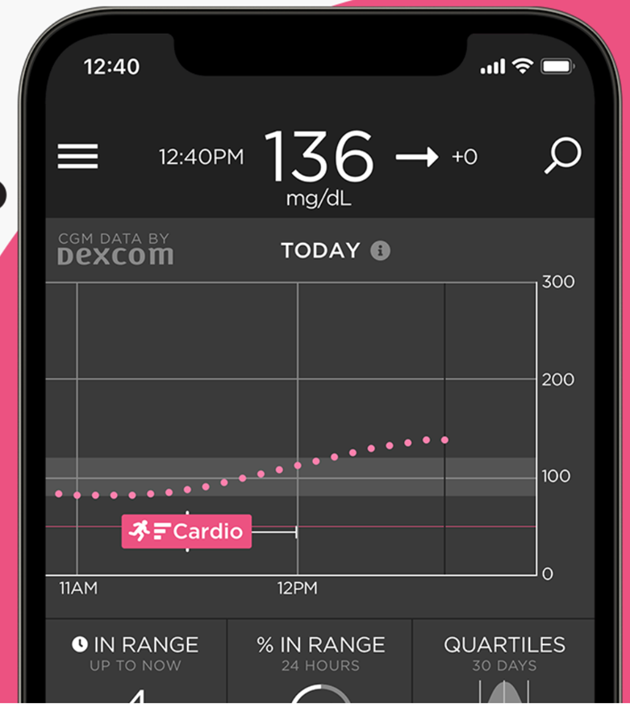

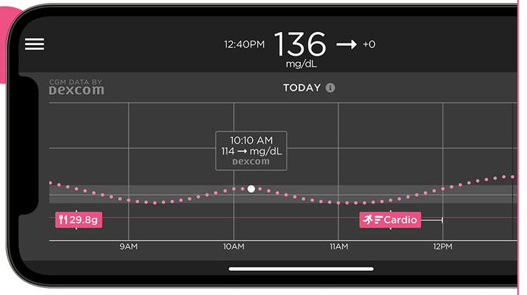


[Sugarmate](https://sugarmate.io/) galima atsisiųsti į iPhone iš App Store. Sugarmate veikia su:
* Apple iPhone (reikia programinės įrangos 13.0 arba naujesnės versijos)
* Apple iPad (reikia programinės įrangos 13.0 arba naujesnės versijos)
* Google Android (išsaugokite žiniatinklio programėlę pagrindiniame ekrane)

Sugarmate naudotojai praneša, kad JAV ją galima naudoti su Apple CarPlay ir vairuojant matyti glikemijos rodmenis. KEEP Jei apie tai žinote daugiau, papildykite šią dokumentaciją sukurdami [pull request](../SupportingAaps/HowToEditTheDocs.md). Tai greita ir paprasta.


### [Spike](https://spike-app.com/) (iOS)

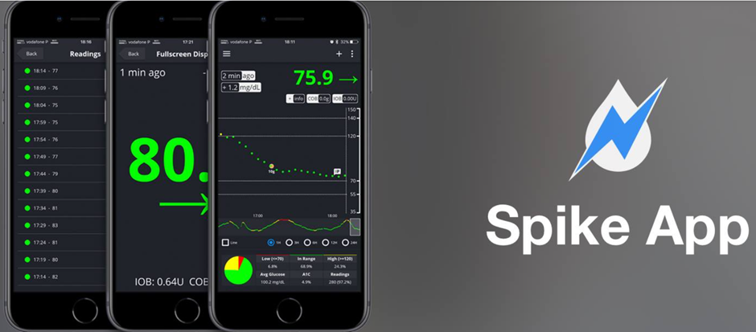

Spike galima naudoti kaip pagrindinį imtuvą arba kaip sekėjo programėlę. Ji rodo KG, aliarmus, AIO ir kt.

KEEP Pagalbos galima rasti [Facebook](https://www.facebook.com/groups/1973791946274873) ir [Gitter](https://gitter.im/SpikeiOS/Lobby).

## Išmanieji laikrodžiai **AAPS stebėjimui** (visi profilio duomenys arba tik glikemija), kai **AAPS** veikia telefone.

Žr. [čia](../Getting-Started/Watches.md).


## KEEP

```{contents} Devices include:
:depth: 1
:local: true
```

### M5Stack

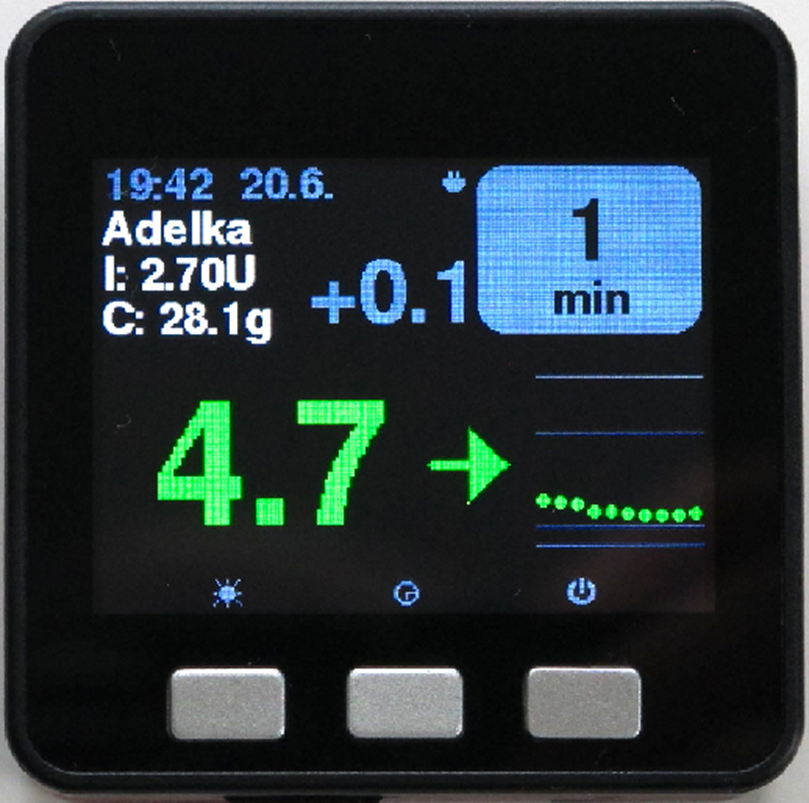

M5Stack – tai maža dėžutė, kurią galima užprogramuoti daugeliui paskirčių. Martino projektas [M5Stack NightscoutMon](https://github.com/mlukasek/M5_NightscoutMon/wiki) rodo jutiklio glikemijos reikšmes ir tendencijas, AIO ir AAO. Tai plastikinė dėžutė su spalvotu ekranu, micro SD kortelės lizdu, 3 mygtukais, garsiakalbiu ir vidine baterija. Tai puikus glikemijos monitorius, kurį gana lengva nustatyti, jei turite Nightscout paskyrą. Dažniausiai naudotojai jį naudoja namų Wi-Fi tinkle, bet kai kurie praneša, kad naudoja jį kaip ekraną važiuodami motociklu, prijungę prie telefono Wi-Fi prieigos taško.

### SugarPixel

SugarPixel – tai įrenginys, kuris rodo nuolatinio gliukozės stebėjimo duomenis ir įspėja. Jis jungiasi prie Dexcom programėlės arba Nightscout programėlės naudotojo išmaniajame telefone. Įrenginys rodo glikemijos rodmenis realiu laiku. Šis NGJ monitorius turi atsitiktinio tono garsinius įspėjimus (kurie yra labai garsūs), vibracijos įspėjimus klausos negalią turintiems žmonėms, pritaikomas ekrano parinktis ir integruotą sekimą keliems naudotojams.

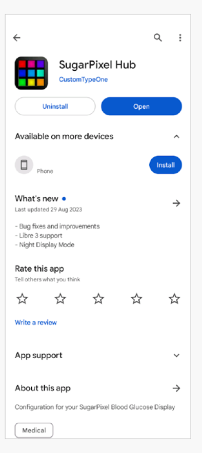

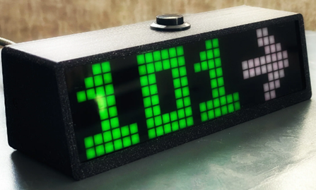

* SugarPixel turi kelias rodymo parinktis mg/dL ir mmol/l, kad atitiktų naudotojo poreikius, su glikemijos reikšmėmis skirtingomis spalvomis.
* Standartiniame ekrano vaizde rodoma KG, tendencijos rodyklė ir pokytis. Pokytis – tai pasikeitimas + arba - nuo paskutinio rodmens.
* SugarPixel galima pritaikyti naudoti esant mažam ryškumui su BG and Time vaizdu, kad naudotojas ant naktinio staliuko matytų savo KG rodmenį ir dabartinį laiką.
* SugarPixel spalvų vaizdas visu ekranu rodo vieną spalvą, kuri atitinka KG reikšmę. Taip naudotojas gali matyti KG rodmenis per atstumą pro langą, kai žaidžia lauke kieme, terasoje ar baseine.
* Big BG vaizdas naudingas tiems, kurie laiko įrenginį ant naktinio staliuko ir nešioja akinius ar kontaktinius lęšius.

### Nightscout Clock ant Ulanzi TC001

**Nightscout Clock** yra atvirojo kodo programinė įranga, veikianti **Ulanzi TC001** įrenginyje. Ji jungiasi prie Dexcom serverių arba Nightscout ir rodo glikemijos rodmenis realiu laiku.

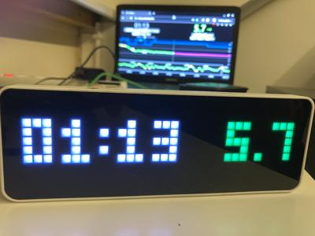

* Laikrodis palaiko ir mmol/l, ir mg/dL vienetus, turi garsinius aliarmus.
* Galimi keli ekrano vaizdai, jų apžvalgą rasite [Github nightscout-clock](https://github.com/ktomy/nightscout-clock?tab=readme-ov-file#more-information-for-people-who-needs-it).
* Įrenginį nustatyti ir sukonfigūruoti reikia tik kelių paprastų žingsnių. Nustatytam įrenginiui veikti reikia tik maitinimo ir Wi-Fi.
* Ulanzi TC001 įrenginys kainuoja gerokai mažiau nei SugarPixel.
* Programinę įrangą ir diegimo instrukcijas rasite [Github nightscout-clock](https://github.com/ktomy/nightscout-clock?tab=readme-ov-file).
* Ją kuria ir prižiūri Artiom Kenibasov, pagalbą teikia [Facebook AAPS Users grupėje](https://www.facebook.com/groups/cgminthecloud/posts/8776932509094594/).

### Kompiuteris (TeamViewer)
Kai kuriems naudotojams sudėtingesnėms problemoms nuotoliniu būdu spręsti padeda pilno nuotolinio prisijungimo įrankis, pvz., [TeamViewer](https://www.teamviewer.com/).
