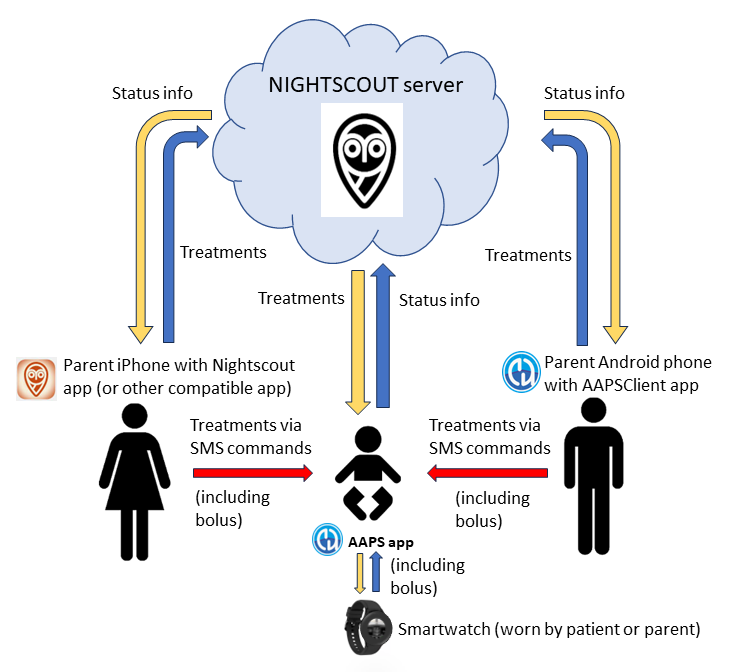
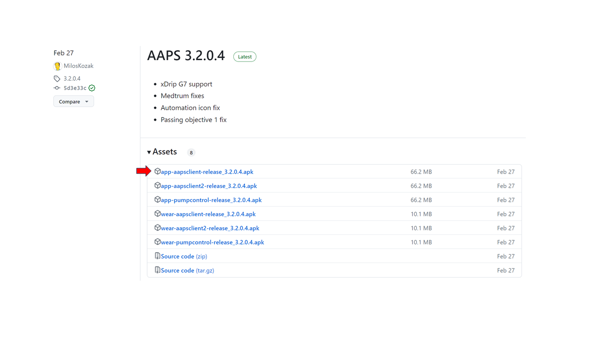
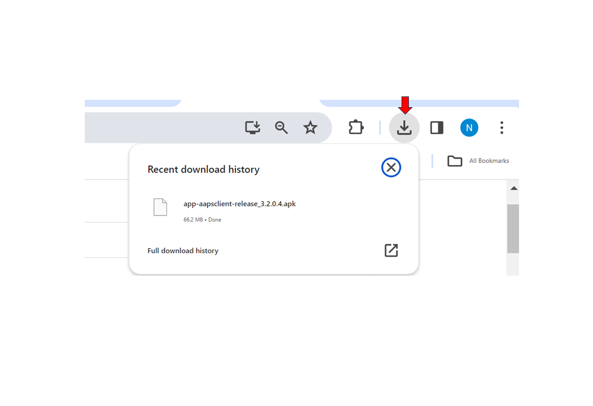
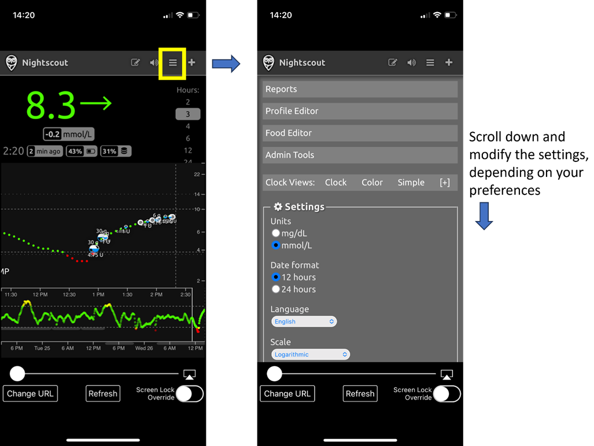

# AAPS nuotolinis valdymas

```{contents} In this page
:backlinks: entry
:depth: 2
```

Yra keturi labai veiksmingi įrankiai **AAPS** valdyti nuotoliniu būdu:

1) [SMS commands](#RemoteControl_SMS-Commands) (follower phone can be either Android or iOS), 2) [AAPSClient](#RemoteControl_aapsclient) (follower device is an Android phone or tablet, or a Windows, Mac or Linux computer; on an iPhone you [build the app yourself](#aapsclient-iphone)) 3) [Nightscout](#RemoteControl_nightscout) (Android, iOS or other computer/device), mainly for following: see the note on [client control](#client-master-control) in that section.  
4) [Smartwatches](#RemoteControl_smartwatches) (Android)

Pirmieji trys labiau tinka prižiūrintiems asmenims / tėvams, o išmanieji laikrodžiai labai naudingi prižiūrintiems asmenims / tėvams **ir** patiems suaugusiems, sergantiems diabetu.



(RemoteControl_SMS-Commands)=

## 1) SMS komandos

Žr. atskirą puslapį [SMS komandos](../RemoteFeatures/SMSCommands.md).

(RemoteControl_aapsclient)=
## 2) AAPSClient

**AAPSClient** atrodo labai panašiai kaip pati **AAPS**: prižiūrintis asmuo turi tuos pačius ekranus ir mygtukus, kad galėtų nuotoliniu būdu siųsti komandas į **AAPS**:


(remotecontrol-aapsclient-versions)=
### Apie AAPSClient, AAPSClient2 ir AAPSClient3

Yra 3 kliento programėlės versijos: **AAPSClient**, **AAPSClient2** ir **AAPSClient3**. Jos veikia vienodai. Vienintelis skirtumas – jas galima įdiegti greta tame pačiame sekėjo telefone.

Prižiūrinčiam asmeniui, kuris seka vieną žmogų, reikia tik **AAPSClient**. Norėdami sekti ir nuotoliniu būdu valdyti antrą žmogų (su jo paties **Nightscout** svetaine ir jo paties **AAPS** telefonu), įdiekite ir **AAPSClient2**, o trečiam žmogui – **AAPSClient3**. Kiekviena programėlė nustatoma ir [susiejama](#aapsclient-pairing-with-the-master) atskirai – su to žmogaus, kurį ji seka, **Nightscout** svetaine ir **AAPS** telefonu.

Kad programėles būtų lengva atskirti, kai kurie elementai yra skirtingos spalvos: geltoni **AAPSClient**, mėlyni **AAPSClient2** ir žali **AAPSClient3**. Tai programėlės piktograma, valdiklio fonas ir **AAPS** būsenos sritis programėlės pagrindiniame ekrane. <br/> Pastaba: valdiklio fono nepermatomumą galima nustatyti valdiklio konfigūracijoje. Esant mažam nepermatomumui, spalvą sunku įžiūrėti.


### Atsisiuntimas ir įdiegimas

**AAPSClient** galima įdiegti viename arba keliuose sekėjų telefonuose (pvz., 1-ojo ir 2-ojo tėvų sekėjo telefonuose), kad abu prižiūrintys asmenys gautų prieigą ir galėtų nuotoliniu būdu valdyti paciento **AAPS** telefoną.

Norėdami atsisiųsti **AAPSClient**, eikite į [GitHub saugyklą](https://github.com/nightscout/AndroidAPS/releases/) ir paspauskite failą **“app-AAPSClient-release_x.x.x.x”** (versija gali būti naujesnė nei parodyta ekrano kopijoje žemiau):



Tada kompiuteryje eikite į  _downloads_ (atsisiuntimai). Windows sistemoje _downloads_ (atsisiuntimai) bus rodomi dešinėje juostoje:



Atsisiuntę paspauskite _show in folder_ (rodyti aplanke), kad rastumėte failą.

**AAPSClient** apk dabar galima:

Perkelti į sekėjo telefoną USB kabeliu; arba Nutempti į Google Drive aplanką ir tada įdiegti sekėjo telefone paspaudus failą „app-AAPSClient-release“.

Jei **AAPS** naudojate patys, o **AAPSClient** – kito žmogaus stebėjimui, **AAPSClient** turėsite sukurti patys, o ne atsisiųsti iš GitHub saugyklos, kaip aprašyta aukščiau. Taip yra todėl, kad tame pačiame telefone negalima įdiegti **AAPS** ir **AAPSClient**, pasirašytų skirtingais raktais. <br/> Norėdami patys sukurti **AAPSClient**, darykite tą patį kaip [įprastai kurdami AAPS](../SettingUpAaps/BuildingAaps.md). Puslapyje **Generate signed App Bundle or APK** vietoj **fullRelease** pasirinkite **aapsclientRelease**.

Ta pati taisyklė galioja, kai viename sekėjo telefone diegiate kelias kliento programėles (**AAPSClient**, **AAPSClient2**, **AAPSClient3**): visos jos turi būti pasirašytos **tuo pačiu raktu**. Kitaip Android atsisakys įdiegti antrąją (klaida `INSTALL_FAILED_DUPLICATE_PERMISSION`).

### Sinchronizacija: AAPSClient ir AAPS sąranka

Įdiegę __AAPSClient__ apk sekėjo telefone, įsitikinkite, kad **NSClientV3** abiejuose telefonuose nustatytas vienodai Nightscout 15 versijai (žr. [atnaujinimo pastabas](../Maintenance/UpdateToNewVersion.md)). Toliau pateiktas pavyzdys rodo sinchronizacijos sąranką su NSClientV3 ir Nightscout 15; __AAPS__ galimi ir kiti duomenų šaltiniai (pvz., xDrip).

Skiltyje **Konfigūracija** > **Ryšys** naudotojas sinchronizuoja savo duomenis su Nightscout per __NSClientV3__ (naudojant v3 API). Tiek __AAPS__, tiek sekėjo telefone tai nustatoma vienodai.


Naudotojas turi užtikrinti, kad __abu__ telefonai – AAPS ir AAPS Client – būtų sinchronizuoti, kiekviename nustatydamas NSClientV3. Sekėjo telefone tai galima padaryti ir nuskaitant **AAPS** rodomą QR kodą, žr. [AAPSClient susiejimas su AAPS](#remotecontrol-pairing) toliau:

- NSClientV3 **Parametrai** laukelyje **Nightscout URL** įveskite savo Nightscout adresą

- Tuose pačiuose nustatymuose laukelyje **Nightscout prieigos raktas** įveskite savo prieigos raktą. Vadovaukitės [šiais](https://nightscout.github.io/nightscout/security/#create-a-token) nurodymais. **AAPS** telefone naudokite **admin prieigos raktą**: su juo **AAPS** kiekvienam sekėjo telefonui sukuria atskirą prieigos raktą.

- Enable **Use websockets** on **both** phones. Websockets are **mandatory** for remote control from **AAPSClient**, on both phones. Without them, **AAPSClient** can follow **AAPS** but cannot control it. Abiejuose telefonuose jie taip pat pagreitina sinchronizaciją, bet šiek tiek daugiau naudoja bateriją.

  Your Nightscout host must support websockets. If the websocket connection keeps dropping, remote control does not work. See [Troubleshooting NSClient](../GettingHelp/TroubleshootingNsClient.md).


Naudotojas turi įsitikinti, kad ir __AAPSClient__, ir __AAPS__ kiekvieno telefono **NSClientV3** ekrane rodo  „Prisijungta“. Dabar **AAPSClient** seka **AAPS** (KG, terapiją, profilį), bet dar negali jos valdyti: susiekite abu telefonus, kaip aprašyta toliau.

(remotecontrol-pairing)=
### AAPSClient susiejimas su AAPS (nuotolinis valdymas)

Nuo **AAPS** 4 versijos **AAPSClient** valdo **AAPS** per saugų, **susietą** ryšį. Vien sinchronizacijos neužtenka: kol telefonai nesusieti, **AAPSClient** rodo tik meniu **Valdymas** su **Profilis** (tik peržiūrai) ir **Susieti su pagrindiniu įrenginiu**.

1. **AAPS** telefone atidarykite **Valdymas → Autorizuoti klientai** ir įjunkite **Leisti valdyti iš kliento** (pagal numatymą išjungta, o Paprastajame režime visada įjungta).
2. Paspauskite **+**, įveskite sekėjo telefono pavadinimą, pasirinkite, kaip jis nustatomas, ir pasirinkite jo **vaidmenį**:
   - **QR kodas: Nightscout ir susiejimas** – **AAPS** parodo QR kodą, kuris vienu nuskaitymu nustato Nightscout sekėjo telefone ir jį susieja. Tam reikia admin prieigos rakto **AAPS** telefono NSClientV3 nustatymuose.
   - **PIN** – sekėjo telefonui be kameros, kuris jau prijungtas prie Nightscout: užsirašykite vienkartinį **PIN** (galioja apie dvi minutes).
3. **AAPSClient** telefone nuskaitykite kodą (Sąrankos vedlyje arba **Valdymas → Susieti su pagrindiniu įrenginiu → Nuskaityti QR kodą**) arba atidarykite **Valdymas → Susieti su pagrindiniu įrenginiu** ir įveskite PIN. Patvirtinkite.

Tada sekėjo telefonas sąraše **Autorizuoti klientai** rodomas kaip **Aktyvus**, o **AAPSClient** rodo skiltis **Terapija**, **Scenarijai** ir **Valdymas**. Sekėjo telefonas gauna atskirą Nightscout prieigos raktą tik su tomis teisėmis, kurių jam reikia. Visa procedūra su ekrano kopijomis ir trikčių šalinimu aprašyta puslapyje [Pagrindinio įrenginio ↔ kliento valdymas](#client_master_master_setup).

Patikrinkite, ar sąranka veikia: **AAPSClient** įveskite angliavandenius, patvirtinkite rodomą kiekį ir patikrinkite, ar įrašas atsirado skiltyje **Terapija** abiejuose telefonuose.

(remotecontrol-nightscout-access-token)=

### „Nightscout prieigos rakto“ konfigūravimo problemų sprendimas

Tiksli „Nightscout prieigos rakto“ konfigūracija gali skirtis priklausomai nuo to, ar jūsų Nightscout teikėjas yra mokama talpinimo paslauga, ar ne.

Jei **AAPS** nepriima „Nightscout prieigos rakto“ ir naudojate mokamą Nightscout talpinimo paslaugą, pirmiausia galite kreiptis į savo Nightscout teikėją, kaip išspręsti „Nightscout prieigos rakto“ problemas. Kitu atveju kreipkitės į **AAPS** grupę, bet prieš tai dar kartą patikrinkite, ar teisingai atlikote [šiuos](https://nightscout.github.io/nightscout/security/#create-a-token) nurodymus.

### Ką siūlo AAPSClient

Susieta **AAPSClient** prižiūrinčiam asmeniui siūlo beveik tuos pačius ekranus kaip ir pati **AAPS**:

- **Terapija**: insulino bolusas, angliavandeniai ir boluso patarėjas.
- **Scenarijai**: [scenarijų](../DailyLifeWithAaps/Scenes.md) paleidimas ir sustabdymas.
- **Valdymas**: profiliai, insulino nustatymai, laikini tikslai, Greitasis vedlys, automatizacija, maistas, infuzijos vietų rotacija, susiejimas ir vykdoma laikina bazė.
- **Pagrindinis meniu**: terapijos istorija, istorija, statistika, servisas, konfigūracija.

**AAPSClient** nėra pompos ir mokymo etapų. Išsamų aprašymą rasite puslapyje [Programėlė AAPSClient](AapsClient.md).

**AAPSClient** leidžia prižiūrinčiam asmeniui nuotoliniu būdu per mobilųjį ryšį ar internetą atlikti daugumą pakeitimų, kuriuos galima atlikti tiesiai **AAPS**, **įskaitant insulino bolusus**. Kiekviena komanda pasirašoma ir per Nightscout siunčiama į **AAPS** telefoną. Šis ją patikrina pagal savo duomenis, apriboja, parodo savo patvirtinimą ir tik tada įvykdo. **AAPSClient** _gali_ būti daug greitesnė nei [SMS komandos](../RemoteFeatures/SMSCommands.md), ypač komandoms, kurioms reikėtų autentifikacijos.

Kitais būdais (pvz., per Nightscout svetainę) Nightscout įvesta terapija netaikoma, kol įjungtas kliento valdymas: tada **AAPS** veikia [Sustiprintos apsaugos režimu](#client-master-control-hardened-mode) ir priima pakeitimus tik iš susietų klientų. Kai kliento valdymas išjungtas, ji taikoma tik tada, jei įjungtos atitinkamos **Gauti** parinktys [NSClient nustatymų skiltyje Sinchronizacija](#Preferences-nsclient-synchronization).

Nuotolinį valdymą per **AAPSClient** rekomenduojama naudoti tik tada, kai jūsų sinchronizacija veikia gerai (_t. y._ nematote nepageidaujamų duomenų pakeitimų, pvz., savaime besikeičiančių LT, laikinų bazių ir kt.).

### AAPSClient su išmaniojo laikrodžio galimybėmis

Išmanusis laikrodis gali labai padėti valdyti **AAPS**, kai juo naudojasi vaikai. Galimos kelios skirtingos konfigūracijos. Jei **AAPSClient** įdiegta prižiūrinčio asmens telefone, [**AAPSClient WearOS** programėlę](https://github.com/nightscout/AndroidAPS/releases/) galima atsisiųsti ir įdiegti į suderinamą išmanųjį laikrodį, prijungtą prie tėvų telefono. Taip bus rodoma dabartinė KG ir ciklo būsena. Kai **AAPSClient** susieta su **AAPS**, laikrodžio veiksmai (įskaitant bolusus, angliavandenius, laikinus tikslus ir profilio keitimus) per **AAPSClient** perduodami į **AAPS**, kuri juos patvirtina ir įvykdo: žr. [Wear OS kliente](#clientmastercontrol-wear-os-on-a-client). Daugiau apie išmaniuosius laikrodžius skaitykite [čia](#remotecontrol-smartwatches).

(RemoteControl_nightscout)=
## 3) Nightscout

Nightscout yra serveris „debesyje“, bet yra ir atskira **Nightscout** programėlė, kurią galima atsisiųsti tiesiai iš App Store į jūsų iPhone. Jei sekėjo telefonas yra Android, atskiros Nightscout programėlės nėra, todėl geriau naudoti [**AAPSClient**](#RemoteControl_aapsclient). Jei norite tik sekti ir nesiųsti terapijos, galite atsisiųsti ir įdiegti programėlę [Nightwatch](https://play.google.com/store/apps/details?id=se.cornixit.nightwatch) iš Play Store.

Įdiegę **Nightscout** programėlę į iPhone, atidarykite ją ir vykdykite sąrankos nurodymus: įveskite savo Nightscout adresą (žr. žemiau, kairėje). Jo forma gali skirtis, priklausomai nuo to, kur talpinamas jūsų Nightscout. (_pvz._, http://youraddresshere.herokuapp.com). Tada įveskite savo Nightscout API secret (žr. žemiau, dešinėje). Jei API slaptažodžio neprašoma, jį reikia įvesti paspaudus spynos piktogramą programėlės viršuje:


Daugiau informacijos apie sąranką rasite tiesiai [Nightscout](https://nightscout.github.io/nightscout/discover/) svetainėje

Pirmą kartą prisijungus, vaizdas bus labai paprastas. Rodymo parinktis pritaikykite pasirinkę „hamburger“ meniu (☰) viršuje dešinėje ir slinkdami žemyn:



Slinkite žemyn iki „Settings“ (nustatymai). Galite pakeisti „scale“ (skalė) į „linear“ (tiesinė), nes KG rodymui numatyta logaritminė skalė, o skiltyje „render basal“ (valandinės bazės rodymas) pasirinkite „default“ (numatyta), kad būtų rodoma pompos valandinė bazė.


Pasirinkite norimas parinktis. Jei aliarmams naudojate kitą programėlę, nuimkite aliarmų žymėjimą.


Slinkite toliau žemyn iki „show plugins“ (rodyti įskiepius).

Būtinai pažymėkite „careportal“. Taip pat galite pasirinkti įvairius kitus rodiklius (naudingiausi: IOB, care portal, pump, cannula age, insulin age, basal profile ir OpenAPS).

Svarbu: dabar apačioje reikia paspausti „save“ (išsaugoti), kad pakeitimai įsigaliotų.


Paspaudus „save“, programėlė grįš į pagrindinį Nightscout ekraną, kuris atrodys maždaug taip:

1. Dabartinė glikemijos reikšmė
2. Informacija apie AAPS sistemos būseną – paspauskite atskirus skirtukus ekrane, kad matytumėte daugiau. Šias rodymo parinktis pridėkite arba pašalinkite per meniu (☰).
3. Naujausia glikemijos kreivė su terapija (angliavandeniais, bolusais)
4. Ilgesnio laikotarpio glikemijos kreivė
5. Meniu (☰) rodymo parinktims nustatyti, ataskaitoms kurti, profiliams redaguoti ir Nightscout administravimo įrankiams
6. „**+**“ meniu terapijai įvesti (kada **AAPS** ją taiko, žr. [toliau](#RemoteControl_nightscout-treatments)).
7. Pasirinkite kitą rodomą laikotarpį
8. Valandinės bazės profilis
9. Žalia linija = ankstesnė glikemija Mėlynos linijos = prognozuojama glikemija


Išsamiau apie Nightscout programėlės meniu viršuje kairėje:

1. Careportal įrašų redagavimas atgaline data
2. Įjungti / išjungti aliarmus
3. Meniu (☰) – nustatymams keisti
4. Careportal – terapijos įrašas (kada **AAPS** juos taiko, žr. [toliau](#RemoteControl_nightscout-treatments))


Šiame ekrane pilkuose skirtukuose yra labai daug informacijos apie **AAPS** sistemos būseną (o paspaudus skirtuką parodoma dar daugiau):

1. 5 min. glikemijos tendencija
2. Boluso patarėjo peržiūra (Bolus wizard preview)
3. Paspauskite Basal, kad matytumėte dabartinį profilį ir valandinės bazės informaciją
4. Laikas nuo paskutinio NGJ rodmens AAPS
5. **Pompa**: insulinas, baterijos % ir kada AAPS paskutinį kartą prie jos jungėsi
6. Kada AAPS paskutinį kartą atnaujino duomenis – jei daugiau nei prieš 5 min., gali būti ryšio problema tarp AAPS telefono ir pompos / NGJ
7. Paspauskite IOB, kad matytumėte, kiek insulino yra iš valandinės bazės ir kiek iš bolusų
8. Insulino amžius rezervuare
9. Kaniulės amžius
10. AAPS telefono baterijos būsena
11. Jūsų duomenų bazės dydis. Jei ji per daug prisipildo (tik savarankiškai įdiegtam Nightscout – mokamų paslaugų naudotojai gali to nepaisyti), gali prasidėti ryšio problemos. Norėdami sumažinti šį skaičių, galite ištrinti duomenis meniu Admin tools (per ☰ meniu).


Paspauskite „refresh“ (atnaujinti) puslapio apačioje, kad uždarytumėte iškylantį langą.

(RemoteControl_nightscout-treatments)=
### Terapijos siuntimas į AAPS per Nightscout programėlę

**AAPS** 4 versijoje palaikomas **AAPS** nuotolinio valdymo būdas yra **susieta AAPSClient**, žr. [Pagrindinio įrenginio ↔ kliento valdymas](#client-master-control): kiekvienas klientas turi [vaidmenį](#client-master-control-roles), kuris riboja, ką jis gali daryti, o kiekvieną komandą pasirašo klientas, tada **AAPS** telefonas ją patikrina ir patvirtina. Kol įjungtas kliento valdymas, **AAPS** telefonas veikia [Sustiprintos apsaugos režimu](#client-master-control-hardened-mode): Nightscout svetainėje ar Nightscout programėlėje įvesta terapija, laikini tikslai ir profilio keitimai **netaikomi**. Tada Nightscout programėlė tinka tik sekimui.

```{admonition} Only when client control is off
:class: warning
Jei **Leisti valdyti iš kliento** išjungta skiltyje **Valdymas → Autorizuoti klientai** (ir Paprastasis režimas išjungtas), **AAPS** taiko Nightscout terapijos įrašus tik tiems duomenų tipams, kuriuos įjungėte ties **Gauti** [NSClientV3 nustatymų skiltyje Sinchronizacija](#Preferences-nsclient-synchronization): angliavandeniams, laikiniems tikslams, profilio keitimams ir kitiems terapijos įrašams. Insulinas šiuo būdu niekada nesuleidžiamas: Nightscout įvestas „Korekcinis bolusas“ tik *įrašomas*, ir **AAPS** jį skaičiuoja kaip aktyvų insuliną organizme (AIO), bet jo nesuleidžia. Tokia sąranka nuotoliniam valdymui nerekomenduojama; vietoj jos naudokite susietą **AAPSClient**.
```

Daugiau apie **Nightscout** galimybes skaitykite [čia](https://nightscout.github.io/)

### Patarimai, kaip geriausiai naudotis Nightscout programėle

KEEP Jei „įstrigote“ kokiame nors puslapyje ir norite vėl matyti pagrindinį ekraną, tiesiog paspauskite „refresh“ (atnaujinti, apačioje per vidurį). Tai grąžins jus į **Nightscout** pagrindinį puslapį su KG grafiku.

Norėdami pamatyti dabartinį telefone veikiantį profilį, spauskite įvairias piktogramas ekrane virš grafiko. Daugiau informacijos (dabartinį IA, jautrumą, laiko juostą ir kt.) pamatysite paspaudę „basal“, o „OpenAPS“ rodo informaciją apie profilį, dabartinį tikslą ir kt. Taip pat galima stebėti telefono baterijos % ir pompos baterijos %. BWP rodo, kas, algoritmo manymu, įvyks ateityje, atsižvelgiant į AIO ir AAO.

#### Kitos meniu piktogramos: ką reiškia pieštukas (redagavimas)?

Redagavimo pieštuku (techniškai) galima perkelti arba ištrinti paskutinių 48 val. boluso ar korekcijos įrašus.

Daugiau apie tai [čia](https://nightscout.github.io/nightscout/discover/#edit-mode-edit)

Tai galėtų būti naudinga ištrinant įvestus angliavandenius, kuriems bolusas nebuvo suleistas, bet praktikoje tai šiuo metu prastai veikia su **AAPS**. Tokius pakeitimus rekomenduojame daryti tiesiai **AAPS** programėlėje.

(RemoteControl_smartwatches)= (remotecontrol-smartwatches)=

## 4) Išmanieji laikrodžiai

### 1 variantas) AAPS valdymas iš Wear OS laikrodžio


Kai [nustatysite **AAPS** laikrodyje](../WearOS/BuildingAapsWearOS.md), išsamią informaciją apie išmaniojo laikrodžio ciferblatus ir jų funkcijas rasite puslapyje [Wear AAPS naudojimas išmaniajame laikrodyje](../WearOS/WearOsSmartwatch.md).

Trumpai: iš išmaniojo laikrodžio galima paleisti šias funkcijas:

* KEEP

* naudoti boluso skaičiuotuvą (skaičiavimo kintamuosius galima nustatyti telefono nustatymuose)

* įvesti i-AV

* suleisti bolusą (insulinas + angliavandeniai)

* laikrodžio nustatymai

* KEEP

* KEEP

* KEEP

* patikrinti ir pakeisti profilį, CPP (Circadian Percentage Profile = laiko perstūmimas + procentas)

* parodyti BPD (bendra paros dozė = bolusai + valandinė bazė per parą)

* Nuotolinis bolusas, kai prižiūrintis asmuo ir 1 tipo diabetu sergantis vaikas yra skirtingose vietose (tai įmanoma su **AAPS** laikrodžiu ir **AAPS** telefonu, jei abu įrenginiai prijungti prie tinklo)

#### Prižiūrinčių asmenų žinutės į laikrodį per kitas programėles (pvz., WhatsApp)

Į laikrodį galima įdiegti papildomų programėlių, pvz., WhatsApp, kad (pavyzdžiui) prižiūrintys asmenys ir vaikai galėtų susirašinėti. Svarbu, kad su telefonu būtų susieta tik VIENA Google paskyra, kitaip laikrodis šių duomenų neperkels. Samsung paskyrą galima turėti tik nuo 13 metų, ir ji turi būti sukurta tuo pačiu el. pašto adresu, kuris naudojamas Android telefone.

Vaizdo įrašą, kaip nustatyti WhatsApp žinutėms Galaxy 4 laikrodyje (visų WhatsApp funkcijų naudoti negalima), rasite [čia](https://gorilla-fitnesswatches.com/how-to-get-whatsapp-on-galaxy-watch-4/)

Pakeitus nustatymus **Galaxy wearable** programėlėje **AAPS** telefone ir laikrodyje, WhatsApp žinutės gali būti pranešamos lengva vibracija ir rodomos ant ciferblato.

### 2 variantas) **AAPS** laikrodyje, telefone esančiai **AAPS** valdyti nuotoliniu būdu

Kaip ir sekėjo telefonas su **AAPSClient** ar SMS komandomis (žr. skyrius aukščiau), išmanusis laikrodis gali būti naudojamas **AAPS** valdyti nuotoliniu būdu ir rodyti visus profilio duomenis. Pagrindinis skirtumas nuo sekėjo telefono – išmanusis laikrodis su **AAPS** telefonu jungiasi per Bluetooth, todėl nereikia nei Nightscout, nei autentifikacijos kodo. Beje, jei per Bluetooth susieti išmanusis laikrodis ir **AAPS** telefonas taip pat prijungti prie Wi-Fi / mobiliojo duomenų tinklo, laikrodis su **AAPS** telefonu ryšį palaikys ir per jį, todėl ryšio atstumas bus didesnis. Tai apima ir nuotolinį boluso suleidimą, kai prižiūrintis asmuo su **AAPS** laikrodžiu ir 1 tipo diabetu sergantis vaikas (su **AAPS** telefonu) yra skirtingose vietose. Tai gali būti naudinga, pavyzdžiui, kai vaikas yra mokykloje.

Todėl nuotolinio valdymo išmanusis laikrodis dažnai naudingas bet kurioje situacijoje, kai:

a)  **AAPSClient** ar **SMS** komandos negali veikti; arba

b)  Naudotojas nenori vesti autentifikacijos kodo (kurio reikia SMS komandoms).

Kad galėtų valdyti **AAPS**, išmaniajame laikrodyje turi būti **Wear OS 3 arba naujesnė**. Patikrinkite laikrodžio technines specifikacijas ir žr. puslapį [Išmanieji laikrodžiai ir AAPS](../Getting-Started/Watches.md). Jei abejojate, paieškokite arba paklauskite **AAPS**  Facebook/Discord grupėse.

Toliau pateiktos išsamios instrukcijos, kaip nustatyti **AAPS** populiariame Samsung Galaxy Watch 4 (40 mm) laikrodyje. Populiarus pasirinkimas yra ir [Garmin](https://apps.garmin.com/en-US/apps/a2eebcac-d18a-4227-a143-cd333cf89b55?fbclid=IwAR0k3w3oes-OHgFdPO-cGCuTSIpqFJejHG-klBTm_rmyEJo6gdArw8Nl4Zc#0) laikrodis. Jei esate nustatę kitokį išmanųjį laikrodį ir manote, kad tai būtų naudinga kitiems, įrašykite tai į šiuos puslapius ([redaguokite dokumentaciją](../SupportingAaps/HowToEditTheDocs.md)) ir pasidalykite savo patirtimi su platesne **AAPS** bendruomene.

### 3 variantas) AAPSClient laikrodyje, telefone esančiai **AAPS** valdyti nuotoliniu būdu


Laikrodžio programinę įrangą, **AAPSClient** Wear apk, galima atsisiųsti tiesiai iš [GitHub](https://github.com/nightscout/AndroidAPS/releases/).

Norėdami atsisiųsti programinę įrangą, paspauskite laikrodžio programėlę, atitinkančią kliento programėlę telefone: **wear-aapsclient-release_**_versija_ skirta **AAPSClient**, **wear-aapsclient2-release_**_versija_ skirta **AAPSClient2** (žr. [Apie AAPSClient, AAPSClient2 ir AAPSClient3](#remotecontrol-aapsclient-versions)):


Tada pasirinkite „save as“ (įrašyti kaip) ir įrašykite failą į patogią vietą kompiuteryje:


**AAPSClient** wear apk galima perkelti į telefoną ir įdiegti į laikrodį taip pat, kaip **AAPS** Wear programėlę, kaip aprašyta skyriuje [Wear programėlės perkėlimas į AAPS telefoną](#remote-control-transferring-the-aaps-wear-app-onto-your-aaps-phone)  


