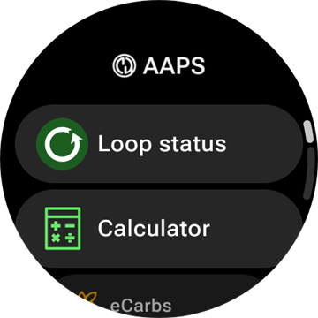
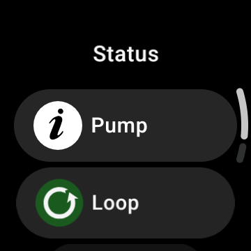
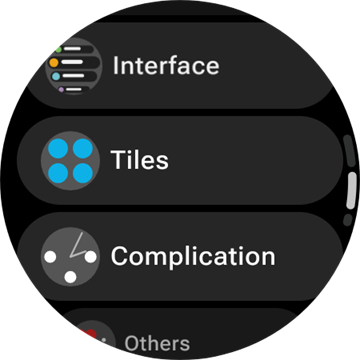
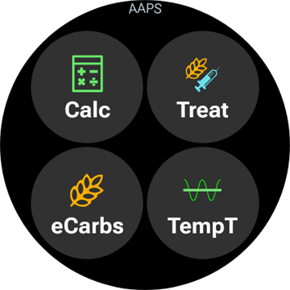
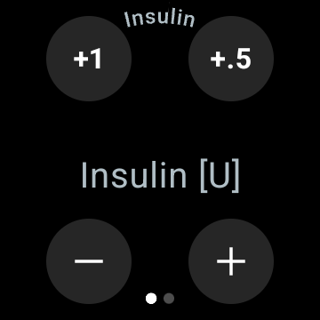
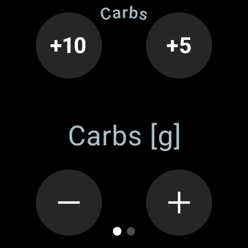
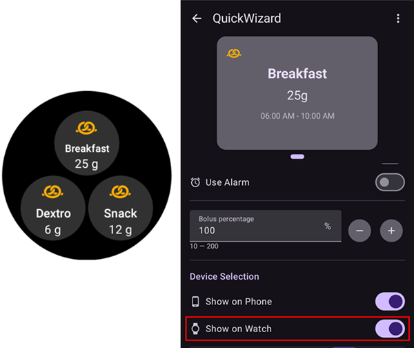

# AAPS valdymas Wear OS išmaniuoju laikrodžiu

(Watchfaces-aaps-watchfaces)=

## AAPS Watchfaces

```{warning}
Klasikiniai **AAPS** ciferblatai veikia tik Wear OS 5 ir senesnėse versijose, o Wear OS 5 juos jau riboja. **Wear OS 6 ir naujesnėse** versijose laikrodžio programėlė vietoj jų įdiegia vieną ciferblatą Google Watch Face Format formatu: jūsų pasirinktinį ciferblatą kaip paveikslėlį arba **Elementų ciferblatas**. Kas neveikia kiekvienoje Wear OS versijoje, žr. [Wear OS ciferblatų pakeitimai](#wearos-watchface-changes), o apie Wear OS 6 – [AAPS įdiegiamas ciferblatas](#wearos-aaps-v4-watchface).
```

Wear OS 5 ir senesnėse versijose į **AAPS** laikrodžio programėlę įtraukti keli klasikiniai ciferblatai. Juose rodoma gliukozės reikšmė su pokyčiu, AIO, aktyvi valandinė bazė ir rodmenų grafikas. Juose veikia du palietimai:

* Dukart bakstelėkite gliukozės reikšmę, kad atidarytumėte **AAPS** pagrindinį meniu
* Dukart bakstelėkite grafiką, kad pakeistumėte jo laiko intervalą

Visose Wear OS versijose šiame puslapyje aprašyti [ekrano elementai](#Watchfaces-complications) ir [plytelės](#WearOsSmartwatch-wear-os-tiles) veikia su bet kuriuo ciferblatu, kuriame jiems yra vietos.

## Configuration

Įjunkite **Išmanieji laikrodžiai** skiltyje [**Konfigūracija** > **Ryšys**](#Config-Builder-wear).

Kad galėtumėte laikrodžiu leisti bolusą ar atlikti kitus veiksmus, įjunkite **Valdymas per Wear**. Laikrodžio boluso skaičiuotuvo parinktys nustatomos toje pačioje vietoje: žr. [Nustatymai > Išmanieji laikrodžiai](#preferences-wear). Kol **Valdymas per Wear** išjungtas, telefonas atmeta kiekvieną iš laikrodžio atsiųstą terapijos ar režimo pakeitimą, o laikrodis rodo *„Telefono AAPS skiltyje „Išmanieji laikrodžiai“ išjungta parinktis „Valdymas per Wear“.“*

Kortelėje **Išmanieji laikrodžiai** paspaudę **Atidaryti įskiepį**, atidarysite Wear ekraną:


Viršutinėje eilutėje rodomas prijungto laikrodžio pavadinimas arba **(nėra prijungto laikrodžio)**. Šiame ekrane galite

* Resend all data. Gali būti naudinga, jei laikrodis kurį laiką nebuvo prijungtas ir norite perduoti informaciją į laikrodį.
* Open settings on your watch directly from your phone.
* Pasirinkti, kurį ciferblatą **AAPS** įdiegs laikrodyje (**Ciferblatas įdiegtas laikrodyje**: jūsų pasirinktinis ciferblatas arba elementų ciferblatas). Ši kortelė rodoma tik tada, kai prijungtas **Wear OS 6** ar naujesnės versijos laikrodis. Žr. [AAPS įdiegiamas ciferblatas](#wearos-aaps-v4-watchface).
* Tvarkyti **Pasirinktinis ciferblatas** (kortelė rodoma, kai laikrodis prijungtas): **Įkelti ciferblatą** išsiunčia pasirinktinį ciferblatą į laikrodį, **Ciferblato info** parodo įkelto ciferblato informaciją ir jame esančius laukus, **Daugiau ciferblatų** naršyklėje atidaro [mainų svetainę](../ExchangeSiteCustomWatchfaces/index.md), o **Eksportuoti šabloną** išsaugo šabloną, kurį galite redaguoti. Po mygtukais rodoma įkelto ciferblato peržiūra. Žr. [Perėjimas prie AAPS ciferblato](#WearOS_changing-to-AAPS-watchface).

Įsitikinkite, kad laikrodyje AAPS pranešimai nėra užblokuoti. Veiksmo (pvz., boluso, laikino tikslo) patvirtinimas gaunamas pranešimu, kurį reikės perbraukti ir pažymėti varnele.

## Pagrindinio AAPS meniu atidarymas



Norėdami atidaryti **AAPS** pagrindinį meniu, naudokite vieną iš šių būdų:

* atidarykite **AAPS** iš laikrodžio programėlių sąrašo
* bakstelėkite **AAPS** ekrano elementą, kuris atidaro meniu, žr. [Su ekrano elementais susiję nustatymai](#WearOsSmartwatch-complication-settings)
* bakstelėkite plytelę **KG grafikas**, kurios **Veiksmas palietus** nustatytas į **Pagrindinis meniu**, žr. [Plytelės nustatymai](#WearOsSmartwatch-wear-os-tiles)
* klasikiniame **AAPS** ciferblate dukart bakstelėkite gliukozės reikšmę

(WearOsSmartwatch-loop-status)=

## Ekranas Ciklo būsena

Ekranas **Ciklo būsena** trumpai parodo, ką daro ciklas, nereikia išsitraukti telefono. Atidarykite jį iš AAPS pagrindinio meniu (**Ciklo būsena** arba **Būklė → Ciklas**) arba bakstelėję ekrano elementą **Kraujo gliukozė**. Meniu **Būklė** taip pat yra puslapis **Pompa** ir puslapis **BPD** su bendromis paros dozėmis.




Ekranas yra kortelių sąrašas. Slinkite žemyn, kad pamatytumėte visas:

* **Veikimo režimas** – dabartinis režimas (uždaras ciklas, atviras ciklas, LGS, sustabdytas, atjungtas…) ir, jei režimas laikinas, kiek laiko jis dar veiks.
* **Ciklo rezultatas** – kada ciklas paskutinį kartą veikė ir kokios laikinos bazės ar SMB jis paprašė.
* **Scenarijus** – tik kai [scenarijus](#scenes-from-watch) aktyvus: jo pavadinimas, likęs laikas (arba **Kol bus baigta**, jei scenarijus neturi pabaigos laiko) ir **Kitas scenarijus**, kuris prasidės jam pasibaigus.
* **Tikslai** – jūsų tikslas ir laikinas tikslas, jei jis veikia.
* **Profilis** – aktyvaus profilio pavadinimas su **Profilio procentas** ir **Laiko perstūmimas**, kai jie skiriasi nuo numatytųjų reikšmių. Laikinas profilio keitimas paryškinamas: rodoma, kiek laiko jis dar veiks ir į kurį profilį grįš pasibaigus (**Grįžtama į profilį**).
* **Jautrumas** – tos pačios eilutės kaip jautrumo ženklelyje telefono pagrindiniame ekrane: Autosens reikšmė ir profilio, kintamas bei faktinis JIF.

Maža scenarijaus piktograma šalia veikimo režimo, laikino tikslo ar profilio keitimo reiškia, kad jį **nustatė aktyvus scenarijus**. Ta pati piktograma rodoma ir **Veikimo režimas** pasirinkimo sąraše.


(WearOsSmartwatch-bolus-calculator)=

## Boluso skaičiuotuvas laikrodyje

Atidarykite **Skaičiuotuvas** iš **AAPS** pagrindinio meniu, iš [plytelės Veiksmai](#WearOsSmartwatch-wear-os-tiles) arba iš ekrano elemento, nustatyto atidaryti skaičiuotuvą. Jis veda per kelis puslapius, norėdami tęsti, braukite iš dešinės į kairę:

| Angliavandeniai                                                               | Užklausa                                                                 | Rezultatas                                                                | Skaičiavimas                                                                          | Patvirtinti                                                                 |
| ----------------------------------------------------------------------------- | ------------------------------------------------------------------------ | ------------------------------------------------------------------------- | ------------------------------------------------------------------------------------- | --------------------------------------------------------------------------- |
|  |  |  |  |  |

1. **AV**: angliavandenius įveskite mygtukais **+10**, **+5**, **−** ir **+**.
2. **Užklausa**: paskutinis puslapis, prieš perduodant darbą telefonui. Jame rodoma, ką įvedėte: angliavandenius, taip pat maisto tipą, angliavandenių laiką ir procentą, jei juos naudojate, žr. [Papildomi puslapiai](#WearOsSmartwatch-calculator-optional-pages). Bakstelėkite varnelę, kad išsiųstumėte į telefoną, kuris atliks skaičiavimą.
3. **Rezultatas**: **AAPS** siūlomas bolusas, o po juo angliavandeniai: dabar suvalgomi angliavandeniai ir vėlesni i-AV, angliavandenių laikas ir valgymo priminimo varpelis. Dozę koreguokite mygtukais **−** ir **+**, žr. toliau. Slinkite žemyn iki kortelės **Skaičiavimas**: bakstelėkite ją, kad pamatytumėte kiekvieną skaičiavimo eilutę, tokią pačią kaip telefone.
4. **Patvirtinti**: perbraukite į antrą puslapį ir bakstelėkite varnelę. Telefonas suleidžia bolusą ir įrašo angliavandenius.

(WearOsSmartwatch-calculator-optional-pages)=

### Papildomi puslapiai

Trys laikrodžio nustatymai kiekvienas prideda po puslapį po puslapio **AV**. Numatytai jie išjungti. Atidarykite **AAPS** pagrindinį meniu, tada **Nustatymai** > **Sąsaja**, ir įjunkite norimus; jei įjungtas daugiau nei vienas, puslapiai eina tokia tvarka: **Maisto tipas**, **Angliavandenių laikas**, **Procentais**. Taškai skaičiuotuvo apačioje rodo, kiek jame yra puslapių.

| Parametrai                                                                                 | Maisto tipas                                                                   | Angliavandenių laikas                                                                   | Procentais                                                                    |
| ------------------------------------------------------------------------------------------ | ------------------------------------------------------------------------------ | --------------------------------------------------------------------------------------- | ----------------------------------------------------------------------------- |
|  |  |  |  |

* **Skaičiuotuvo maisto tipas**: **Duona**, **Pyragas** arba **Pica** – lėtai įsisavinamo maisto angliavandenius padalija į dabar suvalgomus angliavandenius ir vėlesnius i-AV, žr. [Maisto tipo pasirinkimas](#WearOsSmartwatch-wizard-meal-type).
* **Skaičiuotuvo AV laikas**: minutės iki valgio, su varpeliu **Nustatyti įspėjimą** valgymo priminimui, žr. [Angliavandenių laikas ir valgymo priminimas](#WearOsSmartwatch-wizard-carb-time).
* **Skaičiuotuvas proc.**: apskaičiuoto boluso procentas, pavyzdžiui, 70 %, kai norite mažesnės dozės. Pradinė reikšmė yra **Boluso procentas** iš telefono [boluso patarėjo nustatymų](#Preferences-deliver-this-part-of-bolus-wizard-result), 100 %, jei jo nekeitėte. Taip pat žr. pastabą skyriuje [Boluso koregavimas rezultato puslapyje](#WearOsSmartwatch-wizard-result).

(WearOsSmartwatch-wizard-result)=

### Boluso koregavimas rezultato puslapyje

Rezultato puslapyje rodomas **AAPS** siūlomas bolusas kartu su mygtukais **−** ir **+**. Jais galite pakoreguoti dozę prieš ją patvirtindami, negrįždami į telefoną.

| Siūloma                                                                         | Daugiau                                                                            | Mažiau                                                                               |
| ------------------------------------------------------------------------------- | ---------------------------------------------------------------------------------- | ------------------------------------------------------------------------------------ |
|  |  |  |

* Kiekvienas paspaudimas pakeičia bolusą **vienu jūsų pompos žingsniu**, todėl siūlomi kiekiai visada atitinka tai, ką jūsų pompa iš tikrųjų gali suleisti.
* **Paspauskite ir palaikykite** mygtuką, kad reikšmė keistųsi toliau. Kuo ilgiau laikote, tuo greičiau keičiasi.
* Negalima nusileisti žemiau **0 V** ir pakilti aukščiau jūsų **maks. boluso** nustatymo.

Bendra suma rodoma rezultato puslapyje, todėl visada matote kiekį, kurį ketinate patvirtinti. Pakeitimas rodomas po angliavandenių, pavyzdžiui, *(+0,20 V)*, o paspaustas mygtukas tampa žalias, jei didinote, arba raudonas, jei mažinote.

Jei **AAPS** turėjo apriboti dozę, pavyzdžiui, nes apskaičiuotas bolusas viršija jūsų **maks. boluso** nustatymą, po bendra suma gintarine spalva rodoma įspėjimo eilutė (pavyzdžiui, *„Pritaikytas boluso apribojimas“*). Tas pats taikoma ir apribotam angliavandenių kiekiui.

```{admonition} Tai nėra tas pats kaip Skaičiuotuvas proc. :class: note Nustatymas **Skaičiuotuvas proc.** leidžia įvesti apskaičiuoto boluso *procentą* **prieš** pasirodant rezultato puslapiui. Mygtukai **−** ir **+** koreguoja *galutinį kiekį* **rezultato** puslapyje. Galite naudoti abu.

    <br />(WearOsSmartwatch-wizard-meal-type)=
    
    ### Maisto tipo pasirinkimas
    
    Laikrodžio skaičiuotuvas gali lėtai įsisavinamo maisto angliavandenius padalyti į dabar suvalgomus angliavandenius ir vėlesnius i-AV, kaip telefono skaičiuotuvo [maisto tipas](#AapsScreens-carbs-type). Laikrodžio **Nustatymai** > **Sąsaja** įjunkite **Skaičiuotuvo maisto tipas**. Numatytai šis nustatymas išjungtas, tada puslapis **Maisto tipas** praleidžiamas.
    
    * Įvedus angliavandenius, puslapyje **Maisto tipas** rodomos trys piktogramos: **Duona**, **Pyragas** ir **Pica**. Bakstelėkite piktogramą: jos pavadinimas ir angliavandeniai rodomi po piktogramomis, pavyzdžiui, *65 g* duonai arba *52+22 g* picai (52 g dabar ir 22 g i-AV vėliau). **Duona** yra numatytasis pasirinkimas ir visus angliavandenius palieka dabar.
    * Užklausos ir patvirtinimo puslapiuose angliavandeniai rodomi taip pat (*52+22 g*). Rezultato puslapyje taip pat rodoma, kada prasideda i-AV ir kiek laiko jie trunka.
    * Bolusas apskaičiuojamas tik dabar suvalgomiems angliavandeniams. Padalijimui naudojami tie patys skaičiai kaip telefono skaičiuotuve.
    
    (WearOsSmartwatch-wizard-carb-time)=
    
    ### Angliavandenių laikas ir valgymo priminimas
    
    Kai laikrodžio **Nustatymai** > **Sąsaja** įjungtas **Skaičiuotuvo AV laikas**, po angliavandenių eina puslapis **Angliavandenių laikas**: minutės iki valgio, kaip telefono skaičiuotuvo [angliavandenių laikas](#aaps-screens-bolus-wizard). Numatytoji reikšmė yra **Dabar**. **−** ir **+** keičia ją 5 minučių žingsniais, iki valandos prieš dabar arba po dabar. Laikas praeityje skirtas jau suvalgytiems angliavandeniams.
    
    Kai laikas ateityje, po reikšme atsiranda varpelis **Nustatyti įspėjimą**. Numatytai jis įjungtas, bakstelėkite jį, kad išjungtumėte. Užklausos ir rezultato puslapiuose rodomas angliavandenių laikas, pavyzdžiui, *+30 min*, ir varpelis. Telefonas įrašo angliavandenius tuo laiku, kartu perkelia maisto tipo i-AV ir paleidžia priminimą **Laikas valgyti**.
    
    | Rezultatas | KG grafikas | Veikia | Laikas valgyti |
    | --- | --- | --- | --- |
    |  |  |  |  |
    
    Priminimas veikia ir laikrodyje, todėl jis suskamba net tada, kai telefonas yra toli:
    
    * Ekrane **KG grafikas**, plytelėje **KG grafikas** ir **Elementų ciferblatas** grafike toje vietoje, kur suskambės priminimas, nubrėžiama oranžinė brūkšninė linija, o šalia jos rodomos likusios minutės.
    * Kol priminimas veikia, pranešimų sraute yra tylus pranešimas **Laikas valgyti** su mygtukais **Sustabdyti** ir **+5 min**. Jį nubraukus, jis vėl atsiranda, kol priminimas baigsis.
    * Atėjus laikui, laikrodis vibruoja ir vibruoja vėl kas pusę minutės penkias minutes, kol atsakysite. Pranešime yra **Nutildyti** ir **+5 min**, o jį nubraukus jis taip pat nutildomas.
    
    **Sustabdyti**, **Nutildyti** ir **+5 min** veikia vienodai laikrodyje, telefone ir **AAPSClient**, ir visur rodomas tas pats priminimas.
    
    (Watchfaces-complications)=
    
    ## Ekrano elementai
    
    _Ekrano elementas_ (angl. complication) – tai terminas iš tradicinės laikrodžių gamybos, kur jis reiškia priedą prie pagrindinio ciferblato – papildomą mažą langelį ar mažesnį ciferblatą (su data, savaitės diena, mėnulio faze ir pan.). Wear OS 2.0 perėmė šią idėją ir leidžia prie bet kurio ciferblato, palaikančio ekrano elementus, pridėti pasirinktinių duomenų teikėjų duomenis, pvz., orus, pranešimus, sporto skaitiklius ir kt.
    
    AAPS Wear OS programėlė ekrano elementus palaiko nuo versijos `2.6` ir leidžia bet kurį trečiosios šalies ciferblatą, palaikantį ekrano elementus, nustatyti taip, kad jis rodytų su AAPS susijusius duomenis (KG su tendencija, AIO, AAO ir kt.).
    
    Ekrano elementai taip pat veikia kaip AAPS funkcijų **sparčiosios nuorodos**. Bakstelėję juos, galite atidaryti su AAPS susijusius meniu ir langus (priklauso nuo ekrano elemento tipo ir konfigūracijos).
    
    
    
    ### Ekrano elementų tipai
    
    AAPS Wear OS programėlė pateikia tik neapdorotus duomenis pagal iš anksto nustatytus formatus. Kur ir kaip rodyti ekrano elementus, įskaitant jų išdėstymą, rėmelį, spalvą ir šriftą, sprendžia trečiosios šalies ciferblatas. Iš daugelio galimų Wear OS ekrano elementų tipų AAPS naudoja:
    
    * `SHORT TEXT` – dvi teksto eilutės po 7 simbolius, kartais vadinamos reikšme ir pavadinimu. Paprastai rodomas apskritime arba mažame ovale – vienas po kitu arba vienas šalia kito. Tai ekrano elementas, kuriame labai mažai vietos. Kad tilptų, AAPS stengiasi pašalinti nereikalingus simbolius: suapvalina reikšmes, pašalina nulius reikšmių pradžioje ir pabaigoje ir pan.
    * `LONG TEXT` – dvi teksto eilutės, maždaug po 20 simbolių. Paprastai rodomas stačiakampyje arba ilgame ovale – vienas po kitu. Naudojamas išsamesnei informacijai ir tekstinei būsenai.
    * `RANGED VALUE` – naudojamas reikšmėms iš iš anksto nustatyto intervalo, pvz., procentams. Turi piktogramą, pavadinimą ir paprastai rodomas kaip apskritimo formos eigos indikatorius.
    * `LARGE IMAGE` – pasirinktinis fono paveikslėlis, kurį galima naudoti kaip foną (jei ciferblatas tai palaiko).
    * `SMALL IMAGE` / `MONOCHROMATIC IMAGE` – maža piktograma. Vietoje `SMALL IMAGE` AAPS ją piešia savo spalva; vietoje `MONOCHROMATIC IMAGE` ją nuspalvina ciferblatas.
    
    ### Ekrano elementų sąranka
    
    Norėdami pridėti ekrano elementą prie ciferblato, ilgai palaikykite ciferblatą ir spustelėkite apačioje esančią krumpliaračio piktogramą. Priklausomai nuo to, kaip juos nustato konkretus ciferblatas, spustelėkite rezervuotas vietas arba atidarykite ciferblato ekrano elementų sąrankos meniu. AAPS ekrano elementai sugrupuoti po AAPS meniu įrašu.
    
    Kai nustatote ekrano elementus ciferblate, Wear OS parodo ir atfiltruoja sąrašą elementų, kurie tinka pasirinktai ciferblato vietai. Jei konkretaus ekrano elemento sąraše nerandate, tikriausiai jo tipas netinka šiai vietai.
    
    ### AAPS teikiami ekrano elementai
    
    AAPS teikia toliau išvardytus ekrano elementus. „Atidaro“ – tai, ką atlieka bakstelėjimas, kai **Elementų skirtuko veiksmai** palikta **Numatytasis**, žr. [Su ekrano elementais susiję nustatymai](#WearOsSmartwatch-complication-settings).
    
    **Gliukozė**
    
    * **Kraujo gliukozė** (`SHORT TEXT`, atidaro _Ciklo būsena_): pirmoje eilutėje gliukozės reikšmė su tendencijos rodykle, antroje – rodmens amžius ir pokytis.
    * **Kraujo gliukozė (didelis)** (`SHORT TEXT`, atidaro _KG grafikas_): pirmoje eilutėje tik gliukozės reikšmė, kad ciferblatas galėtų ją rodyti didelę. Amžius ir tendencijos rodyklė yra antroje eilutėje.
    * **KG grafikas** (`SMALL IMAGE` / `LARGE IMAGE`, atidaro _KG grafikas_): KG grafikas kaip paveikslėlis, ciferblatams su paveikslėlio vieta. Tai grafikas, rodomas **Elementų ciferblatas**.
    * **Pilna informacija** (`LONG TEXT`, atidaro _Meniu_): dauguma duomenų vienoje eilutėje: gliukozės reikšmė su tendencijos rodykle, pokytis ir rodmens amžius, tada aktyvūs angliavandeniai, aktyvus insulinas ir valandinė bazė.
    * **Pilna informacija (atvirkščiai)** (`LONG TEXT`, atidaro _Meniu_): tas pats, tik sukeistos abi eilutės – ciferblatams, kurie rodo tik vieną iš dviejų `LONG TEXT` vietos eilučių.
    
    **Insulinas ir angliavandeniai**
    
    * **AIO ikonėlė** (`SHORT TEXT`, atidaro _Bolusas_): aktyvus insulinas su švirkšto piktograma.
    * **AIO detaliai** (`SHORT TEXT`, atidaro _Bolusas_): pirmoje eilutėje bendras aktyvus insulinas, antroje – boluso ir valandinės bazės dalys.
    * **AAO ikonėlė** (`SHORT TEXT`, atidaro _Skaičiuotuvas_): aktyvūs angliavandeniai su angliavandenių piktograma.
    * **AAO detaliai** (`SHORT TEXT`, atidaro _Skaičiuotuvas_): pirmoje eilutėje dabartiniai aktyvūs angliavandeniai, antroje – dar laukiami angliavandeniai (i-AV).
    * **AAO & AIO** (`SHORT TEXT`, atidaro _Skaičiuotuvas_): pirmoje eilutėje aktyvus insulinas, antroje – aktyvūs angliavandeniai.
    
    **Valandinė bazė ir tikslas**
    
    * **Valandinė bazė** (`SHORT TEXT`, atidaro _Meniu_): dabartinė valandinė bazė.
    * **VB & AIO** (`SHORT TEXT`, atidaro _Meniu_): pirmoje eilutėje aktyvus insulinas, antroje – valandinė bazė.
    * **VB & tikslas** (`SHORT TEXT`, atidaro _Laikinas tikslas_): pirmoje eilutėje tikslas, o kai veikia laikinas tikslas, ir likęs laikas, antroje – valandinė bazė.
    * **Tikslas** (`SHORT TEXT`, atidaro _Laikinas tikslas_): pirmoje eilutėje tikslas, o kol veikia laikinas tikslas, antroje – jo likęs laikas.
    * **VB, AAO & AIO** (`SHORT TEXT`, atidaro _Meniu_): pirmoje eilutėje valandinė bazė, antroje – aktyvūs angliavandeniai ir aktyvus insulinas.
    
    **Ciklas ir telefonas**
    
    * **Veikimo režimas** (`SMALL IMAGE` / `ICON`, atidaro _Veikimo režimo pasirinkimą_): dabartinis ciklo režimas kaip piktograma: uždaras ciklas, atviras ciklas, stabdymas esant žemai glikemijai, sustabdytas, atjungtas arba išjungtas. Bakstelėjus atidaromas pasirinkimų sąrašas su šiuo metu leidžiamais režimo pakeitimais, pavyzdžiui, **Sustabdyti ciklą**, **Atjungti pompą**, **Atnaujinti ciklą** arba **Iš naujo prijungti pompą**. Tas pats pasirinkimų sąrašas yra **AAPS** pagrindiniame meniu, punkte **Veikimo režimas**.
    * **Telefono baterija** (`RANGED VALUE` / `SHORT TEXT` / `ICON`, atidaro _Būklė_): **AAPS** telefono baterija kaip skalė su baterijos piktograma, kaip skaičius arba tik kaip piktograma. Ji atnaujinama kartu su kitais **AAPS** duomenimis, paprastai kas 5 minutes gavus naują rodmenį.
    
    **Veikimo režimas** pasirinkimų sąrašas, atidarytas iš ekrano elemento, pagrindinio meniu arba plytelės Veikimo režimas:
    
    
    
    (WearOsSmartwatch-complication-settings)=
    
    ### Su ekrano elementais susiję nustatymai
    
    Laikrodžio **AAPS** pagrindiniame meniu atidarykite **Nustatymai** > **Ekrano elementas**:
    
    
    
    * **Elementų skirtuko veiksmai** (numatyta `Default`): ką atidaro bakstelėjimas ant **AAPS** ekrano elemento, iš karto visiems elementams:
      * _Numatytasis_: tai, ką atidaro pats ekrano elementas, žr. sąrašą aukščiau
      * _Meniu_: **AAPS** pagrindinis meniu
      * _Skaičiuotuvas_: boluso skaičiuotuvas
      * _Terapija_: terapijos langas, insulinas ir angliavandeniai
      * _i-AV_: i-AV langas
      * _Būklė_: būklės meniu
      * _Veikimo režimas_: veikimo režimo pasirinkimų sąrašas. Reikia, kad telefono Wear nustatymuose būtų įjungtas **Valdymas per Wear**, kitaip vietoj jo atidaromas pagrindinis meniu.
      * _Nėra_: bakstelėjimas nieko nedaro
    * **KG grafiko laiko intervalas** (numatyta `3 hours`): kiek valandų rodo ekrano elementas **KG grafikas**: 1, 3 arba 6. Plytelė KG grafikas turi savo nustatymą.
    * **Unikodas elementuose** (numatyta `On`): ekrano elementuose naudojami Unikodo simboliai, pvz., `Δ` pokyčiui, `⁞` kaip skirtukas ir `⎍` valandinei bazei. Kaip jie atrodo, priklauso nuo ciferblato šrifto. Išjunkite (`Off`), jei ciferblatas juos rodo kaip langelius arba tuščias vietas.
    
    (WearOsSmartwatch-wear-os-tiles)=
    
    ## Wear OS plytelės
    
    Plytelės – tai puslapiai, kuriuos pasiekiate braukdami nuo ciferblato. **AAPS** pateikia septynias plyteles, kiekvienoje – iki keturių mygtukų. Bakstelėjus mygtuką, laikrodyje atidaromas atitinkamas langas arba prašoma patvirtinti, o darbą atlieka telefonas. Plytelė yra spartusis mygtukas, o ne būsenos rodinys: ji nesaugo telefono programėlės būsenos.
    
    Prieš naudodami plyteles, įjunkite **Valdymas per Wear** skiltyje [Nustatymai > Išmanieji laikrodžiai](#preferences-wear).
    
    ### Plytelės pridėjimas
    
    Yra du būdai, priklausomai nuo jūsų laikrodžio ir telefono:
    
    1. Laikrodyje: nuo ciferblato braukite pro paskutinę plytelę iki **Add tile** (pridėti plytelę) ir pasirinkite **AAPS** plytelę. Daugumoje laikrodžių ilgai palaikius plytelę taip pat atidaromas pridėjimo ir šalinimo rodinys.
    2. Telefone, jūsų laikrodžio susietoje programėlėje (**Galaxy Wearable** – Samsung, **Wear OS** – kitiems gamintojams): atidarykite **Tiles** (plytelės), bakstelėkite **Add** (pridėti) ir pasirinkite norimas **AAPS** plyteles. Plytelių tvarką galima keisti jas tempiant.
    
    
    
    ### Plytelės nustatymai
    
    Plytelės **Veiksmai**, **Laikinas tikslas**, **KG grafikas** ir **Scenarijus** turi nustatymus laikrodyje. Atidarykite **AAPS** pagrindinį meniu, tada **Nustatymai** > **Plytelės**, ir pasirinkite plytelę. Ilgai palaikius plytelę taip pat atidaromi jos nustatymai, išskyrus Pixel laikrodžius. Kitos trys plytelės užpildomos iš telefono, ir laikrodyje jose nėra ką nustatyti.
    
    | Pagrindinis meniu | Nustatymai | Plytelės |
    | --- | --- | --- |
    |  |  |  |
    
    Plytelės nustatymai – tai jos keturių vietų sąrašas. Bakstelėkite vietą ir pasirinkite, ką ji rodys, arba **Nėra**, kad ji liktų tuščia.
    
    | Ilgas plytelės palaikymas | Plytelės Laikinas tikslas nustatymai |
    | --- | --- |
    |  |  |
    
    Kiekviena plytelė turi keturias vietas. Jei plytelė turi daugiau įrašų, rodomi pirmieji keturi.
    
    ### Plytelė Veiksmai
    
    
    
    Sparčiosios nuorodos į **AAPS** laikrodžio programėlės langus. Plytelės nustatymuose pasirinkite iki keturių iš šių:
    
    * **Skaič.**: boluso skaičiuotuvas su angliavandenių įvedimu, papildomu procentu [1] ir papildomu maisto tipu [2]
    * **Terap**: insulinas ir angliavandeniai vienu kartu
    * **Insulinas**: bolusas, įvedamas vienetais
    * **AV**: angliavandeniai, taip pat ištęsti angliavandeniai. Priimamas ir **neigiamas** kiekis, iki jūsų dabartinių AAO, kad galėtumėte pataisyti anksčiau įvestus angliavandenius. Pašalinti angliavandeniai rodomi laikrodžio KG grafike.
    * **i-AV**: ištęsti angliavandeniai
    * **LaikinasTikslas**: laikinas tikslas su pasirinktu tikslu ir trukme
    * **Profilio keitimas**: profilio keitimas su procentu, laiko perstūmimu ir trukme
    
    
    
    Langai, kuriuos atidaro mygtukai. Braukite iš dešinės į kairę, kad pereitumėte į kitą lango puslapį, ir paskutiniame puslapyje bakstelėkite varnelę, kad išsiųstumėte užklausą į telefoną:
    
    | Terap | Insulinas | AV | i-AV | LaikinasTikslas | Profilio keitimas |
    | --- | --- | --- | --- | --- | --- |
    |  |  |  |  |  |  |
    
    [1] Laikrodžio **Nustatymai** > **Sąsaja** įjunkite **Skaičiuotuvas proc.**, kad boluso skaičiuotuve būtų rodomas procento įvedimas. Numatytasis procentas imamas iš telefono nustatymo [„Boluso procentas“](#Preferences-deliver-this-part-of-bolus-wizard-result). Kiti skaičiuotuvo nustatymai yra telefono nustatymai skiltyje **Nustatymai** > **Boluso patarėjo nustatymai**.
    
    [2] Laikrodžio **Nustatymai** > **Sąsaja** įjunkite **Skaičiuotuvo maisto tipas**, kad būtų rodomas puslapis **Maisto tipas**, kuriame pasirenkate **Duona**, **Pyragas** arba **Pica**, kad lėtai įsisavinamo maisto angliavandeniai būtų padalyti į dabar suvalgomus angliavandenius ir vėlesnius i-AV. Žr. [Maisto tipo pasirinkimas](#WearOsSmartwatch-wizard-meal-type).
    
    ### Plytelė Laikinas tikslas
    
    
    
    Laikini tikslai iš telefono ruošinių. Kiekvieno ruošinio trukmę ir tikslą nustatykite telefone skiltyje **Nustatymai** > [Numatytieji laikini tikslai](#Preferences-default-temp-targets). Plytelės nustatymuose pasirinkite iki keturių iš šių:
    
    * **Sportas**: sportui
    * **Valgis**: netrukus valgysiu – žemesnis tikslas, kad valgant būtų daugiau aktyvaus insulino
    * **Hipo**: aukštesnis tikslas gydant hipoglikemiją
    * **Rankiniu būdu**: pasirinktas tikslas ir trukmė
    * **Atšaukti**: sustabdo veikiantį laikiną tikslą. Mygtukas rodomas tik tada, kai veikia laikinas tikslas.
    
    ### Plytelė Greitasis vedlys
    
    
    
    Telefono [Greitojo vedlio](#quickwizards) įrašai, kuriuose įjungta **Rodyti laikrodyje**, jų galiojimo valandomis. Angliavandenių įrašas rodo savo angliavandenius g, insulino įrašas – savo fiksuotą dozę V. Bakstelėjus įrašas įvykdomas, kai jį patvirtinate laikrodyje. Laikrodyje nėra ką nustatyti: įrašus redaguokite telefone ir kiekvienam įrašui, kurį norite matyti plytelėje, skiltyje **Įrenginio pasirinkimas** įjunkite **Rodyti laikrodyje**. Už visų jūsų įrašų galiojimo valandų ribų plytelėje rodoma **Nėra konfigūracijos**.
    
    
    
    ### Plytelė Scenarijus
    
    
    
    Telefono [scenarijai](#scenes-from-watch). Plytelės nustatymuose kiekviena iš keturių vietų nustatoma į **Automatiškai**, **Nėra** arba vieną scenarijų. Vieta **Automatiškai** paima kitą scenarijų iš telefono sąrašo, kurio nepasirinko jokia kita vieta. Vieta, nustatyta į scenarijų, kurio telefone nebėra, rodo **Nepasiekiama**.
    
    
    
    ### Plytelė Veikimo režimas
    
    
    
    [Veikimo režimai](#aaps-screens-running-mode), į kuriuos galite perjungti iš dabartinio, su tomis pačiomis piktogramomis kaip telefone: uždaras ciklas, stabdymas esant žemai glikemijai, atviras ciklas, ciklo išjungimas, ciklo sustabdymas ir pompos atjungimas, arba atnaujinimas ir prijungimas iš naujo, kol veikia vienas iš jų. **Sustabdyti ciklą** ir **Atjungti pompą** pirmiausia paprašo trukmės. Kuriuos režimus siūlyti, sprendžia telefonas, laikrodis rodo pirmuosius keturis ir praleidžia **Išjungti ciklą**, kai sąraše yra **Sustabdyti ciklą**.
    
    ### Plytelė Naudotojo veiksmas
    
    
    
    Po vieną mygtuką kiekvienai telefono [automatizacijai](#automations-automation-triggers), kurios sąlyga yra **Naudotojo veiksmas**. Bakstelėjus prašoma patvirtinti, tada telefonas atlieka automatizacijos veiksmus. Mygtukai pavadinti pagal automatizacijas, todėl suteikite joms trumpus pavadinimus. Laikrodyje nėra ką nustatyti.
    
    ### Plytelė KG grafikas
    
    
    
    Gliukozės reikšmė su rodykle, pokyčiu ir amžiumi, po ja AIO, AAO, valandinė bazė ir tikslas, taip pat KG grafikas su prognozėmis, bolusais, angliavandeniais ir SMB. Laikrodyje du nustatymai: **Laiko intervalas** (1, 3 arba 6 valandos) ir **Veiksmas palietus**, kuris atidaro visą **KG grafikas**, **Pagrindinis meniu** arba ekraną **Ciklo būsena**.
    
    
    
    
    
    ## Visada įjungtas ekranas
    
    Šis ir kitas skyriai taikomi klasikiniams **AAPS** ciferblatams Wear OS 5 ir senesnėse versijose. Wear OS 6 sistemoje **Elementų ciferblatas** turi savo visada įjungto ekrano režimą, žr. [AAPS įdiegiamas ciferblatas](#wearos-aaps-v4-watchface).
    
    Ilgas Android Wear OS išmaniųjų laikrodžių baterijos veikimo laikas yra iššūkis. Kai kurie išmanieji laikrodžiai be įkrovimo veikia iki 30 valandų. Kad būtų taupoma kuo daugiau energijos, kai laikrodis nenaudojamas, ekranas turėtų būti išjungtas. Dauguma laikrodžių palaiko visada įjungtą ekraną („Always on“).
    
    Nuo AAPS 3 versijos visada įjungto ekrano režimu galima naudoti „Supaprastinta sąsaja“. Šioje sąsajoje rodoma tik gliukozė kraujyje, kryptis ir laikas. Ši sąsaja optimizuota energijos taupymui: atnaujinama rečiau, rodo mažiau informacijos ir šviečia mažiau taškų, kad OLED ekranuose būtų taupoma energija.
    
    Supaprastintos sąsajos režimas galimas ciferblatams Digital Style ir Custom. Supaprastinta sąsaja nebūtina ir nustatoma ciferblato nustatymuose (ilgai palaikykite ciferblatą ir spustelėkite „edit“ arba krumpliaračio piktogramą). Pasirinkite nustatymą „Supaprastinta sąsaja“ ir nustatykite jį į „Visada įjungta“ arba „Režimas: visada įjungta kraunant“.
    
    ### Naktinis režimas
    
    Įkraunant būtų naudinga, jei ekranas galėtų likti visada įjungtas ir naktį rodytų jūsų gliukozę kraujyje. Tačiau standartiniai ciferblatai yra per ryškūs, juose per daug informacijos, o mieguistomis akimis detales sunku įskaityti. Todėl pridėjome parinktį, kuri, jei ji įjungta konfigūracijoje, supaprastina ciferblato sąsają tik įkrovimo metu.
    
    Supaprastintos sąsajos režimas galimas ciferblatams Digital Style ir Custom. Supaprastinta sąsaja nebūtina ir nustatoma ciferblato nustatymuose (ilgai palaikykite ciferblatą ir spustelėkite „edit“ arba krumpliaračio piktogramą). Pasirinkite nustatymą „Supaprastinta sąsaja“ ir nustatykite jį į „Įkrovimo metu“ arba „Režimas: visada įjungta kraunant“.
    
    Android kūrėjo parinktys leidžia laikrodžiui neužmigti įkrovimo metu. Kaip įjungti kūrėjo parinktis, žr. [oficialią dokumentaciją](https://developer.android.com/training/wearables/get-started/debugging). Kūrėjo parinktyse nustatykite „Stay awake when charging“ (neužmigti įkraunant) į „on“.
    
    Pastaba: ne visi ekranai gerai toleruoja visada įjungtą režimą. Dėl to ekrane gali išdegti vaizdas, ypač senesniuose OLED ekranuose. Laikrodžiai paprastai pritemdo ekraną, kad vaizdas neišdegtų; patarimų ieškokite naudotojo vadove, pas gamintoją arba internete.
    
    
    
    
    
    (WearOsSmartwatch-phone-alarms)=
    
    ## Telefono aliarmai laikrodyje
    
    
    
    Laikrodis rodo telefono aliarmus, todėl matote, kodėl telefonas skamba, ir galite atsakyti nuo riešo. Laikrodis vibruoja ir vibruoja vėl kas pusę minutės penkias minutes, kol atsakysite. Pranešime rodomas aliarmo pavadinimas ir tekstas, su tais pačiais atsakymais kaip priminimo [Laikas valgyti](#WearOsSmartwatch-wizard-carb-time):
    
    * **Nutildyti** arba nubraukimas: aliarmas nutyla, o telefono aliarmo ekranas užsidaro.
    * **Nutildyti 5 min.**: aliarmas nutyla ir po penkių minučių vėl suskamba telefone ir laikrodyje.
    
    Į laikrodį patenka dviejų rūšių aliarmai:
    
    * Telefono aliarmo ekranas (pompos klaidos, automatizacijų aliarmai, KG aliarmai): **Nutildyti** ir **Nutildyti 5 min.**
    * Skubūs pranešimai su garsu, pvz., *Pompa nepasiekiama* ar Nightscout aliarmas: tik **Nutildyti**. Telefone jiems yra tik **Atmesti**, ir jie patys vėl atsiranda, kol išlieka jų priežastis.
    
    Priminimas *Laikas valgyti* šiuo būdu nesiunčiamas: laikrodis jį skambina pats.
    
    ## Aliarmo nutildymo spartusis mygtukas
    
    Laikrodis pats [rodo aliarmą](#WearOsSmartwatch-phone-alarms); spartusis mygtukas yra antras būdas jį nutildyti vienu paspaudimu. Galima sukurti spartųjį mygtuką AAPS perspėjimams / aliarmams nutildyti. Nutildyti garsą laikrodžiu patogu ir greičiau, nereikia siekti telefono. Pastaba: aliarmo pranešimą telefone vis tiek reikia patikrinti ir atitinkamai sureaguoti, bet tai galite padaryti vėliau. Jei jūsų laikrodis turi du mygtukus, vieną iš jų galite priskirti programai `AAPS Snooze Alert`.
    
    Norėdami susieti mygtuką Samsung Watch 4 laikrodyje, eikite į `Settings > Advanced Features > Customize Buttons > Double press > AAPS Snooze Alert`
    
    Ciferblate su ekrano elementais tą patį vienu bakstelėjimu atlieka ekrano elementas **App shortcut** (programėlės spartusis mygtukas), nustatytas į **Nutildyti AAPS aliarmą**. [Alternatyvi Elementų ciferblato sąranka](#wearos-complications-watchface-setup) tam naudoja viršutinę dešinę vietą.
    
    ### xDrip nutildymas
    
    Jei naudojate xDrip ir xDrip įdiegtas laikrodyje, spartusis mygtukas „Nutildyti AAPS aliarmą“ nutildys ir bet kurį xDrip aliarmą. 
    
    
    ## Patarimai dėl veikimo ir baterijos
    
    Wear OS laikrodžiai – tai įrenginiai, turintys labai mažai energijos. Laikrodžio korpuso dydis riboja jame esančios baterijos talpą. Net ir su naujausiais aparatinės ir programinės įrangos patobulinimais Wear OS laikrodžius vis dar reikia įkrauti kasdien.
    
    Jei baterija išsenka greičiau nei per dieną (nuo ryto iki vakaro), štai keli patarimai, kaip išspręsti problemas.
    
    Daugiausia baterijos naudoja:
    
    * Aktyvus ekranas su įjungtu foniniu apšvietimu (LED) arba visu ryškumu (OLED)
    * Vaizdo piešimas ekrane
    * Radijo ryšys per Bluetooth
    
    Kadangi negalime aukoti ryšio (mums reikia naujausių duomenų) ir norime rodyti naujausius duomenis, daugumą optimizavimų galima atlikti _ekrano veikimo laiko_ srityje:
    
    * Gamykliniai ciferblatai paprastai geriau optimizuoti nei pasirinktiniai, atsisiųsti iš parduotuvės.
    * Geriau naudoti ciferblatus, kurie neaktyviu / pritemdytu režimu rodo mažiau duomenų.
    * Būkite atidūs derindami kitus ekrano elementus, pvz., trečiųjų šalių orų valdiklius ar kitus, naudojančius duomenis iš išorinių šaltinių.
    * Pradėkite nuo paprastesnių ciferblatų. Pridėkite po vieną ekrano elementą ir stebėkite, kaip jie veikia baterijos veikimo laiką.
    * Ciferblate naudokite tamsią temą. OLED ekranuose mažiau šviečiančių taškų reiškia mažesnes energijos sąnaudas ir mažiau išdegimo.
    * Patikrinkite, kas jūsų laikrodyje veikia geriau: gamykliniai AAPS ciferblatai ar kiti ciferblatai su AAPS ekrano elementais.
    * Stebėkite kelias dienas, esant skirtingam aktyvumui. Daugelis laikrodžių įjungia ekraną, kai į juos pažiūrite, juos pajudinate arba dėl kitų su naudojimu susijusių priežasčių.
    * Patikrinkite bendruosius sistemos nustatymus, kurie veikia našumą: pranešimus, foninio apšvietimo / aktyvaus ekrano išsijungimo laiką, kada įjungiamas GPS.
    * Peržiūrėkite [išbandytų telefonų ir laikrodžių sąrašą](#Phones-list-of-tested-phones) ir [paklauskite bendruomenės](../GettingHelp/WhereCanIGetHelp.md) apie kitų naudotojų patirtį ir nurodytą baterijos veikimo laiką.
    * **Negalime garantuoti, kad ciferblate ar ekrano elemente rodomi duomenys yra naujausi**. Galiausiai tik Wear OS sprendžia, kada atnaujinti ciferblatą ar ekrano elementą. Net kai AAPS programėlė prašo atnaujinti, sistema gali nuspręsti atnaujinimą atidėti arba ignoruoti, kad tausotų bateriją. Jei abejojate ir laikrodžio baterija senka, visada pasitikrinkite pagrindinėje AAPS programėlėje telefone.
    
    (Watchfaces-troubleshooting-the-wear-app)=
    
    ## Wear programėlės trikčių šalinimas
    
    Jei laikrodis nerodo duomenų arba rodo senus duomenis, pirmiausia patikrinkite laikrodžio ir telefono ryšį, žr. [AAPS laikrodžio ir AAPS telefono ryšio trikčių šalinimas](#wear-os-watch-phone-communication). Jei laikrodyje veikia Wear OS 5, taip pat žr. [bendrąsias Wear OS 5 trikčių šalinimo rekomendacijas](#wear-os-5-troubleshooting). Neatsinaujinančio ekrano elemento priežastys tos pačios kaip neatsinaujinančios plytelės ar ciferblato, todėl pirmiausia patikrinkite jas.
    
    ## Yra ir daugiau pasirinktinių AAPS ciferblatų
    
    [Čia](../ExchangeSiteCustomWatchfaces/index.md) galite atsisiųsti Zip failus su kitų naudotojų sukurtais pasirinktiniais ciferblatais.
    
    ## Susikurkite savo ciferblatą
    
    Jei norite susikurti savo ciferblatą, vadovaukitės [šiomis instrukcijomis](../ExchangeSiteCustomWatchfaces/CustomWatchfaceReference.md).
    
    Susikūrę pasirinktinį ciferblatą, savo **AAPS** pasirinktiniu ciferblatu galite pasidalyti su kitais: zip failą galima įkelti į aplanką "ExchangeSiteCustomWatchfaces" per Pull Request GitHub. Sujungiant pull request, dokumentacijos komanda išskleis failą CustomWatchface.png ir prie jo pavadinimo pradžios pridės Zip failo pavadinimą.
    
    (WearOsSmartwatch-complications-watchface-download)=
    
    ## Susikurkite savo Elementų ciferblato versiją
    
    **Elementų ciferblatas**, kurį **AAPS** įdiegia Wear OS 6 sistemoje (žr. [AAPS įdiegiamas ciferblatas](#wearos-aaps-v4-watchface)), sukurtas su Samsung **Watch Face Studio**. Jo projekto failą galima atsisiųsti nemokamai, todėl galite jį pakeisti pagal savo skonį arba naudoti laikrodyje su Wear OS 5 ar senesne versija, kur **AAPS** jo neįdiegia:
    
    [Elementų ciferblatas (AAPS V4), zip](https://github.com/openaps/AndroidAPSdocs/raw/refs/heads/master/docs/_static/wearos/Complications_watchface_AAPS_V4.zip)
    
    Zip faile yra keturi failai:
    
    * `AAPS V4_0_2.wfs`: projektas. Atidarykite jį programoje [Watch Face Studio](https://developer.samsung.com/watch-face-studio/download.html), pakeiskite, ką norite, ir iš ten įdiekite į laikrodį.
    * `com.watchfacestudio.aapsv4.apk`: ciferblatas toks, koks yra, paruoštas įdiegti su [adb](https://developer.android.com/tools/releases/platform-tools): `adb install com.watchfacestudio.aapsv4.apk`, kai laikrodis prijungtas per ADB derinimą.
    * `README.txt`: dvi rekomenduojamos ekrano elementų sąrankos, tokios pačios kaip [Wear OS puslapyje](#wearos-complications-watchface-setup).
    * `AAPS V4.png`: peržiūra.
    
    ```{admonition} Tai nėra pasirinktinis ciferblatas
    :class: note
    Šis zip failas nėra pasirinktinis ciferblatas, skirtas **Įkelti ciferblatą** įskiepyje **Išmanieji laikrodžiai**, ir telefonas negali jo įdiegti. Jį reikia išskleisti ir įdiegti į laikrodį su Watch Face Studio arba adb, kaip aprašyta aukščiau.