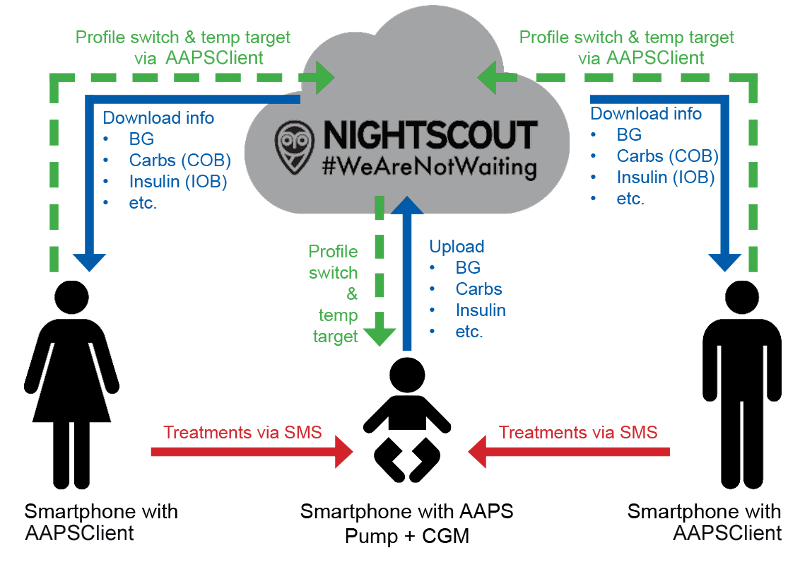

# Nuotolinis stebėjimas

__AAPS__ turi kelias funkcijas 1 tipo diabetu sergančių vaikų nuotoliniam stebėjimui, taip pat leidžia siųsti nuotolines komandas, kurios perduoda nurodymus į __AAPS__ per atstumą. Taip pat __AAPSClient__ galima naudoti nuotoliniam stebėjimui, kad sektumėte partnerio ar draugo __AAPS__.

## Functions

- Vaiko pompą valdo vaiko telefonas su __AAPS__.
- Prižiūrintys asmenys gali nuotoliniu būdu matyti visus svarbius duomenis, pvz., gliukozės lygį, aktyvius angliavandenius organizme, aktyvų insuliną organizme ir kt., naudodami **AAPSClient apk** savo Android telefone (**AAPSClient** versija iPhone telefonui kuriama, žr. [AAPSClient](AapsClient.md)). __AAPS__ pakeisti nustatymai sinchronizuojami su __AAPSClient__ ir atvirkščiai.
- Prižiūrintys asmenys gali gauti aliarmus savo Android telefone per **xDrip programėlę sekimo režimu**, jei nustatytas xDrip Companion režimas.
- Nuotolinis __AAPS__ valdymas [SMS komandomis](../RemoteFeatures/SMSCommands.md) apsaugotas dviejų veiksnių autentifikavimu.
- Nuotolinis valdymas per __AAPSClient__ naudoja pasirašytą komandų kanalą, atsiradusį **AAPS** 4 versijoje: klientą pirmiausia reikia **susieti** su pagrindiniu įrenginiu (QR kodu arba PIN kodu), o kiekvieną komandą patvirtina ir vykdo pagrindinis įrenginys. Kiekvienam prižiūrinčio asmens telefonui galima priskirti savo [vaidmenį](#client-master-control-roles) – nuo tik peržiūros iki visiško valdymo, žr. [Pagrindinio įrenginio ↔ kliento valdymas](#client-master-control).

## Įrankiai ir programėlės nuotoliniam stebėjimui

- [Nightscout](https://nightscout.github.io/) interneto naršyklėje (daugiausia duomenų rodymas).
- [__AAPSClient__](AapsClient.md) yra supaprastinta __AAPS__ versija, kuri gali sekti pagrindinį __AAPS__ ir, kai yra **susieta**, siųsti nuotolines komandas: angliavandenius, __laikinus tikslus__, __profilio keitimus__ ir net bolusus (žr. [Pagrindinio įrenginio ↔ kliento valdymas](#client-master-control)). Yra 3 programėlės: [AAPSClient, AAPSClient2 ir AAPSClient3 atsisiuntimui](https://github.com/nightscout/AndroidAPS/releases/), todėl prižiūrintis asmuo tuo pačiu telefonu gali sekti iki trijų skirtingų žmonių (pvz., du vaikus, sergančius 1 tipo diabetu, kurių kiekvienas turi savo Nightscout paskyrą ir pagrindinį __AAPS__).
- Dexcom follow, jei naudojate originalią Dexcom programėlę (tik KG reikšmės).
- [xDrip](../CompatibleCgms/xDrip.md) sekimo režimu (daugiausia KG reikšmės ir **aliarmai**).
- [Sugarmate](https://sugarmate.io/) arba [Spike](https://spike-app.com/) iOS sistemoje (daugiausia KG reikšmės ir **aliarmai**).
- Kai kuriems naudotojams sudėtingesnėms problemoms nuotoliniu būdu spręsti padeda pilno nuotolinio prisijungimo įrankis, pvz., [TeamViewer](https://www.teamviewer.com/).

## Išmaniųjų laikrodžių galimybės

Išmanusis laikrodis gali būti labai naudingas įrankis, padedantis valdyti __AAPS__ vaikams, sergantiems 1 tipo diabetu. Yra kelios galimybės:

- 1 variantas – jei __AAPSClient__ įdiegtas prižiūrinčio asmens telefone, [AAPSClient WearOS programėlę](https://github.com/nightscout/AndroidAPS/releases/) galima įdiegti suderinamame išmaniajame laikrodyje, prijungtame prie prižiūrinčio asmens telefono. Laikrodis rodys dabartinę __KG__, ciklo būseną ir bolusų istoriją, taip pat leis įvesti angliavandenius, keisti __laikinus tikslus__ ir __profilį__. Jei klientas **susietas** su pagrindiniu įrenginiu, laikrodžiu taip pat galima pradėti **bolusą**: komanda per klientą perduodama pagrindiniam įrenginiui, kuris ją patvirtina ir suleidžia bolusą (žr. [Pagrindinio įrenginio ↔ kliento valdymas](#client-master-control)).
- 2 variantas – [AAPS WearOS programėlę](../WearOS/WearOsSmartwatch.md) taip pat galima sukurti ir įdiegti suderinamame išmaniajame laikrodyje, kuris prijungtas prie vaiko telefono, bet nešiojamas prižiūrinčio asmens. Tai apima visas aukščiau išvardytas funkcijas, taip pat galimybę tiesiogiai suleisti insulino bolusą, nereikia paimti telefono iš vaiko.
- 3 variantas – tik rodymas: laikrodis, kurio **AAPS** tiesiogiai nepalaiko (Xiaomi, Amazfit arba Wear OS laikrodis, rodantis ekrano elementą), gali rodyti gliukozę, AIO, AAO ir ciklo būseną per susietą programėlę, pvz., WatchDrip+ arba GlucoDataHandler. Duomenis jai teikia telefono, prie kurio laikrodis prijungtas, **AAPS** arba **AAPSClient** įskiepis **Išorinės susietos programėlės**. Žr. [Išorinės susietos programėlės](#watches-external-companion-apps).

## Į ką atsižvelgti

- Atsižvelkite į laiko skirtumą tarp pagrindinio įrenginio ir sekėjo, nes duomenims įkelti ir atsisiųsti reikia laiko, be to, pagrindinis __AAPS__ telefonas duomenis įkelia tik po ciklo paleidimo.
- Koks yra jūsų veiksmų planas, kai nuotolinis valdymas neveikia (_pvz._, dėl tinklo problemų arba nutrūkus Bluetooth ryšiui)? Visada pagalvokite, kas nutiks su **AAPS**, jei staiga negalėsite išsiųsti naujos komandos. **AAPS** perrašo pompos valandinę bazę, JIF ir IA dabartinio profilio reikšmėmis. Jei perjungiate į stipresnį insulino profilį, naudokite tik laikiną profilio keitimą (_t. y._ su nustatyta trukme), jei nutrūktų nuotolinis ryšys. Tada, pasibaigus laikui, pompa grįš prie pradinio profilio.
