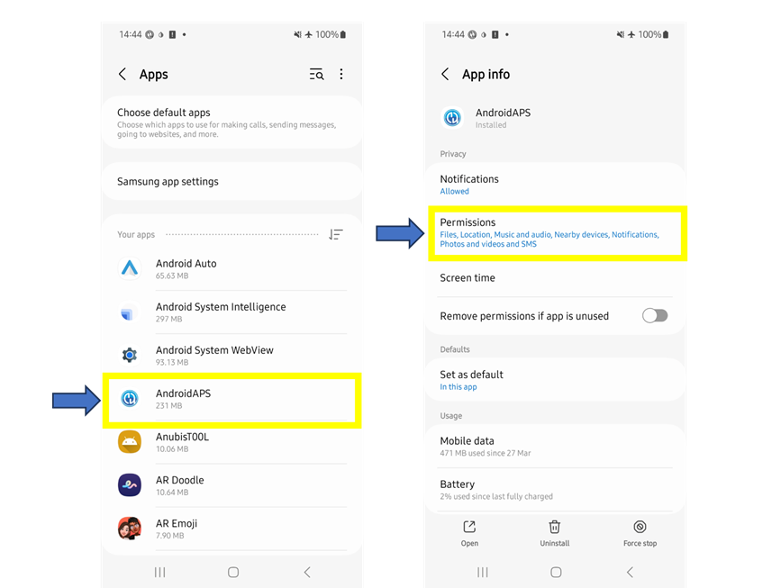
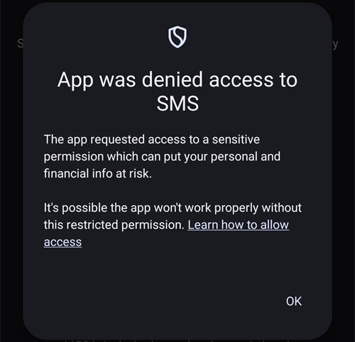
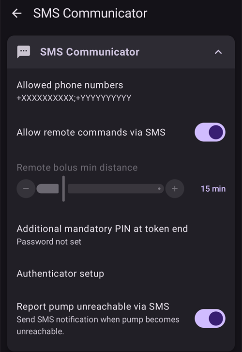
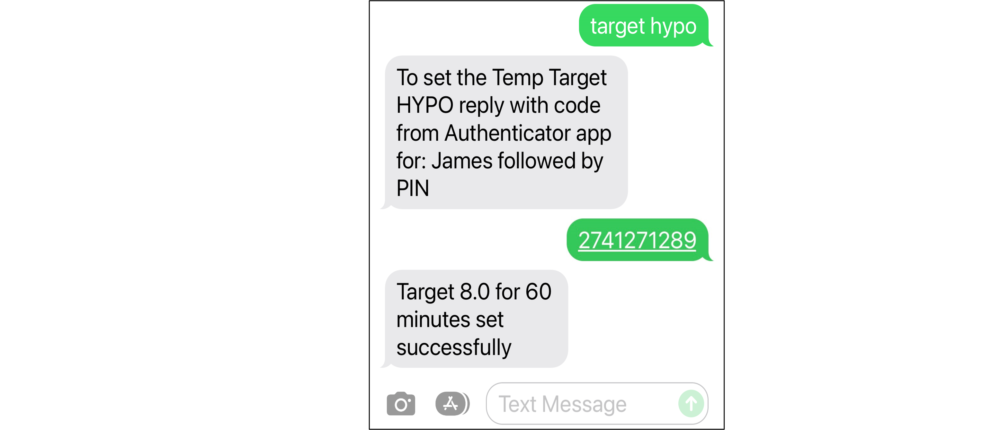
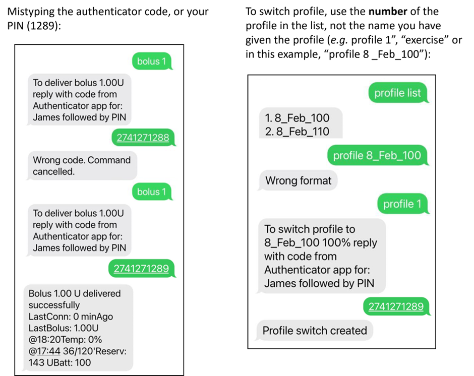

# SMS komandos

```{contents} Table of contents
:depth: 2
```

Daugumą nuotolinių pakeitimų (laikinus tikslus, angliavandenius, profilio keitimus ir, kai klientas susietas, bolusus) galima atlikti [**AAPSClient** programėle](../RemoteFeatures/RemoteMonitoring.md) Android telefone su interneto ryšiu, žr. [Pagrindinio įrenginio ↔ kliento valdymas](#client-master-control) (**AAPSClient** versija iPhone telefonui kuriama, žr. [AAPSClient](AapsClient.md)). SMS komandos lieka alternatyva, kuri veikia be interneto, ir vienintelė nuotolinio valdymo galimybė, jei kaip sekėjo telefoną naudojate iPhone ir dar neturite **AAPSClient**.

**SMS komandos labai naudingos:**
1. Įprastam nuotoliniam valdymui

2. Jei norite nuotoliniu būdu suleisti insulino bolusą be susieto **AAPSClient**

3. Vietovėse, kur prastas interneto ryšys: SMS žinutės pasiekia gavėją, bet mobilusis internetas veikia ribotai. Tai labai naudinga keliaujant į atokias vietoves (pvz., stovyklaujant, slidinėjant).

4. Jei kitas jūsų nuotolinio valdymo būdas (**AAPSClient**) laikinai neveikia

## Saugumas – svarbiausia

Jei **AAPS** įjungiate **SMS komandos**, atminkite, kad telefonas, iš kurio siunčiamos nuotolinės komandos, gali būti pavogtas ir (arba) juo gali naudotis kas nors kitas. Visada užrakinkite savo telefoną bent PIN kodu. Labai rekomenduojamas stiprus slaptažodis ir (arba) biometrinis užraktas; jis turi skirtis nuo jūsų APK pagrindinio slaptažodžio (slaptažodžio, kurio reikia **AAPS** nustatymams eksportuoti).

Be to, SMS komandoms rekomenduojama leisti [antrą telefono numerį](#SMSCommands-authorized-phone-numbers). Tada antruoju numeriu galėsite [išjungti](#SMSCommands-other) SMS komandas, jei jūsų pagrindinis nuotolinio valdymo telefonas būtų pažeistas.

The default minimum time delay between bolus commands is 15 minutes, counted from the moment the pump accepts a bolus. Dėl saugumo turite pridėti bent du autorizuotus telefono numerius, jei norite šį laiko tarpą sutrumpinti. Jei bandysite nuotoliniu būdu vėl suleisti bolusą per 15 minučių po ankstesnio boluso, gausite atsakymą „Nuotolinis bolusas negalimas. Bandykite vėliau.“

AAPS taip pat SMS žinute praneš, ar jūsų nuotolinės komandos, pvz., bolusas ar profilio keitimas, buvo įvykdytos. Patartina tai nustatyti taip, kad patvirtinimo tekstai būtų siunčiami bent dviem skirtingais telefono numeriais, jei pavogtas vienas iš priimančių telefonų.

**Jei bolusą suleidžiate SMS komandomis, angliavandenius turite įvesti atskirai (antra SMS, AAPSClient...)!** Jei to nepadarysite, AIO bus teisingas, bet AAO per mažas, todėl korekcinis bolusas gali būti nesuleistas, nes **AAPS** manys, kad turite per daug aktyvaus insulino.

Jautrioms komandoms saugumui padidinti būtina naudoti autentifikavimo programėlę su laiko pagrindu sukuriamu vienkartiniu slaptažodžiu.

Jei norite atimti iš prižiūrinčio asmens telefono galimybę siųsti SMS komandas, **AAPS** naudokite avarinį mygtuką „[Atstatyti autentikatorius](#sms-commands-authenticator-setup)“ arba išsiųskite SMS komandą „[SMS stop](#SMSCommands-other)“. Iš naujo nustatę autentifikatorius, VISUS prižiūrinčių asmenų telefonus padarysite negaliojančiais. You will need to set them up again.

## Setup SMS commands

```{contents} The overall process is as follows
:depth: 1
:local: true
```

(sms-commands-authenticator-setup)=
### Authenticator setup

Two-factor authentication is used to improve safety.

Prižiūrinčio asmens telefone atsisiųskite (iš App Store arba Google Play) ir įdiekite autentifikavimo programėlę. Populiarios nemokamos programėlės:
  - [Authy](https://authy.com/download/)
  - Google Authenticator – [Android](https://play.google.com/store/apps/details?id=com.google.android.apps.authenticator2) / [iOS](https://apps.apple.com/de/app/google-authenticator/id388497605)
  - [LastPass Authenticator](https://lastpass.com/auth/)
  - [FreeOTP Authenticator](https://freeotp.github.io/)

Šios autentifikavimo programėlės sukuria ribotą laiką galiojantį vienkartinį 6 skaitmenų slaptažodį, panašiai kaip mobiliojoje bankininkystėje ar apsiperkant internetu. Galite naudoti ir kitą autentifikavimo programėlę, jei ji palaiko RFC 6238 TOTP prieigos raktus. Microsoft Authenticator neveikia.

### Patikrinkite telefono nustatymus

Telefone eikite į **Apps > AAPS > Permissions** (programėlės, leidimai). Įsitikinkite, kad **SMS** ir **Phone** (telefonas) leidžiami.



```{admonition} "App was denied access to SMS"
:class: tip
Android gali blokuoti leidimą **SMS** programėlėms, kurios buvo įdiegtos ne iš programėlių parduotuvės, pavyzdžiui, **AAPS**. Jei suteikdami leidimą **SMS** matote šį pranešimą, atidarykite telefono **Settings > Apps > AAPS** (nustatymai, programėlės), bakstelėkite meniu **⋮** (viršuje dešinėje) ir pasirinkite **Allow restricted settings** (leisti ribotus nustatymus). Tada vėl suteikite leidimą **SMS**.
```



### Datos ir laiko sinchronizavimas

The time on both phones must be synchronized. Geriausia laiką nustatyti automatiškai pagal tinklą. Dėl laiko skirtumų gali kilti autentifikavimo problemų.

Ir **AAPS** telefone, ir prižiūrinčio asmens telefone patikrinkite, ar data ir laikas sinchronizuoti. Kaip tai padaryti, priklauso nuo jūsų įrenginio, gali tekti išbandyti skirtingus nustatymus.

Pavyzdys (Samsung S23): **Settings > General management > Date and time** (nustatymai, bendrasis valdymas, data ir laikas): įsitikinkite, kad pažymėta **Automatic date and time** (automatinė data ir laikas).

Kai kurios parinktys gali būti pilkos (neaktyvios), nes, jei telefonas nustatytas kaip vaiko paskyra, jas keisti gali tik administratorius per šeimos paskyrą. Prižiūrinčio asmens / tėvų iPhone telefone šis datos ir laiko nustatymas vadinasi „Set automatically“ (nustatyti automatiškai). Jei nesate tikri, ar telefonai sinchronizuoti, nesijaudinkite: galite nustatyti SMS komandas, o jei atrodys, kad kyla problemų, vėliau jas išspręsti (jei reikia, paprašykite pagalbos).

### AAPS nustatymai

Patikrinę telefono nustatymus, pačioje **AAPS** programėlėje eikite į [**Konfigūracija** → **Ryšys**](../SettingUpAaps/ConfigBuilder.md) ir įjunkite įskiepį **SMS komandos**.

Atidarykite **SMS komandos** nustatymus.

Įjunkite **Leisti nuotolines komandas SMS žinutėmis**. Parinktys **Papildomas privalomas PIN kodas žymeklio gale** ir **Autentifikavimo sąrankos nustatymas** atsiranda tik tai įjungus:



(SMSCommands-authorized-phone-numbers)=
#### Patvirtinti telefono numeriai

Įveskite prižiūrinčio asmens telefono numerį (-ius). Įrašykite šalies kodą ir praleiskite pirmąjį telefono numerio „0“, kaip parodyta pavyzdžiuose:
* JK telefono numeris: +447976304596
* JAV telefono numeris: +11234567890
* Prancūzijos telefono numeris:  +33612344567
* _ir t. t._

Atminkite, kad „+“ prieš numerį, priklausomai nuo jūsų vietovės, gali būti reikalingas arba nereikalingas. Kad tai sužinotumėte, išsiųskite bandomąją žinutę: gautas formatas bus parodytas įskiepio **SMS komandos** ekrane (**Konfigūracija** → **Ryšys** → **SMS komandos** → **Atidaryti įskiepį**).

Jei norite pridėti daugiau nei vieną telefono numerį, atskirkite juos kabliataškiais, **BE tarpų tarp numerių** (tai labai svarbu!). Pasirinkite **OK**:


#### Mažiausias intervalas tarp nuotolinių bolusų

- Galite nustatyti mažiausią laiko tarpą (minutėmis) tarp dviejų bolusų, išsiųstų SMS žinutėmis.
- Dėl saugumo turite pridėti bent du autorizuotus telefono numerius, kad galėtumėte keisti šią reikšmę.

#### Additional mandatory PIN at token end

Dėl saugumo po atsakymo kodo turi būti įvestas PIN kodas. Pasirinkite PIN kodą, kurį jūs (ir kiti prižiūrintys asmenys) rašysite autentifikavimo kodo gale, kai siųsite SMS komandą.

Reikalavimai PIN kodui:

* bent 6 skaitmenys
* tik skaitmenys

Saugesniam PIN kodui nenaudokite to paties skaitmens daug kartų (_pvz._, 111111) arba skaitmenų sekos (_pvz._, 123456).


#### Authenticator setup

* Bakstelėkite **Autentifikavimo sąrankos nustatymas** ir vykdykite ekrane pateikiamus nurodymus žingsnis po žingsnio.
* _Prižiūrinčio asmens telefone_ atidarykite įdiegtą autentifikavimo programėlę, nustatykite naują ryšį ir
* Prižiūrinčio asmens telefonu nuskenuokite QR kodą, rodomą skiltyje **Skanuokite kodą AAPS OTP kodų nustatymui**.


* Skiltyje **Patikrinti vienkartinį slaptažodį** į laukelį **Kodas patikrinimui** įveskite vienkartinį slaptažodį iš prižiūrinčio asmens telefono autentifikavimo programėlės ir po jo – savo PIN kodą:

Pavyzdys:
* Autentifikavimo programėlės kodas yra 457051
* Your mandatory PIN is 2401
* Kodas patikrinimui: 4570512401

Jei įvedėte teisingai, raudonas užrašas „NETEISINGAS PIN“ automatiškai pasikeis į žalią „OK“. **Nėra jokio mygtuko, kurį reikėtų paspausti!** Procesas baigtas, įvedus kodą nereikia spausti jokio mygtuko „OK“:


Dabar SMS komandos turėtų būti nustatytos.

Jei norite pašalinti sukurtus autentifikatorius, naudokite mygtuką **Atstatyti autentikatorius** ekrano **Autentifikavimo sąrankos nustatymas** apačioje. (Iš naujo nustatę autentifikatorius, VISUS jau sukurtus autentifikatorius padarysite negaliojančiais. Jums reikės juos nustatyti dar kartą.)

## SMS komandų naudojimas

### Pirmieji žingsniai naudojant SMS komandas

1)  Kad patikrintumėte, ar viską nustatėte teisingai, išbandykite ryšį: iš prižiūrinčio asmens telefono į **AAPS** telefoną išsiųskite SMS žinutę „bg“. Turėtumėte gauti atsakymą, panašų į parodytą čia:


Jei negavote jokio atsakymo, žr. toliau skyrių [Trikčių šalinimas](#SMSCommands-troubleshooting).

2)  Dabar išbandykite SMS komandą, kuriai reikia autentifikavimo, _pvz._, „target hypo“. Prižiūrinčio asmens telefonas gaus atsakymo žinutę, kurioje bus prašoma įvesti **šešių skaitmenų autentifikavimo slaptažodį** iš autentifikavimo programėlės ir po jo papildomą slaptą **PIN kodą**, kurį žino tik prižiūrintys asmenys / sekėjai (iš viso dvylika skaitmenų, jei jūsų PIN kodas turi 6 skaitmenis).

Kai SMS komandą siunčiate pirmą kartą, išbandykite ją būdami šalia **AAPS** telefono, kad pamatytumėte, kaip tai veikia:


Prižiūrinčio asmens telefonas gaus atsakymo SMS iš **AAPS**, patvirtinančią, ar nuotolinė SMS komanda sėkmingai įvykdyta.

Jei komanda įvykdyta sėkmingai, gausite tai patvirtinantį atsakymą. Jei kilo problema, gausite klaidos pranešimą. Dažnas klaidas rasite toliau, skyriuje [Trikčių šalinimas](#SMSCommands-troubleshooting).

**Patarimas**: jei bus siunčiama daug SMS, naudinga turėti neribotų SMS mokėjimo planą (kiekvienam naudojamam telefonui).

### Bolusų valgymui suleidimas SMS komandomis

Nuotoliniu būdu insulino bolusą galima suleisti **SMS komandomis** arba per susietą **AAPSClient** (žr. [Pagrindinio įrenginio ↔ kliento valdymas](#client-master-control)); per Nightscout svetainę to padaryti negalima. Angliavandenius taip pat galima įvesti SMS žinute arba per **AAPSClient**. SMS žinutėmis negalima vienoje SMS žinutėje išsiųsti ir angliavandenių, ir insulino komandų. Šias komandas reikia siųsti atskirai, taip:

1)  Insulino boluso siuntimas SMS komanda (_pvz._, „bolus 2“ suleis 2 vienetų bolusą) atitinka **Terapija** → **Insulinas** **AAPS** programėlėje. 2)  Išsiųskite angliavandenius (_pvz._, „carbs 20“ įves 20 g angliavandenių). Tai atitinka **Terapija** → **Angliavandeniai** **AAPS** programėlėje.

Kad išvengtumėte hipoglikemijos, verta pradėti atsargiai ir suleisti **mažiau insulino**, nei reikėtų pagal jūsų IA, nes neatsižvelgiate į dabartinį gliukozės lygį ar jo tendenciją.

**Svarbu, kokia tvarka siunčiate šias komandas**. Jei bet kokiu būdu įvedate didelį angliavandenių kiekį ir turite įjungtą SMB, **AAPS** gali iš karto sureaguoti ir suleisti dalį insulino boluso. Todėl, jei _po_ angliavandenių įvedimo bandysite išsiųsti insulino bolusą, gali tekti nemaloniai palaukti ir gausite pranešimą „bolus in progress“ (leidžiamas bolusas), o tada turėsite patikrinti, kiek buvo suleista kaip SMB. Arba, jei nepastebėsite, kad leidžiamas SMB, ir jūsų paties vėlesnis bolusas taip pat bus sėkmingas, valgiui iš viso gali būti suleista per daug insulino. Todėl, leisdami bolusą valgiui nuotoliniu būdu, visada išsiųskite insulino bolusą _prieš_ angliavandenių įvedimą. Jei norite, galite derinti **AAPSClient** ir SMS komandas: angliavandeniams, įvestiems susietame **AAPSClient**, autentifikavimo kodo nereikia, todėl tai greičiau nei SMS komandomis. Angliavandeniai ar kiti terapijos įrašai, įvesti Nightscout svetainėje, **nepritaikomi**, kol įjungtas kliento valdymas; tada **AAPS** veikia [sustiprintos apsaugos režimu](#client-master-control-hardened-mode).

(SMSCommands-commands)=
## Commands

```{contents} List of command groups
:depth: 1
:local: true
```

Komandas reikia siųsti anglų kalba, o atsakymas bus jūsų kalba, jei atsakymo eilutė jau [išversta](#translations-translate-strings-for-AAPS-app). Komandose didžiosios ir mažosios raidės nesvarbios, galite rašyti mažosiomis arba didžiosiomis raidėmis.


Toliau pateiktose **SMS komandų lentelėse** nurodytos visos galimos SMS komandos. Kad būtų lengviau suprasti, pateiktos _pavyzdinės reikšmės_. Komandoms galioja tos pačios galimų reikšmių ribos (tikslai, profilio procentas ir kt.), kurios leidžiamos pačioje **AAPS** programėlėje.

(authentication-or-not)=
### Su autentifikavimu ar be jo?

Į kai kurias SMS komandas atsakoma iš karto, o kai kurioms SMS komandoms reikia griežto **autentifikavimo** per autentifikavimo programėlę. Paprastą užklausą, pvz., „**BG**“ (kuria prašoma dabartinės gliukozės reikšmės), greita parašyti, jai nereikia autentifikavimo, o atsakyme gaunama toliau parodyta **AAPS** būsenos informacija:


Komandoms, kurioms reikia daugiau saugumo, reikia įvesti kodą, pavyzdžiui:



Toliau pateiktų lentelių stulpelyje *Autent.* nurodyta, ar kiekvienai komandai reikia tokio griežto autentifikavimo.

### CGM data

| Komanda    | Autent. | Funkcija ir *atsakymas*                                                                                                                                                                                                                       |
| ---------- | ------- | --------------------------------------------------------------------------------------------------------------------------------------------------------------------------------------------------------------------------------------------- |
| BG         | No      | Grąžina: paskutinę KG, pokytį, AIO (boluso ir valandinės bazės), AAO<br/>*Paskutinė KG: 5,6 prieš 4min, Pokytis: -0,2 mmol, AIO: 0,20V (Bolusas: 0,10V Valandinė bazė: 0,10V)*                                                          |
| CAL 5.6/90 | Yes     | Sukalibruos NGJ reikšme 5.6/90<br/>(naudokite reikšmę, tinkančią jūsų gliukozės vienetams)<br/>Veikia tik tada, jei **AAPS** tinkamai nustatyta.<br/>*Kalibracija išsiųsta. xDrip+ programoje turi būti įgalintas gavimas.* |

### Pump

| Komanda              | Autent. | Funkcija ir *atsakymas*                                                                             |
| -------------------- | ------- | --------------------------------------------------------------------------------------------------- |
| PUMP                 | No      | Ryšys prieš: 1 min<br/>Temp: 0.00U/h @11:38 5/30min<br/>IOB: 0.5U Reserv: 34U Batt: 100 |
| PUMP DISCONNECT *30* | Yes     | Atjungti pompą *30* minučių                                                                         |
| PUMP CONNECT         | Yes     | Pump reconnected                                                                                    |

### Valandinė bazė

| Komanda           | Autent. | Funkcija ir *atsakymas*        |
| ----------------- | ------- | ------------------------------ |
| BASAL 0.3         | Yes     | Pradėti 0,3 V/val. bazę 30 min |
| BASAL 0.3 20      | Yes     | Pradėti 0,3 V/val. bazę 20 min |
| BASAL 30%         | Yes     | Pradėti 30% bazę 30 min        |
| BASAL 30% 50      | Yes     | Pradėti 30% bazę 50 min        |
| BASAL STOP/CANCEL | Yes     | Sustabdyti laikiną bazę        |

Kai kurios pompos laikiną bazę priima tik procentais, kitos – tik V/val. Jei naudosite kitą formą, **AAPS** atsakys *„Ši pompa laikiną bazę nustato procentais, o ne V/val.“* (arba atvirkščiai) ir nieko nenustatys. Trukmė turi būti jūsų pompos laikinos bazės trukmės žingsnio kartotinis.


### Ciklas

| Komanda           | Autent. | Funkcija ir *atsakymas*                                                                                                                                                                                                                                                          |
| ----------------- | ------- | -------------------------------------------------------------------------------------------------------------------------------------------------------------------------------------------------------------------------------------------------------------------------------- |
| LOOP STATUS       | No      | Atsakymas priklauso nuo tikrosios būsenos:<br/> - *Ciklas išjungtas*, jei ciklas išjungtas<br/> - *Ciklas įjungtas*, jei ciklas uždaras, atviras arba LGS<br/> - *Pompa atjungta*, jei pompa atjungta<br/> - *Sustabdyta (10 m)*, jei ciklas sustabdytas |
| LOOP STOP/DISABLE | Yes     | Pompa grįš prie iš anksto užprogramuotos valandinės bazės.<br/>*Ciklas buvo išjungtas*                                                                                                                                                                                     |
| LOOP SUSPEND 20   | Yes     | *Ciklas sustabdytas*                                                                                                                                                                                                                                                             |
| LOOP RESUME       | Yes     | *Loop resumed*                                                                                                                                                                                                                                                                   |
| LOOP CLOSED       | Yes     | *Dabartinis veikimo režimas: Uždaras ciklas*                                                                                                                                                                                                                                     |
| LOOP LGS          | Yes     | *Dabartinis veikimo režimas: Stabdymas esant žemai glikemijai*                                                                                                                                                                                                                   |

### Bolus

Nuotolinis bolusas neleidžiamas per 15 min. po paskutinės boluso komandos ar nuotolinių komandų (šią reikšmę galima keisti tik pridėjus 2 telefono numerius)! Šiuo atveju atsakymas būtų *Nuotolinis bolusas negalimas. Bandykite vėliau.* Šis atsakymas siunčiamas ir tada, kai pompa tuo metu leidžia bolusą.

| Komanda              | Autent. | Funkcija ir *atsakymas*                                                                                                                                      |
| -------------------- | ------- | ------------------------------------------------------------------------------------------------------------------------------------------------------------ |
| BOLUS 1.2            | Yes     |                                                                                                                                                              |
| BOLUS 0.60 MEAL      | Yes     | Suleidžia nurodytą 0,60 V bolusą<br/>**ir** nustato [laikiną tikslą „Netrukus valgysiu“](#TempTargets-eating-soon-temp-target)                         |
| CARBS 5              | Yes     | Įvesti 5 g be boluso                                                                                                                                         |
| CARBS 5 17:35/5:35PM | Yes     | Įvesti 5 g 17:35 val.<br/>Tinkamas laiko formatas priklauso<br/> nuo telefono laiko nustatymo (12 val. / 24 val.).                               |
| EXTENDED 2 120       | Yes     | Pradėti 2 V ištęstą bolusą 120 min.<br/>Tik [suderinamoms pompoms](#Extended-Carbs-extended-bolus-and-switch-to-open-loop-dana-and-insight-pump-only). |
| EXTENDED STOP/CANCEL | Yes     | Sustabdyti ištęstą bolusą                                                                                                                                    |

### Profile

| Komanda        | Autent. | Funkcija ir *atsakymas*                                                                                                                                     |
| -------------- | ------- | ----------------------------------------------------------------------------------------------------------------------------------------------------------- |
| PROFILE STATUS | No      | Dabartinis profilis ir procentas                                                                                                                            |
| PROFILE LIST   | No      | Dabartinis **AAPS** profilių sąrašas, pvz.:<br/>1. Profile1<br/> 2. Profile2                                                                    |
| PROFILE 1      | Yes     | Perjungti į 1 profilį sąraše.<br/>Naudokite numerius, kuriuos grąžina **PROFILE LIST**,<br/>o ne profilių pavadinimus, kuriais juos išsaugojote |
| PROFILE 2 30   | Yes     | Perjungti į Profile2 30%                                                                                                                                    |

Procentas turi būti nuo 30 iki 250 %, kaip ir programėlėje. Reikšmė už šių ribų atmetama dar prieš paprašant autentifikavimo kodo.

### Temporary Targets

| Komanda                   | Autent. | Funkcija ir *atsakymas*                     |
| ------------------------- | ------- | ------------------------------------------- |
| TARGET MEAL/ACTIVITY/HYPO | Yes     | Nustatyti laikiną tikslą MEAL/ACTIVITY/HYPO |
| TARGET STOP/CANCEL        | Yes     | Atšaukti laikiną tikslą                     |


(SMSCommands-other)=
### Kiti

| Komanda          | Autent. | Funkcija ir *atsakymas*                                                                                                                                                                                                                                                        |
| ---------------- | ------- | ------------------------------------------------------------------------------------------------------------------------------------------------------------------------------------------------------------------------------------------------------------------------------ |
| RESTART          | Yes     | Paleidžia AAPS iš naujo. Naudinga, jei kilo problemų, kurias paprastai išsprendžia paleidimas iš naujo.                                                                                                                                                                        |
| SMS DISABLE/STOP | Yes     | Norėdami išjungti SMS nuotolinį valdymą, atsakykite kodu.<br/>Atminkite, kad vėl jį įjungti galėsite<br/>tik pagrindiniame **AAPS** išmaniajame telefone.                                                                                                          |
| HELP             | No      | Grąžina visas funkcijas, apie kurias galima teirautis:<br/>BG, LOOP, PUMP, BASAL, BOLUS, EXTENDED, CAL, PROFILE, TARGET, SMS, CARBS, HELP, RESTART<br/>Išsiųskite komandą ***HELP ***FUNCTION******, kad gautumėte<br/>visų šios funkcijos parinkčių sąrašą. |
| HELP BOLUS       |         | *BOLUS 1.2<br/>BOLUS 1.2 MEAL*                                                                                                                                                                                                                                           |

(SMSCommands-troubleshooting)=
## Trikčių šalinimas ir DUK

```{contents} List of questions and issues
:depth: 1
:local: true
```

### Ko _negalima_ padaryti SMS komandomis?

1)  **Negalite nustatyti _laikino_ profilio keitimo** (pavyzdžiui, nustatyti profilį „exercise“ 60 minučių), nors galite visam laikui perjungti į profilį „exercise“. Laikinus profilio keitimus galima nustatyti per **AAPSClient**.

2)  **Negalite atšaukti automatizacijų** ar **nustatyti savo pasirinktų tikslų**, bet yra apytikslių sprendimų: Pavyzdžiui, tarkime, įprastas profilio tikslas yra 5,5. AAPS nustatėte automatizaciją, kuri dėl kūno kultūros pamokos mokykloje visada nustato aukštą 7,0 tikslą nuo 14:30 iki 15:30, o viena iš automatizacijos sąlygų yra „laikinas tikslas neegzistuoja“. Šią savaitę jums netikėtai pranešė, kad kūno kultūros pamoka atšaukta ir vietoj jos bus valgoma pica, bet jūsų vaikas jau mokykloje su **AAPS** telefonu. Jei automatizacija pradeda aukštą 7,0 laikiną tikslą, o jūs jį atšaukiate (**AAPS** telefone arba nuotoliniu būdu), automatizacijos sąlygos vis tiek tenkinamos, ir **AAPS** po minutės paprasčiausiai vėl nustatys aukštą tikslą.

**Jei turėtumėte prieigą prie AAPS telefono**, galėtumėte išjungti / pakeisti automatizaciją, o jei to daryti nenorite, galėtumėte tiesiog nustatyti naują 5,6 laikiną tikslą 60 min, paspausdami tikslą pagrindiniame ekrane arba per **Valdymas** → **Laikinas tikslas**. Tada automatizacija nebenustatytų aukšto 7,0 tikslo.

**Jei neturite prieigos prie AAPS telefono**, SMS komandomis galima rasti apytikslį sprendimą: pavyzdžiui, komanda „target meal“ nustatyti 5,0 tikslą 45 min (kiti numatytieji tikslai yra 8,0 sportui arba hipoglikemijai, žr. lentelę). Tačiau SMS komandomis negalite nurodyti _konkrečios_ tikslo reikšmės (pavyzdžiui, 5,6 60 minučių), tam reikėtų naudoti **AAPSClient**.

### Kas bus, jei persigalvosiu dėl ką tik išsiųstos komandos?

**AAPS** įvykdys tik paskutinę komandą. Taigi, jei parašote „bolus 1.5“, o tada, nepatvirtinę autentifikavimo kodu, išsiunčiate naują komandą „bolus 1“, ankstesnė 1.5 komanda bus ignoruojama. **AAPS** visada išsiųs prižiūrinčio asmens telefonui atsakymą, patvirtinantį, kokia yra SMS komanda, prieš paprašydama įvesti autentifikavimo kodą, taip pat atsakymą po veiksmo.

### Kodėl negavau atsakymo į SMS komandą?

Tam gali būti viena iš šių priežasčių:

1)  Žinutė nepasiekė telefono (tinklo problemos). 2)  **AAPS** vis dar apdoroja užklausą (_pvz._, bolusą, kurio suleidimas gali užtrukti, priklausomai nuo jūsų boluso greičio). 3)  Gavus komandą, **AAPS** telefono Bluetooth ryšys su pompa buvo prastas, ir komanda nepavyko (paprastai dėl to **AAPS** telefone suveikia aliarmas).

### Visiškai jokio atsakymo į SMS komandas

Prižiūrinčio asmens telefone ir (arba) **AAPS** telefone pabandykite išjungti šias parinktis:
* **Send as chat message** (siųsti kaip pokalbio pranešimą) 
* Jei naudojate Android Messages arba Google Messages programėlę, išjunkite RCS pranešimus:
  - atidarykite konkretų SMS pokalbį programėlėje Messages
  - Pasirinkite parinkčių meniu (trys taškai) viršutiniame dešiniajame kampe
  - pasirinkite „Details“ (išsami informacija)
  - Įjunkite „Only send SMS and MMS messages“ (siųsti tik SMS ir MMS žinutes) 

### Klaidos vykdant komandas

Yra kelios galimos priežastys, kodėl komanda gali būti neįvykdyta:

* SMS komandų sąranka neužbaigta / neteisinga
* Išsiuntėte netinkamo formato komandą (pvz., „disconnect pump 45“ vietoj „pump disconnect 45“)
* Panaudojote neteisingą arba nebegaliojantį autentifikavimo kodą (paprastai verta palaukti kelias sekundes naujo kodo, jei dabartinis netrukus nustos galioti)
* Kodas + PIN buvo teisingi, bet SMS buvo išsiųsta arba pristatyta pavėluotai, todėl **AAPS** apskaičiavo, kad autentifikavimo kodas nebegalioja
* **AAPS** telefonas yra per toli nuo pompos / neturi ryšio su ja
* Sistema jau leidžia bolusą

Dažnos klaidos parodytos toliau pateiktuose pavyzdžiuose:



### Kaip sustabdyti komandą, kai ji jau patvirtinta autentifikavimo kodu?

Negalite. Tačiau SMS žinute išsiųstą bolusą galite atšaukti pačiame **AAPS** telefone, jei suspėsite: tiesiog atšaukite jį boluso iškylančiame lange. Daugelį SMS komandų (išskyrus bolusus ir angliavandenių įvedimą) galima lengvai atšaukti arba, jei suklydote, imtis veiksmų nenumatytam poveikiui sumažinti.

Suklydę leisdami bolusą ar įvesdami angliavandenius, vis tiek galite imtis veiksmų. Pavyzdžiui, jei įvedėte 20 g angliavandenių, bet jūsų vaikas suvalgė tik 10 g, o jūs (arba šalia esantis prižiūrintis asmuo) negalite ištrinti įrašo tiesiai **AAPS** telefone, galite nustatyti aukštą laikiną tikslą arba silpnesnį profilį, kad **AAPS** veiktų mažiau agresyviai.

### Multiple SMS

Jei vis gaunate tą pačią žinutę (_pvz._, apie profilio keitimą), galbūt netyčia sukūrėte uždarą ratą su kitomis programėlėmis. Pavyzdžiui, tai gali būti xDrip. Jei taip, įsitikinkite, kad xDrip (ar bet kuri kita programėlė) neįkelia terapijos įrašų į Nightscout.

Jei kita programėlė įdiegta keliuose telefonuose, būtinai išjunkite įkėlimą visuose.

(sms-commands-too-many-messages)=
### Gaunu per daug SMS žinučių iš SMS komandų. Ar galiu sumažinti jų dažnumą arba jas sustabdyti?

Naudojant SMS komandas, iš **AAPS** telefono į prižiūrinčio asmens telefoną gali būti siunčiama daug automatinių žinučių. Taip pat gausite žinučių, pavyzdžiui, „Bazės profilis pompoje atnaujintas“, jei **AAPS** nustatytos automatizacijos. Jei bus siunčiama daug SMS, naudinga turėti neribotų SMS mokėjimo planą **AAPS** telefonui (ir kiekvienam naudojamam prižiūrinčio asmens telefonui), taip pat visuose telefonuose išjungti SMS pranešimus, garsinius signalus ar vibraciją. Neįmanoma naudoti SMS komandų ir negauti šių pranešimų. Todėl, užuot naudoję SMS, galbūt norėsite kito būdo tiesiogiai bendrauti su vaiku (jei jis pakankamai didelis). **AAPS** prižiūrintys asmenys dažnai bendrauja ir kitomis programėlėmis, pvz., WhatsApp, LINE, Telegram ir Facebook Messenger.

Galima išjungti SMS „Bazės profilis pompoje atnaujintas“, kai profilio keitimas atėjo iš Nightscout. Tam sukurkite failą, kurio pavadinimas yra **tiksliai**  `do_not_send_sms_on_profile_change`, savo AAPS aplanko `extra` poaplankyje.
