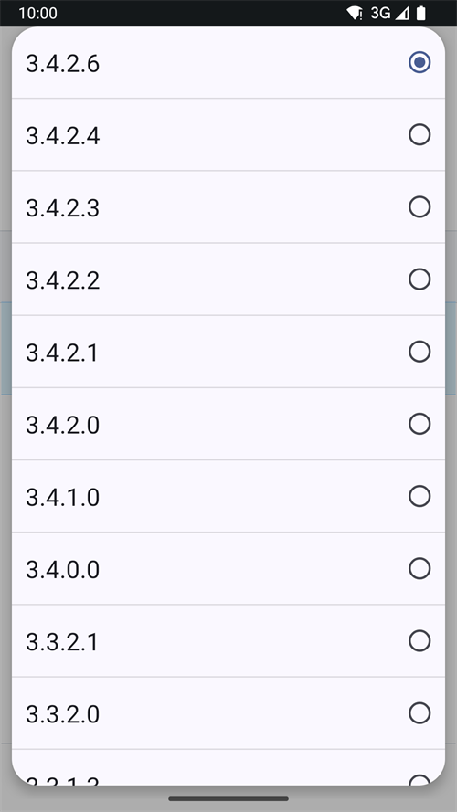

(github-build-apk)=

# Kūrimas naršyklėje – 4 žingsnis: Sukurkite APK

```{note}
Tai yra **4 žingsnis** iš [Kūrimas naršyklėje](BrowserBuild.md). Pirmiausia atlikite [3 žingsnį – Suteikite prieigą prie Google Drive](BrowserBuildGoogleDrive.md).
```

## AAPS-CI GitHub Actions AAPS APK failui sukurti
 - Tinka daugumai naudotojų.

```{tab-set}

:::{tab-item} Wiki
### Paleiskite darbo eigą (workflow) pasirašytam APK sukurti

1. Savo AndroidAPS kopijoje GitHub pasirinkite Actions.
2. Išskleiskite All Workflows.
3. Pasirinkite AAPS-CI


4. Slinkite žemyn ir palieskite Run Workflow.


5. **Use workflow from** palikite master atšaką. Lauke **Select AAPS Version** pasirinkite **AAPS** versiją, kurią norite sukurti (paprastai naujausią). Pasirinkite [variantą](#browserbuild-variant) (fullRelease) ir spauskite Run workflow.


6. Pamatysite pranešimą Workflow run was successfully requested. Atnaujinkite naršyklės puslapį ir galėsite stebėti kūrimo eigą. Kai veiksmas baigsis, prie AAPS CI veiksmo atsiras žalia varnelė. Sėkmingai sukūrėte atnaujintą Android APS versiją.


### AAPS APK įdiegimas

1. Atidarykite savo Google Drive
2. Atidarykite aplanką AAPS, pasirinkite naujos versijos aplanką ir rasite ir telefono, ir Android Wear versijas.


:::  

:::{tab-item} Vaizdo įrašas
<div align="center" style="max-width: 360px; margin: auto; margin-bottom: 2em;">
  <div style="position: relative; width: 100%; aspect-ratio: 9/16;">
    <iframe
      src="https://geo.dailymotion.com/player/x9rdwms.html?video=x9rdwms&loop=true&mute=true"
      loading="lazy"
      style="position: absolute; top: 0; left: 0; width: 100%; height: 100%;"
      frameborder="0"
      allowfullscreen>
    </iframe>
  </div>
</div>
:::  

```

## Kuriamos versijos pasirinkimas

**Naršyklėje galima sukurti tik AAPS 3.3.2.1 ir naujesnes versijas.**

Spauskite **Select AAPS Version** ir pasirinkite versiją, kurią norite sukurti. Naujausia versija yra sąrašo viršuje.



(browserbuild-variant)=

## Kūrimo varianto pasirinkimas

*Pastaba: Android ir Android Wear programėlės bus sukurtos automatiškai.*

  - Pasirinkite reikiamą variantą:
    - fullRelease: įprastam pompos naudojimui su visomis funkcijomis.
    - [aapsclientRelease, aapsclient2Release, aapsclient3Release](#RemoteControl_aapsclient): globėjams (reikia [Nightscout](../SettingUpAaps/Nightscout.md)). `aapsclient3Release` sukuria **AAPSClient3**; galima nuo **AAPS** 4.0 versijos (žr. [Apie AAPSClient, AAPSClient2 ir AAPSClient3](#remotecontrol-aapsclient-versions)).
    - pumpcontrolRelease: pompos programėlei / valdymo įrenginiui pakeisti


Variantai, kurių pavadinimas baigiasi „Debug“, reiškia, kad APK bus sukurtas derinimo (debug) režimu. Tai naudinga kūrėjams ieškant klaidų.

<!-- If you want to test the items in a pull request has been moved to dev page /AdvancedOptions/DevBranch.md -->

----

Kai kūrimas pavyksta, APK failas išsaugomas jūsų Google Drive. Toliau skaitykite [AAPS perkėlimas ir įdiegimas](TransferringAndInstallingAaps.md).

```{note}
Nuo 2026 m. rugsėjo Google [Android kūrėjų tapatybės patikrinimas](#android-developer-verification), priklausomai nuo jūsų šalies, gali neleisti įdiegti APK paspaudus failą. Nemokami apėjimo būdai aprašyti tame puslapyje.
```

Jei kūrimas nepavyksta, pirmiausia [kūrimo žurnale išsiaiškinkite, kas nutiko](#aaps-ci-read-the-logs), tada žr. [Kūrimas naršyklėje: trikčių šalinimas](../GettingHelp/BrowserBuildTroubleshooting.md). Jei į savo kūrimą norite įtraukti konkretų pakeitimą (commit), žr. [vieno pakeitimo įtraukimas (cherry-pick)](#github-cherry-pick).
