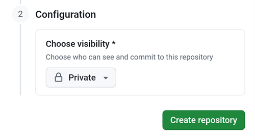
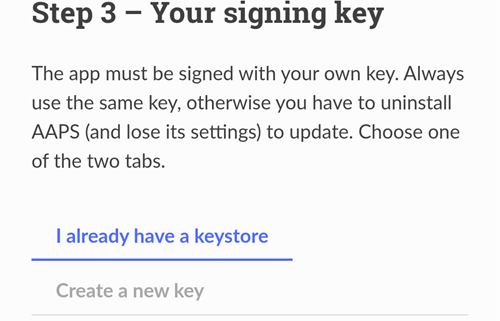
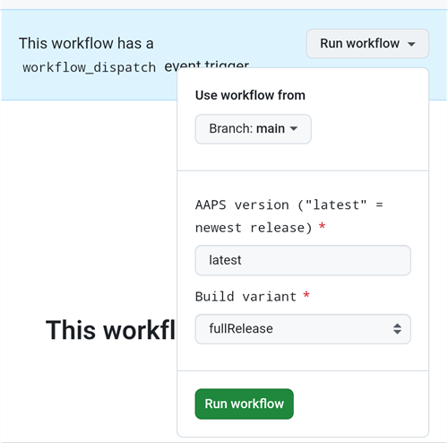

(aaps-builder)=

# Kūrimas naršyklėje su AAPS Builder

```{note}
Tai rekomenduojamas būdas sukurti AAPS iš **Android telefono**. Jis veikia ir bet kurio kompiuterio naršyklėje. Kitus būdus kurti iš kompiuterio arba iPhone rasite apžvalgoje [Kūrimas naršyklėje](BrowserBuild.md).
```

```{contents} In this page
:backlinks: entry
:depth: 2
```

**AAPS Builder** sukuria AAPS programėlę už jus GitHub – nemokamoje kodo talpinimo svetainėje. Telefone nieko nereikia diegti ir nereikia atidaryti jokio paruošimo failo.

Sąrankos puslapis jums padės žingsnis po žingsnio. Pirmą kartą tai užtrunka apie 10 minučių:

1. Savo GitHub paskyroje sukurkite savo **privačią AAPS Builder kopiją**: sąrankos puslapis atidaro GitHub su jau užpildytais laukais, jums tereikia patvirtinti. Kūrimo darbo eiga – failas, kuris nurodo GitHub, kaip kurti AAPS – joje jau yra.
2. Sukurkite arba įkelkite **pasirašymo raktą** (raktų saugyklą).
3. Perduokite raktą savo saugyklai kaip GitHub **slaptąją reikšmę (secret)**.
4. **Sukurkite** programėlę. Vienas kūrimas užtrunka 15–30 minučių.
5. **Atsisiųskite ir įdiekite** programėlę telefone.

AndroidAPS fork kurti **nereikia**: AAPS šaltinio kodas kiekvieno kūrimo metu atsisiunčiamas iš oficialios AndroidAPS saugyklos. Google Drive taip pat **nereikia**: programėlę atsisiunčiate tiesiai iš GitHub.

```{admonition} Where the code comes from
:class: note

Kūrimo darbo eigą prižiūri AAPS kūrėjai saugykloje [nightscout/aaps-builder](https://github.com/nightscout/aaps-builder), o jūsų saugykla yra jos kopija. Jūsų kopijoje esanti [darbo eiga](https://github.com/nightscout/aaps-builder/blob/main/.github/workflows/build.yml) yra trumpa: ji paleidžia toje saugykloje laikomus [kūrimo žingsnius](https://github.com/nightscout/aaps-builder/blob/main/.github/workflows/aaps-builder.yml), todėl patobulinimai jus pasiekia nekeičiant jūsų saugyklos. Abu failus galite perskaityti. Kūrimo metu darbo eiga (workflow) atsisiunčia tik oficialų AAPS šaltinio kodą ir pačios GitHub kūrimo įrankius. Jūsų raktų saugykla niekada nepalieka jūsų naršyklės ir jūsų privačios saugyklos.
```

(aaps-builder-before-you-start)=

## Prieš pradedant

Jums reikės:

- **GitHub paskyros** (nemokamos). Jei jos neturite, pirmiausia ją sukurkite svetainėje [github.com](https://github.com/signup).
- **Interneto naršyklės**: Chrome telefone arba bet kurios naršyklės kompiuteryje. Prieš pradėdami toje naršyklėje prisijunkite prie github.com.
- **Telefone yra GitHub programėlė?** Galite ją palikti. Tada kai kurie sąrankos puslapio mygtukai atidaro programėlę, o ne Chrome. Kurti galima programėlėje, bet programėlė **negali atsisiųsti** sukurtos AAPS: [5 žingsnyje](#aaps-builder-step5) parodyta, kaip atsisiuntimui pereiti į Chrome.
- Jūsų **esamos raktų saugyklos** (`.jks` failo), jos slaptažodžio ir pseudonimo (alias), jei jau anksčiau kūrėte AAPS ir norite jį atnaujinti neįdiegdami iš naujo.

```{warning}
**Jūsų kūrimo saugykla turi likti privati.** Viską, ką sukuria kūrimas, gali matyti kiekvienas, kas mato saugyklą. Sąrankos puslapis sukuria jums privačią saugyklą. Niekada nekeiskite jos į viešą ir nekurkite AAPS Builder **fork**: fork visada yra viešas.

Privati saugykla kas mėnesį gauna 2000 nemokamų GitHub Actions minučių. To pakanka keliems kūrimams.
```

```{warning}
**Naujas raktas ar esamas raktas: nuo to priklauso, ar galėsite atnaujinti AAPS.**

- **Jūsų telefone jau yra AAPS, sukurta su raktų saugykla, kurią vis dar turite**: sąrankos puslapyje pasirinkite **I already have a keystore** (jau turiu raktų saugyklą) ir ją įkelkite. Kitas kūrimas atnaujins jau įdiegtą AAPS. AAPS kūrėte ankstesniu kūrimo naršyklėje būdu (savo fork)? Jūsų raktų saugykla yra jūsų fork: [pirmiausia gaukite jos kopiją](#aaps-builder-from-fork).
- **AAPS kuriate pirmą kartą arba praradote raktų saugyklą ar jos slaptažodį**: pasirinkite **Create a new key** (sukurti naują raktą). Programėlė, pasirašyta nauju raktu, **negali atnaujinti** AAPS, pasirašytos kitu raktu. Turite eksportuoti nustatymus, nukopijuoti failą ne į telefoną, pašalinti senąją AAPS, įdiegti naująją, tada importuoti nustatymus: žr. [AAPS įdiegimas iš naujo su nauja raktų saugykla](#reinstall-aaps).

Vėliau visada naudokite tą patį raktą. Kai kuriate naują raktą, atsisiųskite puslapio siūlomą atsarginę kopiją ir laikykite ją kartu su slaptažodžiu ir pseudonimu (`key0`) saugioje vietoje ne telefone.
```

(aaps-builder-from-fork)=

## Perėjimas nuo ankstesnio kūrimo naršyklėje (fork)

Praleiskite šį skyrių, jei niekada nekūrėte AAPS ankstesniu kūrimo naršyklėje būdu (savo AndroidAPS kopija, arba fork, GitHub, su paruošimo failu ir Google Drive).

Jūsų raktų saugykla saugoma jūsų fork kaip slaptosios reikšmės (secrets). GitHub niekada nebeparodo slaptosios reikšmės, todėl negalite jos nukopijuoti į naują saugyklą. Pirmiausia gaukite savo raktų saugyklos kopiją, tada naudokite ją [2 žingsnyje](#aaps-builder-step2) su **I already have a keystore**.

```{warning}
Nepasirinkite **Create a new key**. AAPS, sukurta su nauju raktu, negali atnaujinti jūsų telefone esančios AAPS.
```

Kuris atvejis yra jūsų?

- **Naudojote 2 variantą** (įkėlėte savo raktų saugyklą iš Android Studio) ir vis dar turite `.jks` failą, jo slaptažodžius ir pseudonimą: čia nieko daryti nereikia. Tą failą naudokite 2 žingsnyje.
- **Naudojote 1 variantą** (raktą sukūrė paruošimo failas) arba nebeturite raktų saugyklos failo: eksportuokite jį iš savo fork, kaip aprašyta toliau.

Kaip eksportuoti raktų saugyklą iš savo fork:

1. Savo fork atidarykite **Settings** → **Secrets and variables** → **Actions** ir pridėkite slaptąją reikšmę `ZIP_PASSWORD`. Sugalvokite slaptažodį tik iš angliškų raidžių ir skaitmenų. Jis apsaugo failą, kurį netrukus sukursite.
2. Atidarykite savo fork skirtuką **Actions**, spauskite **CI Keystore Export**, tada **Run workflow**. Daugiau informacijos: [Raktų saugyklos eksportavimas](#ci-keystore-export).
3. Kai paleidimas pažymėtas žalia varnele, atidarykite savo Google Drive: failas `keystore.zip` yra aplanke **AAPS** → **KeyStore**. Jei paleidimas nepavyksta Google Drive žingsnyje, jūsų fork prieiga prie Google Drive nebegalioja: žr. [Baigėsi Google atnaujinimo rakto (refresh token) galiojimas](#aaps-ci-google-token-expired).
4. Atsisiųskite `keystore.zip` ir atidarykite jį su savo `ZIP_PASSWORD`: kompiuteryje arba telefone su failų tvarkykle, kuri gali atidaryti slaptažodžiu apsaugotus ZIP failus. Jame yra:
   - `keystore.jks`: jūsų raktų saugykla,
   - `keyStoreInfo.txt`: jūsų `KEYSTORE_PASSWORD`, `KEY_PASSWORD` ir `ALIAS` (paprastai `key0`).
5. Nukopijuokite `keystore.jks` į telefoną (arba į Google Drive, kad galėtumėte jį pasirinkti iš ten).

Sąrankos puslapio [2 žingsnyje](#aaps-builder-step2):

1. Spauskite **I already have a keystore**.
2. Lauke **Keystore file** pasirinkite `keystore.jks`.
3. Lauke **Keystore password** įveskite `KEYSTORE_PASSWORD` iš `keyStoreInfo.txt`.
4. Lauke **Key alias** pasirinkite arba įveskite `ALIAS` iš `keyStoreInfo.txt`.
5. Jei `KEY_PASSWORD` skiriasi nuo `KEYSTORE_PASSWORD`, nuimkite žymę **Key password is the same as the keystore password** ir įveskite `KEY_PASSWORD`.

`keystore.zip` ir jo `ZIP_PASSWORD` laikykite saugioje vietoje ne telefone: tai jūsų rakto atsarginė kopija.

Jei norite AAPS Builder kūrimus išsaugoti ir Google Drive, atlikite [6 žingsnį](#aaps-builder-google-drive): sąrankos puslapis gaus jums naują `GDRIVE_OAUTH2`. Savo fork galite laikyti, kol telefone bus įdiegta su AAPS Builder sukurta AAPS.

## Atidarykite sąrankos puslapį

**→ [Atidarykite AAPS Builder sąrankos puslapį](#aaps-builder-setup)**

Sąrankos puslapis yra šios dokumentacijos dalis, jūsų kalba. Šį puslapį taip pat laikykite atidarytą kitame skirtuke: toliau esančiuose skyriuose kiekvienas sąrankos puslapio žingsnis paaiškintas išsamiau, su ekrano nuotraukomis.

Sąrankos puslapis kiekvieną GitHub puslapį atidaro naujame Chrome skirtuke. Norėdami grįžti į sąrankos puslapį, spauskite skirtukų mygtuką šalia Chrome adreso juostos (kvadratas su skaičiumi) ir pasirinkite AAPS Builder sąrankos puslapį.

Sąrankos puslapis veikia tik jūsų naršyklėje: jūsų raktas ir slaptažodžiai niekur nesiunčiami, išskyrus į GitHub slaptąją reikšmę (secret), į kurią juos įklijuojate patys. GitHub siunčiamas tik jūsų GitHub naudotojo vardas, kad būtų patikrinta, ar jis yra. Jis įsimena jūsų GitHub naudotojo vardą ir saugyklos pavadinimą, todėl bet kada galite prie jo grįžti ir vėl atidaryti slaptųjų reikšmių puslapį arba savo kūrimus.


(aaps-builder-step1)=

## 1 žingsnis – Sukurkite savo privačią kūrimo saugyklą

Šiame žingsnyje savo GitHub paskyroje sukuriate privačią AAPS Builder kopiją, kurioje jau yra kūrimo darbo eiga. Ją ir jos sukurtas programėles matote tik jūs.

1. Įsitikinkite, kad šioje naršyklėje esate prisijungę prie github.com.

2. Lauke **Your GitHub username** įveskite savo GitHub naudotojo vardą, ne el. pašto adresą. Puslapis jį patikrina GitHub: **✓ GitHub user found** reiškia, kad jis teisingas.

3. Lauke **Name of your repository** palikite siūlomą `my-aaps`. Jei saugyklą jau sukūrėte kitu pavadinimu, įveskite tiksliai tą pavadinimą.

   ```{note}
   **Jau turite AAPS Builder saugyklą** (sukurtą su ankstesne sąrankos puslapio versija)? Naujos nekurkite: įveskite tikslų jos pavadinimą, praleiskite **Create my private repository** ir vieną kartą atnaujinkite jos darbo eigą, kaip aprašyta skyriuje [AAPS atnaujinimas](#aaps-builder-updates). Jūsų slaptosios reikšmės lieka tokios pat. Jei vis tiek norite naujos saugyklos, pasirinkite pavadinimą, kurio dar neturite, pavyzdžiui, `my-aaps-2`, ir 2 žingsnyje naudokite tą pačią raktų saugyklą.

   Neįveskite savo AndroidAPS fork pavadinimo: fork yra viešas ir jau kuria su savo darbo eiga **AAPS CI**.
   ```

   

4. Patikrinkite eilutę **Your repository:** joje rodoma `github.com/<your username>/my-aaps`. Sąrankos puslapis įsimena pavadinimą nuo paskutinio apsilankymo: kaskart jį patikrinkite prieš naudodami puslapio mygtukus.

5. Spauskite **Create my private repository**.

   

6. GitHub naujame skirtuke atidaro **Create a new repository**. Viskas jau užpildyta: skiltyje **Start with a template** – šablonas `nightscout/aaps-builder` su išjungtu **Include all branches**, o skiltyje **General** – jūsų paskyra kaip **Owner** ir jūsų pasirinktas pavadinimas.

   

   Nieko nekeiskite.

7. Slinkite žemyn: skiltyje **Configuration** laukas **Choose visibility** jau nustatytas į **Private**. Spauskite žalią mygtuką **Create repository**.

   

   GitHub parodo jūsų naują saugyklą: joje yra aplankas `.github` (su kūrimo darbo eiga) ir failas `README.md`. 2 žingsniui **grįžkite į sąrankos puslapio skirtuką**: spauskite skirtukų mygtuką šalia Chrome adreso juostos ir pasirinkite sąrankos puslapį.

```{warning}
**Jūsų nauja saugykla tuščia**, be failų? Ji nebuvo sukurta iš šablono ir negali kurti. Ištrinkite ją (**Settings** → puslapio apačia → **Delete this repository**), tada sąrankos puslapyje dar kartą spauskite **Create my private repository**.
```

(aaps-builder-step2)=

## 2 žingsnis – Jūsų pasirašymo raktas

Programėlė turi būti pasirašyta jūsų nuosavu raktu. Pasirinkite vieną iš dviejų skirtukų. Pirmiausia perskaitykite [įspėjimą apie naują ar esamą raktą](#aaps-builder-before-you-start).



### I already have a keystore

1. Spauskite **I already have a keystore**.
2. Lauke **Keystore file** pasirinkite savo `.jks` failą (arba `.keystore`, `.p12`, `.pfx`). Telefone pirmiausia nukopijuokite failą į telefoną arba į Google Drive.
3. Lauke **Keystore password** įveskite raktų saugyklos slaptažodį.
4. Lauke **Key alias** pasirinkite savo pseudonimą iš sąrašo arba jį įveskite, jei sąrašo nėra. Raktų saugyklose, sukurtose su Android Studio, pseudonimas (alias) paprastai yra `key0`.
5. Jei jūsų rakto slaptažodis skiriasi nuo raktų saugyklos slaptažodžio, nuimkite žymę **Key password is the same as the keystore password** ir įveskite rakto slaptažodį.
6. Spauskite **Check and continue**.

Puslapis patikrina slaptažodį ir pseudonimą jūsų įrenginyje. **Keystore OK! Continue with step 3.** reiškia, kad viskas teisinga. Jei rodoma, kad slaptažodis bus patikrintas kūrimo metu, vis tiek tęskite: kūrimas praneš, jei kas nors negerai.

### Create a new key

1. Spauskite **Create a new key**.

2. Sugalvokite slaptažodį ir įveskite jį du kartus. Taisyklės: bent 8 simboliai, tik raidės a–z ir A–Z, skaitmenys 0–9 ir tokie simboliai kaip `! ? #`. Jokių tarpų, jokių raidžių su diakritiniais ženklais (pvz., ą, č, ė) ir jokio simbolio `|`.

3. Spauskite **Create key**. Po kelių sekundžių pasirodo **Key created**.

   

4. Spauskite **Download backup (aaps-keystore.jks)**. Jei Chrome klausia **Download file again?**, jūsų telefone jau yra senesnė atsarginė kopija tuo pačiu pavadinimu: spauskite **Download again**. Tada Chrome naują raktą išsaugo kaip `aaps-keystore (1).jks`: būtent šis failas priklauso šiam raktui. Jį pasilikite ir nesupainiokite su senesniu.

   Šiuos tris dalykus laikykite kartu, saugioje vietoje ne telefone (pavyzdžiui, savo debesies saugykloje):

   - failą `aaps-keystore.jks`,
   - savo slaptažodį,
   - rakto pseudonimą: **`key0`**.

   Visų trijų jums reikės, jei kada nors kursite AAPS kitu būdu, pavyzdžiui, su Android Studio. Raktai, sukurti su ankstesne sąrankos puslapio versija, turi pseudonimą `aaps`.

   

(aaps-builder-step3)=

## 3 žingsnis – Perduokite raktą savo saugyklai

3 žingsnis atrakinamas, kai baigiamas 2 žingsnis. Jūsų raktas, jo slaptažodžiai ir pseudonimas sudedami į vieną reikšmę – slaptąją reikšmę `KEYSTORE_SET`.

1. Spauskite **Open the secrets page**.


2. GitHub atidaro jūsų saugyklos puslapį **New secret**. Telefone jis yra po nustatymų meniu: slinkite žemyn.


3. Pereikite į sąrankos puslapio skirtuką ir spauskite **Copy name**. Grįžkite į GitHub skirtuką ir įklijuokite jį į mažą lauką **Name**. Pavadinimas yra `KEYSTORE_SET`.

4. Pereikite į sąrankos puslapio skirtuką ir spauskite **Copy secret**. Grįžkite į GitHub skirtuką ir įklijuokite ją į didelį lauką **Secret** (telefone ilgai paspauskite). Slaptoji reikšmė yra labai ilgas kodas – tūkstančiai simbolių: sąrankos puslapis šalia mygtuko rodo pirmuosius jos simbolius. Neįklijuokite ten žodžio `KEYSTORE_SET`.

5. Spauskite **Add secret**. `KEYSTORE_SET` dabar rodoma skiltyje **Repository secrets**.


Tai reikia padaryti tik vieną kartą.

```{tip}
GitHub rodo **Page not found** (404)? Pirmiausia patikrinkite, ar šioje naršyklėje esate prisijungę prie github.com: kai nesate prisijungę, GitHub privačioms saugykloms rodo 404. Kitaip 1 žingsnyje nurodytas naudotojo vardas arba saugyklos pavadinimas nesutampa su jūsų saugykla. Patikrinkite pavadinimą svetainėje github.com, pataisykite jį 1 žingsnyje ir vėl spauskite mygtuką.
```

(aaps-builder-step4)=

## 4 žingsnis – Sukurkite programėlę

1. Sąrankos puslapyje spauskite **Open the build page**. GitHub atidaro jūsų saugyklos puslapį **Build AAPS**.

   

   Jei vietoj to atsidaro **GitHub programėlė**: spauskite **RUN WORKFLOW**, patikrinkite versiją ir variantą ir dar kartą spauskite **RUN WORKFLOW**. Programėlė vis dar gali rodyti **Nothing to see here**: patraukite sąrašą žemyn, kad jį atnaujintumėte ir pamatytumėte savo kūrimą. Tada tęskite nuo toliau aprašyto 4 žingsnio.

2. If GitHub asks, tap the green button to enable workflows.

   The list of workflows shows two entries: use **Build AAPS**. Ignore **AAPS Builder**: it holds the build steps and has no **Run workflow** button.

3. Spauskite **Run workflow**. Atsidaro nedidelė forma:
   - **Version**: palikite `latest`, kad būtų sukurta naujausia AAPS versija, arba įveskite versijos numerį, pavyzdžiui, `4.0.0`.
   - **Variant**: įprastam naudojimui su pompa palikite `fullRelease`. Kiti variantai paaiškinti skyriuje [kūrimo variantai](#browserbuild-variant). `aapsclient3Release` sukuria **AAPSClient3**; galima nuo **AAPS** 4.0 versijos (žr. [Apie AAPSClient, AAPSClient2 ir AAPSClient3](#remotecontrol-aapsclient-versions)).
   - Spauskite žalią mygtuką **Run workflow**.

   

4. Kūrimas prasideda ir rodo **In progress**. Jį sudaro dvi dalys: **AAPS / Check**, tada **AAPS / Build AAPS**.

   

5. Palaukite 15–30 minučių. Žalia varnelė reiškia, kad kūrimas baigtas. Raudonas kryželis reiškia, kad kūrimas nepavyko: atidarykite kūrimą, perskaitykite pranešimą, tada žr. [trikčių šalinimas](#aaps-builder-troubleshooting).

   

   ```{tip}
   **El. laiškas, kai kūrimas baigtas:** GitHub siunčia el. laišką tik tada, kai kūrimas nepavyksta. Norėdami gauti el. laišką ir tada, kai kūrimas pavyksta: svetainėje github.com atidarykite savo profilio nuotrauką → **Settings** → **Notifications** → **System** → **Actions** ir nuimkite žymę **Only notify for failed workflows**.
   ```

Jei nėra mygtuko **Build AAPS** arba **Run workflow**:

- Atidarykite savo saugyklą ir patikrinkite, ar joje yra aplankas `.github` su failu `workflows/build.yml`. Jei saugykla tuščia, ji nebuvo sukurta iš šablono: ištrinkite ją (**Settings** → puslapio apačia → **Delete this repository**) ir dar kartą atlikite [1 žingsnį](#aaps-builder-step1) su mygtuku.
- Atidarykite skirtuką **Actions**. Jei rodoma, kad darbo eigos išjungtos, spauskite žalią mygtuką, kad jas įjungtumėte, tada sąraše spauskite **Build AAPS**.

(aaps-builder-step5)=

## 5 žingsnis – Įdiekite programėlę telefone

```{warning}
**Prieš kiekvieną atnaujinimą** AAPS [eksportuokite savo nustatymus](#ExportImportSettings-Automating-Settings-Export) ir nukopijuokite failą **ne į telefoną** (Google Drive, Dropbox…). Ten laikykite ir kelis senesnius eksportus bei APK failus, kad visada galėtumėte grįžti atgal.
```

1. Telefone atidarykite sąrankos puslapį naršyklėje **Chrome**. Jei paprašoma, prisijunkite prie github.com.
2. Spauskite **Open my builds**, tada naujausią kūrimą su žalia varnele.

   ```{admonition} The GitHub app opened instead of Chrome?
   :class: note

   GitHub programėlė negali atsisiųsti kūrimų. Programėlėje atidarykite naujausią kūrimą, tada spauskite **Artifacts ↗** arba viršuje spauskite bendrinimo piktogramą ir pasirinkite **Chrome** (arba **Copy link**, tada įklijuokite nuorodą į Chrome adreso juostą). Kūrimas atsidaro Chrome: ten tęskite kitą žingsnį.

   Kad GitHub nuorodos nebūtų atidaromos programėlėje: Android **Settings** → **Apps** → **GitHub** → **Open by default** → išjunkite **Open supported links**.
   ```

   

3. Slinkite žemyn iki kūrimo santraukos ir spauskite nuorodą **Download AAPS**.

   

   ```{tip}
   Slinkite pirštu ant teksto, ne ant kūrimo žingsnių diagramos: kitaip juda diagrama, o ne puslapis.
   ```

   Taip pat galite slinkti dar žemiau iki **Artifacts** ir spausti atsisiuntimo piktogramą šalia `aaps-….apk`.

   

4. Kai atsisiuntimas baigtas, atidarykite Chrome meniu **⋮** → **Downloads**, spauskite `aaps-….apk` ir pasirinkite **Install**. Jei paprašoma, leiskite diegti programėles iš šio šaltinio.

   

`aaps-wear-….apk` yra išmaniojo laikrodžio programėlė. Jei laikrodžio nenaudojate, jos nereikia.

Programėlė kūrimo puslapyje laikoma **14 dienų**. Ji nerodoma jūsų saugyklos skiltyje **Code**. Nukopijuokite ją į saugią vietą ne telefone, kartu su nustatymų eksportais.

Daugiau programėlės diegimo būdų rasite puslapyje [AAPS perkėlimas ir įdiegimas](TransferringAndInstallingAaps.md).

```{note}
Nuo 2026 m. rugsėjo Google [Android kūrėjų tapatybės patikrinimas](#android-developer-verification), priklausomai nuo jūsų šalies, gali neleisti įdiegti APK paspaudus failą. Nemokami apėjimo būdai aprašyti tame puslapyje.
```

(aaps-builder-google-drive)=

## 6 žingsnis (nebūtinas) – Programėlę išsaugokite ir Google Drive

Taip pat galite kiekvieną kūrimą išsaugoti savo Google Drive, aplanke `AAPS/<version>`. Tai nebūtina: programėlė visada pasiekiama kūrimo puslapyje.

Tam reikia dar vienos slaptosios reikšmės – `GDRIVE_OAUTH2`. Sąrankos puslapio 6 žingsnis gauna ją iš Google už jus, telefone arba kompiuteryje. Tada **AAPS** jūsų Google Drive gali matyti ir keisti tik savo sukurtus failus, nieko kito.

1. Sąrankos puslapyje spauskite **Connect Google Drive**. Google atsidaro naujame skirtuke.
2. Pasirinkite savo Google paskyrą ir suteikite prieigą. Jei Google rodo, kad programėlė nepatvirtinta, spauskite **Advanced**, tada **Go to …**.
3. Tada naujame skirtuke rodoma klaida, pavyzdžiui, **This site can't be reached** arba **127.0.0.1 refused to connect**. **Taip ir turi būti:** Google atsakymas yra to skirtuko adrese. Spauskite adreso juostą, pažymėkite visą adresą (jis prasideda `http://127.0.0.1:47913/`) ir jį nukopijuokite.
4. Per kelias minutes grįžkite į sąrankos puslapio skirtuką: Google atsakymas galioja tik trumpai ir tik vieną kartą. Įklijuokite adresą į lauką **Paste the copied address here** ir spauskite **Get GDRIVE_OAUTH2**. Puslapis rodo **GDRIVE_OAUTH2 is ready**.
5. Spauskite **Open the secrets page**. Spauskite **Copy name**, tada įklijuokite jį į mažą lauką **Name** (pavadinimas yra `GDRIVE_OAUTH2`). Spauskite **Copy secret**, įklijuokite ją į didelį lauką **Secret** ir spauskite **Add secret**.

Nuo kito kūrimo APK failai taip pat išsaugomi Google Drive.

Jau turite `GDRIVE_OAUTH2` reikšmę iš kitų kūrimo naršyklėje būdų paruošimo failo? Ji irgi tinka: pridėkite ją kaip slaptąją reikšmę `GDRIVE_OAUTH2`.

Google nutraukia prieigą, jei nekuriate 6 mėnesius arba jei pakeičiate Google slaptažodį. Tada kūrimas apie tai praneša: atlikite šiuos veiksmus iš naujo. Žr. [Baigėsi Google atnaujinimo rakto (refresh token) galiojimas](#aaps-ci-google-token-expired).

(aaps-builder-updates)=

## AAPS atnaujinimas

Jūsų saugykla niekada nieko nekuria pati: jūs sprendžiate, kada kurti, kurią versiją ir kurį variantą. Kai išleidžiama nauja AAPS versija:

1. [Padarykite nustatymų atsarginę kopiją](#aaps-builder-step5), kaip aprašyta 5 žingsnyje.
2. Sukurkite naują versiją, kaip aprašyta [4 žingsnyje](#aaps-builder-step4). Palikite `latest` arba įveskite versijos numerį.
3. Atsisiųskite ir įdiekite ją, kaip aprašyta [5 žingsnyje](#aaps-builder-step5).

**Kūrimo žingsnių atnaujinimai** jus pasiekia patys: kiekvieno kūrimo metu jūsų saugykla paleidžia AAPS kūrėjų išleistus kūrimo žingsnius iš nightscout/aaps-builder. Jūsų saugykloje niekas nesikeičia ir automatinio kūrimo nėra.

**Jūsų darbo eigos failo atnaujinimai** reikalingi retai: tik kai pasikeičia forma **Run workflow**, pavyzdžiui, dėl naujo kūrimo varianto, arba vieną kartą, jei jūsų saugykla sukurta su ankstesne sąrankos puslapio versija (tuščia saugykla su trumpu darbo eigos failu) arba iš senojo šablono. Tai nurodoma puslapyje [Dokumentacijos atnaujinimai ir pakeitimai](../Maintenance/DocumentationUpdate.md). Jūsų slaptoji reikšmė `KEYSTORE_SET` lieka tokia pati. Sąrankos puslapyje, 1 žingsnio pabaigoje, atidarykite **Updating your copy**:

1. Spauskite **Open the newest workflow**. Kompiuteryje spauskite **kopijavimo piktogramą** („Copy raw file“) failo viršuje dešinėje. Telefone vietoj to atidarykite **paprasto teksto versiją**, palaikykite paspaudę tekstą, tada **Select all** ir **Copy**.
2. Spauskite **Open my workflow file**.
3. Pakeiskite visą tekstą nukopijuota darbo eiga (telefone ilgai paspauskite: **Select all**, tada **Paste**).
4. Spauskite **Commit changes…**, tada **Commit changes**.

Pirmoje failo eilutėje rodoma jo versija.

(aaps-builder-troubleshooting)=

## Troubleshooting

Norėdami sužinoti, kodėl kūrimas nepavyko, [perskaitykite kūrimo žurnalą](#aaps-ci-read-the-logs): žingsnių pavadinimai kiti, bet klaidą randate taip pat. Taip pat tokiu pat būdu galite [atnaujinti slaptąją reikšmę](#aaps-ci-update-secret) ir [vėl paleisti kūrimą](#aaps-ci-rerun).

- **Nėra mygtuko „Build AAPS“ arba „Run workflow“, arba saugykla tuščia**: saugykla nebuvo sukurta iš šablono. Ištrinkite ją (**Settings** → puslapio apačia → **Delete this repository**) ir dar kartą atlikite [1 žingsnį](#aaps-builder-step1) su mygtuku **Create my private repository**.
- **Kūrimas sustoja su pranešimu „This repository is PUBLIC“**: savo saugykloje atidarykite **Settings** → **General** → **Danger Zone** → **Change visibility** → **Private**, tada kurkite dar kartą.
- **„Secret KEYSTORE_SET is missing“**: atlikite sąrankos puslapio 3 žingsnį.
- **„The secret is too short“**, **„The secret is not a valid code“** arba **„The secret does not contain a keystore“**: į slaptąją reikšmę įklijuotas netinkamas tekstas, dažnai pats žodis `KEYSTORE_SET` arba tik dalis kodo. Savo saugykloje atidarykite **Settings** → **Secrets and variables** → **Actions**, redaguokite `KEYSTORE_SET` ir dar kartą įklijuokite ilgą kodą iš **Copy secret** (jei sąrankos puslapį uždarėte, pirmiausia iš naujo atlikite jo 2 žingsnį).
- **„Keystore, password or alias is wrong“**: patikrinkite savo raktų saugyklos slaptažodį ir pseudonimą, tada iš naujo atlikite sąrankos puslapio 2 ir 3 žingsnius.
- **„Version … does not exist“**: įvesta versija nėra AAPS leidimas. Naudokite `latest` arba patikrinkite versijos numerį.
- **„Variant … is not supported“**: jūsų darbo eigos failas yra senesnės versijos. Pakeiskite jį, kaip aprašyta skyriuje [AAPS atnaujinimas](#aaps-builder-updates).
- **„Page not found“ (404), kai sąrankos puslapis atidaro GitHub**: toje pačioje naršyklėje prisijunkite prie github.com (kai nesate prisijungę, GitHub privačioms saugykloms rodo 404). Jei esate prisijungę, sąrankos puslapio 1 žingsnyje nurodytas naudotojo vardas arba saugyklos pavadinimas nesutampa su jūsų saugykla. Įveskite tikslius pavadinimus.
- **„No GitHub user with this name“** 1 žingsnyje: įveskite savo GitHub naudotojo vardą, kaip jis rodomas jūsų GitHub profilyje, ne el. pašto adresą.
- **Nėra nuorodos Download arba atsidarė GitHub programėlė**: GitHub programėlė negali atsisiųsti kūrimų. Atidarykite kūrimą Chrome, kaip aprašyta [5 žingsnyje](#aaps-builder-step5). Kad GitHub nuorodos nebūtų atidaromos programėlėje: Android **Settings** → **Apps** → **GitHub** → **Open by default** → išjunkite **Open supported links**.
- **„Google Drive access has expired or was revoked“**: iš naujo atlikite [6 žingsnį](#aaps-builder-google-drive) ir atnaujinkite slaptąją reikšmę `GDRIVE_OAUTH2`.

Kitas GitHub ir Google Drive problemas rasite puslapyje [Kūrimas naršyklėje: trikčių šalinimas](../GettingHelp/BrowserBuildTroubleshooting.md).

```{toctree}
:hidden:

AAPS Builder sąrankos puslapis <BrowserBuildAapsBuilderSetup.md>
```
