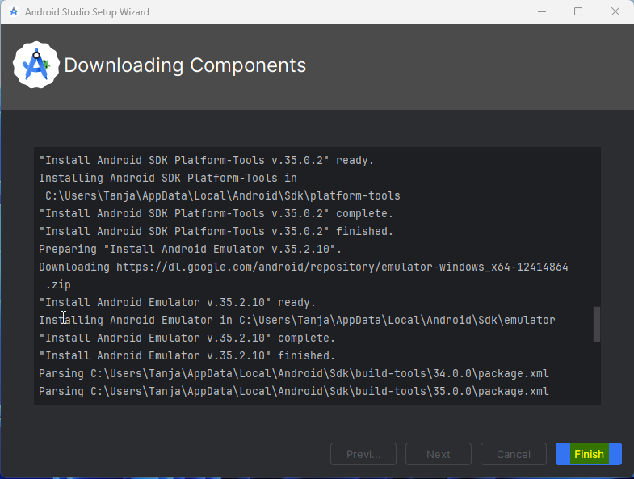
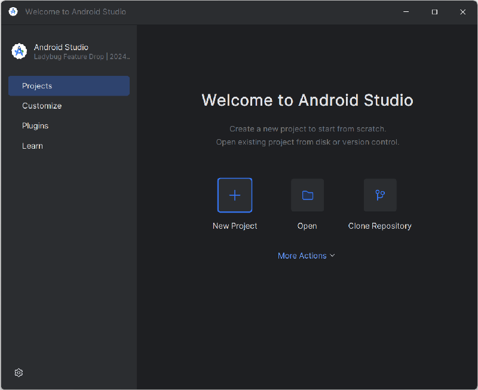
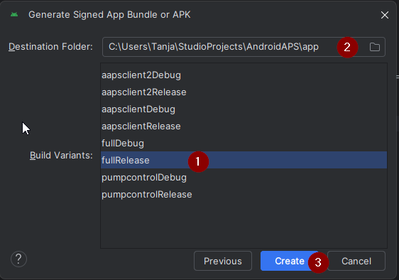
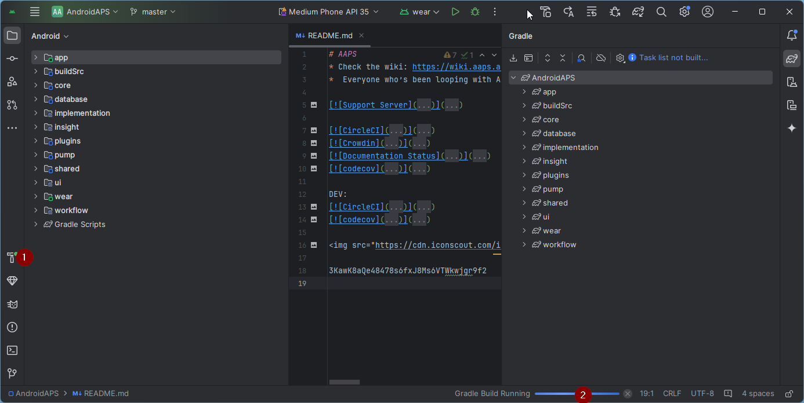

<!-- Android Studio Build, FKA Computer Build. Preserve filenames to avoid breaking URLs. -->

# Kūrimas su Android Studio

Tai tradicinis AAPS programėlės kūrimo būdas.

Programėlę galite sukurti ir be kompiuterio, naudodami būdą [Kūrimas naršyklėje](./BrowserBuild.md).

## Kurti sau, o ne parsisiųsti

**AAPS programėlės (apk failo) negalima atsisiųsti dėl medicinos prietaisų reglamentų. Sukurti programėlę savo reikmėms yra teisėta, bet jos kopijos negalima duoti kitiems!**

Daugiau informacijos rasite [DUK puslapyje](../UsefulLinks/FAQ.md).

---

(Building-APK-recommended-specification-of-computer-for-building-apk-file)=
## Kompiuterio ir programinės įrangos reikalavimai AAPS kūrimui

* Norint sukurti apk, gali reikėti konkrečios **[Android Studio](https://developer.android.com/studio/)** versijos. Žr. lentelę žemiau:

| AAPS Version            | Rekomenduojama<br/>Android Studio<br/>versija | Alternatyvi<br/>Android Studio<br/>versija | Gradle | JVM |
| ----------------------- | --------------------------------------------------------- | ------------------------------------------------------ | ------ |:--- |
| 2.6.2                   | 3.6.1                                                     |                                                        | 5.6.4  | 11  |
| 2.8.2.1                 | 4.1.1                                                     |                                                        | 6.1.1  | 13  |
| [3.1.0.3](#version3100) | 2020.3.1                                                  | išbandyta iki Quail 4                                  | 7.3.3  | 17  |
| [3.2.0.4](#version3204) | Hedgehog (2023.1.1)                                       | išbandyta iki Quail 4                                  | 8.2    | 17  |
| [3.3.1.3](#version3300) | Ladybug Feature Drop (2024.2.2)                           | išbandyta iki Quail 4                                  | 8.10   | 21  |
| [3.3.2](#version3300)   | Meerkat (2024.3.1)                                        | išbandyta iki Quail 4                                  | 8.11.1 | 21  |
| [3.3.2.1](#version3321) | Narwhal (2025.1.2)                                        | išbandyta iki Quail 4                                  | 8.13   | 21  |
| [3.4.2.6](#version3426) | Panda 2 (2025.3.2)                                        | išbandyta iki Quail 4                                  | 9      | 21  |
| [4.0.0](#version400)    | Rabbit 2 (2026.2.2)                                       | Latest                                                 | 9.8    | 21  |

„Rekomenduojamoje versijoje“ jau yra tinkama JVM versija. Rekomenduojama versija kartu yra ir mažiausia versija, kurią galite naudoti **AAPS** kūrimui. Su senesne nei „rekomenduojama“ versija kurti **NEGALĖSITE**. Jei naudojate kitą versiją, gali kilti problemų dėl JVM versijos. Kaip išspręsti šias problemas, žr. puslapį [Android Studio trikčių šalinimas](#troubleshooting_androidstudio-uncommitted-changes). Jei jūsų dabartinės Android Studio versijos lentelėje nėra, pirmiausia ją atnaujinkite.

Gradle versija susieta su šaltinio kodu: atsisiųsdami arba atnaujindami šaltinio kodą, visada gausite tinkamą Gradle versiją. Ji nurodyta tik informacijai, nieko daryti nereikia.

* Android Studio nepalaiko [Windows 32 bitų sistemų](#troubleshooting_androidstudio-unable-to-start-daemon-process). Atminkite, kad **64 bitų procesorius ir 64 bitų operacinė sistema yra privalomos sąlygos.** Jei jūsų sistema šios sąlygos NETENKINA, turite pakeisti netinkamą aparatinę ar programinę įrangą arba visą sistemą.

<table class="tg">
<tbody>
  <tr>
    <th class="tg-baqh">OS (tik 64 bitų)</th>
    <td class="tg-baqh">Windows 10 or higher</td>
    <td class="tg-baqh">macOS 12 or higher</td>
    <td class="tg-baqh">Any Linux distribution that supports Gnome, KDE, or Unity DE;&nbsp;&nbsp;GNU C Library (glibc) 2.31 or later</td>
  </tr>
  <tr>
    <th class="tg-baqh"><p align="center">Procesorius (tik 64 bitų)</th>
    <td class="tg-baqh">x86_64 CPU from 2017 or newer (Intel 8th generation Core i5, AMD Ryzen, or newer) with <a href="https://developer.android.com/studio/install" target="_blank" rel="noopener noreferrer">virtualization support</a> (Intel VT-x or AMD-V) enabled in the BIOS</td>
    <td class="tg-baqh">Apple Silicon (M1 or newer), or 6th generation Intel Core or newer (support for Intel Macs is being phased out)</td>
    <td class="tg-baqh">x86_64 CPU from 2017 or newer (Intel 8th generation Core i5, AMD Ryzen, or newer) with virtualization support (Intel VT-x or AMD-V) enabled in the BIOS</td>
  </tr>
  <tr>
    <th class="tg-baqh"><p align="center">RAM</th>
    <td class="tg-baqh" colspan="3"><p align="center">16GB or more (8GB is the strict minimum for Android Studio alone, 32GB is recommended)</td>
  </tr>
  <tr>
    <th class="tg-baqh"><p align="center">Disk</th>
    <td class="tg-baqh" colspan="3"><p align="center">At least 32GB free space. SSD is recommended.</td>
  </tr>
  <tr>
    <th class="tg-baqh"><p align="center">Resolution</th>
    <td class="tg-baqh" colspan="3"><p align="center">1280 x 800 minimum (1920 x 1080 recommended)<br></td>
  </tr>
  <tr>
    <th class="tg-baqh"><p align="center">Internet</th>
    <td class="tg-baqh" colspan="3"><p align="center">Broadband</td>
  </tr>
</tbody>
</table>

**Labai rekomenduojama (bet neprivaloma) naudoti SSD (Solid State Disk), o ne HDD (Hard Disk Drive), nes AAPS apk failo kūrimas užtruks trumpiau.**  **AAPS** apk failą vis tiek galite kurti ir naudodami HDD. Tokiu atveju kūrimas gali užtrukti ilgai, bet kai jis prasidės, galėsite palikti jį veikti be priežiūros.

## Pagalba kūrimo metu

Jei kuriant **AAPS** programėlę kyla sunkumų, yra atskiras skyrius [**Android Studio trikčių šalinimas**](../GettingHelp/TroubleshootingAndroidStudio.md) – pirmiausia peržiūrėkite jį.

Jei manote, kad kūrimo instrukcijose kažkas neteisinga, trūksta ar neaišku, arba jums vis dar nesiseka, kreipkitės į kitus **AAPS** naudotojus grupėje [Facebook](https://www.facebook.com/groups/AndroidAPSUsers) arba [Discord](https://discord.gg/4fQUWHZ4Mw). Jei norite ką nors pakeisti patys (atnaujinti ekrano nuotraukas _ir pan._), pateikite [pull request (PR)](../SupportingAaps/HowToEditTheDocs.md).

## AAPS programėlės kūrimo instrukcija žingsnis po žingsnio

```{admonition} WARNING
:class: warning
Jei AAPS jau kūrėte anksčiau, visų toliau nurodytų žingsnių kartoti nereikia.
Eikite tiesiai į [atnaujinimo instrukciją](../Maintenance/UpdateToNewVersion.md)!
```

```{contents} The overall steps for building the **AAPS** apk file
:depth: 1
:local: true
```

Šioje instrukcijoje rasite **AAPS** apk failo kūrimo ekrano kopijų _pavyzdžių_. Kadangi **Android Studio** – programa, kuria kuriame **AAPS** apk, – nuolat atnaujinama, šios ekrano kopijos gali skirtis nuo jūsų įdiegtos versijos, tačiau jomis vis tiek turėtų būti galima vadovautis.

Kadangi **Android Studio** veikia Windows, Mac OS X ir Linux platformose, žingsniai skirtingose platformose taip pat gali šiek tiek skirtis.

(install-git-if-you-dont-have-it)=
### Git įdiegimas

```{admonition} Why Git? 
:class: dropdown

Git vadinama „_versijų valdymo sistema_“ (VCS).\
Git – tai programa, leidžianti sekti kodo pakeitimus ir dirbti kartu su kitais. Su Git nukopijuosite **AAPS** šaltinio kodą iš GitHub svetainės į savo kompiuterį. Tada savo kompiuteryje su Android Studio sukursite **AAPS** programėlę (apk). 
```

(BuildingAaps-steps-for-installing-git)=
#### Git diegimo žingsniai

1.  Patikrinkite, ar **Git** dar nėra įdiegta. Tai galite padaryti Windows paieškos juostoje įvedę „git“. Jei matote **„Git bash“** ar kitą Git formą, ji jau įdiegta ir galite pereiti tiesiai prie [Android Studio įdiegimo](#Building-APK-install-android-studio):


2. Jei Git neįdiegta, atsisiųskite ir įdiekite naujausią savo sistemai skirtą versiją iš skilties „Download“ [**čia**](https://git-scm.com/downloads). Turėtų tikti bet kuri nauja Git versija. Pasirinkite versiją pagal savo sistemą: Mac, Windows arba Linux.

**Pastaba Mac naudotojams:** Git svetainė taip pat nurodys įdiegti papildomą programą „homebrew“, kuri padeda diegti. Jei Git diegiate per homebrew, jokių nustatymų keisti nereikia.

(Make_a_note_of_Git_path)=

* Diegimo metu, kai bus paprašyta „select destination location“ (pasirinkti paskirties vietą), užsirašykite, _kur_ diegiama Git (tai „**diegimo kelias**“) – jį reikės patikrinti kitame žingsnyje. Jis bus panašus į „C:\Program Files\Git\cmd\git.exe“

*  Diegdami Git, per visus žingsnius tiesiog palikite numatytąsias parinktis.

*  Jei įdiegę pamiršote užsirašyti, kur įdiegta Git, galite tai rasti taip: kompiuterio paieškos juostoje įveskite „git“, dešiniuoju pelės mygtuku spustelėkite „Git bash“, pasirinkite „open file location“ (atidaryti failo vietą) ir užveskite pelę ant „Git bash“ piktogramos – bus parodyta, kur ji įdiegta.

* Prieš kitą žingsnį iš naujo paleiskite kompiuterį.

(Building-APK-install-android-studio)=
### Android Studio įdiegimas

- **Atliekant toliau nurodytus žingsnius, visą laiką turite būti prisijungę prie interneto, nes Android Studio atsisiunčia kelis atnaujinimus**

```{admonition} What is Android Studio?
:class: dropdown
Android Studio – tai programa, veikianti jūsų kompiuteryje. Ji leidžia atsisiųsti šaltinio kodą iš interneto (naudojant Git) ir sukurti telefono (ir išmaniojo laikrodžio) programėles. Kurdami naują ar atnaujintą programėlę kompiuteryje su Android Studio, negalite „sugadinti“ dabartinės, cikle veikiančios **AAPS** versijos, kurią galbūt naudojate telefone – tai visiškai atskiri procesai. 
```

Diegiant Android Studio, vienas svarbiausių dalykų – **būkite kantrūs!** Diegimo ir sąrankos metu Android Studio atsisiunčia daug dalykų, o tai užtrunka.

```{admonition} Different UI
:class: warning
Svarbi pastaba: per paskutines versijas Android Studio pakeitė savo sąsają. Šioje instrukcijoje žingsniai rodomi su *naująja sąsaja*. Ekrano kopijos padarytos su „Ladybug“, todėl naujesnės versijos gali atrodyti šiek tiek kitaip. Jei vis dar naudojate senąją sąsają, pirmiausia galite perjungti Android Studio į naująją sąsają pagal [šias instrukcijas](#computerbuild-NewUI).
```

Android Studio versija yra labai svarbi. Kaip pasirinkti tinkamą Android Studio versiją, žr. [instrukcijas aukščiau](#Building-APK-recommended-specification-of-computer-for-building-apk-file).

Atsisiųskite [dabartinę Android Studio versiją](https://developer.android.com/studio) arba senesnę versiją iš [**Archives**](https://developer.android.com/studio/archive) (archyvo) ir sutikite su atsisiuntimo sąlygomis.


Kai atsisiuntimas baigsis, paleiskite atsisiųstą programą, kad ją įdiegtumėte kompiuteryje. Gali tekti priimti arba patvirtinti kelis Windows įspėjimus apie atsisiųstas programas!

Įdiekite Android Studio spustelėdami „Next“, kaip parodyta tolesnėse ekrano kopijose. Jokių nustatymų keisti **nereikia**!


Jei norite taupyti vietą standžiajame diske, galite nuimti žymėjimą nuo Android Virtual Device: jis nenaudojamas **AAPS** kurti.


Dabar spustelėkite „Install“:


Kai diegimas baigsis, spauskite „Next“


Paskutiniame žingsnyje spustelėkite „Finish“, kad pirmą kartą paleistumėte Android Studio.


Jūsų bus paklausta, ar norite padėti tobulinti Android Studio. Pasirinkite, kaip jums patinka, – tai neturės įtakos tolesniems žingsniams.


Pirmiausia matysite Android Studio diegimo pasveikinimo ekraną. Spauskite „Next“.


Kaip diegimo tipą pasirinkite „Standard“.


Patikrinkite nustatymus ir vėl spustelėkite „Next“.


Dabar turite sutikti su licencijos sutartimis. Kairėje yra dvi skiltys (1 ir 3): pasirinkite jas vieną po kitos ir kiekvienai dešinėje pasirinkite „Accept“ (2 ir 4).

Tada galima spustelėti mygtuką „Finish“ (5).


Dabar bus atsisiųsti ir įdiegti keli Android paketai. Būkite kantrūs ir palaukite.

Kai tai baigsis, pamatysite ekraną, kuriame vėl galėsite pasirinkti „Finish“.



Dabar matysite Android Studio pasveikinimo ekraną.




(Building-APK-download-AAPS-code)=
### AAPS kodo atsisiuntimas

```{admonition} Why can it take a long time to download the AAPS code?
:class: dropdown

Pirmą kartą atsisiunčiant **AAPS**, Android Studio per internetą prisijungs prie GitHub svetainės ir atsisiųs **AAPS** šaltinio kodą. Tai turėtų užtrukti apie 1 minutę. 

Tada Android Studio naudos **Gradle** (Android programėlių kūrimo įrankį), kad nustatytų kitus komponentus, reikalingus šiems elementams sukurti jūsų kompiuteryje. 
```

Android Studio pasveikinimo ekrane patikrinkite, ar kairėje pažymėta „**Projects**“ (1).

Tada dešinėje spustelėkite „**Clone Repository**“ (2):


Dabar nurodysime Android Studio, iš kur gauti kodą:


* Kairėje turi būti pažymėta (pagal numatytuosius nustatymus) „Repository URL“ (1).
* Kaip versijų valdymo sistema turi būti pasirinkta (pagal numatytuosius nustatymus) „Git“ (2).
* Dabar nukopijuokite šį URL:
    ```
    https://github.com/nightscout/AndroidAPS.git
    ```
    ir įklijuokite jį į URL lauką (3).

* Patikrinkite, ar (numatytasis) aplankas, kuriame bus išsaugotas nukopijuotas kodas, dar neegzistuoja jūsų kompiuteryje (4). Galite jį pakeisti į kitą aplanką, bet būtinai atsiminkite, kur išsaugojote kodą!
* Dabar spustelėkite mygtuką „Clone“ (5).

```{admonition} INFORMATION
:class: note
Užsirašykite aplanką. Čia saugomas jūsų šaltinio kodas!
```

Dabar matysite ekraną, kuriame rašoma, kad saugykla klonuojama:


Tam tikru metu Android Studio užsidarys ir vėl pasileis. Jūsų gali būti paklausta, ar pasitikite projektu. Spustelėkite „Trust project“:

  


Tik Windows naudotojams: jei ugniasienė prašo leidimo, suteikite prieigą:

 

Sėkmingai klonavus saugyklą, Android Studio atidarys klonuotą projektą.

(computerbuild-NewUI)=
```{admonition} New UI
:class: note
Android Studio neseniai pakeitė savo sąsają. Naujose Android Studio versijose naujoji sąsaja įjungta pagal numatymą!

Tik jei jūsų Android Studio atrodo kitaip, gali tekti perjungti į naująją sąsają:
Spustelėkite meniu (☰) viršuje kairėje, tada pasirinkite **Settings** (Apple kompiuteriuose – **Preferences**).
Skiltyje **Appearance & Behavior** eikite į **New UI** ir pažymėkite **Enable new UI**. Tada iš naujo paleiskite Android Studio ir pradėkite ją naudoti.

Jei nerandate parinkties **New UI**, nesijaudinkite: jūs jau naudojate naująją sąsają!
```


Kai Android Studio atsidarys, kantriai palaukite (tai gali užtrukti kelias minutes) ir ypač **neatnaujinkite** projekto, kaip siūloma iškylančiame lange.

Android Studio automatiškai pradės „Gradle project sync“ (Gradle projekto sinchronizavimą), kuris užtruks kelias minutes. Galite matyti, kad jis (vis dar) vyksta:


```{admonition} NEVER UPDATE GRADLE!
:class: warning

Android Studio gali rekomenduoti atnaujinti gradle sistemą. **Niekada neatnaujinkite gradle!** Dėl to kils sunkumų.
```

Tik Windows kompiuteriuose: galite gauti pranešimą apie veikiantį Windows Defender. Spustelėkite **Automatically** ir patvirtinkite – kūrimas vyks greičiau!


Galite palikti gradle sinchronizavimą veikti ir jau atlikti tolesnius žingsnius.

(Building-APK-set-git-path-in-preferences)=
### Git kelio nustatymas Android Studio nustatymuose

Dabar nurodysime Android Studio, kur rasti Git, kurią įdiegėte [anksčiau](#install-git-if-you-dont-have-it).

* Tik Windows naudotojams: įsitikinkite, kad [įdiegę Git](#install-git-if-you-dont-have-it) iš naujo paleidote kompiuterį. Jei ne, iš naujo paleiskite kompiuterį ir vėl atidarykite Android Studio

Viršutiniame kairiajame **Android Studio** kampe atverkite meniu (☰) ir eikite į **File** > **Settings** (Windows) arba **Android Studio** > **Preferences** (Mac). Atsidarys toks langas. Spustelėkite, kad išskleistumėte sąrašą **Version Control** (1), ir pasirinkite **Git** (2)


Patikrinkite, ar **Android Studio** gali automatiškai rasti teisingą **Path to Git executable** (kelią iki Git programos), spustelėdami mygtuką „Test“ (1):


Jei automatinis nustatymas pavyko, šalia kelio bus parodyta jūsų dabartinė **Git** versija.

   


Jei **git.exe** nerandama automatiškai arba paspaudus „Test“ gaunama klaida, galite arba
* rankiniu būdu įvesti kelią, kurį užsirašėte [anksčiau](#BuildingAaps-steps-for-installing-git), arba
* spustelėti aplanko piktogramą (1) ir rankiniu būdu nueiti į aplanką, kuriame [anksčiau](#BuildingAaps-steps-for-installing-git) buvo įdiegta **git.exe**
* Patikrinkite nustatymus mygtuku **Test**!

  

(Building-APK-generate-signed-apk)=
### „Pasirašyto“ AAPS APK kūrimas

```{admonition} Why does the AAPS app need to be "signed"?
:class: dropdown

Android reikalauja, kad kiekviena programėlė būtų _pasirašyta_. Taip užtikrinama, kad vėliau ją būtų galima atnaujinti tik iš to paties patikimo šaltinio, kuris išleido pradinę programėlę. Daugiau informacijos šia tema rasite [šioje nuorodoje](https://developer.android.com/studio/publish/app-signing.html#generate-key). 

Mums tai tiesiog reiškia, kad sugeneruojame pasirašymo arba „raktų saugyklos“ (keystore) failą ir naudojame jį kurdami **AAPS** programėlę.
```


**Svarbu: prieš tęsdami įsitikinkite, kad Gradle sinchronizavimas sėkmingai baigtas!**


Spustelėkite meniu piktogramą (☰) viršuje kairėje, kad atidarytumėte meniu juostą. Pasirinkite **Build** (1), tada pasirinkite **Generate Signed App Bundle / APK** (2)


Pasirinkite „APK“ (1) vietoj „Android App Bundle“ ir spustelėkite „Next“ (2):


Kitame ekrane įsitikinkite, kad „Module“ nustatyta į „AndroidAPS.app“ (1). Dalis prieš „.app“ yra aplanko, į kurį nukopijavote kodą, pavadinimas.

(Building-APK-wearapk)=
```{admonition} INFORMATION!
:class: note
Jei norite sukurti apk savo laikrodžiui, dabar turite pasirinkti AndroidAPS.wear!
```


Spustelėkite „Create new...“ (2), kad pradėtumėte kurti raktų saugyklą.

```{admonition} INFORMATION!
:class: note
Raktų saugyklą reikės sukurti tik vieną kartą.
Jei AAPS jau kūrėte anksčiau, NEKURKITE naujos raktų saugyklos, o pasirinkite esamą ir įveskite jos slaptažodžius!
```

**_Pastaba:_** raktų saugykla – tai failas, kuriame saugoma programėlės pasirašymo informacija. Ji užšifruota, o informacija apsaugota slaptažodžiais.


* Spustelėkite „aplanko“ piktogramą (1) ir pasirinkite vietą kompiuteryje savo raktų saugyklai.

  **Nenaudokite** aplanko, kuriame saugote šaltinio kodą, o pasirinkite aplanką, kurį taip pat perkeltumėte į naują kompiuterį.

```{admonition} WARNING!
:class: warning
Būtinai užsirašykite, kur saugoma jūsų raktų saugykla. Jos prireiks, kai kursite kitą AAPS atnaujinimą!
```

* Dabar pasirinkite paprastą slaptažodį (ir jį užsirašykite), įveskite jį slaptažodžio lauke (2) ir patvirtinkite (2).

  Raktų saugyklos ir rakto slaptažodžiai neturi būti sudėtingi. Jei ateityje pamiršite slaptažodį, žr. [AAPS įdiegimas iš naujo su nauja raktų saugykla](#reinstall-aaps).

```{warning}
**Slaptažodžiuose venkite specialiųjų simbolių.** Raktų saugyklos ir rakto slaptažodžiams naudokite tik raides ir skaitmenis. Ypač nenaudokite `$`, atvirkštinės kabutės (backtick), `"` ar `\`. Jei vėliau pereisite prie [kūrimo naršyklėje](#aaps-ci-option2) ir vėl naudosite šią raktų saugyklą, dėl šių simbolių pasirašymo žingsnis gali nepavykti, žr. [Kūrimas naršyklėje: trikčių šalinimas](#aaps-ci-password-special-characters).
```

* Numatytasis jūsų rakto alias (3) yra „key0“ – jo nekeiskite.

* Dabar jūsų raktui reikia slaptažodžio. Paprastumo dėlei, jei norite, galite naudoti tą patį slaptažodį, kurį aukščiau naudojote raktų saugyklai. Įveskite slaptažodį (4) ir jį patvirtinkite.

```{admonition} WARNING!
:class: warning
Užsirašykite šiuos slaptažodžius! Jų prireiks, kai kursite kitą AAPS atnaujinimą!
```

* Pagal numatytuosius nustatymus galiojimas yra 25 metai – palikite taip, kaip yra.

* Įveskite savo vardą ir pavardę (5). Kitos informacijos pridėti nereikia, bet galite, jei norite (6–7).

* Norėdami tęsti, spustelėkite „OK“ (8):


Puslapyje **Generate signed App Bundle or APK** dabar bus rodomas kelias iki jūsų raktų saugyklos. Dabar vėl įveskite raktų saugyklos slaptažodį (1) ir rakto slaptažodį (2) ir pažymėkite langelį (3), kad slaptažodžiai būtų įsiminti. Tada kitą kartą kurdami apk (pvz., atnaujindami į naują AAPS versiją) nebeturėsite jų įvesti. Click "Next" (4):


Kitame ekrane pasirinkite kūrimo variantą „fullRelease“ (1) ir spustelėkite „Create“ (3). Įsiminkite paskirties aplanką, rodomą (2), nes vėliau ten rasite sukurtą apk failą!

   

Dabar Android Studio sukurs **AAPS** apk. Apačioje dešinėje bus rodoma „Gradle Build running“ (2). Procesas užtrunka, priklausomai nuo jūsų kompiuterio ir interneto ryšio, todėl **būkite kantrūs!** Jei norite stebėti kūrimo eigą, spustelėkite mažą plaktuką „build“ (1) Android Studio apačioje:



Dabar galite stebėti kūrimo eigą:


Baigus kūrimą, Android Studio parodys pranešimą „BUILD SUCCESSFUL“. Gali pasirodyti iššokantis pranešimas, kurį spustelėję galėsite pasirinkti „locate“. Jei to nepastebėjote, spustelėkite pranešimų piktogramą (1), kad atvertumėte pranešimus, tada spustelėkite **locate** (2):


**_Jei kūrimas nepavyko, žr. skyrių [Android Studio trikčių šalinimas](../GettingHelp/TroubleshootingAndroidStudio.md)._**

Pranešimų lange spustelėkite mėlyną nuorodą „locate“:

 Atsidarys failų tvarkyklė ir parodys ką tik sukurtą apk failą.

   

Sveikiname! Sukūrę **AAPS** apk failą, kitoje dokumentacijos dalyje perkelsite jį į savo telefoną.

```{tip}
Jei manote, kad ateityje galbūt norėsite naudoti Android Wear išmanųjį laikrodį, dabar geriausias laikas sukurti AAPS Wear apk, kad jis tikrai būtų suderintas su jūsų AAPS apk.
```

Pereikite prie kito etapo: [**AAPS** perkėlimas ir įdiegimas](../SettingUpAaps/TransferringAndInstallingAaps.md).


