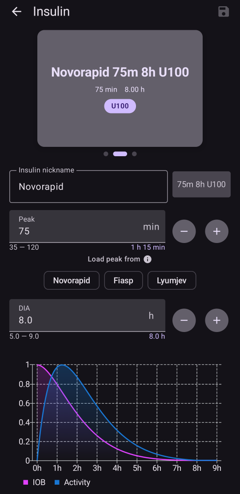
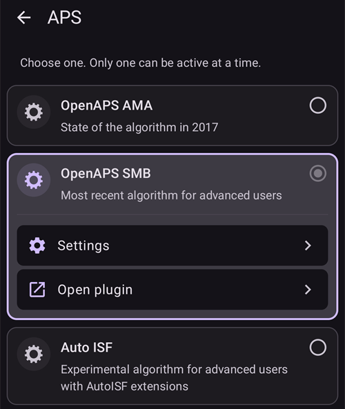

# Konfigūracija (Config Builder)

```{admonition} Pereinate nuo AAPS v3? :class: note **Config Builder** dabar vadinamas **Konfigūracija** ir yra **meniu** (☰). Žr. [Kas pasikeitė AAPS v4](#v4-changes).

    <br />**Konfigūracija** – tai vieta, kur pasirenkate, kurie įskiepiai yra aktyvūs (NGJ, pompa, DKS algoritmas, jautrumas, sinchronizacija, …), ir atidarote kiekvieną įskiepį bei jo nustatymus. [Apžvalga žingsnis po žingsnio](#configuration-v4) pateikta žemiau; likusioje puslapio dalyje išsamiai aprašyta kiekviena skiltis.
    
    (configuration-v4)=
    ## Konfigūracija AAPS v4
    
    **AAPS** v4 pagrindinio ekrano **viršutiniame kairiajame** kampe palieskite **meniu** (☰) ir pasirinkite **Konfigūracija** (*„Nustatykite konfigūraciją (CGM, pompą, ...) ir įjunkite funkcijas“*).
    
    
    
    Įskiepiai sugrupuoti pagal **kategorijas**, pavyzdžiui, *Glodinimas*, *Kalibravimas*, *Jautrumo nustatymas*, *DKS*, *Ryšys* ir *Bendrieji*. Kiekvienoje eilutėje rodomas kategorijos pavadinimas ir **šiuo metu aktyvus** įskiepis (pvz., *DKS → OpenAPS SMB*). Palieskite eilutę, kad atidarytumėte kategoriją.
    
    
    
    Kategorijoje matote jai skirtus įskiepius. Kategorijose, kuriose galima pasirinkti tik vieną įskiepį, pasirenkate aktyvųjį; kai kuriose kategorijose galima pasirinkti kelis (*„Pasirinkite visus tinkamus.“*). Kiekvienas įskiepis turi du veiksmus:
    
    - **Atidaryti įskiepį** – atidaro paties įskiepio ekraną.
    - **Parametrai** – atidaro įskiepio nustatymus (nustatymai gali būti sugrupuoti į išskleidžiamas skiltis).
    
    
    
    (configuration_sync_icon)=
    ### Telefono piktograma – „sinchronizuojama iš pagrindinio įrenginio“
    
    Maža **telefono piktograma** šalia kategorijos ar nustatymo reiškia, kad šis elementas **sinchronizuojamas iš pagrindinio įrenginio** – jo reikšmė ar pasirinkimas į šį įrenginį perduodami NSClientV3 (Nightscout) kanalu.
    
    **Kliente** (**AAPSClient**) šie elementai **sinchronizuojami su pagrindiniu įrenginiu**. Piktograma rodoma tik kliente, todėl jos nematyti aukščiau esančioje ekrano kopijoje, kuri padaryta pagrindinėje **AAPS** programėlėje. Kliente ji paprastai rodoma prie *Glodinimas*, *Kalibravimas*, *Jautrumo nustatymas* ir *DKS*. Kaip tiksliai pagrindinis įrenginys ir klientai lieka suderinti ir kuriuos nustatymus galite keisti iš kurios pusės, aprašyta skyriuje [Pagrindinio įrenginio ↔ kliento valdymas](#client-master-config-prefs).
    
    Ta pati piktograma rodoma ir **nustatymuose**, šalia atskirų sinchronizuojamų nustatymų. Žemiau esančiame pavyzdyje piktograma yra prie *Įsisavinimo ribinis laikas*; nustatymai be piktogramos nustatomi kiekviename įrenginyje atskirai:
    
    
    
    Elementai **be** piktogramos nustatomi **kiekviename įrenginyje atskirai**. Svarbiausias pavyzdys – pats **NSClientV3 (Ryšys)** ryšys: **Nightscout URL**, **prieigos raktas** ir **websockets** nustatomi kiekviename telefone atskirai, todėl prie jų telefono piktograma **nerodoma**.
    
    ---
    
    (Config-Builder-tab-or-hamburger-menu)=
    ## Įskiepio ekrano atidarymas
    
    Kiekvieną įskiepio ekraną galima atidaryti vienu iš šių būdų (**AAPS** v3 skirtukų ir akies žymimojo laukelio nebėra, žr. [Kas pasikeitė AAPS v4](#v4-changes)):
    
    - **Konfigūracija** → įskiepio kategorija → **Atidaryti įskiepį**,
    - apatinės navigacijos meniu **Valdymas** – dažniausiai naudojamiems ekranams (Profilis, Insulino nustatymai, Pompa, Automatizacija, Maistas...),
    - [QuickLaunch](../DailyLifeWithAaps/QuickLaunch.md) mygtukas, kurį pridedate patys,
    - **paieškos juosta** pagrindiniame ekrane.
    
    ```{contents}
    :backlinks: entry
    :depth: 2
    

(ConfigBuilder_Profile)=

## Profile

Šio modulio išjungti negalima, nes jis yra pagrindinė **AAPS** dalis.

Kad suprastumėte, kas sudaro jūsų **profilį**, žr. [Jūsų AAPS profilis](../SettingUpAaps/YourAapsProfile.md).

(insulin)= (Config-Builder-insulin)=

## Insulinas


**AAPS** 4 versijoje insulinas nebėra įskiepis, pasirenkamas **Konfigūracijoje**. Atidarykite **Valdymas → Insulino nustatymai** ir nustatykite naudojamą insuliną.

Insulino redaktoriuje galite:

* suteikti insulinui **Insulino pavadinimas**, kad jį būtų lengva atpažinti,
* nustatyti **Pikas** (laikas iki didžiausio insulino aktyvumo, minutėmis) ir **IVT** (insulino veikimo trukmė, valandomis) – įvesdami reikšmę arba mygtukais **–** / **+**,
* paliesti **Įkelti piko reikšmę iš** ruošinio mygtuką – **Novorapid** (75 min.), **Fiasp** (55 min.) arba **Lyumjev** (45 min.) – ir vienu veiksmu įrašyti standartinį to insulino piko laiką.

Leidžiamos ribos yra tos pačios, kad ir kokį insuliną naudotumėte:

* **IVT**: nuo 5 iki 9 valandų (nuo 5 iki 10 valandų, jei naudotojo tipas nustatytas kaip **Nėščioji**). Kaip pasirinkti reikšmę, žr. [Insulino veikimo trukmė (IVT) ir pikas](#Config-Builder-insulin-dia).
* **Pikas**: nuo 35 iki 120 minučių.

Redaktoriaus apačioje rodomos **AIO** (aktyvus insulinas organizme) ir **Insulino aktyvumas** kreivės keičiasi kartu su reikšmėmis, todėl iš karto matote, kaip jūsų nustatymai keičia insulino veikimą.

Daugiau informacijos apie tai, kaip **AAPS** rodomas insulino profilis, rasite [čia](#AapsScreens-insulin-profile).

(Config-Builder-insulin-change-active)=

### Naudojamo insulino keitimas (IVT arba pikas)

Insulinas, pažymėtas **AKTYVUS**, yra tas, kurį naudoja jūsų veikiantis profilis. Jo laukai yra pilki: jo redaguoti ar ištrinti negalima. Taip veikiančiame profilyje rodomas insulino pavadinimas visada atitinka tikrai naudojamus nustatymus.

Kaip pakeisti naudojamą IVT arba piką:

1. Atidarykite **Valdymas → Insulino nustatymai**. Jei ekranas atsidaro tik peržiūrai (viršutinėje juostoje matyti **✏️ pieštukas**), palieskite pieštuką ir atrakinkite nustatymus.
2. Palieskite **+** (*Pridėti naują insuliną*). **AAPS** sukuria ekrane rodomo insulino kopiją.
3. Nustatykite naują **Pikas** ir (arba) **IVT** reikšmę, tada palieskite išsaugojimo piktogramą (viršuje dešinėje).
4. Palieskite **▶** (*Aktyvuoti insuliną*) ir patvirtinkite. Naujas insulinas tampa **AKTYVUS**.

```{admonition} Pavadinime nurodomas pikas ir IVT :class: note **AAPS** prie insulino pavadinimo automatiškai prideda piką, IVT ir koncentraciją (pavyzdžiui, *Fiasp 55m 8h U100*), todėl savo konfigūracijas atskirsite iš pirmo žvilgsnio.

    <br />Seną insuliną galite ištrinti, kai jis nebėra aktyvus.
    
    ### „Įkelti piko reikšmę iš“ ruošiniai
    
    **AAPS** 4 nebėra insulino tipų sąrašo, iš kurio būtų galima rinktis. Visiems insulinams naudojama ta pati eksponentinė aktyvumo kreivė; skiriasi tik jų **Pikas** ir **IVT**. Insulino redaktoriuje **Įkelti piko reikšmę iš** ruošiniai vienu palietimu įrašo rekomenduojamą dažniausiai naudojamų insulinų piką (maža ⓘ piktograma šalia **Įkelti piko reikšmę iš** parodo jų sąrašą su piko reikšmėmis). Vėliau **Pikas** ir **IVT** vis tiek galite pakoreguoti.
    
    Piką keiskite nuo rekomenduojamos reikšmės tik tada, jei suprantate, kokį poveikį tai turės. Kreives suprasti padeda [insulino kreivės grafikas](#AapsScreens-insulin-profile).
    
    #### Novorapid
    
    
    
    * rekomenduojama Humalog, Novolog ir Novorapid (**AAPS** v3 vadinosi *Rapid-Acting Oref*)
    * Pikas = 75 minutės po injekcijos
    
    #### Fiasp
    
    
    
    * rekomenduojama Fiasp (**AAPS** v3 vadinosi *Ultra-Rapid Oref*)
    * Pikas = 55 minutės po injekcijos
    
    (Config-Builder-lyumjev)=
    #### Lyumjev
    
    
    
    * rekomenduojama Lyumjev
    * Pikas = 45 minutės po injekcijos
    
    #### Pasirinktinis pikas
    
    * **AAPS** 4 nebėra atskiro insulino tipo „Free-Peak Oref“: bet kokį **Pikas** (nuo 35 iki 120 minučių) įveskite tiesiai [insulino redaktoriuje](#Config-Builder-insulin), nenaudodami ruošinio.
    * Pasirinktinis pikas naudingas, jei naudojate insuliną, kurio nėra sąraše, arba skirtingų insulinų mišinį.
    
    (Config-Builder-insulin-dia)=
    ### Insulino veikimo trukmė (IVT) ir pikas
    
    ```{warning}
    Veikiant ciklui, sumažinus IVT arba piką, suleidžiamo insulino kiekis visada padidėja. AAPS IVT veikia kitaip nei komercinėse AID sistemose, todėl neapgalvoti šių nustatymų pakeitimai gali pakeisti insulino dozavimą daug labiau arba daug mažiau, nei tikitės.
    

AAPS insulino veikimo eigą modeliuoja matematine formule, kuri nustatoma **IVT** ir su juo glaudžiai susijusiu **piko** nustatymu. IVT yra teorinė trukmė, per kurią AIO sumažėja iki nulio, o pikas yra laiko momentas, kai insulino poveikis stipriausias. Taip gaunama AIO kreivė ir aktyvumo kreivė, kuri yra tiesiog AIO mažėjimo **greitis**.

Atminkite, kad kai AAPS veikia ciklu, įprasta turėti [nulinės laikinos bazės](#Open-APS-features-super-micro-bolus-smb) laikotarpių. Šis trūkstamas bazinis insulinas visas atimamas iš AIO, todėl praktikoje AIO nukrenta iki nulio daug valandų anksčiau nei nustatyta IVT. [Boluso AIO ir bazės AIO](#aaps-screens-iob-cob-basal-sens) atskirai galite peržiūrėti pagrindiniame ekrane.

Norėdami nustatyti IVT ir piką, pagrindiniame ekrane palieskite **Valdymas**, tada palieskite **Insulino nustatymai**. AAPS aktyvią insulino konfigūraciją rodo taip:


Šiame pavyzdyje piko nustatymas yra 55 minutės, IVT yra 8 valandos, o [insulino koncentracija](#Insulin-Concentration) yra standartinė 100 V/ml.

Dėl aukščiau paaiškinto nulinės laikinos bazės poveikio ir AAPS naudojamos AIO mažėjimo formulės dauguma naudotojų nustato aiškiai ilgesnę IVT nei komercinėse sistemose. Apskritai daugeliui žmonių gerai tinka 9 val. **IVT**. Kai įgysite daugiau patirties su AAPS ir turėsite gerai suderintą profilį, galite pabandyti rasti individualius IVT ir piko nustatymus, remdamiesi toliau pateikta informacija.

````{admonition} Išsamiau apie IVT ir piko nustatymų poveikį :class: dropdown

Kadangi AAPS valandinė bazė netiesiogiai veikia AIO mažėjimą, per didelė valandinė bazė gali paslėpti per ilgą IVT, ir atvirkščiai. Prasminga pirmiausia kruopščiai suderinti valandinę bazę, o tik tada koreguoti IVT ir piką. Be to, atminkite, kad IVT ir piko nustatymai veikia vienas kitą: IVT poveikis priklauso nuo piko, ir atvirkščiai.

Šie grafikai tiksliai rodo IVT ir piko poveikį AIO kreivėms visame leidžiamų reikšmių intervale.

IVT keitimas:

```{image} ../images/iob_remaining_static_peak.png :width: 400px

    <br />Piko keitimas:
    
    ```{image} ../images/iob_remaining_static_dia.png
    :width: 400px
    

Galiausiai palyginimas, kai IVT ir pikas keičiami kartu. Logika tokia: abi reikšmės keičiamos tuo pačiu santykiniu dydžiu, todėl `49/35 ~ 7/5`. Arba panašiai, `120/93 ~ 9/7`. Intervalai bus tokie patys, nepriklausomai nuo pradinės IVT ar piko reikšmės, jei tik santykinis pokytis abiem yra vienodas.

```{image} ../images/iob_remaining_uniform.png :width: 400px

    <br />Atminkite, kad taip keičiant IVT ir piką, kiekvienas kreivės taškas pasislenka tuo pačiu santykiniu dydžiu.
    
    ````
    
    #### Daugiau skaitymo apie IVT ir piko nustatymą
    
    * [Techninės detalės ir istorinis kontekstas iš AAPS pirmtako OpenAPS](https://openaps.readthedocs.io/en/latest/docs/While%20You%20Wait%20For%20Gear/understanding-insulin-on-board-calculations.html#understanding-the-new-iob-curves-based-on-exponential-activity-curves) (anglų k.).
    * [Why we are regularly wrong in the duration of insulin action (DIA) times we use, and why it matters…](https://www.diabettech.com/insulin/why-we-are-regularly-wrong-in-the-duration-of-insulin-action-dia-times-we-use-and-why-it-matters/) (kodėl dažnai klystame nustatydami IVT ir kodėl tai svarbu) svetainėje Diabettech.
    * [Exponential Insulin Curves + Fiasp](https://web.archive.org/web/20220630154425/http://seemycgm.com/2017/10/21/exponential-insulin-curves-fiasp/) (eksponentinės insulino kreivės ir Fiasp) svetainėje See My CGM (archyvas).
    * [Revised Humalog model in a closed loop](https://bionicwookiee.com/2022/04/13/revised-humalog-model-in-a-closed-loop/) (patikslintas Humalog modelis uždarame cikle) ir kiti straipsniai svetainėje Bionic Wookie, kuriuose Lyumjev, Fiasp, NovoRapid, Humalog rekomenduojama 9 val. IVT.
    
    (Config-Builder-bg-source)=
    ## Glikemijos šaltinis
    Pasirinkite naudojamą gliukozės duomenų šaltinį. Daugiau informacijos apie sąranką rasite puslapyje [Glikemijos šaltinis](../Getting-Started/CompatiblesCgms.md).
    
    
    
    Slinkite žemyn, kad pamatytumėte kitus šaltinius:
    
    
    
    
    
    * [xDrip+](../CompatibleCgms/xDrip.md) – taip pat suderinamoms programėlėms, pvz., [Juggluco](../CompatibleCgms/Juggluco.md)
    * [NSClient glikemija](../CompatibleCgms/CgmNightscoutUpload.md) – tik jei žinote, ką darote, žr. [Glikemijos šaltinis](../Getting-Started/CompatiblesCgms.md).
    * [MM640g](../CompatibleCgms/MM640g.md)
    * Glimp – palaikoma tik 4.15.57 ir naujesnė versija
    * [BYODA (Build Your Own Dexcom App)](#DexcomG6-if-using-g6-with-build-your-own-dexcom-app).
    * MicroTech CGM App – Aidex / LinX NGJ
    * [Poctech](../CompatibleCgms/PocTech.md)
    * Tomato (MiaoMiao) – Tomato programėlė MiaoMiao įrenginiui
    * [Glunovo](https://infinovo.com/) – Glunovo programėlė Glunovo NGJ sistemai
    * Intelligo – Intelligo programėlė
    * Syai/Ottai – Syai ir Ottai programėlėms (žr. [Syai Tag](../CompatibleCgms/SyaiTagX1.md) ir [Ottai](../CompatibleCgms/OttaiM8.md))
    * SI App – pataisyta SI App arba Sibionics App programėlė Sibionics NGJ
    * Sino App – pataisyta programėlė Sinocare NGJ
    * Pranešimų skaitytuvas – nuskaito gliukozės reikšmes iš oficialių NGJ programėlių pranešimų (Dexcom, Medtronic, Eversense ir kt.)
    * Instara – Instara programėlė
    * Atsitiktinė glikemija – testavimui generuoja atsitiktinius KG duomenis. Ją galima įjungti tik inžinerinio režimo (kūrėjo) versijoje su **Virtuali pompa**, todėl įprastoje **AAPS** versijoje jos naudoti negalima.
    
    ## Glodinimas
    
    
    
    Žr. [Gliukozės duomenų glodinimas](../CompatibleCgms/SmoothingBloodGlucoseData.md).
    
    ## Kalibravimas
    
    Pasirinkite, kaip **AAPS** apdoroja iš jutiklio gaunamas reikšmes:
    
    - **Be kalibravimo**: jutiklio reikšmės naudojamos tokios, kokios yra. Rinkitės šį nustatymą, jei jutiklis yra gamykliškai sukalibruotas ir rodo tiksliai. Tai numatytasis nustatymas.
    - **Tiesinis kalibravimas**: **AAPS** pataiso jutiklio reikšmes pagal nuolydį ir poslinkį, kuriuos apskaičiuoja iš jūsų matavimų iš piršto.
    
    Kaip naudoti **Tiesinis kalibravimas**:
    
    1. Kategorijoje **Kalibravimas** pasirinkite **Tiesinis kalibravimas**.
    2. Įvedę naują jutiklį, įrašykite jutiklio pakeitimą: kalibravimo ekrane naudokite **Įrašyti jutiklio pakeitimą** arba skiltyje „Terapija“ įveskite NGJ jutiklio įvedimą. Taip **AAPS** sužino, kada prasidėjo jutiklio sesija. Jei **AAPS** pastebi ilgesnę nei 30 minučių pertrauką tarp reikšmių, jis gali paprašyti pažymėti jutiklio pakeitimą; šis prašymas rodomas tik pagrindiniame įrenginyje, ne kliente.
    3. Atidarykite įskiepį ir bakstelėkite **Kalibruoti**. Įveskite matavimo iš piršto reikšmę. **AAPS** susieja ją su jutiklio reikšme iš paskutinių 10 minučių.
    
    Kalibravimas priimamas tik tada, kai:
    
    - įrašytas jutiklio pakeitimas ir nuo jo praėjo bent **2 valandos** (įšilimas),
    - jūsų gliukozė stabili. Jei ji keičiasi per greitai, langas apie tai praneša ir parodo ribą,
    - yra NGJ reikšmė iš paskutinių 10 minučių,
    - kalibravimas yra dabartiniam momentui. Senesnių matavimų iš piršto įvesti negalima.
    
    Kaip veikia korekcija:
    
    - **AAPS** nubrėžia tiesę per dabartinio jutiklio poras: `corrected value = slope × sensor value + offset`.
    - Naujesnės poros turi didesnį svorį nei senesnės: 2 dienų senumo poros svoris yra apie 37 %, 4 dienų senumo – apie 14 %. Todėl tiesė seka jūsų jutiklį, kai jo reikšmės pamažu nukrypsta.
    - Reikia bent **2 porų**.
    - Jei poros yra arti viena kitos (skirtumas mažesnis nei 54 mg/dL / 3 mmol/l), reikšmės tik paslenkamos (poslinkis, be nuolydžio).
    - Nuolydis laikomas tarp 0,55 ir 1,6. Už šio intervalo esantis nuolydis apribojamas iki artimiausios reikšmės.
    - Saugumo riba: jei korekcija ties 100 mg/dL (5,5 mmol/l) būtų didesnė nei ±30 mg/dL (1,7 mmol/l), korekcija netaikoma. Tai apsaugo jus nuo klaidingo įrašo.
    
    Ką tai keičia:
    
    - Pakoreguota reikšmė naudojama visur: KG pagrindiniame ekrane, grafike ir cikle. Pačios jutiklio reikšmės nekeičiamos. Korekcija pritaikoma papildomai, taip pat ir ankstesnėms dabartinio jutiklio reikšmėms.
    - Naujas jutiklio pakeitimas pradeda nuo nulio. Ankstesnių jutiklių poros nebeskaičiuojamos.
    - Grafike kalibravimas rodomas kaip žymeklis ties matavimo iš piršto reikšme.
    - Kalibravimai sinchronizuojami per Nightscout, todėl jūsų klientai rodo tas pačias pakoreguotas reikšmes.
    
    Įrašų tikrinimas ir šalinimas:
    
    - **Atidaryti įskiepį** rodo būseną (pavyzdžiui, *Nuolydis 0,85, vidurinio diapazono korekcija -0,4*), jūsų porų grafiką su tiese ir įrašų sąrašą.
    - Jei įrašas klaidingas (pavyzdžiui, ant piršto buvo cukraus), bakstelėkite šiukšliadėžės piktogramą šalia jo. Tiesė iš karto apskaičiuojama iš naujo.
    
    ```{admonition} Naudojate xDrip+ kaip KG šaltinį?
    :class: note
    xDrip+ turi savo kalibravimą. Kalibruokite tik vienoje vietoje, kad jutiklio reikšmės nebūtų koreguojamos du kartus.
    

    {admonition} Kalibruokite atsargiai
    :class: warning
    Klaidinga matavimo iš piršto reikšmė lemia klaidingas gliukozės reikšmes, o kartu ir klaidingą insulino dozavimą. Prieš matuodami nusiplaukite rankas ir nekalibruokite, kai gliukozė greitai kinta.


(Config-Builder-pump)=

## Pump

Select the pump you are using. Daugiau informacijos apie sąranką rasite puslapyje [Suderinamos pompos](../Getting-Started/CompatiblePumps.md).


Slinkite žemyn, kad pamatytumėte visas pompų tvarkykles:


Kai pasirenkate kitą pompą, **AAPS** paprašo patvirtinti pakeitimą:


* [Dana R](../CompatiblePumps/DanaR-Insulin-Pump.md)
* Dana R Korean (for domestic DanaR pump)
* Dana Rv2 (DanaR pump with unofficial firmware upgrade)
* [Dana-i/RS](../CompatiblePumps/DanaRS-Insulin-Pump.md)
* [Accu Chek Insight](../CompatiblePumps/Accu-Chek-Insight-Pump.md)
* [Accu-Chek Combo](../CompatiblePumps/Accu-Chek-Combo-Pump-v2.md)
* Omnipod – [Omnipod Eros](../CompatiblePumps/OmnipodEros.md) pompai
* Dash – [Omnipod DASH](../CompatiblePumps/OmnipodDASH.md) pompai
* [Medtronic](../CompatiblePumps/MedtronicPump.md)
* [Diaconn G8](../CompatiblePumps/DiaconnG8.md)
* [EOPatch2](../CompatiblePumps/EOPatch2.md)
* [Medtrum](../CompatiblePumps/MedtrumNano.md)
* [Equil 5.3](../CompatiblePumps/Equil5.3.md)
* [Carelevo](../CompatiblePumps/CareLevo.md)
* Virtuali pompa: atviras ciklas – tik **AAPS** rekomendacijos 
  * kai žengiate pirmuosius žingsnius su **AAPS**, per pirmuosius [mokymo etapus](../SettingUpAaps/CompletingTheObjectives.md)
  * pompai, kuri dar neturi tvarkyklės

(config-builder-wrong-pump-data)=

### Pranešimas: „Duomenys gaunami iš kitos pompos“

**AAPS** įsimena pompą, prie kurios yra prisijungusi (pompos tipą ir serijos numerį). Jei gauna duomenis iš kitos pompos, pavyzdžiui, kai jūsų pompa buvo pakeista nauja to paties modelio pompa, rodo šį pranešimą ir tos pompos duomenų nepaiso:


Norėdami naudoti naują pompą, pakeiskite pompos tvarkyklę: pasirinkite **Virtuali pompa**, patvirtinkite, tada vėl pasirinkite savo pompą. Tada **AAPS** užregistruoja pompą, prie kurios dabar prisijungusi.

(Config-Builder-sensitivity-detection)=

## Jautrumo nustatymas


Select the type of sensitivity detection. Daugiau apie skirtingus algoritmus [skaitykite čia](../DailyLifeWithAaps/SensitivityDetectionAndCob.md). Jis nuolat analizuoja duomenų istoriją ir atlieka korekcijas, jei atpažįsta, kad į insuliną reaguojate jautriau (arba, atvirkščiai, rezistentiškiau) nei įprastai. Daugiau informacijos apie tai, kaip apskaičiuojamas pats jautrumo santykis, rasite skyriuje [Pagrindinės AAPS funkcijos > Autosens](#Open-APS-features-autosens).

Savo jautrumą galite matyti pagrindiniame ekrane [papildomame grafike](#AapsScreens-section-g-additional-graphs): pasirinkite SENS% ir stebėkite baltą liniją. Atminkite: kad jautrumo nustatymas / [Autosens](#Open-APS-features-autosens) galėtų automatiškai koreguoti suleidžiamo insulino kiekį, turite būti pasiekę [8 mokymo etapą](#objectives-objective8). Kol nepasiekėte šio mokymo etapo, Autosens procentas / linija grafike rodomi tik informacijai.

### Angliavandenių įsisavinimo parametrai

Jei naudojate Oref1 su **SMB**, turite pakeisti **min_5m_carbimpact** į 8. Ši reikšmė naudojama tik tada, kai trūksta **NGJ** rodmenų, arba kai fizinis aktyvumas „sunaudoja“ visą gliukozės kilimą, pagal kurį **AAPS** kitu atveju mažintų AAO. Kai [angliavandenių įsisavinimo](../DailyLifeWithAaps/CobCalculation.md) negalima dinamiškai apskaičiuoti pagal jūsų gliukozės pokyčius, angliavandeniams taikomas numatytasis įsisavinimo greitis. Basically, it is a failsafe.

(Config-Builder-aps)=

## APS



Select the desired APS algorithm for therapy adjustments. Pasirinkto algoritmo veikimo detales galite peržiūrėti mygtuku **Atidaryti įskiepį**.

* OpenAPS AMA 
  * Advanced Meal Assist (pažangi pagalba valgant): senesnis algoritmas, kurio neberekomenduojama naudoti.
  * Paprastai tariant, jo nauda tokia: susileidus boluso valgiui, sistema gali greičiau nustatyti didesnę laikiną bazę, JEI patikimai įvedate angliavandenius.
* [OpenAPS SMB](#Open-APS-features-super-micro-bolus-smb) 
  * Super Micro Bolus (supermikrobolusas): naujausias algoritmas, rekomenduojamas visiems naudotojams.
  * Skirtingai nei AMA, SMB gliukozės kiekį valdo ne laikinomis valandinėmis bazėmis, o daugiausia mažais **supermikrobolusais**.
  * Pastaba: šį algoritmą rekomenduojama naudoti nuo pat pradžių, nors SMB iš tikrųjų nebus leidžiami iki [9 mokymo etapo](#objectives-objective9).
* [Automatinis JIF](#Open-APS-features-auto-isf) 
  * Eksperimentinis algoritmas patyrusiems naudotojams. Jis rodomas sąraše tik baigus mokymo etapus.

Jei pereinate nuo AMA prie SMB algoritmo, *min_5m_carbimpact* reikia rankiniu būdu pakeisti į **8** (numatytoji SMB reikšmė) skiltyje [Nustatymai → Angliavandenių įsisavinimo parametrai](#Preferences-min_5m_carbimpact).

## Ciklas

Šio modulio išjungti negalima, nes jis yra pagrindinė **AAPS** dalis.


## Constraints


### Mokymo etapai

**AAPS** turi mokymo programą (mokymo etapų seriją), kurią turite atlikti žingsnis po žingsnio. Ji turėtų saugiai padėti jums nustatyti uždaro ciklo sistemą.

Daugiau informacijos rasite puslapyje [Mokymo etapų atlikimas](../SettingUpAaps/CompletingTheObjectives.md).

## Ryšys

Šioje kategorijoje (**AAPS** v3 ji vadinosi **Synchronization**) pasirenkate, ar ir kur **AAPS** turi siųsti jūsų duomenis.


Slinkite žemyn, kad pamatytumėte likusį sąrašą:


### NSClientV3

Gali būti naudojamas kaip [ataskaitų serveris](../SettingUpAaps/SettingUpTheReportingServer.md) ir (arba) [nuotoliniam stebėjimui](../RemoteFeatures/RemoteMonitoring.md), [nuotoliniam valdymui](../RemoteFeatures/RemoteControl.md).

Kaip nustatyti NSClientV3 sinchronizaciją, žr. [Sinchronizacija su ataskaitų serveriu](#SetupWizard-synchronization-with-the-reporting-server-and-more).

### Tidepool

Gali būti naudojamas kaip [ataskaitų serveris](../SettingUpAaps/SettingUpTheReportingServer.md).

Žr. [Tidepool](../SettingUpAaps/Tidepool.md).

### xDrip

Naudojamas duomenims, pvz., gliukozės reikšmėms ir terapijos įrašams, **siųsti** į xDrip+ tame pačiame telefone. Jo nustatymuose taip pat yra **Siųsti būseną į xDrip+** – būsenos eilutė su AIO ir AAO, kurią rodo xDrip+ ir kai kurios laikrodžių susietos programėlės.

### Open Humans

Žr. [Open Humans](../SupportingAaps/OpenHumans.md).

(Config-Builder-wear)=

### Wear

**AAPS** stebėjimas ir valdymas Wear OS laikrodžiu. Kaip nustatyti laikrodį, paaiškinta puslapyje [AAPS nustatymas Wear OS laikrodyje](../WearOS/WearOsSmartwatch.md). Įjungę įskiepį, jo parinktis pasirinkite skiltyje [Nustatymai > Išmanieji laikrodžiai](#preferences-wear). Kaip naudotis laikrodžiu, paaiškinta puslapyje [AAPS valdymas Wear OS išmaniuoju laikrodžiu](../RemoteFeatures/RemoteControlWearOS.md).

(external-companion-apps)=

### External Companion Apps

Transliuoja **AAPS** būsenos duomenis telefone, kad kitos jame įdiegtos programėlės galėtų juos rodyti, pavyzdžiui, laikrodžių ar valdiklių susietos programėlės. Transliuojami duomenys: gliukozė ir tendencija, AIO, AAO, valandinė bazė ir laikina bazė, profilio pavadinimas, ciklo būsena, telefono ir pompos baterija, rezervuaro lygis ir boluso eiga. Įjunkite tik tada, jei šių duomenų prašo jūsų naudojama susieta programėlė.

Žinomos programėlės, kurios skaito šią transliaciją, yra [WatchDrip+](https://bigdigital.home.blog/) (Xiaomi ir Amazfit laikrodžiai), [GlucoDataHandler](https://github.com/pachi81/GlucoDataHandler) (Wear OS ekrano elementai ir valdikliai, taip pat Android Auto per GlucoDataAuto) ir G-Watch programėlė. Jų sąranka aprašyta puslapyje [Išmanieji laikrodžiai ir AAPS](#watches-external-companion-apps). Kai kurios iš jų būsenos eilutei su AIO ir AAO taip pat naudoja aukščiau aprašyto **xDrip** įskiepio parinktį **Siųsti būseną į xDrip+**.

Ankstesnėse versijose šis įskiepis vadinosi **Samsung Tizen** pagal [G-Watch programėlę Samsung Tizen laikrodžiams](#Watchfaces-tizen), kuriai jis iš pradžių buvo sukurtas.

### Garmin

Susiejimas su Garmin (Fenix, Edge...)

## Terapija

Atidarykite **meniu** (☰) ir pasirinkite [Terapijos istorija](#aaps-screens-treatments), kad pamatytumėte įrašytus terapijos įrašus. Jei norite redaguoti ar ištrinti įrašą (pvz., suvalgėte mažiau angliavandenių, nei tikėjotės), pasirinkite „Pašalinti“ ir įveskite naują reikšmę (jei reikia, pakeiskite laiką) apatinėje navigacijoje per **Terapija → Angliavandeniai** (žr. [Angliavandeniai](#screens-bolus-carbs)).

## Bendra informacija

**AAPS** 4 **Konfigūracijos** kategorijoje **Bendrieji** yra tik **Autotune**. Kitos toliau aprašytos funkcijos pasiekiamos visada ir jų čia įjungti nebereikia; kiekvienoje pastraipoje nurodyta, kur jas rasti.


### Pagrindinis ekranas

**AAPS** [pagrindinis ekranas](#AapsScreens-the-homescreen) nebėra įskiepis ir **Konfigūracijoje** neturi savo nustatymų. Čia buvusios parinktys dabar yra **Nustatymai** (krumpliaračio piktograma): [Dialoguose rodyti pastabas](#Preferences-show-notes-field-in-treatments-dialogs), [Būklės indikatoriai](#Preferences-status-lights) ir boluso patarėjo naudojamas [Boluso procentas](#Preferences-deliver-this-part-of-bolus-wizard-result). **AAPS** 3.x superboluso parinktis **AAPS** 4 versijoje [nebėra nustatymuose](#Preferences-advanced-settings-overview).

(Config-Builder-actions)=

### Veiksmai

**AAPS** 3.x skirtuko Veiksmai nebėra. Jo mygtukai dabar yra meniu **Valdymas** – žr. [Kur dingo skirtukas Veiksmai?](#screens-action-tab).

### Automatizavimas

**Valdymas → Automatizacija** leidžia tvarkyti jūsų [automatizacijas](../DailyLifeWithAaps/Automations.md), pradedant nuo [10 mokymo etapo](#objectives-objective10).

(Config-Builder-sms-communicator)=

### SMS komandos

Leidžia nuotoliniu būdu prižiūrintiems asmenims valdyti kai kurias **AAPS** funkcijas SMS žinutėmis. Daugiau informacijos apie sąranką rasite puslapyje [SMS komandos](../RemoteFeatures/SMSCommands.md).

### Food

**Valdymas → Maistas** rodo Nightscout maisto duomenų bazėje apibrėžtus maisto ruošinius. Daugiau informacijos apie sąranką rasite [Nightscout Readme](https://github.com/nightscout/cgm-remote-monitor#food-custom-foods).

Pastaba: šių įrašų negalima naudoti **AAPS** skaičiuotuve. (View only)

(Config-Builder-autotune)=

### Autotune

Galite įjungti Autotune, žr. [čia](../AdvancedOptions/Autotune.md).

### Maintenance

Atidarykite **meniu** (☰) ir pasirinkite **Servisas**, kad eksportuotumėte / importuotumėte nustatymus ir tvarkytumėte žurnalų failus.


### Konfigūracija

Dabar vadinama **Konfigūracija**: tai šis puslapis.