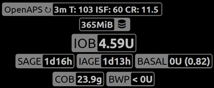

# Nightscout

(Nightscout-security-considerations)=

## Saugumo svarba

Nightscout yra **AAPS** ataskaitų ir stebėjimo serveris: **AAPS** į jį įkelia jūsų duomenis, o jūs arba jus prižiūrintys asmenys juos peržiūrite Nightscout svetainėje arba sekėjo programėlėse. Jame saugomi jūsų medicininiai duomenys, profiliai ir terapijos įrašai, todėl verta pagalvoti, kaip apsaugoti savo Nightscout svetainę.

**AAPS** 4 versijoje nuotolinis valdymas nevyksta per Nightscout svetainę. Kol įjungtas kliento valdymas ([sustiprintos apsaugos režimas](#client-master-control-hardened-mode)), terapijos įrašų ar tikslų, įvestų tiesiogiai Nightscout, **AAPS** **netaiko**. Vietoj to nuotolinės komandos ateina iš susietos **AAPSClient** programėlės – žr. [Pagrindinio įrenginio ↔ kliento valdymas](#client-master-control).

Būkite itin atsargūs, jei Nightscout naudojate kaip AAPS glikemijos duomenų šaltinį.

### Nightscout nustatymai

Viešą prieigą prie savo Nightscout svetainės galite uždrausti naudodami [autentifikavimo vaidmenis](https://nightscout.github.io/nightscout/security): savo URL dalinkitės tik su `readable` prieigos raktu, niekada su `admin` prieigos raktu.

Nightscout `API_SECRET` yra pagrindinis jūsų svetainės slaptažodis: niekam jo viešai neatskleiskite.

(Nightscout-aaps-settings)=

### AAPS nustatymai

Duomenų iš Nightscout priėmimas (profilio pakeitimai, terapijos įrašai, ...) yra pasirenkamas ir pagal numatymą išjungtas. Toliau aprašyti jungikliai paslėpti, kol įjungtas kliento valdymas (sustiprintos apsaugos režimas), ir [paprastajame režime](#preferences-simple-mode).

* NSClientV3 įskiepio **Sinchronizacija** nustatymus atidarykite vienu iš būdų: 1) **Nustatymai** (krumpliaračio piktograma pagrindiniame ekrane) -> **NSClientV3** -> **Sinchronizacija** arba 2) **Konfigūracija** (meniu ☰) -> **Ryšys** -> „**Parametrai**“ prie NSClientV3.
* Įjunkite „Įkelti duomenis į NS“.
* „Įkelti glikemijos duomenis į NS“ yra jūsų glikemijos šaltinio nustatymuose (**Konfigūracija → Glikemijos šaltinis → Parametrai**). Įjunkite šią parinktį, nebent jūsų AAPS glikemijos duomenų šaltinis yra Nightscout: tokiu atveju jos **neįjunkite**.
* Neįjunkite „Gauti NGJ duomenis iš NS“, nebent Nightscout yra jūsų glikemijos duomenų šaltinis.

#### Nesinchronizuoti iš Nightscout

Kai visos parinktys „Gauti … iš NS“ lieka išjungtos, AAPS tikrai nenaudos jokių Nightscout pakeitimų:

#### Priimti pakeitimus iš Nightscout

Įjungę šias parinktis, AAPS nustatymus galite keisti per Nightscout, pvz., keisti ir perjungti profilius, nustatyti laikinus tikslus ir pridėti angliavandenius, kuriuos AAPS įtrauks į skaičiavimus. Jos rodomos tik tada, kai kliento valdymas ir paprastasis režimas išjungti.  
Atminkite, kad insulino įrašai bus naudojami tik skaičiavimams, kaip „Neleisti boluso, tik įrašyti“.

### Tolimesni saugumo nustatymai

Nuolat atnaujinkite savo telefoną, kaip aprašyta skyriuje [Saugumas svarbiausia](#preparing-safety-first).

(Nightscout-manual-nightscout-setup)=

## Rankinis Nightscout diegimas

Daroma prielaida, kad jau turite Nightscout svetainę. Jei ne, visas diegimo instrukcijas rasite [Nightscout](http://nightscout.github.io/nightscout/new_user/) puslapyje. Toliau pateikti nustatymai, kuriuos taip pat reikės įrašyti į savo Nightscout svetainę. Jūsų Nightscout svetainė turi būti bent 15 versijos, todėl patikrinkite, ar naudojate [naujausią versiją](https://nightscout.github.io/update/update/#updating-your-site-to-the-latest-version), kitaip AAPS programėlėje matysite klaidos pranešimą.

* [Kintamųjų redagavimas](https://nightscout.github.io/nightscout/setup_variables/#nightscout-configuration)

* Pridėti arba redaguoti kintamuosius taip:
  
  * `ENABLE` = `careportal boluscalc food bwp cage sage iage iob cob basal dbsize pushover pump openaps`
  * `DEVICESTATUS_ADVANCED` = `true`
  * `SHOW_FORECAST` = `openaps`
  * `PUMP_FIELDS` = `reservoir battery clock`
  * Galima nustatyti įvairius aliarmus [pompos stebėsenai](https://github.com/nightscout/cgm-remote-monitor#pump-pump-monitoring). Ypač rekomenduojamas baterijos % aliarmas: 
    * `PUMP_WARN_BATT_P` = `51`
    * `PUMP_URGENT_BATT_P` = `26` 

* Išsaugokite pakeitimus. Dabar jūsų Nightscout svetainėje turėtų būti galima rodyti informacines žymas (pills). Kad jos būtų rodomos pagal numatymą, įrašykite jas į `SHOW_PLUGINS`.
  
  * `SHOW_PLUGINS` = `careportal boluscalc food bwp cage sage iage iob cob basal dbsize pushover pump openaps`
  
  

## Nightscout kaip mokama SaaS paslauga (Software as a Service)

Kintamuosius nustatykite paslaugos teikėjo žiniatinklio sąsajoje. Jei reikia, kreipkitės į paslaugos teikėjo pagalbos tarnybą.