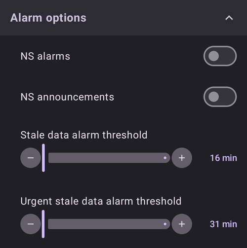
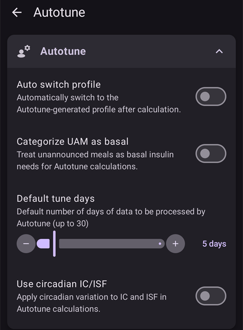
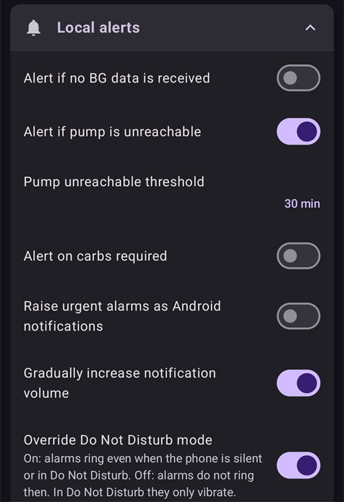

# Parametrai

**AAPS** v4 nustatymai yra ekrane **Nustatymai**. Juos pasiekti galima trimis būdais – išsamiau žr. [AAPS konfigūracijos keitimas](../SettingUpAaps/ChangeAapsConfiguration.md):

1. Bakstelėkite **Nustatymai** (krumpliaračio) piktogramą viršutiniame dešiniajame pagrindinio ekrano kampe: visi nustatymai, sugrupuoti į išskleidžiamas skiltis.
2. Ekrane **Konfigūracija** po aktyviu įskiepiu bakstelėkite „**Parametrai**“: tik to įskiepio nustatymai.
3. Naudokite **paieškos juostą** pagrindinio ekrano viršuje: tiesiog pradėkite rašyti dalį ieškomo teksto. Taip rasite atskirus nustatymus (net tuos, kurių nematyti ekrane Nustatymai), dialogus ir dokumentaciją.


- **Skiltys** atidaromos ir uždaromos jas bakstelėjus. Matomos skiltys priklauso nuo įjungtų įskiepių ir nuo [paprastojo režimo](#preferences-simple-mode).


```{contents}
:backlinks: entry
:depth: 2
```

(Preferences-general)=
## Bendra informacija


**Units**

- Pagal savo pageidavimą nustatykite vienetus mmol/l arba mg/dL.

**Language**

- By default **AAPS** follows the language of the phone (recommended).

- If you want **AAPS** in another language than the phone, choose it here. On Android 13 and newer, **AAPS** registers it as its own app language in Android, so all its screens, the main screen, the widgets and the way numbers are written follow it.

- Pakeitus kalbą, **AAPS** tekstai iš karto rodomi nauja kalba. Jei kai kurie tekstai vis dar rodomi sena kalba, paleiskite **AAPS** iš naujo.
- On Android 12 this setting is not shown: **AAPS** always uses the language of the phone.
- Nustatymas paslėptas [paprastajame režime](#preferences-simple-mode).

(preferences-simple-mode)= **Paprastasis režimas**

**Paprastasis režimas** įjungiamas automatiškai, kai pirmą kartą įdiegiate **AAPS**. **Paprastajame režime** daug nustatymų yra paslėpta, o jų vietoje naudojamos iš anksto nustatytos reikšmės. Kai susipažinsite su **AAPS** naudotojo sąsaja ir nustatymais, paprastąjį režimą turėtumėte išjungti.

**Skirtingų insulino koncentracijų palaikymas**

- Įjungia skirtingų insulino koncentracijų (U50, U200, ...) palaikymą. Įjunkite tai tik tada, jei tikrai naudojate kitos nei U100 koncentracijos insuliną, ir atidžiai perskaitykite įspėjimus.
- Nustatymas paslėptas [paprastajame režime](#preferences-simple-mode).

**Neleisti ekranui išsijungti**

- Priverčia Android visą laiką laikyti ekraną įjungtą. This is useful for presentations etc. But it consumes a lot of battery power. Therefore, it is recommended to connect the smartphone to a charger cable.

**Egzemplioriaus pavadinimas**

- Šį telefoną naudojančio asmens vardas. Jis padeda atskirti šį **AAPS** egzempliorių ataskaitose ir sinchronizuojant, pavyzdžiui, jei jūsų šeimoje **AAPS** naudoja du 1 tipo diabetu sergantys vaikai.
- Naudojamas eksportuotų nustatymų failų pavadinimuose.
- Rodomas [Dual ciferblate](../WearOS/WearOsSmartwatch.md).

(Preferences-skin)=
### Apvalkalas (skin)

**AAPS** 3.x apvalkalo (skin) pasirinkimo (Original, Low resolution, Large display...) **AAPS** 4 nebėra. Nauja sąsaja automatiškai prisitaiko prie jūsų ekrano, o spalvų schemą galima pakeisti skiltyje [Išvaizda](#preferences-appearance).

(preferences-appearance)=
## Išvaizda


(Preferences-range-for-visualization)=
### Range for visualization

Pasirinkite viršutinę ir apatinę KG grafiko ribas **AAPS** pagrindiniame ekrane ir išmaniajame laikrodyje. It is only the visualization, not the target range for your BG. Pavyzdys: 70 - 180 mg/dL arba 3,9 - 10 mmol/l

(Preferences-show-notes-field-in-treatments-dialogs)=
### Dialoguose rodyti pastabas

Leidžia prie terapijos įrašų (boluso patarėjo, angliavandenių, insulino...) pridėti trumpas tekstines pastabas.

Nustatymas paslėptas [paprastajame režime](#preferences-simple-mode).

### Spalvų schema

Pasirinkite šviesią temą, tamsią temą arba telefono sistemos nustatymą.

(Preferences-protection)=
## Protection


(Preferences-master-password)=
### Master password

Būtinas norint [eksportuoti nustatymus](../Maintenance/ExportImportSettings.md), nes nuo 2.7 versijos jie yra užšifruoti.

**Biometrinė apsauga gali neveikti OnePlus telefonuose. Tai žinoma OnePlus problema kai kuriuose telefonuose.**


(Preferences-settings-protection)=
### Settings protection

- Apsaugokite savo nustatymus slaptažodžiu arba telefono biometrine autentifikacija (pvz., kai [vaikas naudoja **AAPS**](../RemoteFeatures/RemoteMonitoring.md)). Įjungus šią funkciją, kiekvieną kartą atidarant bet kurį su nustatymais susijusį langą reikės patvirtinti tapatybę.

- Tada valdymo ekranai (**Profilis**, **Insulino nustatymai**, **Laikinas tikslas**, **Greitasis vedlys**) atidaromi **tik peržiūrai**. Įrašą vis tiek galite aktyvuoti arba naudoti, tačiau pridėti, redaguoti, klonuoti ir ištrinti galimybės paslėptos, kol neatrakinsite nustatymų. Žr. [Nustatymų apsauga dabar užrakina ir valdymo ekranus](#v4changes-read-only-management).

- Pasirinktinį slaptažodį naudokite, jei pagrindinį slaptažodį norite naudoti tik [eksportuotiems nustatymams](../Maintenance/ExportImportSettings.md) apsaugoti, o nustatymams redaguoti – kitą slaptažodį.

- Jei naudojate pasirinktinį slaptažodį, spustelėkite eilutę „Nustatymų slaptažodis“ ir nustatykite slaptažodį, kaip aprašyta [aukščiau](#Preferences-master-password).

### Application protection

Jei programa apsaugota, norėdami atidaryti **AAPS**, turite įvesti slaptažodį arba naudoti telefono biometrinę autentifikaciją; tą patį reikės padaryti grįžus į ją praėjus [laikui iki pakartotinio užrakinimo](#Preferences-password-and-pin-retention).

Įvedus neteisingą slaptažodį, **AAPS** iš karto išsijungs, tačiau toliau veiks fone, jei anksčiau buvo sėkmingai atidaryta.

### Bolus protection

- Bolusų apsauga gali būti naudinga, jei **AAPS** naudoja mažas vaikas, o jūs [bolusą leidžiate SMS žinute](../RemoteFeatures/SMSCommands.md).

- **Bolusų apsaugą** galima pasirinkti tik nustačius **Nustatymų apsaugą** (2 lygis).

- Toliau pateiktame pavyzdyje bolusų apsaugai naudojamas **Pagrindinis slaptažodis**: **AAPS** jo paprašo prieš atidarant terapijos langą, pvz., **Insulinas**. Pasirinkus **Biometrika**, jei biometrinė autentifikacija neveikia, vietoj jos galite įvesti pagrindinį slaptažodį.


(Preferences-password-and-pin-retention)=
### Slaptažodžio ir PIN įsiminimo trukmė

**Laikas iki pakartotinio užrakinimo** nustato, kiek laiko (sekundėmis) nustatymai ar boluso funkcijos lieka atrakinti po sėkmingo slaptažodžio įvedimo.

## Terapijos sauga


(preferences-patient-type)=
### Naudotojo amžius

- Saugos ribos nustatomos pagal šiame nustatyme pasirinktą amžių.
- Jei pradedate dažnai pasiekti šias griežtas ribas (pvz., maks. bolusą), laikas pereiti vienu žingsniu aukščiau.
- Pasirinkti didesnį nei tikrasis amžių yra bloga mintis, nes įvedus neteisingą reikšmę insulino lange (pvz., praleidus dešimtainį skyriklį) gali būti suleista per daug insulino.
- Jei norite sužinoti tikslias šių kode nustatytų saugos ribų reikšmes, [šiame puslapyje](../DailyLifeWithAaps/KeyAapsFeatures.md) suraskite naudojamą algoritmo funkciją.

(Preferences-maximum-bolus)=
### Didžiausias bolusas

- Nustato didžiausią boluso insulino kiekį vienetais, kurį **AAPS** leidžiama suleisti vienu kartu.
- Šis nustatymas yra saugos riba, kuri neleidžia suleisti labai didelio boluso dėl atsitiktinio įvedimo ar naudotojo klaidos.
- Rekomenduojama nustatyti protingą reikšmę, kuri maždaug atitinka didžiausią boluso insulino kiekį, kurio jums gali prireikti maistui ar korekcijai.
- Šis apribojimas taikomas ir boluso skaičiuotuvo rezultatams.

### Didžiausias angliavandenių kiekis

- Nustato didžiausią angliavandenių kiekį gramais, kuriam **AAPS** boluso skaičiuotuvui leidžiama apskaičiuoti dozę.
- Šis nustatymas yra saugos riba, kuri neleidžia suleisti labai didelio boluso dėl atsitiktinio įvedimo ar naudotojo klaidos.
- Rekomenduojama nustatyti protingą reikšmę, kuri maždaug atitinka didžiausią angliavandenių kiekį, kurio jums gali prireikti vienam valgymui.

## Glikemijos šaltinis

Pasirinkto [glikemijos šaltinio](#Config-Builder-bg-source) nustatymai rodomi atskiroje skiltyje. Pavyzdžiui, su **xDrip+**:


- **Įkelti glikemijos duomenis į NS**: leidžia **AAPS** įkelti gautas KG reikšmes į Nightscout. Įjunkite tai tik tada, jei pati NGJ programėlė jų dar neįkelia.
- **Įrašyti jutiklio pakeitimą**: įvedus jutiklį, automatiškai sukuriamas terapijos įrašas apie jutiklio keitimą.

## Pagrindinis ekranas

**AAPS** 3.x šie nustatymai buvo sugrupuoti skiltyje „Overview“ (Pagrindinis ekranas). **AAPS** 4 jie nustatomi tiesiogiai iš pagrindinio ekrano elementų, kuriems jie priklauso.

(Preferences-buttons)=
### QuickLaunch mygtukai

Nustatykite, kurie veiksmų mygtukai matomi pagrindiniame ekrane: bakstelėkite mažą **krumpliaratį** pagrindinio ekrano apačioje per vidurį („Konfigūruoti QuickLaunch“) ir **Pridėti** veiksmus, kuriuos norite greitai pasiekti (terapija, NGJ veiksmai, terapijos įrašai...).


(Preferences-quick-wizard)=
### Greitasis vedlys

Sukurkite savo mygtukus tam tikriems standartiniams patiekalams ar užkandžiams; jie bus rodomi pagrindiniame ekrane. Naudinga dažnai valgomiems standartiniams patiekalams.

Kiekvienam mygtukui nustatote angliavandenių kiekį ir boluso skaičiavimo būdą. Tada nustatote, kokiu laikotarpiu mygtukas bus matomas pagrindiniame ekrane – po vieną mygtuką kiekvienam laikotarpiui. Mygtukas nebus matomas už nustatyto laiko intervalo ribų arba jei jūsų AIO pakanka Greitojo vedlio mygtuke nurodytiems angliavandeniams padengti. Jei skirtingiems valgiams nustatysite skirtingą laiką, pagrindiniame ekrane visada matysite tinkamą standartinio valgio mygtuką pagal paros laiką.

Norėdami tvarkyti Greitojo vedlio ruošinius, pagrindinio ekrano paieškos juostoje įveskite „QuickWizard“ ir atidarykite **Greitasis vedlys - Tvarkyti greitojo vedlio ruošinius**.

Paspaudus Greitojo vedlio mygtuką, **AAPS** apskaičiuos ir pasiūlys bolusą šiems angliavandeniams pagal jūsų dabartinius santykius (atsižvelgdama į gliukozės kraujyje reikšmę arba aktyvų insuliną, jei taip nustatyta).

The proposal has to be confirmed before insulin is delivered.

(Preferences-default-temp-targets)=
### Numatytieji laikini tikslai

[Laikini tikslai (LT)](../DailyLifeWithAaps/TempTargets.md) leidžia tam tikram laikui pakeisti jūsų gliukozės tikslą. Nustatę numatytuosius LT, galite lengvai pakeisti tikslą sportui, prieš valgį ir pan.

Bakstelėkite **tikslo intervalą** pagrindiniame ekrane, kad atidarytumėte ekraną **Laikinas tikslas**. Perbraukite ruošinių korteles (Netrukus valgysiu, Sportas, Hipo) ir kiekvieno ruošinio tikslą bei trukmę pakeiskite skiltyje **Ruošinių nustatymai**. Preset values are:

* Netrukus valgysiu: tikslas 90 mg/dL / 5,0 mmol/l, trukmė 45 min.
* Sportas: tikslas 140 mg/dL / 7,8 mmol/l, trukmė 90 min.
* Hipo: tikslas 160 mg/dL / 8,9 mmol/l, trukmė 60 min.


Sužinokite, kaip [čia įjungti laikinus tikslus](#TempTargets-where-can-i-select-a-temp-target).

### Fill/Prime standard insulin amounts

Jei norite užpildyti vamzdelį arba kaniulę per **AAPS**, tai galite padaryti mygtukais **Užpildymas** išskleistame pagrindinio ekrano būsenos skydelyje.

Trijų užpildymo mygtukų numatytuosius kiekius galima nustatyti **Užpildymas** nustatymuose, atsižvelgiant į jūsų kateterio ilgį. Norėdami juos atidaryti, pagrindinio ekrano paieškos juostoje įveskite „prime“.


(Preferences-status-lights)=
### Būklės indikatoriai

Būklės indikatoriai vizualiai įspėja apie:

- Jutiklio amžius
- Insulin age (days reservoir is used)
- Reservoir level (units)
- Kaniulės amžius
- Pompos baterijos amžius
- Pompos baterijos lygis (%)

Viršijus įspėjimo ribą, reikšmės rodomos geltonai. Viršijus kritinę ribą, reikšmės rodomos raudonai.

Norėdami pakeisti ribas, išskleiskite būsenos skydelį pagrindiniame ekrane (rodyklė būsenos eilutės dešinėje) ir bakstelėkite mažą **Nustatymai** piktogramą šalia „Būsena“:


Bakstelėkite elementą (**Kaniulė**, **Insulinas**, **Jutiklis** arba **Pompos baterija**), kad atidarytumėte jo įspėjimo ir kritinę ribas:


Paskutinė parinktis leidžia importuoti šiuos nustatymus iš Nightscout, jei jie ten nustatyti. Daugiau informacijos rasite [Nightscout dokumentacijoje](https://nightscout.github.io/nightscout/setup_variables/#age-pills).

(Preferences-deliver-this-part-of-bolus-wizard-result)=
### Boluso patarėjo nustatymai

Pagrindinio ekrano paieškos juostoje įveskite „bolus“, kad atidarytumėte **Boluso patarėjo** nustatymus:


**Boluso procentas** nustato [numatytąjį procentą](#AapsScreens-section-j) nuo boluso, apskaičiuoto naudojant boluso patarėją.

Numatyta reikšmė yra 100 %: be korekcijos. Net jei čia nustatysite kitą reikšmę, ją vis tiek galėsite pakeisti kiekvieną kartą naudodami boluso patarėją. Jei šis nustatymas yra 75 %, o jums reikėtų 10 V boluso, boluso patarėjas pasiūlys tik 7,5 V valgio bolusą.

Naudodami [SMB](#objectives-objective9), daugelis žmonių valgiui suleidžia ne 100 % reikiamo insulino, o tik dalį (pvz., 75 %), ir likusią dalį palieka SMB su NDM (nedeklaruoto maisto aptikimu). Mažesnė nei 100 % reikšmė čia gali būti naudinga:
* žmonėms su lėtu virškinimu: suleidus visą bolusą iš karto, gali ištikti hipoglikemija, nes insulinas veikia greičiau, nei virškinamas maistas.
* norint palikti **AAPS** daugiau vietos pačiai susitvarkyti su **KG kilimu**. Abiem atvejais **AAPS** trūkstamą boluso dalį kompensuos SMB, jei ir kai tai bus tikslinga.

**Naudoti boluso patarėją**

Kai ši parinktis įjungta ir naudojate boluso patarėją esant hiperglikemijai, gausite įspėjimą, kuriame bus paklausta, ar norite suleisti išankstinį bolusą ir valgyti vėliau, kai jūsų **KG** grįš į tikslo intervalą.

(Preferences-advanced-settings-overview)=
### Superbolus

**AAPS** 3.x superboluso parinkties **AAPS** 4 nustatymuose nebėra.

## Ciklas

Norėdami dabar pakeisti ciklo režimą, žr. [AAPS ekranai > Pagrindinis ekranas > Ciklo būsena](#AapsScreens-loop-status).

(Preferences-minimal-request-change)=
### Mažiausias pokytis atvirojo ciklo režimu

Naudodami **Atvirą ciklą**, gausite pranešimą kiekvieną kartą, kai **AAPS** rekomenduos pakeisti valandinę bazę. Norėdami sumažinti pranešimų skaičių, galite naudoti [platesnį KG tikslo intervalą](#profile-glucose-targets) arba padidinti nustatymo „**Mažiausias pokytis atvirojo ciklo režimu**“ procentą. Jis nustato santykinį pokytį, kurio reikia, kad būtų parodytas pranešimas.


## Pažangi pagalba valgant (AMA) arba supermikrobolusas (SMB)

Priklausomai nuo nustatymų [Konfigūracija > DKS](../SettingUpAaps/ConfigBuilder.md), galite rinktis vieną iš dviejų algoritmų:

- [Pažangi pagalba valgant (OpenAPS AMA)](#Open-APS-features-advanced-meal-assist-ama) – algoritmas, koks jis buvo 2017 m.
- [Supermikrobolusas (OpenAPS SMB)](#Open-APS-features-super-micro-bolus-smb) – naujausias algoritmas, rekomenduojamas pradedantiesiems

Nuo [**AAPS** 3.3 versijos](#version3300) [dinaminio JIF](../DailyLifeWithAaps/DynamicISF.md) funkcija perkelta į OpenAPS SMB.

### OpenAPS AMA

Visi OpenAPS AMA nustatymai aprašyti tam skirtame skyriuje [Pagrindinės AAPS funkcijos > Pažangi pagalba valgant (AMA)](#Open-APS-features-advanced-meal-assist-ama).

(Preferences-openaps-smb-settings)=
### OpenAPS SMB

Visi OpenAPS SMB nustatymai aprašyti tam skirtame skyriuje [Pagrindinės AAPS funkcijos > Supermikrobolusas (SMB)](#Open-APS-features-super-micro-bolus-smb).

Matomų nustatymų sąrašas priklauso nuo jūsų pažangos [mokymo etapuose](../SettingUpAaps/CompletingTheObjectives.md) ir nuo [paprastojo režimo](#preferences-simple-mode). Naujame įdiegime rodomas tik nustatymas **Naudoti dinaminį jautrumą**. Atlikus mokymo etapus, skiltis atrodo taip:


Skilties apačioje esančiuose **Papildomuose nustatymuose** yra reikšmės, kurių paprastai keisti nereikia:


## Angliavandenių įsisavinimo parametrai


(Preferences-min_5m_carbimpact)=
### SMB minimalus 5 min angliavandenių poveikis (min_5m_carbimpact)

Nustatymas paslėptas [paprastajame režime](#preferences-simple-mode).

Algoritmas naudoja KGĮ (glikemijos įtaką), kad nustatytų, kada [angliavandeniai įsisavinami](../DailyLifeWithAaps/CobCalculation.md).

Kai angliavandenių įsisavinimo negalima dinamiškai apskaičiuoti pagal jūsų kraujo reakcijas, **AAPS** jūsų angliavandeniams taiko numatytąjį mažėjimą. Basically, it is a failsafe. Ši reikšmė naudojama tik tada, kai trūksta **NGJ** rodmenų, arba kai fizinis aktyvumas „sunaudoja“ visą gliukozės kilimą, dėl kurio kitu atveju **AAPS** mažintų AAO.

Paprastai tariant: algoritmas „žino“, kaip jūsų KG *turėtų* kisti veikiant dabartinei insulino dozei ir pan. Kai tik atsiranda teigiamas nuokrypis nuo tikėtinos eigos, laikoma, kad dalis angliavandenių įsisavinta. Didelis pokytis = daug angliavandenių ir pan.

min_5m_carbimpact nustato numatytąjį angliavandenių įsisavinimo poveikį per 5 minutes. Visą parametrų aprašymą rasite [OpenAPS nustatymų ir saugos parametrų dokumentacijoje](https://openaps.readthedocs.io/en/latest/docs/While%20You%20Wait%20For%20Gear/preferences-and-safety-settings.html?highlight=carbimpact#min-5m-carbimpact).

Standartinė reikšmė AMA yra 3, SMB – 8.

AAO grafikas pagrindiniame ekrane parodo, kada naudojamas min_5m_carbimpact: AAO kreivės viršuje rodomi oranžiniai taškai.


### Įsisavinimo ribinis laikas

Laikas, po kurio bet koks maistas laikomas įsisavintu; likę angliavandeniai atmetami. Jei dažnai valgote riebų ar baltymingą maistą, turėsite padidinti maisto įsisavinimo laiką.

### Papildomi nustatymai – Autosens santykis


- Nustatykite mažiausią ir didžiausią [Autosens](#Open-APS-features-autosens) santykį.
- Paprastai standartinių reikšmių (maks. 1,2 ir min. 0,7) keisti nereikėtų.

## Pump


### BT Watchdog

Jei reikia, įjunkite BT Watchdog (pvz., Dana pompoms). Jei prisijungti prie pompos nepavyksta, jis vienai sekundei išjungia Bluetooth. Tai gali padėti kai kuriuose telefonuose, kuriuose užstringa Bluetooth dalis.

## Pump settings

Parinktys čia skiriasi priklausomai nuo to, kurią pompos tvarkyklę pasirinkote skiltyje [Konfigūracija > Pompa](#Config-Builder-pump). Susiekite ir nustatykite pompą pagal [jūsų pompos instrukcijas](../Getting-Started/CompatiblePumps.md).

Pavyzdžiui, naudojant **Virtuali pompa**, skiltis vadinasi **Virtualios pompos nustatymai**. Pasirenkate **Pompos tipas** (kurią pompą imituoja virtuali pompa) ir ar jos būsena įkeliama į Nightscout:


## Tidepool

Daugiau informacijos rasite tam skirtame [Tidepool](../SettingUpAaps/Tidepool.md) puslapyje.

(Preferences-nsclient)=
## NSClientV3


NSClient įskiepis (konfigūracijos meniu rodomas kaip **NSClientV3**) sinchronizuoja jūsų duomenis su Nightscout. Jis naudoja Nightscout API v3.

```{admonition} Data uploaders
:class: warning

Naudojant NSClientV3, visi duomenų įkėlėjai turi naudoti Nightscout API v3. Jei kitas įkėlėjas (pvz., jūsų NGJ programėlė) nesuderinamas su API v3, **leiskite AAPS įkelti visus duomenis** (KG, terapiją, ...) į Nightscout ir išjunkite tą įkėlėją.
```

- Nustatykite savo *Nightscout URL* (pvz., <https://yoursitename.yourplatform.dom>).
- **Make sure that the URL is WITHOUT /api/v1/ at the end.**
- Nightscout sukurkite *[administratoriaus prieigos raktą](https://nightscout.github.io/nightscout/security/#create-a-token)* (V3 API reikia [Nightscout 15](https://nightscout.github.io/update/update/)) ir įveskite jį lauke **Nightscout prieigos raktas** (ne savo API slaptažodį!). **AAPSClient** programėlėje vietoj to galite nuskaityti pagrindinio telefono QR kodą, kuris nustato kliento nuosavą prieigos raktą. Klientas, susietas PIN kodu, po susiejimo gauna savo prieigos raktą iš pagrindinio telefono. Žr. [Kliento nuosavas Nightscout prieigos raktas](#client-master-control-own-token).
- Tai leidžia skaityti ir rašyti duomenis tarp Nightscout svetainės ir **AAPS**.
- Jei įstrigote 1 mokymo etape, dar kartą patikrinkite, ar čia nėra rašybos klaidų.
- Palikite įjungtą „Naudoti WebSocket“ (rekomenduojama).

(Preferences-nsclient-synchronization)=
### Synchronization


Sinchronizacijos pasirinkimai priklauso nuo to, kaip norėsite naudoti **AAPS**.

Galite pasirinkti, kuriuos duomenis norite [įkelti į Nightscout ir atsisiųsti iš jo](#Nightscout-aaps-settings).

Kol kliento valdymas įjungtas (paprastajame režime – visada), šie nustatymai paslėpti: tada **AAPS** veikia [sustiprintos apsaugos režimu](#client-master-control-hardened-mode), nepriima tiesiogiai Nightscout atliktų pakeitimų ir įkelia visus savo duomenis.

### Įspėjimų nustatymai



- Įspėjimų nustatymuose galite pasirinkti, kuriuos Nightscout įspėjimus naudoti programėlėje. **AAPS** įspės, kai suveiks Nightscout įspėjimas.
- Kad įspėjimai skambėtų, savo [Nightscout kintamuosiuose](https://nightscout.github.io/nightscout/setup_variables/#alarms) turite nustatyti Urgent High, High, Low ir Urgent Low įspėjimų reikšmes.
- Jie veikia tik tada, kai yra ryšys su Nightscout, ir yra skirti tėvams / prižiūrintiems asmenims.
- Jei **NGJ** šaltinis yra jūsų telefone (pvz., xDrip ar BYODA), naudokite jo įspėjimus, o ne Nightscout įspėjimus.
- NS pranešimai pakartos Nightscout [pranešimus](https://nightscout.github.io/nightscout/discover/#announcement) **AAPS** pranešimuose.
- Galite pakeisti pasenusių duomenų ir skubaus įspėjimo apie pasenusius duomenis ribas, kai iš Nightscout tam tikrą laiką negaunama duomenų.

### Nuotolinis valdymas

Jungiklio „**Leisti valdyti iš kliento**“ šiuose nustatymuose nebėra: jis yra ekrano **Valdymas → Autorizuoti klientai** viršuje, kur tvarkomi susieti klientai. Žr. atskirą puslapį [Pagrindinio įrenginio ↔ kliento valdymas](../RemoteFeatures/ClientMasterControl.md), įskaitant [sustiprintos apsaugos režimą](#client-master-control-hardened-mode), kurį šis jungiklis įjungia.

### Connection settings


- Ryšio nustatymai nustato, kada bus įjungtas ryšys su Nightscout.
- Apribokite įkėlimą į Nightscout tik per Wi-Fi arba net tik per tam tikrus Wi-Fi SSID.
- Jei norite naudoti tik konkretų Wi-Fi tinklą, galite įvesti jo Wi-Fi SSID.
- Kelis SSID galima atskirti kabliataškiu.
- To delete all SSIDs enter a blank space in the field.

(Preferences-advanced-settings-nsclient)=
### Advanced settings (NSClientV3)


Papildomi nustatymai turėtų būti aiškūs be paaiškinimų.

## SMS komandos

Daugiau informacijos rasite tam skirtame [SMS komandų](../RemoteFeatures/SMSCommands.md) puslapyje.

(preferences-wear)=
## Wear

Ši skiltis rodoma, kai įskiepis **Išmanieji laikrodžiai** įjungtas skiltyje [Konfigūracija > Ryšys](#Config-Builder-wear). Daugiau informacijos rasite tam skirtuose puslapiuose [Wear AAPS naudojimas išmaniajame laikrodyje](../WearOS/WearOsSmartwatch.md) ir [AAPS valdymas Wear OS išmaniuoju laikrodžiu](../RemoteFeatures/RemoteControlWearOS.md).


- **Valdymas per Wear**: leidžia siųsti terapiją ir kitus veiksmus iš laikrodžio. Be jo laikrodis tik rodo duomenis: telefonas atmeta bet kokią komandą iš laikrodžio, o bakstelėjus ekrano elementą, kuris turėtų atidaryti valdymo ekraną, laikrodyje vietoj jo atidaromas **AAPS** meniu.

**Wear boluso skaičiuotuvo nustatymai** nustato, kurie skaičiavimai įtraukiami į boluso patarėjo rezultatą laikrodyje. Laikrodyje įvedate tik angliavandenius; šie jungikliai pakeičia pasirinkimus, kuriuos atliktumėte telefono boluso patarėjyje:

- **Įtraukti glikemiją į boluso skaičiuoklę**: pridedama korekcija dėl skirtumo tarp dabartinės gliukozės ir jūsų tikslo.
- **Įtraukti laikiną tikslą į skaičiuotuvą**: šiai korekcijai naudojamas veikiantis laikinas tikslas, o ne profilio tikslas.
- **Įtraukti tendenciją į skaičiuotuvą**: atsižvelgiama į dabartinę gliukozės tendenciją.
- **Įtraukti AAO į skaičiuotuvą**: pridedama insulino dar organizme esantiems angliavandeniams.
- **Įtraukti AIO į skaičiuotuvą**: atimamas dar organizme esantis insulinas.


**Pasirinktinių ciferblatų nustatymai** apima **Leisti pasirinktinius ciferblatus**. Pasirinktinio ciferblato faile gali būti kai kurių laikrodžio nustatymų reikšmės. Kai šis jungiklis įjungtas, įkeliant tokį ciferblatą leidžiama pakeisti tuos laikrodžio nustatymus; kai išjungtas, ciferblatas įkeliamas, bet nustatymai lieka nepakeisti:


**Bendrieji nustatymai** apima **Pranešti apie SMB**, kad gautumėte pranešimą laikrodyje kiekvieną kartą, kai suleidžiamas SMB:


## Autotune

Ši skiltis rodoma, kai įskiepis **Autotune** įjungtas skiltyje [Konfigūracija > Bendrieji](#Config-Builder-autotune). Nustatymai aprašyti tam skirtame [Autotune](../AdvancedOptions/Autotune.md) puslapyje.



## Automatizavimas


Pasirinkite, kurią vietos nustatymo paslaugą naudoti:

- Naudoti pasyvų vietos nustatymą: **AAPS** gauna vietą tik tada, kai jos prašo kitos programėlės
- Nustatyti vietą pagal tinklą: jūsų Wi-Fi vieta
- Nustatyti vietą naudojant GPS (Dėmesio! Gali labai greitai iškrauti bateriją!)

## Lokalūs įspėjimai



Nustatymai turėtų būti aiškūs be paaiškinimų.

**Override Do Not Disturb mode** (on by default): the **AAPS** alarms ring even when the phone is silent or in Do Not Disturb. Turn it off if **AAPS** should respect those modes: the alarms do not ring then, and in Do Not Disturb they only vibrate, on the phone and on the watch. Loop suggestions that arrive during Do Not Disturb are shown without a sound.

When an alarm rings, the alarm screen offers **Silence alarm** (the screen stays open, so you can read the message) and **Silence and close**. Swiping the alarm notification away in the notification tray mutes the alarm. When you open **AAPS** later, an alarm you did not answer is shown again.

(preferences-maintenance-settings)=
## Serviso nustatymai


**El. laiško gavėjas**: standartinis žurnalų gavėjas yra <logs@aaps.app>.

**Siunčiamų žurnalų skaičius**: kiek naujausių žurnalų failų pridedama, kai siunčiate žurnalus.

**Data Choices**


Galite padėti toliau tobulinti **AAPS**, siųsdami kūrėjams strigčių ataskaitas.

**Automatinis nustatymų eksportavimas**<br/> Įjungę šią funkciją, leidžiate **AAPS** eksportuoti nustatymus be naudotojo įsikišimo. Tam pagrindinis slaptažodis saugiai išsaugomas (tik) jūsų telefone, kai kitą kartą eksportuosite rankiniu būdu. Išsaugotas slaptažodis bus naudojamas iki 4 savaičių. Po 4 savaičių gausite pranešimą, kad slaptažodžio galiojimas netrukus baigsis. Per 1 savaitės papildomą laiką slaptažodį galima atnaujinti rankiniu būdu eksportuojant nustatymus iš meniu Servisas.

Praėjus 1 savaitės papildomam laikui, išsaugoto slaptažodžio galiojimas baigiasi, o bet koks automatinis nustatymų eksportavimas nutraukiamas ir naudotojui pranešama, prašant iš naujo įvesti slaptažodį. [(**Automatiniai nustatymų eksportavimai**)](../DailyLifeWithAaps/Automations.md#automating-preference-settings-export) bus registruojami **AAPS** sąrašuose „Terapijos įrašai“ ir „Naudotojo įrašas“, skiltyje Terapija.

Įjungę šią parinktį, būtinai atlikite rankinį nustatymų eksportavimą, kurio metu bus paprašyta slaptažodžio, kad **AAPS** galėtų jį išsaugoti.

### Log files

AAPS saugo žurnalus trikčių šalinimui.

Neišjunkite šios funkcijos: ji padės suprasti priežastis, jei kas nors nepavyks.

Jei reikia nusiųsti žurnalus kūrėjams, el. laiške tiksliai aprašykite problemą. Žurnalus geriausia siųsti tik tada, kai jūsų to paprašo, po [pranešimo apie problemą GitHub](https://github.com/nightscout/AndroidAPS/issues).

AAPS žurnalus rasite telefono atmintyje -> Android -> data -> info.nightscout.androidaps -> files.

Žurnalų tvarkymas (žurnalų nustatymai, siuntimas ir trynimas) ir failų tvarkymas yra ekrane **Servisas**, kuris atidaromas iš **meniu** (☰) viršutiniame kairiajame pagrindinio ekrano kampe:


(preferences-maintenance-logdirectory)=

### Vietinio AAPS aplanko nustatymas

Ekrane **Servisas** taip pat yra **AAPS aplankas**. Šis nustatymas leidžia pasirinkti telefono aplanką, kuriame **AAPS** saugos nustatymus, žurnalus ir kitus failus. Pasirinkus aplanką, jo kelias (pvz., `Documents/AAPS`) rodomas po **AAPS aplankas**, todėl visada matote, kur saugomi jūsų failai.

Primygtinai rekomenduojama naudoti aplanką, esantį tiesiai telefono atminties šakniniame lygmenyje. Numatytasis aplankas yra AAPS.


Jei pasirinksite AAPS poaplankį, pamatysite klaidos pranešimą. Bakstelėkite „OK“ ir bandykite dar kartą, pasirinkdami teisingą aplanką (vienu lygiu aukščiau). Nesirinkite „Atmesti“ (DISMISS), nebent tiksliai žinote, ką darote.


Android gali nepastebimai atimti leidimą naudoti aplanką, pavyzdžiui, kai iš naujo įdiegiate **AAPS** arba išvalote jos saugyklą. Kai taip nutinka, **AAPS** rodo nuolatinį pranešimą **Prarasta prieiga prie AAPS aplanko**, o vietinis nustatymų eksportavimas neveikia, kol čia grįšite ir vėl pasirinksite aplanką. Padarykite tai nedelsdami, kitaip atsarginės kopijos telefone nebebus atnaujinamos.

(preferences-maintenance-cloud)=

### Debesies aplanko nustatymas

Savo nustatymus, žurnalus ir CSV duomenis galite eksportuoti į debesų paslaugą.

1. Atidarykite **meniu** (☰), pasirinkite **Servisas** ir bakstelėkite **Debesies aplankas** (skiltyje **Failų tvarkymas**).

   

2. Lange **Pasirinkite saugyklos tipą** pasirinkite **Google Drive**.

   

3. Atsidaro Google prisijungimo puslapis. Pasirinkite Google paskyrą, kurioje bus saugomos jūsų atsarginės kopijos (galite naudoti [atskirą Google paskyrą](../UsefulLinks/DedicatedGoogleAccountForAaps.md)).

   

4. Patikrinkite, ar paskyra teisinga, ir bakstelėkite **Continue** (tęsti), kad suteiktumėte **AAPS** prieigą. Jei debesies aplanką jau nustatėte anksčiau, puslapyje parašyta, kad **AAPS** jau turi tam tikrą prieigą.

   

5. Grįžus į **AAPS**, pagrindinio ekrano apačioje pasirodo pranešimas **Prisijungimas prie debesies saugyklos sėkmingas**:

   

   Meniu **Servisas** prie **Debesies aplankas** dabar rodomas žalias taškas, o mygtukai **Debesis** šalia **Siųsti žurnalus**, **Eksportuoti nustatymus**, **Importuoti nustatymus** ir **Eksportuoti naudotojo įrašus į Excel (csv)** tampa prieinami.

   

Norėdami nebeeksportuoti į debesį, meniu **Servisas** eilutės **Debesies aplankas** gale bakstelėkite piktogramą **✕** (**Išvalyti nustatymus**) (ji rodoma, kai debesų paslauga nustatyta) ir patvirtinkite **Išvalyti debesies nustatymus**. Tada vėl naudojama vietinė saugykla, o prieigos leidimas panaikinamas.

## Open Humans

Galite padėti bendruomenei, paaukodami savo duomenis moksliniams tyrimams! Išsami informacija pateikta [Open Humans puslapyje](../SupportingAaps/OpenHumans.md).

Skiltyje **Nustatymai → Open Humans** galite nustatyti, kada duomenys bus įkeliami
- tik prisijungus prie Wi-Fi
- only if charging
