# AAPS sąrankos vedlys

```{contents} In this page
:backlinks: entry
:depth: 2
```

Kai pirmą kartą paleidžiate **AAPS**, jus veda „**Sąrankos vedlys**“. Jis padeda greitai, vienu kartu nustatyti visą pagrindinę programėlės konfigūraciją. **Sąrankos vedlys** jus veda, kad nepamirštumėte nieko svarbaus. Pavyzdžiui, **leidimų nustatymai** yra būtini, kad **AAPS** būtų nustatyta teisingai.

Tačiau nebūtina viską visiškai sukonfigūruoti pirmą kartą naudojant **Sąrankos vedlį**. Iš vedlio galite lengvai išeiti ir grįžti į jį vėliau. Po **Sąrankos vedlio** konfigūraciją galima toliau tobulinti ar keisti trimis būdais. Jie bus paaiškinti kitame skyriuje. Todėl nieko blogo, jei kai kuriuos Sąrankos vedlio punktus praleisite – vėliau juos lengvai sukonfigūruosite.

Naudojant **Sąrankos vedlį** ir iškart po to, **AAPS** galite nepastebėti jokių didelių pokyčių. Kad įjungtumėte **AAPS** ciklą, turite atlikti **mokymo etapus** ir įjungti funkcijas vieną po kitos. **1 mokymo etapą** pradėsite Sąrankos vedlio pabaigoje. Jūs valdote **AAPS**, o ne atvirkščiai.

```{admonition} Preview Objectives
:class: note
Jei norite sužinoti mokymo etapų struktūrą, perskaitykite [Mokymo etapų atlikimas](../SettingUpAaps/CompletingTheObjectives.md), bet tada grįžkite čia ir pirmiausia atlikite Sąrankos vedlį.

```

Iš patirties žinome, kad pradedantieji dažnai skuba kuo greičiau nustatyti **AAPS**. Tai gali sukelti nusivylimą, nes reikia daug ko išmokti.

Todėl neskubėkite konfigūruoti savo ciklo. Gerai veikiančio **AAPS** ciklo nauda yra labai didelė.

```{admonition} Ask for Help
:class: note
Jei dokumentacijoje yra klaida arba žinote, kaip ką nors paaiškinti geriau, galite paprašyti bendruomenės pagalbos, kaip aprašyta skyriuje [Bendravimas su kitais naudotojais](../GettingHelp/WhereCanIGetHelp.md).
```
## Pasveikinimo pranešimas

Atsidaręs Sąrankos vedlys trumpai jus pasveikina ir iškart ekrano apačioje parodo skydelį „**Reikalingi leidimai**“ (žr. kitą skyrių).

Kai suteiksite leidimus, skydelis užsidaro, o pasveikinimo ekrane atsiranda mygtukas „**Toliau**“. Spauskite „**TOLIAU**“, kad tęstumėte:


## Reikalingi leidimai

Kad **AAPS** veiktų teisingai, jai reikia kelių leidimų. Vedlys juos sugrupuoja viename skydelyje „**Reikalingi leidimai**“, kiekvienas leidimas turi savo mygtuką „**Suteikti**“. Suteikite juos po vieną – kai leidimas suteiktas, piktograma šalia jo pasikeičia į varnelę.


### Baterijos optimizavimas

Svarbu galvoti apie išmaniojo telefono baterijos sąnaudas, nes baterijų galimybės vis dar gana ribotos. Todėl jūsų telefono Android operacinė sistema riboja programėlių veikimą ir procesoriaus laiko, o kartu ir baterijos energijos, naudojimą.

Tačiau **AAPS** turi veikti reguliariai, _pvz._, kas kelias minutes gauti gliukozės rodmenis ir tada pagal jūsų nustatymus taikyti algoritmą, kuris nusprendžia, ką daryti su jūsų gliukozės lygiu. Todėl jai reikia išjungti baterijos optimizavimą.

Spauskite „**Suteikti**“ šalia „**Baterijos optimizavimas**“, tada lange „Let app always run in background?“ (leisti programai visada veikti fone?) pasirinkite „**Allow**“ (leisti):


(SetupWizard-StoragePermission)=

### AAPS aplankas

**AAPS** turi saugoti savo nustatymus ir žurnalų informaciją nuolatinėje telefono atmintyje. Nuolatinė atmintis reiškia, kad informacija išliks net iš naujo paleidus telefoną. Kita informacija tiesiog prarandama, nes ji neišsaugoma nuolatinėje atmintyje.

Spauskite „**Suteikti**“ šalia „**AAPS aplankas**“. Atsidaro telefono failų sistema, kurioje galite pasirinkti, kur **AAPS** saugos savo informaciją.

```{tip}
Rekomenduojama pasirinkti numatytąjį AAPS aplanką.</br>
**Nesirinkite** AAPS poaplankio.
```

Numatytasis aplankas yra **AAPS**, bet galite naudoti bet kurį kitą tam skirtą aplanką. Jei reikia, sukurkite aplanką, atidarykite jį ir pasirinkite „**USE THIS FOLDER**“ (naudoti šį aplanką):


Spausdami „**ALLOW**“ (leisti) patvirtinkite, kad suteikiate **AAPS** prieigą prie pasirinkto aplanko:


### Notifications

Android reikalauja specialaus leidimo programėlėms, kurios nori siųsti jums pranešimus.

Naudinga išjungti pranešimus, _pvz._, iš socialinių tinklų programėlių, bet būtina leisti **AAPS** siųsti jums pranešimus.

Spauskite „**Suteikti**“ šalia „**Pranešimai**“ ir sistemos lange pasirinkite „**Allow**“ (leisti):

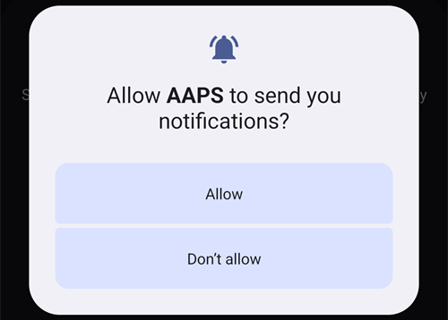

### Signalai ir priminimai

**Android 14 ir naujesnėse versijose** **AAPS** reikia leidimo „**Signalai ir priminimai**“, kad aliarmai galėtų pažadinti ekraną, kai **AAPS** veikia fone, ir kad priminimai (pavyzdžiui, iš **Automatizacijos**) suskambėtų laiku.

Šis punktas rodomas tik tada, kai jo reikia. Kai **AAPS** išjungiamas baterijos optimizavimas (žr. aukščiau), Android tikslius aliarmus leidžia automatiškai ir šis punktas dingsta. Jei jis vis dar rodomas, spauskite „**Suteikti**“ šalia „**Signalai ir priminimai**“. Atsidaro **AAPS** sistemos nustatymų ekranas. Įjunkite jungiklį ir grįžkite į **AAPS**. Android 13 ir senesnėse versijose šis punktas nerodomas ir nieko daryti nereikia.

Kai prie visų leidimų matoma varnelė (trijų, o Android 14 ir naujesnėse versijose – keturių), skydelis „**Reikalingi leidimai**“ užsidaro pats ir pasveikinimo ekrane galite spausti „**TOLIAU**“, kad tęstumėte.

(setup-wizard-bluetooth-battery-optimisation)=
### Bluetooth baterijos optimizavimas

```{admonition} Extra Android setting, not part of the Wizard
:class: note
Toliau aprašyti papildomi Android nustatymai, kurie atliekami ne Sąrankos vedlyje. Tai nėra vienas iš aukščiau aprašytų mygtukų „Suteikti“, bet tai svarbu patikimam ryšiui su pompa.
```

Naujesnėse Android versijose baterijos optimizavimas taikomas ir sisteminei Bluetooth programai.

Be baterijos optimizavimo išjungimo **AAPS**, greičiausiai jį reikės išjungti ir sisteminei Bluetooth programai. Jei to nepadarysite, gali nutrūkti ryšys su pompa ir kilti kitų problemų.

***PASTABA: xDrip dokumentacijoje aprašyta, kaip tai padaryti: [xDrip dokumentacija](https://navid200.github.io/xDrip/docs/BluetoothBatteryOpt.html)***

Atlikite šiuos veiksmus Android 16. Kitose versijose ekranai gali šiek tiek skirtis nuo pateiktų ekrano kopijų:

1. Atidarykite Android nustatymus, ieškokite **Apps** (programos) ir atidarykite programų nustatymus.

   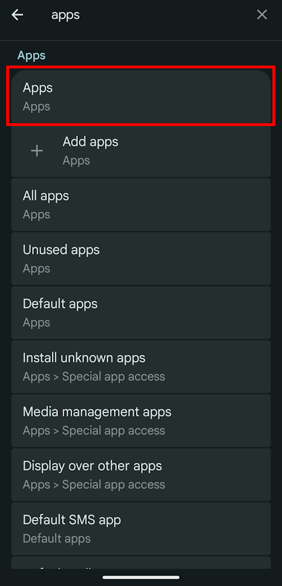

2. Matysite programų nustatymus, bet reikia išskleisti sąrašą, kad matytumėte visas programas. Spauskite **See all apps** (rodyti visas programas).

   

3. Bluetooth programa yra sisteminė, todėl pagal numatymą ji paslėpta. Reikia parodyti sistemines programas. Spauskite **tris taškus** (⋮) viršutiniame dešiniajame kampe (1). Tada spauskite **Show system** (rodyti sistemines) (2).

   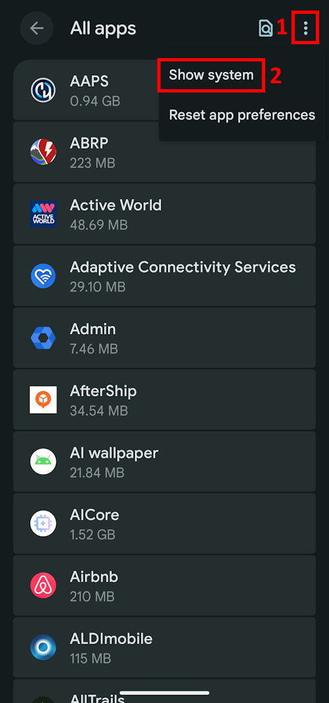

4. Ieškokite programos `Bluetooth` ir spauskite `Bluetooth` ir (arba) `Legacy Bluetooth`. Jei yra abi, atlikite veiksmus su abiem.

   ***PASTABA: `Bluetooth MIDI Service` galima saugiai praleisti, AAPS jo nenaudoja***

           

   1. Android 12 spauskite `Battery`, Android 13+ spauskite `App battery usage`.

   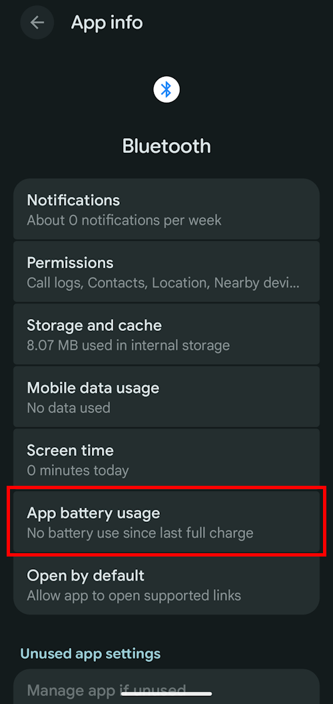   

5. Android 12+ pasirinkite `Unrestricted` (neribojama). Android 15+ reikia išskleisti nustatymą `Allow background usage`: spauskite raudonai pažymėtą sritį, tada atlikite 6 žingsnį.

       

6. Android 16 pasirinkite `Unrestricted`

   

## Licencijos sutartis

Licencinėje sutartyje su naudotoju yra svarbios informacijos apie teisinius **AAPS** naudojimo aspektus. Atidžiai ją perskaitykite.

Jei nesuprantate licencinės sutarties su naudotoju arba negalite su ja sutikti, visiškai nenaudokite **AAPS**!

Jei suprantate ir sutinkate, spauskite mygtuką „**SUPRATAU IR SUTINKU**“ ir sekite Sąrankos vedlį:


Kai sutinkate, atsiranda mygtukas „**Toliau**“. Spauskite „**TOLIAU**“.

Kitame ekrane „**Leidimai**“ leidimai išvardyti dar kartą. Prie visų turėtų būti varnelė, nes juos suteikėte pradžioje. Jei kurio nors trūksta, spauskite „**Suteikti**“ šalia jo. Spauskite „**TOLIAU**“, kad tęstumėte:

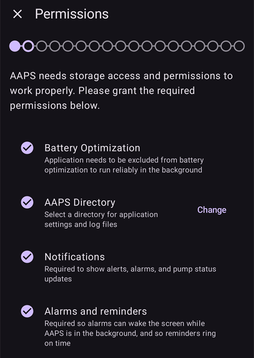

## Master password

**AAPS** konfigūracijoje yra jautrių duomenų (_pvz._, jūsų Nightscout serverio prieigos raktas), todėl ji užšifruojama slaptažodžiu, kurį nustatote čia.

Vedlys rodo „**Slaptažodis nenustatytas**“. Spauskite „**Nustatyti**“:


Atsidaro ekranas „**Apsauga**“. Spauskite „**Pagrindinis slaptažodis**“ (rodoma „Slaptažodis nenustatytas“):


Abiejuose laukuose įveskite tą patį slaptažodį ir spauskite „**OK**“:


Grįžkite atgal rodykle viršutiniame kairiajame kampe. Dabar vedlys rodo „**Slaptažodis nustatytas!**“:


```{admonition} Do not lose your Master Password
:class: danger
**NEPAMESKITE SAVO PAGRINDINIO SLAPTAŽODŽIO**. Užsirašykite jį, _pvz._, Google Drive. Tai gera vieta, nes Google už jus daro atsargines kopijas. Jūsų telefonas ar kompiuteris gali sugesti, ir galite likti be jokios kopijos. Jei pamiršite pagrindinį slaptažodį, vėliau gali būti sunku atkurti profilio konfigūraciją ir **mokymo etapų** pažangą.
```

Kai baigsite, spauskite „**TOLIAU**“, kad pereitumėte į kitą ekraną.

(setup-wizard-import-settings)=
## Importuokite nustatymus

Šis ekranas rodomas tik tada, kai **AAPS** randa anksčiau eksportuotus nustatymus **AAPS** aplanke („Rasti išsaugoti nustatymai“), pavyzdžiui, kai iš naujo įdiegiate programėlę ar pereinate prie naujo telefono.

- Kad atkurtumėte ankstesnę konfigūraciją, spauskite „**Importuoti nustatymus**“ – žr. [Nustatymų eksportavimas ir importavimas](../Maintenance/ExportImportSettings.md).
- Kad pradėtumėte nuo naujos konfigūracijos, spauskite „**TOLIAU**“ ir tęskite vedlį.


## Vienetai (mg/dL <-> mmol/l)

Pasirinkite, ar jūsų gliukozės reikšmės yra mg/dL, ar mmol/l, tada spauskite mygtuką „**TOLIAU**“:


## Ekrano nustatymai

Čia nustatote jutiklio gliukozės rodymo „**Žemąją ribą**“ ir „**Aukštąją ribą**“. Gliukozės reikšmės tarp šių dviejų ribų rodomos kaip „diapazone“. Kol kas galite palikti numatytąsias reikšmes (72 ir 180 mg/dL) ir pakeisti jas vėliau.

Pasirinktos reikšmės keičia tik grafiko vaizdą ir nieko daugiau.

Jūsų gliukozės tikslas, _pvz._, nustatomas atskirai jūsų profilyje.

Intervalas, pagal kurį analizuojamas TIR (laikas intervale), nustatomas atskirai jūsų ataskaitų serveryje.

Jei reikia, pakoreguokite ribas mygtukais „−“ / „+“, tada spauskite mygtuką „**TOLIAU**“:

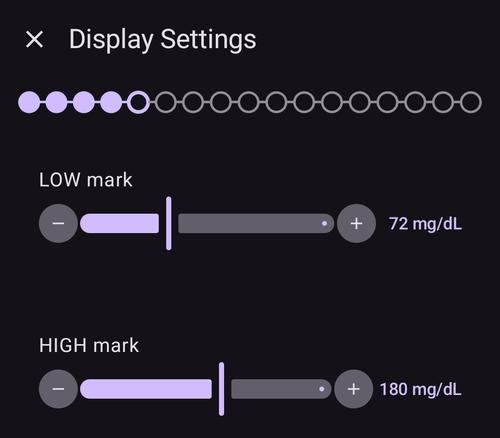

(SetupWizard-synchronization-with-the-reporting-server-and-more)=
## Ryšys

Ekrane „**Ryšys**“ išvardyti įskiepiai, kurie naudojami duomenims įkelti, sinchronizuoti ir transliuoti:

- **SMS komandos** – nuotolinis **AAPS** valdymas SMS komandomis
- **NSClientV3** – sinchronizuoja jūsų duomenis su Nightscout per v3 API
- **Tidepool** – įkelia duomenis į Tidepool
- **xDrip** – siunčia duomenis į xDrip
- **Open Humans** – įkelkite ir paaukokite savo diabeto duomenis moksliniams projektams
- **Išmanieji laikrodžiai** – **AAPS** stebėjimas ir valdymas iš WearOS laikrodžio
- **Išorinės susietos programėlės** – duomenų transliavimas į įvairias išorines programėles
- **Garmin** – ryšys su Garmin įrenginiu


Slinkite žemyn, kad pamatytumėte likusį sąrašą:


Kai kuriuos iš jų galėtumėte sukonfigūruoti dabar, bet pirmą kartą sutelksime dėmesį tik į ataskaitų serverį. Jei šiuo metu negalite jo nustatyti, kol kas praleiskite – galėsite sukonfigūruoti vėliau.

Šiame pavyzdyje kaip ataskaitų serverį naudojame Nightscout. Pažymėkite laukelį dešinėje nuo „**NSClientV3**“, kad jį įjungtumėte. Su Tidepool dar paprasčiau, nes reikia tik jūsų asmeninių prisijungimo duomenų.

Įjungę spauskite „**Parametrai**“ po NSClientV3, kad jį sukonfigūruotumėte:


Čia konfigūruojate Nightscout ataskaitų serverį. NSClientV3 nustatymai rodomi viename slenkamame puslapyje:


Spauskite „**Nightscout URL**“ ir įveskite savo asmeninio Nightscout serverio adresą (URL, kurį nustatėte patys arba gavote iš paslaugos teikėjo). Patvirtinkite paspausdami „**OK**“.

Spauskite „**Nightscout prieigos raktas**“ ir įveskite savo Nightscout serverio prieigos raktą. Be šio prieigos rakto prieiga neveiks. Jei jo dar neturite, perskaitykite ataskaitų serverio nustatymo dokumentaciją.

Leave "**Use websockets**" enabled for real-time communication with Nightscout. Websockets are **mandatory** for remote control from **AAPSClient**, on both phones.

Kitas skiltis kol kas galite palikti su numatytosiomis reikšmėmis. Jos aprašytos čia, kad vėliau žinotumėte, kur jų ieškoti:

**Įspėjimų nustatymai** – Nightscout aliarmai, pranešimai ir pasenusių duomenų ribos. Kol kas palikite jungiklius išjungtus. Atidarome juos tik tam, kad žinotumėte apie šias parinktis.

**Ryšio nustatymai** – pasirinkite, kaip perduodami duomenys. Prižiūrintys asmenys turi įjungti „**Naudoti mobiliuosius duomenis**“, kitaip prižiūrimo asmens (_pvz._, vaiko) telefonas negalės įkelti duomenų už Wi-Fi ryšio ribų, _pvz._, pakeliui į mokyklą. Kiti naudotojai gali išjungti duomenų perdavimą mobiliuoju ryšiu, kad taupytų duomenis ar bateriją. Jei abejojate, palikite viską įjungtą.


**Papildomi nustatymai** – įjunkite „**Įrašyti programos paleidimą**“, jei norite Nightscout matyti, kada programėlė paleidžiama iš naujo (naudinga prižiūrintiems asmenims). Palikite įjungtus „**Kurti pranešimus iš klaidų**“ ir „**Kurti pranešimus, kai reikia angliavandenių**“. Palikite išjungtą „**Sinchronizuoti lėtai**“. Jo reikia tik tada, jei Nightscout serveris lėtai apdoroja didelį duomenų kiekį.


Grįžkite į įskiepių sąrašą ir spauskite „**TOLIAU**“, kad pereitumėte į kitą ekraną.

## Kliento valdymas

Nuo **AAPS** 4 versijos klientų įrenginiai su **AAPSClient** gali būti **susieti** su šiuo telefonu (**pagrindiniu įrenginiu**) ir jį valdyti pasirašytomis komandomis, siunčiamomis per Nightscout. Tai naujas rekomenduojamas nuotolinio **AAPS** valdymo būdas – išsamų paaiškinimą ir nustatymą rasite [Pagrindinio įrenginio ↔ kliento valdymas](../RemoteFeatures/ClientMasterControl.md).

Šiame ekrane dabar nieko nustatyti nereikia. Klientus galėsite susieti bet kada vėliau per **Valdymas → Autorizuoti klientai**. Ten klientą pridedate su **QR kodu** (jis kliente nustato ir Nightscout) arba su **PIN** ir priskiriate jam **vaidmenį**.

- „**Autorizuoti klientai**“ – susietų klientų įrenginių, kuriems leidžiama valdyti šį pagrindinį įrenginį, tvarkymas.
- „**Nightscout duomenų priėmimas**“ – tiesiogiai Nightscout įvestų terapijos įrašų ir duomenų priėmimas (senas, mažiau saugus būdas) dabar pagal numatymą išjungtas. Atidarykite šiuos nustatymus tik jei to vis dar reikia, _pvz._, kad įvestumėte duomenis per Nightscout ar trečiųjų šalių programėles.

Kai kliento valdymas jau įjungtas ([Paprastajame režime](#preferences-simple-mode) visada), šis telefonas veikia [sustiprintos apsaugos režimu](#client-master-control-hardened-mode): jis priima pakeitimus tik iš susietų klientų, todėl ekrane vietoj „**Nightscout duomenų priėmimas**“ nustatymų paaiškinamas sustiprintos apsaugos režimas.


„**Nightscout duomenų priėmimas**“ atidaro nustatymus „**Sinchronizacija**“, kur kiekviena iš Nightscout gaunamų duomenų rūšis turi savo jungiklį:


Spauskite „**TOLIAU**“, kad pereitumėte į kitą ekraną.

(setup-wizard-instance-name)=
## Kas naudoja šį telefoną?

Čia įveskite šį telefoną naudojančio asmens vardą. Jis padeda atskirti šią **AAPS** sistemą nuo kitų ataskaitose ir sinchronizuojant, pavyzdžiui, jei jūsų šeimoje **AAPS** naudoja du vaikai. Jis taip pat naudojamas eksportuotų nustatymų failų pavadinimuose ir rodomas laikrodyje.

Jis gali būti bet koks. Vėliau jį galite pakeisti per **Nustatymai → Bendrieji → Egzemplioriaus pavadinimas**.

Spauskite „**TOLIAU**“, kad pereitumėte į kitą ekraną.

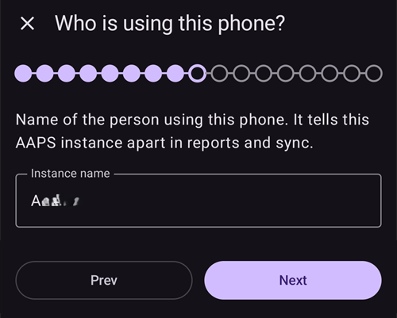

## Patient type

Čia pasirenkate „Naudotojo tipą“. Tai svarbu, nes **AAPS** programinė įranga taiko skirtingas ribas, priklausomai nuo naudotojo amžiaus. Tai svarbu dėl saugumo ir saugos.

Čia taip pat nustatote **maksimalų leistiną bolusą** valgiui. Tai yra didžiausias bolusas, kurio jums reikia įprastam valgiui padengti. Tai saugos funkcija, kuri padeda išvengti atsitiktinės perdozės, kai leidžiate bolusą valgiui.

Antroji riba panaši, bet susijusi su didžiausiu angliavandenių kiekiu, kurį tikitės suvalgyti.

Nustatę šias reikšmes, spauskite „**TOLIAU**“, kad pereitumėte į kitą ekraną:


## Insulinas

Čia nustatote insuliną, kurį naudojate pompoje. Naujiems insulino profiliams reikia **ne trumpesnės kaip 5 val. IVT**.

Spauskite mygtuką „**Insulinas**“, kad atidarytumėte insulino redaktorių:

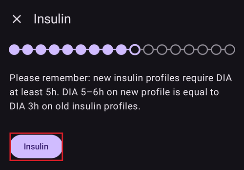

Redaktoriuje galite insulinui suteikti **pavadinimą** ir nustatyti jo **piką** (minutėmis) ir **IVT** (valandomis). Greičiausias būdas – įkelti ruošinį per „**Įkelti piko reikšmę iš**“: pasirinkite **Novorapid**, **Fiasp** arba **Lyumjev**, ir pikas bus užpildytas automatiškai. Grafikas apačioje rodo gautą insulino aktyvumo kreivę.

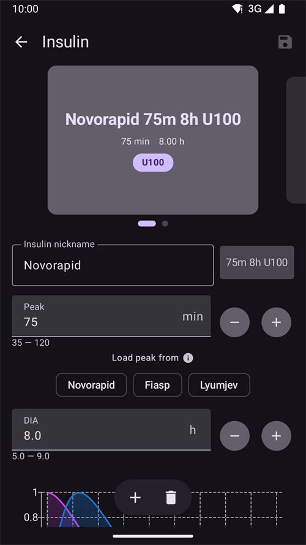

Pasirinkite ruošinį, kuris atitinka jūsų insuliną, pavyzdžiui, **Fiasp**:


```{admonition} Use your insulin brand's preset peak
:class: danger
Nekeiskite piko, nebent esate ekspertas – paprastai kiekvieno insulino ruošinio reikšmės tinka gerai.
```

Jei esate naujas **AAPS** naudotojas, nustatykite **IVT** 9 valandas – kodėl, žr. [Insulino veikimo trukmė (IVT) ir pikas](#Config-Builder-insulin-dia).

```{admonition} "Insulin configuration changed" dialog
:class: note
Jei susietas klientas (_pvz._, kitas telefonas) pakeitė insulino konfigūraciją, atsiranda dialogo langas. Spauskite **OK**, kad įkeltumėte jo pakeitimus, arba **Atšaukti**, kad tęstumėte redagavimą (kitą kartą išsaugojus, jūsų pakeitimai perrašys jo pakeitimus).
```


Spauskite išsaugojimo piktogramą (viršuje dešinėje), tada spauskite „**TOLIAU**“, kad pereitumėte į kitą ekraną.

## Glikemijos šaltinis

Čia pasirenkate, iš kur **AAPS** gauna gliukozės duomenis. Perskaitykite savo [glikemijos šaltinio](../Getting-Started/CompatiblesCgms.md) dokumentaciją.

Galimų šaltinių yra daug – slinkite sąrašą ir pasirinkite tą, kurį naudojate:

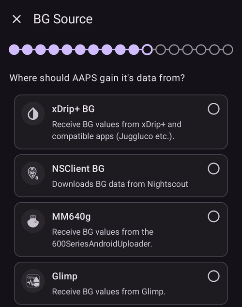

Pasirinkus šaltinį, jo kortelė išsiskleidžia ir rodo du mygtukus: „**Parametrai**“ – nustatyti, kaip gaunami duomenys, ir „**Atidaryti įskiepį**“ – atidaryti paties šaltinio ekraną. Toliau pateiktame pavyzdyje pasirinktas **BYODA**. Kai kurių šaltinių šiame etape nustatyti nereikia, todėl paprastai galite iškart pereiti į kitą ekraną:


Pasirinkę spauskite „**TOLIAU**“, kad pereitumėte į kitą ekraną.

(setup-wizard-profile)=
## Profile

Dabar pereiname prie labai svarbios Sąrankos vedlio dalies.

Prieš įvesdami profilio duomenis kitame ekrane, perskaitykite dokumentaciją apie [profilius](../SettingUpAaps/YourAapsProfile.md).

```{admonition} Working profile required - no exceptions here !
:class: danger
Kad **AAPS** veiktų saugiai, būtinas tikslus profilis.

Būtina, kad savo profilį nustatytumėte ir aptartumėte su gydytoju ir kad jo tinkamumas būtų patikrintas sėkmingais valandinės bazės, JIF ir IA testais!

Jei robotas gauna neteisingus duomenis, jis klys – nuolat. **AAPS** gali dirbti tik su ta informacija, kurią gauna. Jei jūsų profilis per stiprus, rizikuojate hipoglikemija, o jei per silpnas – hiperglikemija. 
```

Spauskite mygtuką „**Profilis**“, kad atidarytumėte profilio redaktorių:


Redaktorius atsidaro tuščias („Nėra įrašų“). Spauskite mygtuką „**+**“ apačioje, kad sukurtumėte naują profilį:


Ilgainiui, jei reikia, galite turėti kelis profilius. Čia sukuriame tik vieną.

```{admonition} Profile only for tutorial - not for your usage
:class: note
Čia pateiktas profilio pavyzdys tik parodo, kaip įvesti duomenis.

Tai nėra tikslus ar gerai optimizuotas profilis, nes kiekvieno žmogaus poreikiai labai skiriasi.

Nenaudokite jo tikram ciklui!
```

Naujas profilis (pavyzdžiui, „**LocalProfile1**“) turi keturis skirtukus: **IA**, **JIF**, **BAZ** ir **TIKSLAS**. Spauskite pieštuką šalia profilio pavadinimo, kad jį pervadintumėte. Užpildykite kiekvieną skirtuką – skirtukas lieka raudonas ir rodo klaidos pranešimą, kol jame nėra tinkamų reikšmių:


Spauskite „**IA**“ ir įveskite savo [IA](#your-aaps-profile-insulin-to-carbs-ratio) reikšmes. Mygtuku „**+**“ pridėkite daugiau laiko intervalų:


Spauskite „**JIF**“ ir įveskite savo [JIF reikšmes](#your-aaps-profile-insulin-sensitivity-factor):

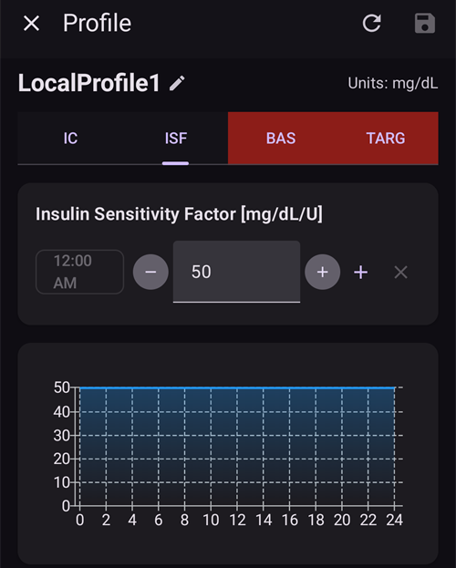

Spauskite „**BAZ**“ ir įveskite savo [valandinės bazės reikšmes](#your-aaps-profile-basal-rates):


Spauskite „**TIKSLAS**“ ir įveskite savo gliukozės tikslo reikšmes.

Atviram ciklui šis tikslas gali būti platesnis intervalas. Kitaip **AAPS** nuolat ragins keisti laikiną valandinę bazę ar kitą nustatymą, o tai gali varginti.

Vėliau, naudodami uždarą ciklą, paprastai turėsite vieną reikšmę ir viršutinei, ir apatinei ribai. Taip **AAPS** lengviau pasiekti tikslą ir geriau kontroliuoti jūsų diabetą.


Kai visi keturi skirtukai užpildyti teisingai, **išsaugojimo piktograma** (viršuje dešinėje) tampa aktyvi. Spauskite ją, kad išsaugotumėte profilį:


Uždarykite redaktorių paspausdami „**X**“ viršutiniame kairiajame kampe. Tada profilio santraukoje rodomas jo pavadinimas, bendra paros valandinė bazė (∑), vienetai ir IA bei JIF reikšmės su jų grafikais:

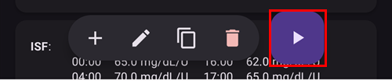

```{admonition} Several defined but only one active profile
:class: note
Galite turėti kelis profilius, bet vienu metu aktyvus gali būti tik vienas profilis.
```

Spauskite mygtuką „**▶**“ (aktyvuoti) apačioje dešinėje. Atsidaro ekranas „**Aktyvuoti**“. Kadangi insulinas dar nepasirinktas, pirmiausia jūsų paprašoma pasirinkti naudojamą insuliną, kad profilio keitimas jį įrašytų. Kol to nepadarysite, mygtukas „**Aktyvuoti**“ lieka pilkas:

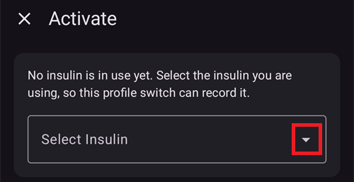

Spauskite „**Pasirinkite insuliną**“ ir pasirinkite anksčiau nustatytą insuliną. Palikite procentą 100 % ir spauskite „**Aktyvuoti**“:


Atsiranda profilio keitimo langas. Šiuo atveju palikite numatytąsias reikšmes ir patvirtinkite paspausdami „**OK**“:

```{admonition} Profile switch dialog
:class: note
Vėliau išmoksite naudoti šį bendrą langą tokiose situacijose kaip liga ar sportas, kai profilį reikia pritaikyti prie aplinkybių.
```


Jūsų profilis dabar aktyvus. Spauskite „**TOLIAU**“, kad pereitumėte į kitą ekraną.

## Insulin pump

Dabar pasirenkate savo insulino pompą. Perskaitykite savo [insulino pompos](../Getting-Started/CompatiblePumps.md) dokumentaciją.

Slinkite sąrašą ir pasirinkite savo pompą. Šiame pavyzdyje naudojame „**Virtuali pompa**“. Ji naudinga, kol dar mokotės ir dar neprijungėte tikros pompos:


Palaikoma daug pompų – slinkite žemyn, kad rastumėte savąją:


Kai pasirenkate tikrą pompą, **AAPS** prašo patvirtinimo, nes nukopijuos jūsų profilio valandines bazes į pompą ir perrašys ten saugomas valandines bazes. Spauskite „**OK**“ tik jei valandinės bazės jūsų **AAPS** profilyje yra teisingos. Kitu atveju spauskite „**Atšaukti**“ ir pompą pakeiskite vėliau:


Jei pasirinkta pompa jungiasi per Bluetooth, baigus vedlį **AAPS** paprašys leidimo jungtis prie netoliese esančių įrenginių (žr. [Bluetooth leidimas](#setup-wizard-bluetooth-permission)).

Jei jau nustatėte profilį ir žinote, kaip prijungti pompą, galite ją prijungti dabar. Kitu atveju kol kas palikite **Virtuali pompa** – ją galite pakeisti bet kada arba išeiti iš Sąrankos vedlio rodykle viršutiniame kairiajame kampe ir leisti **AAPS** pirmiausia parodyti jums kelias gliukozės reikšmes.

Spauskite „**TOLIAU**“, kad pereitumėte į kitą ekraną.

## DKS algoritmas

Kaip DKS algoritmą naudokite OpenAPS SMB algoritmą. Nepaisant pavadinimo, algoritmo SMB funkcija išjungta, kol susipažinsite su AAPS ir atliksite pirmuosius mokymo etapus. OpenAPS SMB vis tiek yra naujesnis ir paprastai geresnis už OpenAPS AMA.

SMB pradžioje išjungtas, nes SMB funkcija greičiau reaguoja į gliukozės kilimą: vietoj valandinės bazės procento didinimo ji naudoja supermikrobolusą. Kadangi pradžioje jūsų profilis paprastai nėra toks geras kaip įgijus patirties, ši funkcija iš pradžių išjungta.

```{admonition} Only use the older algorithm **OpenAPS AMA** if you know what you are doing
:class: note
OpenAPS AMA yra paprasčiausias algoritmas, kuris nepalaiko mikrobolusų aukštoms reikšmėms koreguoti. Gali būti situacijų, kai geriau naudoti šį algoritmą, bet tai nėra rekomendacija.
```

Pasirinkite „**OpenAPS SMB**“, tada spauskite „**Parametrai**“, kad pamatytumėte išsamią informaciją:


Vienintelė parinktis čia – „**Naudoti dinaminį jautrumą**“. Palikite ją išjungtą ir kol kas nieko nekeiskite – tiesiog perskaitykite tekstą.

Dėl **mokymo etapų** apribojimų šiuo metu vis tiek negalite naudoti nei „uždaro ciklo“, nei „SMB funkcijų“.

Grįžkite atgal ir spauskite „**TOLIAU**“, kad pereitumėte į kitą ekraną:


## Jautrumo nustatymas

Palikite pasirinktą „**Jautrumo nustatymo algoritmas Oref1**“ kaip standartinį jautrumo įskiepį:


Jei paspausite „**Parametrai**“, galite peržiūrėti angliavandenių įsisavinimo parametrus. Numatytosios reikšmės (_pvz._, 6 val. įsisavinimo ribinis laikas) kol kas tinka.


Spauskite „**TOLIAU**“, kad pereitumėte į kitą ekraną.

## 1 mokymo etapo pradžia

Dabar pradedate mokymo etapus – jie suteikia prieigą prie kitų **AAPS** funkcijų.

Spauskite „**Atidaryti mokymo etapus**“:

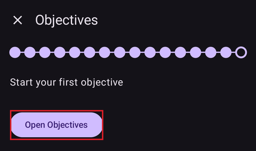

Čia pradedame 1 mokymo etapą, net jei šiuo metu mūsų sąranka dar nėra visiškai paruošta šiam etapui sėkmingai atlikti. Bet tai tik pradžia.

Spauskite **1 mokymo etapo** mygtuką „**Pradėti**“:


Mokymo etapas išsiskleidžia ir parodo atskirus patikrinimus. Matote, kad jau šiek tiek pažengėte, o kiti punktai dar laukia:


Grįžkite atgal, tada spauskite „**UŽBAIGTI**“, kad baigtumėte Sąrankos vedlį:


Paspaudę „**UŽBAIGTI**“, pateksite į pagrindinį **AAPS** ekraną. Gali atsidaryti skydelis „**Pranešimas**“ su informaciniais pranešimais, pavyzdžiui, apie ką tik atliktą profilio keitimą. Spauskite „**Atmesti**“ po kiekvienu pranešimu, kad jį pašalintumėte.

Jei netyčia išeisite iš Sąrankos vedlio, galite tiesiog vėl paleisti vedlį arba rankiniu būdu pakeisti [AAPS ciklo konfigūraciją](../SettingUpAaps/ChangeAapsConfiguration.md).

(setup-wizard-bluetooth-permission)=
## Bluetooth leidimas

Jei pasirenkate pompą, kuri jungiasi per Bluetooth (pavyzdžiui, **Omnipod Dash**), juosta primena, kad **AAPS** reikia Bluetooth leidimo. Kol kas galite spausti „**Atmesti**“ – leidimas suteikiamas baigus vedlį:

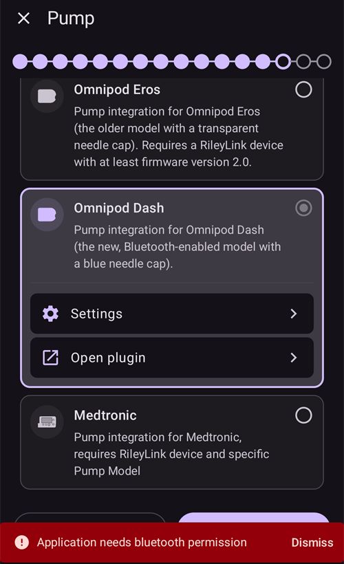

Baigus Sąrankos vedlį, pagrindiniame **AAPS** ekrane rodomas skydelis „**Reikalingi leidimai**“. Kiti leidimai jau suteikti. Spauskite „**Suteikti**“ šalia „**Bluetooth**“:


Pasirinkite „**Allow**“ (leisti), kad **AAPS** galėtų rasti pompą ir prie jos prisijungti:


Jei jūsų **AAPS** ciklas jau visiškai nustatytas, pereikite prie kito skyriaus [„Mokymo etapų atlikimas“](../SettingUpAaps/CompletingTheObjectives.md).
