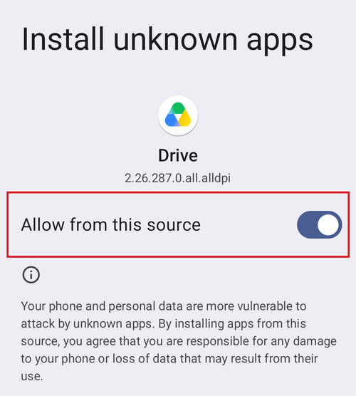

# AAPS perkėlimas ir įdiegimas telefone

Ankstesniame skyriuje [**AAPS** kūrimas](../SettingUpAaps/BuildingAaps.md) kompiuteryje sukūrėte **AAPS** programėlę (tai yra .apk failas).

Kiti žingsniai: **perkelti** **AAPS** APK failą (ir kitas reikalingas programėles, pvz., BYODA, xDrip ar kitą NGJ imtuvo programėlę) į Android išmanųjį telefoną ir tada **įdiegti** programėlę (-es). Įdiegę **AAPS** telefone, galėsite pereiti prie [**AAPS ciklo konfigūravimo**](../SettingUpAaps/SetupWizard.md).

Šiame puslapyje taip pat paaiškinamas [Android kūrėjų tapatybės patikrinimas](#android-developer-verification) – pakeitimas, kurį Google diegia nuo 2026 m. rugsėjo ir kuris paveikia pačių sukurtų programėlių diegimą, bei [nemokami diegimo būdai](#android-developer-verification-free-methods), kurie veiks ir po šio pakeitimo.

```{contents} Table of contents
:depth: 1
:local: true
```

## AAPS diegimas paspaudžiant APK failą

Šiuo metu **AAPS** įdiegiate perkėlę APK failą į telefoną ir jį atidarę („paspaudę“). **AAPS** APK failą iš kompiuterio į išmanųjį telefoną galima perkelti keliais būdais. Čia paaiškiname du skirtingus būdus:

* 1 variantas – naudokite Google Drive (Gdrive)
* 2 variantas – naudokite USB kabelį

Atminkite, kad perkeliant el. paštu gali kilti sunkumų, todėl to daryti nerekomenduojama.

```{admonition} Android developer verification
:class: warning
Nuo 2026 m. rugsėjo Google diegia [Android kūrėjų tapatybės patikrinimą](#android-developer-verification) (pirmiausia Brazilijoje, Indonezijoje, Singapūre ir Tailande, 2027 m. – visame pasaulyje). Ten, kur jis taikomas, APK diegimas paspaudus failą (kaip aprašyta abiejuose toliau pateiktuose variantuose) yra blokuojamas. Tokiu atveju naudokite vieną iš [nemokamų diegimo būdų](#android-developer-verification-free-methods), aprašytų žemiau šiame puslapyje.
```

### 1 variantas. Failų perkėlimas per Google Drive

Naršyklėje atidarykite [Google.com](https://www.google.com/) ir prisijunkite prie savo Google paskyros.

Viršuje dešinėje Google meniu pasirinkite Drive programėlę.


Spauskite **New** (Naujas) viršuje kairėje (arba dešiniuoju pelės mygtuku spauskite tuščią vietą po failais ir aplankais) ir pasirinkite **File upload** (Įkelti failą).


Dabar apk failas turėtų būti įkeltas į Google Drive.

#### Apk failo diegimas per Google Drive programėlę

Pereikite prie telefono ir paleiskite Google Drive programėlę. Tai iš anksto įdiegta programėlė. Ją rasite ten, kur yra kitos Google programėlės, arba paieškoje įvedę programėlės pavadinimą.


Paleiskite APK diegimą telefone, Google Drive programėlėje paspaudę failo pavadinimą.


Jei gausite saugos pranešimą, kad šiuo metu negalima diegti programėlių iš Google Drive, spauskite „Settings“ (Nustatymai) ir trumpam tai leiskite, o po to vėl uždrauskite, nes palikti šį leidimą visą laiką įjungtą nesaugu.




Kai diegimas baigsis, šis žingsnis atliktas.

Turėtumėte matyti **AAPS** piktogramą ir galėti atidaryti programėlę.

```{warning}
**SVARBUS SAUGOS PRANEŠIMAS**
Ar nepamiršote vėl uždrausti diegimo iš Google Drive?
```

Toliau tęskite [AAPS ciklo konfigūravimą](../SettingUpAaps/SetupWizard.md).

### 2 variantas. Failų perkėlimas USB kabeliu

Antras būdas perkelti AAPS APK failą – [USB kabeliu](https://support.google.com/android/answer/9064445?hl=en).

Perkelkite failą iš jo vietos kompiuteryje į telefono atsisiuntimų aplanką („downloads“).

Telefone turėsite leisti diegti programas iš nežinomų šaltinių. Kaip tai padaryti, galite rasti internete (_pvz.,_ [čia](https://www.expressvpn.com/de/support/vpn-setup/enable-apk-installs-android/) arba [čia](https://www.androidcentral.com/unknown-sources)).

Nutempę failą į telefoną, telefone atidarykite aplanką „Downloads“ (Atsisiuntimai) ir paspauskite AAPS APK failą:


Pirmą kartą Android praneš, kad telefonui neleidžiama diegti nežinomų programėlių iš šio šaltinio. Spauskite „**Settings**“ (Nustatymai):


Įjunkite „**Allow from this source**“ (Leisti iš šio šaltinio) ir grįžkite atgal:


Dar kartą paspauskite APK failą ir pasirinkite „**Install**“ (Įdiegti):


Kai diegimas baigsis, spauskite „**Open**“ (Atidaryti), kad paleistumėte **AAPS**, arba „**Done**“ (Atlikta), jei norite atidaryti vėliau:


```{warning}
**SVARBUS SAUGOS PRANEŠIMAS**
Po diegimo nepamirškite vėl išjungti „Allow from this source“, nes palikti šią parinktį visą laiką įjungtą nesaugu.
```

Toliau tęskite [AAPS ciklo konfigūravimą](../SettingUpAaps/SetupWizard.md).

(transferring-installing-play-protect-warning)=
## Google Play Protect įspėjimas

Diegiant **AAPS**, Google Play Protect gali įspėti, kad programėlė nesaugi, sukurta senesnei Android versijai ir neturi naujausių privatumo apsaugų.


Tai normalu programėlei, kurią sukūrėte patys. Spauskite **More details** (Daugiau informacijos), tada **Install anyway** (Vis tiek įdiegti).

Jei diegimas **užblokuotas** ir rodomas pranešimas apie nepatvirtintą kūrėją (ne tik įspėjimas), žr. [Android kūrėjų tapatybės patikrinimas](#android-developer-verification) žemiau.

(android-developer-verification)=

## Android kūrėjų tapatybės patikrinimas

Google įveda **Android kūrėjų tapatybės patikrinimą**: daugumoje Android telefonų bus galima įdiegti tik tas programėles, kurias Google užregistravo patvirtintas kūrėjas. Tai galioja ir programėlėms, diegiamoms iš APK failo („sideloading“), o būtent taip įdiegiate pačių sukurtą **AAPS** programėlę.

### Kas keičiasi

Kai diegiate **AAPS** telefone su Google paslaugomis („sertifikuotame“ Android įrenginyje – tai beveik kiekvienas telefonas, parduodamas su Play Store), Android patikrins, ar programėlė yra iš Google užregistruoto kūrėjo. Jei ne, įprastas diegimas paspaudus APK failą blokuojamas.

**Patikrinimas atliekamas, kai programėlė diegiama arba atnaujinama.** Jau įdiegtos ir veikiančios programėlės nepašalinamos.

Google tai diegia palaipsniui:

| Kada                  | Kas vyksta                                                                                                                                                               |
| --------------------- | ------------------------------------------------------------------------------------------------------------------------------------------------------------------------ |
| 2026 m. rugpjūtis     | Nemokamos riboto platinimo („limited distribution“) kūrėjų paskyros prieinamos visame pasaulyje, o telefonuose pradedama diegti „išplėstinė procedūra“ („advanced flow“) |
| 2026 m. rugsėjo 30 d. | Patikrinimas taikomas **Brazilijoje, Indonezijoje, Singapūre ir Tailande** programėlėms, diegiamoms iš Google Play ir kelių kitų programėlių parduotuvių                 |
| 2027 m.               | Taikymas išplečiamas į **likusį pasaulį** ir **visus diegimus**, įskaitant APK failus                                                                                    |

Išsamią informaciją Google skelbia [Android developer verification](https://developer.android.com/developer-verification) puslapiuose, įskaitant [DUK](https://developer.android.com/developer-verification/guides/faq). Google dar gali pakeisti datas ir detales; šis puslapis bus atnaujinamas, kai diegimas vyks toliau.

### Ar tai paveiks mane?

- **AAPS kūrimas visiškai nepaveiktas.** [Kūrimas naršyklėje](#browser-build), [kūrimas su Android Studio](ComputerBuild.md) ir [kūrimas komandinėje eilutėje](CLIBuild.md) veikia lygiai taip pat kaip anksčiau, o jūsų raktų saugykla nesikeičia.
- **Jūsų dabartinė AAPS programėlė ir toliau veikia.** Patikrinimas atliekamas tik diegiant arba atnaujinant programėlę.
- **Jei gyvenate Brazilijoje, Indonezijoje, Singapūre ar Tailande:** nuo 2026 m. rugsėjo 30 d. patikrinimas taikomas programėlėms, diegiamoms iš Google Play ir kelių kitų programėlių parduotuvių. Google teigia, kad tiesioginis APK failo diegimas į šį pirmą etapą neįtrauktas, todėl **AAPS** turėtų įsidiegti kaip įprasta. Vis dėlto jau dabar pasiruoškite vieną iš toliau aprašytų [nemokamų diegimo būdų](#android-developer-verification-free-methods), kad jūsų neužkluptų netikėtai, jei tai pasikeistų.
- **Jei gyvenate kitur:** iki 2027 m. jums niekas nesikeičia, ir kol kas nieko nedaryti yra visai tinkamas pasirinkimas. Tačiau nustatykite vieną iš toliau aprašytų [nemokamų diegimo būdų](#android-developer-verification-free-methods), kol viskas veikia: blogiausias momentas sužinoti apie blokavimą – tą dieną, kai atnaujinimas atmetamas, o prieš jus dar 24 valandų [išplėstinės procedūros](#android-developer-verification-advanced-flow) laukimas.
- **Seni telefonai:** patikrinimas taikomas telefonams su Android 7 ar naujesne versija, t. y. kiekvienam telefonui, kuriame gali veikti **AAPS**.

(android-developer-verification-free-methods)=

## Nemokami AAPS diegimo būdai

Kad galėtumėte toliau naudoti **AAPS**, Google mokėti **nieko nereikia**. Yra keli nemokami būdai; pasirinkite tą, kuris tinka jūsų situacijai.

```{admonition} Which method should I use?
:class: tip
- Turite **kompiuterį** (nesvarbu, kaip sukūrėte **AAPS**): naudokite [ADB](#android-developer-verification-adb) arba, jei nenorite naudoti komandinės eilutės, [žiniatinklio diegimo programą](#android-developer-verification-web). Abiem būdais patikrinimas netaikomas, nėra jokių apribojimų ir nereikia Google paskyros.
- **Kompiuterio visai neturite**: telefone naudokite [išplėstinę procedūrą](#android-developer-verification-advanced-flow).
- Norite užsiregistruoti Google, kad įprastas diegimas paspaudus APK failą ir toliau veiktų: yra [nemokama riboto platinimo paskyra](#android-developer-verification-limited-account), tačiau su **AAPS** ji neišbandyta.
```

(android-developer-verification-adb)=

### 1 variantas: diegimas su ADB (reikia kompiuterio)

ADB (Android Debug Bridge) – oficialus Google įrankis programėlėms iš kompiuterio į telefoną diegti USB kabeliu. Google patvirtino, kad **programėlėms, įdiegtoms su ADB, patikrinimas netaikomas** – nėra laukimo laikotarpio, įrenginių skaičiaus ribos ir registracijos.

Vienkartinis pasiruošimas:

1. Telefone įjunkite paslėptas kūrėjo parinktis: eikite į **Settings** (Nustatymai) > **About phone** (Apie telefoną) (kai kuriuose telefonuose **Software information** (Programinės įrangos informacija)) ir septynis kartus paspauskite **Build number** (Versijos numeris), kol telefonas patvirtins, kad esate kūrėjas.
1. Grįžkite į pagrindinį **Settings** meniu, atidarykite naują įrašą **Developer options** (Kūrėjo parinktys) ir įjunkite **USB debugging** (USB derinimas).
1. Kompiuteryje įsitikinkite, kad ADB yra:
   - Jei naudojate **Android Studio**, ADB jau įdiegtas kartu su ja.
   - Kitu atveju atsisiųskite nemokamus Google [SDK Platform Tools](https://developer.android.com/tools/releases/platform-tools) ir išarchyvuokite aplanką. Diegti nieko nereikia; ADB – tai programa `adb` tame aplanke.

**AAPS** diegimas (ir vėlesni atnaujinimai):

1. Prijunkite telefoną prie kompiuterio USB kabeliu. APK failo iš anksto į telefoną perkelti nereikia: ADB jį siunčia tiesiai iš kompiuterio.
1. Telefone patvirtinkite užklausą **Allow USB debugging?** (Leisti USB derinimą?) (tik pirmą kartą).
1. Kompiuteryje atidarykite terminalą (komandinę eilutę) aplanke, kuriame yra ADB ir **AAPS** APK failas, ir paleiskite:

   ```
   adb install -r app-full-release.apk
   ```

   Vietoj `app-full-release.apk` įrašykite tikrąjį savo APK failo pavadinimą. Parinktis `-r` atnaujina jau įdiegtą **AAPS** ir išsaugo visus jos duomenis ir nustatymus.

1. Palaukite, kol bus parodyta `Success`. **AAPS** jau įdiegta jūsų telefone.

Ta pati komanda naudojama visiems būsimiems atnaujinimams. [Wear OS puslapiuose](../WearOS/WearOsSmartwatch.md) ADB jau naudojamas taip pat – laikrodžio programėlei įdiegti.

Jei nenorite naudoti kabelio: Android 11 ir naujesnėse versijose **wireless debugging** (belaidis derinimas, taip pat skiltyje **Developer options**) gali tą patį atlikti per Wi-Fi, po vienkartinio susiejimo su kodu, rodomu telefone.

(android-developer-verification-web)=

### 2 variantas: diegimas iš tinklalapio (kompiuteris, be komandinės eilutės)

Jei komandinė eilutė jums netinka, tinklalapis gali atlikti lygiai tą patį, ką ADB, tiesiai iš jūsų naršyklės. Kadangi jis su telefonu bendrauja tuo pačiu mechanizmu kaip ADB, jam taikoma **ta pati išimtis iš patikrinimo**, tačiau nereikia nieko atsisiųsti, išarchyvuoti aplanko ar rašyti komandų.

Tai paprasčiausias būdas, jei naudojote [kūrimą naršyklėje](#browser-build) ir niekada nesate atidarę komandinės eilutės.

1. Telefone įjunkite **USB debugging** (USB derinimas) (aukščiau aprašyto [ADB būdo](#android-developer-verification-adb) 1 ir 2 žingsniai – vienkartinis nustatymas).
1. Naršyklėje atidarykite **[AAPS žiniatinklio diegimo programą](#web-installer)**.
1. Prijunkite telefoną USB kabeliu ir vykdykite puslapio nurodymus: prisijunkite, pasirinkite APK failą ir įdiekite.

Ką reikia žinoti:

- Veikia tik naršyklėse **Chrome, Edge arba Opera**. Firefox ir Safari negali bendrauti su USB įrenginiais.
- Telefono ADB ryšį vienu metu gali naudoti tik viena programa, todėl prieš jungdamiesi **uždarykite Android Studio** (ar bet kurią kitą ADB naudojančią programą).
- Taip prijungtas tinklalapis gauna visišką jūsų telefono valdymą. **Naudokite tik aukščiau nurodytą adresą** iš **AAPS** dokumentacijos – niekada nenaudokite diegimo puslapio, rasto per paieškos sistemą. **AAPS** žiniatinklio diegimo programa veikia tik jūsų naršyklėje: jūsų APK failas niekur neįkeliamas.

```{admonition} No computer? A second phone works too
:class: tip
Žiniatinklio diegimo programa taip pat veikia iš **Chrome kitame Android telefone**, prijungtame USB-C–USB-C kabeliu, todėl tėvai gali įdiegti **AAPS** į vaiko telefoną, net jei namuose nėra kompiuterio.
```

(android-developer-verification-advanced-flow)=

### 3 variantas: „išplėstinė procedūra“ telefone (kompiuterio nereikia)

Patyrusiems naudotojams, kurie supranta nepatvirtintų programėlių diegimo riziką, Google numato atsarginę išeitį – **išplėstinę procedūrą** („advanced flow“). Google ją pradėjo diegti telefonuose 2026 m. rugpjūtį, dar prieš taikymą, todėl galite ją nustatyti jau dabar. Tai vienkartinis nustatymas pačiame telefone, kuris **užtrunka 24 valandas**:

1. Įjunkite paslėptas kūrėjo parinktis (žr. aukščiau aprašyto ADB būdo 1 žingsnį), tada atidarykite **Settings** > **Developer options** > **Apps from unverified developers** (Programėlės iš nepatvirtintų kūrėjų).
1. Įjunkite **Allow apps from unverified developers** (Leisti programėles iš nepatvirtintų kūrėjų). Telefonas paprašys ekrano užrakto, kad patvirtintų, jog tai jūs.
1. Telefonas paklaus, ar kas nors jūsų prašo įjungti šį nustatymą, ir paaiškins, kad bankai, valstybės institucijos ar policija niekada to neprašytų. Perskaitykite įspėjimą ir patvirtinkite, kad niekas jūsų nespaudžia ir nenurodinėja (tai apsauga nuo sukčių).
1. **Paleiskite telefoną iš naujo.** Taip prasideda vienkartinis **24 valandų laukimo laikotarpis**.
1. Po 24 valandų vėl eikite į **Settings** > **Developer options** > **Apps from unverified developers** ir užbaikite nustatymą.
1. Pasirinkite, ar leisti nepatvirtintas programėles **7 dienoms**, ar **neribotą laiką**. **AAPS** atveju pasirinkite **neribotą laiką**, nes kitaip praėjus 7 dienoms kitas atnaujinimas bus užblokuotas.

Po šio nustatymo **AAPS** APK diegimas ar atnaujinimas veikia kaip dabar, tik su vienu papildomu įspėjimu, kad programėlė yra iš nepatvirtinto kūrėjo – spauskite **Install anyway** (Vis tiek įdiegti).

Naudinga žinoti:

- Vėliau galite vėl išjungti **Developer options**: išplėstinė procedūra liks įjungta. Be to, Google nesuteikia programėlėms (pvz., bankų programėlėms) jokio būdo nustatyti, kad išplėstinė procedūra įjungta.
- Jei išplėstinę procedūrą išjungsite, **AAPS** diegimas **ar atnaujinimas** vėl bus blokuojamas (jau įdiegta **AAPS** ir toliau veiks). Turite 10 minučių jai vėl įjungti; vėliau 24 valandų laukimo laikotarpis prasideda iš naujo.
- Telefono laikrodžio keitimas laukimo laikotarpio nesutrumpina, o ADB jo praleisti negali.
- Google teigia, kad jūsų pasirinkimas pagal Google paskyrą perkeliamas į kitus jūsų įrenginius, todėl naujame telefone dar kartą 24 valandas laukti neturėtų reikėti.
- Jei kūrėjo parinktyse nerandate **Apps from unverified developers**, jūsų telefonas šios funkcijos dar negavo. Ją pateikia sistemos komponentas **Android Developer Verifier**, kurį Google palaipsniui diegia per Play Store. Galite tai paspartinti, Play Store atidarę **Android Developer Verifier**.

```{note}
Google tai vadina pirmąja versija ir dar gali pakeisti ekranus bei žingsnius; kai bus galutinė versija, šis skyrius bus atnaujintas su ekrano kopijomis.
```

(android-developer-verification-limited-account)=

### 4 variantas: registracija Google (nemokama riboto platinimo paskyra)

Google siūlo **nemokamą** kūrėjo paskyros tipą mėgėjams ir asmeniniam naudojimui – **riboto platinimo paskyrą** („limited distribution account“), kurią nuo 2026 m. rugpjūčio gali susikurti visi:

- **Nereikia asmens dokumento** ir **nėra mokesčio** (kitaip nei mokamai kūrėjo paskyrai, kurios asmeniniam **AAPS** naudojimui nereikia). Reikia Google paskyros su dviejų veiksmų patvirtinimu, Google mokėjimų profilio su jūsų tikruoju vardu, pavarde ir adresu bei kontaktinio el. pašto adreso.
- Programėlės paketo pavadinimą užregistruojate Google Android Developer Console ir leidžiate telefonus, kuriuose ją galima įdiegti (iki **20 įrenginių**), susiedami telefoną su konsole QR kodu arba nuoroda.
- Po registracijos įprastas diegimas (paspaudus APK failą) leistuose telefonuose vėl veikia – be ADB ir be išplėstinės procedūros.
- Riboto platinimo paskyrą vėliau galima pakeisti į pilną paskyrą, bet ne atvirkščiai.

```{warning}
Google nepaaiškino, kaip veikia registracija, kai daug žmonių kuria tą pačią atvirojo kodo programėlę: kiekviena pačių sukurta **AAPS** naudoja tą patį paketo pavadinimą (`info.nightscout.androidaps`) su skirtingu pasirašymo raktu, o Google DUK teigia, kad kitų jau naudojamo paketo pavadinimo negalima tiesiog pasisavinti ir reikia papildomos peržiūros. Tokios peržiūros rezultatas nežinomas, o mokama kūrėjo paskyra (25 $ ir asmens dokumentas) čia nepadeda: sumokėjus panaikinama tik 20 įrenginių riba, bet ne paketo pavadinimo peržiūra.

Dėl šios priežasties išsamių instrukcijų kol kas parašyti negalima. Šis skyrius bus papildytas, kai registracija bus išbandyta su **AAPS**. Kol kas ADB, žiniatinklio diegimo programa ir aukščiau aprašyta išplėstinė procedūra yra patikimos alternatyvos.
```

## Kas nesikeičia

- **AAPS** kūrimas patiems bet kuriuo iš trijų [kūrimo būdų](BuildingAaps.md).
- Jūsų GitHub paskyra, kūrimo saugykla (AAPS Builder) arba fork ir raktų saugykla.
- Jūsų įdiegta **AAPS** programėlė, jūsų nustatymai ir [mokymo etapai](CompletingTheObjectives.md).
- Telefonai be Google paslaugų ir apskritai [diegimas su ADB](#android-developer-verification-adb).

## Kur gauti pagalbos

1. **Skaitykite** Google [kūrėjų patikrinimo DUK](https://developer.android.com/developer-verification/guides/faq), jei turite klausimų apie patį patikrinimą.
2. Jei diegimas užblokuotas, **klauskite** *#AAPS* kanale [Discord](https://discord.gg/4fQUWHZ4Mw) ar kituose [bendruomenės kanaluose](../GettingHelp/WhereCanIGetHelp.md).
3. Prašydami pagalbos nurodykite telefono gamintoją ir modelį, Android versiją, savo šalį ir tikslų pranešimą, rodomą, kai diegimas nepavyksta.

```{toctree}
:hidden:

AAPS žiniatinklio diegimo programa <WebInstaller.md>
```
