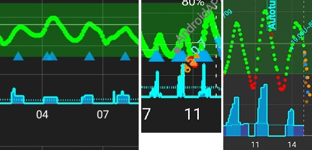
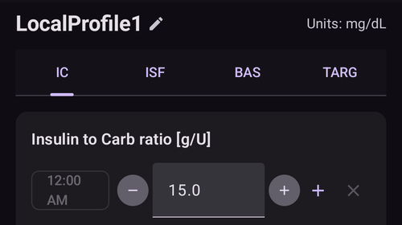
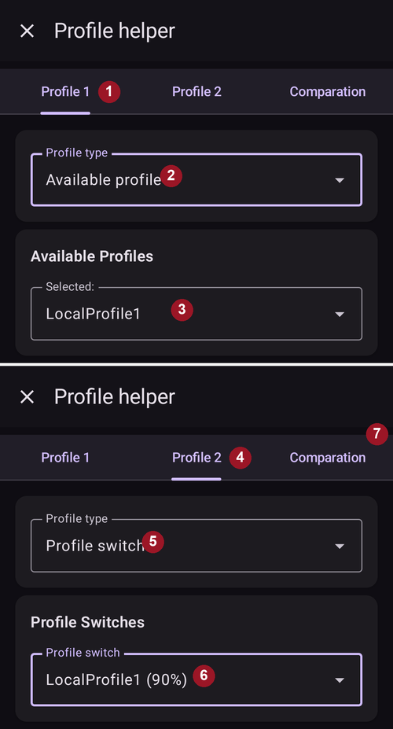

# Jūsų AAPS profilis

Jūsų **AAPS profilis** – tai keturių pagrindinių parametrų rinkinys, kuris nustato, kaip **AAPS** turi tiekti insuliną pagal jutiklio gliukozės reikšmes. Tai pagrindiniai parametrai, kuriais remiasi **AAPS**. Atlikdami **mokymo etapus**, atrakinsite papildomus keičiamus parametrus (pvz., SMB nustatymus), bet šių funkcijų veikimas priklauso nuo to, ar teisingas jūsų pagrindinis **profilis**. **Profilį** sudaro:
* [gliukozės tikslai](#profile-glucose-targets),
* [valandinė bazė](#your-aaps-profile-basal-rates) (BR),
* [jautrumo insulinui faktorius](#your-aaps-profile-insulin-sensitivity-factor) (JIF) ir
* [insulino ir angliavandenių santykis](#your-aaps-profile-insulin-to-carbs-ratio) (IA).

```{admonition} Where did DIA go?
:class: note
**Insulino veikimo trukmė (IVT)** nebėra jūsų **profilio** dalis. Ji nustatoma kiekvienam insulinui atskirai – žr. [Valdymas → Insulino nustatymai](#Config-Builder-insulin-dia).
```

Naudodami **AAPS** turėtumėte nuolat vertinti ir tikrinti, ar jūsų **profilio** nustatymai tikslūs. Rekomenduojama nustatymus derinti tokia tvarka, kokia jie čia pateikti. Prieš keisdami kitą nustatymą, pasistenkite tinkamai nustatyti pirmąjį. Keiskite mažais žingsniais, o ne viską iš karto. Po kiekvieno pakeitimo nepamirškite aktyvuoti naujo profilio. Reguliariai [darykite savo **profilio**](#YourAapsProfile_Profile-backup) nustatymų atsarginę kopiją, eksportuodami nustatymus.

Jūsų **profilio** nustatymai veikia vienas kitą – gali būti „neteisingų“ nustatymų, kurie kartu gerai veikia vienomis aplinkybėmis, bet neveikia kitomis. Pavyzdžiui, kai per didelė valandinė bazė sutampa su per dideliu **IA**. Todėl kiekvieną nustatymą reikia vertinti atskirai ir patikrinti, ar jie gerai veikia kartu įvairiomis aplinkybėmis.

Galite naudoti [Autotune](https://autotuneweb.azurewebsites.net/) kaip pagalbą, tačiau nesekite jo aklai: jis gali netikti jums arba ne visose situacijose.

```{admonition} Your diabetes may vary
:class: note
**Profiliai** labai skiriasi kiekvienam žmogui.

Valandinės bazės (BR), jautrumo insulinui faktoriaus (JIF) ir insulino bei angliavandenių santykio (IA) absoliučios reikšmės ir insulino poreikio tendencijos labai skiriasi kiekvienam žmogui. Jos priklauso nuo jūsų organizmo, lyties, amžiaus, fizinio pasirengimo ir kt., taip pat nuo trumpalaikių veiksnių, pvz., ligos ar neseniai buvusio fizinio krūvio. Daugiau patarimų apie tai rasite Adam Brown knygoje [„Bright Spots and Landmines“](https://diatribe.org/bright-spots-and-landmines/) – ją verta perskaityti.

```

Paskutinius keturis parametrus (gliukozės tikslus, valandinę bazę, jautrumo insulinui faktorių ir insulino bei angliavandenių santykį) per 24 valandas galima nustatyti skirtingomis reikšmėmis, jei reikia – keičiant kas valandą.


Žemiau pateiktos **AAPS** ekrano kopijos su profilio _pavyzdžiu_. Atkreipkite dėmesį: žemiau pateiktame profilio pavyzdyje yra daug laiko taškų. Kai pradedate naudoti **AAPS**, jūsų profilis greičiausiai bus daug paprastesnis.


(profile-glucose-targets)=
## Gliukozės tikslai

### Description

Jūsų **KG tikslas** yra pagrindinė reikšmė, ir visi **AAPS** skaičiavimai remiasi ja. Jis skiriasi nuo tikslinio intervalo, kuriame paprastai stengiatės išlaikyti gliukozės reikšmes. Tikslas naudojamas **AAPS** skaičiavimuose: jei **AAPS** prognozuoja, kad jūsų **KG** bus už tikslinio intervalo ribų, ji imsis veiksmų, kad grąžintų jus į šį intervalą.

Tikslus galima nustatyti šiose ribose:

|                    | _Žemas_ tikslas          | _Aukštas_ tikslas          |
| ------------------ | ------------------------ | -------------------------- |
| Mažiausia reikšmė  | 4,4 mmol/l arba 80 mg/dL | 5 mmol/l arba 90 mg/dL     |
| Didžiausia reikšmė | 10 mmol/l arba 180 mg/dL | 11,1 mmol/l arba 200 mg/dL |

### Impact

Jei tikslas jūsų **profilyje** labai platus (pvz., 3 mmol/l ar daugiau [50 mg/dL ar daugiau]), **AAPS** dažnai mažai ką darys. Taip yra todėl, kad prognozuojama **KG** dažnai būna kažkur šiame plačiame intervale, todėl **AAPS** retai nustato laikiną valandinę bazę.

### Kaip nustatyti

**Žemiau esančiame paveiksle** parodyta, kaip galima nustatyti tikslą **AAPS** profilyje.


**KG** tikslai nustatomi pagal jūsų asmeninius pageidavimus ir poreikius. Pavyzdžiui, jei nerimaujate dėl hipoglikemijos naktį, nuo 21:00 iki 7:00 tikslą galite nustatyti šiek tiek aukštesnį – 117 mg/dL (6,5 mmol/l). Jei norite, kad prieš pusryčių bolusą ryte turėtumėte pakankamai aktyvaus insulino organizme (AIO), nuo 7:00 iki 8:00 galite nustatyti žemesnį tikslą – 81 mg/dL (4,5 mmol/l).

Naudojant [Atvirą ciklą](#KeyAapsFeatures-OpenLoop), ypač atliekant [pirmuosius mokymo etapus](../SettingUpAaps/CompletingTheObjectives.md), platus tikslinis intervalas gali būti geras pasirinkimas, kol mokotės, kaip veikia **AAPS**, ir derinate savo **profilį**.<br/> Naudojant [Uždarą ciklą](#KeyAapsFeatures-ClosedLoop) (nuo **[6 mokymo etapo](#objectives-objective6)**), rekomenduojama intervalą siaurinti, kol kiekvienam paros metui turėsite vieną tikslą (_Žemas_ tikslas = _Aukštas_ tikslas), kad **AAPS** greitai reaguotų į **KG** svyravimus.

(your-aaps-profile-basal-rates)=

## Valandinė bazė

### Description

Jūsų bazinio insulino valandinė bazė (vienetai per valandą) suteikia foninį insuliną, kuris palaiko stabilią gliukozę, kai nevalgote ir nesportuojate.

Insulino pompa kas kelias minutes suleidžia nedidelius greito veikimo insulino kiekius, kad kepenys neišskirtų per daug gliukozės ir kad gliukozė patektų į kūno ląsteles. Bazinis insulinas paprastai sudaro 40–50 % jūsų bendros paros dozės (BPD), priklausomai nuo mitybos, ir paprastai kinta pagal cirkadinį ritmą: per 24 valandas insulino poreikis turi vieną piką ir vieną duobę. Daugiau informacijos rasite Gary Scheiner knygos [„Think like a Pancreas“](https://amzn.eu/d/iVU0RGe) 6 skyriuje – jis labai naudingas.

Dauguma 1 tipo diabeto mokytojų (ir žmonių, sergančių 1 tipo diabetu!) sutinka, kad pirmiausia reikia teisingai nustatyti valandinę bazę, o tik tada optimizuoti JIF ir IA.

### Impact

Tiksli valandinė bazė leidžia pabusti su gliukoze intervale ir praleisti valgį arba valgyti anksčiau ar vėliau, gliukozei nepakylant per aukštai ir nenukrentant per žemai.

Per didelė valandinė bazė gali sukelti žemą KG. Ir atvirkščiai.

**AAPS** lygina viską su numatytąja valandine baze (ji yra atskaitos taškas). Jei valandinė bazė per didelė, „nulinė laikina bazė“ bus skaičiuojama kaip didesnis neigiamas AIO, nei turėtų būti. Dėl to **AAPS** vėliau suleis daugiau korekcijų, nei reikia, kad galiausiai AIO grįžtų į nulį.

Taigi per didelė valandinė bazė sukels žemą **KG** ne tik su numatytąja baze, bet ir po kelių valandų, kai **AAPS** koreguos link tikslo.

Ir atvirkščiai: per maža valandinė bazė gali sukelti aukštą KG, ir nepavyks jos sumažinti iki tikslo.

### Kaip nustatyti

**Žemiau esančiame paveiksle** parodyta, kaip galima nustatyti valandinę bazę **AAPS** profilyje.


Teisinga valandinė bazė nustatoma bandymų ir klaidų būdu, ir tai reikia daryti pasitarus su savo gydymo komanda.

Yra valandinės bazės tikrinimo būdų: paprastai stebima valandinė bazė ir insulino poreikis <u>protarpinio</u> badavimo metu per 24 valandas. Nors valandinę bazę reikia patikrinti visai parai, nerekomenduojama badauti 24 valandas iš eilės. Taip yra todėl, kad organizmas įjungia kompensavimo mechanizmus, pvz., hormonus. Rekomenduojamas būdas – 3 skirtingas dienas badauti po 8 valandas.

Rekomenduojamas būdas – sustabdyti ciklą (saugumo sumetimais galite nustatyti AAPS į [**LGS**](#KeyAapsFeatures-LGS) režimą, kad išvengtumėte hipoglikemijos, kaip daroma atliekant [6 mokymo etapą](#objectives-objective6)). Tada bus naudojama jūsų įprasta profilio valandinė bazė. Stebėkite, kaip keičiasi jūsų **KG**: jei ji krenta, valandinė bazė per didelė. Ir atvirkščiai.<br/> Kitas būdas (gali būti sudėtingesnis) – palikti ciklą veikti ir stebėti, kaip keičiasi **AIO**. Jei **AIO** neigiamas, jūsų valandinė bazė per didelė. Ir atvirkščiai. Atminkite, kad šis būdas remiasi **JIF**, kad koreguotų **KG**, todėl jis pavyks tik tada, kai ir kiti parametrai nustatyti pakankamai gerai.<br/> Dar vienas būdas koreguoti valandinę bazę – stebėti ciklo veiksmus naktį, kai visi AAO jau pasisavinti. Šis būdas ypač naudingas vaikams, kai badauti sunku arba insulino poreikis dažnai keičiasi. [Dr. Saleh Adi iš Tidepool](https://www.youtube.com/watch?v=-fpWnGRhLSo) pateikia naudingų patarimų, kaip analizuoti naktines KG kreives, kad optimizuotumėte valandinę bazę.

[Čia](../GettingHelp/ProfileTuning.md) rasite, kaip pakoreguoti valandinę bazę, analizuojant dėsningumus uždaro ciklo metu.

Keisdami **profilį** pagal valandinės bazės testo rezultatus, pakeitimus darykite 1–2 valandomis (priklauso nuo jūsų insulino tipo) anksčiau, nei KG pradeda kilti / kristi. Kartokite testą tiek kartų, kiek reikia, kol būsite tikri dėl savo **valandinės bazės** nustatymų.

(your-aaps-profile-basal-not-compatible)=
#### Pranešimas: „Valandinė bazė nesuderinama su šiuo metu naudojama pompa“

Kiekviena pompa turi ribas: mažiausią ir didžiausią valandinę bazę, kurią ji gali tiekti, o kai kurių pompų (pvz., Dana, Accu-Chek Combo, Medtronic ir Diaconn G8) valandinė bazė gali keistis tik pilnomis valandomis. **AAPS** tikrina jūsų profilį pagal naudojamą pompą **po to**, kai pritaiko jūsų pasirinktą procentą.

Jei valandinė bazė viršija šias ribas, ekrane **Aktyvuoti** rodomas šis pranešimas, o mygtukas **Aktyvuoti** lieka pilkas:


Pavyzdžiui, jei naktį valandinė bazė yra 0,10 V/val., o profilio procentas 35 %, **AAPS** turėtų tiekti 0,035 V/val. Tai mažiau, nei gali tiekti Dana pompa (0,04 V/val.).

Problemą išspręsite vienu iš būdų:

* pasirinkite kitą procentą: **didesnį**, jei valandinė bazė tampa per maža, arba **mažesnį**, jei valandinė bazė tampa per didelė, arba
* [redaguokite profilį](#your-aaps-profile-create-and-edit-profiles) ir pakeiskite valandinę bazę.

Profilio redaktoriuje valandinę bazę galima pradėti tik nuo pilnos valandos. Valandinė bazė, prasidedanti, pvz., 06:30, gali likti tik iš senesnio profilio, pavyzdžiui, kai pereinate prie pompos, kuri to nepalaiko.

(your-aaps-profile-insulin-sensitivity-factor)=

## Jautrumo insulinui faktorius (JIF)

### Description

Jautrumo insulinui faktorius (kartais vadinamas korekcijos faktoriumi) parodo, kiek 1 insulino vienetas sumažins jūsų gliukozės kiekį kraujyje.

**mg/dL vienetais:** Jei jūsų **JIF** yra 40, kiekvienas insulino vienetas sumažins jūsų gliukozę maždaug 40 mg/dL (pavyzdžiui, gliukozė nukris nuo 140 mg/dL iki 100 mg/dL).

**mmol/l vienetais:** Jei jūsų **JIF** yra 1,5, kiekvienas insulino vienetas sumažins jūsų gliukozę maždaug 1,5 mmol/l (pavyzdžiui, nuo 8 mmol/l iki 6,5 mmol/l).

Iš šių pavyzdžių matyti, kad kuo _mažesnė_ **JIF** reikšmė, tuo mažiau esate jautrūs insulinui. Taigi, jei sumažinate JIF nuo 40 iki 35 (mg/dL) arba nuo 1,5 iki 1,3 (mmol/l), tai dažnai vadinama **JIF** stiprinimu. Ir atvirkščiai: padidinus **JIF** reikšmę nuo 40 iki 45 (mg/dL) arba nuo 1,5 iki 1,8 (mmol/l), **JIF** susilpninamas.

### Impact

**Mažesnis / stipresnis JIF** (pvz., 40 vietoj 50) reiškia, kad vienas insulino vienetas sumažina jūsų **KG** mažiau. Dėl to ciklas koreguoja agresyviau / stipriau, suleisdamas **daugiau insulino**. Jei jūsų **JIF** per stiprus (maža reikšmė), gali būti žema **KG**.

**Didesnis / silpnesnis JIF** (pvz., 45 vietoj 35) reiškia, kad vienas insulino vienetas sumažina jūsų **KG** daugiau. Dėl to ciklas koreguoja mažiau agresyviai / silpniau, suleisdamas **mažiau insulino**. Jei jūsų **JIF** per silpnas (didelė reikšmė), gali būti aukšta **KG**.

**Pavyzdys:**
* **KG** yra 190 mg/dL (10,5 mmol/l), o tikslas 100 mg/dL (5,6 mmol/l).
* Taigi reikia korekcijos `190 - 100 = 90 mg/dL` arba `10.5 - 5.6 = 4.9 mmol/L`
* Jei `ISF = 30` -> `90 / 30 = 3` arba `ISF = 1.63` -> `4.9 / 1.63 = 3`: 3 V insulino
* Jei `ISF = 45` -> `90 / 45 = 2` arba `ISF = 2.45` -> `4.9 / 2.45 = 2`: 2 V insulino

Per mažas **JIF** (taigi agresyvesnis, tai nėra retas atvejis) gali sukelti „perkorekcijas“, nes **AAPS** apskaičiuoja, kad aukštai **KG** koreguoti reikia daugiau insulino, nei iš tikrųjų reikia. Dėl to KG gali svyruoti kaip „kalneliai“ (ypač badaujant), kaip parodyta paveiksle žemiau. Tokiu atveju **JIF** reikšmę reikia padidinti, kad **AAPS** būtų mažiau agresyvi. Tada **AAPS** leis mažesnes korekcines dozes ir nepersistengs koreguodama aukštą **KG**, dėl ko **KG** nukristų per žemai.



Ir atvirkščiai: per didelis **JIF** gali lemti per mažas korekcijas, t. y. jūsų **KG** lieka virš tikslo – tai ypač pastebima naktį.

### Kaip nustatyti

**Žemiau esančiame paveiksle** parodyta, kaip galima nustatyti JIF reikšmes **AAPS** profilyje.


Paprastas pradinis būdas nustatyti dienos JIF – apskaičiuoti jį pagal bendrą paros dozę (BPD) taikant 1700 (94) taisyklę. Daugiau informacijos rasite Gary Scheiner knygos [„Think like a Pancreas“](https://amzn.eu/d/iVU0RGe) 7 skyriuje.

| 1700 (jei matuojate mg/dL) arba 94 (mmol/l) / BPD = apytikslis JIF.<br/><br/>Pavyzdys: BPD = 40 V<br/>Apytikslis JIF (mg/dL) = 1700/40 = 43<br/>Apytikslis JIF (mmol/l) = 94/40 = 2,4 |
| ------------------------------------------------------------------------------------------------------------------------------------------------------------------------------------------------------------- |
|                                                                                                                                                                                                               |

Jei jūsų valandinė bazė teisinga, tai galite patikrinti taip: sustabdykite ciklą, patikrinkite, ar **AIO** lygus nuliui, ir suvalgykite kelias gliukozės tabletes, kad pasiektumėte stabilų „aukštą“ lygį.

Tada susileiskite apskaičiuotą insulino kiekį (pagal dabartinį 1/JIF), kad pasiektumėte tikslinę KG.

Be careful as this is quite often set too low. Per maža reiškia, kad 1 V sumažins KG greičiau, nei tikėtasi.

(your-aaps-profile-insulin-to-carbs-ratio)=

## Insulino ir angliavandenių santykis (IA)

### Description

**IA** parodo, kiek gramų angliavandenių padengia vienas insulino vienetas.

Kartais vietoj **IA** sakoma **I:C** arba kalbama apie angliavandenių santykį (carb ratio) – **CR**.

Pavyzdžiui, insulino ir angliavandenių santykis 1:10 reiškia, kad kiekvieniems 10 gramų suvalgytų angliavandenių reikia 1 V insulino. 25 g angliavandenių valgiui reikėtų 2,5 V insulino.

Jei jūsų **IA** silpnesnis (didesnė reikšmė), pvz., 1:20, 10 g angliavandenių padengti užtektų tik 0,5 V insulino. 25 g angliavandenių valgiui reikėtų 25/20 = 1,25 V insulino.

Dažnai skirtingu paros metu **IA** būna skirtingas dėl hormonų lygio ir fizinio aktyvumo. Daugelio žmonių mažiausias / stipriausias **IA** būna pusryčių metu, nes tuo metu jie dažniausiai būna atsparesni insulinui. Taigi, pavyzdžiui, vieno suaugusio naudotojo **IA** galėtų būti 1:8 pusryčiams, 1:10 pietums ir 1:10 vakarienei. Tačiau šie dėsningumai nėra visuotiniai: kai kurie žmonės atsparesni insulinui vakarienės metu, ir tada jiems reikia stipresnio / mažesnio **IA**.

> **PASTABA:**
> 
> Kai kuriose Europos šalyse duonos vienetai buvo naudojami nustatant, kiek insulino reikia maistui. Iš pradžių 1 duonos vienetas buvo lygus 12 g angliavandenių, vėliau kai kur pakeista į 10 g angliavandenių.
> 
> Pagal šį modelį angliavandenių kiekis buvo nustatomas fiksuotas, insulino kiekis buvo kintamas. ("Kiek insulino reikia vienam duonos vienetui padengti?")
> 
> Naudojant **IA**, insulino kiekis yra fiksuotas, o angliavandenių kiekis kinta. ("Kiek gramų angliavandenių padengia vienas vienetas insulino?")
> 
> Pavyzdys:
> 
> Duonos vieneto koeficientas (DV = 12 g angliavandenių): 2,4 V/DV -> Suvalgę vieną duonos vienetą, turite susileisti 2,4 V insulino.
> 
> Atitinkamas **IA**: 12g / 2,4 V = 5,0 g/V -> vienu insulino vienetu galima padengti 5,0 g angliavandenių.
> 
> DV koeficientas 2,4 V / 12g   ===>   IA = 12g / 2,4 V = 5,0 g/V
> 
> Perskaičiavimo lentelės yra prieinamos internete, pvz., [čia](https://www.mylife-diabetescare.com/files/media/03_Documents/11_Software/FAS/SOF_FAS_App_KI-Verha%CC%88ltnis_MSTR-DE-AT-CH.pdf).

### Impact

**Mažesnis / stipresnis IA** reiškia mažiau maisto vienam vienetui, t. y. tam pačiam angliavandenių kiekiui gaunate daugiau insulino. Dar vadinamas „agresyvesniu“. Jei jūsų IA per stiprus, gaunate per daug insulino, ir tai gali sukelti žemą **KG**.

**Didesnis / silpnesnis IA** = daugiau maisto vienam vienetui, t. y. tam pačiam angliavandenių kiekiui gaunate mažiau insulino. Dar vadinamas „mažiau agresyviu“. Jei jūsų IA per silpnas, gaunate mažiau insulino, nei reikia, ir tai gali sukelti aukštą **KG**.

### Kaip nustatyti

**Žemiau esančiame paveiksle** parodytas naudotojo **IA** pavyzdys ir kaip jį galima nustatyti **AAPS profilyje**. Įvedant šias reikšmes įvedama paskutinė santykio dalis, todėl insulino ir angliavandenių santykis 1:3,5 įvedamas tiesiog kaip „3,5“.



Jei suvirškinus maistą ir **AIO** grįžus į nulį jūsų **KG** lieka aukštesnė nei prieš valgį, greičiausiai jūsų **IA** per silpnas (_t. y._ skaičius per didelis, ir jį reikia palaipsniui mažinti). Ir atvirkščiai: jei jūsų **KG** žemesnė nei prieš valgį, **IA** per stiprus (_t. y._ skaičius per mažas, ir jį reikia palaipsniui didinti).

Jei jūsų valandinė bazė teisinga, galite patikrinti taip: įsitikinkite, kad **AIO** lygus nuliui ir esate tiksliniame intervale, suvalgykite tiksliai žinomą angliavandenių kiekį ir susileiskite apskaičiuotą insulino kiekį pagal dabartinį insulino ir angliavandenių santykį. Geriausia valgyti maistą, kurį paprastai valgote tuo paros metu, ir tiksliai suskaičiuoti jo angliavandenius.

## Dažni klausimai apie profilį

```{contents} Common questions related to the Profile
:depth: 1
:local: true
```

### Kodėl svarbu teisingai nustatyti profilį

**Kodėl turėčiau stengtis teisingai nustatyti profilį? Ar ciklas negali to sutvarkyti pats?**

Hibridinis uždaras ciklas _gali_ bandyti koreguoti insulino tiekimą, kad sumažintų prastą glikemijos kontrolę, atsirandančią dėl neteisingų **profilio** reikšmių. Pavyzdžiui, ji gali tai padaryti sustabdydama insulino tiekimą, jei jums gresia hipoglikemija. Tačiau glikemiją galite valdyti daug geriau, jei jūsų **profilio** nustatymai jau yra kuo artimesni tam, ko reikia jūsų organizmui. Tai viena iš priežasčių, kodėl **AAPS** naudoja mokymo etapus, kad pereitumėte nuo gydymo pompa be ciklo prie hibridinio uždaro ciklo. Be to, kartais teks atjungti ciklą (jutiklio įšilimas, jutiklio gedimas _ir pan._), kartais net vidury nakties, ir tokiais atvejais norėsite, kad jūsų nustatymai būtų teisingi.

Jei pradedate naudoti **AAPS** po kitos atviro ar uždaro ciklo pompos sistemos, jau maždaug žinosite, kokias reikšmes naudoti valandinei bazei (**BR**), jautrumo insulinui faktoriui (**JIF**) ir insulino bei angliavandenių santykiui (**IA**).

Jei pereinate nuo injekcijų (MDI) prie **AAPS**, pirmiausia verta perskaityti, kaip pereiti nuo MDI prie pompos, ir šį perėjimą atsargiai suplanuoti bei atlikti pasitarus su savo gydymo komanda. Labai naudingos knygos: John Walsh ir Ruth Roberts [„Pumping insulin“](https://amzn.eu/d/iaCsFa2) bei Gary Scheiner [„Think like a Pancreas“](https://amzn.eu/d/iVU0RGe).

### What causes high postprandial peaks in closed loop?
Pirmiausia patikrinkite savo valandinę bazę ir atlikite valandinės bazės testą be angliavandenių. Jei jis teisingas, o jūsų **KG** krenta iki tikslo tik visiškai pasisavinus angliavandenius, pabandykite **AAPS** kurį laiką prieš valgį nustatyti laikiną tikslą „Netrukus valgysiu“ arba su savo endokrinologu aptarkite tinkamą išankstinio boluso laiką. <br/> Jei jūsų **KG** po valgio per aukšta ir vis dar per aukšta visiškai pasisavinus angliavandenius, su savo endokrinologu apsvarstykite **IA** sumažinimą. Jei jūsų **KG** per aukšta, kol yra **AAO**, ir per žema visiškai pasisavinus angliavandenius, su savo endokrinologu apsvarstykite **IA** padidinimą ir tinkamą išankstinio boluso laiką.

### Mano KG užstrigo aukštai, ir ciklas jos nesumažina
Galimos priežastys, kodėl **AAPS** suleidžia per mažai insulino:
* **JIF** nepakankamai stiprus
* Valandinė bazė gali būti nepakankamai stipri
* Gali įsijungti saugos nustatymas, pvz., **maxIOB**. Arba, priklausomai nuo jūsų nustatymų, šiuo metu išjungtas **SMB**.
* Nustatyta automatizacija, kuri pakeitė **AAPS** sprendimus.

Taip pat žr. [AAPS profilio derinimas](../GettingHelp/ProfileTuning.md).

### Mano AIO neigiamas – ar tai problema?
Neigiamas **AIO** reiškia, kad absoliutus insulino kiekis (valandinė bazė + bolusai) jūsų organizme yra mažesnis už valandinę bazę. Dėl to **AAPS** suleis daugiau insulino, kai tik **KG** pradės kilti, nes laikys, kad insulino trūksta, ir vėliau tai gali sukelti žemą **KG**.

Štai kelios priežastys, kodėl AIO gali būti neigiamas, ir ką daryti:
* per stipri valandinė bazė: pakoreguokite savo **profilį**
* per didelis bolusas per ankstesnį valgį: pakoreguokite savo **profilį** arba patikrinkite, ar bolusą leidžiate tinkamu laiku.
* Jūsų insulino tipui nustatyta per trumpa IVT, todėl insulinas kaupiasi: pakoreguokite ją [Valdymas → Insulino nustatymai](#Config-Builder-insulin-dia)
* fizinis aktyvumas: kitą kartą sportuodami apsvarstykite mažesnį [profilio procentą](../DailyLifeWithAaps/ProfileSwitch-ProfilePercentage.md), kad atsižvelgtumėte į padidėjusį jautrumą.

## Profilių valdymas

```{contents} Operations that you can perform on your **Profiles** in **AAPS**
:depth: 1
:local: true
```
(your-aaps-profile-create-and-edit-profiles)=
### Profilių kūrimas ir redagavimas

**AAPS** v4 versijoje jūsų profiliai yra ekrane **Valdymas** (apatinė navigacija) → **Profilis**. Jie rodomi kaip braukiamų kortelių karuselė su veiksmų juosta (**➕ Pridėti**, **✏️ Redaguoti**, **⧉ Klonuoti**, **🗑️ Ištrinti**, **▶ Aktyvuoti**). Kaip valdyti ir aktyvuoti profilį, žr. [Profilių valdymas ir aktyvavimas](#ProfileSwitch-manage-v4). Pereinate nuo **AAPS** v3, kur profiliai turėjo savo skirtuką? Žr. [Kas pasikeitė AAPS v4](#v4changes-manage).

Paspaudus **✏️ Redaguoti** atsidaro redaktorius. Nustatykite profilio **pavadinimą** ir **vienetus**, tada skirtukuose užpildykite keturis grafikus:

- **IA** — insulino ir angliavandenių santykis (g/V)
- **JIF** — jautrumo insulinui faktorius
- **BAZ** — valandinė bazė
- **TIKSLAS** — tikslinis intervalas


Kiekvienas grafikas yra **laiko intervalų** sąrašas: pridėkite intervalą, nustatykite jo pradžios laiką ir reikšmę, tada paspauskite **Išsaugoti**.

Jei keičiate savo **profilį**, įsitikinkite, kad redaguojate tinkamą **profilį**: naudojamo profilio kortelė pažymėta **AKTYVUS**, bet ekrane pasirinkta kortelė gali būti kita.

(your-aaps-profile-profile-from-scratch-for-a-kid)=
### Profilio vaikui kūrimas nuo nulio

[Profilio pagalbininkas](#aaps-screens-profile-helper) (meniu ☰ → **Profilio pagalbininkas**) gali padėti sukurti profilį vaikui (iki 18 metų).

**Important note:**

**Profilio pagalbininkas skirtas padėti jums rasti pradinį profilį vaikui. Nors jis pagrįstas dviejų skirtingų ligoninių duomenų rinkiniais, prieš naudodami naują profilį visada pasitarkite su savo gydymo komanda!**

Profilio pagalbininkas siūlo dviejų skirtingų vaikų ligoninių duomenų rinkinius. Tai yra pagalba jums kuriant pradinį profilį jūsų vaikui (iki 18 metų).


1. Įsitikinkite, kad esate skirtuke **1 profilis**.
2. Lauke **Profilio tipas** įsitikinkite, kad pasirinkta „Numatytasis profilis“.
3. Pakoreguokite numatytąjį profilį (pagrįstą ligoninės duomenų rinkiniu): įveskite vaiko amžių ir BPD viso **arba** svorį.
4. Pereikite į skirtuką **2 profilis**.
5. Paspauskite **Profilio tipas** ir pasirinkite „DPV numatytasis profilis“.
6. Pakoreguokite DPV numatytąjį profilį (pagrįstą kitos ligoninės duomenų rinkiniu): įveskite vaiko amžių, BPD viso ir valandinės bazės procentą. Atkreipkite dėmesį: DPV duomenų rinkinys pateikia tik **valandinę bazę**, todėl šio profilio IA ir JIF rodomi kaip nulis.
7. Atidarykite skirtuką **Palyginimas**. Bus parodytas dviejų pakoreguotų profilių palyginimas (žr. ekrano kopiją žemiau).
8. Jei norite pradėti derinti savo profilį pagal vieną iš šių pasiūlymų, palyginimo apačioje paspauskite mygtuką **Klonuoti**.


### Profilio keitimas

Žr. [Profilio keitimas ir profilio procentas](../DailyLifeWithAaps/ProfileSwitch-ProfilePercentage.md).

(your-aaps-profile-clone-profile-switch)=
### Profilio keitimo klonavimas į naują profilį


[Terapijos istorijoje](#aaps-screens-treatments) rodomi visi ankstesni **profilio keitimai**. Skirtuke **Profilio keitimas** galite naudoti ankstesnį **profilio keitimą** kaip pagrindą naujam **profiliui** sukurti. Tokiu atveju laiko perstūmimas ir procentas bus pritaikyti naujam vietiniam profiliui. Paspauskite mygtuką **Klonuoti**, rodomą **2** eilutėje.

Dabar galite eiti į [Profilio ekraną](#your-aaps-profile-create-and-edit-profiles) (**Valdymas → Profilis**) ir redaguoti naujai sukurtą profilį.

(YourAapsProfile_Profile-backup)=
### Profilio atsarginė kopija

Kadangi **profiliai** yra pagrindinis jūsų ciklo sistemos nustatymas, jie labai svarbūs, ir tikrai nenorėsite jų prarasti.

* Jūsų **profiliai** saugomi **AAPS** duomenų bazėje.
* Kai nustatytas **NSClientV3** (žr. [Sinchronizacija](#SetupWizard-synchronization-with-the-reporting-server-and-more)), jūsų **profiliai** taip pat automatiškai įkeliami į Nightscout.
* Jie taip pat įtraukiami į [eksportuotus nustatymus](../Maintenance/ExportImportSettings.md). So make sure to have a backup in a safe place.

### Profilių redagavimas Nightscout

Jei įjungta, **profilio** pakeitimus, padarytus tiesiogiai Nightscout, **AAPS** gali gauti. Nustatymas vadinasi „**Gauti profilius iš NS**“ ir yra **Nightscout duomenų priėmimas** parinkčių dalis (duomenų priėmimas iš Nightscout pagal numatymą išjungtas, žr. [Sąrankos vedlio žingsnį Kliento valdymas](../SettingUpAaps/SetupWizard.md)); jį greitai rasite pagrindinio ekrano **paieškos juostoje**. Kai įjungtas kliento valdymas, šis nustatymas paslėptas, ir **AAPS** nepriima jokių profilio pakeitimų iš Nightscout ([sustiprintos apsaugos režimas](#client-master-control-hardened-mode)). Vietoj to redaguokite profilį susietame kliente arba įkelkite jį vieną kartą su **Pilna sinchronizacija**.

Tai gali būti naudinga, kai ketinate daryti didelius pakeitimus sudėtingesniame **profilyje**. Juos lengviau įvesti per žiniatinklio sąsają, _pvz._ rankiniu būdu nukopijuojant duomenis iš skaičiuoklės.

Tačiau tam svarbu Nightscout redaktoriuje klonuoti visą **duomenų bazės įrašą**, kurį sudaro keli profiliai (mėlyna rodyklė ekrano kopijoje žemiau). Tada naujiems duomenų bazės įrašams priskiriama dabartinė data. Išsaugojus pakeistą / naują **profilį** galima aktyvuoti **AAPS** įprastu [profilio keitimu](../DailyLifeWithAaps/ProfileSwitch-ProfilePercentage.md).


(your-aaps-profile-compare-profiles)=
### Dviejų profilių palyginimas

Taip pat galite naudoti [Profilio pagalbininką](#aaps-screens-profile-helper) (meniu ☰ → **Profilio pagalbininkas**), kad palygintumėte du skirtingus profilius arba profilio keitimus (vieno iš jūsų profilių procentą, anksčiau naudotą [profilio keitime](../DailyLifeWithAaps/ProfileSwitch-ProfilePercentage.md)).



1. Įsitikinkite, kad esate skirtuke **1 profilis**.
2. Lauke **Profilio tipas** pasirinkite „Galimas profilis“, kad galėtumėte rinktis iš visų išsaugotų **profilių**.
3. Pasirinkite **profilį**, kurį norite palyginti.
4. Pereikite į skirtuką **2 profilis**.
5. Lauke **Profilio tipas** pasirinkite „Profilio keitimas“, kad galėtumėte rinktis iš visų savo **profilio keitimų** istorijos.
6. Pasirinkite **profilio keitimą**, su kuriuo norite palyginti.
7. Atidarykite skirtuką **Palyginimas**. Bus parodytas dviejų profilių palyginimas (žr. ekrano kopiją žemiau).


